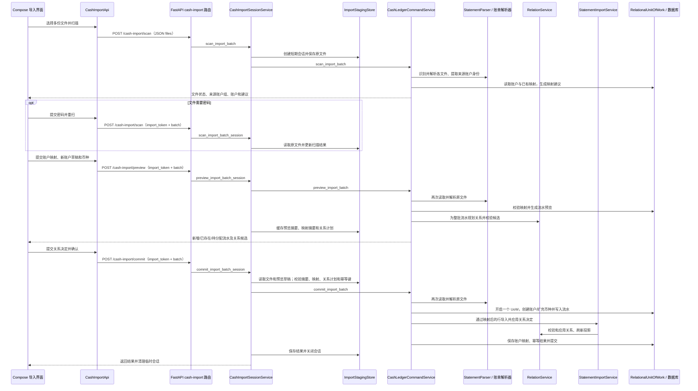

# 现金账单导入后端：当前链路、问题与重构计划

记录日期：2026-10-18

本文梳理 Compose 多文件现金账单导入的当前后端实现，并列出已观察到的架构问题和建议的重构顺序。证券账单不在本文范围内。文中“重构计划”是后续工作的建议，不代表已批准或已实施的代码变更；可执行行为仍以 `openspec/specs/` 和代码为准。

## 当前主链路

## Compose 使用的接口

| 阶段 | 接口 | 多文件会话行为 |
|---|---|---|
| 初次扫描 | `POST /api/v1/cash-import/scan` | JSON `files` 携带文件名和 Base64 内容，服务端创建会话并扫描整批。 |
| 密码重试 | `POST /api/v1/cash-import/scan` | JSON `import_token`、`batch: true` 和按文件提供的密码；复用原会话。 |
| 预览 | `POST /api/v1/cash-import/preview` | JSON `import_token`、`batch: true`、账户映射和币种。 |
| 确认导入 | `POST /api/v1/cash-import/commit` | JSON `import_token`、`batch: true`、账户映射、关系决定及预览摘要；请求头必须带 `Idempotency-Key`。 |

`/cash-import/detect` 和直接上传文件内容的单文件路径仍保留在后端，属于兼容入口；它们不是 Compose 主流程。路由根据 Content-Type 和 JSON 字段在新会话、单文件会话及兼容路径之间分派，见 [`routes.py`](../src/ft/web/routes.py#L446)。下表列出已标记为 Compose 废弃、后续应删除的接口分支。

### Compose 未使用接口：已标记废弃，待删除

核对范围是当前 Compose `CashImportViewModel` 的运行时调用点及共享 API 包装层。以下状态用于标识 Compose 未使用的兼容路径；后端实现仍待按删除条件清理。删除后端分支前仍须清理兼容客户端和对应契约测试。

| 接口或分支 | Compose 使用情况 | 废弃与删除条件 |
|---|---|---|
| `POST /cash-import/detect`；`detectCashImport` | `CashImportViewModel` 没有运行时调用；Compose 仅保留 API/Repository 声明和实现，demo 测试仍直接调用 Repository 方法。 | **已标记废弃。** 后续删除 Compose API、Repository 方法、演示实现及后端 `detect_import` 路由。旧 `web/src` 也有包装函数声明，删除前一并清理 demo/契约测试。 |
| `POST /cash-import/scan` 的非 JSON 原始文件上传分支 | Compose 扫描始终发送 JSON：首次请求带 `files`，会话重扫带 `import_token`。 | **已标记废弃。** 后续删除原始 body 分支和单文件 `scan_import` 入口；保留 JSON 首次扫描和会话重扫。 |
| `POST /cash-import/preview` 的非 JSON 原始文件上传分支，以及 `batch` 缺省/`false` 的单文件会话分支 | Compose 当前页面始终调用 token 预览并传 `batch: true`。旧 React `ImportDrawer` 仍调用文件直传的预览包装函数。 | **已标记为 Compose 废弃。** 后续先移除或迁移 `ImportDrawer` 和 `web/src` 包装，再删除后端 `preview_import`、`preview_import_session` 路径。 |
| `POST /cash-import/commit` 的非 JSON 原始文件分支、JSON `content_base64` 分支，以及 `batch` 缺省/`false` 的单文件会话分支 | Compose 当前页面只提交 token、`batch: true`、映射/关系决定和幂等键。旧 React `ImportDrawer` 仍调用文件直传确认。 | **已标记为 Compose 废弃。** 后续先迁移或移除旧 React 调用，再删除后端 `commit_import`、`commit_import_session` 路径及 `content_base64` 兼容解析。 |
| `POST /cash-import/scan` 的 token 单文件会话分支（`batch` 缺省/`false`） | `scanCashImport` 在带 token 且恰好选择一份文件时会设置 `batch: false`，因此该分支仍可能被 Compose 密码重试触发。 | **暂不标记废弃。** 先统一单文件与批次重扫语义，并覆盖单文件密码重试，再决定是否删除 `scan_import_session`。 |

Compose 实际调用位置见 [`CashImportViewModel.kt`](../compose/shared/src/commonMain/kotlin/com/finance/tracker/presentation/CashImportViewModel.kt#L100)、[`CashImportApi.kt`](../compose/shared/src/commonMain/kotlin/com/finance/tracker/data/CashImportApi.kt#L21)；旧 React 文件直传调用见 [`ImportDrawer.tsx`](../web/src/components/ImportDrawer.tsx#L21)。这里的“废弃”是架构清理状态，不代表后端已经返回弃用响应头或停止服务。

## 分层与职责

| 位置 | 当前职责 | 主要边界问题 |
|---|---|---|
| [`CashImportViewModel.kt`](../compose/shared/src/commonMain/kotlin/com/finance/tracker/presentation/CashImportViewModel.kt#L100)、[`CashImportApi.kt`](../compose/shared/src/commonMain/kotlin/com/finance/tracker/data/CashImportApi.kt#L24) | 驱动扫描、映射、预览、关系审核和确认请求。 | 客户端要维持多个摘要、映射和关系状态；请求合同必须与服务端的临时会话状态同步。 |
| [`routes.py`](../src/ft/web/routes.py#L446) | 解析请求格式、密码和确认参数，将请求分发给应用层。 | 一个路由按内容类型、`batch` 和 `import_token` 多路分派；参数校验和兼容分支交织。 |
| [`app.py`](../src/ft/web/app.py#L172) | `WorkspaceServices.__getattr__` 动态构造服务，并通过方法名白名单将导入方法转交给会话服务。 | 路由依赖隐式属性分派；新增方法时需要同步维护白名单，漏配会表现为运行时错误。 |
| [`cash_import_session.py`](../src/ft/application/cash_import_session.py#L16)、[`cash_import_staging.py`](../src/ft/application/cash_import_staging.py#L16) | 按工作区和用户保存短期文件、扫描结果、预览、结果；校验会话并维护密码重试与幂等流程。 | 会话服务管理流程状态，同时又负责调用业务服务、摘要校验和清理；扫描、预览、提交的职责边界较宽。 |
| [`cash_ledger.py`](../src/ft/application/cash_ledger.py#L1658) | 解析批次、账户映射、预览、关系计划及最终写入。文件约 3,047 行，也包含现金账本其他命令。 | 导入工作流与账本命令、关系和投影逻辑集中在同一大型服务中；单文件与批次路径并存。 |
| [`statement_import.py`](../src/ft/application/statement_import.py#L91)、[`statement_import.py`](../src/ft/adapters/statement_import.py#L216) | 将解析器输出的规范化流水写入账本，并处理幂等、来源快照及关系决定。 | 批次提交通过局部 `MappedParser` 和 `_ActiveUowProxy` 适配已有导入服务，暴露了调用方与被调用方的内部实现耦合。 |
| [`relations.py`](../src/ft/application/relations.py#L1511) | 规划候选、校验关系图、应用交易关系并维护收支投影。 | 导入预览计划、导入确认和独立关系 API 都涉及关系规则；需要明确共享的规划与应用合同。 |

## 一次多文件导入的处理细节

### 1. 扫描

首次扫描时，会话服务计算文件摘要并把原文件放入临时存储，再调用 `CashLedgerCommandService.scan_import_batch`。批次解析按文件识别渠道并读取来源账户信息；随后根据已有账户映射生成建议，同时返回可选账户及来源账户分组。扫描只做读取与临时会话写入，不创建正式账户、流水、映射或关系。

临时存储限制每会话最多 20 份文件、单份文件最多 100 MB，并把会话绑定到用户和工作区。需要密码的文件保留在会话中供重试；普通解析失败会清理会话。

### 2. 账户映射和预览

Compose 将来源账户组映射到已有账户或新账户草稿，并提供各账户所需币种。预览阶段会重新从临时文件解析所有记录，校验映射和组合支付分配，计算每行是新增、已存在还是需要补充金额分配，然后将整批行作为统一输入交给关系规划。

服务端把预览摘要、映射摘要和关系计划暂存到会话。账户创建和扩充币种只在最终确认事务中发生；账户映射也在确认时保存。

### 3. 关系审核

关系规划同时考虑本批所有文件中的流水和当前账本可匹配流水。预览返回候选、未关联状态和关系上下文摘要。客户端可接受、拒绝或调整决定；服务端在确认时检查候选计划和关系上下文是否仍有效，过期则要求重新预览，不能静默换成其他候选。

### 4. 确认和事务

会话服务先检查 `Idempotency-Key`、会话文件状态、批次摘要、预览摘要、映射摘要及关系计划摘要，再委托批次提交。提交服务重新解析账单，在一个 `RelationalUnitOfWork` 中创建新账户或扩充已有账户币种、更新余额快照、通过 `StatementImportService` 写入幂等流水、保存账户映射、应用关系并维护收支投影。任一步骤失败都应回滚整批。成功后写入幂等结果并关闭会话。

## 单条流水如何转换为现金账本模型

当前导入链路没有一个贯穿解析、预览和入库的强类型“导入流水”对象。解析器、映射服务和预览服务主要用 Python `dict` 传递单行；到关系规划时才构造成 `FactView`；最终写入时由 Repository 建立 ORM 模型。因此，一行账单会经历多种表示，字段名和 ID 语义靠调用顺序与字典键衔接。

### 转换步骤

| 阶段 | 单条记录的表示 | 主要工作 |
|---|---|---|
| 原始解析 | 文件内来源行字典 | 各渠道解析器提取原始字段和 `_source_payload`。原始快照用于审计和重导入，不应混入后续推导值。 |
| 规范化 | 规范化流水字典 | [`_parse_cash_statement`](../src/ft/adapters/statement_import.py#L53) 调用 [`_build_output_row`](../src/ft/convert.py#L2129)，统一发生时间、精确十进制金额、币种、交易对方、收支类型/子类型等字段；把 `_source_payload` 放入 `source_payload`，把 `offset_group`、`offset_role` 等配对提示单独放入 `relation_metadata`。现金批次扫描调用 [`parse_source_rows`](../src/ft/adapters/statement_import.py#L260)，此时不选系统账户，`account_name` 留空。 |
| 来源账户映射 | 规范化流水字典 + 来源账户组 | [`scan_source_rows_with_issues`](../src/ft/application/statement_account_mapping.py#L360) 将行按来源渠道和来源账户身份归组，得到 `SourceAccountGroup`；不能安全确定账户的行记为 `SourceRowIssue`。映射决定把每个来源账户组连到已有账户或新账户草稿。 |
| 业务行身份 | 已映射流水字典 | [`_row_record_id`](../src/ft/application/statement_import.py#L66) 优先采用解析器给出的 `record_id`；缺失时对规范化行做稳定哈希，并以出现序号区分重复内容。预览映射阶段先计算并保留该 ID，避免筛掉待解决行后重新编号。 |
| 预览和关系规划 | 预览字典 + `FactView` | [`preview_import_batch`](../src/ft/application/cash_ledger.py#L2379) 返回新增、已存在、待补分配等预览项；它们仍是传输字典，并非已写入流水。关系规划把预览流水转成虚拟 `FactView`，ID 以 `preview:` 标识，尚无数据库主键。 |
| 确认入库 | formal row 字典 → ORM | [`StatementImportService.import_statement`](../src/ft/application/statement_import.py#L263) 补齐正式 `source_type`、`record_id`、`source_payload` 和目标账户，再调用 `merge_import_batch`。Repository 以来源业务身份做幂等合并，并创建或更新父流水及账户组成项。 |

批次确认当前会重新解析临时会话中的文件，再按映射构造 formal rows；扫描、预览和确认因此可能各自解析一次。这是后续重构中应消除的重复工作，但不能改变 `source_payload` 原始快照、`record_id` 幂等身份或预览关系计划绑定的语义。

### 一条来源流水对应父记录和账户组成项

现金流水持久化不是“一行账单必定对应一行单账户记录”。父记录代表一条来源业务行；组成项代表它实际影响的账户和金额。普通单账户流水通常是一个父记录加一个组成项；支付宝等组合支付可能是一个父记录加多个组成项。

| 模型 | 表 | 关键字段与职责 |
|---|---|---|
| `CashTransactionModel` | `cash_transactions` | 父级来源事实和账单审计单位。`id` 是数据库父记录 ID；`source_type + record_id` 是业务幂等身份；保存 `source_payload`、独立的 `relation_metadata`、来源指纹、手动覆盖、发生时间、总金额、币种、类型、摘要和软删除字段等。普通 `atomic` 流水有单一 `account_id`；多账户 `aggregate` 父记录的 `account_id` 为空，金额是所有组成项的精确合计。 |
| `CashTransactionComponentModel` | `cash_transaction_components` | 账户级金额组成项，含父记录 `cash_transaction_id`、账户 `account_id`、金额、币种、`ordinal`、来源标签/键和元数据。组件金额必须精确合计为父记录金额；关系匹配按组件展开，避免把组合支付总额和单个银行卡金额误配。 |
| `AccountModel` | `accounts` | 被映射的系统账户，包括账户类型和支持币种。新建账户和币种扩充在确认事务写入；预览阶段只给出选择或草稿。 |
| `StatementAccountMappingModel` | `statement_account_mappings` | 来源账户身份到系统 `account_id` 的持久映射，包含 `source_type`、身份类别、内部来源账户键和 `revision`。这是账户映射记录，不是流水本身。 |
| `CashCategoryModel` | `cash_categories` | 流水可选的分类主数据；现金父记录通过 `category_id` 引用。 |

`merge_import_batch` 根据工作区、`source_type` 和 `record_id` 查找现有父记录。已存在的来源事实不会因为本次选择了另一账户映射而迁移到新账户；其既有目标账户和币种仍是该事实的归属。对新建或来源值发生变化的父记录，Repository 再同步组成项；有关系或资金使用依赖的组成项不能被悄悄改形。

## 关系配对：候选如何形成并落库

### 匹配输入是账户组成项，不是预览卡片

[`RelationService.plan_in_uow`](../src/ft/application/relations.py#L1511) 读取当前有效现金流水，把每个父记录展开成一个或多个账户组成项，再将本次预览行也展开为虚拟事实，统一转换成 `FactView`。已有事实使用数据库组成项 ID；新导入事实使用 `preview:` 虚拟 ID。匹配还会读取已有关系、银行卡尾号别名和账户标识索引。

这样做有两个后果：

- 组合支付父记录不会以“整笔总额”参与对账；每个候选落在具体账户、具体组成金额上。
- 同一父记录的多个组成项可能成为不同关系端点；稳定的来源引用需要在来源业务 ID 后附 `#component:<ordinal>` 才能区分。

### 三类关系的匹配边界

领域管线分别规划支付镜像、资金移动和退款冲销。候选规则按关系类型有意区分，不能用一个通用“金额相等”规则替代。

| 关系类型 | 业务含义 | 当前主要约束和候选处理 |
|---|---|---|
| `payment_mirror` | 支付平台支出/退款与银行侧同一笔记录的双来源镜像；两条原始事实都保留，投影避免重复统计。 | 只匹配平台与银行两类来源、相同账户和币种、相同收支方向；再按金额、时间、文本、卡尾号和别名证据筛选。匹配器做全局 1:1 分配；足够强的唯一候选可自动接受，证据较弱或候选竞争时待审核。跨账户不作为支付镜像。 |
| `refund_offset` | 正向退款冲销先前的负向支出；每笔退款仍保留为独立流水。 | 退款必须有明确退款信号；退款与候选支出必须同账户、同币种，且退款晚于支出、金额不超过该支出的剩余可冲销额。商户、订单、标题、对方账户等证据参与排序；唯一强证据可自动确认。弱证据唯一时可能待审核；多个候选以一个开放候选（`open_leg`）表达并保留候选列表，不对每个支出扇出建边。 |
| `transfer_pair` | 同一资金移动的付出端与收入端，例如内部转账、信用还款或换汇。 | 按规范化流水类型/子类型、相反方向、金额、币种、时间和对方账户标识筛选。普通转账要求不同账户、同币种和等额；换汇子类型 `currency_exchange` 要求币种不同并走单独时间窗口。普通资金移动在候选唯一、账户标识约束无冲突且进入自动时间窗口时可自动接受，其他情况保留待审核候选。 |

退款候选的“账户局部”规则很重要：一笔退款只能在其映射到账户内寻找可冲销支出；支付镜像也要求相同账户。候选可能来自微信、支付宝、银行卡等不同来源渠道，但每个候选仍须满足关系类型的账户约束。因此，退款候选列表中的来源渠道不同，本身不表示它们属于不同账户；关系判断看映射后的组成项账户和证据，而不是仅看渠道名称。

匹配实现见 [`mirror/match.py`](../src/ft/domain/relations/mirror/match.py#L249)、[`refund/match.py`](../src/ft/domain/relations/refund/match.py#L74)、[`transfer/match.py`](../src/ft/domain/relations/transfer/match.py#L237) 和 [`pipeline.py`](../src/ft/domain/relations/pipeline.py#L575)。现存已确认关系也会占用或折叠相关事实，避免同一支付/退款事件重复配对；退款金额按精确十进制剩余额累计，最终关系图还要通过收支投影合法性校验。

### 候选、人工决定与持久化

领域结果由 `RelationProposal` 表示；其中 `RelationEvidence` 记录金额差、时间差、候选数、候选 ID、规则 ID、匹配信号及补充证据。预览序列化为关系 DTO，包含稳定 `proposal_key`、类型、状态、主/次端点、候选引用和理由。自动关系通常是 `accepted` 且有明确次端点；歧义退款可为 `pending_review + open_leg`，没有确定次端点但列出候选。匹配服务只产生候选和自动规则结果，不会代替调用方推理歧义；是否能由 AI 自行选择仍由上层 Agent 根据可见证据处理。

预览计划以稳定来源引用序列化并留存在服务端会话中。确认前，服务端检查外部关系上下文摘要；若已有流水或关系发生变化，要求重新预览。确认时按缓存计划解析来源引用到新写入的事实，不重跑匹配器生成另一组候选；随后验证客户端决定仍对应缓存候选，持久化被接受/拒绝的关系并校验最终关系图和投影。

## 相关数据模型清单

### 导入期与领域内存模型

| 模型 | 所在层 | 用途与生命周期 |
|---|---|---|
| 来源行、规范化流水、预览项字典 | Parser / Application / API | 当前主链路的主要行模型；不是 ORM，也没有统一 dataclass。键包含来源、发生时间、金额、类型、账户映射、组成项、业务 `record_id` 和原始来源快照等。 |
| `SourceAccountGroup`、`SourceRowIssue` | `statement_account_mapping.py` | 账户映射阶段的类型化值对象：账户组提供安全展示身份、支持币种和行数；问题对象指出无法安全映射的行及原因代码。 |
| `ImportPreviewItemDto`、`ImportRelationDto` | Compose API DTO | Compose 端解码预览项目和候选关系的传输模型；它们不是后端持久模型，服务端主要由路由/应用服务组装字典。 |
| `FactView` | 关系领域 | 匹配器使用的统一事实视图；ID 在此层是字符串，包含金额、币种、账户、时间、类型、来源业务 ID、来源元数据，以及聚合时的父记录和组成项序号。 |
| `RelationEvidence`、`RelationProposal` | 关系领域 | 分别承载匹配证据和一条关系提议；可表达自动接受、待审核、候选列表或无次端点的 `open_leg`。 |
| `RelationPlan` | Application | 预览阶段组合事实、提议和关系上下文摘要的只读计划；不是数据库关系，也不是客户端可自行改写的权威计划。 |

Compose DTO 定义见 [`CashImportDtos.kt`](../compose/shared/src/commonMain/kotlin/com/finance/tracker/data/CashImportDtos.kt)；领域关系模型定义见 [`types.py`](../src/ft/domain/relations/core/types.py#L398)。

### 持久化模型

| 模型 | 表 | 在导入链路中的角色 |
|---|---|---|
| `AccountModel` | `accounts` | 账户实体和支持币种。 |
| `StatementAccountMappingModel` | `statement_account_mappings` | 持久保存来源账户身份与账户的映射及版本。 |
| `AccountAliasModel` | `account_aliases` | 关系候选可读取的账户别名，例如银行卡尾号或账户标识；别名索引辅助匹配，但不会代替已映射的组成项账户约束。 |
| `CashImportCommitModel` | `cash_import_commits` | 用工作区和 `Idempotency-Key` 持久保存确认结果，供确认重试返回原结果；不是业务流水。 |
| `CashTransactionModel` | `cash_transactions` | 单条现金来源业务事实的父记录。 |
| `CashTransactionComponentModel` | `cash_transaction_components` | 父记录下按账户拆分的金额事实；关系端点落在此表。 |
| `TransactionRelationModel` | `transaction_relations` | 保存 `kind`、`subtype`、`status`（`pending_review`、`accepted`、`rejected`、`superseded`）、`primary/secondary/anchor_component_id`、`rule_id`、候选组成项 ID、已应用金额和决策审计字段。数据库外键指向组成项；`primary_fact_id` 等兼容别名在关系 Repository 中实际返回组成项 ID。它不保存完整的 `RelationEvidence` 对象，主要持久化规则、候选和决定所需字段。 |
| `CashProjectionStateModel`、`CashProjectionDatasetModel` | `cash_projection_states`、`cash_projection_datasets` | 记录每个工作区投影活动版本、构建状态和数据集版本。 |
| `CashProjectionModel`、`CashProjectionMemberModel`、`CashProjectionRelationModel` | `cash_projections`、`cash_projection_members`、`cash_projection_relations` | 按父级现金事实和已确认关系构造收支查询读模型；记录根事实、成员、净额、可见性和关联类型。它们是可重建投影，不替代原始流水或关系事实。 |

导入 token、暂存文件、扫描结果和缓存关系计划由 `ImportStagingStore` 管理，不是上述 SQLAlchemy 业务 ORM。投影领域计算另有 `CashProjectionFact`、`ProjectionRelation`、`CashProjection` 和 `CashProjectionBuild`，与同名/相近的持久化读模型要区分。

### 几种 ID 不可混用

| 标识 | 例子 / 类型 | 指向什么 |
|---|---|---|
| 来源业务标识 | `source_type + record_id`（字符串） | 账单中的同一业务行；跨重复导入稳定，用于幂等。 |
| 父流水主键 | `CashTransactionModel.id`（数据库整数） | 一条现金来源事实，供账本详情和审计使用。 |
| 组成项主键 | `CashTransactionComponentModel.id`（数据库整数） | 某账户上的一份金额；关系 Repository 的关系端点使用此 ID。 |
| 稳定关系引用 | `source_type:record_id[#component:n]`（字符串） | 预览/缓存计划引用，不依赖数据库自增主键；聚合父记录须带组件序号。 |
| 预览临时 ID | `preview:...`（字符串） | 尚未确认的虚拟事实，只在关系规划期间有效。 |
| 关系提议键 | `proposal:<摘要>`（字符串） | 标识候选及其端点、类型、规则和候选集，供确认决定与缓存计划对应。 |

因此，关系规划使用 `FactView.id` 字符串，`cash_import` 预览使用由 [`stable_fact_reference`](../src/ft/domain/relations/core/keys.py#L21) 生成的稳定来源引用，关系表保存组成项整数 ID，账本查询通常面对父流水 ID。这些值属于不同命名空间；接口字段和内部类型应明确表达对应实体，避免继续用通用 `fact_id` 混指。

## 当前主要问题

### 结构与流程

1. **解析至少重复三次。** 扫描、预览和确认各自解析原文件。对 PDF、XLSX 或大批量账单，CPU 和临时文件读写成本被重复支付；解析器版本或输入条件变化也可能让预览与提交看到不同的行。
2. **会话状态与业务编排交叉。** `CashImportSessionService` 管临时会话、摘要、密码重试和幂等调用；`CashLedgerCommandService` 又负责映射、预览、关系计划和写入，职责之间依靠字典字段与调用顺序衔接。
3. **批次路径与单文件路径分叉。** 解析、映射、预览和确认存在单文件及多文件实现；未来修复错误时容易只改其中一条路径，形成语义漂移。
4. **服务发现依赖动态名称。** `WorkspaceServices.__getattr__` 根据方法字符串构造多个服务，导入会话方法还需维护白名单。依赖关系不显式，漏接时可能直到线上请求才暴露。
5. **提交通过临时适配器跨服务。** `MappedParser` 把已映射行伪装成解析器输出，`_ActiveUowProxy` 让导入服务复用外层事务。原子性目标正确，但 UoW 所有权和服务边界不易看清，代码维护者必须了解这些内部技巧。
6. **解析器元数据的契约需要核对。** 批次路径的 `_clean_import_rows` 会移除 `_import_meta`，而 `StatementImportService` 会读取该字段处理跳过行和解析接受信息。映射阶段会另行收集组合支付问题，但应确认批次最终结果不会因此丢失必须保留的解析统计或校验语义。

### 当前代码可确认的问题与验证要求

7. **错误上下文会被压缩。** [`_cash_import_error`](../src/ft/web/routes.py#L79) 对已知异常映射专用错误；未识别的 `ValueError` 会落到通用 `invalid_import` 响应。重构应为可恢复的导入错误定义稳定错误类型和可安全返回的上下文，避免把内部异常文本直接暴露给客户端。
8. **关系方向语义跨层传递。** 候选规划、决定校验和投影应用由不同服务处理。重构应让它们共享端点方向与关系约束，保留最终领域校验。
9. **ID 命名空间需要显式区分。** 父流水 ID、账户组成项整数 ID、稳定来源引用、预览临时 ID 和关系提议键在导入链路中同时存在。调用方应使用明确类型或字段名，不能依赖通用 `fact_id` 字符串表达不同实体。
10. **性能缺少当前基线。** 扫描、预览与确认各自解析原文件；在代表性账单上应记录解析次数、每阶段耗时、峰值内存和暂存占用，作为后续优化的比较基线。

## 建议的重构目标

- 让一个明确的批次工作流服务拥有“扫描、预览、确认”的用例边界；路由只做请求/响应转换，依赖显式构造，不再靠 `__getattr__` 按方法名分派。
- 将账单读取、格式识别、来源行解析、账户映射、预览计划、关系计划和事务提交定义为有类型的输入输出；减少隐式字典协议和临时代理。
- 扫描后生成绑定文件摘要、解析器版本和选项的不可变解析产物，预览与确认复用它。若密码、币种、文件或解析条件改变，则明确废弃相关产物并重新扫描。
- 将账户映射、币种扩充、关系决定、账本写入和收支投影保持在单一最终事务中；关系校验与应用使用同一领域合同。
- 保留 Compose 现有用户流程和 API 语义，先以兼容适配器迁移，再逐步移除已经无人调用的单文件/旧路径。

## 分阶段重构计划

### 阶段 0：锁定行为和错误矩阵

- 以 [`cash-import-session`](../openspec/specs/import/cash-import-session/spec.md)、[`statement-import`](../openspec/specs/import/statement-import/spec.md) 和 [`transaction-relations`](../openspec/specs/cash-ledger/transaction-relations/spec.md) 为行为基线。
- 建立批次正常导入、密码重试、重复导入、账户新建/币种扩充、组合支付分配、已有行跳过、关系候选非唯一、关系上下文过期、失败回滚和相同幂等键重试的契约矩阵。
- 覆盖关系端点方向、关系投影校验与不同 ID 命名空间的边界条件，并在数据库后端矩阵中验证。

### 阶段 1：显式化应用入口

- 新增显式注入的批次导入工作流服务，由路由直接调用；先迁移方法，不改变请求合同和业务语义。
- 把 JSON 解码、请求校验、应用编排及数据库事务边界分开；记录单文件兼容入口的真实调用方和移除条件。
- 取消导入主路径对动态方法名白名单的依赖。

### 阶段 2：解析一次并冻结预览输入

- 扫描时生成可校验的规范化来源行产物，记录源文件摘要、解析器版本、币种和密码处理状态。
- 预览和确认复用同一产物及映射版本，不能静默重新解释原始文件；上下文不一致时返回可恢复的重新扫描或重新预览错误。
- 先对一个文件类型做小步迁移，验证内存、临时存储容量和敏感数据清理，再推广到其他来源。

### 阶段 3：收敛映射和预览模型

- 为来源账户组、映射决定、新账户草稿、组合支付分配和导入行引入明确的数据对象及校验入口。
- 预览统一生成稳定的新增/已存在/待分配状态，并产出独立的映射摘要和关系计划摘要。
- 让单文件入口适配同一批次模型，避免继续维护两套业务规则。

### 阶段 4：隔离单一提交用例

- 把新建账户、账户币种扩充、余额快照、流水幂等写入、账户映射、关系应用和投影更新纳入一个可见的提交服务及单一 UoW。
- 明确 UoW 的创建者和所有者；让 `StatementImportService` 接收显式的已解析输入与事务依赖，逐步移除 `MappedParser` 和 `_ActiveUowProxy`。
- 保证失败时整批回滚、成功结果可幂等重放，且重复请求不会重复生成业务事实。

### 阶段 5：移除旧分支并完成性能/双后端验证

- 先按上表清理 Compose API、旧 `web/src`/`ImportDrawer` 调用和契约测试，再删除已废弃路由分支与 `WorkspaceServices` 白名单项。删除单文件 token 扫描分支前，先核实调用方并统一密码重试语义。
- 根据实际调用证据删除不再使用的旧入口和重复路径，保留必要的 API 兼容策略。
- 对代表性的大批量文件测量扫描、预览、确认耗时、解析次数、峰值内存和临时存储占用。
- 对同一导入契约矩阵完成 SQLite 与专用 PostgreSQL 测试库验证；未验证项明确保留为发布阻断或风险。

## 必须保持的行为不变量

- 扫描和预览不得创建或修改账户、账户支持币种、账单账户映射、现金流水、交易关系或收支投影。
- 多文件确认是一个原子事务；任一账户、流水、关系或投影步骤失败时整批回滚。
- 账单业务行幂等与提交请求幂等都必须保留；同一会话使用相同幂等键重试时不得重复写入。
- 关系计划必须绑定预览时的账单、映射和关系上下文；失效时要求重新确认，不得静默替换候选。
- 现金账单与证券账单继续走各自领域流程；本重构不改变金额、来源快照、币种和关系的既定语义。

## 重构实施验收基线

- 用 Compose 多文件会话覆盖正常导入、密码重试、重复导入、账户新建与币种扩充、组合支付分配、关系候选非唯一、关系上下文过期、失败回滚和幂等重试。
- 对相同的 Application Service 合同运行 SQLite 与专用 PostgreSQL 测试库矩阵。
- 使用去标识化且可复用的代表性账单记录端到端阶段耗时、解析次数、峰值内存与暂存清理结果；没有新测量时不沿用旧性能数字。
- 每阶段明确记录 API 错误码、用户可恢复动作和服务端诊断关联信息，同时避免把密码、账号或原始账单内容写入日志。

本文描述架构和后续验收要求，不代表重构或上述验证已经完成。
