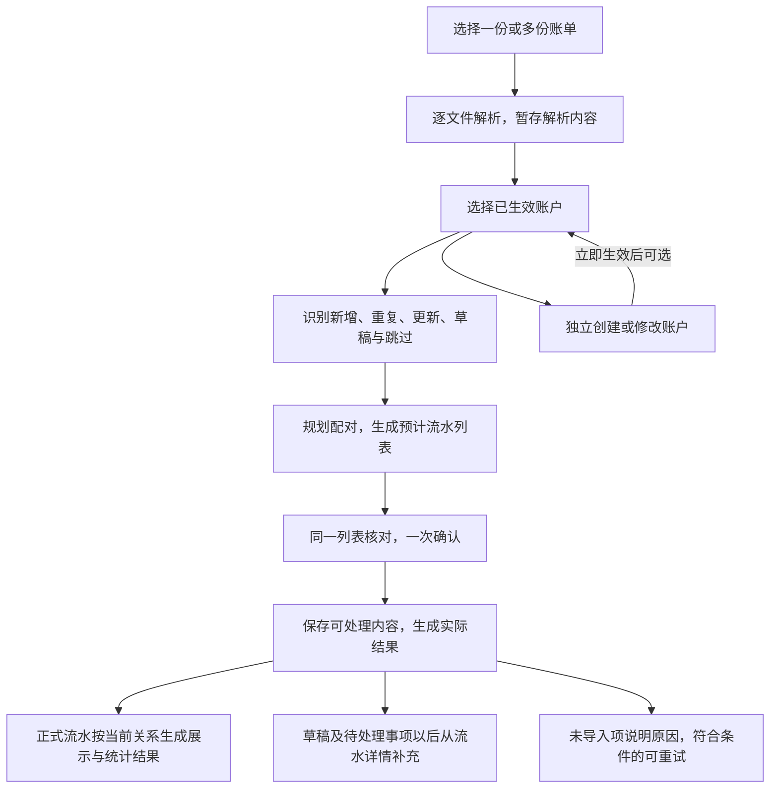

# 现金账单导入流程

现金导入把外部账单中的业务行转成内部现金流水。系统自动识别重复、处理来源变化、安排配对；信息不足的内容可以先保存，只有需要用户判断的部分才留待补充，避免一条记录拖住整个导入。

本文按“导入前准备 → 解析与识别 → 统一核对 → 一次提交 → 结果与后续补处理”介绍重构后的完整链路。后端已实现；统一导入列表、主页补处理入口及退出时的账户撤销交互尚待客户端接入。下文涉及界面的部分描述已确定的交互合同，不代表当前 Compose 页面已可用，实际覆盖见 [功能地图](feature-map.md)。

本文是现金导入的主阅读入口：先读第 1–5 节和例子了解业务，再读第 6–8 节理解后端执行、数据及一致性机制。字段边界和特殊场景查 [业务规则](cash-import-redesign.md)，请求、响应及表结构见 [接口与数据契约](cash-import-redesign-contracts.md)，实施和验证证据见 [OpenSpec 变更](../openspec/changes/cash-import-lifecycle-redesign/tasks.md)。

入库后的流水模型、列表及统计、详情编辑、分类和删除，统一从 [现金流水：存储、展示与操作](cash-ledger.md) 阅读。本文中的后续补处理只解释导入与账本维护的衔接。

| 阅读目标 | 入口 |
|---|---|
| 理解业务全过程 | [整体流程](#整体流程)、第 1–5 节、[完整例子](#一个例子) |
| 理解实现如何承载业务 | [后端执行链路](#6-后端执行链路)、[接口与数据衔接](#7-接口与数据如何衔接) |
| 理解联合配对、局部重建和失败恢复 | [一致性机制](#8-一致性机制只更新必要范围结果可以核实) |
| 查字段、协议、表结构或配置 | [详细参考](#继续查阅) |

## 整体流程

用户只需准备文件和账户，在同一个流水列表里核对并确认，再查看结果。解析、去重、更新识别和配对是后端阶段，不能据此把前端拆成多个必经核对步骤。



这里的“预计流水列表”由后端根据当前决定生成。多条已配对流水会合并成一个展示结果，这个派生结果称为**投影**。日常列表和收支分析都使用投影；组成流水和关系只在维护具体一笔时展开，关系不作为独立产品入口。

## 1. 导入前准备：文件与账户分别处理

一次导入可以包含多份账单。文件可以分别添加、移除或重传；某份文件需要密码或解析失败，不使其他成功文件作废。完全无法辨认业务行的文件只能报告文件问题，不能伪造为一笔待补流水。

系统根据来源账户分组给出内部账户建议，用户可以选择已经生效的账户，也可以暂不选择。建议不等于已确认选择；缺少账户的可辨认流水仍可进入后续流程，最终保存为草稿。

创建、修改账户走独立账户流程，保存成功后立即生效，再供导入选择。导入会话取消不会自动撤销账户。客户端后续需要在未完成导入而退出时，合并询问是否撤销本次账户改动；撤销也须检查当前修订和引用，不能覆盖期间发生的其他修改。

成功提交（包括部分完成或仅保存草稿）后，退出不再询问撤销账户。刷新后若丢失撤销所需的旧值，则保留账户改动，不猜测还原。

账户实体与“来源账户以后默认对应哪个内部账户”是两件事。后者只有在本次实际成功使用、资金资格仍有效时才记住，不因预览或取消而写入；单笔账户覆盖也不改变整组默认选择。

## 2. 解析与识别：先确定是哪笔，再确定怎么处理

### 解析内容临时保存，原文件不留存

每份文件在收到后识别来源并解析。后续调整账户、补字段和重新预览复用解析内容，不反复读取原文件。原文件只作为当次解析输入，密码只用于当次解密，不作为后续补处理资料保存。

需要密码时，调用方重传对应文件和当次密码，其他文件不用重传。解析会话有固定有效期，修改选择或重试不续期；到期后尚未保存的内容需要重新选择文件。已确认保存的草稿和处理结果不随会话过期消失。

### 自动对应已有流水

同一交易在重叠账单中再次出现时，系统先核对来源身份，再判断内容：

| 识别情况 | 本次处理 |
|---|---|
| 没有对应记录，信息完整 | 拟新增正式流水 |
| 没有对应记录，但缺账户、金额、时间或完整分摊等必要信息 | 能辨认业务行时拟保存草稿，保留已知内容及待补原因 |
| 已有对应记录，内容完全重复 | 报告重复，不再新增 |
| 已有对应记录，仅允许更新的字段变化 | 展示差异，拟更新原流水；用户可选择保留现有 |
| 已有草稿，本次来源补足必要信息 | 校验通过后，可随本次确认将原草稿转正式，保留原身份 |
| 已有正式流水，但金额等固定字段冲突 | 整条更新跳过，保留已有流水，不自动删除重建 |
| 无法可靠辨认，或该行处理异常 | 跳过并说明原因，其他行继续 |

有可靠交易编号时，按工作区和来源范围对应，不能仅凭编号跨来源合并。微信默认使用一个稳定来源，普通导入不要求填写本人微信号；确有多个微信账号时才在文件设置中区分，来源范围与内部资金账户分开。

没有可靠编号时，系统利用已验证的来源范围、固定特征及出现次数自动核对，既避免重叠文件重复入账，也保留真实发生的多次同额交易。缺编号本身不增加用户操作；只有证据确实不足的歧义才留作当前待处理对象，不把两组都保存为正式流水让用户挑选。

每次导入都视为最新来源，不按导出时间阻止覆盖。已删除流水再次出现在账单中时，静默按正常新记录处理。同批文件若对同一可靠身份给出相互冲突的内容，则报告该身份冲突，不按文件顺序任选一个覆盖。

### 来源更新遵守同一套字段约束

正式流水的金额、币种、发生时间、资金账户、组成项及来源身份固定；对方信息、备注、分类、类型和来源行等允许更新。导入与手动编辑使用同一套约束，详细白名单见 [字段更新边界](cash-import-redesign.md#2-字段更新边界)。固定字段输入错误由用户删除后新建，导入不会代为重建。

来源变化不能覆盖用户已有的人工分类和备注，包括用户主动清空的值。没有人工备注覆盖时，备注直接取来源约定的原始注释、描述或备注；没有就为空，不拼接生成说明。原始来源行仍可更新保存。

## 3. 统一核对：流水与配对在同一列表确认

后端在预计新增、更新和草稿的基础上规划关系，形成不可变的**导入计划**。用户看到的是按拟生效关系生成的流水列表，差异和配对选择都在该项详情中按需展开，不需要先逐条核对流水，再进入另一套配对流程。

唯一且有强证据的合法配对默认拟接受；其余合法未确定建议默认延后。用户确认整份计划，才同时确认本次流水处理和配对决定。新增关系不能自动替换已有确认关系。

| 预计状态 | 列表如何展示 | 保存后的金额效果 |
|---|---|---|
| 正式流水，无未解决事项 | 已确认；拟确认关系按合并结果展示 | 按实际提交后的投影统计 |
| 草稿流水 | 待确认，仅展示已知字段 | 不参与余额及任何金额统计 |
| 两条正式流水只有未确认关系 | 分别展示，两项均待确认 | 分别参与统计，关系确认后才合并 |
| 已有正式流水带有待处理来源信息 | 保留当前正式展示并标待确认，不复制另一笔正式流水 | 继续按当前正式值统计 |

**“已确认／待确认”与“正式／草稿”是两个维度。** 预览中的“已确认”不代表已写入账本；正式流水也可能因为关系待确认而标待确认，同时继续参与统计。

合法但未确认的建议在最终提交时保存为草稿关系，不合并、不抵扣、不占用正式配对名额或退款额度。非法关系或配对异常会报告失败，不能换个名字当草稿保存。全额退款合并后净额为 0，仍在预览和日常列表保留核对入口。

修改账户、字段或配对选择后重新生成计划，旧计划失效。计划包含完整处理范围；分页只影响读取，不改变最后确认的范围。

## 4. 一次提交：成功内容一起生效，局部失败有边界

确认请求引用确定的计划和会话修订，并携带唯一的幂等键。后端在写入前重新校验当前状态；已有流水或账户资格发生变化时，不能静默采用另一份新决定。

流水操作以保存点隔离可恢复的单项错误。关系则按依赖划分为**配对提交组**：共享端点或必须联合合法的关系一起校验、保存或回滚，不能机械地拆成每条关系独立保存。其他独立流水和关系仍可继续。

配对失败不撤销已经合法保存的流水，但也不能据此假定关系两端都已保存。结果分别说明流水和关系的实际情况；两端均已正式保存而未能合并时，各自保留展示和统计。

所有成功业务写入、余额变更、受影响投影及处理收据最终在同一个数据库事务中提交。连接失效、事务故障或最终投影发布失败等无法局部隔离的问题，会使本次提交整体回滚。独立生效的账户改动不属于这个事务。

投影只重建本次涉及流水在变更前后已确认关系可达的范围，不全库重新配对。普通备注等更新不重新寻找配对；类型改变时保留合法旧关系、解除不合法关系，再更新受影响投影，不自动寻找替代对侧。

## 5. 结果与后续补处理

### 结果以实际收据为准

确认完成后产生持久的**处理收据**，分别记录正式新增、更新、草稿、重复、跳过及关系结果。文件问题单独报告，原因使用用户能理解的说明，不暴露异常栈或数据库细节。全部重复也可以完成并获得“无新增”的结果。

收据记录实际发生的处理，不能继续把预览中的合并结果当成已成功保存。正式新增数、草稿数、关系数和列表项数也不相等：两笔流水可以合成一项，一条草稿则可能完全不影响统计。

提交响应丢失时，调用方先使用原计划和幂等键核实结果。暂时查不到收据不等于未提交，不能换一个键再次提交。重复原请求取得的是原结果，不会顺便重新执行其中失败的行。

### 已保存的内容从流水详情继续维护

草稿流水保存的是提取后的来源内容和待补原因，后续维护无需原文件。普通“保存待确认”即使补齐信息也保持草稿；明确“确认保存”才转为正式，并保留同一流水身份。

未确认关系从相关流水详情处理。确认合法关系后，后端重建局部投影，使相关正式流水合并展示；继续暂存时仍分别显示。用户面对的始终是这一笔流水的维护，不另建关系管理流程。

### 未导入项按原因决定后续方式

草稿属于已经保存的内容；跳过表示本次未采用该行，不能声称以后都能从账本找回它。允许重试的临时写入失败或并发变化，可在临时内容有效时从收据派生一个只含失败子集的新会话，重新预览、用新键确认；已成功项不会重跑，也不延长原有效期。

固定字段冲突等业务问题不属于通用自动重试。临时内容过期或文件未成功解析时，需要重新选择文件；已有正式流水、草稿和收据保持不变。

## 一个例子

以下使用虚构数据。一次账单包含 6 条来源行，假设账户和必要字段除特别说明外均已完整：

| 来源行 | 识别和核对结果 | 确认后的结果 |
|---|---|---|
| 消费 100 元 | 新流水 | 正式新增 |
| 对上述消费全额退款 100 元 | 新流水，与消费有可靠退款依据，拟确认关系 | 正式新增；关系成功后与消费合并展示为净额 0，仍可查看 |
| 某笔已导入消费的来源备注变化 | 合法来源更新 | 更新原流水；若已有人工备注则保留人工值，来源行仍更新 |
| 另一笔消费 20 元，尚未选择账户 | 可辨认但信息不足 | 保存草稿，不计入统计，以后补账户并确认 |
| 某个已有交易号的金额由 30 元变为 35 元 | 正式固定字段冲突 | 跳过；已有 30 元流水不变，结果说明原因 |
| 一笔已导入且完全相同的记录 | 完全重复 | 不新增、不改写，报告重复 |

若上述操作均按计划完成，流水结果是：**正式新增 2 条、更新 1 条、草稿 1 条、跳过 1 条、重复 1 条**；退款关系另行报告成功。用户无需先补齐 20 元草稿，也无需先处理金额冲突，就能保存其余内容。

若用户暂不确认退款关系，两条完整正式流水仍可保存，但分别展示和统计；关系以后确认时才合并。若配对执行失败，则报告实际关系失败，不把它当作用户选择的暂存。

## 6. 后端执行链路

前面的业务过程在后端分成解析上下文、只读计划和事务内执行三个部分。HTTP 只负责输入与输出边界；来源对应、流水约束和关系决定都由后端生成，客户端不拼装可直接写入数据库的操作图。


| 阶段 | 主要职责 | 当前实现入口 |
|---|---|---|
| 解析上下文 | 逐文件解析，维护来源分组、当前选择、修订和固定有效期 | [`cash_import_context.py`](../src/ft/application/cash_import_context.py)、[`parsed_import_staging.py`](../src/ft/application/parsed_import_staging.py) |
| 来源与资金准备 | 核对已有来源对应，保留重复次数；将选择解析成父流水及资金组成项 | [`cash_import_source_plan.py`](../src/ft/application/cash_import_source_plan.py)、[`cash_import_funding.py`](../src/ft/application/cash_import_funding.py) |
| 流水操作规划 | 合并来源值、人工保护和本次补充，确定新增、更新、草稿、转正式、重复或跳过 | [`cash_import_operations.py`](../src/ft/application/cash_import_operations.py) |
| 业务计划构建 | 为新增正式端点发现直接候选，验证联合关系，生成预计投影及处理明细 | [`cash_import_business_plan.py`](../src/ft/application/cash_import_business_plan.py) |
| 计划发布与读取 | 原子保存不可变计划，校验修订，提供摘要、列表、详情及分页 | [`cash_import_plans.py`](../src/ft/application/cash_import_plans.py) |
| 确认执行 | 重验操作，隔离流水与配对组失败，汇总实际结果并提交 | [`cash_import_commit.py`](../src/ft/application/cash_import_commit.py)、[`cash_plan_execution.py`](../src/ft/application/cash_plan_execution.py) |
| 后续维护 | 无原文件地保存草稿，预览正式编辑、草稿转正式和关系决定 | [`cash_record_maintenance.py`](../src/ft/application/cash_record_maintenance.py)、[`cash_mutation_plans.py`](../src/ft/application/cash_mutation_plans.py)、[`cash_mutation_commit.py`](../src/ft/application/cash_mutation_commit.py) |

导入和后续维护使用不同的上下文与计划服务，共用流水字段策略、关系校验及事务内写入。实际共用入口包括 [`cash_record_policy.py`](../src/ft/domain/cash_record_policy.py)、[`cash_record_writer.py`](../src/ft/application/cash_record_writer.py) 和 `cash_plan_execution.py`。

## 7. 接口与数据如何衔接

### 一次正常导入的调用顺序

以下路径均以 `/api/v1` 为前缀。这里只说明数据如何向下传递，完整请求和响应查 [接口参考第 3 节](cash-import-redesign-contracts.md#3-前后端接口契约)。

| 调用 | 获得什么 | 下一步使用什么 |
|---|---|---|
| `POST /cash-import/sessions` | 解析会话、文件结果、来源账户分组 | `session_id` 及当前 `session_revision` |
| 按需调用独立账户 API、追加／重传文件 | 已生效账户、更新后的解析上下文 | 当前账户资格和最新会话修订；账户建议须转成明确选择 |
| `POST /cash-import/sessions/{session_id}/plans` | 不可变计划、预计列表、差异及问题 | `plan_id`、计划对应的会话修订；三类选择数组完整提交 |
| `GET /cash-import/plans/{plan_id}/items` 及单项详情 | 当前计划的分页列表和按需细节 | 只用于核对；改变选择需携旧计划标识重新预览 |
| `POST /cash-import/plans/{plan_id}/commit` | 持久收据及实际摘要 | 原 `Idempotency-Key` 标识这一次提交；`receipt_id` 用于读结果 |
| `GET /cash-mutations/receipts/{receipt_id}` 及 `rows/relations` | 实际逐项结果及当前可定位引用 | 刷新实际列表，进入已保存流水的后续维护 |

后续普通草稿保存使用 `PATCH /cash-records/{transaction_id}/draft`；正式编辑、明确转正式和关联决定使用 `/cash-mutations/plans` 预览，再确认对应计划。导入计划和维护计划都由服务端生成，调用方不能通过直接提交 `state` 或关系边绕过校验。

### 哪些内容是临时的，哪些已经进入账本

| 内容 | 保存位置和寿命 | 作用 |
|---|---|---|
| 原文件、解密密码 | 仅当次解析使用 | 不保留作以后补处理的档案 |
| 解析会话、账户选择、导入计划 | 有固定有效期的私有解析存储 | 支持调整和预览；确认前不创建账本草稿 |
| 草稿／正式流水及资金组成项 | 账本数据库，同一套流水表 | 保存当前业务事实；草稿转正式保留同一身份 |
| 来源对应记录 | 账本数据库 | 将外部来源身份对应到当前内部流水，支持跨文件重复和更新识别 |
| 当前问题、关系决定及候选 | 账本数据库 | 保存可延后处理的当前事项；合法确认关系参与合并 |
| 投影及成员 | 账本数据库，按当前事实派生 | 为列表、详情入口及分析提供一致读取；草稿单独展示、不统计 |
| 处理收据 | 账本数据库，独立于会话有效期 | 保存本次实际结果和幂等事实；不能据此回放历史账本 |
| 失败项重试上下文 | 继承原有效期的临时存储 | 仅为允许重试的失败子集保留必要解析内容，不保留整份原文件 |

父流水表达一笔内部交易，组成项表达其真实资金分摊；普通流水也有一个组成项，组合支付可以有多个。来源对应回答“这条外部记录是哪一笔”，关系回答“哪些已保存流水应合并解释”，投影回答“现在展示和统计什么”。这几类对象不能互相代替。

物理字段、条件空值、外键、关系角色和精度统一查 [数据参考第 4 节](cash-import-redesign-contracts.md#4-后端逻辑表结构契约)，不在本文复制一份字段表。临时后端、有效期及清扫配置查 [运行配置](cash-import-r2-staging.md)。

## 8. 一致性机制：只更新必要范围，结果可以核实

### 8.1 受影响投影闭包

种子 `S` 是本次新增、补全或编辑的流水，以及本次关系操作的旧端点和新端点。组成项端点先提升到父流水，并包含同一父流水的全部组成项。

闭包由尚未替换的旧投影成员和操作后的已确认关系图 `G_after` 共同确定。两种连接可能交替延伸，须反复扩展直到集合不再增加：

```text
C_0 = S
C_next = C ∪ old_projection_members(C) ∪ confirmed_connected_members(C, G_after)
重复计算 C_next，直到 C_next = C
```

`C` 包含相关旧投影的全部成员及新确认图中可达的成员，不沿未确认关系或潜在候选扩展。旧端点在关系删除或替换前保留；旧投影成员须在发布替换前参与范围计算，避免拆组后遗漏原成员。实际实现交替读取新确认图及未访问的旧投影组，见 [`affected_transaction_closure`](../src/ft/adapters/relational/projections.py)。

每次用当前正式流水和 `G_after` 重建 `C` 的正式投影；草稿单独生成展示投影。原子替换覆盖 `C` 的旧投影和成员，不修改闭包外投影。

#### 各类操作的范围

| 操作 | 关系处理 | 投影范围 |
|---|---|---|
| 新增正式流水、草稿转正式 | 为新增正式端点查询直接候选，应用本次确认的关系 | 新增流水、选定对侧原有组及合并后的组 |
| 更新名称、对方账号及属性、备注、分类或来源行 | 不主动重配，不复核已有关系的历史匹配证据 | 被更新记录所在已确认关系组的展示及汇总 |
| 更新流水类型或业务细分 | 保留合法关系，解除因类型变化失效的关系，不寻找替代配对 | 旧关系组全部成员及拆分后各组 |
| 确认或增加关系 | 检查两端和各自原有组，应用明确决定 | 两个旧组和合并后的新组 |
| 拒绝草稿或解除已确认关系 | 更新当前决定，不自动找替代配对 | 草稿拒绝不改财务投影；解除时重建整个旧组拆出的各组 |

更新直接受影响的已有草稿候选状态，可按关系端点和候选引用反向索引执行。这是当前状态维护，不是潜在候选闭包，不引发候选的候选继续重排。

#### 拆组与合组的例子

已有 `A—B—C` 合并组，解除 `A—B`：必须替换旧组投影，并生成 `A` 与 `B—C` 的两个结果。不能只重建 `A`。

已有 `A—B` 和 `C—D` 两个组，用户确认 `B—C`：必须校验四条流水组成的整个组并替换两个旧投影，不能只检查两个直接端点。

旧投影为 `A—B`、`C—D`，新确认图包含 `B—C`、`D—E` 时，从 `A` 出发需交替扩展，最终覆盖 `A/B/C/D/E`；只各展开一次旧组和新图会遗漏成员。

新增 `E` 时发现对侧 `B` 已被占用：保留原确认决定，返回待处理或不合法的明确结果；不拆 `A—B`，也不继续为 `A` 寻找 `F`。

这些示例只说明更新范围，不放宽具体关系种类的图约束；实际 `A—B—C` 必须先满足该关系组合的合法性。

### 8.2 配对提交组

反例：已有两组消费退款 `A→B`、`C→D`，消费各为 −100 元、退款各为 100 元。此次确认消费镜像 `A—C` 和退款镜像 `B—D`。只加消费镜像会暂时重复计算退款，只加退款镜像会暂时出现两个消费根；两条镜像一起生效才合法。因此不能逐边校验投影，也不能仅靠调整写入顺序解决。

采用按受影响关系组聚合的保守方案，不求解最小依赖子集：

1. 在预览使用的状态中，把既有已确认关系连通组收缩为节点，无关系的流水是单独节点；同一父流水的组成项归入同一维护范围。
2. 把本次拟确认、解除的关系操作加入临时图，触及相同节点或依赖同一关系操作的项目归为同一配对提交组。仅包含已选操作，不沿未选候选扩展，不新增配对、不拆现有关系。
3. 逐组构造最终图，按最终图一次验证关系种类、退款额度、端点占用和投影；通过后整组进入联合确认。发现阶段的单项异常不产生操作，不因此让无关建议失败。
4. 提交在同一个保存点内应用整组并校验最终图，将受影响成员交给最终统一投影发布。不能在每插入一条边时以中间图拒绝整个联合决定；外键、工作区和唯一性仍有效，最终图不合法则整组回滚。
5. 失败结果逐条关联到组内关系，区分直接失败和“相关配对未完成”；已保存流水按原有效关系展示。不能在失败后任意挑一个子集重试或另选对侧，这会改变用户已确认的计划。

这会让同一受影响组内的部分操作共同回滚，是保证合法最终图的局部取舍，不扩大到整个导入批次。预览必须展示整组结果；仅依靠多条关系联合才合法的建议，不能允许用户确认其中一个非法子集。用户改变选择后重新验证；可以保留联合待处理决定，不能把依赖边分别宣称为可独立确认的合法关系草稿。

流水类型更新仍遵守 [业务规则第 2.3 节](cash-import-redesign.md#23-更新与关系投影) 的逐条更新顺序，不与本节混成一个全批最终状态。配对组以这些流水操作成功后的状态重新校验；并发导致原先独立的组相连或影响范围扩大时，跳过相关操作并提示重新确认，不在提交时扩大组或扫描替代候选。

### 8.3 保存点与最终提交

当前导入执行器按下面的顺序落实第 4 节的提交语义：

1. 校验权限和请求摘要，优先查询已提交收据；同键同请求返回原结果，同键不同请求拒绝。取得写入边界后仍须防止并发重复执行。
2. 读取有效计划及解析内容，在工作区现金写入边界内按当前来源、流水、账户资格和关系重验操作。不满足原计划的项跳过，不自动换对侧或扩大决定。
3. 写入可处理流水。可恢复的单项失败回滚本项并记录跳过；来源对应、组成项及当前问题不能留下半条写入。类型变化所需的关系清理与该条写入一起受保护。
4. 发布实际成功使用的账户映射，并以保存点写入完整配对提交组。依赖失败流水的关系不执行，合法独立组继续。
5. 汇总实际成功操作的余额变化和受影响成员，统一维护局部投影，生成实际计数、结果引用及持久收据，最后提交外层事务。

保存点只隔离可以安全恢复的错误，不是每行各自提交数据库。失败后要丢弃或重新加载受影响的 ORM 状态和临时映射；下一项不能继续使用失败操作留下的对象。当前执行器将成功写入的余额变化汇总后应用，避免失败项提前污染共享余额。

关系组的最终图校验失败可以局部回滚，组外操作继续；最终统一余额／投影发布或外层事务失败，则本次请求整体回滚，不能返回局部成功。SQLite 与 PostgreSQL 通过同一应用服务合同验证这些边界。实现细节以 [`cash_import_commit.py`](../src/ft/application/cash_import_commit.py) 和 [`cash_plan_execution.py`](../src/ft/application/cash_plan_execution.py) 为准。

投影与当前事实同步提交，不先报告成功再异步补算。已有工作区投影未就绪时明确失败，不在导入中暗中全库修复；独立账户命令不随本次事务回滚。

### 8.4 请求恢复与失败项重试

请求幂等解决“这次确认是否已经执行”，来源对应解决“外部这笔交易是否已经入账”。二者同时存在，不能用文件摘要或来源编号代替提交键。

响应丢失后，`POST /cash-mutations/resolve` 使用原计划与键核实：

| 核实结果 | 调用方动作 |
|---|---|
| `committed` | 读取确定收据，展示实际结果 |
| `pending` | 保留原请求标识，继续核实，不新建提交 |
| `retry_original` | 仅重试原计划、修订、正文和原键 |
| `not_committed` | 服务端已排除原请求继续生效，才可重新准备或结束任务 |

已提交收据先于临时会话读取，因此会话到期不使成功事实丢失。普通收据查询 `404` 不代表未提交。恢复协议细节见 [接口参考第 3.4 节](cash-import-redesign-contracts.md#34-幂等并发及结果恢复)。

已确定部分完成后，“重试未导入项”才使用收据派生新会话、新计划和新键；成功项不重跑，失败子集不冒充完整导出。具体允许条件和当前来源证明由 [`cash_import_retry.py`](../src/ft/application/cash_import_retry.py) 重新核对，超期需重新选择文件。

## 继续查阅

| 想了解的内容 | 文档 |
|---|---|
| 为什么这样设计、字段能否更新、复杂来源和关系场景 | [现金导入业务规则](cash-import-redesign.md) |
| 如何调用接口、计划和收据的结构、数据库合同、后续 UI 合同 | [接口、数据与客户端交互参考](cash-import-redesign-contracts.md) |
| 跨层调用和详细业务边界的合成场景 | [统一场景对照与 HTTP 示例](cash-import-redesign-contracts.md#5-端到端契约对照) |
| 临时解析内容如何存储、到期和清理 | [临时存储配置](cash-import-r2-staging.md) |
| 哪些客户端已接入、还缺哪些页面入口 | [功能地图](feature-map.md) |
| 现金导入与投资导入、连接器同步的边界 | [导入、关系与同步流程](import-flow.md) |
