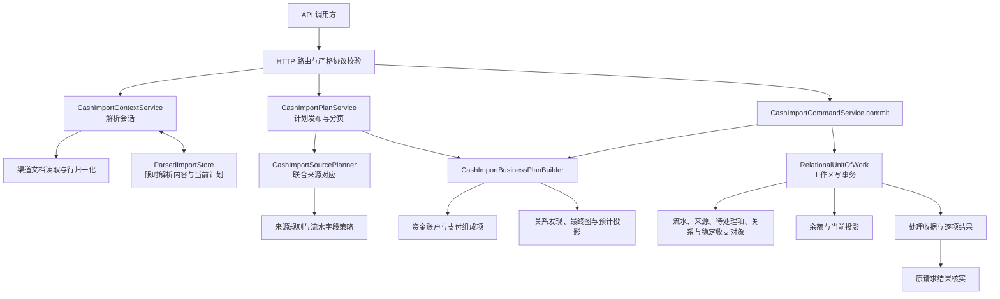
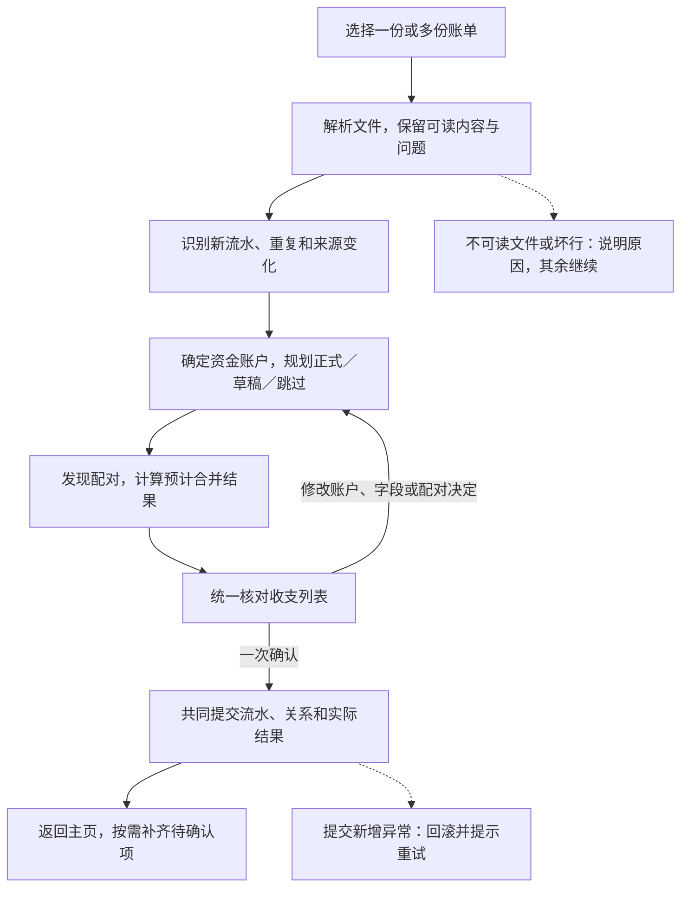
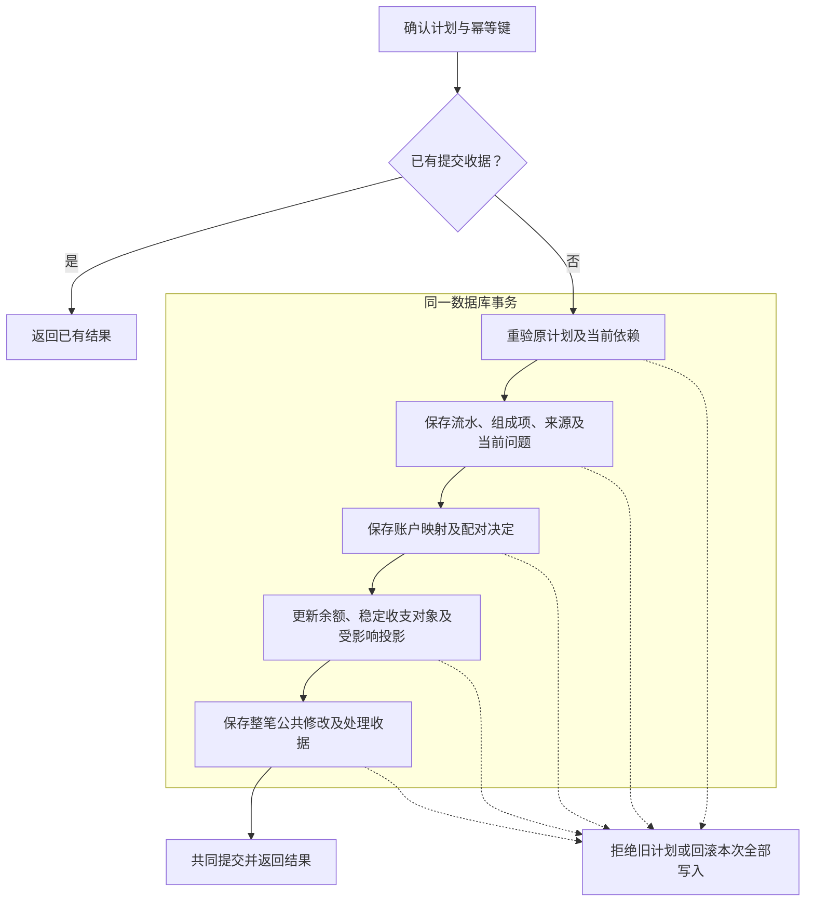
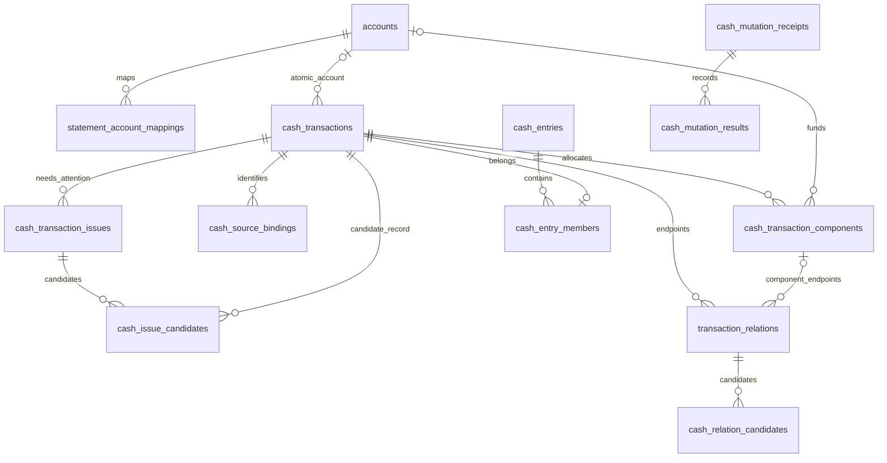

# 现金账单导入：业务、架构与数据模型

现金导入把银行或支付平台账单转换为工作区内可维护的现金流水。一次导入可以包含多个文件：系统先解析并识别来源，再确定资金账户、识别重复与更新、计算关联后的预计收支列表，最后按一次确认保存流水、关系和处理收据。不能立即正式入账但仍有可保存内容的记录进入草稿；无法读取或不适合保存的内容保留明确的未导入原因。

本文面向需要理解、维护或接入该模块的开发者，覆盖解析会话、来源对应、资金归属、关系配对、统一核对、提交、结果核实和失败恢复。关系配对决定不同来源如何合成一笔收支、退款如何抵扣及统计是否重复，是确认导入前的核心环节。数据库章节列出这些链路直接维护的业务表字段、类型和关键约束。账户、分类、现金账本查询及投资资金关联只说明衔接边界，账本阅读入口见 [现金流水](cash-ledger.md)。

本文描述当前后端实现和 ORM 模型。界面用语统一见[领域词表](../DOMAIN_GLOSSARY.md#用户界面用语)；内部模型名用于解释实现，不直接复制到页面。Compose Web、Android、iOS 已共用当前会话、统一预览与结果摘要入口；Web 已验证上传、草稿提交、公共编辑及账户退出，消费／退款及重复账单差异已有代表 Web 冒烟，演示确认仍待完成，完整页面覆盖见 [功能地图](feature-map.md)。`cash_entries`、`cash_entry_members` 及创建方式字段通过 Alembic 迁移发布，实际环境的升级状态以运行数据库为准。

阅读导航：[业务对象](#business-model) · [模块架构](#architecture) · [导入流程](#execution-flow) · [关系配对](#relation-matching) · [API](#api) · [失败恢复](#recovery) · [完整数据库字段](#database)

<a id="business-model"></a>

## 1. 业务对象及其关系

### 1.1 从账单中的一行到用户看到的一笔收支

| 对象 | 解决的业务问题 | 代码或存储载体 |
|---|---|---|
| 解析行 | 从渠道格式中读出时间、金额、币种、交易对方、支付方式和来源证据；保留逐行读取问题 | `ParsedCashRow`、`ParsedCashDocument` |
| 来源行定位 | 指出这一行来自哪个渠道、账户范围、文件和位置；支持同文件重传、跨文件对应 | `SourceOccurrence`、`SourceCoverage` |
| 来源对应记录 | 把可靠的来源身份关联到内部流水，避免重复创建；同一流水可以具有多个来源定位别名 | `cash_source_bindings` |
| 现金流水父记录 | 保存一条内部流水的业务总额、来源行快照、类型和正式／草稿状态 | `cash_transactions` |
| 支付组成项 | 将父记录金额分配到实际资金账户；单账户流水也通过组成项表达账户金额 | `cash_transaction_components` |
| 当前待处理项 | 保存尚未解决的来源歧义、字段冲突或其他问题，解决后删除 | `cash_transaction_issues`、`cash_issue_candidates` |
| 现金流水关系 | 解释多条流水之间的支付镜像、转账配对或退款抵扣；决定是否合并展示及采用哪些金额 | `transaction_relations`、`cash_relation_candidates` |
| 稳定收支对象 | 保存用户对一笔当前收支的分类、备注、交易对方等公共属性，以及合并／拆分时的人工决定 | `cash_entries`、`cash_entry_members` |
| 展示投影 | 根据当前流水、关系、公共属性和待处理项，生成账本列表及统计口径 | `CashProjectionService`、`cash_projections` 等读模型 |
| 导入计划 | 冻结用户本次确认所依据的输入、操作、关系组和预计展示结果 | 解析暂存中的不可变 `plan_id` |
| 处理收据 | 持久记录一次命令是否提交，以及每行、每组实际发生了什么 | `cash_mutation_receipts`、`cash_mutation_results` |

例如，一笔 100 元消费使用银行卡 80 元、支付余额 20 元。父记录表达消费总额，两个支付组成项表达资金分摊，不能把父记录的 100 元再加到余额中。若另一个银行账单也记录了同一次扣款，先做来源身份识别，再由支付镜像规则判断两条来源流水的关系；仅凭金额相同不能把它们当作重复。

### 1.2 三种状态分别回答三个问题

| 状态 | 值 | 含义与后果 |
|---|---|---|
| 流水入账状态 `state` | `draft`、`posted` | 草稿允许缺少必要字段，不参与金额统计；正式流水必须满足资金和字段完整性约束 |
| 关系状态 `state` | `draft`、`confirmed`、`ignored`，另有 `active` | 草稿关系保留候选和待确认信息；只有有效的已确认关系参与正式合并；忽略与停用具有不同语义 |
| 展示确认状态 `confirmation_status` | `pending`、`confirmed` | 草稿或存在未解决事项时显示待确认；正式流水也可能待确认，这个值不表示预览已经提交 |

预览另外返回 `anticipated_state` 和 `statistics_eligible`。客户端应使用服务端给出的值，不能把“待确认”一概当作“不入账”，也不能用列表颜色推算统计资格。规则入口是 [流水字段策略](../src/ft/domain/cash_record_policy.py) 和 [展示投影规则](../src/ft/domain/cash_projection.py)。

### 1.3 来源身份与资金账户是两条独立的线

来源身份回答“这次看到的行与哪条既有流水相同”；资金账户回答“钱实际从哪个工作区账户流出或流入”。更换账户显示名称不会改变来源身份，来源文件名或商户名称也不能代替本方账户证据。

账户映射建议来自已确认映射或严格匹配的账户别名，只用于预选；唯一身份匹配的账户建议不因缺少来源币种而隐藏。预览请求用 `source_account_ref`、`account_id` 和 `expected_account_revision` 明确提交选择。账户必须属于当前工作区、处于可用状态且类型允许参与现金流水；进入预览前，Compose 按所选来源组汇总缺失币种，通过独立账户命令补齐，再以最新账户修订生成计划。创建或修改账户立即生效；退出导入不会自动撤销这些账户修改。账单账户映射则只随实际成功使用且资格有效的选择保存。

<a id="architecture"></a>
<a id="整体流程"></a>

## 2. 模块架构



| 模块 | 责任 | 主要实现入口 |
|---|---|---|
| HTTP 边界 | 鉴权上下文、请求格式、体积限制、错误脱敏、响应结构；不计算财务规则 | [会话路由](../src/ft/web/cash_import_routes.py)、[计划与收据路由](../src/ft/web/cash_plan_routes.py) |
| 会话与解析 | 一次读取上传内容；追加、替换、删除文件；管理修订号和固定到期时间 | [会话服务](../src/ft/application/cash_import_context.py)、[解析暂存](../src/ft/application/parsed_import_staging.py) |
| 渠道适配 | 读取渠道文档并归一化，保留来源证据和逐行错误 | [统一解析入口](../src/ft/adapters/cash_statement_rows.py) |
| 来源规划 | 在一组文件和当前数据库之间识别新行、重复、更新及歧义 | [来源规划](../src/ft/application/cash_import_source_plan.py)、[批量来源规则](../src/ft/domain/cash_source_batch.py) |
| 行操作规划 | 把来源判断、资金归属、用户修改合成为创建、更新、草稿或跳过操作 | [行操作规划](../src/ft/application/cash_import_operations.py)、[资金归属](../src/ft/application/cash_import_funding.py) |
| 业务计划 | 加载受影响的旧流水，发现关联，应用用户选择，校验最终关系图并生成唯一预计列表 | [业务计划构建器](../src/ft/application/cash_import_business_plan.py)、[关系图规则](../src/ft/domain/cash_relation_graph.py) |
| 计划生命周期 | 原子发布不可变计划，验证旧计划上下文，提供详情与分页 | [计划服务](../src/ft/application/cash_import_plans.py) |
| 提交执行 | 重验当前状态，在同一事务内保存流水、关系、余额、投影与收据；执行异常全部回滚 | [导入提交](../src/ft/application/cash_import_commit.py)、[共享计划执行](../src/ft/application/cash_plan_execution.py) |
| 结果与恢复 | 持久收据、原键重放及未知结果核实 | [收据仓储](../src/ft/adapters/relational/cash_mutations.py)、[提交边界](../src/ft/application/cash_commit_outcome.py) |

服务由 [Web 组合入口](../src/ft/web/app.py) 注入工作区 `RelationalUnitOfWork`、暂存后端和当前 `user_id`。`CashImportCommandService` 复用计划服务及写入操作；领域规则独立于 HTTP 和存储后端。解析器不直接查询账户、不写流水，也不负责关系确认。

<a id="execution-flow"></a>

## 3. 导入流程

用户在一个流程中完成文件准备、统一核对和确认导入。后端在核对前完成来源识别、资金归属、行操作规划和关系配对，生成一份预计收支列表；预览不会提前写入业务流水。



### 3.1 解析：把文件变成可处理的账单行

系统逐文件识别渠道、读取账单，将每次原始出现转换为统一解析行，保留时间、金额、支付方式、来源原文及身份依据。即使两行内容完全相同，解析时也保留两次出现，留给来源识别判断实际笔数。微信每条交易都必须包含非空 `交易单号`；缺少有效单号的微信账单不能通过解析。

微信解析将 `交易对方` 原样写入交易对方，将 `商品` 原样写入备注；`备注` 只留在来源快照中，不覆盖商品。商品为空时标准备注也为空，不提取商户、不截断或生成替代文案；原始三列都保存在 `source_payload`。

缺少账户、时间或分摊等信息，不等于整行不可用：可读内容继续参与规划，必要时保存为草稿。坏行单独标明原因；密码错误、格式不支持等文件问题只影响对应文件，其他可用文件继续。只有权限、整个请求或会话无法成立等问题才阻止本次操作。

解析结果进入限时会话，原文件和密码在请求结束后释放，不保存到业务库。用户可在会话有效期内追加、替换或移除文件；改变文件集合后需要重新预览，过期后需要重新上传。微信流水统一使用工作区固定来源范围，并仅凭非空交易单号跨账号识别；昵称只区分本次导入中的账户组，不建立长期账号映射。每次导入都由用户选择对应账本账户。

实现：[解析会话](../src/ft/application/cash_import_context.py)、[渠道读取](../src/ft/adapters/cash_statement_rows.py)。

### 3.2 来源识别：判断是新流水、重复还是更新

系统联合比较本次全部文件与已有流水，先确定“这一行是否已经保存过”，再讨论它与其他流水是否需要关联。来源身份与资金账户分别判断，改选账户不能改变流水身份。

| 情况 | 处理方式 |
|---|---|
| 有可靠交易编号或认证行证据 | 按来源身份匹配已有流水；微信使用工作区固定范围和必有交易单号跨账号识别，其他渠道仍按本人来源范围隔离 |
| 无可靠编号，但范围和覆盖可比较 | 联合比较固定特征及出现次数，避免重叠文件重复记账；正常情况不要求用户逐笔选择 |
| 只有文件内定位 | 能识别同文件重传，不能据此声称已证明跨文件身份 |
| 确有无法消除的歧义 | 只保留不确定部分待处理，不额外生成另一组正式流水 |
| 对应的旧流水已删除 | 静默按新流水导入 |

例如，同一已知来源范围、固定特征相同且覆盖可比较的两份账单，都包含三次相同小额消费，结果保留三笔。不能因为内容一样只留一笔，也不能因为出现于两个文件就新增六笔。

认定同一流水后，完全重复不再新建；允许更新的来源内容可刷新，并提供差异供核对。同批文件包含同一可靠身份的不同快照时，优先采用修改时间较晚的文件；时间缺失或重复时按文件选择顺序，后选文件优先。跨批仍按当前导入执行，不比较或保存先前文件的修改时间。正式导入流水的金额、币种、时间、资金结构、类型等固定事实冲突时，该项跳过并说明原因；用户人工修改的公共字段继续保留，包括主动清空。

实现：[来源规划](../src/ft/application/cash_import_source_plan.py)、[联合来源规则](../src/ft/domain/cash_source_batch.py)；精确判定见 [业务规则](cash-import-redesign.md#62-流水核对与重复判定)。

### 3.3 资金归属：确定钱属于哪个账户

系统按账单中的支付方式和本方身份整理资金组。微信账单按昵称和资金方式生成本次会话分组：同昵称、同资金方式共用一组，不同昵称分开，没有昵称时每份文件独立分组；分组标题为“微信 - 昵称”。支付宝账单按可识别账号生成本次会话分组，同账号的资金方式归在一起，不同账号分开，标题为“支付宝 - 脱敏账号”；缺少可用账号身份时按文件分组。临时分组引用随会话到期，不进入长期身份。微信不读取跨导入账户映射或账户别名建议，每次由用户选择对应账户；其他来源按现有映射和唯一账户别名规则提供建议。账户选择页面按微信昵称和支付宝账号分组，其他来源仍按渠道分组；默认开启跨渠道同名账户合并。只有同名组在每个相关渠道各有一个来源组时才合并，选择同步到所有原始来源账户引用；合并组恢复到不一致选择时清空，由用户重新选择。关闭开关后，来源组可以独立选择。唯一身份匹配的可用账户不会因币种缺项而从建议中排除；用户确认选择并进入预览前，客户端先按目标账户合并所需币种，再用独立账户命令补齐缺项。预览请求仍明确提交本次选择及最新账户修订。

微信支付方式 `/`、`零钱` 和 `微信零钱` 归入同一个 `微信零钱` 资金方式组；该组还按当次微信昵称或无昵称文件标签区分账号，不改写来源快照中的支付方式原值。

所有现金渠道都按同一规则输出银行账户名称，但分别在本渠道转换器中实现：仅对完整符合“银行名称＋可选卡种＋可选四位尾号”的名称去除空白、统一括号和“中国”银行别名，例如 `中国工商银行储蓄卡（尾号 3697）` 规范为 `工商银行储蓄卡(3697)`。支付宝和微信支付方式开头的 `云闪付-` 由各自转换器去掉。缺失卡种或尾号时不补字段，也不与字段不同的名称模糊合组；非银行式账户名称保持原样。银行账单仍以文件中的账户身份识别资金组，名称只用于显示；任何规范化都不改账单来源快照。规范化会改变平台账户组引用；旧名称对应的映射不会按银行或尾号迁移，缺少新组的精确映射时需要重新选择。

账户映射列出已识别资金账户和来源规则明确给出的兜底账户。支付宝行缺少可识别资金账户时，`商品说明` 含“余额宝”归入余额宝，否则不分收入、支出或不计收支归入支付宝余额；已识别账户优先。只有无法识别资金方式的微信流水仍保留待补资金项并作为草稿，不创建“待选择账户”映射组。

支付宝支付方式中的 `政府补贴` 属于优惠，不是支付账户；它不生成账户映射组或支付组成项，原始账单行仍保留在来源快照中。

一笔消费可以有多个支付组成项。例如消费 100 元，银行卡支付 80 元、余额支付 20 元：父流水表达总额，组成项表达各账户分摊，不能再把父总额算一遍。只有一个实际账户时可使用已知总额；多个账户之间的分摊不明时保留缺项，不平均分配或填零凑齐。

账户未准备好不阻塞其余流水，相关可保存记录进入草稿。用户从导入入口创建或修改账户走独立账户命令，立即生效，随后才能选择；退出导入时的撤销询问由客户端承载。支付宝和银行账户映射按既有规则持久保存；微信每次导入由用户重新选择，不保存跨导入映射。

实现：[资金归属](../src/ft/application/cash_import_funding.py)、[账户映射](../src/ft/application/cash_import_account_mappings.py)。

### 3.4 行操作规划：确定本次准备保存什么

来源判断、账户分配、字段完整性和用户选择共同决定每项操作。多个文件中的出现可能对应同一个操作，文件行数不等于新增流水数。

| 当前情况 | 预计处理 |
|---|---|
| 新记录完整且合法 | 新建正式流水 |
| 新记录可保存但缺项或身份待确定 | 保存草稿，不参与统计 |
| 已有草稿 | 更新后保持草稿，或在完整且无阻断问题时转正式；无变化可视为重复 |
| 已有正式流水存在允许的变化 | 更新允许部分，保护人工公共值 |
| 完全重复 | 不重复创建，必要时补保存来源位置别名 |
| 不可读、明确排除、固定字段冲突或该项处理异常 | 跳过并保留业务原因 |

用户可对已有流水保留当前值，也可把可延后内容留待以后处理；已有正式流水延后更新时继续按当前正式值统计。来源固定事实冲突不能通过用户补丁掩盖。同批多条来源对应同一个操作时，只接受一项用户决定；重复提交决定、对新流水选择保留当前值或填写非法补丁都会使预览拒绝输入，不能伪装成跳过。时间或分摊信息缺项仍可按草稿规则保存，已填写的资金值互相矛盾则在表单中提示并由后端拒绝。真正的坏来源行和固定事实冲突仍按行说明原因。

本环节只生成操作、差异和原因，尚未写入流水。字段权限见 [流水维护规则](cash-ledger.md)，实现见 [行操作规划](../src/ft/application/cash_import_operations.py)。

<a id="relation-matching"></a>

### 3.5 关系配对：让多条来源流水展示为一笔收支

来源识别解决重复导入；关系配对解释不同流水之间的业务联系。平台消费和银行扣款各有自己的流水号，可以都保存，再以同笔支付关系合并展示。配对不删除来源，不改变来源金额，用户也不需要进入独立的关系管理页面。

新增正式流水和草稿转正式会触发配对发现，候选来自合格的正式导入／历史流水。普通来源描述更新和公共字段编辑不重新寻找对侧；普通手工流水不参与关联，手工转账仅保留自身内部双端关系。已确认组作为完整校验上下文保留，新增建议不能抢占已有对侧。

| 配对类型 | 要解释的业务 | 判断依据 |
|---|---|---|
| 同笔支付 | 平台记录与银行记录是同一次消费或退款 | 来源互补、实际账户、金额、时间及支付方式等证据，满足对应规则的唯一性要求 |
| 退款抵扣 | 退款属于哪笔消费、抵扣多少 | 优先可靠平台键，再结合订单、原文等证据；核对币种、先后顺序和剩余额度 |
| 转账配对 | 转出、转入、提现、还款或换汇的两端 | 类型、方向、时间、账户指向及金额币种；换汇不要求两侧面额相等 |

规则按平台退款可靠键、同笔支付、转账、退款链补全、普通退款的顺序组合证据。匹配读取来源信息，不把用户修改的公共备注作为配对证据；金额相同或文字相似本身不够。

**配对必须校验完整组。** 例如消费与全额退款都同时出现在平台和银行：


这四条来源共同描述一次消费和一次退款，最终净额为 0，不能抵扣两次。必须共同成立的关系组成一个提交组，完整检查角色、占用、退款额度和公共值，再一起确认或一起延后，避免只保存一部分关系破坏结果。

证据充分、完整组合法且公共值无冲突时，系统默认拟确认；确需判断时保留待确认，用户可以以后处理。只有实际存在不同人工公共值时才要求选择共同值，来源原文不同本身不构成冲突。待确认关系不新增合并：已有确认组保持原展示和统计，尚未合入的正式流水独立展示。全额退款合并后的零金额收支也保留展示。

单组发现或保存异常不阻塞其他合法流水和独立关系组。合法的待确认关系可以保存为草稿；非法或执行失败的关系不能伪装成可确认草稿。此时仍处于预览，任何配对决定都要等最终确认后才生效。

实现：[关系发现](../src/ft/domain/relations/pipeline.py)、[完整图校验](../src/ft/domain/cash_relation_graph.py)、[业务计划](../src/ft/application/cash_import_business_plan.py)。

### 3.6 统一核对：看到导入后的预计收支

后端把预计流水操作和关系决定应用到当前数据快照，生成一份收支列表。用户在同一列表核对流水、差异和关联，一次确认整个计划；不拆成“先核对流水、再核对配对”的两个流程。

合法拟确认组显示合并结果；待确认关系不改变已有确认组，尚未合入的正式流水独立展示；草稿显示已知内容但不参与统计。每项标记已确认／待确认；正式流水也可能待确认，因此不能把“待确认”统一当作不统计。公共分类、备注和对方信息按整笔展示，来源成员只读。

用户按需打开一项查看来源、差异或关联候选；导入详情不提供接受或拒绝关联的操作，不需要处理完所有待确认项才能导入。重复、跳过保留在处理明细中，文件问题单独列出，都不伪造成已保存流水。

导入详情按“摘要 → 关联流水 → 账单原文”排列。多笔实际来源或存在候选时显示默认展开的关联区；预计关联及候选只读，证据不足时以“尚未合并，关系待确认”说明状态，不再叠加通用导入错误。账单原文默认折叠，并只显示本笔实际来源流水的原始字段；单笔且无候选时隐藏关联区。

预览对应不可变计划，冻结操作及其依赖。改变账户、字段或配对决定要重新生成计划；分页和筛选只改变查看方式，不缩小提交范围。提交前使用最新计划及修订，不能沿用旧预览。精确字段与请求规则见 [API 合同](#api)。

<a id="8-一致性机制只更新必要范围结果可以核实"></a>
<a id="82-配对提交组"></a>

### 3.7 一次提交：原子保存本次结果

确认时，后端先检查是否已经提交，再重验当前账户、流水、公共对象和关系是否仍支持原计划。依赖变化时拒绝旧计划并提示重新核对，不把新候选纳入确认范围。



计划中已显示的文件问题、业务跳过和合法缺项草稿可以一起确认。任一新增状态冲突、内部执行或持久化异常会回滚本次全部业务写入，不产生部分成功收据，不为异常建立待处理事项。批量写入保持有界批次，失败后不退回逐行尝试。

流水、来源证据、映射、关系、余额、稳定收支对象、投影和收据共同发布。只更新受影响的旧、新关系闭包；承载人工公共值的稳定对象不会随投影重建被删除。独立账户命令不属于本事务。

数据库提交调用前已证明失败的，返回确定未提交；调用提交后无法确认结果的，保留原命令核实，不能把连接中断当作回滚。

### 3.8 读取结果：区分已保存、待补充和未导入

确认后的收据记录实际结果，替代预览中的预计结果。结果说明新增、更新、草稿、重复、跳过，以及关系确认、延后或失败；原因面向用户，不暴露 SQL、内部路径或异常细节。结果中的流水入口按当前状态定位，收据本身保留当次命令事实。新收据另以 `commit_outcome` 区分预览已知问题和提交新增异常，并记录是否有实际成功业务写入；原 `partial/failed` 不能直接解释为新增异常。旧收据缺少该事实时保持缺省。

| 结果或异常 | 后续动作 |
|---|---|
| 正式或草稿已保存 | 返回主页查看；待确认项以后补处理 |
| 历史部分成功收据 | 保留真实结果，已保存草稿从详情维护；不派生失败子集 |
| 确认响应丢失、结果未知 | 用原幂等键或提交核实入口查明结果，不能换键再导 |
| 临时会话或失败内容过期 | 已提交收据仍可读取；需要重新处理文件时重新上传 |

同一请求重放只返回原结果，不重新执行。确定未提交时按原命令重试或重新核对，不派生失败子集，也不延长原暂存期限。具体恢复条件见 [失败恢复](#recovery)。

### 3.9 后续维护：在流水详情完成补处理

导入结束后，用户从主页同一笔收支的详情继续处理，不进入独立的关系产品：

| 待处理内容 | 维护方式 |
|---|---|
| 流水草稿缺项 | 补齐后可继续保存草稿；明确确认转正式时再校验并规划配对 |
| 正式流水有待采用的来源差异 | 按允许动作采用或保留当前值，固定事实仍不可改 |
| 公共分类、备注或对方信息 | 单条与合并导入流水使用同一白名单，整笔编辑；来源成员只读 |
| 已保存的待确认关系 | 查看候选，确认、延后或忽略；存在人工冲突时选择共同值 |
| 解除已有合并 | 有人工公共值时询问是否让拆出的各笔继承，再重建受影响展示 |

后续维护生成自己的计划及结果，不改写原导入收据。普通草稿保存可使用 `save_draft` 计划并保持草稿，原直接保存命令仍兼容；新客户端使用计划的原命令核实。保存只在出现输入之外的实际影响时额外确认。当前关系维护只处理已保存的关系和候选；配对发现或保存失败若没有留下合法关系／候选，目前没有专门的重新发现接口，不能承诺进入详情即可恢复配对。详细操作见 [现金流水](cash-ledger.md)。

<a id="api"></a>
<a id="7-接口与数据如何衔接"></a>

## 4. API 合同

所有下列路径以 `/api/v1` 为前缀，使用应用统一的 Bearer 鉴权及当前工作区上下文。会话绑定工作区和创建者；写操作要求当前成员具有 `admin` 或 `editor` 资格。知道 `session_id`、`plan_id` 或 `receipt_id` 不代表获得访问权。请求字段严格校验，未知字段、重复 JSON 键及非法修订号均会被拒绝。

完整类型定义位于 [会话协议](../src/ft/web/cash_import_protocol.py) 和 [计划与结果协议](../src/ft/web/cash_plan_protocol.py)。以下列出调用所需的主合同及语义。

### 4.1 会话和文件

| 方法与路径 | 请求 | 返回或作用 |
|---|---|---|
| `POST /cash-import/sessions` | Multipart：`metadata` 和文件部分 | `201`，创建解析会话 |
| `GET /cash-import/sessions/{session_id}` | 无 | 会话状态、文件结果、来源账户、上次核对输入及当前计划 |
| `POST /cash-import/sessions/{session_id}/files` | Multipart；元数据增加 `expected_session_revision`，可选 `file_ref` | 追加文件；提供 `file_ref` 时替换该文件，且只能传一个文件 |
| `DELETE /cash-import/sessions/{session_id}/files/{file_ref}` | `If-Match: <revision>`，允许带双引号 | 移除文件，返回新会话视图 |
| `DELETE /cash-import/sessions/{session_id}` | 无 | 取消会话，返回会话视图 |

`metadata.files[]` 每项包含必填 `client_file_ref`，以及可选的 `password` 和 `source_hint`。文件部分名称必须是 `file:<client_file_ref>`，与元数据一一对应。例如元数据为：

```json
{
  "files": [
    {"client_file_ref": "bill_1", "source_hint": "alipay"}
  ]
}
```

此时文件部分名称为 `file:bill_1`。`client_file_ref` 是调用方在本次上传中使用的关联标识；后续操作使用服务端返回的 `file_ref`。

每次上传支持 1–20 个文件，单文件上限为 `100 * 1024 * 1024` 字节，元数据上限为 65,536 字节；整体请求另有上限。解析后的暂存空间也有独立预算，上传体积合法不保证解析结果一定可以暂存。

会话视图的主要字段为 `session_id`、`session_revision`、`expires_at`、`state`、`files`、`source_accounts`、`last_preview_input`、`last_plan_id`、`can_preview` 和 `receipt_id`。开放会话的状态为 `open`，提交后为 `committed`，取消后为 `cancelled`；过期通过错误响应表达。关闭后的视图可不再提供原修订号和解析内容。

### 4.2 预览、详情与确认

| 方法与路径 | 输入 | 输出 |
|---|---|---|
| `POST /cash-import/sessions/{session_id}/plans` | 下面的预览请求 | 新的不可变计划 |
| `GET /cash-import/plans/{plan_id}` | 无 | 计划视图 |
| `GET /cash-import/plans/{plan_id}/items` | `cursor` 或 `start_index`、`limit`、`confirmation_status` | 展示项、`next_cursor`、`start_index` 和筛选后的 `total_count`；`cursor` 与 `start_index` 不能同时提供 |
| `GET /cash-import/plans/{plan_id}/items/{preview_item_id}` | 无 | 成员、差异、问题、关系选择与影响 |
| `GET /cash-import/plans/{plan_id}/processing-details` | `cursor`、`limit` | 来源行处理明细与 `next_cursor` |
| `POST /cash-import/plans/{plan_id}/commit` | `Idempotency-Key`；JSON 中的 `expected_session_revision` | 持久处理收据 |

首次预览请求的最小结构如下；引用和修订号必须取自实际会话与账户响应：

```json
{
  "expected_session_revision": 1,
  "previous_plan_id": null,
  "account_selections": [],
  "row_choices": [],
  "relation_choices": []
}
```

空账户选择允许服务端表达缺少账户的待处理状态，不保证流水能正式入账。重新预览时提交当前计划 ID，并携带本次完整选择集合。

| 输入项 | 字段 | 语义 |
|---|---|---|
| `account_selections[]` | `source_account_ref`、可空 `account_id`、可空 `expected_account_revision` | 选择账户时必须提供有效修订；清空账户时修订也应为空 |
| `row_choices[]` | `row_ref`、`action`、可选 `patch` | `apply` 应用有效输入；`keep_existing` 保留现有值；`defer` 延后处理；具体可用操作以详情为准 |
| `relation_choices[]` | `suggestion_id`、`action`、可选 `candidate_id`、`common_fields`、`inherit_common_fields` | `accept`、`defer`、`ignore`；公共属性或继承选项未使用时省略，使用时分别提交对象或布尔值 |

三个选择数组分别最多 100,000 项，同类引用不能重复。金额使用十进制字符串，时间使用带时区的 ISO 8601 值；修订号必须是大于零且小于 `2^63` 的整数，不能使用字符串或布尔值替代。

计划视图包括 `summary`、`item_counts`、`can_commit`、`items`、`file_results`、`pages` 和 `invalidated_choices`。每个展示项包含 `preview_item_id`、展示确认状态、预计入账状态、显示字段、统计资格、成员引用及待处理原因。分页默认 50 项，上限 200；展示项筛选支持 `all`、`confirmed`、`pending`。展示项读取可用游标继续读取，也可按筛选结果的绝对序号定位；响应包含准确筛选总数，便于客户端连续分页和跳转。

### 4.3 收据与原请求核实

| 方法与路径 | 输入 | 作用 |
|---|---|---|
| `GET /cash-mutations/receipts/by-key` | 查询参数 `key` | 按当前操作者的幂等键查收据；另提供 `/by-key/{key}` 路径形式 |
| `GET /cash-mutations/receipts/{receipt_id}` | 无 | 读取持久收据 |
| `GET /cash-mutations/receipts/{receipt_id}/rows` | `after`、`limit` | 逐行实际结果、`next_after` 和当前投影定位 |
| `GET /cash-mutations/receipts/{receipt_id}/relations` | `after`、`limit` | 关联组实际结果及分页定位 |
| `POST /cash-mutations/resolve` | `plan_id`、`idempotency_key` | 在写事务互斥边界下核实未知结果 |

`Idempotency-Key` 长度为 1–255，只允许字母、数字及 `_:.~-`。同一工作区、同一用户、同一键和同一请求重放原收据；同键不同请求产生 `idempotency_conflict`。同一会话即使换键也不能再次提交。

收据始终以 `committed: true` 表示命令结果已经持久化；`status` 则说明业务执行情况：`completed`、`partial`、`no_changes` 或 `failed`。因此 `failed` 收据不等于数据库事务未提交，而是本次持久结果中没有成功完成的业务处理。汇总包括新建／更新正式流水、保存／转正草稿、重复、跳过以及关系确认／延后／忽略／失败数量。多行可以指向同一个操作，不能直接把所有行计数解释成新增流水数。

### 4.4 错误和后续动作

| 情况 | HTTP／业务码 | 调用方处理 |
|---|---|---|
| 未登录或无权写入 | `401`、`403` | 恢复鉴权或工作区权限；对象读取也可能以 `404` 隐藏不可见对象 |
| 请求级修订或计划变化 | `409`，如 `plan_changed`、`record_changed` | 获取当前状态并重新预览，不自动重放决定；提交新增变化使本次业务写入全部回滚 |
| 会话已提交 | `409 session_committed`，可带 `receipt_id` | 打开已有结果，不生成新的导入请求 |
| 计划过期 | `410 plan_expired` 等 | 重新选文件；持久收据仍可读取 |
| 上传或请求非法 | `413` 或 `422` | 按体积限制、字段错误或文件问题修正 |
| 明确未提交 | `503 commit_failed`，`commit_state=not_committed` | 保留原请求和键，按当前上下文重试 |
| 提交结果未知 | `503 commit_state_unknown`，`commit_state=unknown` | 进入核实流程，不把网络错误当作失败重建会话 |
| 暂时查不到收据 | `404 receipt_not_found` | 不能由此推断未提交；调用 `resolve` |

HTTP 请求级错误与行级问题不同。行级问题在 `issues`／处理明细中携带 `code`、`message`、`field_path`、`blocking_scope` 和 `next_action`；`blocking_scope` 区分 `row`、`relation_group`、`file`、`request`，决定影响范围。错误响应不透传原始文件内容、内部路径或底层异常正文。

<a id="recovery"></a>

## 5. 幂等、失败恢复与数据生命周期

### 5.1 网络中断后的结果核实

客户端应在提交前保留原 `plan_id`、提交修订号和幂等键。收到超时或未知结果后，先查原键收据，再用 `POST /cash-mutations/resolve` 核实。核实结果及动作如下：

| `status` | 服务端已经确认的事实 | 后续动作 |
|---|---|---|
| `committed` | 找到原键或已消费会话的收据 | 显示返回收据 |
| `retry_original` | 当前没有已提交收据，原计划上下文仍可使用 | 重发同一计划、同一请求和同一键 |
| `not_committed` | 在互斥检查下没有收据，且原计划已不可提交 | 重新开始可用的核对流程 |
| `pending` | 暂时无法取得写互斥，尚不能排除在途提交 | 稍后继续核实 |

[提交边界](../src/ft/application/cash_commit_outcome.py) 在调用数据库提交前切换为 `unknown`。即使提交调用抛错，数据库也可能已经生效；之后调用回滚不能证明它未提交。只有持久收据和带互斥的核实结果可以指导恢复。

### 5.2 确定未保存后的重新处理

提交新增异常使本次全部业务写入回滚。用户可以重新核对尚有效的会话，或重新选择账单；仍有效的原计划可按原键重试。需要密码或解析失败的文件继续通过普通文件重传处理。

不提供失败子集派生会话，不保留失败正文、子会话登记或跨子会话消费证明。旧部分成功收据仍显示真实历史结果；已保存草稿从流水详情补充，重新导入完整账单仍使用当前来源身份规则去重和更新。

### 5.3 临时内容和长期数据

| 生命周期 | 保存内容 | 清理或失效方式 |
|---|---|---|
| 当次上传 | 原文件字节、密码、Multipart 资源 | 当次解析结束后释放，不作为会话恢复来源 |
| 限时解析暂存 | 解析行、文件摘要与安全显示名、来源证据、核对输入及当前计划 | 固定 TTL；取消／成功消费后清理；后台清扫兜底 |
| 当前业务数据 | 流水、组成项、来源绑定、当前待处理项、关系、稳定收支对象 | 按业务维护／删除规则更新；不是完整状态历史 |
| 持久命令结果 | 幂等摘要、会话消费摘要、汇总及逐项结果 | 独立于会话 TTL，可在来源对象后来删除后继续读取 |

配置入口为 [应用配置](../src/ft/config.py) 和 [解析暂存实现](../src/ft/application/parsed_import_staging.py)：

- `FT_IMPORT_STAGING_BACKEND` 必须显式选择 `r2` 或 `memory`；内存模式还要求 `FT_IMPORT_STAGING_ALLOW_MEMORY=1`，进程重启会丢失其中的解析上下文。
- `FT_IMPORT_STAGING_TTL_SECONDS` 默认为 1800 秒，允许范围为 1–1800 秒。会话修改及重新预览都不续期。
- R2 使用 `FT_R2_ENDPOINT`、`FT_R2_BUCKET`、`FT_R2_ACCESS_KEY_ID`、`FT_R2_SECRET_ACCESS_KEY`；端点要求 HTTPS，`FT_R2_PREFIX` 默认为 `cash-import`。
- 暂存实现默认单对象序列化预算为 64 MiB，解析内容预算为 25 MiB；它们与 HTTP 上传上限不同。
- `FT_IMPORT_STAGING_SWEEP_SECONDS` 默认 30 秒，`FT_IMPORT_STAGING_SWEEP_PAGE_SIZE` 默认 100。逻辑过期检查先于物理清扫，过期内容不能因对象尚未删除而继续访问。

### 5.4 导入结束后由哪些模块接手

| 后续任务 | 衔接点 | 责任边界 |
|---|---|---|
| 查账本与统计 | 当前投影查询；逐行结果返回 `projection_refs`、`projection_version` | 导入提供已持久化流水及当前定位；账本按自己的筛选、分页和快照合同读取 |
| 补齐已保存草稿 | `GET /cash-records/{transaction_id}`、`save_draft` 维护计划（直接 PATCH 保持兼容） | 保存补充内容仍保持草稿；转正式由维护计划明确确认 |
| 处理来源问题或编辑公共属性 | `/cash-mutations/plans` 及其提交入口 | 按实际允许动作，以当前流水／问题／稳定对象修订重新规划；不修改已经提交的导入计划 |
| 维护已有关系和候选 | `maintain_relations` 维护计划及其提交入口 | 只处理已经保存的当前关系和候选；不提供任意对侧搜索或未落库失败建议的重新发现 |
| 创建、编辑或删除账户 | 独立账户命令及其收据 | 账户改动独立生效；导入仅重验资格并发布实际使用的账单账户映射 |
| 现金与投资事件的资金关联 | 独立的现金—投资资金关联服务 | 现金端还须符合创建方式、账户、类型等准入规则；普通手工流水不能关联，不把投资事件作为普通现金关系的第二端 |

账本和维护接口的具体操作见 [现金流水](cash-ledger.md)。现金—投资资金边界由 [资金关联服务](../src/ft/application/cash_investment_funding_relations.py) 实现。导入和维护都在提交新增异常时回滚本次业务修改；批量分类和删除沿各自原子合同执行。

<a id="database"></a>

## 6. 数据库模型

### 6.1 存储边界与类型约定

以下 13 张表覆盖导入直接维护的来源、流水、关系、公共属性、待处理项和结果。完整列定义依据 [SQLAlchemy 模型](../src/ft/adapters/relational/models.py)，表中未标“可空”的列均为非空。默认值指 ORM 默认值，除特别说明外不承诺直接执行 SQL 也有同样默认值。

| 本章类型记法 | PostgreSQL／SQLite 实际表达 |
|---|---|
| `ID` | `SurrogatePK`：PostgreSQL `BIGINT`，SQLite `INTEGER`；作为代理主键时自增 |
| `String(n)` | ORM 字符串长度声明；不能把 SQLite 的字符串声明当作数据库已强制执行长度校验 |
| `BigInteger`、`Integer` | 整数类型；修订号的取值约束另行列出 |
| `Decimal` | `ExactDecimal`：PostgreSQL `NUMERIC(38,18)`；SQLite `VARCHAR(96)` 无损十进制文本，绑定前校验有限值及精确范围 |
| `UTC` | `UTCDateTime`：带时区输入规范化到 UTC；SQLite 读取时恢复 UTC 时区 |
| `JSON`、`Boolean`、`Text` | SQLAlchemy 对应类型，由后端实现存储；JSON 的业务结构由应用校验 |

业务表之间的外键普遍包含 `workspace_id`，防止引用另一个工作区的账户、流水或关系。`accounts`、`cash_categories` 和 `workspaces` 是外部主数据；本章列出引用和删除约束，不展开这些相邻模块的全部字段。`cash_projection_states`、`cash_projection_datasets`、`cash_projections`、`cash_projection_members`、`cash_projection_relations` 属于账本读模型，导入通过投影服务维护它们，不直接把它们当作来源或公共属性的事实源。

导入会话及计划保存在 `ParsedImportStore`，没有对应的持久导入批次表。结果表中的 `session_digest` 是消费证明，不是可还原文件的会话快照。



图中关系表的端点合并表示多个外键角色；`cash_source_empty_pages` 单独保存文档证据，没有流水外键。收据结果中的对象 ID 是历史引用，不是外键。以下各节给出准确约束。

### 6.2 `statement_account_mappings`：账单账户映射

记住来源账户到工作区账户的整组选择，供后续导入生成建议；读取建议不会改写账本。

模型：[`StatementAccountMappingModel`](../src/ft/adapters/relational/models.py#L214)。

| 字段 | 类型 | 可空性与默认值 | 业务含义 |
|---|---|---|---|
| `id` | `ID` | 主键；自增 | 内部标识 |
| `workspace_id` | `String(64)` | 非空 | 所属工作区 |
| `source_type` | `String(64)` | 非空 | 导入渠道 |
| `identity_kind` | `String(64)` | 非空 | 来源账户身份类别 |
| `source_account_key` | `String(255)` | 非空 | 规范化后的来源账户键 |
| `account_id` | `ID` | 可空 | 目标资金账户 |
| `confirmed_by` | `String(128)` | 默认 `''` | 确认映射的操作者 |
| `revision` | `BigInteger` | 默认 `1` | 映射修订号，由仓储维护 |
| `created_at` | `UTC` | 默认当前 UTC | 创建时间；默认当前 UTC 时间 |
| `updated_at` | `UTC` | 默认当前 UTC | 最近更新时间；创建和 ORM 更新时取当前 UTC 时间 |

唯一键为 `(workspace_id, source_type, identity_kind, source_account_key)`，另有 `(workspace_id, id)` 唯一约束。`workspace_id` 引用工作区并随工作区删除级联；`(workspace_id, account_id)` 引用账户，账户物理删除时级联删除映射。`account_id` 允许为空，不表示可以未经选择自动写入任意账户。工作区索引用于读取当前映射。

### 6.3 `cash_transactions`：现金流水父记录

保存内部流水身份、业务总额、来源快照、人工保护和入账状态。来源变化可以更新同一内部流水；内部 ID 不由来源内容哈希代替。

模型：[`CashTransactionModel`](../src/ft/adapters/relational/models.py#L335)。

| 字段 | 类型 | 可空性与默认值 | 业务含义 |
|---|---|---|---|
| `id` | `ID` | 主键；自增 | 内部标识 |
| `workspace_id` | `String(64)` | 非空 | 所属工作区 |
| `account_id` | `ID` | 可空 | 目标资金账户 |
| `state` | `String(16)` | 默认 `'posted'` | 入账状态，`draft` 或 `posted` |
| `record_origin` | `String(24)` | 默认 `'legacy'` | 创建方式：`import`、`manual`、`manual_transfer`、`legacy` |
| `manual_transfer_id` | `String(64)` | 可空 | 手工资金调拨的共同标识；普通导入不使用 |
| `row_revision` | `BigInteger` | 默认 `1` | 本流水修订号 |
| `cash_granularity` | `String(16)` | 默认 `'atomic'` | `atomic` 为单账户，`aggregate` 为多组成项聚合父记录 |
| `source_type` | `String(64)` | 可空 | 导入渠道 |
| `record_id` | `String(512)` | 默认 `''` | 业务行标识；有作用域的来源身份仍由绑定表管理 |
| `source_payload` | `JSON` | 可空 | 来源行快照，保留渠道解释所需字段 |
| `relation_metadata` | `JSON` | 可空 | 关系计算使用的派生元数据 |
| `source_fingerprint` | `String(64)` | 可空 | 来源指纹 |
| `manual_overrides` | `JSON` | 默认 `{}` | 字段级人工保护信息 |
| `occurred_at` | `UTC` | 可空 | 业务发生时间 |
| `amount` | `Decimal` | 可空 | 带方向的精确金额，单位为对应币种的主单位 |
| `currency` | `String(3)` | 可空 | 币种代码 |
| `counterparty` | `String(512)` | 默认 `''` | 交易对方 |
| `counterparty_account` | `String(512)` | 默认 `''` | 对方账号 |
| `counterparty_account_attrs` | `JSON` | 默认 `[]` | 对方账号属性列表 |
| `note` | `Text` | 默认 `''` | 备注 |
| `category_id` | `String(64)` | 可空 | 现金分类 |
| `record_type` | `String(32)` | 可空；默认 `'other'` | 内部流水类型 |
| `record_subtype` | `String(32)` | 可空；默认 `'not_applicable'` | 与类型匹配的流水子类型 |
| `created_at` | `UTC` | 默认当前 UTC | 创建时间；默认当前 UTC 时间 |
| `deleted_at` | `UTC` | 可空 | 软删除时间；为空表示未软删除 |
| `deleted_by` | `String(128)` | 默认 `''` | 删除操作者 |
| `delete_reason` | `Text` | 默认 `''` | 删除原因 |

数据库检查 `state`、`record_origin`、`cash_granularity` 的枚举及 `row_revision >= 1`。正式流水要求 `amount`、`occurred_at`、`currency`、`record_type`、`record_subtype` 非空；`atomic` 要求 `account_id` 非空，`aggregate` 要求其为空。币种非空时长度为 3 且为大写；组成项的守恒、账户资格和完整性由应用进一步校验。

`record_type` 允许 `consumption`、`refund`、`reversal`、`transfer_reversal`、`withdrawal_in`、`withdrawal_out`、`transfer_in`、`transfer_out`、`repayment`、`income`、`investment_in`、`investment_out`、`interest`、`fee`、`fx_in`、`fx_out`、`other`。类型与子类型的数据库约束如下：

| 类型 | 允许的子类型 |
|---|---|
| `transfer_in`、`transfer_out` | `ordinary_transfer`、`cross_border_remittance`、`internal_account_transfer` |
| `fx_in`、`fx_out` | `currency_exchange` |
| `repayment` | `credit_repayment` |
| `withdrawal_in`、`withdrawal_out` | `withdraw_to_bank` |
| 其他非空类型 | `not_applicable` |

`(workspace_id, id)` 唯一；账户及分类通过工作区复合外键引用，删除策略为 `RESTRICT`。当 `source_type`、`record_id` 非空字符串且 `deleted_at IS NULL` 时，`(workspace_id, source_type, record_id)` 有部分唯一索引。查询索引覆盖工作区下的时间、账户、分类、状态和来源标识。`state`、`record_origin`、`row_revision` 同时有服务端默认值；ORM 更新时 `row_revision` 加一。SQLite 主键启用 `AUTOINCREMENT`，避免删除后复用标识。

### 6.4 `cash_transaction_components`：支付组成项

表达流水在每个资金账户上的分摊。草稿可保留待补齐组成项；只有满足正式入账约束的组成项才具有完整资金含义。

模型：[`CashTransactionComponentModel`](../src/ft/adapters/relational/models.py#L441)。

| 字段 | 类型 | 可空性与默认值 | 业务含义 |
|---|---|---|---|
| `id` | `ID` | 主键；自增 | 内部标识 |
| `workspace_id` | `String(64)` | 非空 | 所属工作区 |
| `cash_transaction_id` | `ID` | 非空 | 所属父记录 |
| `account_id` | `ID` | 可空 | 目标资金账户 |
| `amount` | `Decimal` | 可空 | 带方向的精确金额，单位为对应币种的主单位 |
| `currency` | `String(3)` | 可空 | 币种代码 |
| `ordinal` | `Integer` | 非空 | 父记录内的稳定顺序，从 0 开始 |
| `label` | `String(255)` | 默认 `''` | 组成项显示标签 |
| `source_key` | `String(255)` | 默认 `''` | 组成项来源键 |
| `metadata_json` | `JSON` | 默认 `{}` | 组成项附加元数据 |
| `created_at` | `UTC` | 默认当前 UTC | 创建时间；默认当前 UTC 时间 |

唯一约束为 `(workspace_id, id)`、`(workspace_id, cash_transaction_id, id)`、`(workspace_id, cash_transaction_id, ordinal)`。父记录复合外键采用 `CASCADE`，账户复合外键采用 `RESTRICT`。数据库检查 `ordinal >= 0`，币种非空时长度为 3；大写币种、方向、金额合计和正式组成项完整性由领域策略校验。账户及父记录均有工作区索引，SQLite 主键启用 `AUTOINCREMENT`。

### 6.5 `cash_source_bindings`：来源对应记录

一条内部流水可以拥有多个来源定位或别名；同一规范来源身份只能指向一条当前流水。

模型：[`CashSourceBindingModel`](../src/ft/adapters/relational/models.py#L497)。

| 字段 | 类型 | 可空性与默认值 | 业务含义 |
|---|---|---|---|
| `id` | `ID` | 主键；自增 | 内部标识 |
| `workspace_id` | `String(64)` | 非空 | 所属工作区 |
| `transaction_id` | `ID` | 非空 | 关联的内部流水 |
| `source_type` | `String(64)` | 非空 | 导入渠道 |
| `source_scope_kind` | `String(16)` | 非空 | 来源范围：`account` 或 `file_local` |
| `source_scope_key` | `String(256)` | 非空 | 规范化来源范围键 |
| `identity_kind` | `String(32)` | 非空 | 身份类别：`provider_id` 或 `file_occurrence` |
| `identity_key` | `String(64)` | 非空 | 来源身份摘要键 |
| `identity_strength` | `String(16)` | 非空 | 证据强度：`provider`、`validated`、`manual`、`file_local` |
| `stable_evidence_key` | `String(64)` | 可空 | 稳定证据摘要，用于候选检索 |
| `strategy_version` | `String(64)` | 非空 | 来源对应策略版本 |
| `coverage` | `JSON` | 默认 `{}` | 时间范围、完整性、筛选条件、精度或分页证明等覆盖证据 |
| `revision` | `BigInteger` | 默认 `1` | 当前对象修订号 |
| `created_at` | `UTC` | 默认当前 UTC | 创建时间；默认当前 UTC 时间 |
| `updated_at` | `UTC` | 默认当前 UTC | 最近更新时间；创建和 ORM 更新时取当前 UTC 时间 |

唯一约束包含 `(workspace_id, source_type, source_scope_kind, source_scope_key, identity_kind, identity_key)`。微信使用固定 `source_scope_key` 和必有交易单号，允许跨微信账号匹配；支付宝、银行等渠道仍按来源账户隔离。流水复合外键采用 `CASCADE`。数据库检查范围、身份类别、证据强度枚举，范围键和身份键非空字符串，以及 `revision >= 1`。修订号有服务端默认值 `1`，ORM 更新时加一；索引覆盖所属流水和稳定证据键。流水软删除时来源释放依赖业务删除流程，不能把物理外键级联当作软删除行为。

### 6.6 `cash_source_empty_pages`：认证空页证据

保存已认证的文档空页，使多文件和分页覆盖判断保留空页事实；不会为此创建占位流水，也不保存原始页面。

模型：[`CashSourceEmptyPageModel`](../src/ft/adapters/relational/models.py#L484)。

| 字段 | 类型 | 可空性与默认值 | 业务含义 |
|---|---|---|---|
| `workspace_id` | `String(64)` | 主键 | 所属工作区 |
| `source_type` | `String(64)` | 主键 | 导入渠道 |
| `parser_version` | `String(64)` | 主键 | 产生证据的解析器版本 |
| `document_key` | `String(64)` | 主键 | 文档身份摘要 |
| `page_number` | `Integer` | 主键 | 文档页码 |
| `coverage` | `JSON` | 非空 | 该页所属文档的覆盖证明 |

全部五个标识列共同组成主键：`(workspace_id, source_type, parser_version, document_key, page_number)`。页码检查为 `1 <= page_number <= 2000`。工作区外键采用 `CASCADE`；本表没有流水外键。

### 6.7 `cash_transaction_issues`：当前待处理项

保存尚未解决的问题及必要的候选来源内容。问题解决后移除；历史提交结果由收据保存。

模型：[`CashTransactionIssueModel`](../src/ft/adapters/relational/models.py#L530)。

| 字段 | 类型 | 可空性与默认值 | 业务含义 |
|---|---|---|---|
| `id` | `ID` | 主键；自增 | 内部标识 |
| `workspace_id` | `String(64)` | 非空 | 所属工作区 |
| `transaction_id` | `ID` | 非空 | 关联的内部流水 |
| `issue_key` | `String(128)` | 非空 | 同一流水中的稳定问题键 |
| `code` | `String(64)` | 非空 | 稳定业务原因码 |
| `field_path` | `String(255)` | 可空 | 问题对应的字段路径 |
| `pending_source_payload` | `JSON` | 可空 | 尚未应用的来源行快照 |
| `pending_fields` | `JSON` | 可空 | 等待处理的字段和值 |
| `origin` | `JSON` | 默认 `{}` | 问题来源及关联上下文 |
| `revision` | `BigInteger` | 默认 `1` | 当前对象修订号 |
| `created_at` | `UTC` | 默认当前 UTC | 创建时间；默认当前 UTC 时间 |
| `updated_at` | `UTC` | 默认当前 UTC | 最近更新时间；创建和 ORM 更新时取当前 UTC 时间 |

`(workspace_id, id)` 和 `(workspace_id, transaction_id, issue_key)` 唯一，流水复合外键采用 `CASCADE`。`revision >= 1`，默认值在 ORM 和服务端均为 `1`，ORM 更新时加一。所属流水有索引；SQLite 主键启用 `AUTOINCREMENT`。

### 6.8 `cash_issue_candidates`：待处理项的流水候选

为存在来源歧义的待处理项保存候选内部流水及其修订快照。候选 ID 不能直接作为无条件覆盖授权。

模型：[`CashIssueCandidateModel`](../src/ft/adapters/relational/models.py#L557)。

| 字段 | 类型 | 可空性与默认值 | 业务含义 |
|---|---|---|---|
| `id` | `ID` | 主键；自增 | 内部标识 |
| `workspace_id` | `String(64)` | 非空 | 所属工作区 |
| `issue_id` | `ID` | 非空 | 所属当前待处理项 |
| `candidate_transaction_id` | `ID` | 非空 | 候选内部流水 |
| `expected_row_revision` | `BigInteger` | 非空 | 候选流水被记录时的修订号，用于发现候选失效 |

`(workspace_id, issue_id, candidate_transaction_id)` 唯一。问题和候选流水均使用工作区复合外键并采用 `CASCADE`。`expected_row_revision >= 1`；候选流水有检索索引。实际采用候选前还要重验当前修订与候选集合。

### 6.9 `cash_entries`：稳定收支对象

保存一笔当前收支的公共属性，使这些属性不会随展示投影重建丢失。已确认关系改变成员集合时，由业务服务维护对象及公共属性。

模型：[`CashEntryModel`](../src/ft/adapters/relational/models.py#L626)。

| 字段 | 类型 | 可空性与默认值 | 业务含义 |
|---|---|---|---|
| `id` | `String(64)` | 主键 | 稳定收支对象标识 |
| `workspace_id` | `String(64)` | 非空 | 所属工作区 |
| `root_transaction_id` | `ID` | 非空 | 当前根流水标识 |
| `revision` | `BigInteger` | 默认 `1` | 当前对象修订号 |
| `category_id` | `String(64)` | 可空 | 现金分类 |
| `note` | `Text` | 默认 `''` | 备注 |
| `counterparty` | `String(512)` | 默认 `''` | 交易对方 |
| `counterparty_account` | `String(512)` | 默认 `''` | 对方账号 |
| `counterparty_account_attrs` | `JSON` | 默认 `[]` | 对方账号属性列表 |
| `manual_fields` | `JSON` | 默认 `[]` | 公共属性中由用户明确决定的字段集合 |
| `split_inherit` | `Boolean` | 可空 | 拆分时是否继承公共属性的决定，未决定时为空 |

`id` 为主键，另有 `(workspace_id, id)` 唯一约束和 `revision >= 1` 检查。工作区外键采用 `CASCADE`；分类复合外键采用 `RESTRICT`。当前 ORM 没有为 `root_transaction_id` 声明外键，其一致性由仓储与业务流程维护，不能将概念上的根引用误写成数据库强制约束。修订号的推进由仓储维护，没有声明自动 `onupdate`。

### 6.10 `cash_entry_members`：稳定收支对象成员

将每条流水归入一个稳定收支对象，并保留其独立时的公共属性及人工字段，以支持拆分恢复。

模型：[`CashEntryMemberModel`](../src/ft/adapters/relational/models.py#L648)。

| 字段 | 类型 | 可空性与默认值 | 业务含义 |
|---|---|---|---|
| `workspace_id` | `String(64)` | 主键 | 所属工作区 |
| `transaction_id` | `ID` | 主键 | 关联的内部流水 |
| `entry_id` | `String(64)` | 非空 | 所属稳定收支对象 |
| `standalone_values` | `JSON` | 非空 | 成员独立时的公共属性快照 |
| `standalone_manual_fields` | `JSON` | 默认 `[]` | 成员独立时的人工字段集合 |

主键是 `(workspace_id, transaction_id)`，保证一条当前成员流水只属于一个稳定收支对象。对象及流水复合外键均采用 `CASCADE`；`(workspace_id, entry_id)` 有索引。`standalone_values` 的业务内容由仓储维护，不是数据库逐字段展开的列。

### 6.11 `transaction_relations`：当前现金流水关系

导入可创建、确认、延后或忽略关系。关系连接父记录及其具体支付组成项；未完成候选选择时允许只有一个端点。

模型：[`TransactionRelationModel`](../src/ft/adapters/relational/models.py#L904)。

| 字段 | 类型 | 可空性与默认值 | 业务含义 |
|---|---|---|---|
| `id` | `ID` | 主键；自增 | 内部标识 |
| `workspace_id` | `String(64)` | 非空 | 所属工作区 |
| `kind` | `String(32)` | 非空 | 关系类别：`payment_mirror`、`transfer_pair`、`refund_offset` |
| `subtype` | `String(64)` | 默认 `''` | 该关系类别下的业务子类型 |
| `primary_transaction_id` | `ID` | 非空 | 主端流水 |
| `secondary_transaction_id` | `ID` | 可空 | 另一端流水，开放关系可为空 |
| `primary_component_id` | `ID` | 可空 | 主端支付组成项 |
| `secondary_component_id` | `ID` | 可空 | 另一端支付组成项 |
| `anchor_transaction_id` | `ID` | 非空 | 供待处理及操作定位的锚点流水 |
| `anchor_component_id` | `ID` | 可空 | 锚点支付组成项 |
| `primary_role` | `String(32)` | 可空 | 主端业务角色 |
| `secondary_role` | `String(32)` | 可空 | 另一端业务角色 |
| `state` | `String(16)` | 默认 `'draft'` | 关系状态：`draft`、`confirmed`、`ignored` |
| `active` | `Boolean` | 默认 `True` | 是否为有效的当前关系 |
| `row_revision` | `BigInteger` | 默认 `1` | 本关系修订号 |
| `decision_group_id` | `String(128)` | 可空 | 共同决策及原子保存的关系组标识 |
| `decision_source` | `String(32)` | 默认 `'rule'` | 决策来源 |
| `evidence` | `JSON` | 默认 `{}` | 关系判断证据 |
| `applied_amount` | `Decimal` | 默认 `Decimal('0')` | 关系应用金额，具体符号及上限由关系规则校验 |
| `rule_id` | `String(128)` | 默认 `''` | 产生关系的规则标识 |
| `created_by` | `String(128)` | 默认 `'system'` | 创建者 |
| `created_at` | `UTC` | 默认当前 UTC | 创建时间；默认当前 UTC 时间 |
| `decided_by` | `String(128)` | 默认 `''` | 作出决定的操作者 |
| `decided_at` | `UTC` | 可空 | 决定时间 |
| `decision_reason` | `Text` | 默认 `''` | 决定原因 |

所有父记录端点及锚点使用工作区复合外键，删除策略为 `RESTRICT`。组成项外键还包含所属父记录 ID，防止引用另一条流水的组成项。`(workspace_id, id)` 唯一，`row_revision >= 1`，ORM 更新时修订加一。

数据库检查关系类别、状态及角色枚举。角色允许 `expense`、`refund`、`p2p_out`、`p2p_in`、`outgoing`、`incoming`。两个父记录端点不能相同；第二端为空时其组成项和角色也必须为空。锚点父记录必须来自端点，非空锚点组成项必须来自端点组成项。`confirmed` 要求第二端、三个组成项引用和两端角色均非空。

有效双端关系以工作区、类别、子类型和规范化后的无序端点／组成项组合建立部分唯一索引，交换两端不能重复创建。有效单端关系以工作区、类别、子类型、锚点及 `coalesce(anchor_component_id, 0)` 建立部分唯一索引。其他索引覆盖状态、端点、锚点和决策组。`active`、`row_revision`、`applied_amount` 有服务端默认值；SQLite 主键启用 `AUTOINCREMENT`。

这些约束只保证基本结构；关系角色兼容、金额应用、候选资格、组件占用及最终图是否合法仍由领域规则校验。关系失败须按完整关联组回滚，不能依赖单个外键代替业务校验。

### 6.12 `cash_relation_candidates`：关系候选

为尚需选择的关系保存候选流水／组成项、证据及有效性。

模型：[`CashRelationCandidateModel`](../src/ft/adapters/relational/models.py#L1003)。

| 字段 | 类型 | 可空性与默认值 | 业务含义 |
|---|---|---|---|
| `id` | `ID` | 主键；自增 | 内部标识 |
| `workspace_id` | `String(64)` | 非空 | 所属工作区 |
| `relation_id` | `ID` | 非空 | 所属关系 |
| `candidate_transaction_id` | `ID` | 非空 | 候选流水 |
| `candidate_component_id` | `ID` | 可空 | 候选流水中的支付组成项 |
| `expected_row_revision` | `BigInteger` | 非空 | 候选流水被记录时的修订号，用于发现候选失效 |
| `evidence` | `JSON` | 默认 `{}` | 关系判断证据 |
| `validity` | `String(16)` | 默认 `'valid'` | 候选状态：`valid`、`incomplete`、`stale` |

关系和候选流水的工作区复合外键采用 `CASCADE`；候选组成项复合外键包含候选流水 ID，采用 `RESTRICT`。唯一索引为 `(workspace_id, relation_id, candidate_transaction_id, coalesce(candidate_component_id, 0))`。数据库检查有效性枚举和 `expected_row_revision >= 1`，索引覆盖候选父记录及组成项。

### 6.13 `cash_mutation_receipts`：持久处理收据

记录导入、维护及账户等命令的共同幂等结果。导入使用会话摘要；其他维护命令可使用编辑上下文摘要。

模型：[`CashMutationReceiptModel`](../src/ft/adapters/relational/models.py#L245)。

| 字段 | 类型 | 可空性与默认值 | 业务含义 |
|---|---|---|---|
| `id` | `String(36)` | 主键；默认 `UUID` | 收据 UUID |
| `workspace_id` | `String(64)` | 非空 | 所属工作区 |
| `user_id` | `String(128)` | 非空 | 提交命令的操作者 |
| `idempotency_key` | `String(255)` | 非空 | 客户端提交的幂等键 |
| `request_digest` | `String(64)` | 非空 | 请求身份摘要，用于防止同键异义 |
| `operation_kind` | `String(32)` | 非空 | 命令类别；现金导入使用 `import` |
| `plan_id` | `String(128)` | 可空 | 被提交的计划 ID |
| `session_digest` | `String(64)` | 可空 | 已消费导入会话的 SHA-256 摘要 |
| `edit_context_digest` | `String(64)` | 可空 | 已消费维护上下文的摘要 |
| `result_summary` | `JSON` | 非空 | 业务结果汇总、投影版本及原命令恢复信息 |
| `created_at` | `UTC` | 默认当前 UTC | 创建时间；默认当前 UTC 时间 |

`(workspace_id, id)`、`(workspace_id, user_id, idempotency_key)` 唯一。非空 `session_digest`、`edit_context_digest` 分别与工作区和用户组成部分唯一索引，阻止同一上下文换键重复提交。两个上下文摘要不能同时非空；摘要非空时长度为 64，`request_digest` 必须为 64 字符，幂等键不能为空。工作区外键采用 `CASCADE`。

收据与本次成功业务写入同事务提交。数据库约束没有把 `operation_kind` 限定为导入；不能给所有收据都补上导入会话或假定存在 `plan_id`。

### 6.14 `cash_mutation_results`：逐项实际结果

保留每个来源行、关联组、文件或账户命令的实际结果，即使相关业务对象后来被删除也可解释原提交。

模型：[`CashMutationResultModel`](../src/ft/adapters/relational/models.py#L272)。

| 字段 | 类型 | 可空性与默认值 | 业务含义 |
|---|---|---|---|
| `id` | `ID` | 主键；自增 | 内部标识 |
| `workspace_id` | `String(64)` | 非空 | 所属工作区 |
| `receipt_id` | `String(36)` | 非空 | 所属持久收据 |
| `result_kind` | `String(16)` | 非空 | 结果类别：`row`、`relation`、`file`、`account` |
| `item_ref` | `String(255)` | 非空 | 该类别下的输入或结果对象引用 |
| `outcome` | `String(32)` | 非空 | 实际执行结果 |
| `code` | `String(64)` | 可空 | 稳定原因码 |
| `operation_ref` | `String(128)` | 可空 | 计划操作引用，多个来源行可指向同一操作 |
| `transaction_id` | `String(128)` | 可空 | 结果涉及的流水 ID 字符串 |
| `relation_id` | `String(128)` | 可空 | 结果涉及的关系 ID 字符串 |
| `account_id` | `String(128)` | 可空 | 结果涉及的账户 ID 字符串 |

`(workspace_id, receipt_id, result_kind, item_ref)` 唯一，收据复合外键采用 `CASCADE`。数据库检查 `result_kind` 枚举；`outcome` 由各命令合同约束。`transaction_id`、`relation_id`、`account_id` 是可空字符串，没有业务对象外键，不占用账户删除引用，也不保证对象仍存在。分页索引覆盖 `(workspace_id, receipt_id, result_kind, id)` 及 `(workspace_id, receipt_id, id)`。
