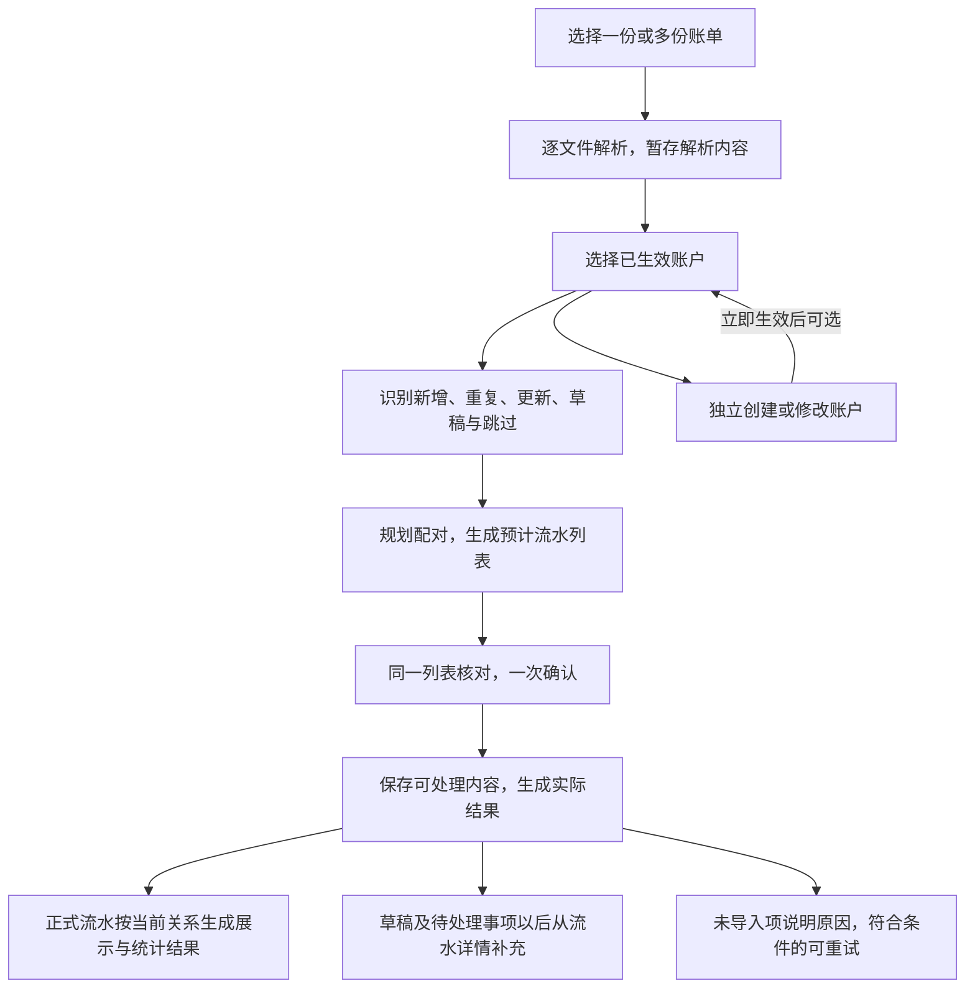

# 现金账单导入流程

现金导入把外部账单中的业务行转成内部现金流水。系统自动识别重复、处理来源变化、安排配对；信息不足的内容可以先保存，只有需要用户判断的部分才留待补充，避免一条记录拖住整个导入。

本文按“导入前准备 → 解析与识别 → 统一核对 → 一次提交 → 结果与后续补处理”介绍重构后的完整链路。后端已实现；统一导入列表、主页补处理入口及退出时的账户撤销交互尚待客户端接入。下文涉及界面的部分描述已确定的交互合同，不代表当前 Compose 页面已可用，实际覆盖见 [功能地图](feature-map.md)。

本文解释流程，不重新定义业务规则或接口。字段边界和特殊场景见 [业务规则](cash-import-redesign.md)，请求、响应及表结构见 [接口与数据契约](cash-import-redesign-contracts.md)，实施和验证证据见 [OpenSpec 变更](../openspec/changes/cash-import-lifecycle-redesign/tasks.md)。

## 整体流程

用户只需准备文件和账户，在同一个流水列表里核对并确认，再查看结果。解析、去重、更新识别和配对是后端阶段，不能据此把前端拆成多个必经核对步骤。

这里的“预计流水列表”由后端根据当前决定生成。多条已配对流水会合并成一个展示结果，这个派生结果称为**投影**。日常列表和收支分析都使用投影；组成流水和关系只在维护具体一笔时展开，关系不作为独立产品入口。

## 1. 导入前准备：文件与账户分别处理

一次导入可以包含多份账单。文件可以分别添加、移除或重传；某份文件需要密码或解析失败，不使其他成功文件作废。完全无法辨认业务行的文件只能报告文件问题，不能伪造为一笔待补流水。

系统根据来源账户分组给出内部账户建议，用户可以选择已经生效的账户，也可以暂不选择。建议不等于已确认选择；缺少账户的可辨认流水仍可进入后续流程，最终保存为草稿。

创建、修改账户走独立账户流程，保存成功后立即生效，再供导入选择。导入会话取消不会自动撤销账户。客户端后续需要在未完成导入而退出时，合并询问是否撤销本次账户改动；撤销也须检查当前修订和引用，不能覆盖期间发生的其他修改。

成功提交（包括部分完成或仅保存草稿）后，退出不再询问撤销账户。刷新后若丢失撤销所需的旧值，则保留账户改动，不猜测还原。

账户实体与“来源账户以后默认对应哪个内部账户”是两件事。后者只有在本次实际成功使用、资金资格仍有效时才记住，不因预览或取消而写入；单笔账户覆盖也不改变整组默认选择。

## 2. 解析与识别：先确定是哪笔，再确定怎么处理

### 解析内容临时保存，原文件不留存

每份文件在收到后识别来源并解析。后续调整账户、补字段和重新预览复用解析内容，不反复读取原文件。原文件只作为当次解析输入，密码只用于当次解密，不作为后续补处理资料保存。

需要密码时，调用方重传对应文件和当次密码，其他文件不用重传。解析会话有固定有效期，修改选择或重试不续期；到期后尚未保存的内容需要重新选择文件。已确认保存的草稿和处理结果不随会话过期消失。

### 自动对应已有流水

同一交易在重叠账单中再次出现时，系统先核对来源身份，再判断内容：

| 识别情况 | 本次处理 |
|---|---|
| 没有对应记录，信息完整 | 拟新增正式流水 |
| 没有对应记录，但缺账户、金额、时间或完整分摊等必要信息 | 能辨认业务行时拟保存草稿，保留已知内容及待补原因 |
| 已有对应记录，内容完全重复 | 报告重复，不再新增 |
| 已有对应记录，仅允许更新的字段变化 | 展示差异，拟更新原流水；用户可选择保留现有 |
| 已有草稿，本次来源补足必要信息 | 校验通过后，可随本次确认将原草稿转正式，保留原身份 |
| 已有正式流水，但金额等固定字段冲突 | 整条更新跳过，保留已有流水，不自动删除重建 |
| 无法可靠辨认，或该行处理异常 | 跳过并说明原因，其他行继续 |

有可靠交易编号时，按工作区和来源范围对应，不能仅凭编号跨来源合并。微信默认使用一个稳定来源，普通导入不要求填写本人微信号；确有多个微信账号时才在文件设置中区分，来源范围与内部资金账户分开。

没有可靠编号时，系统利用已验证的来源范围、固定特征及出现次数自动核对，既避免重叠文件重复入账，也保留真实发生的多次同额交易。缺编号本身不增加用户操作；只有证据确实不足的歧义才留作当前待处理对象，不把两组都保存为正式流水让用户挑选。

每次导入都视为最新来源，不按导出时间阻止覆盖。已删除流水再次出现在账单中时，静默按正常新记录处理。同批文件若对同一可靠身份给出相互冲突的内容，则报告该身份冲突，不按文件顺序任选一个覆盖。

### 来源更新遵守同一套字段约束

正式流水的金额、币种、发生时间、资金账户、组成项及来源身份固定；对方信息、备注、分类、类型和来源行等允许更新。导入与手动编辑使用同一套约束，详细白名单见 [字段更新边界](cash-import-redesign.md#2-字段更新边界)。固定字段输入错误由用户删除后新建，导入不会代为重建。

来源变化不能覆盖用户已有的人工分类和备注，包括用户主动清空的值。没有人工备注覆盖时，备注直接取来源约定的原始注释、描述或备注；没有就为空，不拼接生成说明。原始来源行仍可更新保存。

## 3. 统一核对：流水与配对在同一列表确认

后端在预计新增、更新和草稿的基础上规划关系，形成不可变的**导入计划**。用户看到的是按拟生效关系生成的流水列表，差异和配对选择都在该项详情中按需展开，不需要先逐条核对流水，再进入另一套配对流程。

唯一且有强证据的合法配对默认拟接受；其余合法未确定建议默认延后。用户确认整份计划，才同时确认本次流水处理和配对决定。新增关系不能自动替换已有确认关系。

| 预计状态 | 列表如何展示 | 保存后的金额效果 |
|---|---|---|
| 正式流水，无未解决事项 | 已确认；拟确认关系按合并结果展示 | 按实际提交后的投影统计 |
| 草稿流水 | 待确认，仅展示已知字段 | 不参与余额及任何金额统计 |
| 两条正式流水只有未确认关系 | 分别展示，两项均待确认 | 分别参与统计，关系确认后才合并 |
| 已有正式流水带有待处理来源信息 | 保留当前正式展示并标待确认，不复制另一笔正式流水 | 继续按当前正式值统计 |

**“已确认／待确认”与“正式／草稿”是两个维度。** 预览中的“已确认”不代表已写入账本；正式流水也可能因为关系待确认而标待确认，同时继续参与统计。

合法但未确认的建议在最终提交时保存为草稿关系，不合并、不抵扣、不占用正式配对名额或退款额度。非法关系或配对异常会报告失败，不能换个名字当草稿保存。全额退款合并后净额为 0，仍在预览和日常列表保留核对入口。

修改账户、字段或配对选择后重新生成计划，旧计划失效。计划包含完整处理范围；分页只影响读取，不改变最后确认的范围。

## 4. 一次提交：成功内容一起生效，局部失败有边界

确认请求引用确定的计划和会话修订，并携带唯一的幂等键。后端在写入前重新校验当前状态；已有流水或账户资格发生变化时，不能静默采用另一份新决定。

流水操作以保存点隔离可恢复的单项错误。关系则按依赖划分为**配对提交组**：共享端点或必须联合合法的关系一起校验、保存或回滚，不能机械地拆成每条关系独立保存。其他独立流水和关系仍可继续。

配对失败不撤销已经合法保存的流水，但也不能据此假定关系两端都已保存。结果分别说明流水和关系的实际情况；两端均已正式保存而未能合并时，各自保留展示和统计。

所有成功业务写入、余额变更、受影响投影及处理收据最终在同一个数据库事务中提交。连接失效、事务故障或最终投影发布失败等无法局部隔离的问题，会使本次提交整体回滚。独立生效的账户改动不属于这个事务。

投影只重建本次涉及流水在变更前后已确认关系可达的范围，不全库重新配对。普通备注等更新不重新寻找配对；类型改变时保留合法旧关系、解除不合法关系，再更新受影响投影，不自动寻找替代对侧。

## 5. 结果与后续补处理

### 结果以实际收据为准

确认完成后产生持久的**处理收据**，分别记录正式新增、更新、草稿、重复、跳过及关系结果。文件问题单独报告，原因使用用户能理解的说明，不暴露异常栈或数据库细节。全部重复也可以完成并获得“无新增”的结果。

收据记录实际发生的处理，不能继续把预览中的合并结果当成已成功保存。正式新增数、草稿数、关系数和列表项数也不相等：两笔流水可以合成一项，一条草稿则可能完全不影响统计。

提交响应丢失时，调用方先使用原计划和幂等键核实结果。暂时查不到收据不等于未提交，不能换一个键再次提交。重复原请求取得的是原结果，不会顺便重新执行其中失败的行。

### 已保存的内容从流水详情继续维护

草稿流水保存的是提取后的来源内容和待补原因，后续维护无需原文件。普通“保存待确认”即使补齐信息也保持草稿；明确“确认保存”才转为正式，并保留同一流水身份。

未确认关系从相关流水详情处理。确认合法关系后，后端重建局部投影，使相关正式流水合并展示；继续暂存时仍分别显示。用户面对的始终是这一笔流水的维护，不另建关系管理流程。

### 未导入项按原因决定后续方式

草稿属于已经保存的内容；跳过表示本次未采用该行，不能声称以后都能从账本找回它。允许重试的临时写入失败或并发变化，可在临时内容有效时从收据派生一个只含失败子集的新会话，重新预览、用新键确认；已成功项不会重跑，也不延长原有效期。

固定字段冲突等业务问题不属于通用自动重试。临时内容过期或文件未成功解析时，需要重新选择文件；已有正式流水、草稿和收据保持不变。

## 一个例子

以下使用虚构数据。一次账单包含 6 条来源行，假设账户和必要字段除特别说明外均已完整：

| 来源行 | 识别和核对结果 | 确认后的结果 |
|---|---|---|
| 消费 100 元 | 新流水 | 正式新增 |
| 对上述消费全额退款 100 元 | 新流水，与消费有可靠退款依据，拟确认关系 | 正式新增；关系成功后与消费合并展示为净额 0，仍可查看 |
| 某笔已导入消费的来源备注变化 | 合法来源更新 | 更新原流水；若已有人工备注则保留人工值，来源行仍更新 |
| 另一笔消费 20 元，尚未选择账户 | 可辨认但信息不足 | 保存草稿，不计入统计，以后补账户并确认 |
| 某个已有交易号的金额由 30 元变为 35 元 | 正式固定字段冲突 | 跳过；已有 30 元流水不变，结果说明原因 |
| 一笔已导入且完全相同的记录 | 完全重复 | 不新增、不改写，报告重复 |

若上述操作均按计划完成，流水结果是：**正式新增 2 条、更新 1 条、草稿 1 条、跳过 1 条、重复 1 条**；退款关系另行报告成功。用户无需先补齐 20 元草稿，也无需先处理金额冲突，就能保存其余内容。

若用户暂不确认退款关系，两条完整正式流水仍可保存，但分别展示和统计；关系以后确认时才合并。若配对执行失败，则报告实际关系失败，不把它当作用户选择的暂存。

## 继续查阅

| 想了解的内容 | 文档 |
|---|---|
| 为什么这样设计、字段能否更新、复杂来源和关系场景 | [现金导入业务规则](cash-import-redesign.md) |
| 如何调用接口、计划和收据的结构、数据库合同、后续 UI 合同 | [用户流程、接口与数据契约](cash-import-redesign-contracts.md) |
| 临时解析内容如何存储、到期和清理 | [临时存储配置](cash-import-r2-staging.md) |
| 哪些客户端已接入、还缺哪些页面入口 | [功能地图](feature-map.md) |
| 现金导入与投资导入、连接器同步的边界 | [导入、关系与同步流程](import-flow.md) |
