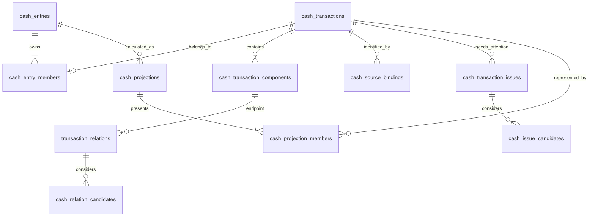

# 现金流水与导入：接口、数据与客户端交互参考

本文是现金流水维护与导入共用的详细参考。连贯讲解分别从 [现金流水的存储、展示与操作](cash-ledger.md) 和 [现金账单导入流程](cash-import-flow.md) 开始；此处查阅精确 HTTP 协议、持久化约束和后续客户端交互。字段开放与来源对应等详细判定见 [业务规则](cash-import-redesign.md)。

## 1. 交付边界与现状

后端接口、迁移脚本及双后端验收已完成，未部署或迁移真实账本；第 2 节统一列表、主页维护入口和账户退出交互是后续独立 UI 任务的合同，尚未交付。旧现金导入写入口已移除，不能因为旧 Compose 页面仍存在就认定新流程可用。共享网络、状态与恢复存储已有基础实现，实际客户端接入状态见 [功能地图](feature-map.md)。

| 内容 | 本文职责 | 权威入口 |
|---|---|---|
| 用户流程 | 保留统一核对、默认决定、后续补充及退出恢复合同 | 第 2 节；客户端完成状态见功能地图 |
| HTTP | 解释请求、修订、分页、结果及安全恢复语义 | 第 3 节；精确结构以运行服务 `/openapi.json` 及路由协议模型为准 |
| 数据 | 说明持久化对象、空值、引用及唯一性约束 | 第 4 节；物理结构以 ORM 和 Alembic 为准 |
| 验证 | 示例与后续 UI 验收范围 | 第 5–6 节；实际证据见 [实施变更](../openspec/changes/cash-import-lifecycle-redesign/tasks.md) |

本文不重复实施顺序、审查日志或迁移操作手册。纯文档整理不改变业务规则、接口、数据或主规格。

## 2. 用户业务流程

### 2.1 入口与信息顺序

用户业务主线和流程图统一见 [流程说明第 1–5 节](cash-import-flow.md#整体流程)。本节只补充后续 UI 必须遵守的动作、状态、退出及跨端合同：准备后进入一个预计流水列表，流水与配对在其中核对并一次确认；最终确认前不写流水、映射或关系，独立账户命令除外。以下交互尚待客户端接入。

### 2.2 同一任务内的内容与动作

| 区域／状态 | 用户看到的内容 | 系统默认处理 | 用户可做的事 | 操作条件 |
|---|---|---|---|---|
| 选择文件 | 文件名称、识别进度；有问题的文件显示具体原因 | 逐文件解析，成功文件不因其他文件失败而作废 | 添加／移除文件，为单个文件重传并输入密码；保留错误项继续 | 至少一条可辨认业务行，或有可展示的终结处理结果；正在改变文件集合的请求完成 |
| 选择账户 | 来源账户及建议归属，待选择项数量 | 复用已有映射建议；未确定项保留未知 | 选择账户；从入口独立创建或编辑账户；暂不处理 | 不要求全部映射完成；账户独立保存请求已结束 |
| 预览并导入 | 投影后的流水列表，逐项“已确认／待确认”；有来源变化的项可展开差异 | 自动对应来源并形成预计展示；强证据合法关系纳入拟确认图，未确认关系不连接；保护人工分类和备注 | 直接确认导入；按需打开一项查看差异、组成流水和关联；无需逐项处理待确认项 | 当前计划已生成，没有未提交的本地修改；单项待确认不禁用导入 |
| 结果 | 实际保存结果、待确认数量和未导入原因 | 待确认项默认引导回主页处理；实际未合并时不沿用预览合并结果 | 返回主页；按需查看错误或重试未导入项 | 结果已确定；网络未知状态走第 2.5 节 |

所有可应用更新的字段差异都可查看，“确认导入”同时确认这些更新，不额外逐条弹窗。用户选择“保留现有”只跳过本次更新，不建立永久禁止更新规则。人工分类和备注的保护规则不因预选更新而失效。强建议仍在最终确认前不生效；“暂不处理”保存草稿关系，“拒绝”形成忽略决定，两者不能共用一个动作。

只有用户主动展开某项维护时，才出现上述细分动作。主列表不要求先完成流水核对再进入关系核对，也不把来源行、关系建议和投影各展示成一份并列清单。文件无法解析、完全重复及冲突跳过通过摘要和按需展开的处理明细保留，不伪造为已保存的投影流水。

没有可靠编号不增加一步核对身份：正常对应自动完成。只有主设计第 6.2.1 节所述真实歧义才进入待补充；界面不把同批银行数据展示成两组要求逐笔选择。

### 2.3 列表如何合并及标记确认状态

预览列表由后端在内存中按当前计划生成，使用与正式列表一致的投影规则。用户只看日期、金额、账户、说明和确认状态；组成流水及关系仅在维护该项时展开。消费镜像和退款镜像联合生效后对应一个结果时，只展示一个合并项，不展示“消费配对任务”和“退款配对任务”两张产品卡片。

| 情况 | 列表表现 | 导入后的统计 |
|---|---|---|
| 信息完整、没有待处理问题 | 已确认；有拟确认合法关系时展示合并结果 | 按最终成功提交的正式投影统计 |
| 两条正式流水仅存在未确认关系 | 两条各自的投影项，均标待确认；不能提前合并成一项 | 两条仍分别参与统计，确认关系后才合并 |
| 缺必填信息或身份尚不明确的草稿 | 单条待确认项，只展示已知信息 | 不参与统计 |
| 已有正式流水附有当前待处理来源信息 | 保留当前正式投影、标待确认，不新增另一笔 | 按现有正式值统计 |

这里“已确认”表示当前没有待用户处理的事项、可按当前决定导入，不表示预览已经写入账本，也不代表用户逐条作过人工审核。`confirmation_status` 与流水 `state` 是两个维度：正式流水也可以待确认关联且继续统计。没有关系候选的正常完整流水无需人为制造一个待确认关系。

联合建议尚未确认或用户暂不处理时，组内关联决定一起保存为待处理，不合并正式流水；不允许只确认一个违反最终关系约束的子集。独立关联各自可处理。一项关联失败时，按逐行实际结果及当前列表说明哪些流水已保存、哪些未导入；相关正式流水都已保存且独立显示时，说明“未合并，流水已分别保留”。不能仅凭关系失败断言全部流水已保存，也不能把合法流水成功写入误报为整批“导入失败”。非法关系不能伪装成草稿；必要时在相关流水上保存不含非法边的当前问题，供主页后续重新处理。

新增关系不得自动替换已有确认关系。需要解除或替换时，从相关流水详情维护，导入预览只说明当前不能合并。

### 2.4 导入后如何补充

主页流水列表与导入预览使用相同的投影展示语义和“已确认／待确认”标记。主页默认可展示已保存的正式项及草稿项，待确认筛选提供快捷定位；不新增一级问题中心或关系页面。草稿显示已知信息但所有金额汇总仍排除草稿，正式流水的待确认关联不改变现有统计口径。不能把用户引导回主页后，又将待确认项隐藏在默认不可见的独立列表。

全额退款及全额平台退回在导入预览和主页均展示，净额为 0；无待处理事项时显示已确认，有待处理事项时显示待确认，解决后仍保留在列表。其他业务隐藏项有活动待处理事项时优先展示，统计资格仍按原口径；此优先级不覆盖权限、工作区或逻辑删除边界。默认查询不能因为草稿时间为空而漏掉它，可在“时间待补充”分组展示；用户主动设置的具体筛选条件仍明确生效，结果页进入待确认筛选时清除妨碍定位的旧日期条件。

| 用户进入的对象 | 详情提供的动作 | 保存语义 |
|---|---|---|
| 缺账户、金额、时间或分摊的草稿 | 在同一流水详情补字段和关联；“保存待确认”；完整后“确认保存” | 前者保持草稿；后者在当前详情内预览变化并联合保存成为正式流水，保留原身份，不跳到独立配对步骤 |
| 正式流水的来源更新待处理项 | 查看已有值与当前待处理值；应用或保留现有 | 应用仍遵守统一字段约束并保护人工覆盖；保留现有只结束当前问题 |
| 无法自动确定身份的少数草稿 | 查看候选，在确有需要时确认独立记录或对应已有流水 | 只有用户主动进入该问题才提供选择；合并不相加金额，来源对应随之转移 |
| 尚未确认的关联 | 在流水详情展开相关记录并确认、拒绝或继续暂存 | 未确认保持当前展示；确认后按当前合法图合并 |
| 正式流水编辑 | 展示可编辑字段；固定字段只读 | 导入流水只改公共字段，合并后整笔编辑；手工流水按创建方式允许修改，手工转账双端共同保存 |

已经完整的草稿仍可“保存待确认”，不会因为一次普通保存意外进入统计。用户选择“确认保存”才转换状态。更新来源补足草稿时，导入最终确认可以同时承担这个确认，无须再打开详情操作一次。

保存后仍停留于当前详情并刷新结果。关系合并／拆分会改变投影标识，客户端按稳定流水引用重新定位当前展示结果，不继续访问已失效的旧投影；草稿合并则使用响应中的保留流水引用。

### 2.5 失败、退出与重入

| 场景 | 交互与后续 |
|---|---|
| 某个文件需要密码、无法解析 | 允许只处理其余内容；需要以后重新上传的文件明确提示，不伪装成已保存草稿 |
| 所有文件均无法得到业务行 | 显示文件结果并允许退出／重选；不显示可保存流水的“确认导入”按钮 |
| 全部重复或按规则跳过 | 可以完成处理并获得结果，“无新增流水”不是失败 |
| 有草稿但没有正式记录 | 允许确认，结果明确“已保存待补充”，不宣称进入收支统计 |
| 提交中 | 禁止重复点击及修改计划；普通关闭请求提示正在保存，可等待；不触发账户撤销 |
| 提交响应丢失 | 显示“正在确认保存结果”；查询收据或使用原幂等键重试；禁止更换键重复提交 |
| 已明确事务回滚 | 显示未保存，允许重试；独立账户改动仍有效，退出时询问是否撤销 |
| 部分完成 | 成功项保持；问题按行或关联展示。有临时重试内容时可“重试未导入项”，生成新会话和计划；过期后重选文件，不重新执行原请求 |
| 提交前正常退出、没有账户改动 | 沿用未完成任务的退出确认，说明尚未保存；不逐条询问 |
| 提交前正常退出、有账户改动 | 合并成一次询问：“撤销并退出／保留并退出／继续导入”，不再叠加第二次离开确认 |
| 撤销账户失败或冲突 | 保留不能安全撤销的部分，说明账户名称及原因；可继续处理或保留并退出 |
| 提交已成功，包括部分完成和仅草稿 | 退出不再询问撤销账户；成功使用的账户和其他独立改动都保留 |
| 会话尚未过期，在当前任务中刷新／重试 | 用会话标识恢复解析结果及最后一次预览输入；账户撤销旧值只在内存，刷新不保证仍能自动恢复；不承诺恢复尚未发送的输入 |
| 离开已取消任务后重新进入，或会话过期 | 重新选择文件；已确认保存的草稿从账本维护，不能从已删除原文件重新解析 |
| 浏览器关闭、进程被杀 | 不保证离开询问或补偿执行；保留已生效账户。重新进入先核实已发出的提交；计划过期且服务端确认未提交后可重新导入 |

前端仅保留恢复所需的会话标识、幂等键和账户操作标识，不将原文件、密码或财务正文放入长期本地存储。账户撤销前的旧值仅在当前任务内存中保存；刷新导致这些值丢失时不能猜测还原，账户保持生效。提交结果未知时保留原提交标识以便恢复，不以会话过期推定未提交。

收据存在或 `committed=true` 不单独表示导入完成；收据状态为 `failed`、所有业务写入均未成功时，退出仍保留账户撤销选择。

### 2.6 跨端与界面设计约束

用户任务是“看一个流水列表，确认导入，待确认事项回主页处理”。FinanceTheme、Material 3、字体和金额颜色继续遵循项目约束，不新增产品导航。`COMPACT` 单列全屏，`REGULAR`／`WIDE` 使用主内容区的完整任务页面；区域顺序为标题、文件及账户准备、预览流水列表、固定确认操作。具体组件和旧步骤状态机可以重写，不要求为了复用保留四步导航。账户表单最大宽度 720 px，窄屏不横向滚动。

将删除的冗余信息：独立“核对流水／核对配对”步骤、并列的关系任务列表、无编号逐条身份问答、未完成账户映射导致的整页阻断、单独关系管理入口、重复的退出弹窗、内部关系图及投影术语、正常状态的大段流程教学。来源原文、组成流水和差异按需展开，错误原因紧邻对象。

设计方向自查：优先暴露需处理的问题，正常结果可批量确认；只有一个最终导入动作，账户操作明确独立保存；不靠颜色单独表达错误；键盘和系统返回统一走任务关闭逻辑。Web、Android、iOS 及共享 presentation 均受影响。此处交付信息架构与交互合同，不交付最终视觉 UI；实施时还需 Hallmark 方向及最终 audit、三种窗口真实 QA 和演示评审。

## 3. 前后端接口契约

### 3.1 通用规则与身份

以下路径均以 `/api/v1` 为前缀。当前后端已用解析会话和计划替代旧批次 `scan/preview/commit` 合同，旧写入口不再提供；客户端统一切换留后续任务，不混用两套确认语义。解析、来源核对及关系规划是服务内部阶段，不对应前端必经页面。

- 认证、工作区选择沿用现有机制。工作区取自认证上下文，不信任正文；计划和会话还绑定操作者。读操作需工作区访问权，导入及维护需写权限，每次提交重新校验。
- `transaction_id`、`component_id`、`account_id`、`relation_id` 在计划及维护 DTO 中统一为不透明字符串，可由既有数据库代理键编码，不新增一套财务业务身份。它们只在当前数据库内定位，删除后不复用到新对象，避免旧上下文指向后来新建的记录；跨导入识别仍使用来源作用域和 `record_id`。
- `row_ref` 仅定位会话内来源行；`operation_ref` 定位一个计划内操作。多个重复来源行可共同指向同一保存操作，不能按来源行数重复写入。
- `session_id`、`plan_id`、`receipt_id` 为服务端生成的不透明标识。服务端保存计划，客户端不能提交自造操作或闭包。`session_revision`、`row_revision`、`account_revision` 是单调整数，不是历史版本链。
- 金额及汇率使用十进制字符串，禁止 JSON 浮点，未知金额为 `null`；时间使用含时区的 RFC 3339，展示转换由客户端负责。字段缺省表示不修改，`null` 只用于合同允许为空的字段；文本清空使用 `""`，属性清空使用 `[]`。
- 普通请求结构错误返回 HTTP `422`；可定位的行字段问题进入行结果，不把一行无效数据提升为整个预览失败。错误只返回稳定 `code`、安全 `message`、`field_errors`、`retryable`。
- 计划输入改变后生成新 `plan_id`，旧计划不可提交。账本并发变化不一概使整批失败，执行时仅跳过受影响且无法按原授权应用的项。

计划生成和替换是临时存储中的原子比较写入：导入预览带当前 `expected_session_revision`，成功后修订加一，并同时更新 `last_plan_id`、输入和计划。响应返回递增后的修订；并发创建的两个计划只能有一个基于同一旧修订成功。提交在工作区锁内再次验证最新计划及有效期，不能锁外读完旧计划后无条件执行。

预览发布、文件集合修改、取消以及提交读取最新计划必须使用同一工作区锁同步：耗时解析／计算可在锁外，发布时在锁内比较修订并检查提交状态。提交从最终校验到事务结果确定期间持有该锁，其他发布／取消不得穿插；重新获得锁后先查消费收据再决定是否允许修改。此规则同样适用于维护编辑上下文，不能只靠临时存储 CAS 留下“验完旧计划后新计划又发布”的窗口。

旧 `POST /cash-import/detect/scan/preview/commit`、正式流水 `PUT`、直接 `/cash-relations`、独立 `/relations` 待确认读取／发现／决定及 `/cash-facts` 删除不再提供。关系决定通过流水内维护计划提交；账户别名、独立投资、资金调拨、现金新建／删除及余额校准继续保留。运行时只构造解析内容暂存，不构造原文件会话。

手工新建继续使用 `POST /cash-records`，仅接收账户名称、金额、币种、发生时间、交易对方、对方账号／属性、备注、分类 ID、类型／子类型及 `components`。组成项只接收账户 ID／名称、金额、币种和标签；顺序及其他内部字段由服务端生成。兼容旧 `category` 输入但不将名称猜测为分类 ID。正文最多 64 KiB、组成项最多 64 个，未知字段及格式错误返回安全 `422`；明确备注／分类含清空由服务端建立人工保护。此入口不接收来源身份、来源正文、关系解释或保护字典。

### 3.2 会话、文件与预览

| 方法与路径 | 请求 | 响应及副作用 |
|---|---|---|
| `POST /cash-import/sessions` | multipart 文件；各文件 `client_file_ref`、可选当次密码 | `201` 返回 `SessionView`；逐文件读取后删除原输入，只保留解析行；最多 20 份、每份 100 MB |
| `GET /cash-import/sessions/{session_id}` | 无 | `SessionView`，不返回文件下载地址或密码 |
| `POST /cash-import/sessions/{session_id}/files` | 新文件或指定 `file_ref` 重传，`expected_session_revision`；密码仅本次传输 | 返回更新后的会话；重传只解析该文件，旧计划失效 |
| `DELETE /cash-import/sessions/{session_id}/files/{file_ref}` | `If-Match` 会话修订 | 删除该文件解析内容及临时决定；其他文件不重读；旧计划失效 |
| `PATCH /cash-import/sessions/{session_id}/files/{file_ref}` | `expected_session_revision`、`source_scope_label`（微信来源名称，可空） | 设置该微信文件来源；空值为默认来源，不重读文件，旧计划及该文件行选择失效 |
| `POST /cash-import/sessions/{session_id}/plans` | `PreviewInput` | 返回不可变 `ImportPlanView`，不写业务流水 |
| `GET /cash-import/plans/{plan_id}` | 无 | 读取计划摘要及第一页；分页路径见下文 |
| `POST /cash-import/plans/{plan_id}/commit` | `{"expected_session_revision": 4}`；`Idempotency-Key` | `200` 返回已提交收据，包括全部成功、部分完成或无新增 |
| `POST /cash-import/receipts/{receipt_id}/retry-sessions` | 可选失败 `row_refs[]`，新幂等键 | 在临时重试内容有效时生成新会话，`201` 返回 `SessionView`；不执行旧请求，不重跑成功项 |
| `DELETE /cash-import/sessions/{session_id}` | 无 | 取消未提交会话、清理解析内容；不撤销账户，不撤销已提交导入；提交中返回 `409` |

`SessionView`：`session_id`、`session_revision`、`expires_at`、`state`（`open/committed/cancelled`）、`files[]`、`source_accounts[]`、`last_preview_input`、`last_plan_id`、`can_preview`、`receipt_id`（未提交时为空）。过期会话返回 `410 session_expired`。

multipart 的文件字段名为 `file:<client_file_ref>`，唯一文本字段 `metadata` 为严格 JSON；其中 `files[]` 元素包含 `client_file_ref`、可选 `password/source_hint/source_scope_label`，不传本地路径。追加／重传另带整数 `expected_session_revision`，重传时带 `file_ref` 且仅允许一份文件。文件与元数据一一对应，单个文本字段最多 64 KiB；密码只供本次解析。`source_scope_label` 缺省沿用，明确 `null` 切回默认来源。

已提交会话优先返回持久 `receipt_id`，不要求解析暂存仍存在；此时 `session_revision/expires_at/last_preview_input` 为 `null`，`last_plan_id` 来自收据，文件和来源账户数组为空，不能再次预览。未提交会话的过期仍返回 `410`。

文件元素包含 `file_ref`、脱敏 `display_name`、`status`（`ready/partial/password_required/failed`）、已识别行数、安全问题与 `can_retry`。不能识别行数时为 `null`。需要密码的文件只保留状态、显示信息及已选来源设置；重试必须带文件内容，后端不能凭会话重新读取它。

微信文件可选 `source_scope_label`，普通上传省略时使用工作区内稳定的默认微信来源；多账号时用户才选择已有来源名称或输入另一名称。名称按 Unicode NFC 和两端空白规范化，最多 64 个字符及 256 UTF-8 字节，不接受控制字符；空值回到默认来源。默认来源和同名的自定义来源使用不同命名空间。选择独立于原始昵称、本方微信号和内部账户映射，不新增独立来源管理页面；文件重传保留已有选择，解析失败、需要密码或超限时也不丢失，除非上传明确提供另一选择或已成功识别为其他渠道。

文件变化使旧计划不可执行，但不清空所有人工配对决定。服务端仅在当前解析上下文私有保留单份重验证明及未入库记录的稳定分配；下一次预览依当前文件和候选校验，未受影响的延后／忽略可继续，失效组仍待确认。用户从最新详情明确重选某组后，该组的新决定优先，不能因完整输入还保留旧失效选择而被覆写，也不使相邻未重选组自动确认；旧指纹恢复不能恢复旧确认。证明不提供旧计划读取／提交能力，不形成历史链，不延长 TTL。

`client_file_ref` 标识客户端上传槽位，重传时保留；`file_ref` 标识当前解析结果，重传时更换，旧行引用及对应选择同时失效。其他文件的引用保持不变，新计划重新验证其余选择，避免将旧位置的决定应用到另一份内容。

来源账户元素包含 `source_account_ref/source_type/display_name/currencies/row_count`，以及独立的 `suggestion` 和 `selection`。`suggestion` 包含建议 `account_id/expected_account_revision/basis`；`selection` 是本次已保存的账户选择或 `null`，明确暂不选择账户时其中 `account_id=null`。建议不是已经确认的选择。内部完整账号只在授权来源信息读取中按现有规则使用，不能回传为列表调试信息。

`PreviewInput` 使用完整替换的选择集合，避免省略和撤销混淆：

三类选择数组均须提供；第一次 `previous_plan_id` 为 `null`。JSON 请求最多 64 MiB，结构及修订严格校验；行内补丁的业务字段问题仍逐行返回。分页大小默认 50、最大 200；收据结果的 `result_id/next_after` 为十进制字符串，后一值为空表示结束。查询参数不接受重复键。

```json
{
  "expected_session_revision": 4,
  "previous_plan_id": "plan_previous",
  "account_selections": [
    {"source_account_ref": "sa_1", "account_id": "41", "expected_account_revision": 3},
    {"source_account_ref": "sa_2", "account_id": null}
  ],
  "row_choices": [
    {"row_ref": "f1:r8", "action": "keep_existing"},
    {"row_ref": "f2:r3", "action": "apply", "patch": {"note": "原始备注"}}
  ],
  "relation_choices": [
    {"suggestion_id": "sg_1", "action": "defer"},
    {"suggestion_id": "sg_2", "action": "accept", "candidate_id": "candidate_7"}
  ]
}
```

未出现在 `row_choices` 的行采用服务端默认：完整新增、合法更新拟应用，不完整新增拟草稿，重复不改写，冲突跳过。未出现在 `relation_choices` 的建议：唯一强证据拟接受，其余拟暂存；最终仍由用户确认整个计划。客户端可选 `apply/keep_existing/defer`，其中 `defer` 只允许服务端声明可保存的草稿或当前问题，不允许将固定字段冲突转成更新草稿。

用户直接编辑 `note` 的补丁与来源解析值分开提交，前者设置人工覆盖；客户端不可提交 `manual_overrides`。请求体字段未被该行 `editable_fields` 允许时，该行返回字段问题；JSON 结构本身不合法才拒绝整个请求。

同一计划中的联合建议通过 `suggestion_id` 引用完整组，不能用单条边绕过。`candidate_id` 只能来自服务端当前候选；改类型、对侧或成员后重新预览。映射或流水修改使旧建议失效时，返回失效选择列表，不静默改对侧。

第一次预览 `previous_plan_id=null`；修改选择时传上次返回的计划标识、当前会话修订及完整输入集合。选择中的建议和候选标识先按旧计划验证，再按当前事实重新生成新计划；失效选择不能静默转成另一个候选。新计划使用自己的标识和修订，原计划始终不可变。

### 3.3 计划与逐项结果

`ImportPlanView` 必填字段：

| 字段 | 含义 |
|---|---|
| `plan_id/session_id/session_revision/expires_at` | 本次确认的精确上下文 |
| `summary` | 预计正式新增、更新、草稿保存、重复、跳过，以及关联确认、暂存、失败的独立数量 |
| `items[]` | 主体是预计投影列表：合并后展示字段、确认状态、成员引用及待处理原因；客户端不能自己合并来源行 |
| `item_counts` | 预计可见的 `confirmed/pending` 项数，与来源行数、内部关系边数分开 |
| `file_results[]` | 文件级问题，不能伪装成单条流水 |
| `can_commit` | 可终结处理，包括全部重复；无可辨认行且只有文件错误时为 `false` |
| `pages` | 投影项及处理明细的分页游标 |
| `invalidated_choices[]` | 失效选择的 `kind/reference/code`，不能静默换成另一候选 |

`GET /cash-import/plans/{plan_id}/items/{preview_item_id}` 在用户维护某项时返回 `members[]`、`field_diffs[]`、`issues[]`、`relation_choices[]` 和 `relation_effects[]`。成员包含来源行引用或已有流水引用、字段和允许动作；关联选择包含服务端建议／候选 ID 及联合范围；关联影响包含类型修改将保留或解除的旧关系。它们从属于这一项详情，不是另一份顶层关系列表。

成员内部 `planned_action` 为 `create_posted/create_draft/update_posted/update_draft/finalize_draft/duplicate/skip`；实际结果另用 `outcome`，不拿计划状态冒充已保存。只要与本次成功操作相关的完整投影需要展示已有对侧，就将该已有成员纳入当前预览项，但不把它算成新增或主动更新。

`PreviewItem` 的字段：

| 字段 | 类型与语义 |
|---|---|
| `preview_item_id` | 本计划内不透明标识，不能用作提交后的正式投影 ID |
| `confirmation_status` | `confirmed/pending`，按当前问题、草稿状态和未确认关系派生，不是独立持久化的审核开关 |
| `anticipated_state` | `posted/draft`；用于解释统计资格，不向用户暴露内部枚举 |
| `display` | `occurred_at/amount/currency/counterparty/note/accounts[]`；未知值可空，金额为字符串 |
| `statistics_eligible` | 按预计正式投影与既有财务口径计算；不是由确认状态直接决定 |
| `member_refs[]` | `{row_ref}` 或 `{transaction_id}`，一个成员不能同时用两种身份重复计算 |
| `attention_reasons[]` | 安全原因及 `after_import_action=open_home_item`；待确认默认回主页处理 |
| `detail_available` | 是否可展开该项；正常预览不要求展开 |

示例：两条完整支出仅有待确认镜像时，后端必须返回两项，而不是一个提前合并的待确认项：

```json
{
  "item_counts": {"confirmed": 0, "pending": 2},
  "items": [
    {
      "preview_item_id": "pi_1",
      "confirmation_status": "pending",
      "anticipated_state": "posted",
      "display": {"occurred_at": "2026-10-01T12:00:00+08:00", "amount": "-100", "currency": "CNY", "counterparty": "示例商户", "note": "", "accounts": ["示例支付账户"]},
      "statistics_eligible": true,
      "member_refs": [{"row_ref": "f1:r1"}],
      "attention_reasons": [{"code": "relation_pending", "message": "待确认关联，可回主页处理", "after_import_action": "open_home_item"}],
      "detail_available": true
    },
    {
      "preview_item_id": "pi_2",
      "confirmation_status": "pending",
      "anticipated_state": "posted",
      "display": {"occurred_at": "2026-10-01T12:00:01+08:00", "amount": "-100", "currency": "CNY", "counterparty": "示例商户", "note": "", "accounts": ["示例银行卡"]},
      "statistics_eligible": true,
      "member_refs": [{"row_ref": "f2:r1"}],
      "attention_reasons": [{"code": "relation_pending", "message": "待确认关联，可回主页处理", "after_import_action": "open_home_item"}],
      "detail_available": true
    }
  ]
}
```

同一例中，关系纳入拟确认图且整体合法时，列表改为一个 `confirmed/posted` 项，两个成员、金额 `"-100"`；未确认不能只把它的状态改成 `pending` 而保留合并金额。上述 JSON 只展示计划的列表字段，计划标识、摘要及文件结果仍遵守完整响应合同。

`FieldDiff` 包含 `field`、`current`、`incoming`、`effective`、`resolution`；`resolution` 可为 `apply/protected/fixed_conflict/keep_existing`。人工保护的备注即使来源不同，也显示最终保留值。来源行差异支持展开，不在默认列表展开整个 JSON。

每个问题包含 `code/message/field_path/blocking_scope/next_action`。`blocking_scope` 为 `row/relation_group/file/request`；仅 `request` 影响整次请求。用户文案不显示这些内部枚举。`next_action` 限定为 `edit/reselect_file/open_record/review_relation/retry/none`，由客户端映射入口。

预览主列表通过 `GET /cash-import/plans/{plan_id}/items?cursor=...&limit=...&confirmation_status=...` 分页，默认 50、最大 200。重复、跳过、失败来源行从 `/processing-details` 按需读取，不进入正常投影列表。游标绑定不可变计划与筛选；客户端切换筛选重新取第一页。确认适用于完整计划，不只适用于已加载页面。关系选择变化后整个受影响预览组重新投影，不能只更新一张关系卡而保留过时金额。

计划摘要只交付主列表第一页，因此 `pages.items` 是该页之后的游标，`pages.processing_details=null` 表示明细尚未读取、从头开始；不能返回未交付明细第一页之后的游标。详情及明细按公开字段白名单返回，不透传服务端操作图。计划发布前验证全部可读取结构并构造摘要，构建器输出异常时保留原计划与会话修订。

格式有效的计划所依赖的临时会话已经过期或被清扫时，统一返回 `plan_expired`，不依赖保留到期对象；已有消费收据仍优先恢复。其他操作者或工作区的现存上下文返回 `404`，不泄漏归属。问题的安全文案由服务端根据稳定原因生成，不使用构建器或存储异常正文；保留 `blocking_scope/next_action` 供客户端定位后续入口。

收据 `MutationReceipt`：

```json
{
  "receipt_id": "receipt_example",
  "plan_id": "plan_example",
  "operation_kind": "import",
  "created_at": "2026-10-22T08:00:00+00:00",
  "status": "partial",
  "committed": true,
  "needs_attention_count": 1,
  "pending_item_count": 1,
  "summary": {
    "created_posted": 1,
    "updated_posted": 0,
    "saved_draft": 1,
    "finalized_draft": 0,
    "duplicate": 1,
    "skipped": 1,
    "relations_confirmed": 0,
    "relations_deferred": 0,
    "relations_failed": 1
  },
  "projection_version": 19
}
```

摘要中的写入数量按唯一 `operation_ref` 计数；每个来源行仍有结果，同批重复来源行可返回 `duplicate_in_batch` 并引用同一操作。`relations_*` 按建议决定计数，组内每条关系明细另返回，不能一处按组、另一处按边相加。

收据摘要保持有界，只保存计数及发布版本；不附加全量 `affected_transaction_ids` 或 `projection_refs` 数组。完整流水／关系引用随逐项结果分页读取，客户端按稳定流水引用定位最新详情。失败子集可在原 TTL 内从独立的限时失败上下文派生，访问必须同时验证该用户的持久收据及失败结果；不复制原文件、不续期，也不重跑成功项。

收据 `status=completed/partial/no_changes/failed` 描述已提交的处理结果；`committed=true` 表示执行结果已持久保存，不等于业务全部成功。已保存草稿属于成功写入。`partial` 表示有成功操作，也有失败或被跳过的有效业务操作／文件；`no_changes` 表示只有重复、用户保留现有或白名单跳过。`needs_attention_count` 表达草稿和待处理关联，避免把它们混成失败。若没有任何成功写入且存在有效业务操作失败，返回 `status=failed`，界面显示“未导入任何记录”，仍允许退出时撤销独立账户改动。事务整体回滚使用错误响应，不能生成已提交收据。

`needs_attention_count` 按有当前问题的唯一流水计数；同一流水的多个问题或关系不重复加数，跨两笔流水的草稿关系可使两笔分别待处理。`saved_draft` 包含新增及更新草稿，结果定位到实际保存的流水。

逐项结果由 `/rows`、`/relations` 读取：`items[]` 包含 `result_id/result_kind/item_ref/outcome`，以及适用的 `operation_ref/transaction_id/relation_id/account_id/code/message`；来源行或建议标识使用 `item_ref`。结果页还包含 `next_after/projection_refs/projection_version`。`code` 存在时提供安全文案；成功结果没有额外问题文案。原文件、来源绑定证明及临时失败正文标识不通过收据 DTO 暴露。

面向用户的待确认数量另由最终可见投影按 `confirmation_status=pending` 计数，字段为 `pending_item_count`；不能把内部流水数当成列表项数。收据摘要只含有界计数和发布版本；受影响流水及提交后当前投影的引用放在分页逐项结果中。客户端用正式查询刷新实际结果，不能在部分失败后继续展示原先预计的合并列表。

结果页的 `projection_refs` 和 `projection_version` 表达读取时的当前归属，引用数量不超过该页流水数；永久收据的发布版本及计数保留本次提交结果。后续合并、拆分或删除后，客户端以当前定位刷新详情，不把旧引用当作仍有效。

### 3.4 幂等、并发及结果恢复

| 情况 | HTTP 与客户端动作 |
|---|---|
| 会话或计划属于其他用户／工作区 | `404`，不泄漏对象是否存在 |
| 预览输入基于旧会话修订，或旧计划已被新计划替代 | `409 plan_changed`，刷新当前预览 |
| 提交时一条流水修订变化、账户不可用或一组关系失效 | 该项跳过，其他项继续；已提交响应仍为 `200` |
| 相同幂等键与相同计划重试 | 原收据，不能重跑其中失败项 |
| 同键不同计划／请求摘要 | `409 idempotency_conflict` |
| 会话已成功消费，另一个键再次提交 | 返回 `409 session_committed` 和有权访问的收据引用，不再写入 |
| 事务确定回滚 | 安全的 `503 commit_failed`，`commit_state=not_committed`；原请求可重试 |
| 连接中断且结果不能确定 | `503 commit_state_unknown` 或无响应；先恢复查询，不能以超时当作回滚 |

`GET /cash-mutations/receipts/{receipt_id}` 返回摘要，`/rows`、`/relations` 分页返回结果。`GET /cash-mutations/receipts/by-key/{key}` 在当前用户、工作区内查询，路径及键从访问日志中脱敏。返回 `200` 表示已提交；未发现用 `404 receipt_not_found`，**不代表事务肯定没提交**，客户端仍只能重试原请求或继续查询。

旧导入收据以 `operation_kind=legacy_import` 迁入同一结构，保留原 ID、归属、键及时间。`summary` 只保留实际存在的 `new_rows/updated_rows/mapping_saved/skipped_rows`；`legacy_by_account` 保存原历史账户名称与处理计数，不改称新增数、不要求合计等于 `new_rows`，也不按当前账户回填。旧收据没有新计划或消费上下文，无逐项结果及重试正文，原用户请求派生重试返回 `retry_context_unavailable`（410），归属不符仍返回 404，不推断缺失状态；原文件名、技术摘要及旧消息不进入永久结果。目标碰撞或坏摘要整次拒绝，存在已迁入旧收据时拒绝无法还原的降级。

补充 `GET /cash-mutations/receipts/by-key?key=...`，在当前用户及工作区内按原键精确查询，支持旧键中的斜杠、空格和 Unicode；原路径式查询保留。键及整个查询串从应用访问日志脱敏；反向代理仍需部署配置。兼容读取使用独立有界校验，新写入及重放的严格键规则不变。

服务端提交先查收据，再读取计划；这样会话清理后原请求仍能返回结果。原请求摘要覆盖计划标识、会话修订和操作种类，不包含客户端临时 UI 状态。工作区写锁内再次查键和会话消费状态；会话只允许一次成功消费。永久收据不保存原账单内容、完整字段差异或计划副本，只保存操作结果和定位引用。

`POST /cash-mutations/resolve` 接收 `plan_id/idempotency_key`，用于终结网络未知状态。服务端在同一工作区写锁内等候在途提交退出并再次查询：有收据返回 `committed` 和收据；计划仍有效且没有收据返回 `retry_original`；计划已永久过期或取消、无法再执行且没有收据时返回权威的 `not_committed`；锁暂不可得返回 `pending`。客户端据此结束核实，不能无限卡在“未查到”。取得锁后的提交必须重验计划有效性，确保已过期请求不会在该判定后又提交。

部分失败的再次处理分两条：已保存草稿和关联问题从账本详情继续；有可靠解析行的临时写入失败，可在原 TTL 内由 `/retry-sessions` 派生新会话。提交前将可重试失败行准备到受控临时重试上下文，外层事务提交成功后才可凭收据访问；失败则随 TTL 清理。永久收据只保留定位及到期时间，不保存这些行正文。失败关系有完整正式端点时直接从详情重新预览；不能形成安全行的解析错误仍需重选文件。

派生会话只含选定失败行，携带原来源作用域、已知对应及必要计数上下文，不把子集冒充完整银行导出。复用已有强对应并重验当前记录；缺证据时不能凭子集数量新增。重试上下文过期返回 `410 retry_context_expired`，界面要求重选文件；重新导入仍自动去重已成功记录。服务端通过收据决定哪些失败项可以派生，客户端不能任意索取其他会话的来源行。

省略 `row_refs` 表示处理全部可重试失败项；空数组、成功项或未知引用返回结构错误。同一共同操作的任一失败出现被选择时，服务端自动携带必要的其余失败别名，不增加选择步骤。同键派生返回同一新会话，继承原到期时间；账户／行补充选择可以保留，旧关系选择必须重新核对。收据可带 `retry_context_status=available/reselect_file`；后者表示需重选文件，不影响本次已保存结果。独立重试正文不能通过普通会话或计划入口直接读取。某个派生会话成功后，同一逻辑操作在原失败上下文及其他子会话中的正文都撤销访问并清理，旧计划失效；原收据的历史处理结果保持不变，清理失败不改变成功消费事实。

重试时移除必要文件或改变相关文件的来源范围，只跳过受影响的共同操作，并在结果中提示重新导入相关账单；其余独立流水继续提交。必要来源行全部成功保存后，才撤销该操作在其他副本中的正文访问，不能因保存其中一条就丢弃其余未保存项。

对子集使用显式标记，禁止重新推导完整范围或将省略行当空页。只有原提交已通过重验、随后保存失败的来源决定才能携带剩余次数证明；证明以局部当前来源集合及输入摘要重验，不保存成功行正文。证明不再成立时优先使用现有强对应，其余按真实歧义延后，不能因子集缩小而丢行或重复新增。


#### 提交新增异常与结果摘要

新导入收据的 `commit_outcome` 与业务结果同事务保存，结构如下：

```json
{
  "has_new_failures": false,
  "has_business_writes": true,
  "reason_codes": []
}
```

`has_new_failures` 只表达提交期间新增的并发变化或执行失败；预览已知的重复、业务跳过、文件失败、草稿缺项和关联发现失败不算新增异常。`has_business_writes` 记录实际成功的业务写入，重复不算新写入；不能从 `committed` 或 `partial` 推断这一值。`reason_codes` 为去重、有界的安全码，不包含异常正文。

原 `status`／`summary` 保留原有含义。新前端正常完成仅显示摘要；有新增异常时统一显示导入错误、安全原因与返回，不提供逐项处理或重试入口。结果未知仍用原命令核实。清理后读取、按键读取、resolve 及原键重放返回同一持久事实。旧收据缺少 `commit_outcome` 时分类未知，保留原摘要，不补算或改写历史结果。

### 3.5 后续维护与读取

流水对象、投影及各操作的业务范围统一见 [现金流水说明](cash-ledger.md)，本节只列接口和执行约束。当前命令分为直接命令与维护计划，不能把所有写入都理解为同一种幂等／部分成功流程。

| 方法与路径 | 输入与输出 |
|---|---|
| `GET /cash-projections?state=posted\|draft\|all&confirmation_status=confirmed\|pending&...` | 主页默认 `state=all`，待确认筛选使用 `confirmation_status=pending`；服务端返回投影及问题摘要，统计仍排除草稿 |
| `GET /cash-projections/{projection_id}` | 当前展示结果、成员引用和问题；不再符合当前可维护条件时返回 `404 projection_not_found`，不返回旧分组或历史重定向 |
| `GET /cash-records/{transaction_id}` | 详情维护字段、组成项、`row_revision`、`editable_fields`、当前问题和关联；不能被正常列表用来拼接统计 |
| `GET /cash-records/{transaction_id}/projection` | 当前投影引用；合并／拆分后重新定位用 |
| `PATCH /cash-records/{transaction_id}/draft` | `expected_revision` 与字段补丁；只保存草稿，即使完整也不转正式；返回已提交收据及读取时当前详情状态，详情暂不可读不抹去成功事实 |
| `POST /cash-mutations/plans` | 正式编辑、草稿转正式、当前问题处理或详情内关系维护；返回同类不可变计划 |
| `GET /cash-mutations/plans/{plan_id}` 及 `/items`、`/items/{preview_item_id}` | 读取维护计划的预计流水结果及详情，权限、游标和到期规则与导入计划一致 |
| `GET /cash-mutations/edit-contexts/{edit_context_id}/plan` | 重预览响应丢失时读取该上下文的当前计划；已消费返回原收据引用，不重新授权提交 |
| `POST /cash-mutations/plans/{plan_id}/commit` | `Idempotency-Key`；统一字段约束及局部提交；返回 `MutationReceipt` 和最新定位 |
| `GET /cash-records` | 活动父流水的辅助搜索，非主页投影列表，不授权任意新关系写入；支持搜索、日期及游标，最多每页 20 条 |
| `POST /cash-records` | 手工新建正式流水的直接命令；公开字段见第 3.1 节，不创建维护计划，不承诺维护收据的重放语义 |
| `PUT /cash-projections/{projection_id}/category`、`PUT /cash-projections/categories` | `projection_version/category_id`；批量另带明确 `projection_ids`，所选稳定收支对象的公共分类原子更新，来源成员不变，清空同样建立人工保护 |
| `DELETE /cash-records/{transaction_id}` | `mode=delete_current_dissolve`（默认）或 `delete_all`；前者只删当前，后者删已确认连通组；直接命令，当前不要求行修订或幂等键 |
| `POST /cash-projections/delete-impact` | `projection_ids/projection_version`；只读返回展示项、成员及关联影响计数 |
| `DELETE /cash-projections` | 同一投影选择和发布版本，`confirmed=true`；原子删除所选投影全部成员，失效选择拒绝，不删除未选的受影响重建组 |

草稿补丁请求也使用幂等键与并发修订，避免响应丢失后误报冲突。`state` 不属于补丁字段，用户不能直接改为 `posted`。正式编辑补丁只能包含主设计白名单；固定字段实际变化拒绝该操作，原记录不动。

当前详情使用 `transaction_id/state/row_revision/confirmation_status/fields/editable_fields/issues/relations/projection_ref`，替换旧单条详情结构。当前问题只返回安全原因、实例和修订、允许决定、待采用字段及适用的当前候选；不返回来源绑定证明。`pending_source_payload_present=true` 表示本次包含原文更新（正文为 null 时明确清空），false 表示不更新原文，null 或旧响应缺省表示不能判断；客户端不得从可空正文推断清空。只读成员可查看详情，但 `editable_fields` 和允许决定为空。

维护结构错误返回 `422`，当前流水修订变化返回 `409 record_changed`，不可见目标返回 `404`。统一字段规则拒绝固定字段变化时返回 `422 fixed_field_conflict`；可定位错误的 `field_errors` 项包含 `field/code/message`，只回传已知字段名，不附输入值。尚未补齐但不能定位到单一字段的原因仍通过安全消息和当前详情的问题表达，不伪造字段位置。允许来源的浏览器可读取认证错误；其他编辑者不能读取或提交本人的临时维护计划。

列表展示对象新增 `transaction_id`，直接引用当前根流水，供客户端打开详情及维护；`record_id` 保留账单来源编号。客户端只使用明确引用，不解析展示标识或猜测来源编号。该字段与列表其他值来自同一读取快照，工作区可见性不变。

当前投影详情返回 `projection_version/projection/members/issues`：展示结果 `projection` 与列表字段一致，成员为 `transaction_id/row_revision/state/confirmation_status`，问题带所属流水、实例／修订及安全原因，不返回来源正文或旧关系历史。整份响应使用同一读取快照。标识仍属于当前结果时返回最新成员及版本，不保证旧分组不变；标识退出当前数据集或不可见时返回 `404 projection_not_found` 并重载列表，不保留历史分组映射。稳定流水重新定位返回 `transaction_id/projection_id/attention_count/projection_version`，数据集未就绪或活动流水缺少当前归属返回 `503`，不能返回旧位置；已删除流水返回不可见。

草稿保存响应区分 `receipt` 与 `current_record`，后者带 `current_record_status=available/deleted/unavailable`，明确是读取时的当前详情。幂等重放返回原收据，再读取当前详情，不保存或重放流水正文；提交后详情暂不可读仍返回已提交收据及 `unavailable`，不能误报保存失败并重跑写入。普通详情中的父 `row_revision` 不是整个维护视图的版本，问题实例／修订和关系修订分别参与相关决定及维护计划校验。

组成项 DTO 使用 `component_id`、`account_id`、`amount`、`currency`、`ordinal`；`ordinal` 是 `0..2**31-1` 的整数，不接受布尔值，不要求连续。草稿补丁省略 `components` 时保持原组成项，提供时表示完整替换；已有项须携带属于当前流水的 `component_id`，新增项省略该字段并由服务端分配，删除项通过从数组移除表达。组成项删除与相关草稿引用清理在同一保存点内完成，不能留下失效端点；正式流水不开放组成项替换。

维护计划请求为判别联合：

```json
{
  "intent": "finalize_draft",
  "previous_plan_id": null,
  "expected_plan_revision": null,
  "transaction_id": "102",
  "expected_revision": 2,
  "patch": {},
  "issue_resolutions": [],
  "relation_choices": []
}
```

`intent` 可选 `save_draft/edit_entry/edit_record/finalize_draft/resolve_issue/maintain_relations`。`save_draft` 只接受当前草稿的字段补丁，不处理来源问题／关系决定、不转正式；复用维护计划及其可终结的原命令核实。`edit_entry/edit_record/finalize_draft/resolve_issue` 可提供 `issue_resolutions` 数组；每项包含 `issue_id`、`expected_issue_revision`、`resolution=apply_source/keep_existing/merge_into/create_independent` 及适用的目标引用。`resolve_issue` 至少提供一项，不接受同一问题的重复决定；允许值由当前问题返回。先应用所选来源决定，再应用本次显式 `patch`，最后验证最终状态及生成预计列表；`finalize_draft` 可在同次确认中解决来源阻断并转正式，单独 `resolve_issue` 不自动转正式。不能将固定字段冲突用 `apply_source` 或后续补丁掩盖。`merge_into` 是保留目标身份的终结动作，必须保护已有正式值及人工覆盖，冲突时保留问题，不能静默拼接金额。

原子草稿修改金额、币种或账户时，只需发送实际修改的标量字段；系统在采用来源后的有效值上联动唯一支付组成项。请求明确提供 `components` 时保留该决定；来源明确提供组成项时不使用父金额覆盖其未知值或金额。分摊草稿不做隐式联动，仍需明确补齐各组成项。

维护计划顶层 `additional_effects` 完整列出本次明确输入之外的实际影响，不随 `items` 分页截断。每项为 `kind/reference` 及适用的 `field`；`kind` 为 `field_value_changed`、`relation_changed`、`funding_relation_removed`、`choice_changed` 或 `new_attention`，只给授权对象引用和安全字段，不回传内部执行正文。明确公共清空、来源决定、完整关系决定及转账双端联动不重复确认；原有问题及保持的关系也不算新增影响。空数组表示可以在本次保存动作内继续提交；非空先向用户说明影响并确认同一计划修订。缺省时新页面提示重新核对，不提供旧版本执行路径。提交重新构建并比较完整影响，不能沿用旧确认。

请求仅接受当前意图的字段；`patch`、`issue_resolutions`、`relation_choices` 省略时为空，`maintain_relations` 不携带来源问题决定。`expected_revision`、每项 `expected_issue_revision` 和计划修订必须是受支持的正整数，不接受布尔或浮点数。每次最多处理 100 个当前问题；问题必须属于当前流水。`merge_into` 的目标字段是 `target_transaction_id/expected_target_revision`，其他问题决定不带目标字段；同次只能有一个合并目标，不能同时要求 `finalize_draft` 或 `create_independent`，也不隐式转正式目标草稿。关联决定使用 `suggestion_id/action/candidate_id/common_fields/inherit_common_fields`，实际允许动作和候选以该维护计划返回为准，不能由客户端构造执行清单。

`edit_entry` 使用 `transaction_id/expected_revision` 定位当前成员，同时必须携带 `entry_id/expected_entry_revision` 校验稳定对象。导入独立与合并收支的 `patch` 均只允许公共字段；保留的 `edit_record` 也执行相同权限。`GET /cash-records/{transaction_id}` 返回 `record_origin` 与 `entry`（标识、修订、公共字段、人工字段、可编辑字段及 `supports_transfer_edit`），来源 `fields` 与公共值分别返回。计划单项详情的 `entry.fields/editable_fields` 表达预计公共值，正式导入来源成员的字段只读；预计 `display` 包含公共分类和对方账户信息。

手工转账的财务修改使用 `edit_entry.member_patches`，恰含内部双端各一项 `transaction_id/patch`；公共属性仍放顶层 `patch`，不接受两端分别指定不同公共值。账户、币种、类型和完整最终图共同校验；两端、内部关系和余额同一事务保存，不能以单端补丁绕过。普通手工流水可修改全部合法业务字段，不能填写外部身份或参与配对。

身份问题详情可提供 `candidates`，每项包含 `transaction_id`、当前 `row_revision`、`state` 和与预览一致的 `display`。只返回同工作区、当前可访问的活动候选，不修改库中候选证明；这些候选只在使用者主动处理该问题时展示，不增加导入核对步骤。合并计划按实际选择的目标及其当前修订完整验证，不能把旧候选修订当作目标尚未变化的证明。

`merge_into` 以同一单元保存目标字段、目标原组的分类、全部来源绑定、未解决问题、双向候选及完整关联组，最后使源草稿退出活动态。双方原有固定财务冲突先于来源采用和显式补丁检查；未知不能覆盖已知，组成项不按序号或同额第一项任意对应。双方人工备注／分类冲突包含清空，须由本次补丁统一；未安全采用的源信息继续作为当前待采用内容保留。同 `issue_key` 的问题不按原因折叠，源未解决实例和正文保留，只有键冲突时重命名。不能保持合法完整关联组的合并整单元拒绝，保留原草稿和内容供之后处理。成功结果及 `retained_transaction_id` 均指向保留目标；已确认余额不重复计算，合并进草稿仍不入统计。

合并成功结果行为 `merged_draft`，`summary.merged_draft` 按源草稿计数，`summary.resolved_issues` 按实际结束的问题实例计数；输入 `item_ref` 仍指源，结果 `transaction_id` 指目标。单元失败时这些定位保留在源草稿，不宣称目标已更新。候选改指目标后旧证明失效；只有当前候选事实等价时去重，不能覆盖不同证据。来源问题的财务正文保留，源组成项的技术引用随明确对应一起迁移，不能证明对应时只省略引用，金额、账户、币种等内容仍可继续维护。

`apply_source` 使用库中当前待采用内容，来源备注／分类的自动取值不新增人工保护；已有人工选择及清空继续保留，本次显式 `patch` 可以覆盖并建立保护。多份采用内容对同一字段不一致时，须由本次补丁明确统一，否则保留原问题并拒绝该计划；每份来源的固定字段及结构仍须先合法。来源行的明确清空由服务端保存是否存在的标记区分；旧事项缺少正文时不推断清空，无足够可采用内容时只允许保留现有。`keep_existing` 只结束所选当前事项，保留字段、来源绑定及其他未选事项；单纯事项处理不制造父字段更新，但成功收据及当前待处理状态须反映该处理。流水、事项和局部投影仍共同提交，失败完整回滚。

首次维护预览创建一个临时编辑上下文并返回 `edit_context_id/plan_revision`。修改补丁或关联选择时再次 `POST /cash-mutations/plans`，携带该上下文、`previous_plan_id/expected_plan_revision` 和完整输入；服务端按比较写入生成新计划并使旧计划不可提交。无须重新读取原文件；记录并发仍由 `expected_revision` 单独约束。维护提交请求带 `expected_plan_revision`，成功后消费该编辑上下文；过期返回 `410 plan_expired`，用户从当前详情重新预览。

`create_independent` 只确认当前身份草稿保留原实体及全部来源绑定，不隐式转正式，可与明确的补充／转正式共用一次确认。输入自身已验证的来源范围和可靠键在最初保存草稿时即可进入来源绑定；这不消除与旧未知流水的对应问题。不同文件中的同一可靠编号应复用原草稿，时间变化也不另造草稿；旧问题和候选继续保留。来源原文修改不改变可信编号，自定义微信范围不回退默认。旧无可信绑定的数据也可确认独立，但继续保守隔离，不能因此回退微信默认范围、从后来文件为全部旧别名授信或抢占另一条活动流水的可靠身份。预览及提交核对当前完整绑定集合，即使父修订未变，绑定、实例或证据变化也使旧计划失效；不另复制身份证明，不向公开输入或永久收据暴露绑定证明正文。预览 `create_independent` 按流水计数，永久收据的 `resolved_issues` 按结束的问题计数。

维护上下文只承载无文件的当前操作，不能用于导入或失败重试。首次 `plan_revision=1`，成功重预览递增；稳定的 `transaction_id` 不能在同一上下文内更换。父修订过期时先刷新当前详情，再用新父修订重预览；构建、输入或预算失败不替换原计划。所有者和当前工作区权限、永久消费收据在读取临时正文前检查，已清理的已消费上下文不会重新授权提交。

维护计划的 `summary` 仅含非负、非布尔整数计数：`update_posted`、`finalize_draft`、`update_draft`、`resolve_issue`、`merge_draft`、`create_independent`、`duplicate`、`skip`、`relations_accepted`、`relations_deferred`、`relations_ignored`、`relations_removed`、`relations_failed`；不含错误文本或流水正文。未知键或错误类型在发布前拒绝，不能替换原计划。

`maintain_relations` 从相关 `transaction_id` 出发，仅根据已保存关系及候选生成当前组，提交 `accept/defer/ignore/remove` 等服务端允许动作；不重新发现新候选，也不接收任意搜索两条流水后构造的新关系。导入正式类型不可由用户修改，公共编辑不自动拆组。实际公共人工值冲突以 `common_field_conflicts` 返回，明确选择放入 `common_fields`；存在人工公共值的解除必须携带布尔 `inherit_common_fields`。仅普通备注等无关联影响的编辑，前端在点击“保存”后可以先请求计划再立即提交；若服务端返回用户未见的差异，先展示确认，不增加正常编辑的空确认弹窗。

当前关联同样先从计划取得完整 `suggestion_id` 和候选，再用完整输入重预览；不接受客户端构造的边或残缺成员集合。初次预览及未选择组保持各成员原状态，不算新确认或新延后，不刷新候选证明。当前组包含以前停用的成员供并发核对，维护不能自动复活它们；解除只停用仍活动的成员。已有候选按原证明修订、证据、端点当前状态及完整最终图校验，失效选择要求刷新，不改选其他对侧；多个关系必须共同生效时，每个 `candidate_id` 表示完整合法组合。没有组成项的草稿可继续延后、忽略或解除，仍不能确认合并。保存继续保留原关系 ID、锚点及决定组，成功后读取双方最新展示。

投影响应含 `state`、`confirmation_status`、可空展示金额／时间、`attention_count`、`statistics_eligible`、`projection_version`。每项的 `projection_version` 与所在读取快照的发布号一致，不把内部行最后构建版本当作调用方的确认版本。`confirmation_status=pending` 当且仅当是草稿或有未解决问题／未确认关联，否则为 `confirmed`；它是派生显示属性，不另建人工审批状态。统计端点始终排除草稿，前端不能自行按混合列表求和。投影与成员在同一读取快照返回；分页游标携带发布序号，翻页时版本变化返回可识别的 `409 read_snapshot_changed`，客户端重载，避免新旧成员混读。

主页可见条件为已授权的活动当前投影满足 `visible OR confirmation_status=pending`，列表与待确认计数使用同一条件。全额退款组本身具有 `visible=true`，不依赖待处理事项才能显示；净额仍为 0，统计资格保持正式流水规则，不能回退原消费额或把退款另算收入。

### 3.6 独立账户接口与退出补偿

当前普通账户 API 按稳定 ID 和修订操作，独立立即生效；按名称写入的旧路径已关闭。前端退出补偿复用这些普通接口，没有导入回滚专用 API：

| 方法与路径 | 合同 |
|---|---|
| `POST /accounts` | `name/type/currencies`，幂等键；立即创建，返回 `account_id`、字段及 `account_revision` |
| `GET /accounts/by-id/{account_id}` | 返回当前字段、修订及可操作能力 |
| `PATCH /accounts/by-id/{account_id}` | `expected_revision`、允许修改的账户字段；原子更新并增加修订 |
| `DELETE /accounts/by-id/{account_id}` | JSON 正文 `expected_revision`、幂等键；只有普通删除规则允许且无使用引用时成功 |

名称、启用状态和支持币种在本次需要的普通编辑范围内；账户类型沿用创建后固定的合同，不因为要撤销就开放任意类型修改。创建和补偿均用独立幂等键；前端记录每次已生效操作的键、前后修订和改动字段，重复补偿返回相同结果。`409 account_changed` 或 `409 account_in_use` 时不能强行覆盖／删除。

成功的普通更新（包括字段值未变化的请求）推进一次修订；稳定 ID 删除后不复用。币种配置不删除已有余额。收据仅对白名单账户字段保存本次命令结果，确保账户后来编辑或删除后，重放仍返回原结果与原修订；前端恢复旧值仍只依赖自身连续操作记录，不从收据构造账户历史。

三个写接口均使用 `Idempotency-Key` 请求头。创建正文为 `name/type/currencies`，更新正文为 `{expected_revision,patch}`，删除正文为 `{expected_revision}`；多余字段、重复 JSON 键、浮点修订号及超过 64 KB 的账户正文拒绝。响应平铺 `account_id/name/type/active/currencies/account_revision/deleted`，写入响应再带 `receipt_id/committed`；读取附 `capabilities`。GET 返回当前状态，重放写请求返回本次原结果。账户名称定位的旧重命名、启停和删除路径关闭，缺少幂等键的旧创建请求不再执行。

账户写入遇到无法确定结果的存储故障时，返回 `503/account_result_unknown` 和 `commit_state=unknown`；当前任务内存仍保留请求时，客户端只用原幂等键、正文及目标重试，不据此撤销账户或生成替代命令。每个账户命令在发出前独立保存恢复键，和导入恢复标识分开，取消导入不能顺带清除未确定的账户键。刷新丢失正文及旧值后只按键查询：找到 `account_*` 的确定收据才确认该次操作成功；404、权限及网络错误都保持未确定，不重造正文或补偿链。确认成功后再读取当前账户资格供选择，不按名称猜测创建结果，不把收据旧快照当作当前账户。未确定的账户操作不阻塞其他流水导入，未知创建不算成功，缺账户的流水可保留草稿；受影响的补偿链等待核实。恢复键达到 64 条时拒绝新增命令，不静默淘汰；跨标签页并发超限仍按最多 64 条一批逐步核实，不能把合法键整体判为损坏。

沿用普通删除“已停用且无使用记录”的前置条件。撤销本次新建且仍启用的账户时，前端先以预期修订 `PATCH active=false`，再使用返回的新修订 `DELETE`，两个动作各自幂等。停用成功但删除失败，必须显示“账户保留，已停用”的实际状态；只有修订仍等于本次停用结果时，才可通过普通 `PATCH` 安全恢复原启用状态，不能覆盖其他操作。补偿中间失败不误报全部撤销。

账户表及其引用的检查与写入必须具备原子性：导入引用账户和账户删除／移除币种都取得同一账户锁或等价数据库约束，在同一事务内重验。不能“先查无引用，再无条件删除”。已有其他草稿引用也算使用。

前端账户操作记录不进入导入计划；选择携带账户引用和预期修订，计划只冻结该笔最终资金组成依赖的当前资格。同一账户由其他流程更新时，导入按稳定 ID 重验，预期修订不单独作为拒绝条件；名称、纯修订及无关币种变化无需跳过，账户失效或缺少所需币种只影响对应流水。人工资金补丁涉及的全部最终账户使用相同规则，普通账户修改和退出补偿仍使用严格 CAS。

连续编辑同一账户时，只有修订链始终连续，才能以本次首次编辑前的值作为撤销目标。每次编辑前须比较当前读取修订与本次上次成功写入修订；链中出现其他入口修改后，不能仅凭当前值等于最后一次写入值就恢复最早旧值。例如 `0→本次写 1→外部写 2→本次写 3`，退出不能自动恢复为 `0`。新建账户也须保持可追踪修订链且没有外部引用，才可补偿删除。补偿只用于当前任务退出，不形成账户历史系统。

## 4. 后端逻辑表结构契约

### 4.1 通用类型、关系与权威数据

下文概括已实现持久化的业务约束，不复制完整 DDL。物理结构见 [ORM](../src/ft/adapters/relational/models.py)，迁移及回滚见 [Alembic](../migrations/versions/) 和实施变更；旧关系状态、JSON 候选数组及原文件会话已退出当前合同。升级保留既有数据，不能通过默认值把旧数据伪造成已经核验的草稿或来源对应。

所有业务表带 `workspace_id`；内部主键继续使用现有代理键，新独立标识可用 UUID。被引用实体提供 `(workspace_id,id)` 唯一键，关联表用复合外键防跨工作区。前端字符串标识在适配层转换。金额沿用精确十进制适配器：PostgreSQL `NUMERIC(38,18)`、SQLite 无损十进制文本；两端写入前统一拒绝超过 20 位整数或 18 位小数的值，不允许数据库静默舍入。时间按 UTC 保存并保留明确解析时区语义。

权威数据只有当前流水、组成项、关系决定和来源对应；投影、候选证据和摘要可重算。导入计划是临时授权执行的内容，不是第二份正式账本。



图只表达主要联系；草稿关系的父流水锚点、候选端点和账户映射的精确约束以下表为准。

### 4.2 `cash_transactions`

| 字段 | 类型／空值 | 约束和写入责任 |
|---|---|---|
| `id/workspace_id/created_at` | 沿用，非空 | 系统维护 |
| `state` | `draft/posted`，非空 | 只能由对应命令转换 |
| `record_origin/manual_transfer_id` | 固定创建方式／可空内部转账标识 | 服务端设置 `import/manual/manual_transfer/legacy`；手工转账双端共用标识，缺证历史保守限制权限 |
| `row_revision` | 正整数，非空 | 来源字段、组成项或身份对应变化时推进；公共对象编辑不推进父修订；问题和关系分别使用各自实例／修订，维护计划联合校验 |
| `source_type/record_id` | 导入记录非空；手工记录沿用现状 | 活动记录业务身份唯一；无编号时一次生成合成标识，不能使用会变化的描述哈希 |
| `source_payload` | JSON，可空 | 导入记录保存当前原始来源列；手工记录可空；正式来源正文只通过来源更新写入 |
| `source_fingerprint` | 文本，可空 | 当前来源内容摘要，不是完整记录版本 |
| `relation_metadata` | JSON，可空 | 当前逐行来源解释，跨行选择放关系／候选中 |
| `manual_overrides` | JSON，非空，默认 `{}` | 保留草稿及迁移所需来源侧标记；正式公共人工值权威为 `cash_entries.manual_fields`，客户端不可直接写 |
| `occurred_at/amount/currency` | 草稿可空 | 正式必须完整；导入／缺证历史正式后固定，普通手工及完整手工转账按对应命令校验更新；未知金额不写 `0` |
| `cash_granularity` | `atomic/aggregate`，非空，默认 `atomic` | 正式 `atomic` 对应唯一组成项和一致账户；导入／缺证历史正式后固定 |
| `account_id` | 可空 | 草稿可尚未确定账户；正式 `atomic` 必填，`aggregate` 不填伪造的单一账户 |
| `record_type/record_subtype` | 草稿可空 | 正式非空且组合合法；已填草稿值同样必须合法，原始非法输入保留在来源行和问题中 |
| `counterparty/counterparty_account/note` | 文本，非空默认 `""` | 来源当前值，备注不截断或合成；用户公共值另存稳定对象 |
| `counterparty_account_attrs` | JSON 数组，默认 `[]` | 仅基本结构检查，不做账号语义校验 |
| `category_id` | 可空，工作区内分类外键 | 来源默认分类；用户公共分类及保护另存稳定对象 |
| `deleted_at/deleted_by/delete_reason` | 沿用 | 逻辑删除后退出活动唯一性、关系与投影，不物理删除原记录 |

正式必填检查形如 `state <> 'posted' OR (amount IS NOT NULL AND occurred_at IS NOT NULL AND currency IS NOT NULL AND record_type IS NOT NULL AND record_subtype IS NOT NULL)`，不能只比较字段值而放过 SQL `NULL`。金额有限、日期可解析和类型组合由共享领域校验，双方后端一致。

活动记录按 `(workspace_id,source_type,record_id)` 唯一。来源候选查询使用不可变候选字段，**不能设为唯一键**，同秒同额真实交易允许存在多条；具体查询索引以 ORM 和迁移为准，不在本文维护列顺序副本。

### 4.2.1 `cash_entries/cash_entry_members`

`cash_entries` 保存 `id/workspace_id/root_transaction_id/revision`，以及 `category_id/note/counterparty/counterparty_account/counterparty_account_attrs` 和 `manual_fields`。修订为正整数；分类为当前工作区外键；人工字段包含明确清空。`split_inherit` 仅传递同事务拆分决定，维护完成后清空。

`cash_entry_members` 以 `(workspace_id,transaction_id)` 唯一，引用同工作区的来源父记录及收支对象；`standalone_values/standalone_manual_fields` 保存该成员的一份当前独立恢复值。它不是历史版本；未保护字段随来源刷新，明确继承时将整笔人工值写入拆出的恢复值。来源成员不接受公共属性批量回写。

合并采用展示基准所在对象；拆分优先让包含原基准的结果保留对象 ID，其他结果创建对象。删除旧基准但保留其他成员时同步根引用。全量派生替换不删除稳定对象；实际流水删除时清理成员及空对象。迁移保留当前展示公共值和各成员已有不同人工值，缺证创建方式保持 `legacy`；有损降级拒绝，使用升级前备份恢复。

### 4.3 `cash_transaction_components`

沿用 `id/workspace_id/cash_transaction_id/account_id/amount/currency/ordinal/label/source_key/metadata_json/created_at`。草稿允许账户、金额、币种为空，但父引用、`ordinal` 非空；唯一 `(workspace_id,cash_transaction_id,ordinal)`。与父表和账户的复合外键有效，`account_id=null` 不代表虚拟账户。

组成项不另存 `state`，继承父记录状态。正式父记录至少一个完整组成项，与父流水同币种、同方向且精确合计正确；零父金额的组成项均为零。`atomic` 恰一个，`aggregate` 按已确认分摊保存。跨表约束由共享服务在锁内校验；余额查询必须连接活动正式父记录，不能只看组成项金额非空。

导入／缺证历史正式组成项字段固定；普通手工可改，完整手工转账在同一操作更新双端并校验最终图。草稿删除组成项前，清理对应候选，关联草稿退回父锚点；禁止通过级联删除留下错误关系。调整顺序不替换组成项主键。

### 4.4 `cash_source_bindings`

| 字段 | 类型／约束 |
|---|---|
| `id/workspace_id/transaction_id` | 主键及复合流水外键，非空 |
| `source_type/source_scope_kind/source_scope_key` | 渠道、`account/file_local` 作用域种类及非空作用域键；微信使用工作区内默认或用户区分的稳定来源，其他本方账户未知时 `file_local` 用文件摘要及解析命名空间，只支持同文件幂等 |
| `identity_kind` | `provider_id/file_occurrence` |
| `identity_key` | 渠道稳定编号的规范编码（可用定长摘要，原编号保留在来源行），或文件摘要＋表格位置＋行位置＋解析规则命名空间的规范编码；不是可变内容摘要 |
| `identity_strength` | `provider/validated/manual/file_local`，说明当前对应依据；不能把文件位置标为跨文件交易身份 |
| `stable_evidence_key` | 可空，仅保存来源已认证的固定逐行证据规范键；包含来源账户作用域，不能由描述、类型或内容散列代替；用于同证据查找和不同证据排除 |
| `strategy_version` | 当前对应策略标识，不参与“哪个账单更新”的优先级 |
| `coverage` | JSON：来源声明的范围、边界、筛选及完整性；未知显式为未知 |
| `revision` | 正整数，更新绑定目标时增加 |
| `created_at/updated_at` | 系统时间 |

唯一 `(workspace_id,source_type,source_scope_kind,source_scope_key,identity_kind,identity_key)`，索引 `(workspace_id,transaction_id)`。它表达当前对应，不保存字段历史。一个流水可以有多个来源定位；真实重复出现必须使用不同 `file_occurrence`，不能同一个文件中的两次出现都被消耗为同一笔。

来源对应只在流水／草稿保存成功时提交；弱业务证据只能存为问题候选，不写确定的跨文件绑定。同文件出现位置是另一种确定性：允许 `file_local/file_occurrence` 指向草稿，只表示“这个文件的这一行已经保存”，不声称业务对应已确定。补齐来源账户后新增账户作用域绑定并保留原文件定位别名；合并到已有流水时两种绑定一起转移。同一未知来源账户文件再次上传必须命中原草稿。

身份草稿自身已验证的来源范围和可靠键仍应在首次保存时绑定，不能因为与旧未知流水的对应尚未确认而丢弃；重复来源可直接复用草稿，原问题继续保留。该强身份不为旧未知候选授信，也不把未知范围编号变成全局编号；多键指向不同活动目标时安全拒绝该单元，不能抢占。

微信默认来源是已确认的导入假设，不伪造解析出的本人微信号；原始身份／昵称仍保留原意。相同编号在不同显式微信来源中互不去重；同一来源中的金额、方向或时间变化仍是固定字段冲突，不能因变化生成另一笔正式记录。没有当前绑定的旧微信记录，仅在原始交易号与既有 `record_id` 规则一致时按默认来源读取并在成功保存后补绑定，不把未知旧数据或昵称猜成自定义来源。

整个候选集合重复但不能确定逐行对应时，可以报告重复而不创建新绑定。绑定指向已删除流水不具有阻止重导的效力，新记录成功后更新该绑定；失败恢复原值。

稳定来源编号若只在账户内唯一，由来源适配器将作用域编码进不可变 `record_id`，与父表活动唯一键一致；来源原始编号仍在 `source_payload`，不能依赖父表唯一键误把两个账户的相同编号折叠。

认证空页另用 `cash_source_empty_pages` 保存 `workspace_id/source_type/parser_version/document_key/page_number/coverage`，以前五项为复合主键，工作区外键级联；页码为 `1..2000`，`coverage` 只含该页摘要与认证范围。它不包含业务行、账号、原文件或历史状态。只有没有任何物理业务行（包括跳过行）的认证页可写入，且只在最终提交时保存；矛盾不覆盖，失败回滚不留证据。有业务行的证据仍来自当前活动来源绑定。计划和提交合并两类证据重新计算范围完整性，不信任单行旧完整标志，不回写全部旧流水。

### 4.5 当前问题与候选

`cash_transaction_issues`：

问题 ID 标识当前实例，删除后再次出现不得复用。SQLite 使用 `AUTOINCREMENT` 并在表重建时保留序列高水位，PostgreSQL 沿用序列；问题 ID、所属流水及修订共同参与当前上下文校验，不依赖创建时间的精度。

| 字段 | 合同 |
|---|---|
| `id/workspace_id/transaction_id` | 当前问题所属流水，复合外键 |
| `issue_key` | 同一流水内稳定问题键；唯一 `(workspace_id,transaction_id,issue_key)` |
| `code/field_path` | 稳定原因和可选字段定位 |
| `pending_source_payload` | 仅需后续处理的当前来源内容，可空；不是历史来源列表 |
| `pending_fields` | 当前待应用业务值，可空；不能绕过固定字段校验；保留键 `_source_explanation` 只承载同次来源解释白名单，应用来源值时由服务端一同处理，不作为用户可编辑字段 |
| `origin` | 必要文件摘要、行定位、来源作用域，不能含原文件或密码 |
| `revision/created_at/updated_at` | 并发与当前维护时间 |

问题不另设永久状态历史：解决后移除当前问题；收据只记录本次结果。未知技术异常只有安全原因，不把 SQL、堆栈写入可返回字段。固定字段冲突本次跳过，收据保存原因；不得因此创建可覆盖正式值的更新草稿。

`cash_issue_candidates`：`workspace_id/issue_id/candidate_transaction_id/expected_row_revision`；每对唯一，使用复合外键，提供按候选流水反向索引。后续变化只使引用需刷新，不把旧候选值当成仍然可选。

一条来源对应不明确时只保留一个草稿及其当前问题；已明确目标的未应用更新把问题挂在正式流水，不生成第二笔流水。合并草稿时在同一事务转移来源绑定、清理候选、保护保留方字段并移除被合并草稿的活动展示。

### 4.6 `transaction_relations` 与候选

当前现金关系不保留旧 `pending_review/accepted/rejected/superseded`、代理字段别名或 JSON 候选列表作为第二套事实源。现金—投资资金关系仍使用明确类型的端点，不能塞进无类型通用 ID。字段摘要如下：

| 字段 | 合同 |
|---|---|
| `id/workspace_id/kind/subtype` | `kind` 沿用 `payment_mirror/refund_offset/transfer_pair`，不新增财务关系种类 |
| `state` | 活动决定 `draft/confirmed/ignored`；使用当前决定状态 |
| `active` | 当前是否有效；系统解除设为非活动，不能伪装用户忽略 |
| `anchor_transaction_id/anchor_component_id` | 父锚点必填，组成项草稿可空 |
| `primary_transaction_id/secondary_transaction_id` | 主端父记录必填；对侧未确定时可空 |
| `primary_component_id/secondary_component_id` | 草稿可空；已确认时均必填且各自属于对应父记录 |
| `primary_role/secondary_role` | 已建立关系的端点角色，不使用后来变化的文本重新猜测 |
| `applied_amount` | 精确十进制；按关系种类解释，不额外改写流水金额 |
| `decision_group_id` | 可空；必须联合确认的草稿建议共享同一标识，使会话过期后仍能一起维护 |
| `decision_source/created_by/decided_by/decided_at/decision_reason` | 来源与当前决定；系统解除和用户拒绝区别记录 |
| `rule_id/evidence/row_revision` | 当前规则、必要证据和并发；不存原文件 |

`state=confirmed` 要求双端、双组成项、角色完整及活动正式端点；`draft/ignored` 不占正式端点或额度。父记录及组成项都用工作区复合外键，额外确保“组成项属于所声明父记录”，不能只分别验证两个 ID 都存在。

活动双边决定按工作区、关系种类、子类型及规范化端点唯一；无向镜像按组成项 ID 排序，有向关系保留方向。未确定对侧的草稿按锚点、关系种类及子类型去重。已确定的不同候选作为同一草稿的候选行，不复制多条已确认关系。索引覆盖主端、对侧、锚点、`decision_group_id` 和状态。

镜像端点排序仅用于业务唯一键，不改写持久主／对侧顺序；既有展示基准和投影方向必须保留。主／对侧不代表用户可见的主次关系。

`cash_relation_candidates` 保存 `workspace_id/relation_id/candidate_transaction_id/candidate_component_id/expected_row_revision/evidence/validity`；候选可因端点缺失组成项而只引用父记录。每个候选引用唯一，按端点建反向索引。联合候选合法性按整组判断，不能把依赖其他边的候选标为可独立确认。

`decision_group_id` 仅保留必要的联合草稿决定，不建立全账本关系组主数据；正式配对提交组由当前已确认图和本次操作计算。组中成员删除或改动必须重验整体，不能留下可独立提交的残缺组。服务端通过组成员及修订摘要进行并发检查。

关系类型角色矩阵沿用现有种类语义：消费镜像只连接兼容的消费角色，退款镜像连接退款入账角色；退款抵扣连接消费角色与退款入账角色；转账、换汇、提现、还款按既有 `transfer_pair` 子类型的两端角色和币种规则。负向 `refund` 表示原消费的既有来源情形必须作为明确角色处理，不能仅因类型名含退款判为入账。共享关系校验执行该矩阵，不能仅调用没有类型字段的投影校验器。

| 关系 | 可确认端点角色与类型 | 新建议的额外证据 |
|---|---|---|
| `payment_mirror` | 两端同为负向 `expense`（`consumption` 或原消费语义的 `refund`），或同为正向 `refund` | 新的负向 `refund` 必须分别有原消费证据，不能继承另一条关系的角色 |
| 普通 `refund_offset` | 负向 `expense` → 正向 `refund`；两端账户和币种一致 | `investment_out` 作为支出端只沿用已有支付宝订单硬配对路径；普通候选不因此扩大 |
| `refund_offset/p2p_return` | 负向、正向 `transfer_reversal` | 沿用明确原交易标识专用路径 |
| `transfer_pair/ordinary_transfer` | `transfer_out` → `transfer_in`，或 `withdrawal_out` → `withdrawal_in`，同币种等额 | 流水子类型不必相等；跨境及内部转账沿用既有发现规则 |
| `transfer_pair/credit_repayment` | 负向、正向 `repayment`，同币种等额 | 两端 `credit_repayment` |
| `transfer_pair/currency_exchange` | `fx_out` → `fx_in`，或同账户的 `transfer_out` → `transfer_in`，币种不同 | 沿用明确换汇或内部账户转账路径 |
| `transfer_pair/cross_currency_remittance` | `cross_border_remittance` 的 `transfer_out` → `transfer_in`，币种不同 | 沿用跨境汇款路径 |

既有关系的 `expense` 角色在普通退款关系中兼容负向 `consumption/refund/investment_out`，镜像关系中只兼容前两者；该规则不重新读取后来修改的订单或原消费提示。手工转账整笔修改时校验双端最终类型、角色及上述结构；导入正式类型固定，不迁移当前角色或寻找新候选。金额、额度、镜像折叠、互斥和最终图继续由完整财务校验负责；角色通过不能替代图校验。现金关系与现金—投资资金关系保持不同端点合同。

既有普通退款的同账户、同币种且两端父流水总额均为零的 `0 → 0` 场景保留消费／退款角色及零净额证据；单边零退款、跨币种零退款和零金额转账仍不合法。不同支付组成项的真实退款分配必须累计，仅有已确认镜像证明的同一部分可去重，不能仅用父流水及金额判断重复。明确分配金额不能因原关系来自非基准来源而丢失或回退为父退款总额。

现金—投资关系继续使用 `cash_investment_funding_relations` 及明确的投资端点。导入正式现金类型固定；删除在本次闭包内清理失效关联并刷新资金关系影响的读取结果；不扫描或改写投资事件、不重建投资历史。

关系校验拆成三个职责：发现候选时判断创建方式和当前来源证据；手工转账整笔修改时判断内部双端兼容性；关系写入时判断最终图和金额约束。类型校验输入必须带两端最终 `record_type`、`record_subtype`、方向、组成项及关系角色，不能直接复用没有类型字段的投影事实对象。类型及角色兼容矩阵见本节上表，覆盖消费／退款镜像、退款抵扣、转账／换汇／还款，不通过账号、名称再验证恢复已取消的限制。

`relation_metadata` 只保存当前可重算的来源解释，不保存“已经选择了哪条对侧”的决定。导入来源更新和草稿的来源行补充使用同一派生过程：受影响键替换或清空，不与旧字典盲目合并；跨行计算出的候选分组、对侧和置信信息进入关系计划或当前候选，不当作流水身份。公共备注或分类编辑不重算来源证据；导入正式类型和来源原文不向用户开放编辑。

来源更新不因名称或描述变化解除已确认关系。导入正式类型固定；普通手工不参与任何现金或现金—投资关联。手工转账只维护自身内部双端关系，其金额、币种、账户、类型及余额变化通过同一维护单元验证、保存；无完整内部现金双端时不开放单端财务编辑。

### 4.7 投影及发布状态

`cash_projection_states/cash_projections/cash_projection_members` 仅保存当前有效展示；不为每次局部变更复制全库数据集。旧全量构建记录不成为本流程必需依赖。当前投影通过 `entry_id` 关联稳定对象，具有 `state`、`statistics_eligible`、`attention_count`，`confirmation_status` 由草稿及待处理项派生，不新增可独立修改的列。未知草稿 `net_amount/currency/occurred_at/economic_type` 可空。正式投影保持既定财务要求，草稿单独构建，不填伪造金额或经济类型。

排序字段 `sort_at` 仅供索引及游标使用：有发生时间取发生时间，否则取父流水创建时间。它不作为账单日期展示，也不参与按发生日期统计；重建时保持相同来源，不能把重建时间当成草稿的新发生时间。

每条活动流水恰属于一个当前投影；当前成员以工作区、流水主键唯一。物理数据集仅保留暂存和唯一活动集合，成员及关系引用以工作区、数据集和投影行的复合外键约束归属；成功切换活动指针后同事务移除旧派生副本，源流水及当前引用不变。草稿投影只含该草稿，正式投影成员全为正式记录。统计只读取当前投影并要求 `state=posted` 及既有统计资格，不只依赖客户端筛选。若物理实现保留数据集字段，仅用于维护切换，不能让旧数据集加入当前查询。

发布状态保留工作区写锁及 `source_revision/projection_version`。一次成功变更只计算受影响旧、新组；成员、角色、关系不变时原地更新变化列，结构变化时仅替换相关组，同一事务发布；闭包外行不动，`attention_count` 随问题和草稿关系变更更新。增加按状态、待处理计数、时间及投影标识的查询索引；空时间草稿在待补充列表按创建时间稳定排序，不能因日期过滤缺失永远不可见。

来源候选失效、关系草稿变化虽然不改金额，也必须刷新相关详情修订和待处理标识；不能只发布财务变化。

`visible` 保留正常业务展示资格，实际主页查询叠加待确认可见优先级，避免把可见性和统计资格存成同一个标记；待确认原因消失后，派生状态及实际展示同步恢复。

### 4.8 收据、账户及临时会话

| 对象 | 合同 |
|---|---|
| `cash_mutation_receipts` | `id/workspace_id/user_id/idempotency_key/request_digest/operation_kind/plan_id/session_digest/result_summary/created_at`；唯一工作区、用户、幂等键 |
| `cash_mutation_results` | 收据外键、`result_kind`、稳定项引用、状态、安全原因、可选流水／关系引用；按收据分页，唯一收据＋种类＋项引用；不存来源正文 |
| 会话消费约束 | 工作区、用户、非空 `session_digest` 联合唯一；摘要来自唯一会话标识，不是文件内容摘要，相同文件的新导入不被永久禁止 |
| 维护上下文消费约束 | 收据增加可空 `edit_context_digest`，工作区、用户、非空编辑上下文摘要联合唯一；不同键也不能重复消费同一维护上下文 |
| `accounts` | 增加单调 `revision`，所有普通写入口统一推进；稳定 ID、字段、名称唯一性及支持币种沿用现有实体 |
| `statement_account_mappings`（沿用） | 来源账户到已存在账户的当前映射及修订；新键为 `funding_group_v1` 下的不透明来源组引用，按本人／文件范围隔离。只随实际成功使用且资金资格有效的整组选择写入，失败项专属或单笔覆盖不改默认，同值及重放不推进修订 |
| 临时解析会话与计划 | `ParsedImportSession` 保存解析行、选择、不可变计划及固定到期时间；维护计划有独立编辑上下文；不保存原文件，不属于长期业务表 |
| 临时失败项重试上下文 | 只保留可重试失败行及必要范围信息，受原 TTL 限制；有已提交收据才能读取，不新建长期账单档案 |

旧 `cash_import_commits` 已由 [迁移 49](../migrations/versions/20261023_49_unify_cash_import_receipts.py) 迁入 `cash_mutation_receipts` 并移除；原 ID／用户键碰撞及坏摘要先全预检失败，不能改键或丢弃。旧摘要不进入新上下文唯一索引。无旧数据时可降级恢复空旧表，有旧数据迁入时拒绝有损降级，数据库备份恢复及外部旧文件对象清理由发布阶段另行授权。

收据与逐项结果和成功业务写入同一最终事务提交；没有“业务成功而没有收据”的可见状态。收据不因会话到期删除。结果中的旧对象已删除时仍可显示原处理状态，但不得假装它当前仍存在。

账户普通写命令使用同一命令收据基础设施，账户删除后仍按原键识别删除重试；稳定 ID、正文和 CAS 合同见第 3.6 节。

临时会话 TTL 由服务端配置并通过 `expires_at` 返回，读取不隐式永久续期。会话写入采用修订比较，成功消费后清理成功项解析正文和计划；可重试失败项按上述独立临时上下文保留到原 TTL。若重试上下文准备失败，只返回需重选文件的后续动作，不影响可安全提交的流水。会话与计划存储无法使用时返回请求级错误，不能静默落到不受控目录。

## 5. 端到端契约对照

以下均为合成场景，不使用真实账单。业务约束和跨层链路场景集中在本节；表格说明预期行为，不代表所有客户端已完成验收。

### 5.1 跨层链路场景

| 场景 | 用户流程 | 接口链路 | 持久化与展示 |
|---|---|---|---|
| 正常导入两条完整记录 | 一个预览流水列表，一次确认 | 创建会话 → 创建计划 → 提交计划 → 读取结果 | 两条正式流水、组成项及来源对应；确认关系和投影同事务；收据返回实际记录 |
| 1 条正式、1 条缺账户、1 条重复、1 条金额冲突 | 正常继续，结果查看待补充及未导入 | 同上，返回第 3.3 节部分完成示例 | 正式 1、草稿 1；重复不改写，冲突不改原记录；无另一条更新草稿 |
| 同编号来源名称变化，用户已有备注 | 按需展开差异后确认 | 计划差异：名称 `apply`、备注 `protected` → 提交 | 更新同一记录及当前来源，保留备注；已有关系不变，投影更新 |
| 草稿补齐账户 | 详情保存待补充，或确认保存 | 草稿 PATCH → 转正式计划 → 带旧计划标识重新预览关系选择 → 提交新计划 | 保存待补充仍不统计；正式确认保留主键并发布当前投影 |
| 两组消费退款新增双镜像 | 看一次联合合并结果 | 计划包含联合建议 → 一个配对提交组 | 最终图合法才整体保存；失败组回滚，独立组和流水保留 |
| 无编号账单重叠导出 | 不增加身份核对步骤 | 会话解析 → 来源范围自动对应 → 普通计划 | 重复不新增；唯一更新复用来源绑定，真实歧义仅当前待处理项 |
| 删除记录再次导入 | 无额外恢复询问 | 普通计划和提交 | 新活动记录和当前绑定；不恢复旧关系或人工覆盖 |
| 创建账户后退出导入 | 账户立即可选；退出选撤销 | 普通账户 POST → CAS 停用 → CAS 删除 → 取消会话 | 账户无引用且修订连续才删除；失败显示实际状态，取消会话本身不改账户 |
| 名称改动穿插其他客户端编辑 | 退出时说明无法完整撤销 | 前端检测修订链；普通 PATCH 的 CAS 再校验 | 不恢复过时的首次值，其他流水和账户修改不受影响 |
| 确认响应丢失后刷新 | 显示正在核实，恢复结果 | 按键查收据／原键提交重试 | 不重复写入；即使会话已清理也返回原收据 |
| 同一未知来源账户的文件重复上传 | 不要求用户重复补信息 | 文件局部位置命中同一草稿 | 草稿不增加；补齐账户后仍保留原位置别名 |
| 部分完成后重试临时写入失败行 | 只处理未导入项 | 按收据派生新会话 → 新计划、新键提交 | 已成功项不重跑，失败子集不冒充完整导出；TTL 后需重选文件 |
| 请求未提交且计划已过期 | 结束核实，允许重新导入 | `resolve` 在锁内确认无收据且计划不可再执行 | 返回 `not_committed`，不能无限等待或猜测成功 |
| 两条正式流水的关联仍待确认 | 预览和主页均显示两项待确认，可直接导入 | 后端返回两个预计投影项；未确认关系默认暂存 | 不提前合并，两笔分别统计；以后在其中一项详情确认后合并 |
| 有完整已确认项和缺金额待确认项 | 同一预览列表，直接确认，提示回主页处理 | 同一计划、同一提交 | 主页两项可见，草稿不进任何金额汇总，不强制进入另一个核对步骤 |
| 全额退款组已确认或存在来源待处理问题 | 预览和主页均可见，分别标已确认或待确认 | 列表和待确认计数使用相同可见性条件 | 净额为 0；问题解决后仍可见，不另算退款收入 |

### 5.2 业务约束场景

| 场景 | 必须得到的结果 |
|---|---|
| 100 元组合支付只知道两个账户 | 一条草稿、两个未完成组成项；补为 30 元和 70 元后同一记录转正式 |
| 分摊合计为 99 元 | 不允许转正式，也不把父金额改成 99 元 |
| 同一资金账户名称重复出现 | 规范账户身份，不人为增加无法解释的分摊 |
| 导入正式流水总额不变，但尝试重分摊 | 拒绝，导入正式组成项金额固定 |
| 正式流水修改分类或用户备注 | 保存成功，金额与关系集合不变，相关展示更新 |
| 正式流水修改时间、账户或币种 | 拒绝，不隐式解除关系或降为草稿 |
| 导入正式流水资金账户映射或分摊有误 | 不开放固定字段修改；由用户手动删除后新建，导入不自动代办 |
| 修改备注包含“退款”等词 | 不隐式改变流水类型，不触发配对或修改已有关系 |
| 平台和银行各有 100 元正式支出，配对为草稿 | 两个正式投影，按既有口径分别统计；确认后只显示一个合并结果 |
| 草稿关系的一端仍是草稿流水 | 允许保存待处理决定，禁止关系正式生效 |
| 多个草稿关系争用一个对侧 | 可以保留候选；确认其中一个后，其余候选立即重新校验或标记需刷新，不自动改配 |
| 已有 100 元消费累计退款 80 元，再确认 30 元退款 | 拒绝非法关系；合法退款流水仍可在导入计划中按未配对状态保存 |
| 解散旧关系组中的一条边 | 旧组所有成员重新获得正确投影，无残留旧组或遗漏单例 |
| 新关系连接两个已有组 | 完整校验并替换两组投影，闭包外不变 |
| 新来源存在更优候选，但旧关系已确认 | 保留旧决定，不自动抢占、连锁重配 |
| 重复导入同一草稿 | 命中同一身份，不创建第二条草稿 |
| 对方账号从一个非空值改为另一个非空值 | 导入和手动更新都直接覆盖，不要求同一账号证明，也不解除已有关系 |
| 对方账号属性与新账号表示不一致 | 不因账号语义校验阻止覆盖；不借关系检查恢复已取消的校验 |
| 原始来源没有注释、描述或备注 | 没有人工覆盖时 `note` 为空，不生成替代说明 |
| 原始来源描述含完整长文本 | 使用原文，不截成导入器生成的短描述 |
| 用户明确清空备注后重导入 | 保留人工清空，来源行可以更新 |
| 同编号仅来源状态由等待确认收货变为交易成功 | 作为 `source_payload` 更新，不增加独立状态字段或额外更新门槛 |
| 先导入后导出的账单，再导入早导出的账单 | 后一次仍视为最新来源，允许确认后覆盖可更新字段，不比较导出时间 |
| 导入正式类型修改 | 跳过该条，已有流水和关系保持原状 |
| 手工类型／子类型组合非法 | 拒绝整笔修改，原财务值保持不变 |
| 手工转账最终图不合法 | 双端、内部关系与余额共同回滚；其他可独立处理项继续 |
| 手工转账两端同时修改金额／币种／账户 | 同一维护单元验证完整双端与内部关系，不保存单端结果 |
| 来源名称变化同时伴随金额变化 | 整条冲突跳过，不更新名称或来源行，其余流水继续 |
| 全部来源行都是完全重复 | 显示处理完成、无新增流水和重复数量，不误报导入失败 |
| 1,000 行中有 1 行解析器异常 | 该行跳过并给出业务说明，其余 999 行继续处理 |
| 文件无法解密或无法可靠提取行 | 结果说明文件无法处理，不伪造整文件草稿；其他文件继续 |
| 确认前候选被另一个请求占用 | 跳过该配对并说明原因，合法流水与其他配对继续，不静默改对侧 |
| 一条独立配对在发现、校验或保存时异常 | 只跳过该配对，合法流水仍保留；其他独立配对继续 |
| 自动匹配阶段无法继续 | 提示自动配对未完成，合法流水继续导入 |
| 单条流水写入失败，保存点可恢复 | 回滚该条及其专属依赖，跳过相关配对，其他流水继续 |
| 写完流水后某配对组的最终图校验失败 | 回滚该配对组，保留合法流水和其他独立组；若最终统一投影发布失败，则全部回滚 |
| 最终提交失败且确认已回滚 | 本次暂存写入均未导入，不能展示局部成功 |
| 部分完成后重复同一提交请求 | 返回原逐项结果，不重新执行成功项或失败项 |
| 内部异常含 SQL、堆栈或文件路径 | 用户仅看到安全业务说明，诊断信息不出现在结果中 |
| 不相关流水发生普通编辑 | 不扫描全账本关系，不重建无关投影 |
| 同组一条关系写入失败，另有独立配对组 | 失败组共同回滚并逐条说明，独立组继续，已保存流水保留 |
| 无编号银行账单首次导入 | 完整记录正常导入，不要求逐条证明独立身份 |
| 无编号来源仅名称、备注或状态变化且对应唯一 | 命中同一流水，按统一字段规则展示更新，不以新内容哈希新增 |
| 完整重叠范围内同内容交易由 2 次增加到 3 次 | 在该来源已验证完整性及次数语义的前提下，仅新增 1 笔，不折叠真实重复交易，也不累加两份账单次数 |
| 同秒同额多笔且变化无法归属到具体旧记录 | 保持正式流水不变，仅保存一个当前待处理项；其他流水导入，不强制本次选择 |
| 同一待核对来源多次导入 | 复用当前问题或草稿及来源对应记录，不持续复制待核对项 |
| 草稿合并后再次导入同一文件 | 来源对应指向保留流水，不重新生成已合并草稿 |
| 新账户只被待补充流水使用 | 账户仍已存在，草稿保存其真实引用，不等待转正式才创建 |
| 撤销新账户时它已被其他流水引用 | 不级联删除，说明无法撤销；用户可以保留并退出 |
| 退出撤销时账户相关字段已被其他操作更新 | 不覆盖其他更新，明确部分未撤销 |
| 不同筛选各导出一笔同秒同额银行交易 | 不以“剩余互为唯一”判作同一笔更新；证据不足的碰撞项延后处理 |
| 同秒同额旧名称“甲、乙”变成“乙、丙”，两笔各有人工分类或关系 | 不先匹配两个“乙”再强配剩余行；没有稳定证据时仅该候选集合延后，原流水不被交叉覆盖 |
| 导入部分完成或只保存草稿 | 已是完成的提交，不触发中断退出账户撤销 |
| 最终导入事务回滚 | 流水、来源对应和配对均未提交，独立账户改动仍生效；退出时可选择撤销 |
| 来源解释变化但类型未变 | 更新当前派生证据，保留既有关系，不因旧退款提示消失自动解除 |
| 保存点回滚后继续处理第三项 | 第三项不读取失败项缓存，数据库、余额及投影与实际成功项一致 |

### 5.3 HTTP 调用示例

接口示例的四条主链：

1. **正常导入**：`POST sessions` 获得 `session_id=s1,revision=1`；`POST s1/plans` 使用全部可用默认选择，返回 `plan_id=p1,session_revision=2` 和预计投影列表；`POST p1/commit` 携键 `k1` 及修订 `2` 返回 `completed`；主页按返回发布序号刷新。无逐行或独立关系步骤。
2. **部分完成**：同一链路的计划保留缺账户行并排除冲突写入；提交返回第 3.3 节的逐项结果。关联失败独立列出；同键重试返回原结果，不把失败项当成待自动重跑队列。
3. **来源更新**：计划行 `planned_action=update_posted`、`transaction_id=88`，差异为 `counterparty: 甲→乙`，`note` 的 `effective` 仍为人工值；提交只写白名单及当前来源。无需重新确认身份或重建匹配候选。
4. **草稿补全**：`PATCH .../102/draft` 提交账户与组成项，返回 `state=draft,row_revision=3`；`POST /cash-mutations/plans` 提交 `intent=finalize_draft,expected_revision=3`；修改配对选择时携旧计划和修订重新预览，提交最新计划，返回 `finalized_draft` 及同一 `transaction_id=102` 的新投影引用。

以下给出四条链路的写入请求与关键返回字段；共享的完整响应字段由第 3 节定义，这些示例省略重复分页、权限和空数组字段。它们只表示合成协议数据，不表示调用已经发生。

```json
{
  "scenario": "normal_import",
  "requests": [
    {"method": "POST", "path": "/api/v1/cash-import/sessions/s1/plans", "body": {"expected_session_revision": 1, "previous_plan_id": null, "account_selections": [{"source_account_ref": "sa1", "account_id": "41", "expected_account_revision": 3}], "row_choices": [], "relation_choices": []}},
    {"method": "POST", "path": "/api/v1/cash-import/plans/p1/commit", "headers": {"Idempotency-Key": "normal-k1"}, "body": {"expected_session_revision": 2}}
  ],
  "responses": [
    {"plan_id": "p1", "session_id": "s1", "session_revision": 2, "can_commit": true, "item_counts": {"confirmed": 1, "pending": 0}},
    {"receipt_id": "r1", "plan_id": "p1", "status": "completed", "committed": true, "pending_item_count": 0, "row_results": [{"row_ref": "f1:r1", "operation_ref": "op1", "outcome": "created_posted", "transaction_id": "101"}]}
  ]
}
```

```json
{
  "scenario": "partial_import",
  "request": {"method": "POST", "path": "/api/v1/cash-import/plans/p2/commit", "headers": {"Idempotency-Key": "partial-k1"}, "body": {"expected_session_revision": 5}},
  "response": {
    "receipt_id": "r2",
    "plan_id": "p2",
    "status": "partial",
    "committed": true,
    "pending_item_count": 1,
    "row_results": [
      {"row_ref": "f1:r1", "operation_ref": "op1", "outcome": "created_posted", "transaction_id": "201"},
      {"row_ref": "f1:r2", "operation_ref": "op2", "outcome": "saved_draft", "transaction_id": "202"},
      {"row_ref": "f1:r3", "operation_ref": "op3", "outcome": "skipped", "code": "save_unavailable", "message": "这条记录暂时无法保存，未导入"}
    ],
    "retry_context_expires_at": "2026-10-21T10:00:00Z"
  },
  "retry_request": {"method": "POST", "path": "/api/v1/cash-import/receipts/r2/retry-sessions", "headers": {"Idempotency-Key": "retry-session-k1"}, "body": {"row_refs": ["f1:r3"]}},
  "retry_response": {"session_id": "s3", "session_revision": 1, "state": "open", "can_preview": true}
}
```

```json
{
  "scenario": "source_update",
  "preview_detail": {
    "preview_item_id": "pi4",
    "members": [{"transaction_id": "88", "row_ref": "f1:r1", "planned_action": "update_posted"}],
    "field_diffs": [
      {"field": "counterparty", "current": "甲", "incoming": "乙", "effective": "乙", "resolution": "apply"},
      {"field": "note", "current": "人工备注", "incoming": "来源原文", "effective": "人工备注", "resolution": "protected"}
    ]
  },
  "request": {"method": "POST", "path": "/api/v1/cash-import/plans/p4/commit", "headers": {"Idempotency-Key": "update-k1"}, "body": {"expected_session_revision": 2}},
  "response": {"receipt_id": "r4", "plan_id": "p4", "status": "completed", "committed": true, "row_results": [{"row_ref": "f1:r1", "operation_ref": "op1", "outcome": "updated_posted", "transaction_id": "88"}]}
}
```

```json
{
  "scenario": "finalize_draft",
  "requests": [
    {"method": "PATCH", "path": "/api/v1/cash-records/102/draft", "headers": {"Idempotency-Key": "draft-save-k1"}, "body": {"expected_revision": 2, "patch": {"account_id": "41", "components": [{"component_id": "501", "account_id": "41", "amount": "-20", "currency": "CNY", "ordinal": 0}]}}},
    {"method": "POST", "path": "/api/v1/cash-mutations/plans", "body": {"intent": "finalize_draft", "previous_plan_id": null, "expected_plan_revision": null, "transaction_id": "102", "expected_revision": 3, "patch": {}, "relation_choices": []}},
    {"method": "POST", "path": "/api/v1/cash-mutations/plans/mp1/commit", "headers": {"Idempotency-Key": "finalize-k1"}, "body": {"expected_plan_revision": 1}}
  ],
  "responses": [
    {"receipt": {"receipt_id": "dr1", "status": "completed", "committed": true}, "current_record_status": "available", "current_record": {"transaction_id": "102", "state": "draft", "row_revision": 3, "confirmation_status": "pending"}},
    {"plan_id": "mp1", "edit_context_id": "ec1", "plan_revision": 1, "can_commit": true, "item_counts": {"confirmed": 1, "pending": 0}},
    {"receipt_id": "mr1", "plan_id": "mp1", "status": "completed", "committed": true, "row_results": [{"operation_ref": "op1", "outcome": "finalized_draft", "transaction_id": "102"}], "projection_refs": [{"transaction_id": "102", "projection_id": "projection_102"}]}
  ]
}
```

## 6. 验证与后续 UI 范围

第 5 节是说明合同的示例，不能直接当作完整请求或已通过测试的证明。真实响应以运行服务 OpenAPI 为准，后端双数据库、迁移、性能、私有账单及故障恢复证据统一保留在 [实施变更](../openspec/changes/cash-import-lifecycle-redesign/tasks.md)。

后续独立 UI 任务仍须验证：

- 一个预览列表内核对流水、更新差异和完整关联决定，一次确认；待确认项不阻塞，之后能从主页继续维护。
- 缺字段及资金分摊的草稿保存、补全、明确转正式；净额为零的全额退款始终可查看和维护。
- 文件部分失败、密码重传、来源设置、过期及失败项补处理；不把已成功项重新写入。
- 账户创建／修改立即生效，成功读取当前账户后才可选；中断退出询问、逆序安全补偿、刷新不猜测旧值。
- 提交未知时保留原请求并核实；结果展示真实收据，与预计列表分开。
- Compose Web、Android、iOS 的正常、空、错误、加载及禁用状态；390／768／1440 px、键盘焦点、返回／Escape、真实浏览器及适用设备 QA、Hallmark audit 和用户演示。

以上是后续 UI 验收范围，已具备的共享基础和后端验收不计作客户端完成。
