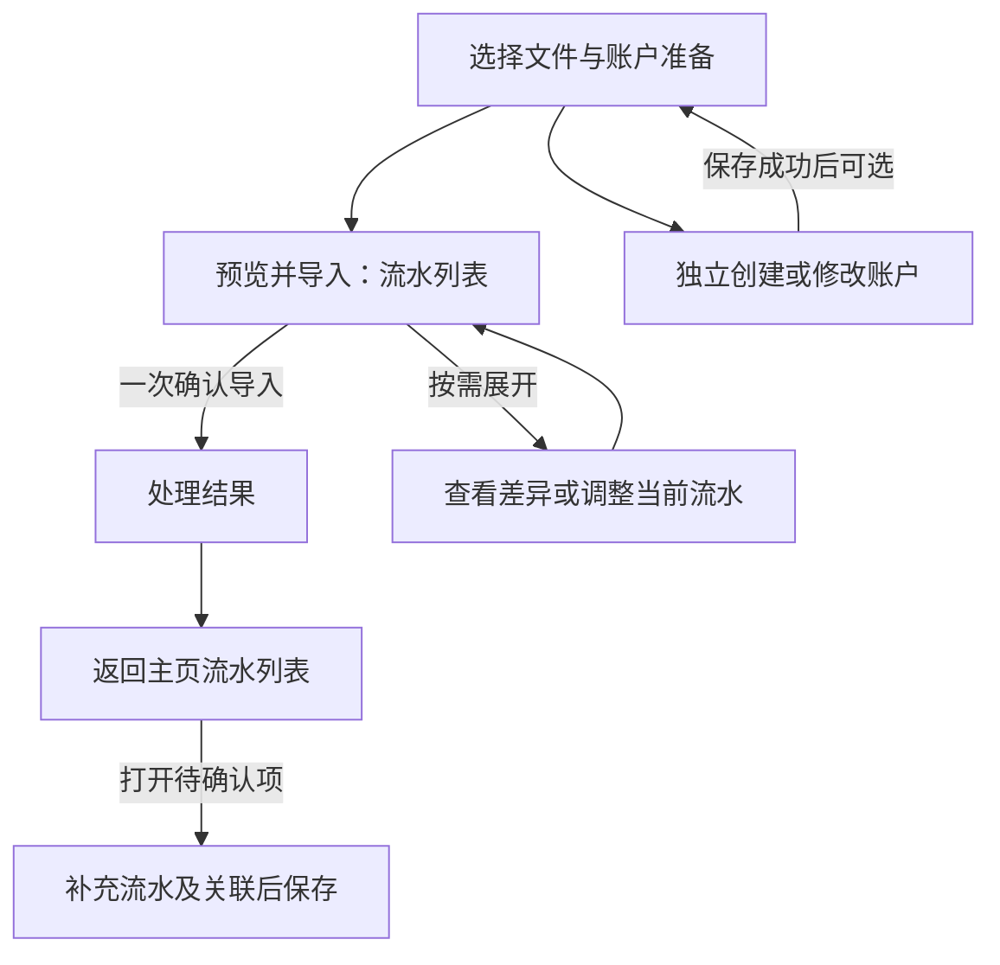
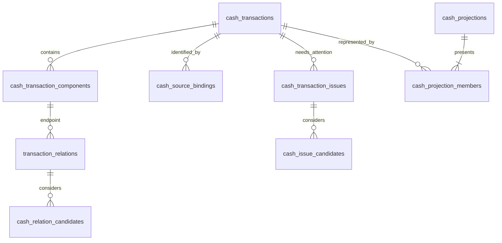

# 现金导入：用户流程、接口与数据契约

日期：2026-10-21
状态：设计提议，尚未实施。
上位规则：[现金导入流程重设计](cash-import-redesign.md)。本文按用户任务、接口、持久化顺序细化该设计，不改变已确认的字段更新、统计、配对和失败隔离规则。

## 1. 交付边界与现状

本文提供可供后续实现拆分的业务流程、协议字段、逻辑表结构及端到端验收。不是当前 API 文档，不声称接口、草稿入口或账户补偿已经可用。现有行为仍由 OpenSpec 主规格定义。

| 当前实现 | 本次目标 |
|---|---|
| Compose 导入已有选择文件、账户、流水、配对四步 | 替换为统一的“预览并导入”，流水核对、关联核对和确认由同一投影列表承载 |
| 导入中的新账户暂存在映射草稿，随确认写入 | 独立账户命令立即生效，成功后刷新可选账户 |
| Compose 只有账户查询能力，没有完整独立账户编辑流程 | 补独立账户表单调用及 Repository 命令，不能把当前内存草稿当成账户已保存 |
| `/api/v1/cash-import/scan`、`preview`、`commit` 承担旧合同 | 下文定义新会话和计划合同，后续统一切换调用方，不让客户端混用两套确认语义 |
| 现金记录、支付组成项、关系及投影已有表 | 按目标契约重建不合理结构；是否保留表名不构成必须沿用其旧结构的承诺 |

新增文档不创建 OpenSpec 实施变更。进入实现时需把下述目标写入相应 delta，尤其说明会话不保留原文件、单项失败隔离、账户独立生效和来源行可更新与当前规格的差异。

用户已明确允许彻底重构不合理流程和数据结构。现有代码只用于识别财务规则及切换风险，不构成流程、协议或 schema 的兼容门槛；不满足目标的页面状态机、DTO、旧写入口和持久化结构可以替换或移除。已确认的金额、类型、关系和统计语义仍是约束，不能以重构为由改变。如何处理既有数据属于后续实施切换设计，不授权直接删除真实数据。

## 2. 用户业务流程

### 2.1 入口与信息顺序

从主页流水列表的“导入账单”进入导入任务。选择文件和必要的账户准备之后，进入一个“预览并导入”界面：用户看到的是系统按拟生效关系生成的流水列表，每项展示“已确认”或“待确认”，底部只有一次“确认导入”。流水核对、关联核对、差异查看都是这个界面内的子动作，不拆成先后必经的页面或步骤。



最终确认前不保存流水、映射或关系；账户操作例外，独立立即生效。缺账户、缺分摊、部分文件错误和配对未确定均不阻止可处理内容继续。待确认项默认随本次导入保存，提示“待确认项可回主页处理”，无需用户逐项点击暂不处理。

### 2.2 同一任务内的内容与动作

| 区域／状态 | 用户看到的内容 | 系统默认处理 | 用户可做的事 | 操作条件 |
|---|---|---|---|---|
| 选择文件 | 文件名称、识别进度；有问题的文件显示具体原因 | 逐文件解析，成功文件不因其他文件失败而作废 | 添加／移除文件，为单个文件重传并输入密码；保留错误项继续 | 至少一条可辨认业务行，或有可展示的终结处理结果；正在改变文件集合的请求完成 |
| 选择账户 | 来源账户及建议归属，待选择项数量 | 复用已有映射建议；未确定项保留未知 | 选择账户；从入口独立创建或编辑账户；暂不处理 | 不要求全部映射完成；账户独立保存请求已结束 |
| 预览并导入 | 投影后的流水列表，逐项“已确认／待确认”；有来源变化的项可展开差异 | 自动对应来源并形成预计展示；强证据合法关系纳入拟确认图，未确认关系不连接；保护人工分类和备注 | 直接确认导入；按需打开一项查看差异、组成流水和关联；无需逐项处理待确认项 | 当前计划已生成，没有未提交的本地修改；单项待确认不禁用导入 |
| 结果 | 实际保存结果、待确认数量和未导入原因 | 待确认项默认引导回主页处理；实际未合并时不沿用预览合并结果 | 返回主页；按需查看错误或重试未导入项 | 结果已确定；网络未知状态走第 2.5 节 |

所有可应用更新的字段差异都可查看，“确认导入”同时确认这些更新，不额外逐条弹窗。用户选择“保留现有”只跳过本次更新，不建立永久禁止更新规则。人工分类和备注的保护规则不因预选更新而失效。强建议仍在最终确认前不生效；“暂不处理”保存草稿关系，“拒绝”形成忽略决定，两者不能共用一个动作。

只有用户主动展开某项维护时，才出现上述细分动作。主列表不要求先完成流水核对再进入关系核对，也不把来源行、关系建议和投影各展示成一份并列清单。文件无法解析、完全重复及冲突跳过通过摘要和按需展开的处理明细保留，不伪造为已保存的投影流水。

没有可靠编号不增加一步核对身份：正常对应自动完成。只有主设计第 6.2.1 节所述真实歧义才进入待补充；界面不把同批银行数据展示成两组要求逐笔选择。

### 2.3 列表如何合并及标记确认状态

预览列表由后端在内存中按当前计划生成，使用与正式列表一致的投影规则。用户只看日期、金额、账户、说明和确认状态；组成流水及关系仅在维护该项时展开。消费镜像和退款镜像联合生效后对应一个结果时，只展示一个合并项，不展示“消费配对任务”和“退款配对任务”两张产品卡片。

| 情况 | 列表表现 | 导入后的统计 |
|---|---|---|
| 信息完整、没有待处理问题 | 已确认；有拟确认合法关系时展示合并结果 | 按最终成功提交的正式投影统计 |
| 两条正式流水仅存在未确认关系 | 两条各自的投影项，均标待确认；不能提前合并成一项 | 两条仍分别参与统计，确认关系后才合并 |
| 缺必填信息或身份尚不明确的草稿 | 单条待确认项，只展示已知信息 | 不参与统计 |
| 已有正式流水附有当前待处理来源信息 | 保留当前正式投影、标待确认，不新增另一笔 | 按现有正式值统计 |

这里“已确认”表示当前没有待用户处理的事项、可按当前决定导入，不表示预览已经写入账本，也不代表用户逐条作过人工审核。`confirmation_status` 与流水 `state` 是两个维度：正式流水也可以待确认关联且继续统计。没有关系候选的正常完整流水无需人为制造一个待确认关系。

联合建议尚未确认或用户暂不处理时，组内关联决定一起保存为待处理，不合并正式流水；不允许只确认一个违反最终关系约束的子集。独立关联各自可处理。一项关联失败时，结果说明“未合并，流水已分别保留”，不说“导入失败”。非法关系不能伪装成草稿；必要时在相关流水上保存不含非法边的当前问题，供主页后续重新处理。

新增关系不得自动替换已有确认关系。需要解除或替换时，从相关流水详情维护，导入预览只说明当前不能合并。

### 2.4 导入后如何补充

主页流水列表与导入预览使用相同的投影展示语义和“已确认／待确认”标记。主页默认可展示已保存的正式项及草稿项，待确认筛选提供快捷定位；不新增一级问题中心或关系页面。草稿显示已知信息但所有金额汇总仍排除草稿，正式流水的待确认关联不改变现有统计口径。不能把用户引导回主页后，又将待确认项隐藏在默认不可见的独立列表。

活动待确认项的展示优先于全额退款等业务隐藏规则，统计资格仍按原口径；问题解决后恢复正常显示规则。此优先级不覆盖权限、工作区或逻辑删除边界。默认查询不能因为草稿时间为空而漏掉它，可在“时间待补充”分组展示；用户主动设置的具体筛选条件仍明确生效，结果页进入待确认筛选时清除妨碍定位的旧日期条件。

| 用户进入的对象 | 详情提供的动作 | 保存语义 |
|---|---|---|
| 缺账户、金额、时间或分摊的草稿 | 在同一流水详情补字段和关联；“保存待确认”；完整后“确认保存” | 前者保持草稿；后者在当前详情内预览变化并联合保存成为正式流水，保留原身份，不跳到独立配对步骤 |
| 正式流水的来源更新待处理项 | 查看已有值与当前待处理值；应用或保留现有 | 应用仍遵守统一字段约束并保护人工覆盖；保留现有只结束当前问题 |
| 无法自动确定身份的少数草稿 | 查看候选，在确有需要时确认独立记录或对应已有流水 | 只有用户主动进入该问题才提供选择；合并不相加金额，来源对应随之转移 |
| 尚未确认的关联 | 在流水详情展开相关记录并确认、拒绝或继续暂存 | 未确认继续分别显示；确认后按当前合法图合并 |
| 正式流水编辑 | 展示可编辑字段；固定字段只读 | 修改类型时展示将解除的关联，点击保存一并确认；不寻找替代配对 |

已经完整的草稿仍可“保存待确认”，不会因为一次普通保存意外进入统计。用户选择“确认保存”才转换状态。更新来源补足草稿时，导入最终确认可以同时承担这个确认，无须再打开详情操作一次。

保存后仍停留于当前详情并刷新结果。关系合并／拆分会改变投影标识，客户端按稳定流水引用重新定位当前展示结果，不继续访问已失效的旧投影；草稿合并则使用响应中的保留流水引用。

### 2.5 失败、退出与重入

| 场景 | 交互与后续 |
|---|---|
| 某个文件需要密码、无法解析 | 允许只处理其余内容；需要以后重新上传的文件明确提示，不伪装成已保存草稿 |
| 所有文件均无法得到业务行 | 显示文件结果并允许退出／重选；不显示可保存流水的“确认导入”按钮 |
| 全部重复或按规则跳过 | 可以完成处理并获得结果，“无新增流水”不是失败 |
| 有草稿但没有正式记录 | 允许确认，结果明确“已保存待补充”，不宣称进入收支统计 |
| 提交中 | 禁止重复点击及修改计划；普通关闭请求提示正在保存，可等待；不触发账户撤销 |
| 提交响应丢失 | 显示“正在确认保存结果”；查询收据或使用原幂等键重试；禁止更换键重复提交 |
| 已明确事务回滚 | 显示未保存，允许重试；独立账户改动仍有效，退出时询问是否撤销 |
| 部分完成 | 成功项保持；问题按行或关联展示。有临时重试内容时可“重试未导入项”，生成新会话和计划；过期后重选文件，不重新执行原请求 |
| 提交前正常退出、没有账户改动 | 沿用未完成任务的退出确认，说明尚未保存；不逐条询问 |
| 提交前正常退出、有账户改动 | 合并成一次询问：“撤销并退出／保留并退出／继续导入”，不再叠加第二次离开确认 |
| 撤销账户失败或冲突 | 保留不能安全撤销的部分，说明账户名称及原因；可继续处理或保留并退出 |
| 提交已成功，包括部分完成和仅草稿 | 退出不再询问撤销账户；成功使用的账户和其他独立改动都保留 |
| 会话尚未过期，在当前任务中刷新／重试 | 用会话标识恢复解析结果及最后一次预览输入；账户撤销旧值只在内存，刷新不保证仍能自动恢复；不承诺恢复尚未发送的输入 |
| 离开已取消任务后重新进入，或会话过期 | 重新选择文件；已确认保存的草稿从账本维护，不能从已删除原文件重新解析 |
| 浏览器关闭、进程被杀 | 不保证离开询问或补偿执行；保留已生效账户。重新进入先核实已发出的提交；计划过期且服务端确认未提交后可重新导入 |

前端仅保留恢复所需的会话标识、幂等键和账户操作标识，不将原文件、密码或财务正文放入长期本地存储。账户撤销前的旧值仅在当前任务内存中保存；刷新导致这些值丢失时不能猜测还原，账户保持生效。提交结果未知时保留原提交标识以便恢复，不以会话过期推定未提交。

### 2.6 跨端与界面设计约束

用户任务是“看一个流水列表，确认导入，待确认事项回主页处理”。FinanceTheme、Material 3、字体和金额颜色继续遵循项目约束，不新增产品导航。`COMPACT` 单列全屏，`REGULAR`／`WIDE` 可使用侧面任务容器；区域顺序为标题、文件及账户准备、预览流水列表、固定确认操作。具体组件和旧步骤状态机可以重写，不要求为了复用保留四步导航。账户表单最大宽度 720 px，窄屏不横向滚动。

将删除的冗余信息：独立“核对流水／核对配对”步骤、并列的关系任务列表、无编号逐条身份问答、未完成账户映射导致的整页阻断、单独关系管理入口、重复的退出弹窗、内部关系图及投影术语、正常状态的大段流程教学。来源原文、组成流水和差异按需展开，错误原因紧邻对象。

设计方向自查：优先暴露需处理的问题，正常结果可批量确认；只有一个最终导入动作，账户操作明确独立保存；不靠颜色单独表达错误；键盘和系统返回统一走任务关闭逻辑。Web、Android、iOS 及共享 presentation 均受影响。此处交付信息架构与交互合同，不交付最终视觉 UI；实施时还需 Hallmark 方向及最终 audit、三种窗口真实 QA 和演示评审。

## 3. 前后端接口契约

### 3.1 通用规则与身份

以下路径均以 `/api/v1` 为前缀，是目标合同。新增会话路径替代旧 `scan/preview/commit` 合同；客户端统一切换后移除不满足目标的旧写入口，不为兼容旧流程保留绕过约束的路径。解析、来源核对及关系规划是服务内部阶段，不对应前端必经页面。

- 认证、工作区选择沿用现有机制。工作区取自认证上下文，不信任正文；计划和会话还绑定操作者。读操作需工作区访问权，导入及维护需写权限，每次提交重新校验。
- `transaction_id`、`component_id`、`account_id`、`relation_id` 在新 DTO 中统一为不透明字符串，可由既有数据库代理键编码，不新增一套财务业务身份。它们只在当前数据库内定位；跨导入识别仍使用来源作用域和 `record_id`。
- `row_ref` 仅定位会话内来源行；`operation_ref` 定位一个计划内操作。多个重复来源行可共同指向同一保存操作，不能按来源行数重复写入。
- `session_id`、`plan_id`、`receipt_id` 为服务端生成的不透明标识。服务端保存计划，客户端不能提交自造操作或闭包。`session_revision`、`row_revision`、`account_revision` 是单调整数，不是历史版本链。
- 金额及汇率使用十进制字符串，禁止 JSON 浮点，未知金额为 `null`；时间使用含时区的 RFC 3339，展示转换由客户端负责。字段缺省表示不修改，`null` 只用于合同允许为空的字段；文本清空使用 `""`，属性清空使用 `[]`。
- 普通请求结构错误返回 HTTP `422`；可定位的行字段问题进入行结果，不把一行无效数据提升为整个预览失败。错误只返回稳定 `code`、安全 `message`、`field_errors`、`retryable`。
- 计划输入改变后生成新 `plan_id`，旧计划不可提交。账本并发变化不一概使整批失败，执行时仅跳过受影响且无法按原授权应用的项。

计划生成和替换是临时存储中的原子比较写入：导入预览带当前 `expected_session_revision`，成功后修订加一，并同时更新 `last_plan_id`、输入和计划。响应返回递增后的修订；并发创建的两个计划只能有一个基于同一旧修订成功。提交在工作区锁内再次验证最新计划及有效期，不能锁外读完旧计划后无条件执行。

预览发布、文件集合修改、取消以及提交读取最新计划必须使用同一工作区锁同步：耗时解析／计算可在锁外，发布时在锁内比较修订并检查提交状态。提交从最终校验到事务结果确定期间持有该锁，其他发布／取消不得穿插；重新获得锁后先查消费收据再决定是否允许修改。此规则同样适用于维护编辑上下文，不能只靠临时存储 CAS 留下“验完旧计划后新计划又发布”的窗口。

### 3.2 会话、文件与预览

| 方法与路径 | 请求 | 响应及副作用 |
|---|---|---|
| `POST /cash-import/sessions` | multipart 文件；各文件 `client_file_ref`、可选当次密码 | `201` 返回 `SessionView`；逐文件读取后删除原输入，只保留解析行；最多 20 份、每份 100 MB |
| `GET /cash-import/sessions/{session_id}` | 无 | `SessionView`，不返回文件下载地址或密码 |
| `POST /cash-import/sessions/{session_id}/files` | 新文件或指定 `file_ref` 重传，`expected_session_revision`；密码仅本次传输 | 返回更新后的会话；重传只解析该文件，旧计划失效 |
| `DELETE /cash-import/sessions/{session_id}/files/{file_ref}` | `If-Match` 会话修订 | 删除该文件解析内容及临时决定；其他文件不重读；旧计划失效 |
| `POST /cash-import/sessions/{session_id}/plans` | `PreviewInput` | 返回不可变 `ImportPlanView`，不写业务流水 |
| `GET /cash-import/plans/{plan_id}` | 无 | 读取计划摘要及第一页；分页路径见下文 |
| `POST /cash-import/plans/{plan_id}/commit` | `{"expected_session_revision": 4}`；`Idempotency-Key` | `200` 返回已提交收据，包括全部成功、部分完成或无新增 |
| `POST /cash-import/receipts/{receipt_id}/retry-sessions` | 可选失败 `row_refs[]`，新幂等键 | 在临时重试内容有效时生成新会话，返回 `SessionView`；不执行旧请求，不重跑成功项 |
| `DELETE /cash-import/sessions/{session_id}` | 无 | 取消未提交会话、清理解析内容；不撤销账户，不撤销已提交导入；提交中返回 `409` |

`SessionView`：`session_id`、`session_revision`、`expires_at`、`state`（`open/committed/cancelled`）、`files[]`、`source_accounts[]`、`last_preview_input`、`last_plan_id`、`can_preview`。过期会话返回 `410 session_expired`。

文件元素包含 `file_ref`、脱敏 `display_name`、`status`（`ready/partial/password_required/failed`）、已识别行数、安全问题与 `can_retry`。不能识别行数时为 `null`。需要密码的文件只有状态和显示信息；重试必须带文件内容，后端不能凭会话重新读取它。

来源账户元素包含 `source_account_ref`、渠道、安全显示名称、建议 `account_id`、建议依据和是否已选择；内部完整账号只在授权来源信息读取中按现有规则使用，不能回传为列表调试信息。

`PreviewInput` 使用完整替换的选择集合，避免省略和撤销混淆：

```json
{
  "expected_session_revision": 4,
  "previous_plan_id": "plan_previous",
  "account_selections": [
    {"source_account_ref": "sa_1", "account_id": "41", "expected_account_revision": 3},
    {"source_account_ref": "sa_2", "account_id": null}
  ],
  "row_choices": [
    {"row_ref": "f1:r8", "action": "keep_existing"},
    {"row_ref": "f2:r3", "action": "apply", "patch": {"note": "原始备注"}}
  ],
  "relation_choices": [
    {"suggestion_id": "sg_1", "action": "defer"},
    {"suggestion_id": "sg_2", "action": "accept", "candidate_id": "candidate_7"}
  ]
}
```

未出现在 `row_choices` 的行采用服务端默认：完整新增、合法更新拟应用，不完整新增拟草稿，重复不改写，冲突跳过。未出现在 `relation_choices` 的建议：唯一强证据拟接受，其余拟暂存；最终仍由用户确认整个计划。客户端可选 `apply/keep_existing/defer`，其中 `defer` 只允许服务端声明可保存的草稿或当前问题，不允许将固定字段冲突转成更新草稿。

用户直接编辑 `note` 的补丁与来源解析值分开提交，前者设置人工覆盖；客户端不可提交 `manual_overrides`。请求体字段未被该行 `editable_fields` 允许时，该行返回字段问题；JSON 结构本身不合法才拒绝整个请求。

同一计划中的联合建议通过 `suggestion_id` 引用完整组，不能用单条边绕过。`candidate_id` 只能来自服务端当前候选；改类型、对侧或成员后重新预览。映射或流水修改使旧建议失效时，返回失效选择列表，不静默改对侧。

第一次预览 `previous_plan_id=null`；修改选择时传上次返回的计划标识、当前会话修订及完整输入集合。选择中的建议和候选标识先按旧计划验证，再按当前事实重新生成新计划；失效选择不能静默转成另一个候选。新计划使用自己的标识和修订，原计划始终不可变。

### 3.3 计划与逐项结果

`ImportPlanView` 必填字段：

| 字段 | 含义 |
|---|---|
| `plan_id/session_id/session_revision/expires_at` | 本次确认的精确上下文 |
| `summary` | 预计正式新增、更新、草稿保存、重复、跳过，以及关联确认、暂存、失败的独立数量 |
| `items[]` | 主体是预计投影列表：合并后展示字段、确认状态、成员引用及待处理原因；客户端不能自己合并来源行 |
| `item_counts` | 预计可见的 `confirmed/pending` 项数，与来源行数、内部关系边数分开 |
| `file_results[]` | 文件级问题，不能伪装成单条流水 |
| `can_commit` | 可终结处理，包括全部重复；无可辨认行且只有文件错误时为 `false` |
| `pages` | 投影项及处理明细的分页游标 |

`GET /cash-import/plans/{plan_id}/items/{preview_item_id}` 在用户维护某项时返回 `members[]`、`field_diffs[]`、`issues[]`、`relation_choices[]` 和 `relation_effects[]`。成员包含来源行引用或已有流水引用、字段和允许动作；关联选择包含服务端建议／候选 ID 及联合范围；关联影响包含类型修改将保留或解除的旧关系。它们从属于这一项详情，不是另一份顶层关系列表。

成员内部 `planned_action` 为 `create_posted/create_draft/update_posted/update_draft/finalize_draft/duplicate/skip`；实际结果另用 `outcome`，不拿计划状态冒充已保存。只要与本次成功操作相关的完整投影需要展示已有对侧，就将该已有成员纳入当前预览项，但不把它算成新增或主动更新。

`PreviewItem` 的字段：

| 字段 | 类型与语义 |
|---|---|
| `preview_item_id` | 本计划内不透明标识，不能用作提交后的正式投影 ID |
| `confirmation_status` | `confirmed/pending`，按当前问题、草稿状态和未确认关系派生，不是独立持久化的审核开关 |
| `anticipated_state` | `posted/draft`；用于解释统计资格，不向用户暴露内部枚举 |
| `display` | `occurred_at/amount/currency/counterparty/note/accounts[]`；未知值可空，金额为字符串 |
| `statistics_eligible` | 按预计正式投影与既有财务口径计算；不是由确认状态直接决定 |
| `member_refs[]` | `{row_ref}` 或 `{transaction_id}`，一个成员不能同时用两种身份重复计算 |
| `attention_reasons[]` | 安全原因及 `after_import_action=open_home_item`；待确认默认回主页处理 |
| `detail_available` | 是否可展开该项；正常预览不要求展开 |

示例：两条完整支出仅有待确认镜像时，后端必须返回两项，而不是一个提前合并的待确认项：

```json
{
  "item_counts": {"confirmed": 0, "pending": 2},
  "items": [
    {
      "preview_item_id": "pi_1",
      "confirmation_status": "pending",
      "anticipated_state": "posted",
      "display": {"occurred_at": "2026-10-01T12:00:00+08:00", "amount": "-100", "currency": "CNY", "counterparty": "示例商户", "note": "", "accounts": ["示例支付账户"]},
      "statistics_eligible": true,
      "member_refs": [{"row_ref": "f1:r1"}],
      "attention_reasons": [{"code": "relation_pending", "message": "待确认关联，可回主页处理", "after_import_action": "open_home_item"}],
      "detail_available": true
    },
    {
      "preview_item_id": "pi_2",
      "confirmation_status": "pending",
      "anticipated_state": "posted",
      "display": {"occurred_at": "2026-10-01T12:00:01+08:00", "amount": "-100", "currency": "CNY", "counterparty": "示例商户", "note": "", "accounts": ["示例银行卡"]},
      "statistics_eligible": true,
      "member_refs": [{"row_ref": "f2:r1"}],
      "attention_reasons": [{"code": "relation_pending", "message": "待确认关联，可回主页处理", "after_import_action": "open_home_item"}],
      "detail_available": true
    }
  ]
}
```

同一例中，关系纳入拟确认图且整体合法时，列表改为一个 `confirmed/posted` 项，两个成员、金额 `"-100"`；未确认不能只把它的状态改成 `pending` 而保留合并金额。上述 JSON 只展示计划的列表字段，计划标识、摘要及文件结果仍遵守完整响应合同。

`FieldDiff` 包含 `field`、`current`、`incoming`、`effective`、`resolution`；`resolution` 可为 `apply/protected/fixed_conflict/keep_existing`。人工保护的备注即使来源不同，也显示最终保留值。来源行差异支持展开，不在默认列表展开整个 JSON。

每个问题包含 `code/message/field_path/blocking_scope/next_action`。`blocking_scope` 为 `row/relation_group/file/request`；仅 `request` 影响整次请求。用户文案不显示这些内部枚举。`next_action` 限定为 `edit/reselect_file/open_record/review_relation/retry/none`，由客户端映射入口。

预览主列表通过 `GET /cash-import/plans/{plan_id}/items?cursor=...&limit=...&confirmation_status=...` 分页，默认 50、最大 200。重复、跳过、失败来源行从 `/processing-details` 按需读取，不进入正常投影列表。游标绑定不可变计划与筛选；客户端切换筛选重新取第一页。确认适用于完整计划，不只适用于已加载页面。关系选择变化后整个受影响预览组重新投影，不能只更新一张关系卡而保留过时金额。

收据 `MutationReceipt`：

```json
{
  "receipt_id": "receipt_example",
  "plan_id": "plan_example",
  "status": "partial",
  "committed": true,
  "needs_attention_count": 1,
  "summary": {
    "created_posted": 1,
    "updated_posted": 0,
    "saved_draft": 1,
    "finalized_draft": 0,
    "duplicate": 1,
    "skipped": 1,
    "relations_confirmed": 0,
    "relations_deferred": 0,
    "relations_failed": 1
  },
  "row_results": [
    {"row_ref": "f1:r1", "operation_ref": "op1", "outcome": "created_posted", "transaction_id": "101"},
    {"row_ref": "f1:r2", "operation_ref": "op2", "outcome": "saved_draft", "transaction_id": "102", "message": "尚未选择账户，已保存为待补充流水"},
    {"row_ref": "f1:r3", "operation_ref": null, "outcome": "duplicate", "transaction_id": "88"},
    {"row_ref": "f1:r4", "operation_ref": "op4", "outcome": "skipped", "code": "fixed_field_conflict", "message": "已有流水的金额与本次账单不同，未更新"}
  ],
  "relation_results": [
    {"suggestion_id": "sg1", "outcome": "failed", "code": "endpoint_changed", "message": "相关流水已变化，本次未合并"}
  ],
  "projection_version": 19
}
```

摘要中的写入数量按唯一 `operation_ref` 计数；每个来源行仍有结果，同批重复来源行可返回 `duplicate_in_batch` 并引用同一操作。`relations_*` 按建议决定计数，组内每条关系明细另返回，不能一处按组、另一处按边相加。

收据 `status=completed/partial/no_changes/failed` 描述已提交的处理结果；`committed=true` 表示执行结果已持久保存，不等于业务全部成功。已保存草稿属于成功写入。`partial` 表示有成功操作，也有失败或被跳过的有效业务操作／文件；`no_changes` 表示只有重复、用户保留现有或白名单跳过。`needs_attention_count` 表达草稿和待处理关联，避免把它们混成失败。若没有任何成功写入且存在有效业务操作失败，返回 `status=failed`，界面显示“未导入任何记录”，仍允许退出时撤销独立账户改动。事务整体回滚使用错误响应，不能生成已提交收据。

`needs_attention_count` 按有当前问题的唯一流水计数；同一流水的多个问题或关系不重复加数，跨两笔流水的草稿关系可使两笔分别待处理。`saved_draft` 包含新增及更新草稿，逐项结果另外给出 `created/updated`。

面向用户的待确认数量另由最终可见投影按 `confirmation_status=pending` 计数，字段为 `pending_item_count`；不能把内部流水数当成列表项数。收据包含 `affected_transaction_ids` 及提交后当前 `projection_refs`，客户端用正式查询刷新实际结果，不能在部分失败后继续展示原先预计的合并列表。

### 3.4 幂等、并发及结果恢复

| 情况 | HTTP 与客户端动作 |
|---|---|
| 会话或计划属于其他用户／工作区 | `404`，不泄漏对象是否存在 |
| 预览输入基于旧会话修订，或旧计划已被新计划替代 | `409 plan_changed`，刷新当前预览 |
| 提交时一条流水修订变化、账户不可用或一组关系失效 | 该项跳过，其他项继续；已提交响应仍为 `200` |
| 相同幂等键与相同计划重试 | 原收据，不能重跑其中失败项 |
| 同键不同计划／请求摘要 | `409 idempotency_conflict` |
| 会话已成功消费，另一个键再次提交 | 返回 `409 session_committed` 和有权访问的收据引用，不再写入 |
| 事务确定回滚 | 安全的 `503 commit_failed`，`commit_state=not_committed`；原请求可重试 |
| 连接中断且结果不能确定 | `503 commit_state_unknown` 或无响应；先恢复查询，不能以超时当作回滚 |

`GET /cash-mutations/receipts/{receipt_id}` 返回摘要，`/rows`、`/relations` 分页返回结果。`GET /cash-mutations/receipts/by-key/{key}` 在当前用户、工作区内查询，路径及键从访问日志中脱敏。返回 `200` 表示已提交；未发现用 `404 receipt_not_found`，**不代表事务肯定没提交**，客户端仍只能重试原请求或继续查询。

服务端提交先查收据，再读取计划；这样会话清理后原请求仍能返回结果。原请求摘要覆盖计划标识、会话修订和操作种类，不包含客户端临时 UI 状态。工作区写锁内再次查键和会话消费状态；会话只允许一次成功消费。永久收据不保存原账单内容、完整字段差异或计划副本，只保存操作结果和定位引用。

`POST /cash-mutations/resolve` 接收 `plan_id/idempotency_key`，用于终结网络未知状态。服务端在同一工作区写锁内等候在途提交退出并再次查询：有收据返回 `committed` 和收据；计划仍有效且没有收据返回 `retry_original`；计划已永久过期或取消、无法再执行且没有收据时返回权威的 `not_committed`；锁暂不可得返回 `pending`。客户端据此结束核实，不能无限卡在“未查到”。取得锁后的提交必须重验计划有效性，确保已过期请求不会在该判定后又提交。

部分失败的再次处理分两条：已保存草稿和关联问题从账本详情继续；有可靠解析行的临时写入失败，可在原 TTL 内由 `/retry-sessions` 派生新会话。提交前将可重试失败行准备到受控临时重试上下文，外层事务提交成功后才可凭收据访问；失败则随 TTL 清理。永久收据只保留定位及到期时间，不保存这些行正文。失败关系有完整正式端点时直接从详情重新预览；不能形成安全行的解析错误仍需重选文件。

派生会话只含选定失败行，携带原来源作用域、已知对应及必要计数上下文，不把子集冒充完整银行导出。复用已有强对应并重验当前记录；缺证据时不能凭子集数量新增。重试上下文过期返回 `410 retry_context_expired`，界面要求重选文件；重新导入仍自动去重已成功记录。服务端通过收据决定哪些失败项可以派生，客户端不能任意索取其他会话的来源行。

### 3.5 后续维护与读取

| 方法与路径 | 输入与输出 |
|---|---|
| `GET /cash-projections?state=posted\|draft\|all&confirmation_status=confirmed\|pending&...` | 主页默认 `state=all`，待确认筛选使用 `confirmation_status=pending`；服务端返回投影及问题摘要，统计仍排除草稿 |
| `GET /cash-projections/{projection_id}` | 展示结果、成员引用、当前问题；已失效投影返回可重新定位的安全结果 |
| `GET /cash-records/{transaction_id}` | 详情维护字段、组成项、`row_revision`、`editable_fields`、当前问题和关联；不能被正常列表用来拼接统计 |
| `GET /cash-records/{transaction_id}/projection` | 当前投影引用；合并／拆分后重新定位用 |
| `PATCH /cash-records/{transaction_id}/draft` | `expected_revision` 与字段补丁；只保存草稿，即使完整也不转正式；返回详情和问题 |
| `POST /cash-mutations/plans` | 正式编辑、草稿转正式、当前问题处理或详情内关系维护；返回同类不可变计划 |
| `GET /cash-mutations/plans/{plan_id}` 及 `/items`、`/items/{preview_item_id}` | 读取维护计划的预计流水结果及详情，权限、游标和到期规则与导入计划一致 |
| `POST /cash-mutations/plans/{plan_id}/commit` | `Idempotency-Key`；统一字段约束及局部提交；返回 `MutationReceipt` 和最新定位 |

草稿补丁请求也使用幂等键与并发修订，避免响应丢失后误报冲突。`state` 不属于补丁字段，用户不能直接改为 `posted`。正式编辑补丁只能包含主设计白名单；固定字段实际变化拒绝该操作，原记录不动。

组成项 DTO 使用 `component_id`、`account_id`、`amount`、`currency`、`ordinal`。草稿补丁省略 `components` 时保持原组成项，提供时表示完整替换；已有项须携带属于当前流水的 `component_id`，新增项省略该字段并由服务端分配，删除项通过从数组移除表达。组成项删除与相关草稿引用清理在同一保存点内完成，不能留下失效端点；正式流水不开放组成项替换。

维护计划请求为判别联合：

```json
{
  "intent": "finalize_draft",
  "previous_plan_id": null,
  "expected_plan_revision": null,
  "transaction_id": "102",
  "expected_revision": 2,
  "patch": {},
  "relation_choices": []
}
```

`intent` 可选 `edit_record/finalize_draft/resolve_issue/maintain_relations`。`resolve_issue` 另外提供 `issue_id`、`expected_issue_revision`、`resolution=apply_source/keep_existing/merge_into/create_independent` 及适用的目标引用；允许值由具体问题返回，不能将固定字段冲突用 `apply_source` 强行应用。`merge_into` 必须保护已有正式值及人工覆盖，冲突时保留问题，不能静默拼接金额。

首次维护预览创建一个临时编辑上下文并返回 `edit_context_id/plan_revision`。修改补丁或关联选择时再次 `POST /cash-mutations/plans`，携带该上下文、`previous_plan_id/expected_plan_revision` 和完整输入；服务端按比较写入生成新计划并使旧计划不可提交。无须重新读取原文件；记录并发仍由 `expected_revision` 单独约束。维护提交请求带 `expected_plan_revision`，成功后消费该编辑上下文；过期返回 `410 plan_expired`，用户从当前详情重新预览。

`maintain_relations` 从相关 `transaction_id` 出发提交当前建议或关系引用以及 `accept/defer/ignore/remove`；类型变化造成的系统解除由服务端计算，不作为客户端任意删除集合。仅普通备注等无关联影响的编辑，前端在点击“保存”后可以先请求计划再立即提交；若服务端返回新的关联解除或用户未见的差异，先展示确认，不增加正常编辑的空确认弹窗。

投影响应含 `state`、`confirmation_status`、可空展示金额／时间、`attention_count`、`statistics_eligible`、`projection_version`。`confirmation_status=pending` 当且仅当是草稿或有未解决问题／未确认关联，否则为 `confirmed`；它是派生显示属性，不另建人工审批状态。统计端点始终排除草稿，前端不能自行按混合列表求和。投影与成员在同一读取快照返回；分页游标携带发布序号，翻页时版本变化返回可识别的 `409 read_snapshot_changed`，客户端重载，避免新旧成员混读。

主页可见条件为已授权的活动当前投影满足 `visible OR confirmation_status=pending`，列表与待确认计数使用同一条件。全额退款组即使原 `visible=false`，有待处理事项也必须可找到；不能为了让它显示而改写净额或统计资格。

### 3.6 独立账户接口与退出补偿

现有账户写 API 使用账户名称定位且缺少所需修订合同。目标补充按稳定 ID 操作的普通账户 API；不是导入回滚专用 API：

| 方法与路径 | 合同 |
|---|---|
| `POST /accounts` | `name/type/currencies`，幂等键；立即创建，返回 `account_id`、字段及 `account_revision` |
| `GET /accounts/by-id/{account_id}` | 返回当前字段、修订及可操作能力 |
| `PATCH /accounts/by-id/{account_id}` | `expected_revision`、允许修改的账户字段；原子更新并增加修订 |
| `DELETE /accounts/by-id/{account_id}` | `expected_revision`、幂等键；只有普通删除规则允许且无使用引用时成功 |

名称、启用状态和支持币种在本次需要的普通编辑范围内；账户类型沿用创建后固定的合同，不因为要撤销就开放任意类型修改。创建和补偿均用独立幂等键；前端记录每次已生效操作的键、前后修订和改动字段，重复补偿返回相同结果。`409 account_changed` 或 `409 account_in_use` 时不能强行覆盖／删除。

沿用普通删除“已停用且无使用记录”的前置条件。撤销本次新建且仍启用的账户时，前端先以预期修订 `PATCH active=false`，再使用返回的新修订 `DELETE`，两个动作各自幂等。停用成功但删除失败，必须显示“账户保留，已停用”的实际状态；只有修订仍等于本次停用结果时，才可通过普通 `PATCH` 安全恢复原启用状态，不能覆盖其他操作。补偿中间失败不误报全部撤销。

账户表及其引用的检查与写入必须具备原子性：导入引用账户和账户删除／移除币种都取得同一账户锁或等价数据库约束，在同一事务内重验。不能“先查无引用，再无条件删除”。已有其他草稿引用也算使用。

前端账户操作记录不进入导入计划；计划仅保存账户引用和预期修订。同一账户由其他流程更新时，导入只重新校验相关记录；仍符合原选择语义的名称等展示变化无需跳过，失效账户或币种变化只影响对应流水。

## 4. 后端逻辑表结构契约

### 4.1 通用类型、关系与权威数据

下文是目标逻辑 schema，标为“调整”的项只是说明存在同名旧实体，不意味着必须以增量加列实现。旧关系状态、JSON 候选数组、强制非空组件锚点及混用来源哈希的身份结构不满足合同，可以直接用目标结构替换。表名不是兼容约束。不附可直接执行的迁移，不处理历史数据回填；切换和回滚在实施变更中另行完成，不能通过默认值把旧数据伪造成已经核验的草稿或来源对应。

所有业务表带 `workspace_id`；内部主键继续使用现有代理键，新独立标识可用 UUID。被引用实体提供 `(workspace_id,id)` 唯一键，关联表用复合外键防跨工作区。前端字符串标识在适配层转换。金额沿用精确十进制适配器：PostgreSQL `NUMERIC(38,18)`、SQLite 无损十进制文本；两端写入前统一拒绝超过 20 位整数或 18 位小数的值，不允许数据库静默舍入。时间按 UTC 保存并保留明确解析时区语义。

权威数据只有当前流水、组成项、关系决定和来源对应；投影、候选证据和摘要可重算。导入计划是临时授权执行的内容，不是第二份正式账本。



图只表达主要联系；草稿关系的父流水锚点、候选端点和账户映射的精确约束以下表为准。

### 4.2 `cash_transactions`（调整）

| 字段 | 目标类型／空值 | 约束和写入责任 |
|---|---|---|
| `id/workspace_id/created_at` | 沿用，非空 | 系统维护 |
| `state` | `draft/posted`，非空 | 新增；只能由对应命令转换 |
| `row_revision` | 正整数，非空 | 新增；业务值、当前问题或影响该记录维护视图的关系状态变化时增加 |
| `source_type/record_id` | 导入记录非空；手工记录沿用现状 | 活动记录业务身份唯一；无编号时一次生成合成标识，不能使用会变化的描述哈希 |
| `source_payload` | JSON，可空 | 导入记录保存当前原始来源列；手工记录可空，用户允许更新 |
| `source_fingerprint` | 文本，可空 | 当前来源内容摘要，不是完整记录版本 |
| `relation_metadata` | JSON，可空 | 当前逐行来源解释，跨行选择放关系／候选中 |
| `manual_overrides` | JSON，非空，默认 `{}` | 记录 `note/category_id` 是否人工覆盖，包含明确清空；客户端不可直接写 |
| `occurred_at/amount/currency` | 草稿可空 | 正式必须完整，正式后固定；未知金额不写 `0` |
| `cash_granularity/account_id` | 草稿允许未知 | 正式 `atomic` 对应唯一组成项和一致账户；`aggregate` 不填伪造的单一账户 |
| `record_type/record_subtype` | 草稿可空 | 正式非空且组合合法；已填草稿值同样必须合法，原始非法输入保留在来源行和问题中 |
| `counterparty/counterparty_account/note` | 文本，非空默认 `""` | 按统一字段白名单更新，备注不截断或合成 |
| `counterparty_account_attrs` | JSON 数组，默认 `[]` | 仅基本结构检查，不做账号语义校验 |
| `category_id` | 可空，工作区内分类外键 | 人工分类保护独立于类型 |
| `deleted_at/deleted_by/delete_reason` | 沿用 | 逻辑删除后退出活动唯一性、关系与投影，不物理删除原记录 |

正式必填检查形如 `state <> 'posted' OR (amount IS NOT NULL AND occurred_at IS NOT NULL AND currency IS NOT NULL AND record_type IS NOT NULL AND record_subtype IS NOT NULL)`，不能只比较字段值而放过 SQL `NULL`。金额有限、日期可解析和类型组合由共享领域校验，双方后端一致。

索引：沿用活动 `(workspace_id,source_type,record_id)` 唯一键；新增 `(workspace_id,state,deleted_at,occurred_at,id)`；来源候选查询索引使用不可变候选字段，**不能设为唯一键**。同秒同额真实交易允许存在多条。

### 4.3 `cash_transaction_components`（调整）

沿用 `id/workspace_id/cash_transaction_id/account_id/amount/currency/ordinal/label/source_key/metadata_json/created_at`。草稿允许账户、金额、币种为空，但父引用、`ordinal` 非空；唯一 `(workspace_id,cash_transaction_id,ordinal)`。与父表和账户的复合外键有效，`account_id=null` 不代表虚拟账户。

组成项不另存 `state`，继承父记录状态。正式父记录至少一个完整组成项、币种及合计正确；`atomic` 恰一个，`aggregate` 按已确认分摊保存。跨表约束由共享服务在锁内校验；余额查询必须连接活动正式父记录，不能只看组成项金额非空。

正式组成项字段按主设计固定。草稿删除组成项前，清理对应候选，关联草稿退回父锚点；禁止通过级联删除留下错误关系。调整顺序不替换组成项主键。

### 4.4 `cash_source_bindings`（新增）

| 字段 | 类型／约束 |
|---|---|
| `id/workspace_id/transaction_id` | 主键及复合流水外键，非空 |
| `source_type/source_scope_kind/source_scope_key` | 渠道、`account/file_local` 作用域种类及非空作用域键；本方账户未知时 `file_local` 用文件摘要及解析命名空间，只支持同文件幂等 |
| `identity_kind` | `provider_id/file_occurrence` |
| `identity_key` | 渠道稳定编号的规范编码（可用定长摘要，原编号保留在来源行），或文件摘要＋表格位置＋行位置＋解析规则命名空间的规范编码；不是可变内容摘要 |
| `identity_strength` | `provider/validated/manual/file_local`，说明当前对应依据；不能把文件位置标为跨文件交易身份 |
| `stable_evidence_key` | 可空，仅保存来源已认证的固定逐行证据规范键；包含来源账户作用域，不能由描述、类型或内容散列代替；用于同证据查找和不同证据排除 |
| `strategy_version` | 当前对应策略标识，不参与“哪个账单更新”的优先级 |
| `coverage` | JSON：来源声明的范围、边界、筛选及完整性；未知显式为未知 |
| `revision` | 正整数，更新绑定目标时增加 |
| `created_at/updated_at` | 系统时间 |

唯一 `(workspace_id,source_type,source_scope_kind,source_scope_key,identity_kind,identity_key)`，索引 `(workspace_id,transaction_id)`。它表达当前对应，不保存字段历史。一个流水可以有多个来源定位；真实重复出现必须使用不同 `file_occurrence`，不能同一个文件中的两次出现都被消耗为同一笔。

来源对应只在流水／草稿保存成功时提交；弱业务证据只能存为问题候选，不写确定的跨文件绑定。同文件出现位置是另一种确定性：允许 `file_local/file_occurrence` 指向草稿，只表示“这个文件的这一行已经保存”，不声称业务对应已确定。补齐来源账户后新增账户作用域绑定并保留原文件定位别名；合并到已有流水时两种绑定一起转移。同一未知来源账户文件再次上传必须命中原草稿。

整个候选集合重复但不能确定逐行对应时，可以报告重复而不创建新绑定。绑定指向已删除流水不具有阻止重导的效力，新记录成功后更新该绑定；失败恢复原值。

稳定来源编号若只在账户内唯一，由来源适配器将作用域编码进不可变 `record_id`，与父表活动唯一键一致；来源原始编号仍在 `source_payload`，不能依赖父表唯一键误把两个账户的相同编号折叠。

### 4.5 当前问题与候选（新增）

`cash_transaction_issues`：

| 字段 | 合同 |
|---|---|
| `id/workspace_id/transaction_id` | 当前问题所属流水，复合外键 |
| `issue_key` | 同一流水内稳定问题键；唯一 `(workspace_id,transaction_id,issue_key)` |
| `code/field_path` | 稳定原因和可选字段定位 |
| `pending_source_payload` | 仅需后续处理的当前来源内容，可空；不是历史来源列表 |
| `pending_fields` | 当前待应用业务值，可空；不能绕过固定字段校验 |
| `origin` | 必要文件摘要、行定位、来源作用域，不能含原文件或密码 |
| `revision/created_at/updated_at` | 并发与当前维护时间 |

问题不另设永久状态历史：解决后移除当前问题；收据只记录本次结果。未知技术异常只有安全原因，不把 SQL、堆栈写入可返回字段。固定字段冲突本次跳过，收据保存原因；不得因此创建可覆盖正式值的更新草稿。

`cash_issue_candidates`：`workspace_id/issue_id/candidate_transaction_id/expected_row_revision`；每对唯一，使用复合外键，提供按候选流水反向索引。后续变化只使引用需刷新，不把旧候选值当成仍然可选。

一条来源对应不明确时只保留一个草稿及其当前问题；已明确目标的未应用更新把问题挂在正式流水，不生成第二笔流水。合并草稿时在同一事务转移来源绑定、清理候选、保护保留方字段并移除被合并草稿的活动展示。

### 4.6 `transaction_relations` 与候选（调整／新增）

以下重新定义现金关系结构，不保留旧 `pending_review/accepted/rejected/superseded`、代理字段别名或 JSON 候选列表作为第二套事实源。现金—投资资金关系仍使用明确类型的端点，不能塞进无类型通用 ID。目标字段如下：

| 字段 | 合同 |
|---|---|
| `id/workspace_id/kind/subtype` | `kind` 沿用 `payment_mirror/refund_offset/transfer_pair`，不新增财务关系种类 |
| `state` | 活动决定 `draft/confirmed/ignored`；替代当前接口状态映射 |
| `active` | 当前是否有效；系统解除设为非活动，不能伪装用户忽略 |
| `anchor_transaction_id/anchor_component_id` | 父锚点必填，组成项草稿可空 |
| `primary_transaction_id/secondary_transaction_id` | 主端父记录必填；对侧未确定时可空 |
| `primary_component_id/secondary_component_id` | 草稿可空；已确认时均必填且各自属于对应父记录 |
| `primary_role/secondary_role` | 已建立关系的端点角色，不使用后来变化的文本重新猜测 |
| `applied_amount` | 精确十进制；按关系种类解释，不额外改写流水金额 |
| `decision_group_id` | 可空；必须联合确认的草稿建议共享同一标识，使会话过期后仍能一起维护 |
| `decision_source/created_by/decided_by/decided_at/decision_reason` | 来源与当前决定；系统解除和用户拒绝区别记录 |
| `rule_id/evidence/row_revision` | 当前规则、必要证据和并发；不存原文件 |

`state=confirmed` 要求双端、双组成项、角色完整及活动正式端点；`draft/ignored` 不占正式端点或额度。父记录及组成项都用工作区复合外键，额外确保“组成项属于所声明父记录”，不能只分别验证两个 ID 都存在。

活动双边决定按工作区、关系种类、子类型及规范化端点唯一；无向镜像按组成项 ID 排序，有向关系保留方向。未确定对侧的草稿按锚点、关系种类及子类型去重。已确定的不同候选作为同一草稿的候选行，不复制多条已确认关系。索引覆盖主端、对侧、锚点、`decision_group_id` 和状态。

`cash_relation_candidates` 保存 `workspace_id/relation_id/candidate_transaction_id/candidate_component_id/expected_row_revision/evidence/validity`；候选可因端点缺失组成项而只引用父记录。每个候选引用唯一，按端点建反向索引。联合候选合法性按整组判断，不能把依赖其他边的候选标为可独立确认。

`decision_group_id` 仅保留必要的联合草稿决定，不建立全账本关系组主数据；正式配对提交组由当前已确认图和本次操作计算。组中成员删除或改动必须重验整体，不能留下可独立提交的残缺组。服务端通过组成员及修订摘要进行并发检查。

关系类型角色矩阵沿用现有种类语义：消费镜像只连接兼容的消费角色，退款镜像连接退款入账角色；退款抵扣连接消费角色与退款入账角色；转账、换汇、提现、还款按既有 `transfer_pair` 子类型的两端角色和币种规则。负向 `refund` 表示原消费的既有来源情形必须作为明确角色处理，不能仅因类型名含退款判为入账。实施须把该矩阵落为可执行共享校验，不能仅调用没有类型字段的投影校验器。

现金—投资关系继续使用 `cash_investment_funding_relations` 及明确的投资端点。现金类型更新或删除必须在本次闭包内校验其现金端兼容性并清理失效关联、刷新资金关系影响的读取结果；不扫描或改写投资事件、不重建投资历史。

### 4.7 投影及发布状态（调整）

`cash_projection_states/cash_projections/cash_projection_members` 仅保存当前有效展示；不为每次局部变更复制全库数据集。旧全量构建记录不成为本流程必需依赖。目标投影具有 `state`、`statistics_eligible`、`attention_count`，`confirmation_status` 由草稿及待处理项派生，不新增可独立修改的列。未知草稿 `net_amount/currency/occurred_at/economic_type` 可空。正式投影保持既定财务要求，草稿单独构建，不填伪造金额或经济类型。

每条活动流水恰属于一个当前投影；成员表以工作区、流水主键唯一。草稿投影只含该草稿，正式投影成员全为正式记录。统计只读取当前投影并要求 `state=posted` 及既有统计资格，不只依赖客户端筛选。若物理实现保留数据集字段，仅用于维护切换，不能让旧数据集加入当前查询。

发布状态保留工作区写锁及 `source_revision/projection_version`。一次成功变更更新受影响旧、新组的投影和成员，同一事务发布；闭包外行不动，`attention_count` 随问题和草稿关系变更更新。增加按状态、待处理计数、时间及投影标识的查询索引；空时间草稿在待补充列表按创建时间稳定排序，不能因日期过滤缺失永远不可见。

来源候选失效、关系草稿变化虽然不改金额，也必须刷新相关详情修订和待处理标识；不能只发布财务变化。

`visible` 保留正常业务展示资格，实际主页查询叠加待确认可见优先级，避免把可见性和统计资格存成同一个标记；待确认原因消失后，派生状态及实际展示同步恢复。

### 4.8 收据、账户及临时会话

| 对象 | 目标合同 |
|---|---|
| `cash_mutation_receipts`（由既有导入收据扩展） | `id/workspace_id/user_id/idempotency_key/request_digest/operation_kind/plan_id/session_digest/result_summary/created_at`；唯一工作区、用户、幂等键 |
| `cash_mutation_results`（新增） | 收据外键、`result_kind`、稳定项引用、状态、安全原因、可选流水／关系引用；按收据分页，唯一收据＋种类＋项引用；不存来源正文 |
| 会话消费约束 | 工作区、用户、非空 `session_digest` 联合唯一；摘要来自唯一会话标识，不是文件内容摘要，相同文件的新导入不被永久禁止 |
| 维护上下文消费约束 | 收据增加可空 `edit_context_digest`，工作区、用户、非空编辑上下文摘要联合唯一；不同键也不能重复消费同一维护上下文 |
| `accounts`（调整） | 增加单调 `revision`，所有普通写入口统一推进；稳定 ID、字段、名称唯一性及支持币种沿用现有实体 |
| `statement_account_mappings`（沿用） | 来源账户到已存在账户的当前映射及修订；随实际成功使用者写入，失败项专属映射不残留 |
| 临时 `ImportSession/ImportPlan` | 可复用受控临时存储，保存解析行、选择、计划及到期时间；维护计划有独立编辑上下文；不保存原文件，不属于长期业务表 |
| 临时失败项重试上下文 | 只保留可重试失败行及必要范围信息，受原 TTL 限制；有已提交收据才能读取，不新建长期账单档案 |

收据与逐项结果和成功业务写入同一最终事务提交；没有“业务成功而没有收据”的可见状态。收据不因会话到期删除。结果中的旧对象已删除时仍可显示原处理状态，但不得假装它当前仍存在。

账户普通写命令同样需要幂等收据，可复用通用命令收据基础设施，不能只让导入入口具有幂等。账户删除后仍需用请求收据识别删除重试；当前接口的名称定位不足以支持此合同。

临时会话 TTL 由服务端配置并通过 `expires_at` 返回，读取不隐式永久续期。会话写入采用修订比较，成功消费后清理成功项解析正文和计划；可重试失败项按上述独立临时上下文保留到原 TTL。若重试上下文准备失败，只返回需重选文件的后续动作，不影响可安全提交的流水。会话与计划存储无法使用时返回请求级错误，不能静默落到不受控目录。

## 5. 端到端契约对照

以下均为合成场景，不使用真实账单。

| 场景 | 用户流程 | 接口链路 | 持久化与展示 |
|---|---|---|---|
| 正常导入两条完整记录 | 一个预览流水列表，一次确认 | 创建会话 → 创建计划 → 提交计划 → 读取结果 | 两条正式流水、组成项及来源对应；确认关系和投影同事务；收据返回实际记录 |
| 1 条正式、1 条缺账户、1 条重复、1 条金额冲突 | 正常继续，结果查看待补充及未导入 | 同上，返回第 3.3 节部分完成示例 | 正式 1、草稿 1；重复不改写，冲突不改原记录；无另一条更新草稿 |
| 同编号来源名称变化，用户已有备注 | 按需展开差异后确认 | 计划差异：名称 `apply`、备注 `protected` → 提交 | 更新同一记录及当前来源，保留备注；已有关系不变，投影更新 |
| 草稿补齐账户 | 详情保存待补充，或确认保存 | 草稿 PATCH → 转正式计划 → 带旧计划标识重新预览关系选择 → 提交新计划 | 保存待补充仍不统计；正式确认保留主键并发布当前投影 |
| 两组消费退款新增双镜像 | 看一次联合合并结果 | 计划包含联合建议 → 一个配对提交组 | 最终图合法才整体保存；失败组回滚，独立组和流水保留 |
| 无编号账单重叠导出 | 不增加身份核对步骤 | 会话解析 → 来源范围自动对应 → 普通计划 | 重复不新增；唯一更新复用来源绑定，真实歧义仅当前待处理项 |
| 删除记录再次导入 | 无额外恢复询问 | 普通计划和提交 | 新活动记录和当前绑定；不恢复旧关系或人工覆盖 |
| 创建账户后退出导入 | 账户立即可选；退出选撤销 | 普通账户 POST → CAS 停用 → CAS 删除 → 取消会话 | 账户无引用且修订连续才删除；失败显示实际状态，取消会话本身不改账户 |
| 名称改动穿插其他客户端编辑 | 退出时说明无法完整撤销 | 前端检测修订链；普通 PATCH 的 CAS 再校验 | 不恢复过时的首次值，其他流水和账户修改不受影响 |
| 确认响应丢失后刷新 | 显示正在核实，恢复结果 | 按键查收据／原键提交重试 | 不重复写入；即使会话已清理也返回原收据 |
| 同一未知来源账户的文件重复上传 | 不要求用户重复补信息 | 文件局部位置命中同一草稿 | 草稿不增加；补齐账户后仍保留原位置别名 |
| 部分完成后重试临时写入失败行 | 只处理未导入项 | 按收据派生新会话 → 新计划、新键提交 | 已成功项不重跑，失败子集不冒充完整导出；TTL 后需重选文件 |
| 请求未提交且计划已过期 | 结束核实，允许重新导入 | `resolve` 在锁内确认无收据且计划不可再执行 | 返回 `not_committed`，不能无限等待或猜测成功 |
| 两条正式流水的关联仍待确认 | 预览和主页均显示两项待确认，可直接导入 | 后端返回两个预计投影项；未确认关系默认暂存 | 不提前合并，两笔分别统计；以后在其中一项详情确认后合并 |
| 有完整已确认项和缺金额待确认项 | 同一预览列表，直接确认，提示回主页处理 | 同一计划、同一提交 | 主页两项可见，草稿不进任何金额汇总，不强制进入另一个核对步骤 |
| 原本隐藏的全额退款组出现来源待处理问题 | 主页可见、标待确认，打开当前项处理 | 列表和待确认计数使用相同可见性条件 | 不改变退款净额或统计口径；问题解决后恢复正常隐藏规则 |

接口示例的四条主链：

1. **正常导入**：`POST sessions` 获得 `session_id=s1,revision=1`；`POST s1/plans` 使用全部可用默认选择，返回 `plan_id=p1,session_revision=2` 和预计投影列表；`POST p1/commit` 携键 `k1` 及修订 `2` 返回 `completed`；主页按返回发布序号刷新。无逐行或独立关系步骤。
2. **部分完成**：同一链路的计划保留缺账户行并排除冲突写入；提交返回第 3.3 节的逐项结果。关联失败独立列出；同键重试返回原结果，不把失败项当成待自动重跑队列。
3. **来源更新**：计划行 `planned_action=update_posted`、`transaction_id=88`，差异为 `counterparty: 甲→乙`，`note` 的 `effective` 仍为人工值；提交只写白名单及当前来源。无需重新确认身份或重建匹配候选。
4. **草稿补全**：`PATCH .../102/draft` 提交账户与组成项，返回 `state=draft,row_revision=3`；`POST /cash-mutations/plans` 提交 `intent=finalize_draft,expected_revision=3`；修改配对选择时携旧计划和修订重新预览，提交最新计划，返回 `finalized_draft` 及同一 `transaction_id=102` 的新投影引用。

以下给出四条链路的写入请求与关键返回字段；共享的完整响应字段由第 3 节定义，这些示例省略重复分页、权限和空数组字段。它们只表示合成协议数据，不表示调用已经发生。

```json
{
  "scenario": "normal_import",
  "requests": [
    {"method": "POST", "path": "/api/v1/cash-import/sessions/s1/plans", "body": {"expected_session_revision": 1, "previous_plan_id": null, "account_selections": [{"source_account_ref": "sa1", "account_id": "41", "expected_account_revision": 3}], "row_choices": [], "relation_choices": []}},
    {"method": "POST", "path": "/api/v1/cash-import/plans/p1/commit", "headers": {"Idempotency-Key": "normal-k1"}, "body": {"expected_session_revision": 2}}
  ],
  "responses": [
    {"plan_id": "p1", "session_id": "s1", "session_revision": 2, "can_commit": true, "item_counts": {"confirmed": 1, "pending": 0}},
    {"receipt_id": "r1", "plan_id": "p1", "status": "completed", "committed": true, "pending_item_count": 0, "row_results": [{"row_ref": "f1:r1", "operation_ref": "op1", "outcome": "created_posted", "transaction_id": "101"}]}
  ]
}
```

```json
{
  "scenario": "partial_import",
  "request": {"method": "POST", "path": "/api/v1/cash-import/plans/p2/commit", "headers": {"Idempotency-Key": "partial-k1"}, "body": {"expected_session_revision": 5}},
  "response": {
    "receipt_id": "r2",
    "plan_id": "p2",
    "status": "partial",
    "committed": true,
    "pending_item_count": 1,
    "row_results": [
      {"row_ref": "f1:r1", "operation_ref": "op1", "outcome": "created_posted", "transaction_id": "201"},
      {"row_ref": "f1:r2", "operation_ref": "op2", "outcome": "saved_draft", "transaction_id": "202"},
      {"row_ref": "f1:r3", "operation_ref": "op3", "outcome": "skipped", "code": "save_unavailable", "message": "这条记录暂时无法保存，未导入"}
    ],
    "retry_context_expires_at": "2026-10-21T10:00:00Z"
  },
  "retry_request": {"method": "POST", "path": "/api/v1/cash-import/receipts/r2/retry-sessions", "headers": {"Idempotency-Key": "retry-session-k1"}, "body": {"row_refs": ["f1:r3"]}},
  "retry_response": {"session_id": "s3", "session_revision": 1, "state": "open", "can_preview": true}
}
```

```json
{
  "scenario": "source_update",
  "preview_detail": {
    "preview_item_id": "pi4",
    "members": [{"transaction_id": "88", "row_ref": "f1:r1", "planned_action": "update_posted"}],
    "field_diffs": [
      {"field": "counterparty", "current": "甲", "incoming": "乙", "effective": "乙", "resolution": "apply"},
      {"field": "note", "current": "人工备注", "incoming": "来源原文", "effective": "人工备注", "resolution": "protected"}
    ]
  },
  "request": {"method": "POST", "path": "/api/v1/cash-import/plans/p4/commit", "headers": {"Idempotency-Key": "update-k1"}, "body": {"expected_session_revision": 2}},
  "response": {"receipt_id": "r4", "plan_id": "p4", "status": "completed", "committed": true, "row_results": [{"row_ref": "f1:r1", "operation_ref": "op1", "outcome": "updated_posted", "transaction_id": "88"}]}
}
```

```json
{
  "scenario": "finalize_draft",
  "requests": [
    {"method": "PATCH", "path": "/api/v1/cash-records/102/draft", "headers": {"Idempotency-Key": "draft-save-k1"}, "body": {"expected_revision": 2, "patch": {"account_id": "41", "components": [{"component_id": "501", "account_id": "41", "amount": "-20", "currency": "CNY", "ordinal": 0}]}}},
    {"method": "POST", "path": "/api/v1/cash-mutations/plans", "body": {"intent": "finalize_draft", "previous_plan_id": null, "expected_plan_revision": null, "transaction_id": "102", "expected_revision": 3, "patch": {}, "relation_choices": []}},
    {"method": "POST", "path": "/api/v1/cash-mutations/plans/mp1/commit", "headers": {"Idempotency-Key": "finalize-k1"}, "body": {"expected_plan_revision": 1}}
  ],
  "responses": [
    {"transaction_id": "102", "state": "draft", "row_revision": 3, "confirmation_status": "pending"},
    {"plan_id": "mp1", "edit_context_id": "ec1", "plan_revision": 1, "can_commit": true, "item_counts": {"confirmed": 1, "pending": 0}},
    {"receipt_id": "mr1", "plan_id": "mp1", "status": "completed", "committed": true, "row_results": [{"operation_ref": "op1", "outcome": "finalized_draft", "transaction_id": "102"}], "projection_refs": [{"transaction_id": "102", "projection_id": "projection_102"}]}
  ]
}
```

## 6. 验证与实施切分

本次验证仅针对设计：核对当前 Compose、路由、模型和主规格；检查文档链接、JSON 示例、表结构与 API 字段对应；独立复核跨层一致性。不会把文档示例视为已通过的运行时测试。

本轮设计复核记录（2026-10-21，代码基线 `5b41517`）：

| 复核范围 | 发现与处置 | 结论 |
|---|---|---|
| 用户任务与范围 | 原四步核对不符合统一列表合同；已同步主设计、本文、词表及导航，预览只展示预计投影项 | 采用用户最新决定，旧流程允许替换 |
| API 可执行性与并发 | 补维护计划重预览、同一工作区锁内发布及消费计划、无来源账户时的文件局部别名、账户停用后安全删除；修正示例的旧计划引用 | 经独立上下文复核，相关发现已关闭 |
| 部分完成及网络恢复 | 补失败行限时重试内容、过期计划权威未提交判定；收据不保存原账单正文 | 经独立上下文复核，相关发现已关闭 |
| 主页待确认可发现性 | 补待确认可见性优先于退款隐藏，保留统计与访问边界，加入跨层验收场景 | 修订后独立复核关闭 |
| 文档静态一致性 | 直接读取主设计、本文、词表和导航，核查本地链接、围栏、行尾空白及 8 个 JSON 代码块；执行 `git diff --check` | 通过；包含尚未跟踪的设计文件，不只依赖 Git diff |

实施顺序按可验证能力切分：统一状态和字段约束 → 独立账户接口及 Compose 入口 → 临时解析会话和来源对应 → 计划、联合提交及收据 → 草稿／问题／关联维护 → 双端用户流程。每一步保持当前写入口不绕过新约束，正式切换前不得混用旧提交与新计划。

必须形成的验证矩阵：

- 相同应用服务在 SQLite 和真实 PostgreSQL 上验证正式必填、来源重复、草稿隔离、复合外键、组内回滚、并发消费及收据重试。
- 合成来源覆盖同秒同额多次出现、范围／筛选不一致、可变名称交叉、已删除重导、固定字段冲突与人工清空备注。
- Compose Web 与 Native 覆盖统一预览列表与一次确认、待确认项回主页处理、文件部分失败、未映射继续、联合关联暂存、草稿补全、账户创建及退出补偿、结果未知恢复。
- 三种窗口检查区域顺序、长文本、分页、键盘焦点、返回／Escape、错误／空状态和触控；最终实现按项目要求执行 Hallmark audit、真实浏览器及适用设备 QA。

尚未交付的是实现、数据库迁移脚本、OpenAPI 生成文件、跨后端运行证据和最终 UI；这些属于实施阶段，不是未确认的业务取舍。当前没有新增必须由用户决定的业务问题；若实现验证发现来源信息不足或既有财务角色合同存在冲突，回写设计并针对具体差异澄清，不能自行扩大规则。
