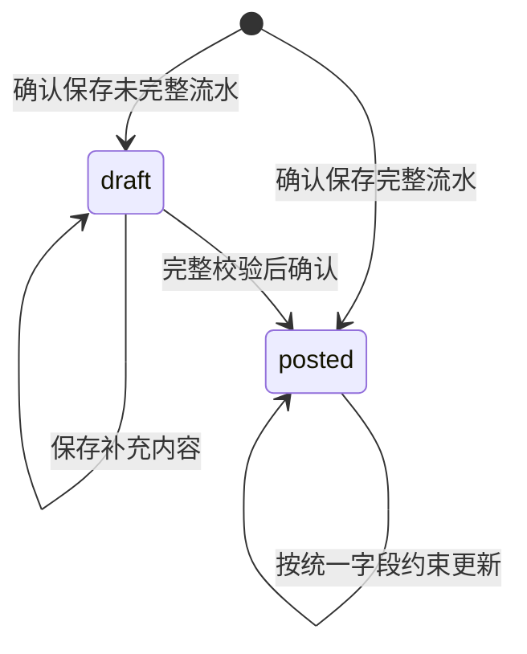

# 现金流水与导入业务规则

本文是现金流水维护与账单导入共用的详细规则参考，字段权限由创建方式和状态决定，公共属性、来源事实及关系各自维护。连贯说明分别见 [现金流水的存储、展示与操作](cash-ledger.md) 和 [现金账单导入流程](cash-import-flow.md)；接口、表结构和后续客户端交互查 [契约参考](cash-import-redesign-contracts.md)。当前后端已实现，新 UI 尚待接入，交付及验证状态统一见 [实施变更](../openspec/changes/cash-import-lifecycle-redesign/tasks.md)。

## 1. 设计结论与范围

用户侧导入采用以下流程：

**选择文件与账户准备 → 同一投影流水列表预览并确认导入 → 返回主页处理待确认项。**

解析、来源核对、关系规划和投影构建是内部阶段，不对应前端先后必经的“核对流水／核对配对”步骤。一个预览列表承载这些子动作，逐项显示“已确认／待确认”，待确认默认随导入保存并提示之后回主页处理。

信息不足的来源行在最终确认时保存为草稿流水；未确认的合法配对保存为草稿关系。用户以后通过流水维护入口补充。正式流水与已确认关系共同生成日常列表和分析使用的投影，关系没有独立一级管理入口。

需求澄清确定：

| 决策 | 目标行为 |
|---|---|
| 有效记录先导入 | 可以把有效记录保存为正式流水，同时保存其他可识别业务行的草稿；不静默丢行 |
| 单项失败 | 无法安全保存的流水或配对单独跳过，结果说明原因；单项冲突、解析异常或配对错误不阻塞其余导入 |
| 原文件 | 只在本次解析期间使用，不长期保存；草稿保存已提取的来源行和必要信息 |
| 配对时机 | 保留在导入确认前；流水与配对决定一起提交 |
| 草稿流水 | 可以查看、补充和保存，不参与统计 |
| 草稿关系 | 可以在相关流水详情中处理；未确认不合并正式流水，也不改变统计 |
| 日常展示 | 只读取投影；维护某笔流水时才展开原始流水和关系 |
| 维护范围 | 只维护受影响旧、新关系闭包；公共编辑不重配，手工转账内部整笔校验 |
| 金额更新 | 导入正式金额固定；普通手工财务字段可改，手工转账双端原子修改；草稿可补齐 |
| 更新入口 | 用户编辑按创建方式执行；公共属性整笔维护，对方账号及属性直接覆盖；来源原文由来源更新 |
| 来源新旧 | 同批同一可靠身份存在不同快照时，优先选文件修改时间较晚的版本；时间缺失或重复时按文件选择顺序，后选覆盖先选。跨批仍按普通导入更新，不跨批比较或保存文件时间 |
| 无渠道编号 | 先自动去重和识别更新，不因缺少编号复制一组流水或要求用户逐条选择；真实歧义允许导入后处理 |
| 删除后重导 | 已删除流水不阻止再次导入，不增加恢复确认或跳过提示；仍参加本次正常流水与配对确认 |
| 账户管理 | 创建、修改账户独立且立即生效，成功后才能选择；未完成导入而退出时由 Compose 询问是否撤销本次账户改动 |
| 前端确认 | 流水与关联在同一投影列表核对并一次确认，不建立独立配对流程；待确认事项默认延后到主页流水详情处理 |
| 重构边界 | 以目标契约为准，可以替换不合理的旧页面状态机、API 与数据结构，不以兼容旧流程为前提 |
| 历史能力 | 不建设历史版本、回放、历史批量修复或追溯产品；保留既有数据的迁移与回滚由实施变更记录 |

可更新字段由第 2 节定义。普通手工不参与配对，手工转账仅维护内部双端，不触发对外递归重配。

不重新定义退款、还款、转账、投资和月度统计口径，不建设完整财务核算系统。数据结构为本次导入及草稿机制服务。

## 2. 字段更新边界

字段权限由固定创建方式 `record_origin` 和流水状态决定。创建方式由服务端真实入口设置，不由来源名称、流水号或请求补丁推断。来源渠道、交易状态、商品说明等仅存在于 `source_payload` 的字段，统一随来源行更新，不另设逐项权限。

### 2.1 创建方式与用户编辑权限

| 对象 | 用户可更新内容 | 固定边界 |
|---|---|---|
| 导入正式流水 `import` | `category_id`、`note`、`counterparty`、`counterparty_account`、`counterparty_account_attrs` | 金额、币种、账户、组成项、时间、类型／子类型和来源身份固定；来源正文只随来源更新 |
| 历史缺证流水 `legacy` | 与导入正式流水相同 | 不猜测为手工创建而扩大权限 |
| 普通手工流水 `manual` | 全部合法业务字段，包括财务字段、时间和类型 | 系统身份、创建方式、归属及来源身份不可伪造；禁止参与任何现金或现金—投资关联 |
| 手工转账 `manual_transfer` | 公共属性整笔编辑，完整内部现金双端通过同一操作修改财务字段 | 只保留自身内部关系，禁止对外配对；无完整双端时不开放单端财务编辑 |
| 草稿流水 | 补充和修正合法业务字段，明确确认后转正式 | 不绕过来源对应、账户、精度及完整性校验，不参与金额统计 |

单条导入收支和已合并导入收支采用相同公共字段白名单。分类必须属于当前工作区；对方账号和属性只检查基本结构，不校验新旧账号一致性、格式、补全方向或重建证明。人工清空也是明确决定。

已合并收支不提供逐成员编辑；来源成员只读，用户编辑稳定收支对象的公共值。金额等非公共字段不因合并而开放。导入固定字段输入错误由用户删除后新建，系统不自动重建。普通手工流水不增加与后来导入记录之间的去重、提醒或合并机制。

正式流水不能降级为草稿。系统 ID、工作区、创建信息、修订、删除元数据及内部保护字段只能由对应命令维护。

### 2.2 来源原文与公共人工值

来源流水保存自己的 `note`、对方信息、分类及当前 `source_payload`。来源备注直接取该渠道原始注释、描述或备注，缺失则为空，不拼接对方、类型或平台名补位。重导按来源更新边界刷新这些当前值；正式金额、币种、账户、组成项、时间、类型和来源身份冲突时整条跳过，不部分写入。

`cash_entries` 保存用户实际查看和编辑的公共属性及逐字段人工标记。未人工修改的字段取展示基准流水当前来源值；人工修改过的字段保留公共值，包括清空，来源原文仍可正常刷新。公共编辑不反向修改来源正文或来源父记录，也不推进其 `row_revision`。

同一对象的多个导入成员携带公共补丁时，字段相同或互补的决定合为一次公共写入，并与这些来源更新共同保存；同字段给出不同显式值属于不一致输入，不能按行顺序覆盖。

### 2.3 合并、解除与差量维护

合并逐字段采用唯一人工值；不存在人工值时采用展示基准来源值。多个不同人工值（包含清空）发生实际冲突时，必要的完整关系提交组保留待确认，其他导入继续；用户以后从该笔详情明确公共值。来源文字不同本身不是冲突，也不要求用户统一原文。

解除具有人工公共值的组时，必须明确选择是否继承。选择继承，把公共人工字段应用到拆出的各笔收支；不继承，各笔恢复自己的当前独立值。每个成员只保存一份当前恢复值，不建立历史版本链。

公共属性编辑不改变关系，也不自动搜索替代对侧。导入正式类型固定，不能通过编辑时自动拆组绕过权限。手工转账的双端、内部关系与余额必须共同合法并原子保存，失败不留下单端变化。

日常维护只计算受影响旧、新关系闭包。成员、角色及关系不变时保留派生行并更新变化字段；合并或拆分仅替换受影响组。显式全量重建可替换计算数据集，但保留稳定收支对象、人工字段和当前恢复值。

## 3. 状态模型

### 3.1 流水状态

只有 `draft` 和 `posted` 两个业务状态：

| 状态 | 数据要求 | 查询与统计 |
|---|---|---|
| `draft` | 有内部身份及可辨认的来源行；未确定字段允许为空，并保存待补项 | 生成草稿展示投影；不进入余额、收入、支出、月度汇总和其他金额统计 |
| `posted` | 必填字段、账户、币种、金额、组成项及类型全部通过校验 | 生成正式投影；统计继续遵守既有关系和经济类型规则 |

已知总额但分摊未完成时，整个父记录仍是草稿。不能先记其中一部分账户金额，再把剩余部分作为另一个正式流水。未知金额用空值和待补原因表达，不能写成 `0`。

草稿转正式时保留同一流水主键，避免重复导入、已有候选引用或详情链接指向另一条记录。

### 3.2 关系状态

关系使用 `draft`、`confirmed` 和 `ignored` 表示当前决定：

| 状态 | 含义 | 对投影的作用 |
|---|---|---|
| `draft` | 有明确锚点，但对侧、决定或端点完整性尚未满足确认要求 | 不合并、不抵扣、不占用正式配对名额或退款额度 |
| `confirmed` | 两端均为正式流水的合法组成项，且通过完整关系组校验 | 按现有镜像、退款、转账规则生成合并结果 |
| `ignored` | 用户明确拒绝或解除这组配对 | 不参与投影；阻止相同建议自动恢复，用户主动操作可重新确认 |

没有人工决定不等于拒绝。系统只把合法但未确定的建议保存为草稿，不把违反金额、币种或关系图硬约束的结果改名为草稿后保存。

草稿流水可作为人工草稿关系的锚点或对侧引用，但不能参与自动金额匹配，也不能成为已确认关系的端点。补全后，在相关流水维护中重新生成并确认候选。

两条正式流水只有草稿关系时，分别生成正式投影并分别统计；关系确认后才合并。一个候选被接受后，同一次操作必须刷新直接争用该端点或额度的已有草稿关系，使其不能继续显示为可直接确认；这只更新已保存候选的有效性，不递归寻找新的替代配对。

## 4. 业务一致性约束

1. 正式流水的金额、币种、时间、类型和账户信息必须完整，金额使用精确十进制，拒绝非有限数。
2. 正式组成项与父流水同币种、同方向，金额精确合计为父金额；零额父流水的组成项均为零，不能重复计父金额和组成项金额。
3. 草稿组成项没有任何余额效果；统计服务不能仅依靠页面过滤草稿。
4. 已确认关系只引用正式组成项，并遵守既有方向、币种、镜像、退款额度和图约束。
5. 每条正式流水恰好属于一个当前正式投影；每条草稿恰好有一个草稿展示投影。
6. 相同来源身份在同一工作区内只能对应一条当前内部流水，唯一性覆盖草稿和正式状态。
7. 所有入口执行第 2.1 节的创建方式及状态约束；固定字段冲突不静默忽略。人工公共值存入稳定对象，来源与派生重建不能覆盖它。
8. 投影是当前流水和已确认关系的派生结果。草稿关系、忽略决定和匹配候选不得形成投影连接。

持久化对象及物理约束见 [数据契约](cash-import-redesign-contracts.md#4-后端逻辑表结构契约)，对象如何衔接见 [流程接口](cash-import-flow.md#api)。

## 5. 解析与资金缺项边界

解析规则只标识当前解释条件，不建设历史解析版本库。解析器逐行隔离转换异常，单行失败记入结果并继续读取后续行。不能安全辨认行边界或继续读取的文件不生成虚假的草稿流水；跳过无法处理的文件或剩余部分，明确标记其覆盖范围，继续其他文件，无需先解决该错误才能确认。无法解密、来源未知或完全提取失败时，后续仍需要重新选择文件。

| 情况 | 处理 |
|---|---|
| 单行缺少账户、币种、类型或分摊 | 保留来源行，生成待确认的草稿流水 |
| 单行金额无法转换，但行边界及来源内容可靠 | 保存原值及待补原因，金额为空；不参与自动匹配 |
| 单行导入器异常，无法安全形成草稿 | 跳过该行，显示“这条记录暂时无法识别，请稍后重试”；继续其他行 |
| 组合支付只有总额 | 保留总额和账户候选，要求补充分摊，不猜测 |
| 多次出现同一真实支付账户 | 先规范为同一账户，不因重复名称虚构多个资金来源 |
| 优惠、券、抵扣等非资金组成项（包括支付宝 `政府补贴`） | 作为来源信息保留，不创建资金账户或支付组成项 |
| 支付宝行缺少可识别资金账户 | `商品说明` 含“余额宝”时归入余额宝，否则归入支付宝余额；不按收支方向推断，也不覆盖已识别账户 |
| 其他来源账户无法确定 | 保持未知并留在流水待补项中，不生成可映射的虚构账户组 |
| 文件无法可靠提取业务行 | 返回文件错误，不创建一条代替整个文件的流水 |
| 已明确不产生流水的来源提示行 | 按白名单跳过并计数；与草稿、错误分别统计 |

## 6. 来源对应与配对判定

### 6.1 账户归属

来源账户按稳定身份分组；建议不等于已选，未确定账户的可辨认流水可保存草稿。账户创建、修改独立立即生效，来源账户映射只随实际成功使用它的流水保存，单笔覆盖不改变整组默认选择。

退出询问、连续修订链、分步补偿和刷新恢复的详细客户端合同统一见 [用户交互参考](cash-import-redesign-contracts.md#25-失败退出与重入) 与 [独立账户接口](cash-import-redesign-contracts.md#36-独立账户接口与退出补偿)，不由导入事务自动撤销账户。

### 6.2 流水核对与重复判定

每条来源行必须得到可解释结果：

| 结果 | 最终确认动作 |
|---|---|
| 新增且完整 | 新建正式流水 |
| 新增但未完整 | 新建草稿流水及当前问题 |
| 已有草稿，新的来源补足信息 | 预览合并差异，确认后更新同一草稿；完整时转正式 |
| 已有正式流水，来源行及允许更新的来源字段均相同 | 完全重复，不新增、不改写 |
| 已有正式流水，仅可更新字段不同 | 显示差异，确认后刷新来源值；保留稳定对象的全部人工公共值 |
| 已有正式流水，固定字段冲突或变化无法安全解释 | 跳过该条并显示差异和原因，不覆盖固定字段，也不另建一条正式流水 |
| 单条解析、校验或保存失败，无法安全形成草稿 | 跳过该条并说明原因，其余流水继续处理 |
| 没有渠道编号，但自动对应明确 | 正常判定新增、重复或更新，不增加用户确认步骤 |
| 自动对应后仍有真实歧义 | 保留一个待核对项；已有流水继续有效，不创建另一组正式流水，不阻塞其他记录；处理规则见第 6.2.1 节 |
| 明确白名单跳过 | 不写流水，返回原因和计数 |

来源变化经确认后更新，适用于补充已有草稿及更新第 2.1 节允许的正式字段。相同正式身份但来源金额变化应明确返回冲突，原正式流水和关系保持原状，不创建“更新草稿”分叉。单条来源同时包含可更新字段和固定字段冲突时，整条跳过，不部分替换来源行。

来源差异无需保存版本链。确认结果必须单列冲突数及原因，不能把它伪装成“完全重复”或“已更新”；这类正式流水冲突不属于可以补字段解决的草稿。

不能只凭 `source_fingerprint` 相同就跳过比较：来源字段和人工公共字段分别保存。应比较当前来源与本次允许写入的来源字段；人工公共值单独合并，不能使原始来源差异消失。指纹只反映来源行，不是所有业务字段的版本。

业务身份优先使用来源渠道提供的稳定业务编号。没有编号时按第 6.2.1 节自动对应，不把缺编号当作缺字段。文件摘要和行定位可识别同一文件的再次导入，但不能单独证明跨文件业务身份；内容哈希只辅助比较，不能独自区分“同内容的两笔真实交易”和“内容变化的同一笔交易”。

同批不同文件的同一可靠身份有不同快照时，只选一个快照进入普通来源更新：当该身份的每个版本都有且修改时间唯一时，选时间较晚的文件；否则按会话中的文件选择顺序，后选文件覆盖先选文件。所选快照成功时，其他版本逐行记为批内重复；若固定字段冲突导致所选快照跳过，所有版本显示同一跳过原因，不产生第二笔流水。文件时间只保存在本次解析会话中，不用于跨批版本比较。所选快照仍遵守既有字段边界，正式流水的金额、发生时间、账户、类型等固定字段变化照常冲突跳过；可更新来源字段和人工保护值保持原规则。同一文件内重复身份的不同内容、标准字段集合变化、来源账户或可靠身份不一致仍作为批次冲突。已有草稿上的人工补充不会被重新导入静默清空；非空值冲突在预览中明确选择。

冲突选择可以留到后续，不能成为提交其他记录的前置条件；已有记录保留原状，结果列明本次未应用的变化。

#### 6.2.1 无编号账单的自动对应

系统先处理，只有实际歧义才需要用户介入，而且可以在导入结束后处理。无编号账单与有编号账单使用同一流程，不另设逐条确认页面。

1. **确定来源作用域。** 使用工作区、渠道及来源本方账户身份隔离候选，不拿不同银行卡或平台的同额行作重复。微信在工作区内默认使用一个稳定来源，普通导入不填写微信号；确有多个本人微信账号时才在文件设置中区分，昵称和内部记账账户不决定该范围。最终映射到哪个内部账户不改变来源身份，改错映射仍适用固定字段冲突规则。
2. **优先复用已知对应。** 查询稳定渠道编号或已保存的文件摘要、表格及行定位对应记录；命中活动流水后比较当前字段，不能因为来源内容相同就忽略用户后来改过的可更新字段。
3. **对可比较的重叠范围作一对一匹配。** 无直接对应时，先检查来源格式声明的范围、筛选条件及时间边界是否可比，再用发生时间、精确有符号金额、币种及其他可靠字段形成候选集合。对方名称、备注、状态、分类和可更新类型不能作为身份键；余额可作来源上下文证据，不作通用主键。组合键可能碰撞，只是候选索引。缺少范围信息不能由最早、最晚业务行擅自推定完整导出。
4. **保留重复次数。** 同内容行按多重集合处理，每条旧流水在同一份账单中最多被一个出现位置消耗。多份重叠账单分别对应同一内部集合，不能把每份账单的次数相加。只有来源已验证导出范围完整、边界和筛选一致时，才可根据多出的出现次数自动新增；无法证明时不猜测。
5. **自动识别更新。** 在范围、筛选和边界可比且该来源规则支持的前提下，按稳定证据形成的来源行与旧记录互为唯一对应时，继续核对固定字段，再把可更新字段差异并入普通导入预览，不另问一次“是否同一笔”。互为唯一只是候选数量条件，不是独立的身份凭证；不同商户筛选各导出一笔同秒同额交易时，不能据此覆盖。缺少可比范围但有其他经过验证的稳定逐行证据时可用该证据；否则只把实际碰撞项延后核对。允许更新的字段变化不能直接触发新增。
6. **保存当前对应。** 新增记录分配一次内部身份及合成 `record_id`，以后不随内容哈希变化；来源对应记录可有多条，均指向同一流水。文件行定位保留重复出现位置和规则版本，解析规则改变时重新核验，不能盲用相同行号。

除采用默认来源的微信外，来源本方账户尚未知时，允许保存明确的文件局部行定位绑定到草稿，仅保证同文件不重复生成草稿；它不声称跨文件业务对应已经确定。以后补齐账户时增加账户作用域对应并保留文件定位别名，不通过改作用域丢失原幂等引用。微信多账号文件选择的是来源范围，不修改账单原文或已保存流水的来源身份；改变文件选择使本文件旧计划和行选择失效，重新预览，不重新解析原文件。

首次导入、没有旧候选且行信息完整的记录正常新增，不要求用户证明它是独立交易。相同时间、金额的多笔真实记录保留多笔，不因候选索引相同而折叠成一笔。

同一稳定字段候选集合中有多笔旧记录时，必须整体检查对应是否唯一或结果是否等价。完整来源行相等可以判定集合内容与次数没有变化，但不能先用可变字段贪心消去，再制造“剩余唯一”。例如旧名称为“甲、乙”，新名称为“乙、丙”，不能先把两个“乙”绑定，再把“丙”绑定到旧“甲”。没有额外稳定证据且对应会影响人工内容、当前字段更新或关系归属时，仅该集合延后处理。集合完全重复且无需修改时可直接报告重复，不强行建立不确定的逐行对应；只有所有可行对应的处理结果等价时才可确定性分配。次数增加但无法唯一判断多出来的是哪条来源行，同样不能任意选择新增。

待核对信息分两种保存位置：若已能确定是某条正式流水的更新，只是不能安全应用，保留该正式流水及一份当前待处理来源信息，不另建草稿流水；若连新增还是已有记录都无法判定，保存一个不计统计的草稿及候选引用。复导先复用该待核对项，不复制它，不增加另一组正式流水。主页可展示这个待确认草稿，不能要求用户在导入时为整批数据逐一选择。实现时可扩展 `CashTransactionIssue` 保存当前待处理来源内容和身份候选，不保存来源历史链。固定字段冲突仍按跳过处理，不能以草稿绕过。

后续账单补足证据时可在下一次导入计划中自动消除歧义；仍不能确定时，用户以后从待补充入口处理，无须在本次导入中作选择。合并草稿时同步迁移其来源对应记录和合法候选引用；固定字段或人工内容冲突不能静默覆盖。正常导入不主动展示“独立新增／合并已有”的逐行问答。

| 来源 | 自动对应基线 |
|---|---|
| 微信、支付宝 | 来源账户作用域内的稳定交易编号；无编号的异常行再进入来源特定匹配 |
| 工行、建行的无编号格式 | 账户与导出范围隔离、稳定字段候选集合、整体唯一性或结果等价检查、重复次数；不能沿用包含可更新描述的内容哈希作为身份 |
| 新增来源格式 | 导入器明确时间精度、范围完整性、候选字段和重复次数规则；未验证的组合不标成唯一业务编号 |

这些规则不能从账单中恢复根本没有提供的信息。目标是自动处理正常重叠导出，把不可消除的歧义限制在少数待处理项，而不是为缺编号的所有流水增加人工工作。

#### 6.2.2 删除后再次导入

来源对应查询只把活动流水作为去重、更新目标。命中已删除流水或指向它的来源对应记录，不阻止本次新增，也不询问恢复；按本次来源创建新内部流水并重新参加正常配对。新记录不恢复旧关系、人工覆盖或挂在旧流水身份上的忽略决定。

已有另一条活动流水接管相同来源身份时，优先按该活动流水去重或更新，不能因为还存在删除记录而再新建。当前来源对应记录在新增成功时指向新流水；新增失败则不得留下占位绑定。此规则不提供自动删除重建：活动流水固定字段冲突仍跳过，必须由用户先手动删除。

### 6.3 配对预览

本节描述内部关系规划。前端接收的是预计投影列表，关系及成员只在单项维护时展开，不把规划结果呈现成独立必经配对步骤。

本批新增或由草稿转正式的流水参与自动匹配。已有正式流水更新仅执行第 2.3 节维护，不因更新主动寻找新配对。自动匹配使用当前流水类型、账户、币种、精确金额、时间、对方信息及结构化来源证据，不读取收支分类或用户编辑的备注；组合支付按组成项参与。

读取本批准备正式保存的流水及其直接合法候选。候选可以来自已有正式流水或本批次，查询必须双向工作：新增退款、入账端或银行镜像也能找到既有对侧。

强证据唯一且合法的结果作为自动建议列入本次确认；其余合法建议可以人工确认、拒绝或保存为草稿。已有已确认关系和用户忽略决定是约束，本次导入不为追求更优匹配而自动拆掉它们。

新候选若与已有关系互斥，用户可在相关流水维护中明确调整；导入不能越过已确认关系抢占对侧。安全的新增关系可以连接既有组，例如向已确认消费镜像组添加合法退款。

不承诺任意导入顺序都产生相同的自动配对集合。本设计优先保留当前确认决定；正式金额与投影始终一致，尚未确认的候选可后续处理。这是取消全局候选重排的明确取舍，不是保留旧规则的性能优化。

配对发现按单条建议隔离错误；校验和保存按 [必要关系提交组](cash-import-flow.md#relation-matching) 隔离。独立配对失败只影响自身；相互依赖、必须一起生效的配对共同成功或回滚，组外配对继续。合法流水仍可正式保存并按现有有效关系生成投影；不存在有效关系时各自展示和统计。可合法保留且只是尚未确认的建议存为草稿关系；非法或处理失败的配对只列入结果，不能伪装成合法草稿。

某条流水被跳过时，仅跳过依赖它的配对并说明“相关流水未导入”；其他配对继续。配对不合法、候选已被占用或匹配器处理单项时发生异常，都不能升级为整批导入失败。无法继续运行的匹配阶段可以整体返回“本次自动配对未完成”，流水导入仍继续，不能因此回滚合法流水。

### 6.4 用户结果与失败说明

每条可辨认的来源行有一个最终处理结果；流水结果与配对结果分开统计，不能把“流水成功、配对失败”写成整条流水导入失败。结果保留安全的文件显示名、行号或交易信息、处理状态、业务原因及下一步操作；显示名不带完整路径、密码等敏感内容。无法确定失败行数时显示文件或范围级问题，不虚构数量。

| 情况 | 面向用户的原因示例 | 后续操作 |
|---|---|---|
| 正式流水金额冲突 | 已有流水的金额与本次账单不同，未更新 | 查看差异和已有流水 |
| 缺少账户但已保存草稿 | 尚未选择账户，已保存为待补充流水 | 补充账户 |
| 单条解析异常 | 这条记录暂时无法识别，未导入 | 检查账单或稍后重试 |
| 单条保存异常且已安全回滚 | 这条记录暂时无法保存，未导入 | 稍后重试 |
| 配对金额规则不满足 | 金额不符合配对条件，未合并 | 查看相关流水 |
| 配对对侧已被占用 | 相关流水已有其他配对，本次未合并 | 查看已有配对 |
| 单条匹配器异常 | 这组流水暂时无法配对，已分别保留 | 稍后在流水详情中处理 |
| 配对依赖未导入的记录 | 相关流水未导入，本次未配对 | 先处理未导入记录 |

内部错误码映射为稳定的业务说明；SQL、异常类型、堆栈、内部路径和服务名称不进入用户结果。未知原因使用诚实的通用提示，不编造“金额有误”等业务诊断。诊断信息只进入符合现有脱敏规则的内部日志。

最终状态区分全部成功、部分完成和未完成；所有待写入项均失败时不能显示“导入成功”。若全部为完全重复或白名单跳过，应显示“处理完成，无新增流水”，不误报失败；只保存草稿时明确提示待补充数量。收据保存最小逐项结果供响应重试与查看，不保留原文件，也不新建历史流水版本。重试已完成请求返回同一结果；再次处理失败项使用新请求，成功项由来源身份幂等避免重复写入。

可安全保存解析内容的临时写入失败，在原会话 TTL 内保留独立的失败项重试上下文，通过收据派生新会话和计划；不重跑原请求或保留原文件。解析失败、重试内容不可用或过期时重新选择文件。结果未知且计划已过期时，由服务端在写锁内排除在途提交并核实收据，才能给出确定的未提交结果，不能只凭普通查询的 `404` 推定失败。

## 7. 导入之后的维护

### 7.1 草稿流水补全

从账本的待补充筛选或流水详情进入，读取同一草稿及待补项。保存未完成修改仍是草稿；选择正式确认时执行完整校验、生成相关配对建议，再联合提交流水状态、关系和投影。

面向用户统一使用“待确认”标记和筛选。补字段、处理关联及确认保存在同一详情承载，服务端生成配对建议不要求跳转到另一个产品流程。

草稿可以同时补齐账户和支付组成项。确认时校验金额守恒、账户有效性、币种支持以及来源身份唯一性，不能通过直接改 `state` 成为正式流水。

草稿删除或替换组成项时，必须在同一事务中清理失效候选，并把引用这些组成项的草稿关系退回父流水锚点，标记为需要重新选择组成项。不能保留悬空引用，也不能把旧引用静默指向新组成项；仅调整顺序不改变组成项主键。

如果草稿在补充身份后被证明是另一条已有记录的重复，只能明确合并其待补信息和引用，不能发布第二笔流水或把金额相加。被合并草稿的候选引用须同步转移或清理；结果跳转到保留的流水。

### 7.2 正式收支编辑

读取当前 `entry_id/revision`、创建方式及可编辑字段，以 `edit_entry` 请求维护计划并确认。导入独立收支和合并收支均只编辑公共属性；组内来源成员只读。普通手工可修改合法业务字段，手工转账通过完整内部双端操作修改。公共编辑不重配，来源原文通过来源更新刷新。

### 7.3 草稿关系确认、拒绝和解除关系

关系维护嵌入流水详情。用户选择对侧、确认、拒绝或解除时，服务端检查当前端点、忽略决定、额度和整个待合并关系组的约束。

确认成功后维护新合并组的投影；解除后维护旧组拆出的所有投影。解除产生当前忽略决定，自动建议不能立即把同一关系建回来。候选过期时刷新该笔流水的建议，不能按旧界面选择直接套用。

操作一次只处理本次明确选择及其必要约束；不自动为被释放的对侧寻找另一笔配对。

## 8. 重叠账单提供的设计输入

只读检查仓库外账单目录中的 6 份微信 XLSX、6 份支付宝 CSV、5 份工行 PDF 和 2 份建行 XLS。实际目录为 `~/.ft/bills/账单流水`，用户本轮提及的“收支账单”目录不存在。本节只保存汇总与抽象规则，不将真实账号、交易编号、原始交易明细或文件密码写入仓库。

微信与支付宝先核对账单所属用户信息，再按来源和稳定交易编号比对全部字段。比较时仅去除单元格两端空白；同一交易在多份账单中重复出现只算一笔，不累加成多次更新。

| 来源 | 可跨导出对照的记录 | 发现 |
|---|---|---|
| 微信 | 228 笔有稳定交易编号的重叠记录 | 9 笔仅交易对方名称变化，主要由昵称变为备注名加昵称；发生在六月与八月导出之间 |
| 支付宝 | 193 笔有稳定交易编号的重叠记录 | 1 笔仅交易状态由等待确认收货变为交易成功；发生在八月与九月导出之间 |
| 工行信用卡 | 实际重叠范围内 1,517 条业务行 | 全部业务字段与重复出现次数一致，未发现更新 |
| 工行借记账户 | 实际重叠范围内 116 条业务行 | 全部业务字段与重复出现次数一致，未发现更新 |
| 建行 | 两份账单的所属账户不同 | 不作为同账户重导更新样本 |

微信与支付宝的 10 笔变化中，未发现交易时间、金额、收支方向或支付方式变化；按各文件共同时间范围另行核对，也未发现旧行消失或补入更早发生的业务行。这个结论只适用于本批样本，不证明这些字段永远不会变化。

银行账单缺少可用于此次对照的稳定交易编号，采用完整业务行的多重集合比较。时间与账户组合在两类工行样本中都存在碰撞，不能据此建立通用唯一身份，也不能用内容哈希检测“同一流水内容变了”。

名称变化落到来源 `counterparty`，来源状态变化归入 `source_payload`，不为每个来源字段新增列。来源更新与人工公共值分别维护，导入正式类型固定。同批不同文件的可靠身份快照按文件时间或选择顺序选出一个当前输入；跨批每次导入仍按普通规则处理，不建立历史版本链、导出时间优先级或状态单向推进，也不持久保存文件修改时间。
