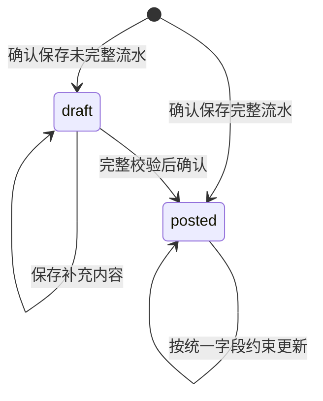

# 现金导入流程重设计

日期：2026-10-20
状态：目标设计，实施中；完成范围见 [变更任务及验证证据](../openspec/changes/cash-import-lifecycle-redesign/tasks.md)。
范围：外部现金账单转换为内部流水、导入前配对、联合确认、草稿补充及局部投影维护。

本文承接 [现有后端架构梳理](cash-import-backend-architecture.md)，记录本轮需求澄清后的目标设计。当前可执行行为仍以 [OpenSpec 主规格](../openspec/specs/README.md) 和实现为准。用户已授权按本设计实施；尚未完成的目标及切换边界由上述变更记录维护，不能把目标合同当作当前已上线行为。

配套的 [用户流程、接口与数据契约](cash-import-redesign-contracts.md) 按用户任务 → API → 表结构细化本文。本文负责业务规则，配套文档负责字段、路径、状态和约束；两者共同构成设计提议，不替代当前主规格。

## 1. 设计结论与范围

用户侧导入采用以下流程：

**选择文件与账户准备 → 同一投影流水列表预览并确认导入 → 返回主页处理待确认项。**

解析、来源核对、关系规划和投影构建是内部阶段，不对应前端先后必经的“核对流水／核对配对”步骤。一个预览列表承载这些子动作，逐项显示“已确认／待确认”，待确认默认随导入保存并提示之后回主页处理。

信息不足的来源行在最终确认时保存为草稿流水；未确认的合法配对保存为草稿关系。用户以后通过流水维护入口补充。正式流水与已确认关系共同生成日常列表和分析使用的投影，关系没有独立一级管理入口。

需求澄清确定：

| 决策 | 目标行为 |
|---|---|
| 有效记录先导入 | 可以把有效记录保存为正式流水，同时保存其他可识别业务行的草稿；不静默丢行 |
| 单项失败 | 无法安全保存的流水或配对单独跳过，结果说明原因；单项冲突、解析异常或配对错误不阻塞其余导入 |
| 原文件 | 只在本次解析期间使用，不长期保存；草稿保存已提取的来源行和必要信息 |
| 配对时机 | 保留在导入确认前；流水与配对决定一起提交 |
| 草稿流水 | 可以查看、补充和保存，不参与统计 |
| 草稿关系 | 可以在相关流水详情中处理；未确认不合并正式流水，也不改变统计 |
| 日常展示 | 只读取投影；维护某笔流水时才展开原始流水和关系 |
| 维护范围 | 只维护本次变更涉及的已确认关系组及其投影；类型更新保留合法关系、解除不合法关系，不自动寻找新配对 |
| 金额更新 | 正式流水金额固定；草稿中的未确定金额可以补齐 |
| 更新入口 | 导入和手动更新共用字段白名单与业务约束；对方账号及属性直接覆盖，不做账号一致性或补全校验 |
| 来源新旧 | 每次导入都视为用户提供的最新账单，不比较导出时间，不防止来源内容被较早导出的账单覆盖 |
| 无渠道编号 | 先自动去重和识别更新，不因缺少编号复制一组流水或要求用户逐条选择；真实歧义允许导入后处理 |
| 删除后重导 | 已删除流水不阻止再次导入，不增加恢复确认或跳过提示；仍参加本次正常流水与配对确认 |
| 账户管理 | 创建、修改账户独立且立即生效，成功后才能选择；未完成导入而退出时由 Compose 询问是否撤销本次账户改动 |
| 前端确认 | 流水与关联在同一投影列表核对并一次确认，不建立独立配对流程；待确认事项默认延后到主页流水详情处理 |
| 重构边界 | 以目标契约为准，可以替换不合理的旧页面状态机、API 与数据结构，不以兼容旧流程为前提 |
| 历史能力 | 不设计历史版本、历史回放、历史批量修复、追溯系统或迁移旧库的方案 |

正式流水金额保持固定。可更新字段由第 2 节统一定义，类型更新仅校验现有关系，不触发候选的递归重配。

不重新定义退款、还款、转账、投资和月度统计口径，不建设完整财务核算系统。数据结构为本次导入及草稿机制服务。

## 2. 字段更新边界

字段边界以当前流水表及组成项表实际字段为准。导入和用户手动更新使用同一套字段约束，不设置“仅导入可改”或“仅手动可改”的业务字段。来源交易状态、商家订单号、商品说明等仅存在于 `source_payload` 的内容，统一按来源行可更新处理，不增加对应独立字段或逐项更新规则。

同一笔交易自然发生的信息变化可以成为开放更新的理由；输入、映射或解析错误本身不作为扩大可更新范围的理由。涉及固定字段的错误，由用户手动删除后新建。已明确开放的字段，无论经导入还是用户手动提交，都按同一约束处理。草稿仍允许补全和纠正。

### 2.1 正式流水的统一字段约束

| 当前字段 | 规则 |
|---|---|
| `counterparty` | 允许更新、清空 |
| `counterparty_account`、`counterparty_account_attrs` | 允许直接覆盖、清空；不做新旧账号一致性、格式、补全方向、属性与账号语义匹配或重建证明校验 |
| `note` | 允许更新、清空；来源取值遵守第 2.2 节 |
| `category_id` | 允许更新、清空，仍须属于当前工作区内的合法分类 |
| `record_type`、`record_subtype` | 允许更新；最终类型组合须合法，并按第 2.3 节处理受影响关系 |
| `source_payload` | 允许更新；只存在其中的来源字段不另设更新白名单 |
| `amount`、`currency`、`occurred_at` | 不可更新 |
| `account_id`、`cash_granularity` | 不可更新 |
| 组成项的 `account_id`、`amount`、`currency`、成员数量及 `ordinal` | 不可更新，不能通过重分摊绕过父流水金额固定 |
| `source_type`、`record_id` | 不可更新，来源身份保持不变 |
| `id`、`workspace_id`、`created_at` | 系统身份、归属和创建信息，不开放更新 |
| `source_fingerprint`、`manual_overrides`、`relation_metadata` | 系统维护，不作为调用方可直接覆盖的业务字段 |
| `deleted_at`、`deleted_by`、`delete_reason` | 由删除操作维护 |

字段是否可更新不取决于调用入口；权限、JSON/字段类型、存储边界、并发及引用完整性检查仍统一执行。对方账号直接覆盖时，不能通过已有账号校验器或关系检查变相恢复被取消的新旧一致性、格式或证明要求。

传入固定字段且值未变不构成修改；实际改变固定字段时拒绝整条更新。导入按单条跳过处理，不能部分更新其余字段。来源行中保存的原始值不直接覆写固定列，更新 `source_payload` 不能成为修改金额、账户或来源身份的旁路。

正式流水不提供降级为草稿的入口。用户删除后新建时，按删除合同清理受影响关系及投影，新建时重新校验和处理配对；导入不能自动删除重建。

### 2.2 备注直接来自原始来源内容

`note` 不再接收导入器生成、拼接、推断、缩写或加工后的描述。没有人工覆盖时，直接采用该来源约定的原始注释、描述或备注字段；来源没有相应内容就为空，不使用交易对方、交易类型、平台名称或其他内容补位。

每个来源明确原始字段映射；有多个相关字段时按明确的来源映射选择原文，不能合成为新描述。完整来源行仍保存在 `source_payload`。本设计不增加独立的来源摘要、用户备注、展示名称或来源状态列。

用户可手动更新或明确清空 `note`。已有“保护人工分类和备注”的要求继续生效：重导入组装待确认值时保留用户覆盖；其他来源信息仍可更新到 `source_payload`。这属于值合并规则，不是导入和手动更新使用不同字段权限。明确清空也是人工覆盖，不能再回填来源内容。

来源行的对应原文变化且没有人工备注覆盖时，`note` 同步按映射更新；这一派生取值规则同样适用于手动修改来源行。单次请求明确提交 `note` 时，以该值为准。只修改 `note` 不反向篡改原始来源字段。

投影直接展示当前流水的 `note`，不再生成二次说明。关系合并后的展示基准规则不变，也不得清空成员已有的人工分类或备注。

### 2.3 更新与关系、投影

更新名称、对方账号及属性、备注、分类或来源行，不自动解除已确认关系，不重新验证历史匹配证据，也不主动扫描新配对。更新当前展示和相关分类汇总即可。后续主动匹配或新流水匹配读取当时的当前记录；不再增加一套冻结的匹配名称或来源快照。

`record_type` 或 `record_subtype` 改变时，用户已选择：保留合法关系，解除不合法关系，重建受影响投影。服务端读取变更前完整已确认关系组，应用拟更新的类型组合，按关系种类、角色、方向、币种和金额约束校验关系组；不能仅检查与该流水直接相连的一条边。

解除的是因类型变化而失效的关系，不是重新评估账号或名称是否像同一笔交易。保留仍合法的关系，清理失效草稿候选，不自动寻找替代配对。最终解除集合和投影变化列入导入或手动更新的同一确认结果。类型更新、必要的关系解除及整个旧组拆分后的投影替换必须作为单条更新的原子保存单位。

同一关系组内多条流水同时更新类型时，预览与提交使用计划中相同的确定顺序，每条基于此前实际成功的状态判断关系合法性；“保留合法关系”指该条更新时仍存在且合法的关系。后续项不自动恢复前序已经解除的关系，也不按假设全部成功的最终状态提前改配。若前序项失败导致后续项需解除的关系超出已确认范围，后续项跳过并提示重新确认。

失效关系解除记录为当前系统处置，不冒充用户拒绝；它不会自动生成永久忽略决定。用户明确拒绝或主动解除的关系仍按既有忽略规则处理。

`source_payload` 内容变化本身不触发隐式重分类；导入解析若同时产生新的 `record_type`、`record_subtype`，必须把它们明确列入同一待确认更新。单条处理失败则恢复该流水、关系和投影，其他流水继续。

每次导入都视为最新来源，不比较文件时间、导出时间或来源状态的前进顺序。并发仍按当前记录修订校验；字段允许更新不意味着可以跳过并发和确认。

## 3. 状态模型

### 3.1 流水状态

只有 `draft` 和 `posted` 两个业务状态：



| 状态 | 数据要求 | 查询与统计 |
|---|---|---|
| `draft` | 有内部身份及可辨认的来源行；未确定字段允许为空，并保存待补项 | 生成草稿展示投影；不进入余额、收入、支出、月度汇总和其他金额统计 |
| `posted` | 必填字段、账户、币种、金额、组成项及类型全部通过校验 | 生成正式投影；统计继续遵守既有关系和经济类型规则 |

已知总额但分摊未完成时，整个父记录仍是草稿。不能先记其中一部分账户金额，再把剩余部分作为另一个正式流水。未知金额用空值和待补原因表达，不能写成 `0`。

草稿转正式时保留同一流水主键，避免重复导入、已有候选引用或详情链接指向另一条记录。

### 3.2 关系状态

关系使用 `draft`、`confirmed` 和 `ignored` 表示当前决定：

| 状态 | 含义 | 对投影的作用 |
|---|---|---|
| `draft` | 有明确锚点，但对侧、决定或端点完整性尚未满足确认要求 | 不合并、不抵扣、不占用正式配对名额或退款额度 |
| `confirmed` | 两端均为正式流水的合法组成项，且通过完整关系组校验 | 按现有镜像、退款、转账规则生成合并结果 |
| `ignored` | 用户明确拒绝或解除这组配对 | 不参与投影；阻止相同建议自动恢复，用户主动操作可重新确认 |

没有人工决定不等于拒绝。系统只把合法但未确定的建议保存为草稿，不把违反金额、币种或关系图硬约束的结果改名为草稿后保存。

草稿流水可作为人工草稿关系的锚点或对侧引用，但不能参与自动金额匹配，也不能成为已确认关系的端点。补全后，在相关流水维护中重新生成并确认候选。

两条正式流水只有草稿关系时，分别生成正式投影并分别统计；关系确认后才合并。一个候选被接受后，同一次操作必须刷新直接争用该端点或额度的已有草稿关系，使其不能继续显示为可直接确认；这只更新已保存候选的有效性，不递归寻找新的替代配对。

## 4. 数据结构

以下为目标模型，不是已经存在的数据库迁移。正式记录和草稿记录共用同一身份及表，避免设计两套流水和转存流程。

### 4.1 持久化对象

| 对象 | 关键字段 | 责任 |
|---|---|---|
| `CashTransaction` | 当前流水表字段，另增加草稿机制所需的 `state` 和并发用 `row_revision` | 保存一条内部流水的当前状态；业务字段更新边界见第 2.1 节，不为来源行内字段另增列 |
| `CashTransactionComponent` | 沿用 `id`、`cash_transaction_id`、`ordinal`、`account_id`、`amount`、`currency`、`label`、`source_key`、`metadata_json` | 保存账户分摊；普通流水也有一个组成项 |
| `CashTransactionIssue` | `transaction_id`、`code`、`field_path`、安全说明 | 表达当前缺失或冲突，补全后移除；不保存历史问题列表 |
| `CashRelation` | `id`、`workspace_id`、`kind`、`subtype`、`state`、锚点及对侧引用、决定来源、`row_revision` | 保存当前配对、草稿或忽略决定 |
| `CashRelationCandidate` | `relation_id`、候选流水及组成项引用、当前证据摘要、端点修订号 | 保存草稿关系可选择的对侧，支持反向查询和过期校验 |
| `CashProjection` 及成员表 | 展示标识、`state`、成员、展示字段、净额、统计资格、待处理数量、当前发布序号 | 统一提供正式流水及草稿的读取结果；显示确认状态按草稿及待处理事项派生 |
| `CashMutationReceipt` | 工作区、操作者、幂等键、请求摘要、逐项结果及结果引用 | 支持提交重试并返回相同的成功、草稿和跳过结果；不承担历史账单档案或变更回放 |
| `CashSourceBinding` | 工作区、来源作用域、身份种类、来源键、流水引用、匹配规则版本 | 保存当前来源对应记录；稳定编号与文件行定位分命名空间，来源变化不改变内部流水主键 |

账户、账户币种及来源账户映射沿用现有实体。账户创建、修改和币种扩充通过独立账户操作立即提交，导入只引用已存在的账户。废弃“仅供草稿使用的新账户延后创建”及“账户改动随导入提交”的方案。来源账户映射是导入决定，仍随使用它的流水成功保存，不与账户实体的创建混为一谈。前端退出处理见第 6.1 节。

草稿可保存未完成的组成项；有确定来源字段就保存，没有就留空。关系草稿至少引用流水主键，只有已存在组成项时才引用其主键；已确认关系必须引用具体组成项。使用带工作区约束的外键，禁止跨工作区引用及悬空引用。

`row_revision` 只用于并发校验，不表示历史版本存储。`source_payload` 只保存该流水必要的来源内容，不保存整份 PDF、XLSX、CSV、文件路径或密码。来源文件摘要和行定位可以保存，用于身份判定，不提供原文件下载。

### 4.2 必须执行的约束

1. 正式流水的金额、币种、时间、类型和账户信息必须完整，金额使用精确十进制，拒绝非有限数。
2. 正式组成项与父流水同币种、同方向，金额精确合计为父金额；零额父流水的组成项均为零，不能重复计父金额和组成项金额。
3. 草稿组成项没有任何余额效果；统计服务不能仅依靠页面过滤草稿。
4. 已确认关系只引用正式组成项，并遵守既有方向、币种、镜像、退款额度和图约束。
5. 每条正式流水恰好属于一个当前正式投影；每条草稿恰好有一个草稿展示投影。
6. 相同来源身份在同一工作区内只能对应一条当前内部流水，唯一性覆盖草稿和正式状态。
7. 正式流水所有更新入口共用第 2.1 节白名单及约束；实际修改固定字段必须报错，不能静默忽略。类型更新与其必要的关系清理、投影重建共同成功或回滚。
8. 投影是当前流水和已确认关系的派生结果。草稿关系、忽略决定和匹配候选不得形成投影连接。

## 5. 临时导入数据与解析

### 5.1 只解析一次

文件到达后识别渠道并解析，得到带稳定行引用的 `ParsedRow`。原文件只作为受控解析临时输入；解析完成后删除临时文件，不把整文件放入长期对象存储。密码只用于当前解密请求。

临时 `ImportSession` 保存标准化来源行、解析问题、映射草稿和预览计划，并设置有限有效期。更换映射、填写分摊或重新预览使用这些已解析内容，不重新读取原文件。

未解密的文件保留在客户端本次文件选择中；用户输入密码后重发对应文件。服务端不为以后补处理长期保存加密文件。离开页面前没有最终确认的会话不创建数据库草稿。

`ParsedRow` 至少包含：

```text
row_ref
source_type
source_identity / identity_strength
source_payload
normalized_fields
component_drafts
issues[]
parser_version
```

`parser_version` 仅标识本次解释条件，不建设历史解析版本库。解析器逐行隔离转换异常，单行失败记入结果并继续读取后续行。不能安全辨认行边界或继续读取的文件不生成虚假的草稿流水；跳过无法处理的文件或剩余部分，明确标记其覆盖范围，继续其他文件，无需先解决该错误才能确认。无法解密、来源未知或完全提取失败时，后续仍需要重新选择文件。

### 5.2 区分文件错误与流水草稿

| 情况 | 处理 |
|---|---|
| 单行缺少账户、币种、类型或分摊 | 保留来源行，生成待确认的草稿流水 |
| 单行金额无法转换，但行边界及来源内容可靠 | 保存原值及待补原因，金额为空；不参与自动匹配 |
| 单行导入器异常，无法安全形成草稿 | 跳过该行，显示“这条记录暂时无法识别，请稍后重试”；继续其他行 |
| 组合支付只有总额 | 保留总额和账户候选，要求补充分摊，不猜测 |
| 多次出现同一真实支付账户 | 先规范为同一账户，不因重复名称虚构多个资金来源 |
| 优惠、券、抵扣等非资金组成项 | 作为来源信息保留，不创建资金账户 |
| 账户无法确定 | 保持未知，不默认归入支付宝余额或其他真实账户 |
| 文件无法可靠提取业务行 | 返回文件错误，不创建一条代替整个文件的流水 |
| 已明确不产生流水的来源提示行 | 按白名单跳过并计数；与草稿、错误分别统计 |

## 6. 导入流程

### 6.1 识别和账户归属

来源账户按稳定身份分组，复用现有账户与映射建议。用户可以确认能确定的账户；未确定的分组使对应流水保持草稿，不阻止其他记录进入下一步。

目标 Compose 提供独立账户创建和编辑入口。当前 Compose 的账户编辑仍是导入内存草稿，独立保存命令和接口需要按配套契约补齐，不能宣称已经可用。账户操作保存成功后立即生效，刷新可选账户并允许用户选择；保存失败不生成虚拟账户选项。即使随后没有导入任何流水，账户改动也已经生效。来源映射选择仍暂存在导入计划中，随实际成功使用它的流水保存。

前端在本次导入期间记录由这些入口产生的账户改动：账户标识、首次修改前的可恢复字段、最后一次成功写入的字段值及并发标识；新建账户记录为本次创建。只记录账户改动，不记录原账单文件。退出处理由前端编排，不建立跨账户和导入流程的长事务或后端自动撤销任务：

1. 未完成导入、确有账户改动且用户主动退出时，询问是否撤销本次账户改动，提供“撤销并退出”“保留并退出”“继续导入”。没有账户改动时不增加这次询问。
2. “撤销并退出”通过普通账户修改、删除接口执行补偿：恢复本次改过的字段；删除本次新建且仍可删除的账户。不能整对象覆盖其他入口新增的改动。
3. 撤销必须在服务端校验并发和引用。若相关字段已被其他操作修改，或账户已被其他流水、草稿或持久映射使用，不强制覆盖或级联删除；保留无法撤销的部分并说明原因，用户可以保留并退出或继续处理。新增币种已被使用时也不能直接移除。
4. 已提交成功，包括部分完成或只保存草稿，均结束本次退出撤销范围；未被流水使用的账户也保留。响应丢失时先核实导入收据，不能在提交结果未知时撤销账户。
5. 浏览器关闭、进程被杀等无法可靠执行交互的情况，不承诺询问或撤销成功，已生效账户保持不变。正常关闭导入界面、站内导航及 Native 返回必须经过退出拦截。

连续编辑同一账户且修订链始终连续时，撤销目标是进入本次编辑前的值；前端保留首次旧值并更新最后写入值。每次再编辑前检查读取修订是否等于本次上一次写入修订；链条中断时，对无法证明未被其他操作修改的字段停止自动恢复首次旧值，即使当前值后来又由本会话写入，也不能覆盖中途的外部修改。例如 `0→本次写 1→外部写 2→本次写 3`，退出不能直接恢复为 `0`。新建账户也必须保持本次可追踪的修订链且没有外部引用，才可自动补偿删除。

一次成功的补偿也可能被重试，需按当前值和并发标识识别已完成操作。该机制只服务本次退出，不扩展成通用账户历史系统。

普通删除要求账户已停用，因此新建账户的撤销顺序为按修订停用、再按新修订删除。删除失败时如实显示仍存在且已停用的状态；仅在没有后续修改时可安全恢复启用。结果收据已保存但所有业务写入均失败的情况仍属于未完成导入，退出时保留账户撤销选择。

### 6.2 流水核对与重复判定

每条来源行必须得到可解释结果：

| 结果 | 最终确认动作 |
|---|---|
| 新增且完整 | 新建正式流水 |
| 新增但未完整 | 新建草稿流水及当前问题 |
| 已有草稿，新的来源补足信息 | 预览合并差异，确认后更新同一草稿；完整时转正式 |
| 已有正式流水，合并人工分类和备注保护后，来源行及拟更新字段均相同 | 完全重复，不新增、不改写 |
| 已有正式流水，仅可更新字段不同 | 显示差异，确认后按统一约束更新；保护人工分类和备注，类型变化按第 2.3 节清理失效关系 |
| 已有正式流水，固定字段冲突或变化无法安全解释 | 跳过该条并显示差异和原因，不覆盖固定字段，也不另建一条正式流水 |
| 单条解析、校验或保存失败，无法安全形成草稿 | 跳过该条并说明原因，其余流水继续处理 |
| 没有渠道编号，但自动对应明确 | 正常判定新增、重复或更新，不增加用户确认步骤 |
| 自动对应后仍有真实歧义 | 保留一个待核对项；已有流水继续有效，不创建另一组正式流水，不阻塞其他记录；处理规则见第 6.2.1 节 |
| 明确白名单跳过 | 不写流水，返回原因和计数 |

来源变化经确认后更新，适用于补充已有草稿及更新第 2.1 节允许的正式字段。相同正式身份但来源金额变化应明确返回冲突，原正式流水和关系保持原状，不创建“更新草稿”分叉。单条来源同时包含可更新字段和固定字段冲突时，整条跳过，不部分替换来源行。

来源差异无需保存版本链。确认结果必须单列冲突数及原因，不能把它伪装成“完全重复”或“已更新”；这类正式流水冲突不属于可以补字段解决的草稿。

不能只凭 `source_fingerprint` 相同就跳过比较：已有流水的对方信息或类型可能已被手动更新。应比较保护人工分类和备注之后的最终待写字段；有差异仍按统一更新处理。指纹只反映来源行，不是所有业务字段的版本。

业务身份优先使用来源渠道提供的稳定业务编号。没有编号时按第 6.2.1 节自动对应，不把缺编号当作缺字段。文件摘要和行定位可识别同一文件的再次导入，但不能单独证明跨文件业务身份；内容哈希只辅助比较，不能独自区分“同内容的两笔真实交易”和“内容变化的同一笔交易”。

同批次同身份但内容不同的行作为冲突处理，不采用“第一条胜出”或“最后一条胜出”。已有草稿上的人工补充不会被重新导入静默清空；非空值冲突在预览中明确选择。

冲突选择可以留到后续，不能成为提交其他记录的前置条件；已有记录保留原状，结果列明本次未应用的变化。

#### 6.2.1 无编号账单的自动对应

系统先处理，只有实际歧义才需要用户介入，而且可以在导入结束后处理。无编号账单与有编号账单使用同一流程，不另设逐条确认页面。

1. **确定来源作用域。** 使用工作区、渠道及来源本方账户身份隔离候选，不拿不同银行卡或平台的同额行作重复。微信在工作区内默认使用一个稳定来源，普通导入不填写微信号；确有多个本人微信账号时才在文件设置中区分，昵称和内部记账账户不决定该范围。最终映射到哪个内部账户不改变来源身份，改错映射仍适用固定字段冲突规则。
2. **优先复用已知对应。** 查询稳定渠道编号或已保存的文件摘要、表格及行定位对应记录；命中活动流水后比较当前字段，不能因为来源内容相同就忽略用户后来改过的可更新字段。
3. **对可比较的重叠范围作一对一匹配。** 无直接对应时，先检查来源格式声明的范围、筛选条件及时间边界是否可比，再用发生时间、精确有符号金额、币种及其他可靠字段形成候选集合。对方名称、备注、状态、分类和可更新类型不能作为身份键；余额可作来源上下文证据，不作通用主键。组合键可能碰撞，只是候选索引。缺少范围信息不能由最早、最晚业务行擅自推定完整导出。
4. **保留重复次数。** 同内容行按多重集合处理，每条旧流水在同一份账单中最多被一个出现位置消耗。多份重叠账单分别对应同一内部集合，不能把每份账单的次数相加。只有来源已验证导出范围完整、边界和筛选一致时，才可根据多出的出现次数自动新增；无法证明时不猜测。
5. **自动识别更新。** 在范围、筛选和边界可比且该来源规则支持的前提下，按稳定证据形成的来源行与旧记录互为唯一对应时，继续核对固定字段，再把可更新字段差异并入普通导入预览，不另问一次“是否同一笔”。互为唯一只是候选数量条件，不是独立的身份凭证；不同商户筛选各导出一笔同秒同额交易时，不能据此覆盖。缺少可比范围但有其他经过验证的稳定逐行证据时可用该证据；否则只把实际碰撞项延后核对。允许更新的字段变化不能直接触发新增。
6. **保存当前对应。** 新增记录分配一次内部身份及合成 `record_id`，以后不随内容哈希变化；来源对应记录可有多条，均指向同一流水。文件行定位保留重复出现位置和规则版本，解析规则改变时重新核验，不能盲用相同行号。

除采用默认来源的微信外，来源本方账户尚未知时，允许保存明确的文件局部行定位绑定到草稿，仅保证同文件不重复生成草稿；它不声称跨文件业务对应已经确定。以后补齐账户时增加账户作用域对应并保留文件定位别名，不通过改作用域丢失原幂等引用。微信多账号文件选择的是来源范围，不修改账单原文或已保存流水的来源身份；改变文件选择使本文件旧计划和行选择失效，重新预览，不重新解析原文件。

首次导入、没有旧候选且行信息完整的记录正常新增，不要求用户证明它是独立交易。相同时间、金额的多笔真实记录保留多笔，不因候选索引相同而折叠成一笔。

同一稳定字段候选集合中有多笔旧记录时，必须整体检查对应是否唯一或结果是否等价。完整来源行相等可以判定集合内容与次数没有变化，但不能先用可变字段贪心消去，再制造“剩余唯一”。例如旧名称为“甲、乙”，新名称为“乙、丙”，不能先把两个“乙”绑定，再把“丙”绑定到旧“甲”。没有额外稳定证据且对应会影响人工内容、当前字段更新或关系归属时，仅该集合延后处理。集合完全重复且无需修改时可直接报告重复，不强行建立不确定的逐行对应；只有所有可行对应的处理结果等价时才可确定性分配。次数增加但无法唯一判断多出来的是哪条来源行，同样不能任意选择新增。

待核对信息分两种保存位置：若已能确定是某条正式流水的更新，只是不能安全应用，保留该正式流水及一份当前待处理来源信息，不另建草稿流水；若连新增还是已有记录都无法判定，保存一个不计统计的草稿及候选引用。复导先复用该待核对项，不复制它，不增加另一组正式流水。主页可展示这个待确认草稿，不能要求用户在导入时为整批数据逐一选择。实现时可扩展 `CashTransactionIssue` 保存当前待处理来源内容和身份候选，不保存来源历史链。固定字段冲突仍按跳过处理，不能以草稿绕过。

后续账单补足证据时可在下一次导入计划中自动消除歧义；仍不能确定时，用户以后从待补充入口处理，无须在本次导入中作选择。合并草稿时同步迁移其来源对应记录和合法候选引用；固定字段或人工内容冲突不能静默覆盖。正常导入不主动展示“独立新增／合并已有”的逐行问答。

| 来源 | 自动对应基线 |
|---|---|
| 微信、支付宝 | 来源账户作用域内的稳定交易编号；无编号的异常行再进入来源特定匹配 |
| 工行、建行的无编号格式 | 账户与导出范围隔离、稳定字段候选集合、整体唯一性或结果等价检查、重复次数；不能沿用包含可更新描述的内容哈希作为身份 |
| 新增来源格式 | 导入器明确时间精度、范围完整性、候选字段和重复次数规则；未验证的组合不标成唯一业务编号 |

这些规则不能从账单中恢复根本没有提供的信息。目标是自动处理正常重叠导出，把不可消除的歧义限制在少数待处理项，而不是为缺编号的所有流水增加人工工作。

#### 6.2.2 删除后再次导入

来源对应查询只把活动流水作为去重、更新目标。命中已删除流水或指向它的来源对应记录，不阻止本次新增，也不询问恢复；按本次来源创建新内部流水并重新参加正常配对。新记录不恢复旧关系、人工覆盖或挂在旧流水身份上的忽略决定。

已有另一条活动流水接管相同来源身份时，优先按该活动流水去重或更新，不能因为还存在删除记录而再新建。当前来源对应记录在新增成功时指向新流水；新增失败则不得留下占位绑定。此规则不提供自动删除重建：活动流水固定字段冲突仍跳过，必须由用户先手动删除。

### 6.3 配对预览

本节描述内部关系规划。前端接收的是预计投影列表，关系及成员只在单项维护时展开，不把规划结果呈现成独立必经配对步骤。

本批新增或由草稿转正式的流水参与自动匹配。已有正式流水更新仅执行第 2.3 节维护，不因更新主动寻找新配对。自动匹配使用当前流水类型、账户、币种、精确金额、时间、对方信息及结构化来源证据，不读取收支分类或用户编辑的备注；组合支付按组成项参与。

读取本批准备正式保存的流水及其直接合法候选。候选可以来自已有正式流水或本批次，查询必须双向工作：新增退款、入账端或银行镜像也能找到既有对侧。

强证据唯一且合法的结果作为自动建议列入本次确认；其余合法建议可以人工确认、拒绝或保存为草稿。已有已确认关系和用户忽略决定是约束，本次导入不为追求更优匹配而自动拆掉它们。

新候选若与已有关系互斥，用户可在相关流水维护中明确调整；导入不能越过已确认关系抢占对侧。安全的新增关系可以连接既有组，例如向已确认消费镜像组添加合法退款。

不承诺任意导入顺序都产生相同的自动配对集合。本设计优先保留当前确认决定；正式金额与投影始终一致，尚未确认的候选可后续处理。这是取消全局候选重排的明确取舍，不是保留旧规则的性能优化。

配对发现按单条建议隔离错误；校验和保存按第 9.1 节的配对提交组隔离。独立配对失败只影响自身；相互依赖、必须一起生效的配对共同成功或回滚，组外配对继续。合法流水仍可正式保存并按现有有效关系生成投影；不存在有效关系时各自展示和统计。可合法保留且只是尚未确认的建议存为草稿关系；非法或处理失败的配对只列入结果，不能伪装成合法草稿。

某条流水被跳过时，仅跳过依赖它的配对并说明“相关流水未导入”；其他配对继续。配对不合法、候选已被占用或匹配器处理单项时发生异常，都不能升级为整批导入失败。无法继续运行的匹配阶段可以整体返回“本次自动配对未完成”，流水导入仍继续，不能因此回滚合法流水。

### 6.4 一次确认

确认摘要分别列出正式新增、流水更新、草稿新增、草稿补全、重复、无法导入、白名单跳过，以及确认配对、待处理配对、配对失败和类型变化解除的关系。冲突是无法导入的具体原因，不重复计数。用户明确知道哪些记录进入统计，哪些只保存为草稿，哪些没有导入。最终结果以实际保存情况为准。

生成不可变的 `ImportPlan`，包含：

```text
session_id + plan_id
rows_to_create / rows_to_update / drafts_to_update / drafts_to_finalize
selected_account_ids + expected_account_revisions + mapping_changes
relations_to_confirm / relations_to_draft / invalid_relations_to_remove / ignore_decisions
relation_commit_groups + operation_dependencies
expected_row_revisions + expected_workspace_epoch
affected_transaction_ids
result_counts + row_results + relation_results + file_results
```

用户一次确认，服务端在同一最终事务中保存实际成功的流水、草稿、关系、投影和逐项结果。事务内部使用单项回滚边界：失败流水不留下半条记录，失败配对不留下部分关系或错误投影，其余成功项继续。最终提交前不能把暂存的成功当成已经导入。

确认采用用户看到的计划，并允许失败项跳过，不在提交期间偷偷重新选择对侧、覆盖冲突字段或扩大操作。上下文变化时重新校验相关项，只跳过已不再满足条件的操作，其余继续；需要新的用户选择时保留待处理结果。

### 6.5 用户结果与失败说明

每条可辨认的来源行有一个最终处理结果；流水结果与配对结果分开统计，不能把“流水成功、配对失败”写成整条流水导入失败。结果保留安全的文件显示名、行号或交易信息、处理状态、业务原因及下一步操作；显示名不带完整路径、密码等敏感内容。无法确定失败行数时显示文件或范围级问题，不虚构数量。

| 情况 | 面向用户的原因示例 | 后续操作 |
|---|---|---|
| 正式流水金额冲突 | 已有流水的金额与本次账单不同，未更新 | 查看差异和已有流水 |
| 缺少账户但已保存草稿 | 尚未选择账户，已保存为待补充流水 | 补充账户 |
| 单条解析异常 | 这条记录暂时无法识别，未导入 | 检查账单或稍后重试 |
| 单条保存异常且已安全回滚 | 这条记录暂时无法保存，未导入 | 稍后重试 |
| 配对金额规则不满足 | 金额不符合配对条件，未合并 | 查看相关流水 |
| 配对对侧已被占用 | 相关流水已有其他配对，本次未合并 | 查看已有配对 |
| 单条匹配器异常 | 这组流水暂时无法配对，已分别保留 | 稍后在流水详情中处理 |
| 配对依赖未导入的记录 | 相关流水未导入，本次未配对 | 先处理未导入记录 |

内部错误码映射为稳定的业务说明；SQL、异常类型、堆栈、内部路径和服务名称不进入用户结果。未知原因使用诚实的通用提示，不编造“金额有误”等业务诊断。诊断信息只进入符合现有脱敏规则的内部日志。

最终状态区分全部成功、部分完成和未完成；所有待写入项均失败时不能显示“导入成功”。若全部为完全重复或白名单跳过，应显示“处理完成，无新增流水”，不误报失败；只保存草稿时明确提示待补充数量。收据保存最小逐项结果供响应重试与查看，不保留原文件，也不新建历史流水版本。重试已完成请求返回同一结果；再次处理失败项使用新请求，成功项由来源身份幂等避免重复写入。

可安全保存解析内容的临时写入失败，在原会话 TTL 内保留独立的失败项重试上下文，通过收据派生新会话和计划；不重跑原请求或保留原文件。解析失败、重试内容不可用或过期时重新选择文件。结果未知且计划已过期时，由服务端在写锁内排除在途提交并核实收据，才能给出确定的未提交结果，不能只凭普通查询的 `404` 推定失败。

## 7. 导入之后的维护

### 7.1 草稿流水补全

从账本的待补充筛选或流水详情进入，读取同一草稿及待补项。保存未完成修改仍是草稿；选择正式确认时执行完整校验、生成相关配对建议，再联合提交流水状态、关系和投影。

面向用户统一使用“待确认”标记和筛选。补字段、处理关联及确认保存在同一详情承载，服务端生成配对建议不要求跳转到另一个产品流程。

草稿可以同时补齐账户和支付组成项。确认时校验金额守恒、账户有效性、币种支持以及来源身份唯一性，不能通过直接改 `state` 成为正式流水。

草稿删除或替换组成项时，必须在同一事务中清理失效候选，并把引用这些组成项的草稿关系退回父流水锚点，标记为需要重新选择组成项。不能保留悬空引用，也不能把旧引用静默指向新组成项；仅调整顺序不改变组成项主键。

如果草稿在补充身份后被证明是另一条已有记录的重复，只能明确合并其待补信息和引用，不能发布第二笔流水或把金额相加。被合并草稿的候选引用须同步转移或清理；结果跳转到保留的流水。

### 7.2 正式流水编辑

导入、手动编辑和批量更新都执行第 2.1 节相同的字段约束。名称、对方账号及属性、备注、分类和来源行更新不自动重配；类型更新保留合法关系、解除失效关系，再重建受影响投影。

整笔收支分类的维护继续作用于其成员；逐条流水的备注和对方信息可在相关流水详情中维护。金额、组成项、资金账户、币种、时间和来源身份等固定字段不能绕过限制。不同入口提交相同最终字段值，应得到相同业务判定和关系维护结果。

### 7.3 草稿关系确认、拒绝和解除关系

关系维护嵌入流水详情。用户选择对侧、确认、拒绝或解除时，服务端检查当前端点、忽略决定、额度和整个待合并关系组的约束。

确认成功后维护新合并组的投影；解除后维护旧组拆出的所有投影。解除产生当前忽略决定，自动建议不能立即把同一关系建回来。候选过期时刷新该笔流水的建议，不能按旧界面选择直接套用。

操作一次只处理本次明确选择及其必要约束；不自动为被释放的对侧寻找另一笔配对。

## 8. 受影响投影闭包

### 8.1 闭包只沿已确认关系扩展

种子 `S` 是本次新增、补全或编辑的流水，以及本次关系操作的旧端点和新端点。组成项端点先提升到父流水，并包含同一父流水的全部组成项。

分别取得操作前后的已确认关系图 `G_before`、`G_after`：

```text
C_before = confirmed_connected_members(S, G_before)
C_after  = confirmed_connected_members(S ∪ C_before, G_after)
C        = C_before ∪ C_after
```

`C` 包含两个图的相关连通组和原投影全部成员。它不沿未确认关系或潜在候选递归扩展。读取旧组必须发生在删除关系或替换成员之前；否则原来与种子相连、后来被拆开的记录可能继续留下旧投影。

每次用当前正式流水和 `G_after` 重建 `C` 的正式投影；草稿单独生成展示投影。原子替换覆盖 `C` 的旧投影和成员，不修改闭包外投影。

### 8.2 各类操作的范围

| 操作 | 关系处理 | 投影范围 |
|---|---|---|
| 新增正式流水、草稿转正式 | 为新增正式端点查询直接候选，应用本次确认的关系 | 新增流水、选定对侧原有组及合并后的组 |
| 更新名称、对方账号及属性、备注、分类或来源行 | 不主动重配，不复核已有关系的历史匹配证据 | 被更新记录所在已确认关系组的展示及汇总 |
| 更新流水类型或业务细分 | 保留合法关系，解除因类型变化失效的关系，不寻找替代配对 | 旧关系组全部成员及拆分后各组 |
| 确认或增加关系 | 检查两端和各自原有组，应用明确决定 | 两个旧组和合并后的新组 |
| 拒绝草稿或解除已确认关系 | 更新当前决定，不自动找替代配对 | 草稿拒绝不改财务投影；解除时重建整个旧组拆出的各组 |

更新直接受影响的已有草稿候选状态，可按关系端点和候选引用反向索引执行。这是当前状态维护，不是潜在候选闭包，不引发候选的候选继续重排。

### 8.3 例子

已有 `A—B—C` 合并组，解除 `A—B`：必须替换旧组投影，并生成 `A` 与 `B—C` 的两个结果。不能只重建 `A`。

已有 `A—B` 和 `C—D` 两个组，用户确认 `B—C`：必须校验四条流水组成的整个组并替换两个旧投影，不能只检查两个直接端点。

新增 `E` 时发现对侧 `B` 已被占用：保留原确认决定，返回待处理或不合法的明确结果；不拆 `A—B`，也不继续为 `A` 寻找 `F`。

这些示例只说明更新范围，不放宽具体关系种类的图约束；实际 `A—B—C` 必须先满足该关系组合的合法性。

## 9. 事务、并发与幂等

采用一个共享的 `CashMutationService` 执行导入确认、草稿补全、正式编辑和关系维护。各命令提供不同变更计划，共享字段白名单、状态校验、关系合法性和局部投影发布。

导入事务顺序：

1. 检查操作者与工作区权限，查询相同幂等键的已提交结果。
2. 获取工作区现金写入锁，校验计划真实性，并重新检查相关记录和配对条件。
3. 逐条处理流水：每条在独立保存点内保存旧关系闭包，校验已存在账户并写入流水、来源对应记录及必要映射；类型变化时保留合法关系、解除失效关系，再完整更新该条涉及的投影。单项异常回滚这些写入，并记入跳过结果，继续下一条。已有草稿更新失败时保留其原状态。
4. 按配对提交组处理用户确认的关系操作：每组在独立保存点内保存旧闭包、应用整组操作、校验最终关系图并替换投影。失败时恢复该组操作之前的关系和投影，保留已成功保存的流水及其他独立组。草稿及忽略决定按其引用和依赖保存，不参与已确认关系图。
5. 每项成功都必须保持约束完整，并同步清理失效候选。财务状态只体现实际成功的操作，结果同时记录成功和失败项；失败项专属的来源对应记录、映射或候选不能残留。共享映射按实际成功使用者保留，依赖同一失败前置项的流水分别报告原因。账户已经独立提交，不随导入保存点或最终事务回滚。
6. 更新当前发布序号，保存逐项结果与幂等收据，提交最终事务。

流水、支付组成项及其必要投影是不可拆开的保存单位；同一配对提交组与它引起的整个投影闭包变化也是不可拆开的保存单位。回滚单项同时清理应用内暂存状态，后续项不能继续使用失败操作留下的对象或缓存。采用确定的计划执行顺序，每个配对提交组针对前序成功结果重新校验；被跳过操作的后续依赖同样跳过，不自动选择替代关系。

SQLite 可使用写事务串行化，PostgreSQL 可锁定每个工作区的现金状态行；两者都必须验证保存点内失败可恢复后继续处理的合同。工作区发布序号变化仅触发本次相关项的重新校验，不能因为某条候选失效就阻塞整批；不引入全账本扫描、候选递归重排或复杂依赖版本。

只有无法继续保证安全提交的批次级问题才终止整批，例如工作区权限失效、数据库连接中断、事务无法恢复或最终提交失败。可定位且能安全回滚的单项数据库异常仍按单项失败处理；不能仅因为异常来自数据库就终止整批，也不能吞掉已经使事务不可用的异常后宣称成功。批次回滚时所有暂存成功结果必须改为未提交；提交结果不确定时先按幂等收据核实，不直接声称成功或失败。

相同幂等键及相同请求摘要返回原结果；相同键但不同请求必须拒绝。请求超时不能使草稿、正式流水或关系重复创建。来源身份幂等与请求幂等分别保留，不能用文件摘要代替业务身份。

投影与正式写入同步提交，不能先报告成功再让异步任务补一致性。配对提交组的闭包过大或投影构建失败时跳过该组并恢复原状态，其他独立操作继续；不能截断闭包后宣称全部更新。若流水本身无法形成合法投影，则跳过该流水。

### 9.1 配对提交组

反例：已有两组消费退款 `A→B`、`C→D`，消费各为 −100 元、退款各为 100 元。此次确认消费镜像 `A—C` 和退款镜像 `B—D`。只加消费镜像会暂时重复计算退款，只加退款镜像会暂时出现两个消费根；两条镜像一起生效才合法。因此不能逐边校验投影，也不能仅靠调整写入顺序解决。

采用按受影响关系组聚合的保守方案，不求解最小依赖子集：

1. 在预览使用的状态中，把既有已确认关系连通组收缩为节点，无关系的流水是单独节点；同一父流水的组成项归入同一维护范围。
2. 把本次拟确认、解除的关系操作加入临时图，触及相同节点或依赖同一关系操作的项目归为同一配对提交组。仅包含已选操作，不沿未选候选扩展，不新增配对、不拆现有关系。
3. 逐组构造最终图，按最终图一次验证关系种类、退款额度、端点占用和投影；通过后整组进入联合确认。发现阶段的单项异常不产生操作，不因此让无关建议失败。
4. 提交在同一个保存点内应用整组并重建完整闭包。仓储不能在每插入一条边时强制构建完整投影，但外键、工作区和唯一性仍然有效；最终图不合法则整组回滚。
5. 失败结果逐条关联到组内关系，区分直接失败和“相关配对未完成”；已保存流水按原有效关系展示。不能在失败后任意挑一个子集重试或另选对侧，这会改变用户已确认的计划。

这会让同一受影响组内的部分操作共同回滚，是保证合法最终图的局部取舍，不扩大到整个导入批次。预览必须展示整组结果；仅依靠多条关系联合才合法的建议，不能允许用户确认其中一个非法子集。用户改变选择后重新验证；可以保留联合待处理决定，不能把依赖边分别宣称为可独立确认的合法关系草稿。

流水类型更新仍遵守第 2.3 节的逐条更新顺序，不与本节混成一个全批最终状态。配对组以这些流水操作成功后的状态重新校验；并发导致原先独立的组相连或影响范围扩大时，跳过相关操作并提示重新确认，不在提交时扩大组或扫描替代候选。

### 9.2 草稿、关系校验及派生字段

草稿同表存储需要条件约束，不能只增加 `state`：

| 字段或对象 | 草稿 | 正式 |
|---|---|---|
| `id`、工作区、状态和系统身份 | 必须存在 | 必须存在 |
| 时间、金额、币种、类型 | 未确定时可空；已填写值须可解析、金额有限 | 必须非空，时间带明确时区，类型组合有效 |
| 组成项账户、金额、币种 | 可部分填写，缺项有当前问题记录 | 所有项完整、账户有效且支持币种、分摊合计守恒 |
| 父记录 `account_id` | 可空 | 依现金粒度确定；组合支付不强制填一个虚构账户 |
| 投影 | 独立草稿构建分支，未知值为空且无统计资格 | 当前合法关系图产生的完整结果 |

数据库条件检查显式使用 `IS NOT NULL`，不能让 SQL 的未知值使正式必填约束失效。跨表的组成项完整性、已确认关系端点正式状态和来源对应唯一性由共享应用服务在写锁内验证；SQLite 与 PostgreSQL 使用同一合同。

关系校验拆成三个职责：发现候选时判断当前来源证据；类型更新时判断现有关系的类型及角色兼容性；关系写入时判断最终图和金额约束。类型校验输入必须带两端最终 `record_type`、`record_subtype`、方向、组成项及关系角色，不能直接复用没有类型字段的投影事实对象。实施时按现有关系种类列出兼容矩阵，覆盖消费／退款镜像、退款抵扣、转账／换汇／还款，不通过账号、名称再验证恢复已取消的限制。

`relation_metadata` 只保存当前可重算的来源解释，不保存“已经选择了哪条对侧”的决定。导入和手动修改来源行走同一派生过程：受影响键替换或清空，不与旧字典盲目合并；跨行计算出的候选分组、对侧和置信信息转入本次关系计划或当前候选，不当作长期有效的流水身份。仅改备注或分类不重算来源证据；只改类型则更新与类型有关的解释，但不隐式修改来源行。

非类型来源更新可以使未来匹配证据变化，却不能因此解除已确认关系。已有关系的端点角色随关系保存，类型更新再以新类型判断该角色是否仍允许；不能因当前来源不再含旧退款提示而撤销原决定。来源判定的“负向退款类型代表原消费”须在角色兼容矩阵中明确覆盖，不能让旧 `offset_group` 或文本提示偷偷决定类型是否合法。新关系的角色仍须由当前类型和来源证据建立，不能从任意旧配对缓存继承。

### 9.3 保存点与重试的执行合同

- 开始下一保存点前，前一项已完成必要刷新且无遗留待写对象；本项所有流水、关系、来源对应、映射和投影刷新都发生在自己的保存点内。不能让 ORM 自动刷新把本项写入提前到保存点外。
- 本项失败后，回滚数据库并丢弃或重新加载本项影响的仓储缓存、余额缓存、临时标识映射及投影状态，再执行下一项；数据库回滚本身不等于内存恢复。
- 空工作区初始化当前投影状态；已有工作区投影未就绪时明确失败，不能把维护函数返回空值当成成功。需要全库修复时不在导入中暗中执行。
- 幂等收据在读取临时会话前查询，已提交请求不因会话过期失去结果；取得写锁后再次检查幂等键，避免两个并发请求都执行。相同键不同请求拒绝。
- 记录修订、当前发布序号及收据只反映实际提交结果。最终提交失败时导入写入全部回滚，但之前独立生效的账户改动不受影响，前端仍可按第 6.1 节处理退出。

## 10. 应用接口边界

具体 HTTP 路径、请求响应、错误及分页合同见 [配套契约第 3 节](cash-import-redesign-contracts.md#3-前后端接口契约)。以下是共享用例摘要，Web、Native 和 Agent 共用；用例不等于前端独立页面：

| 用例 | 输入与返回 |
|---|---|
| 扫描账单 | 文件及当次密码 → 解析会话、来源分组、逐文件错误、逐行问题 |
| 预览导入 | 会话、账户决定、草稿补充、配对决定 → 预计投影流水列表、每项确认状态、按需展开的详情及联合提交计划 |
| 确认导入 | 计划标识、期望修订、幂等键 → 实际正式/草稿数量、逐条跳过原因、独立配对结果及整体完成状态 |
| 保存草稿 | 草稿标识、允许修改的业务字段、期望修订 → 更新后的草稿及待补项 |
| 预览并确认草稿完成 | 草稿标识、补全字段及关系决定 → 同一流水转正式并联合保存 |
| 更新正式流水 | 统一白名单内的字段、期望修订及确认决定 → 最新流水、关系处置结果和投影 |
| 维护关联流水 | 从流水详情发起的确认、拒绝或解除决定 → 更新后的相关投影 |
| 独立管理账户 | 复用账户创建、修改、删除接口与并发校验；立即提交，不作为确认导入的子命令 |

预览响应中的正式流水固定字段即使由客户端再次传回，也不能被后端作为可写字段采用。计划由服务端校验，来源行可通过统一更新命令修改，但不能据此隐式修改金额、来源身份或候选端点。

## 11. 产品读取边界与跨端合同

本节只约定导入及维护的读取边界；完整用户步骤、默认动作、退出和重入见 [配套契约第 2 节](cash-import-redesign-contracts.md#2-用户业务流程)。不交付新视觉页面或另建关系管理产品。

- 日常列表、详情入口及分析读取投影。主页默认可显示正式及草稿项，并提供待确认筛选，不让客户端直接拼接原始流水表。
- 草稿展示投影提供已知金额、日期、交易对方和待补项；缺失值显示未填写，不能生成零额消费或伪造日期。
- 所有金额汇总显式排除 `state=draft`，包括在混合列表中显示的汇总。草稿条数可以计数，不能当作交易额。
- 正式流水存在草稿关系时仍按当前正式投影分别展示，各项标待确认；不提前合并。候选只是详情内的待核对信息，不形成第三笔流水。
- 在合并结果详情中可查看组成流水，维护允许修改的对方信息、备注、分类、类型和关联；不显示数据库表、闭包或投影等实现词语。
- 导入预览只有一个投影流水列表，承载流水核对、关联核对及一次确认。未补全或未确认项不要求用户当场处理，保存后回主页维护。
- 显示“已确认／待确认”由是否草稿及是否有当前待处理事项决定，不是新的人工审批字段。正式流水待确认关联仍分别统计，草稿待确认不统计；预览的已确认也不表示已经提交。
- 全额退款及全额平台退回在导入预览和主页均展示，净额为 0；问题解决后仍展示，确认状态恢复为已确认。其他业务隐藏项有当前待处理事项时优先展示，避免用户回主页后找不到；不越过权限、工作区、逻辑删除或用户主动筛选边界，也不改变统计资格。
- 结果分别显示流水处理和配对处理；支持查看未导入、待补充和未配对项及原因，不向用户展示内部错误信息。
- Web 与 Native 的字段可编辑性、草稿状态、确认语义及错误处理一致；共享 presentation 层提供相同状态和语义测试标识。
- Compose Web、Native 和共享 presentation 均受账户入口、账户刷新及未完成导入退出询问影响。退出补偿由前端通过普通账户接口编排；服务端负责普通账户修改的并发和引用安全，不感知前端导航生命周期。

现有 Compose 页面与 Material 3、项目 token 是后续视觉实现基线。此次无 UI 实现，未执行浏览器 QA、设备 QA 或 Hallmark 最终 UI 审计，不能据此宣称新流程已经可用。后续若调整页面信息架构，需在正式实施变更中完成 Hallmark 设计方向、三类窗口 QA 和用户演示评审。

## 12. 验收场景

下面金额均为合成示例，场景取自已查看的支付宝、微信和银行账单结构；不提交真实账单、账号或订单号。

| 场景 | 必须得到的结果 |
|---|---|
| 1,000 行中有 5 行缺少账户 | 一次确认保存 995 条正式流水和 5 条草稿，草稿不计金额 |
| 100 元组合支付只知道两个账户 | 一条草稿、两个未完成组成项；补为 30 元和 70 元后同一记录转正式 |
| 分摊合计为 99 元 | 不允许转正式，也不把父金额改成 99 元 |
| 同一资金账户名称重复出现 | 规范账户身份，不人为增加无法解释的分摊 |
| 正式流水总额不变，但尝试重分摊 | 拒绝，正式组成项金额也固定 |
| 正式流水修改分类或用户备注 | 保存成功，金额与关系集合不变，相关展示更新 |
| 正式流水修改时间、账户或币种 | 拒绝，不隐式解除关系或降为草稿 |
| 正式流水资金账户映射或分摊有误 | 不因此开放固定字段修改；由用户手动删除后新建，导入不自动代办 |
| 修改备注包含“退款”等词 | 不隐式改变流水类型，不触发配对或修改已有关系 |
| 平台和银行各有 100 元正式支出，配对为草稿 | 两个正式投影，按既有口径分别统计；确认后只显示一个合并结果 |
| 草稿关系的一端仍是草稿流水 | 允许保存待处理决定，禁止关系正式生效 |
| 多个草稿关系争用一个对侧 | 可以保留候选；确认其中一个后，其余候选立即重新校验或标记需刷新，不自动改配 |
| 已有 100 元消费累计退款 80 元，再确认 30 元退款 | 拒绝非法关系；合法退款流水仍可在导入计划中按未配对状态保存 |
| 解散旧关系组中的一条边 | 旧组所有成员重新获得正确投影，无残留旧组或遗漏单例 |
| 新关系连接两个已有组 | 完整校验并替换两组投影，闭包外不变 |
| 新来源存在更优候选，但旧关系已确认 | 保留旧决定，不自动抢占、连锁重配 |
| 重复导入同一草稿 | 命中同一身份，不创建第二条草稿 |
| 重复导入已正式保存的流水 | 不新增、不覆盖人工分类和用户备注 |
| 同编号对方名称由昵称变为备注名加昵称 | 确认后更新 `counterparty`，已有关系不变；手动提交相同值遵循同一约束 |
| 对方账号从一个非空值改为另一个非空值 | 导入和手动更新都直接覆盖，不要求同一账号证明，也不解除已有关系 |
| 对方账号属性与新账号表示不一致 | 不因账号语义校验阻止覆盖；不借关系检查恢复已取消的校验 |
| 原始来源没有注释、描述或备注 | 没有人工覆盖时 `note` 为空，不生成替代说明 |
| 原始来源描述含完整长文本 | 使用原文，不截成导入器生成的短描述 |
| 用户明确清空备注后重导入 | 保留人工清空，来源行可以更新 |
| 同编号仅来源状态由等待确认收货变为交易成功 | 作为 `source_payload` 更新，不增加独立状态字段或额外更新门槛 |
| 先导入后导出的账单，再导入早导出的账单 | 后一次仍视为最新来源，允许确认后覆盖可更新字段，不比较导出时间 |
| 类型更新后部分关系失效 | 保留合法关系，解除失效关系，重建旧组全部成员的投影，不自动补配 |
| 类型更新后的类型与子类型组合非法 | 该条更新失败，恢复原流水、关系和投影，其他导入继续 |
| 类型更新已清理关系，但投影构建失败 | 该条流水及其关系清理全部回滚，其他流水继续 |
| 同一旧组多条流水依次更新类型 | 按预览确定顺序处理；每条基于前序成功状态校验，后续不自动恢复已解除关系 |
| 来源名称变化同时伴随金额变化 | 整条冲突跳过，不更新名称或来源行，其余流水继续 |
| 全部来源行都是完全重复 | 显示处理完成、无新增流水和重复数量，不误报导入失败 |
| 相同正式身份的来源金额变化 | 明确冲突，正式记录和关系保持原样，不伪装为重复或新增 |
| 1,000 行中有 1 行解析器异常 | 该行跳过并给出业务说明，其余 999 行继续处理 |
| 同批次包含正式字段冲突与正常新增 | 冲突项跳过并展示差异，正常新增成功 |
| 文件无法解密或无法可靠提取行 | 结果说明文件无法处理，不伪造整文件草稿；其他文件继续 |
| 确认前候选被另一个请求占用 | 跳过该配对并说明原因，合法流水与其他配对继续，不静默改对侧 |
| 一条独立配对在发现、校验或保存时异常 | 只跳过该配对，合法流水仍保留；其他独立配对继续 |
| 自动匹配阶段无法继续 | 提示自动配对未完成，合法流水继续导入 |
| 单条流水写入失败，保存点可恢复 | 回滚该条及其专属依赖，跳过相关配对，其他流水继续 |
| 写完流水后某条关系的投影失败 | 回滚该配对及其投影变化，保留流水和此前成功配对；继续处理其他配对 |
| 最终提交失败且确认已回滚 | 本次暂存写入均未导入，不能展示局部成功 |
| 部分完成后重复同一提交请求 | 返回原逐项结果，不重新执行成功项或失败项 |
| 内部异常含 SQL、堆栈或文件路径 | 用户仅看到安全业务说明，诊断信息不出现在结果中 |
| 成功提交后响应丢失 | 相同幂等请求返回同一结果，不重复写入 |
| 不相关流水发生普通编辑 | 不扫描全账本关系，不重建无关投影 |
| 两组消费退款需要同时添加消费镜像和退款镜像 | 一个配对提交组验证最终图并提交，两条镜像都生效；不能因中间图非法逐条拒绝 |
| 同组一条关系写入失败，另有独立配对组 | 失败组共同回滚并逐条说明，独立组继续，已保存流水保留 |
| 无编号银行账单首次导入 | 完整记录正常导入，不要求逐条证明独立身份 |
| 同账户、同完整范围重复导出无编号账单 | 自动对应已有记录，不增加另一组流水或逐条确认步骤 |
| 无编号来源仅名称、备注或状态变化且对应唯一 | 命中同一流水，按统一字段规则展示更新，不以新内容哈希新增 |
| 完整重叠范围内同内容交易由 2 次增加到 3 次 | 在该来源已验证完整性及次数语义的前提下，仅新增 1 笔，不折叠真实重复交易，也不累加两份账单次数 |
| 同秒同额多笔且变化无法归属到具体旧记录 | 保持正式流水不变，仅保存一个当前待处理项；其他流水导入，不强制本次选择 |
| 同一待核对来源多次导入 | 复用当前问题或草稿及来源对应记录，不持续复制待核对项 |
| 草稿合并后再次导入同一文件 | 来源对应指向保留流水，不重新生成已合并草稿 |
| 已删除流水再次出现在账单中 | 静默按新记录导入，不恢复旧关系，不额外询问；已有活动替代记录则按它去重 |
| 导入中创建账户 | 账户独立保存成功后可选，未提交导入也已生效 |
| 新账户只被待补充流水使用 | 账户仍已存在，草稿保存其真实引用，不等待转正式才创建 |
| 未完成导入，账户有改动，用户正常退出 | 询问撤销或保留，也可继续导入；选择保留不影响账户 |
| 撤销新账户时它已被其他流水引用 | 不级联删除，说明无法撤销；用户可以保留并退出 |
| 退出撤销时账户相关字段已被其他操作更新 | 不覆盖其他更新，明确部分未撤销 |
| 本次账户编辑之间穿插其他入口修改，最后又被本次编辑覆盖 | 识别修订链断裂，不因当前值等于最后写入值就恢复最早旧值 |
| 不同筛选各导出一笔同秒同额银行交易 | 不以“剩余互为唯一”判作同一笔更新；证据不足的碰撞项延后处理 |
| 同秒同额旧名称“甲、乙”变成“乙、丙”，两笔各有人工分类或关系 | 不先匹配两个“乙”再强配剩余行；没有稳定证据时仅该候选集合延后，原流水不被交叉覆盖 |
| 导入部分完成或只保存草稿 | 已是完成的提交，不触发中断退出账户撤销 |
| 最终导入事务回滚 | 流水、来源对应和配对均未提交，独立账户改动仍生效；退出时可选择撤销 |
| 来源解释变化但类型未变 | 更新当前派生证据，保留既有关系，不因旧退款提示消失自动解除 |
| 保存点回滚后继续处理第三项 | 第三项不读取失败项缓存，数据库、余额及投影与实际成功项一致 |
| 已提交请求的会话过期后重试 | 直接由收据返回原结果，不重复导入 |

实现验证需覆盖 SQLite 与真实 PostgreSQL 的同一合同、相关服务测试及 Compose Web/Native 的草稿补全和联合确认流程。本文没有运行这些未来实现测试。

## 13. 与现状的差异和实施边界

本设计必须通过新的实施变更落实，不能只按现有架构文档做内部重构：

| 当前行为或限制 | 目标变化 |
|---|---|
| 来源账户必须全部确认后才能继续 | 无法确定的行进入草稿，其他记录继续 |
| 未分摊行阻止最终确认 | 未分摊行可作为草稿随最终确认保存 |
| 各更新路径约束不完全一致 | 导入和手动编辑共用实际字段白名单，类型更新清理失效关系 |
| 导入器加工描述后写入 `note` | 改为直接使用原始来源的注释、描述或备注，没有则为空，并保护人工覆盖 |
| 对方账号写入校验格式、属性和重建证明 | 对方账号及属性允许直接覆盖，不以这些校验阻止更新 |
| 重导入可以刷新来源字段 | 按统一约束区分可更新字段与固定字段冲突；来源行内字段整体允许更新 |
| 自动关系可能因新增来源被替代 | 保留已有确认决定，替换需要明确关系操作 |
| 无数据库草稿流水及相应展示投影 | 同一流水实体增加草稿状态及统计隔离 |
| 关系规划可能读取完整账本 | 新增正式流水查直接候选；维护只重建受影响已确认关系组 |
| 单项错误可能终止整批 | 解析、流水保存和配对分别隔离，最终提交实际成功项及逐项结果 |
| 无编号格式用内容哈希生成业务身份 | 来源范围内自动对应、保留重复次数和当前绑定，真实歧义可延后 |
| 账户创建、币种扩充暂存到导入确认 | 账户操作独立立即生效；Compose 在未完成导入退出时提供撤销选择 |

参考能力：[`import/statement-import`](../openspec/specs/import/statement-import/spec.md)、[`import/cash-import-session`](../openspec/specs/import/cash-import-session/spec.md)、[`cash-ledger/transaction-relations`](../openspec/specs/cash-ledger/transaction-relations/spec.md)、[`cash-ledger/cash-ledger-browser`](../openspec/specs/cash-ledger/cash-ledger-browser/spec.md) 和 [`shared/ledger-records`](../openspec/specs/shared/ledger-records/spec.md)。

已存在的局部投影维护入口见 [`CashProjectionService.maintain_in_session`](../src/ft/application/cash_projections.py)，可以作为实施参考；不能将“已有局部维护方法”当作草稿过滤、解除关系旧闭包、原子发布和固定字段合同已经满足的证明。

下一步实施按独立变更拆分为：状态和字段约束、一次解析与导入计划、联合提交、草稿维护及局部投影验证。历史迁移和数据追溯不属于本文交付，不据此清理已有历史数据。当前既有最低来源保存、安全及审计约束若需要调整，必须在实施的 OpenSpec 中明确差异，不能因本设计暂不展开追溯而直接删除现有证据。

## 14. 重叠账单提供的设计输入

只读检查仓库外账单目录中的 6 份微信 XLSX、6 份支付宝 CSV、5 份工行 PDF 和 2 份建行 XLS。实际目录为 `~/.ft/bills/账单流水`，用户本轮提及的“收支账单”目录不存在。本节只保存汇总与抽象规则，不将真实账号、交易编号、原始交易明细或文件密码写入仓库。

微信与支付宝先核对账单所属用户信息，再按来源和稳定交易编号比对全部字段。比较时仅去除单元格两端空白；同一交易在多份账单中重复出现只算一笔，不累加成多次更新。

| 来源 | 可跨导出对照的记录 | 发现 |
|---|---|---|
| 微信 | 228 笔有稳定交易编号的重叠记录 | 9 笔仅交易对方名称变化，主要由昵称变为备注名加昵称；发生在六月与八月导出之间 |
| 支付宝 | 193 笔有稳定交易编号的重叠记录 | 1 笔仅交易状态由等待确认收货变为交易成功；发生在八月与九月导出之间 |
| 工行信用卡 | 实际重叠范围内 1,517 条业务行 | 全部业务字段与重复出现次数一致，未发现更新 |
| 工行借记账户 | 实际重叠范围内 116 条业务行 | 全部业务字段与重复出现次数一致，未发现更新 |
| 建行 | 两份账单的所属账户不同 | 不作为同账户重导更新样本 |

微信与支付宝的 10 笔变化中，未发现交易时间、金额、收支方向或支付方式变化；按各文件共同时间范围另行核对，也未发现旧行消失或补入更早发生的业务行。这个结论只适用于本批样本，不证明这些字段永远不会变化。

银行账单缺少可用于此次对照的稳定交易编号，采用完整业务行的多重集合比较。时间与账户组合在两类工行样本中都存在碰撞，不能据此建立通用唯一身份，也不能用内容哈希检测“同一流水内容变了”。

这些证据促成第 2 节和第 6.2 节的修订：名称变化落到现有 `counterparty`，来源状态变化归入 `source_payload`，不为每个来源字段新增列或更新规则。后续用户确认导入和手动编辑使用相同约束，并允许类型更新时清理失效关系。每次导入均视为最新来源，不增加导出时间优先级、状态单向推进或防止来源信息回退的机制。

## 15. 本次设计验证记录

- 基线：`5b41517`；初稿日期：2026-10-20；本轮修订：2026-10-21。
- 需求来源：本轮 `grill-me → grilling` 澄清及用户后续修订。当前合同为单项失败隔离、统一实际字段更新约束、对方账号直接覆盖、备注取来源原文、类型更新保留合法关系并清理失效关系。
- 文档范围：本文件、[用户流程与契约](cash-import-redesign-contracts.md)、文档导航及标为“提议”的新增术语；不修改当前主规格、代码、数据库或功能覆盖状态。
- 静态检查：检查本次文档的本地链接、旧字段名和旧更新约束残留，执行 `git diff --check`。按当前数据模型核对业务字段，新增状态和并发字段仍明确标为设计提议。
- 已完成的独立复核：覆盖用户范围、草稿隔离、来源变化、闭包完整性和单项失败隔离；已采纳草稿组成项引用清理、全部重复时不误报失败等修订。
- 重叠样本检查：微信与支付宝按稳定编号比较，12 份表格提取行数均与文件声明笔数一致，独立回读支付宝状态变化的原始行；银行按完整业务行多重集合核对。独立上下文核对变化统计。原文件、私有分析结果和身份信息均留在仓库外。
- 前一轮统一更新规则复核覆盖实际字段、备注原文及人工覆盖、账号直接覆盖和类型变更原子性；当时未发现该范围的阻断性矛盾。后续整体审查发现逐边保存无法形成合法退款钻石、无编号对应不完整及账户草稿决定可能丢失，不能把前一次结论解释为整个设计已经可实施。
- 本轮补充范围：按用户最新决定修订无编号自动处理、删除后静默重导和独立账户流程；补充配对提交组、草稿条件约束、类型与角色校验、来源派生更新、缓存回滚和幂等合同。只修改本设计及提议术语；不修改当前主规格或功能地图的实现状态。
- 已采纳整体审查的处理方向：第 9.1 节用组内原子提交解决合法关系中间态；第 6.2.1 节补自动对应和来源绑定；账户草稿持久化方案因用户改为独立账户流程而废弃，不再建设。
- 补充后的独立范围复核覆盖无编号误去重、账户退出补偿及词表一致性。采纳并修复 3 项：不同筛选范围不能靠互为唯一自动覆盖；账户编辑穿插外部改动时禁止恢复首次旧值；同秒同额记录不能按可变字段贪心匹配制造唯一对应。相关反例已加入第 12 节，最后一项修订后经独立复核关闭；未发现该复核范围内的遗留阻断项。
- 本轮文档检查：`git diff --check` 通过；额外直接读取本文件、`DOMAIN_GLOSSARY.md` 和 `docs/README.md`，检查本地 Markdown 链接、代码围栏及行尾空白，通过。该检查包含尚未跟踪的设计文件，不以 Git diff 未覆盖它代替检查。
- 实施前仍须在正式变更中落定：各来源时间精度和范围规则的合成夹具、各类关系类型／角色兼容矩阵、具体条件约束及索引、账户普通接口的并发补偿支持。本文给出目标合同，不将这些尚未完成的工程证据记为通过。
- 用户流程、API 和逻辑表结构已在配套契约补齐，包含数据空值、来源作用域、计划不可变与重预览、收据查询、失败项临时重试、账户独立补偿及跨端流程。物理迁移、接口实现和运行时验证仍待实施，不把“已有逻辑契约”误作“数据库约束已生效”。
- 按用户最新纠正，前端四步核对方案已废弃，改为统一投影列表承载核对与确认；主页展示同一确认状态并承接后续处理。配套 API 返回预计投影项而非要求客户端拼装来源行及关系。旧实现不符合合同的部分允许直接替换，未实施任何删除或数据重建。
- 跨层独立复核及处置记录见 [配套契约第 6 节](cash-import-redesign-contracts.md#6-验证与实施切分)。维护重预览、计划并发发布、未知来源别名、账户安全补偿、失败重试、结果恢复和待确认可见性相关发现均已关闭；四份文档静态检查及 8 个 JSON 示例解析通过。
- 未运行：运行时测试、双后端矩阵、浏览器与设备 QA；本次没有实现代码或 UI，不把设计场景视为已通过测试。
