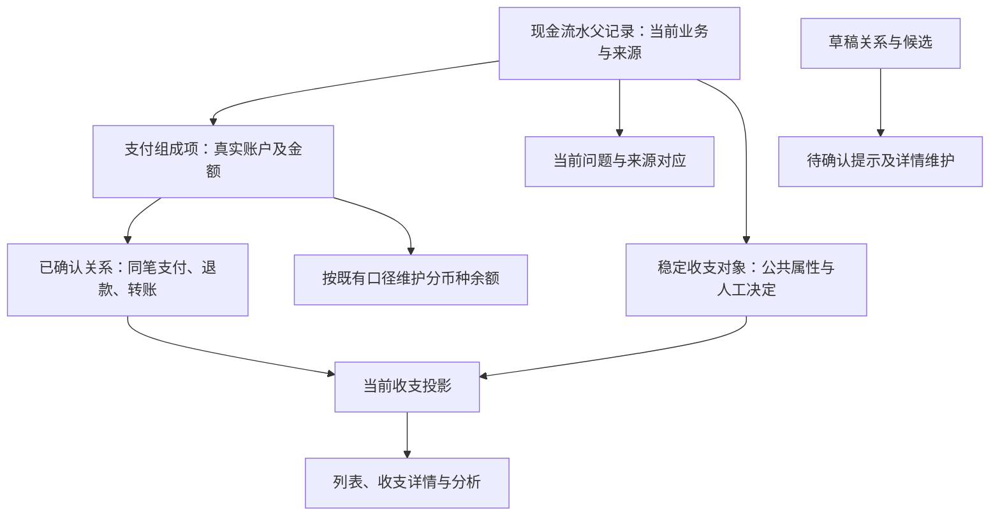

# 现金流水：存储、展示与操作流程

本文从业务概念讲到当前后端实现，说明一笔现金流水怎样保存、怎样成为列表中的一笔收支，以及查看、编辑、分类、关联和删除分别修改什么。账单进入系统的过程另见 [现金账单导入流程](cash-import-flow.md)。

当前后端已支持正式／草稿流水、当前投影及无文件维护；Compose 已接入当前详情、草稿及分摊保存、明确转正式、公共整笔编辑，以及普通记账／转账创建和完整转账编辑。完整关系验收与统一导入仍待完成。下文区分后端能力与客户端合同，实际页面覆盖统一见 [功能地图](feature-map.md)。字段及接口的详细参考集中在 [规则](cash-import-redesign.md) 和 [契约](cash-import-redesign-contracts.md)，不再另存完整字段表。

| 阅读目标 | 入口 |
|---|---|
| 理解一笔收支由什么组成 | [业务对象](#1-先区分流水支付组成项关系和投影)、[状态与类型](#2-状态类型和分类各自表达什么) |
| 理解列表、详情、统计的口径 | [展示与读取](#3-列表详情统计怎样读取)、[例子](#4-用一个例子串起保存和展示) |
| 理解每种操作改动的范围 | [操作流程](#5-操作流程及作用范围) |
| 查后端模型、接口及执行入口 | [技术对应](#6-从业务对象到存储与接口)、[一致性和当前边界](#7-一致性及当前实现边界) |

## 1. 先区分流水、支付组成项、关系和投影

**现金流水父记录**保存一笔业务记录的当前状态和来源。平台消费、银行扣款即使描述同一笔支付，也分别保留各自流水；确认关联不会删除其中一条或把原金额改成合并后的金额。这里的“来源流水”不是不可变的历史版本：允许更新的字段和当前来源行仍可按规则修改。

**支付组成项**保存这笔流水实际使用的账户和金额。普通流水有一个组成项；一笔 100 元组合支付可以分成账户甲 30 元、账户乙 70 元。父记录总额不能再加到账户金额上，否则会重复计算。组合支付父记录不填写虚构的单一账户。

**关系**保存流水之间已确定或待处理的业务联系，例如同笔支付、退款冲销、转账配对。已确认现金关系引用正式流水的具体支付组成项，金额、币种、方向和完整关系图必须合法。候选或草稿关系不是已经发生的合并。

**稳定收支对象**保存用户看到的一笔收支的公共分类、备注、对方及对方账户信息，独立于来源原文；单条和合并收支采用同一编辑入口。人工清空也保留，计算重建不删除这些人工决定。

**投影**是当前流水和已确认关系生成的展示结果。没有确认关系时，一条流水独立成为一项；确认同笔支付或退款关系后，多条流水可能共同成为一项。用户日常看这一笔结果，维护时才展开组成流水及关联，关系不作为一级管理产品。

图中的余额和收支分析是两条计算路径。列表净额不是账户余额分录，关系合并也不是把真实扣款抹掉。

## 2. 状态、类型和分类各自表达什么

| 维度 | 表达的含义 | 不能据此推断什么 |
|---|---|---|
| 流水 `state=draft/posted` | 草稿尚未正式确认；正式流水已通过完整业务校验 | 字段已填全的草稿仍不自动成为正式流水 |
| 展示 `confirmation_status=confirmed/pending` | 是否仍有草稿、当前问题或未确认关联 | 正式流水也可以待确认，继续按当前正式结果统计 |
| `record_type/record_subtype` | 单条流水的业务性质及适用细分 | 不等于用户选择的收支分类，也不等于投影经济类型 |
| `category_id` | 用户整理一笔收支的分类目录标签 | 不改变金额、方向或关系种类 |
| 投影 `economic_type/statistics_eligible` | 展示结果的经济含义和统计资格 | 能看见不等于计入收入或支出 |

金额符号表示资金方向，不能替代上述类型。零金额仍可以是合法正式流水；它与“不知道金额”的草稿不同，未知值用空值及待补原因表达。

草稿与正式流水在同一套表中保存，转正式保留流水身份。草稿可以缺账户、金额、时间、类型或完整分摊，但已填写值仍须合法；草稿不参与余额、收入、支出和其他金额统计。已知总额但分摊不完整时，整笔仍为草稿，不能先统计其中一部分。

关系的当前决定为 `draft/confirmed/ignored`，另有活动标记。只有活动的已确认关系参与投影连接；未确认关系不合并、不抵扣、不占用正式配对名额或退款额度。用户拒绝与主动解除须区分；已合并来源成员只读，公共属性编辑不自动解除关系。

## 3. 列表、详情、统计怎样读取

### 列表读取一笔结果

主页使用当前投影列表，后端默认允许正式和草稿共同展示，每项返回金额、日期、账户、对方、说明、来源、分类和确认状态。待确认项可筛选定位；未知字段不填零金额、假日期或猜测账户。

全额退款及全额平台退回合并后净额为 0，仍保留在列表。内部转账可以展示但不作为外部收入、支出；其他业务隐藏项存在待处理事项时优先可见。这些规则仍受工作区、权限、逻辑删除和用户明确筛选限制。

筛选作用于当前投影。分类父节点包含后代；账户筛选也检查成员的支付组成项，不能因组合支付父记录没有单一账户而漏掉它。用户明确设置日期范围时，未知发生日期的草稿不在该范围内；默认排序可用创建时间作内部位置，但不把它展示成发生日期。

### 详情区分收支结果与实际流水

打开列表项先读取当前收支详情，得到展示结果、成员引用和待处理事项。编辑时读取稳定收支对象的公共值及修订；关联成员的来源字段只读。草稿补全和来源问题仍按具体流水定位。

合并或拆分后，投影标识可能变化。客户端用仍活动的 `transaction_id` 查询最新投影位置并刷新详情，不能把旧 `projection_id` 当作永久流水身份或历史版本地址。来源证据展示可核对的业务信息，不提供原账单下载或技术调试正文。

### 汇总与余额分别计算

月度汇总由服务端对筛选范围内、具有统计资格的当前投影计算，不是对已加载的一页做加法；金额按币种保留，不能直接相加不同币种。草稿始终排除，正式待确认关联仍按各自投影统计，确认后才采用合并结果。

账户余额按正式支付组成项和既有业务口径维护，不能从投影净额反推。当前通用余额增量函数排除草稿、已删除记录及非普通手工的 `transfer_in/transfer_out`；明确转账通过专用操作维护两端余额，余额校准则设置目标余额。因此不能概括为“所有正式流水金额直接累加为余额”。

列表、成员、待确认计数、筛选选项和汇总读取同一个快照。游标绑定筛选及投影发布版本；翻页期间版本变化返回 `409 read_snapshot_changed`，客户端重载，不能混接新旧页面。

## 4. 用一个例子串起保存和展示

以下均为虚构数据：

1. 导入平台消费 −100 元和对应银行扣款 −100 元。数据库保存两条正式流水，各有支付组成项；同笔支付关系未确认时，列表分别展示并分别按正式规则统计。
2. 确认合法同笔支付关系后，两条流水共同形成一笔 −100 元支出。两条原流水及其金额仍保留；公共分类、备注和对方信息统一保存在这笔收支对象上，两条来源原文各自保留。
3. 原消费新增 40 元退款，确认合法退款关系后，展示结果净支出为 60 元；退款不另算一笔收入。全额退款时净额为 0，结果仍可查看。
4. 同时导入另一笔缺账户的 20 元消费，保存为草稿。列表可见并标待确认，但不影响金额汇总；补齐后仍可保存草稿，明确确认才转正式。

第 2 步减少的是重复的收支展示，不是物理删除一条扣款；第 3 步改变的是投影净额，不是改写原消费的固定金额。

## 5. 操作流程及作用范围

### 新增

手工新建使用当前公开字段，提供账户、时间、币种、有符号金额、类型及必要支付组成项；校验成功后直接创建正式流水并维护余额，投影就绪时更新独立展示。它不是“先创建草稿再提交维护计划”的入口，也没有维护计划的幂等收据流程；当前不开放调用方任意指定来源身份、内部保护字典或对象状态。

Compose 的“记一笔”提供普通记账／转账两个模式，切换保留各自尚未保存的输入，只保存当前模式。普通记账内选择收入或支出，金额输入非负数；转账选择转出／转入账户，同币种只输入一个金额，换汇分别填写两端金额。确定成功后刷新账本；结果未知时保留输入并停止重复提交，返回账本核对后再操作。

明确填写的备注和分类，包括清空，由服务端记录人工保护。普通手工新建不会自动发现并确认任意配对；需要从账单生成来源身份、处理重叠文件或自动配对时，使用 [导入流程](cash-import-flow.md)。

### 保存草稿与转正式

从已保存草稿读取当前详情，提交期望修订和补充字段。“保存待确认”使用草稿保存命令，即使财务字段已完整也保持草稿；“确认保存”建立转正式维护计划，检查完整字段、账户资格、币种、分摊守恒、来源歧义及关系，再确认提交。

转正式保留原流水身份。来源身份仍有歧义或待采用内容尚未处理时，不能仅凭财务字段齐全转正式。替换草稿组成项时清理失效候选和引用，不让旧关系悄悄指向新组成项。

### 编辑正式收支与分类

读取创建方式、可编辑字段及 `entry_id/revision`，以 `edit_entry` 提交公共补丁并确认维护计划。导入正式收支只允许分类、备注、对方名称及对方账户信息；单条与合并采用相同白名单，组内来源成员只读。金额、币种、账户、时间、类型和来源身份固定。普通手工流水可以修改全部合法业务字段；手工转账通过完整内部双端操作原子修改。详细边界见 [字段更新规则](cash-import-redesign.md#2-字段更新边界)。

公共属性保存在稳定收支对象，不批量回写来源成员。没有人工值时使用展示基准来源值；人工修改和清空在再次导入、局部维护及全量重建后保留。来源备注取原始描述，原始来源行仅由来源更新刷新。

Compose 在当前详情内切换编辑，只列允许修改的字段，其余信息保留为只读摘要。通常点击一次保存即可完成；有额外影响时停留在当前表单确认。取消编辑会同时清除尚未提交的确认计划，保存进行中或结果未知时保留当前任务，避免重复记账。

单项和批量分类使用直接分类命令，携带当前 `projection_version`，写入对应收支对象；批量任一选择失效时整批拒绝。分类目录维护独立，不在流水编辑中偷偷创建分类。公共编辑不改变金额、关系或配对证据，不需要额外关系确认步骤。

### 处理来源问题与关联

已保存的来源问题可在流水详情选择采用当前来源内容、保留现有，或在确有身份歧义时确认独立记录／合并到已有记录。可选动作来自服务端当前问题；合并不相加金额，不复制另一笔正式流水，并迁移可安全保留的来源对应及待处理引用。

当前关联维护计划处理已经保存的关系及其候选，可以确认、继续暂存、拒绝或解除服务端允许的完整组。关系确认后合并，未确认时分别展示；解除关系保留实际流水，并重新生成拆分结果；存在人工公共值时须明确选择拆出的各笔是否继承。联合关系不能只确认一个非法子集。核对时展示每个候选的完整成员，单候选也不省略；金额、账户、对方与时间取自实际流水，不能用预计合并结果替代。成员读取失败或选择失效时提示重新读取，不自动换目标或保留旧决定。

普通手工流水禁止现金及现金—投资关联；手工转账只保留自身内部关系。当前公开合同不提供“搜索任意两条流水后直接新建关系”的写入口。保留的流水搜索是辅助读取能力，不能据此认定旧新增关联接口仍可用。候选发现与用户任意挑选是不同能力，实际允许动作以维护计划返回为准。

### 删除

删除前先确定目标是某条实际流水，还是列表中的整笔收支：

| 删除入口 | 删除目标 | 其他关联流水 |
|---|---|---|
| 删除当前流水 `delete_current_dissolve` | 仅指定父流水及其当前业务作用 | 清理直接相关关系，其他流水保留并重新展示 |
| 从流水明确选择 `delete_all` | 该流水的已确认关系连通组 | 组内流水一并删除；不沿未确认候选无限扩大 |
| 选择投影删除，含批量 | 所选投影的全部成员 | 先预览影响，再按同一发布版本确认；无关投影不作为删除目标 |

正式与草稿都可逻辑删除，包括尚无组成项的草稿。父记录和已知组成项保留删除审计，退出活动查询；当前来源绑定、问题、直接端点／锚点关系及相关未确认决定组清理。若只是别人的候选，则移除该候选并推进所属修订，保留其他候选，不自动接受剩余唯一项。

删除目标与投影重建范围不同。只删一条流水时，可能要重建整个旧组，但不能因此把旧组全部删除；仍合法且不直接涉及被删目标的确认关系继续保留。余额撤销、关系清理和展示更新同事务完成，草稿不会产生余额回退。

相同来源以后再次导入时，静默创建新的活动流水，不自动恢复旧关系或人工覆盖。删除不提供历史版本编辑或恢复产品。

## 6. 从业务对象到存储与接口

### 存储职责

| 对象／表 | 保存什么 | 权威性 |
|---|---|---|
| `cash_transactions` | 来源当前字段、创建方式、正式／草稿状态、行修订及删除信息 | 来源及财务当前事实 |
| `cash_entries/cash_entry_members` | 公共属性、逐字段人工标记、修订、当前成员及各成员的一份独立恢复值 | 用户编辑的稳定收支对象，不随派生数据集替换 |
| `cash_transaction_components` | 父记录下的实际账户、金额、币种和顺序 | 资金分摊事实，继承父状态 |
| `cash_source_bindings` | 外部身份／出现位置与当前流水的对应 | 重导去重及更新识别，不是历史版本 |
| `cash_transaction_issues/cash_issue_candidates` | 当前缺项、待采用来源及身份候选 | 未解决事项，不是第二份正式流水 |
| `transaction_relations/cash_relation_candidates` | 当前关系决定、角色、金额分配及候选证明 | 已确认关系决定参与合并，候选不能代替决定 |
| `cash_categories` | 工作区分类树与稳定分类身份 | 分类目录事实 |
| `cash_projections/cash_projection_members/cash_projection_relations` | 当前展示字段、成员和已采用关系引用 | 可重建的读取结果，不直接编辑 |
| `cash_projection_states/cash_projection_datasets` | 当前发布位置及版本 | 当前一致性边界，不是历史账本版本库 |
| `cash_mutation_receipts/cash_mutation_results` | 受支持命令的实际结果和幂等事实 | 提交核实，不承诺所有旧命令都有收据 |

完整物理字段及条件约束以 [ORM](../src/ft/adapters/relational/models.py) 和 [数据契约](cash-import-redesign-contracts.md#4-后端逻辑表结构契约) 为准。草稿允许的空值不免除工作区外键、已填写值合法性和正式条件校验；精确金额跨 SQLite／PostgreSQL 保持一致。

流水实例 ID 用于本库关联和维护定位，来源身份用于跨账单核对，投影 ID 用于当前展示，三者不能互换。`entry_id/expected_entry_revision` 校验公共收支对象，`row_revision` 校验目标来源流水，`plan_revision` 校验维护计划，`projection_version` 校验当前列表、分类和删除选择；这些都是并发令牌，不是历史版本。

### 当前公开入口

以下路径均以 `/api/v1` 为前缀：

| 任务 | 入口与提交方式 |
|---|---|
| 列表与筛选汇总 | `GET /cash-projections`；同快照返回发布版本、投影项、筛选选项及月汇总 |
| 收支详情／来源证据 | `GET /cash-projections/{projection_id}`；证据为 `GET /evidence/cash-projections/{projection_id}` |
| 维护详情及重新定位 | `GET /cash-records/{transaction_id}`；`GET /cash-records/{transaction_id}/projection` |
| 辅助搜索／手工新建 | `GET /cash-records`／`POST /cash-records`；新建是直接命令 |
| 保存草稿 | `save_draft` 维护计划及原命令核实；直接 `PATCH /cash-records/{transaction_id}/draft` 保持兼容，均需要期望行修订和补丁，保持草稿 |
| 正式编辑、转正式、问题与关联维护 | `POST /cash-mutations/plans` → 读取或重预览 → `POST /cash-mutations/plans/{plan_id}/commit` |
| 单项／批量分类 | `PUT /cash-projections/{projection_id}/category`／`PUT /cash-projections/categories`；版本化的原子直接命令 |
| 单条或确认连通组删除 | `DELETE /cash-records/{transaction_id}`；明确删除模式 |
| 按展示项删除 | `POST /cash-projections/delete-impact` → `DELETE /cash-projections`；携投影选择、发布版本及明确确认 |
| 分类目录 | `/cash-categories` 及其当前管理子路径；独立目录操作 |
| 专用现金操作 | 保留 `/cashflow/add`、`/cashflow/checkin`、`/cashflow/transfer`；不能把专用操作的输入和余额语义推及普通编辑 |

独立投资事件及现金—投资资金关联有各自的端点合同，不能用无类型整数 ID 混入普通现金关系。专用余额校准和明确转账不等于修改一条正式流水的固定金额。

### 实现入口

| 职责 | 当前代码 |
|---|---|
| 模型、来源与关系约束 | [关系模型](../src/ft/adapters/relational/models.py)、[统一字段策略](../src/ft/domain/cash_record_policy.py)、[关系图规则](../src/ft/domain/cash_relation_graph.py) |
| 列表、汇总、收支详情和定位 | [应用查询](../src/ft/application/queries.py)、[数据库读取](../src/ft/adapters/relational/web_queries.py) |
| 维护详情与草稿保存 | [维护服务](../src/ft/application/cash_record_maintenance.py) |
| 维护计划及确认 | [业务规划](../src/ft/application/cash_mutation_business_plan.py)、[计划服务](../src/ft/application/cash_mutation_plans.py)、[提交执行](../src/ft/application/cash_mutation_commit.py) |
| 分类 | [分类目录](../src/ft/application/cash_categories.py)、[投影分类](../src/ft/application/cash_classification.py) |
| 新建与删除 | [现金命令](../src/ft/application/cash_ledger.py)、[删除引用清理](../src/ft/application/cash_record_deletion.py) |
| 余额与局部投影 | [余额规则](../src/ft/application/cash_balances.py)、[投影服务](../src/ft/application/cash_projections.py) |
| HTTP 与命令开放范围 | [查询及直接命令路由](../src/ft/web/routes.py)、[维护路由](../src/ft/web/cash_plan_routes.py)、[专用操作](../src/ft/web/operation_routes.py)、[运行时分发](../src/ft/web/app.py) |

## 7. 一致性及当前实现边界

所有操作在当前认证使用者、角色和工作区内执行；只读角色不能写入。维护预览不写业务数据，修改决定后生成新不可变计划；确认时重验行、问题、候选及关系，按实际结果维护当前状态。

导入可隔离不同流水的失败，不能据此推断所有命令都“部分成功”。整笔分类的共同维护单位、版本化批量分类和批量删除各有完整性边界；范围内操作须按各自合同一起成功或回滚。维护计划与草稿保存的收据、当前状态和投影共同提交，结果未知先核实原请求，不换键重复写入。

投影维护只影响相关旧、新组，并在旧投影成员与新确认关系之间迭代到闭包稳定。闭包外不重建，未确认候选不引发全库重配。算法、配对提交组、最终统一发布失败的回滚边界及收据恢复见 [导入流程的一致性机制](cash-import-flow.md#8-一致性机制只更新必要范围结果可以核实)，同一机制也支撑维护写入。

旧类中仍存在的 `update_record/add_relation/cancel_relation/dissolve_relations` 等方法，不因代码存在而成为当前公共入口；运行时已限制可分发命令。旧 `/cash-facts/*` 及直接现金关系写入口不再作为当前操作合同。保留的专用现金、分类、删除及投资能力，不能随旧入口一起误删。

Compose 已接入当前正式／草稿列表、维护详情、草稿保存／转正式、普通记账、转账及整笔编辑；来源问题和关系维护已接线，完整关系验收与统一导入仍待完成。旧全字段编辑、来源成员编辑和任意新增关联页面及其 HTTP 客户端已移除；演示夹具和历史截图不证明完整流程已验收。

手工新建路径仍有独立的当前行为：账户查询检查工作区、账户类型和币种，未统一检查启用状态；投影写入采用就绪时维护，不以统一投影就绪作为全部新建的保存前置条件。不能把导入或草稿转正式的全部账户资格与计划保护推及这个入口，准确实现见 `CashLedgerCommandService.create_record`。

## 继续查阅

| 内容 | 入口 |
|---|---|
| 外部账单如何成为上述流水 | [现金账单导入流程](cash-import-flow.md) |
| 字段、状态、来源对应和维护的详细规则 | [现金流水与导入业务规则](cash-import-redesign.md) |
| 请求、响应、逻辑字段、后续 UI 合同与场景 | [接口、数据与客户端交互参考](cash-import-redesign-contracts.md) |
| 当前客户端证据和待接入范围 | [功能地图](feature-map.md) |
| 行为规格与未完成变更 | [现金账本规格导航](../openspec/specs/cash-ledger/README.md)、[实施变更](../openspec/changes/cash-import-lifecycle-redesign/tasks.md) |
