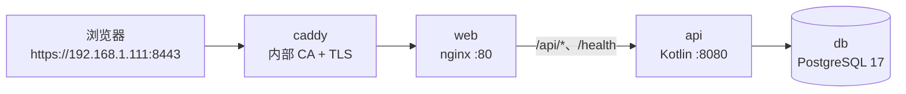

# 本地 Docker + PostgreSQL 部署

本部署在一台机器上运行 Kotlin 后端、Compose Web、PostgreSQL 和 Caddy TLS 入口，供同一局域网内的浏览器访问。Caddy 是唯一入口，后端、Web 和数据库不直接暴露到宿主机。



## 前置条件

- Docker Desktop（含 Compose v2）与至少 8 GB 可用内存。
- 固定的局域网 IPv4 地址。本说明以 `192.168.1.111` 为例；请先在路由器为该机器设置 DHCP 保留。
- 首次构建需要网络下载 Gradle 依赖和基础镜像，耗时取决于网络。
- 浏览器最低版本：Chrome / Edge 119、Firefox 120、Safari 18.2。
- 每台访问设备需要安装一次本部署的本地 CA 根证书。应用依赖 `SharedArrayBuffer` 与 OPFS，明文 HTTP 不是安全上下文，无法启动账本。

## 首次部署

在仓库根目录生成 `.env` 并写入随机数据库密码：

```bash
password="$(openssl rand -hex 24)"
awk -v p="$password" '/^FT_POSTGRES_PASSWORD=/{print "FT_POSTGRES_PASSWORD=" p; next} {print}' .env.example > .env
chmod 600 .env
```

编辑 `.env`，确认 HTTPS origin 与机器当前局域网地址一致：

```dotenv
FT_WEB_HOST=192.168.1.111
FT_WEB_PORT=8443
FT_POSTGRES_DB=finance_tracker
FT_POSTGRES_USER=finance_tracker
FT_POSTGRES_PASSWORD=<随机值>
```

Compose 会用 `FT_WEB_HOST` 和 `FT_WEB_PORT` 派生 `FT_WEB_ORIGIN`，不要单独设置 `FT_WEB_ORIGIN`。请使用非 80/443 端口；默认端口会让浏览器在 `Origin` 中省略端口，导致与后端精确匹配不一致。

启动并等待四个服务健康：

```bash
docker compose up -d --build
docker compose ps
```

导出 Caddy 根证书（只导出公开证书，不导出私钥）：

```bash
mkdir -p certs
docker compose cp caddy:/data/caddy/pki/authorities/local/root.crt \
  certs/finance-tracker-local-ca.crt
```

### 安装并信任根证书

macOS：

```bash
sudo security add-trusted-cert -d -r trustRoot \
  -k /Library/Keychains/System.keychain \
  certs/finance-tracker-local-ca.crt
```

iOS / iPadOS：

1. 通过 AirDrop 或“文件”把 `finance-tracker-local-ca.crt` 传到设备并安装描述文件。
2. 打开“设置 → 通用 → 关于本机 → 证书信任设置”，为该根证书启用完全信任。
3. 重新打开 Safari。

安装后验证：

```bash
curl --cacert certs/finance-tracker-local-ca.crt \
  https://192.168.1.111:8443/health
```

浏览器打开 `https://192.168.1.111:8443`，注册第一个账号并创建 workspace；后端不会自动创建 workspace。若浏览器仍提示证书错误，先确认根证书已信任并重启浏览器，不要通过长期忽略证书错误来使用。

如果其他设备无法访问，先在本机用局域网地址验证，再检查 macOS 防火墙是否允许 Docker 入站，以及路由器是否隔离了无线客户端。

## 日常操作

```bash
docker compose ps                    # 状态
docker compose logs -f caddy api web # 日志
docker compose stop                  # 停止，保留容器与数据卷
docker compose up -d                 # 再次启动
docker compose down                  # 删除容器与网络，保留数据卷
docker compose up -d --build         # 代码或配置变化后重建
```

`docker compose down -v` 会删除 PostgreSQL 数据卷和 Caddy CA 数据卷，**不可恢复**；执行前必须先备份，删除后所有设备都需要重新安装新的根证书。

局域网地址或端口变化时，修改 `.env` 的 `FT_WEB_HOST` 和 `FT_WEB_PORT`，然后重建后端、Web 与 Caddy：

```bash
docker compose up -d --build api web caddy
```

Caddy 会为新 IP 自动签发新证书；根证书不变，已安装的设备不需要重新安装。后端 `FT_WEB_ORIGIN` 与编译进前端的 API 地址都由同一组 `FT_WEB_HOST`/`FT_WEB_PORT` 派生。

## 手工备份与恢复

本次部署不包含自动备份。建议在升级、删除卷或批量导入前手工执行 `pg_dump`，备份文件放在仓库外：

```bash
set -a
. ./.env
set +a
mkdir -p "$HOME/finance-tracker-backups"
docker compose exec -T db pg_dump -U "$FT_POSTGRES_USER" -d "$FT_POSTGRES_DB" -Fc \
  > "$HOME/finance-tracker-backups/finance-$(date +%Y%m%d-%H%M%S).dump"
```

恢复前停止写入，确认备份文件可读，再执行：

```bash
docker compose stop caddy web api
docker compose exec -T db pg_restore -U "$FT_POSTGRES_USER" -d "$FT_POSTGRES_DB" \
  --clean --if-exists < "$HOME/finance-tracker-backups/<备份文件>.dump"
docker compose start api web caddy
```

数据库密码通过 `.env` 和容器环境传递，不要写进命令行或提交到 Git。

## 安全边界

- 本部署通过 HTTPS 提供 Web，避免会话令牌和财务数据在局域网内明文传输。
- 根证书的私钥只保存在 `caddy_data` 数据卷中；只导出和分发 `root.crt`，不要分发私钥或 `caddy` 数据卷。
- 本地根证书只安装在自己控制的设备。它可以为该设备信任任意本地证书；设备不再使用本部署时应移除。
- 只发布 Caddy 的 `8443` 端口；后端、Web 与 PostgreSQL 只在 Compose 内部网络可达。
- 后端保留对 RFC1918 私有 IPv4 HTTP origin 的兼容能力，但本部署没有明文 Web 入口，也不要把 `8443` 暴露到公网。
- 真实 `.env`、数据库卷、根证书和备份都留在仓库外。不要提交 `.env` 或把密码贴进 issue、日志和截图。

## 回滚

保留数据卷时，回滚代码不会删除账本数据：

```bash
docker compose down
git checkout <本次变更前的提交>
docker compose up -d --build
```

如果旧代码不接受当前 schema 版本，先在旧环境验证数据库版本；不要通过修改 `alembic_version` 绕过校验。只有确认不再需要本地数据时，才执行 `docker compose down -v`。

## 排查

1. `docker compose ps` 查看四个服务健康状态；`docker compose logs caddy` 查看证书签发和反向代理错误。
2. 浏览器 Console 搜索 `[Finance Tracker runtime]`，确认 `secureContext`、`crossOriginIsolated` 和 `sharedArrayBuffer` 为真。
3. 证书错误时重新安装根证书；`curl --cacert` 失败时检查地址、端口和系统时间。
4. `curl -I --cacert certs/finance-tracker-local-ca.crt https://192.168.1.111:8443/` 的响应头应包含 `Cross-Origin-Opener-Policy: same-origin` 与 `Cross-Origin-Embedder-Policy: require-corp`。
5. 登录返回 CORS 或 origin 错误时，核对 `.env` 的 `FT_WEB_HOST`/`FT_WEB_PORT` 与浏览器地址是否完全一致（协议、主机、端口）。
6. schema 版本不匹配时，后端会失败关闭；空库由后端建立当前基线（本次代码为 `20261104_54`），非空库只校验版本。不要删除表或手改版本号，先核对代码与数据库版本并恢复备份。
