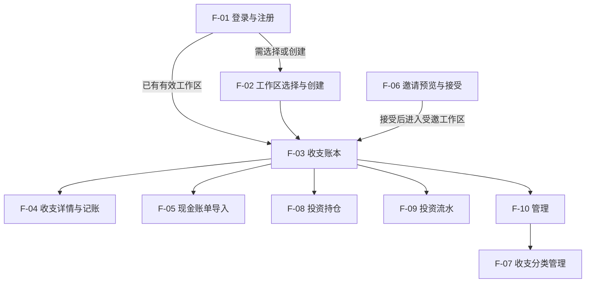

# Compose 功能地图

本文是页面级功能、业务路径、实现证据、跨端覆盖与待办的统一盘点入口。按模块查页面，再进入模块文档查看入口、主路径、分支、失败恢复和实现证据；行为合同以 [OpenSpec 主规格](../openspec/specs/README.md) 为准。

> 盘点日期：2026-11-02。导入及共用备注编辑修复见 [规范对齐任务](../openspec/changes/archive/2026-11-03-align-cash-import-product-rules/tasks.md)，Web 验证与独立设计复核已完成。Compose Web、Android、iOS 共用 `compose/shared`，共享代码不代表各平台设备 QA 全部完成。

## 产品总览

当前共有 **10 项页面级功能**，分布在 5 个有页面的业务模块。账户与共享规则由现有任务承载，没有独立页面。编号保持稳定，F-04 的详情面板与 F-07 的管理页分组仍各计一项独立任务。

| 模块 | 页面级功能 | 主要用户任务 | 详情与证据 |
|---|---|---|---|
| 认证 | F-01 登录与注册 | 登录、注册、恢复会话 | [认证模块](authentication/feature-map.md) |
| 工作区 | F-02 工作区选择与创建；F-06 邀请预览与接受；F-10 管理 | 进入工作区、接受邀请、管理资料／权限／成员 | [工作区模块](workspace/feature-map.md) |
| 现金账本 | F-03 收支账本；F-04 收支详情与记账；F-07 收支分类管理 | 浏览、记账、编辑、处理草稿／关联流水、分类 | [现金账本模块](cash-ledger/feature-map.md) |
| 导入 | F-05 现金账单导入 | 准备文件和账户、统一核对、一次确认、查看结果 | [导入模块](import/feature-map.md) |
| 投资 | F-08 投资持仓；F-09 投资流水 | 查看估值与表现、浏览事件与来源证据 | [投资模块](investment/feature-map.md) |
| 账户 | 无独立页面 | 在记账／导入中选择账户，在导入中创建账户和补齐币种 | [账户模块](accounts/feature-map.md) |
| 共享规则 | 无独立页面 | 支撑导航、响应式、展示、时间和演示模式等共同规则 | [共享规则与工程证据](shared/feature-map.md) |

图表示主要任务之间的到达关系，不表示所有页面都是独立路由。邀请可在登录前打开；已有有效会话和工作区时可直接进入对应页面。账户、投资账单导入、连接器及 Agent 操作指引不因后端能力存在而计为客户端页面。

## 页面入口索引

工作区内页面使用 `/w/<workspaceId>/` 上下文；认证、工作区选择和邀请入口见各行说明。切换工作区保留当前子页面路径。

| ID | 页面级功能 | 入口或承载方式 |
|---|---|---|
| F-01 | [登录与注册](authentication/feature-map.md#f-01-登录与注册) | 无有效会话时的应用入口，登录／注册共用页面 |
| F-02 | [工作区选择与创建](workspace/feature-map.md#f-02-工作区选择与创建) | 认证后的工作区入口，无独立路由 |
| F-03 | [收支账本](cash-ledger/feature-map.md#f-03-收支账本) | `/w/<workspaceId>/` |
| F-04 | [收支详情与记账](cash-ledger/feature-map.md#f-04-收支详情与记账) | F-03 的详情面板或新增表单，无独立路由 |
| F-05 | [现金账单导入](import/feature-map.md#f-05-现金账单导入) | `/w/<workspaceId>/cash-import`，全屏任务 |
| F-06 | [邀请预览与接受](workspace/feature-map.md#f-06-邀请预览与接受) | `?invite=<token>`；Native 内部 URI 为 `finance-tracker://invite/<token>` |
| F-07 | [收支分类管理](cash-ledger/feature-map.md#f-07-收支分类管理) | F-10 内嵌分组；`/w/<workspaceId>/cash-categories` 深链接定位该分组 |
| F-08 | [投资持仓](investment/feature-map.md#f-08-投资持仓) | `/w/<workspaceId>/investment-holdings` |
| F-09 | [投资流水](investment/feature-map.md#f-09-投资流水) | `/w/<workspaceId>/investment-events` |
| F-10 | [管理](workspace/feature-map.md#f-10-管理) | `/w/<workspaceId>/workspace-management` |

## 跨端覆盖与待办

10 项功能均有 Web、Android、iOS 共用的 Compose 入口。下表区分已记录的验证范围与仍待验收项；未单列的平台范围不推定通过。各模块正文集中保存代码、主规格与验证记录链接，历史结果不能替代当前缺口。

| 功能 | 已记录的实现与验证范围 | 当前待办或边界 |
|---|---|---|
| F-01／F-02 | 认证恢复、工作区进入／创建已实现；共同入口壳有 Web Chrome 与 Android QA 记录 | 未形成覆盖全部状态与平台的验收矩阵，具体范围见 [认证](authentication/feature-map.md) 和 [工作区](workspace/feature-map.md) |
| F-03 | 共享账本已接搜索、筛选、分页和批量操作；账本、导入核对和关联搜索共用瀑布流组件，账本类型列显示待处理原因；本次 Web Chromium 390／768／1440 代表视口与 Android Host／iOS Simulator 编译已验证 | 未做原生设备交互 QA；见 [现金账本](cash-ledger/feature-map.md) |
| F-04 | 当前详情、草稿／分摊、转正式及关联维护已接真实 API；关联流水和账单原文共用成员卡布局，搜索只返回可选流水，服务端资格筛选有 SQLite／PostgreSQL 合同证据 | 联合方案改选不可提交；本次未做原生设备交互 QA；见 [F-04](cash-ledger/feature-map.md#f-04-收支详情与记账) |
| F-05 | 共享文件／账户准备、统一核对、确认和收据已接入；仅多渠道时分组账户，核对列表显示类型及待处理原因；实际格式月度切片、并发追加、批量补币种、完整月度汇总及真实浏览器回归入口见 [导入](import/feature-map.md) | 未做原生设备交互 QA；iOS 文件选择器交回后的完整导入、未知账户与账户编辑分支待验收；见 [导入](import/feature-map.md) |
| F-06 | 邀请预览／接受／取消及内部 URI 路由已实现，有入口 QA 记录 | HTTPS Universal Links 待部署域名与签名配置；见 [F-06](workspace/feature-map.md#f-06-邀请预览与接受) |
| F-07 | 目录、搜索、排序、编辑、删除已实现；查看者只读入口含物理与语义激活保护；有 Wasm 单测、Web／Android 搜索创建、新 Android 管理布局及 iPad 11 部分操作证据 | iOS 新布局与分类完整操作集待设备验证；见 [F-07](cash-ledger/feature-map.md#f-07-收支分类管理) |
| F-08 | Web E2E、Android 三布局主题 QA、iPad 11 估值／详情及 iPad 13 wide 深色布局有通过记录 | 既有结果仅覆盖所列范围；见 [F-08](investment/feature-map.md#f-08-投资持仓) |
| F-09 | Web E2E、Android 详情／分页、iPad 11 详情／加载更多有通过记录 | 银证转账关系只读；既有结果仅覆盖所列范围；见 [F-09](investment/feature-map.md#f-09-投资流水) |
| F-10 | 资料／成员／邀请／删除已实现；Web E2E 与 Android 管理 QA、iOS 改名／角色／邀请有记录 | 新 iPhone／iPad 管理布局及 iOS 删除流程待设备验收；见 [F-10](workspace/feature-map.md#f-10-管理) |

**共同缺口：** Compose Web `1.12.1` 关闭详情弹层后无障碍树不恢复；草稿保存及公共备注决策已补齐有限的 Web 控件状态导出，整体无障碍 QA 仍保留未通过状态，不升级 Compose。问题与历史浏览器证据见 [共享规则](shared/feature-map.md#web-已知缺陷与历史验证)。目前仍没有覆盖全部页面、平台、窗口尺寸与状态的完整矩阵。

**部署边界：** 现金导入的真实库迁移、旧外部原文件对象清理及部署尚未执行，不能把代码接通、后端验收或共享入口视为实际部署。条件见 [导入模块](import/feature-map.md#后端能力与客户端边界) 的实施记录。

### 跨端影响检查

任何 Web／Mobile 页面、文案、交互、表单校验、弹层、状态或响应式变化都必须执行 Cross-platform Impact Check，在对应 `tasks.md` 写明 Web、Native、共享层是否受影响及理由，不得默认另一端无影响。

- Web compact 与 Native Phone 共用产品合同；Native regular／wide 按逻辑宽度适配 Android 多形态、iPhone 和 iPad，wide 保持 Web 大屏导航层级、区域顺序及筛选／详情／操作关系。
- 共享文案、状态、语义 ID、操作、响应式与确认／错误／结果语义；渲染控件可以不同。差异须登记于 [presentation 合同](../openspec/specs/shared/cross-platform-presentation/spec.md) 或 OpenSpec，否则按 defect。
- 未覆盖的 Native 页面登记缺口，不用伪页面或静默跳转掩盖。
- 当前 Web／QA 位于 `compose/`。

## 统计口径

- 一项可独立完成的用户任务计为一个页面级功能；路由页面、详情面板或管理页分组均可承载，同一任务跨窗口／平台只计一次。
- 登录／注册、记账的新建／查看／编辑、导入的文件／账户／核对／确认／结果均为各自任务内部模式或步骤。
- 邀请、工作区管理、分类管理、投资持仓和投资流水分别计数；F-07 嵌入 F-10 后仍保留独立分类任务。
- 重定向、路由守卫、导航壳、加载态、错误态、筛选和确认弹窗不另计页面。
- “共享实现覆盖”须有可达的 Compose 入口和真实 API 流程；仅有后端接口、文案、原型、规格或不可达导航不计为当前客户端实现。各 target 的实际验收范围分别登记。

## 维护规则与依据

1. 本总览与 `docs/<module>/feature-map.md` 各模块共同组成唯一功能盘点。模块文档保存业务路径、限制和证据，总览保存页面索引、统计与跨端待办；行为以 [主规格](../openspec/specs/README.md) 为准。
2. 所有功能改动，包括后端能力新增客户端入口、Web／Native／共享 presentation 改动，必须同组更新相关模块及总览的页面数、覆盖、证据和待办。
3. 每次核对模块归属、页面入口、主路径、关键分支与失败／取消／恢复出口。新增页面先登记各平台状态，一端未实现时同时登记另一端对齐 TODO。
4. 只有真实页面入口、API 流程与相称验证均完成后，才移除对应缺口；共享代码不代表设备 QA，通过的历史记录不覆盖新布局或新流程。
5. 平台特有控件可不同，但行为、文案、状态、语义和业务结果须遵守 [跨端展示规格](../openspec/specs/shared/cross-platform-presentation/spec.md)。工程、导航壳和共同验证证据集中见 [共享规则](shared/feature-map.md)。
6. 纯文档、词表、功能地图、`AGENTS.md` 或 `README.md` 改动不创建 OpenSpec 变更；涉及代码改动时遵守仓库 OpenSpec 门禁，在对应 `tasks.md` 保存准确的验证证据。

## Kotlin 后端迁移状态

Web 自动解锁密钥仓储与实际加密 OPFS Worker 已组合并通过真实浏览器重启、错钥拒绝、事务中断恢复和范围清理失败验证；Web 工厂已组合真实 SQLDelight 驱动、SQL 快照和清理围栏，验证取消及线程故障；与同步／本地浏览的内部组合已验证换版、失败保旧及撤权擦除。Apple 与 Android 内部缓存工厂均已组合平台安全密钥、范围文件租约、实际 SQLCipher 驱动和完整快照，并通过相应系统测试；Android 工厂与同步／本地浏览的组合已用合成 HTTP 验证，未接应用登录。离线访问恢复记录已接入同一加密存储并验证原令牌及身份绑定；应用启动定位、联网核验、原生索引、登录生命周期及页面尚未接通，仍不具备完整离线缓存能力，见[共享工程证据](shared/feature-map.md#跨端合同与验收边界)。

Kotlin/Ktor 是仓库唯一后端实现，已接入 86 个业务操作；Python 后端及 Alembic 已退役。默认后端测试和 CI 执行全部自包含用例，外部历史夹具测试通过独立任务显式执行。生产入口支持 PostgreSQL／Neon 连接安全参数，配置边界见[共享工程入口](shared/feature-map.md)。当前运行、验证范围和保留限制见 [Kotlin 后端迁移证据](shared/kotlin-backend-migration.md)，逐项源定义见 [迁移盘点](../openspec/changes/archive/2026-11-04-kotlin-backend-shared-core/inventory.md)。Render 切换尚未成功，修复后的线上启动仍待验收；页面数和现有 Web／Native 覆盖不因后端退役改变。

离线账本改造已提供选定工作区的版本查询和一致全量事实快照，事实写入口审计完成，同一合成输入的完整响应已通过 SQLite／PostgreSQL 逐字段对照。来源候选读取与操作规划保留 64 位修订；工作表行列／坐标预算和值型 XLSX 字节读取／归一已提供本地入口，所选工作表公式整份拒绝；完整文件调度和页面尚未接入。PDF 与旧建行 XLS 的无状态解析入口和共享传输已提供：PDF 返回归一化文档，XLS 返回原始文档后在端侧归一；两者不读取账本或创建导入暂存，需要联网；共享单文件分派已将它们与本地读取器组合，按原字节／来源优先级处理并只读一次原文件。批次 owner、稳定输入保存和页面尚未接入。

来源流水与组成项的内部 SQL 写入已从旧编排抽取，旧入口仍保持条目编辑、绑定与问题处理的原顺序；新写集的真实旧事实准备与完整事务仍待接入。

XLSX 本地读取已完整校验全部 XML／rels，未选中及非标准路径工作表也受坐标预算保护。main 新增的唯一渠道探测、核对时区月汇总及超大预览恢复已保留在现有服务端／页面路径，端侧完整文件 owner 接线仍须适配，不能据此视为本地导入已完成。

现金文档／归一、来源身份／查重、来源计划证明准备与账户／支付组件决定、逐流水操作计划、资金扫描／分摊、昵称 NFC 及来源账户 Unicode 识别、关系发现与完整规划／校验、逐行投影和金额图已复用共享核心。文本解码、工作簿数字／日期文本与日期样式识别、平台 CSV／工银亚洲 TSV 字节到完整归一、已解码文档归一及来源账户、资金扫描、账户选择后的分配校验、完整字段验证、来源行／批次查重、完整快照上的候选／证明读取及导入选择输入校验及完整逐流水操作计划及快照逐行投影派生、稳定收支及公共字段组合、完整列表读取模型及全局筛选选项、工作区／账本／规则／筛选绑定的分页游标、显式浏览时区的月份适配、筛选日期文本归一及选定时区日期范围、普通文字且忽略大小写的关键词谓词与完整选择的精确月度统计具备本地入口；本地查询已组合原始筛选归一、双分页及完整范围统计，本地金额筛选限制整数 20 位／小数 18 位；普通现金、含现金端的转账及现金编辑已接提交前 UTC 时间范围校验，纯投资转账保留原范围，三端编译及 Web 宽窄表单回归已通过，内部浏览 owner 已组合固定登录范围的快照刷新与本地分页，已确认收据版本可作为完整快照刷新下限，过旧事实不发布；实际加密驱动、应用会话与页面仍待接线；已接受且生效的现金资金对应仅同步所关联投资记录的最小只读字段，完整投资账本和计算仍排除；缓存版本／快照 HTTP 入口已按预期工作区校验，刷新编排已通过事实缓存端口组合，内部 SQL 快照已验证完整保存与失败保旧，快照 HTTP／落盘 JSON 数字词法使用同一专用 serializer 保真；工作簿 ZIP 预检已接共享预算／CRC／中央目录扫描，原生继续原 XML 与单元格读取，本地值型 XLSX 复用预算并由共享 XML 解析；候选类型、时间窗合并与硬键查询规划已共享，本地入口已在完整快照上执行候选读取，平台编号优先标准化字段，仅缺失时按来源映射惰性读取原文，本地准备配置已组合账户、候选与关系上下文并接真实初始工厂，完整发现与业务计划仍待接通；关系选择的失效保留及 generation 核心、拆分公共值恢复与图应用已共享；本地计算型建议组已直接复用保存选择，拆分恢复从同一完整快照按需读取独立公共值，计算金额和精确虚拟标识不经 JSON 往返，建议组／依赖和有界候选组合亦已共享，来源增强、保留编辑目标及种子读取编排亦已共享，本地建议组已使用真实工厂及精确类型，完整发现和核对计划仍待组装；关系上下文模型、依赖摘要及完整快照上的只读上下文入口已共享，保留确认闭包、历史组及精确依赖，可变预览状态与正式图／草稿投影组合已共享，类型修改失效和整条操作回退亦由共享操作叠加执行，条目公共字段继承、手工值与编辑补丁合并亦已共享，存量值和条目已接完整快照，本地初始预览工厂已组合精确虚拟事实、草稿、操作和公共字段，完整发现及文件到核对流程仍待接通；计算值预览摘要与虚拟标识已共享，保留 Decimal／微秒时刻及完整 128 位摘要前缀；核对页公共字段选择的目标索引与应用决定已共享，冻结核对结果、成员详情／关系影响和文件结果亦由共享呈现规则执行，真实本地工厂后的图应用与呈现配置已通过全部原生呈现用例对照，本地公共字段编辑已直接消费计算型呈现计划，JSON 入口仍先复制完整计划；已计算提案的核对结果组装已复用共享流程，最终冻结编码已输出固定金额和 UTC 微秒并保留整数／浮点种类，完整发现、计划保存及文件到核对流程仍待接通；永久收据的精确账本版本已贯通存储、原键读取和共享模型；最终增量传输模型已提供，显式区分已有与新建引用并隔离服务端审计字段，另分开表达本次人工编辑与通用来源事项动作及精确依赖，当前来源事项补丁准备由原生与端侧共享规则执行，稳定收支对象的身份保留、人工值合并／拆分及成员恢复已复用共享协调规则，公共字段编辑及合并前公共选择的归一、逐父修订和独立值边界亦已共享，原仓储继续负责事务与持久化，内部协调分组不依赖时刻，可供后续草稿结果核对复用；通用辅助模型仍保留维护用拆分选择，文件动作门拒绝该动作；条目结果只传业务分组，全部受影响旧条目以独立修订读集提交，旧存储身份／拆分标记／退休指令严格拒绝；内部拓扑检查已覆盖完整受影响最终成员／根、来源绑定新旧归属、旧条目依赖及无时间草稿，文件专用内部门已核全部受影响旧成员及身份锚存活且同组，完整效果及实际事务仍待接入；行核对的前置公共补丁已单独表达，保留旧条目修订／不存在观察，与来源最终值及归并后公共编辑分开；按可信旧 owner 合并前置补丁的副本准备已提供，原操作管线复用同一冲突原语；受管事务中的前置编辑阶段已复用原 applyEdit，先核全部旧观察及实际引用，再按旧修订执行，完整服务仍待接线；公共及完整成员独立值的输入归一已提供，最终临时拆分标记不得提交；有序关系选择组另保存全部新边分区与合并前公共补丁，文件门拒绝缺漏、重复、旧引用、失效新边及非接受组的公共编辑，五字段浅归一和当前分类引用亦已核对；内部联合批次准备已保留全部关系状态及明确选择组顺序，不信客户端联合标签或关系数组顺序；生效公共补丁的批次一致性及可信前置人工字段覆盖已有内部门；仅首次写入的真实公共选择阶段已按原批次／组序执行逐组逐父选择，完整去重消费仍归外层；实际协调后完整条目业务结果对照亦已提供；真实条目收尾已组合受管事务、实际引用与完整分区预检、原协调和普通后置编辑及写后完整事实核对，失败由外层回滚；完整三阶段提交、收据与公开入口仍待接入；文件动作范围门已限制被写流水为存活的导入／历史记录，拒绝无文件维护与已有关系重写，并保留已软删旧父项的来源绑定复用；该内部门尚未接入公开提交服务，通用事项／拆分辅助能力不代表新导入入口开放维护；引用／修订及最终自然键占用的纯预检、金融值归一、正式／草稿组成项一致性、按实际旧值的固定字段／正式状态方向核对及最终生效确认图（含未改存量边）检查已提供，但尚未接真实事务；其余生产适配、写集校验与提交、本地存储和页面接线尚未完成，不能视为已支持离线导入。页面覆盖按上表记录，实施及验证见 [离线账本任务](../openspec/changes/offline-first-ledger-import/tasks.md)。
