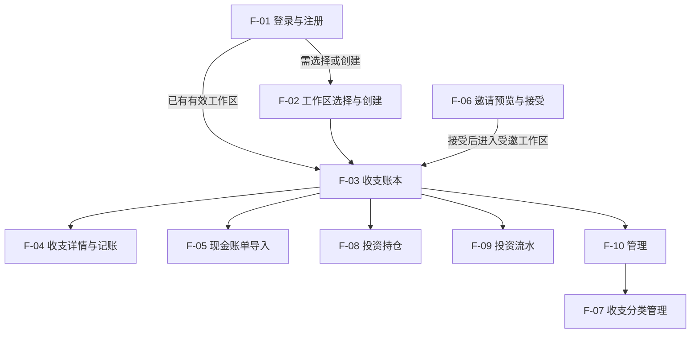

# Compose 功能地图

本文是页面级功能、业务路径、实现证据、跨端覆盖与待办的统一盘点入口。按模块查页面，再进入模块文档查看入口、主路径、分支、失败恢复和实现证据；行为合同以 [OpenSpec 主规格](../openspec/specs/README.md) 为准。

> 盘点日期：2026-10-29。行为盘点基于已合并的 `origin/main`：`89682e5237e7bbe341ffc4b79ec84c2e8825a88c`。Compose Web、Android、iOS 共用 `compose/shared`，共享代码不代表各平台设备 QA 全部完成。

## 产品总览

当前共有 **10 项页面级功能**，分布在 5 个有页面的业务模块。账户与共享规则由现有任务承载，没有独立页面。编号保持稳定，F-04 的详情面板与 F-07 的管理页分组仍各计一项独立任务。

| 模块 | 页面级功能 | 主要用户任务 | 详情与证据 |
|---|---|---|---|
| 认证 | F-01 登录与注册 | 登录、注册、恢复会话 | [认证模块](authentication/feature-map.md) |
| 工作区 | F-02 工作区选择与创建；F-06 邀请预览与接受；F-10 管理 | 进入工作区、接受邀请、管理资料／权限／成员 | [工作区模块](workspace/feature-map.md) |
| 现金账本 | F-03 收支账本；F-04 收支详情与记账；F-07 收支分类管理 | 浏览、记账、编辑、处理草稿／关联流水、分类 | [现金账本模块](cash-ledger/feature-map.md) |
| 导入 | F-05 现金账单导入 | 准备文件和账户、统一核对、一次确认、查看结果 | [导入模块](import/feature-map.md) |
| 投资 | F-08 投资持仓；F-09 投资流水 | 查看估值与表现、浏览事件与来源证据 | [投资模块](investment/feature-map.md) |
| 账户 | 无独立页面 | 在记账／导入中选择账户，在导入中创建账户和补齐币种 | [账户模块](accounts/feature-map.md) |
| 共享规则 | 无独立页面 | 支撑导航、响应式、展示、时间和演示模式等共同规则 | [共享规则与工程证据](shared/feature-map.md) |

图表示主要任务之间的到达关系，不表示所有页面都是独立路由。邀请可在登录前打开；已有有效会话和工作区时可直接进入对应页面。账户、投资账单导入、连接器及 Agent 操作指引不因后端能力存在而计为客户端页面。

## 页面入口索引

工作区内页面使用 `/w/<workspaceId>/` 上下文；认证、工作区选择和邀请入口见各行说明。切换工作区保留当前子页面路径。

| ID | 页面级功能 | 入口或承载方式 |
|---|---|---|
| F-01 | [登录与注册](authentication/feature-map.md#f-01-登录与注册) | 无有效会话时的应用入口，登录／注册共用页面 |
| F-02 | [工作区选择与创建](workspace/feature-map.md#f-02-工作区选择与创建) | 认证后的工作区入口，无独立路由 |
| F-03 | [收支账本](cash-ledger/feature-map.md#f-03-收支账本) | `/w/<workspaceId>/` |
| F-04 | [收支详情与记账](cash-ledger/feature-map.md#f-04-收支详情与记账) | F-03 的详情面板或新增表单，无独立路由 |
| F-05 | [现金账单导入](import/feature-map.md#f-05-现金账单导入) | `/w/<workspaceId>/cash-import`，全屏任务 |
| F-06 | [邀请预览与接受](workspace/feature-map.md#f-06-邀请预览与接受) | `?invite=<token>`；Native 内部 URI 为 `finance-tracker://invite/<token>` |
| F-07 | [收支分类管理](cash-ledger/feature-map.md#f-07-收支分类管理) | F-10 内嵌分组；`/w/<workspaceId>/cash-categories` 深链接定位该分组 |
| F-08 | [投资持仓](investment/feature-map.md#f-08-投资持仓) | `/w/<workspaceId>/investment-holdings` |
| F-09 | [投资流水](investment/feature-map.md#f-09-投资流水) | `/w/<workspaceId>/investment-events` |
| F-10 | [管理](workspace/feature-map.md#f-10-管理) | `/w/<workspaceId>/workspace-management` |

## 跨端覆盖与待办

10 项功能均有 Web、Android、iOS 共用的 Compose 入口。下表区分已记录的验证范围与仍待验收项；未单列的平台范围不推定通过。各模块正文集中保存代码、主规格与验证记录链接，历史结果不能替代当前缺口。

| 功能 | 已记录的实现与验证范围 | 当前待办或边界 |
|---|---|---|
| F-01／F-02 | 认证恢复、工作区进入／创建已实现；共同入口壳有 Web Chrome 与 Android QA 记录 | 未形成覆盖全部状态与平台的验收矩阵，具体范围见 [认证](authentication/feature-map.md) 和 [工作区](workspace/feature-map.md) |
| F-03 | 共享账本已接搜索、默认隐藏零元结果、筛选、序号分页和批量操作；本次 Web Chrome 检查 390×844、768×1024，Android Host 与 iOS Simulator 共享测试通过，SQLite／PostgreSQL 合同通过 | 本次未做原生设备交互 QA；历史 QA 不替代当前详情与导入任务的验收；见 [现金账本](cash-ledger/feature-map.md) |
| F-04 | 当前详情、草稿／分摊、转正式、普通记账／转账与公共编辑有真实 API Web 冒烟；关联维护有 Chromium 流程、共享单测、跨端编译和双后端契约证据 | 联合方案改选不可提交；关系治理后端已完成本轮实现与验证，Compose 共享层已接入业务标签、稳定引用及明确现金部分选择，保留现有 UI；用户已确认首版演示，独立契约／设计复核与最终 QA 未完成；见 [F-04](cash-ledger/feature-map.md#f-04-收支详情与记账) |
| F-05 | 共享文件／账户准备、统一核对、确认和收据已接入；账户分组与密码方向已获用户确认，有 Web 结果核实和账户撤销证据 | 本次未执行原生设备 QA；iOS 文件选择器交回后的完整导入、未知账户与账户编辑分支待验收；见 [导入](import/feature-map.md) |
| F-06 | 邀请预览／接受／取消及内部 URI 路由已实现，有入口 QA 记录 | HTTPS Universal Links 待部署域名与签名配置；见 [F-06](workspace/feature-map.md#f-06-邀请预览与接受) |
| F-07 | 目录、搜索、排序、编辑、删除已实现；有 Wasm 单测、Web／Android 搜索创建、新 Android 管理布局及 iPad 11 部分操作证据 | iOS 新布局与分类完整操作集待设备验证；见 [F-07](cash-ledger/feature-map.md#f-07-收支分类管理) |
| F-08 | Web E2E、Android 三布局主题 QA、iPad 11 估值／详情及 iPad 13 wide 深色布局有通过记录 | 既有结果仅覆盖所列范围；见 [F-08](investment/feature-map.md#f-08-投资持仓) |
| F-09 | Web E2E、Android 详情／分页、iPad 11 详情／加载更多有通过记录 | 银证转账关系只读；既有结果仅覆盖所列范围；见 [F-09](investment/feature-map.md#f-09-投资流水) |
| F-10 | 资料／成员／邀请／删除已实现；Web E2E 与 Android 管理 QA、iOS 改名／角色／邀请有记录 | 新 iPhone／iPad 管理布局及 iOS 删除流程待设备验收；见 [F-10](workspace/feature-map.md#f-10-管理) |

**共同缺口：** Compose Web `1.12.1` 关闭详情弹层后无障碍树不恢复，另有禁用状态语义缺陷；Web 返回及无障碍 QA 保留未通过状态，不升级 Compose。问题与历史浏览器证据见 [共享规则](shared/feature-map.md#web-已知缺陷与历史验证)。目前仍没有覆盖全部页面、平台、窗口尺寸与状态的完整矩阵。

**部署边界：** 现金导入的真实库迁移、旧外部原文件对象清理及部署尚未执行，不能把代码接通、后端验收或共享入口视为实际部署。条件见 [导入模块](import/feature-map.md#后端能力与客户端边界) 的实施记录。

## 统计口径

- 一项可独立完成的用户任务计为一个页面级功能；路由页面、详情面板或管理页分组均可承载，同一任务跨窗口／平台只计一次。
- 登录／注册、记账的新建／查看／编辑、导入的文件／账户／核对／确认／结果均为各自任务内部模式或步骤。
- 邀请、工作区管理、分类管理、投资持仓和投资流水分别计数；F-07 嵌入 F-10 后仍保留独立分类任务。
- 重定向、路由守卫、导航壳、加载态、错误态、筛选和确认弹窗不另计页面。
- “共享实现覆盖”须有可达的 Compose 入口和真实 API 流程；仅有后端接口、文案、原型、规格或不可达导航不计为当前客户端实现。各 target 的实际验收范围分别登记。

## 维护规则与依据

1. 本总览与 `docs/<module>/feature-map.md` 各模块共同组成唯一功能盘点。模块文档保存业务路径、限制和证据，总览保存页面索引、统计与跨端待办；行为以 [主规格](../openspec/specs/README.md) 为准。
2. 所有功能改动，包括后端能力新增客户端入口、Web／Native／共享 presentation 改动，必须同组更新相关模块及总览的页面数、覆盖、证据和待办。
3. 每次核对模块归属、页面入口、主路径、关键分支与失败／取消／恢复出口。新增页面先登记各平台状态，一端未实现时同时登记另一端对齐 TODO。
4. 只有真实页面入口、API 流程与相称验证均完成后，才移除对应缺口；共享代码不代表设备 QA，通过的历史记录不覆盖新布局或新流程。
5. 平台特有控件可不同，但行为、文案、状态、语义和业务结果须遵守 [跨端展示规格](../openspec/specs/shared/cross-platform-presentation/spec.md)。工程、导航壳和共同验证证据集中见 [共享规则](shared/feature-map.md)。
6. 纯文档、词表、功能地图、`AGENTS.md` 或 `README.md` 改动不创建 OpenSpec 变更；涉及代码改动时遵守仓库 OpenSpec 门禁，在对应 `tasks.md` 保存准确的验证证据。
