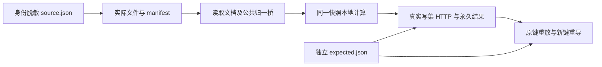

# 现金账单导入回归夹具

当前默认后端用同一批[实际格式切片](../../compose/backend/src/test/resources/cash-import-slice/)验证文件字节、完整本地业务计算、新写集提交及原独立事实期望。旧上传／计划全流程已退役；当前浏览器覆盖与尚待迁移的四格式用例见运行回归，不把旧接口测试当作当前证据。



## 数据边界与覆盖

这些夹具是**身份脱敏的真实月度切片**，不是全合成数据。按用户明确选择，保留 2026 年 5 月的交易日期、金额、币种及余额等货币单元；姓名、账户、卡号、订单号、商户与自由描述已替换。保留付款方式组成、退款编号关系、原生状态及交易分类。原件、原文件名、密码和身份对应表不在仓库内；文件容器重新生成，不复制原容器的隐藏内容或元数据。

| 来源 | 格式 | 文件数 | 输入行数 |
|---|---|---:|---:|
| 支付宝 | GB18030 CSV | 3 | 150 |
| 微信支付 | XLSX | 3 | 220 |
| 建设银行借记卡 | XLS | 1 | 11 |
| 工商银行信用卡 | PDF | 2 | 342 |
| 工商银行借记卡 | PDF | 2 | 36 |

11 份文件共 759 行，包含重复导出和重叠区间，独立核定为 377 条正式现金交易事实、382 条重复、0 条草稿、0 条跳过。377 指事实数，关联合并后的账本展示数量可不同。建行存在同秒、同金额但内容不同的两笔，期望按多重集保留两次；银行序号也不被当成全局交易号。四份 PDF 保留 90 度页面旋转和分页，`wechat-01.xlsx` 的 worksheet XML 为 74,938 字节，超过 64 KiB，防止旧读取截断问题再次出现。

实际来源不含工银亚洲；其 reader 覆盖仍依赖既有合成样本。该自然月不能代表全部格式变体、跨月退款配对或所有关系决策，原有单元和契约测试继续承担这些边界。

## 独立期望与重新生成

`source.json` 是已脱敏单元及格式元数据；`manifest.json` 绑定实际提交文件的 SHA-256、来源和行数。`expected.json` 另绑定 source 的 SHA-256，保存独立核定的日期、带符号精确金额、币种、来源与状态多重集。期望由匿名单元、Decimal、上海时区和既有冻结合同独立推导并复核，没有调用被测解析、归一、规划或导入结果生成。实际结果在首次确认、原键重放及再次导入后分别与同一份期望比较，不能用再次导入纠正首批错误。

生成器的输入必须是已经脱敏的 JSON；工具不执行脱敏，也不读取原账单。使用 JDK 21 和后端已有 POI／SnakeYAML 依赖，无额外 Python 依赖。在仓库根目录执行：

```bash
./compose/gradlew -p compose :backend:installDist --no-configuration-cache
python3 scripts/generate_cash_import_fixtures.py \
  --source compose/backend/src/test/resources/cash-import-slice/source.json \
  --output /tmp/finance-cash-fixtures
```

重建工作簿的容器时间戳可能变化，应比较解码后的单元和格式边界；提交字节变化时同步 manifest。生成器不生成或更新 `expected.json`。调整切片必须重新独立核定期望，不能从被测服务实际输出回填；改变匿名化范围需先与用户对齐。

## 运行回归

默认后端保留 `CashImportSliceFixtureTest` 的字节、独立期望及大 XML／旋转 PDF 边界检查。`CashImportWriteSetHttpTest.originalMonthlyFileFactsSurviveLocalCalculationWriteSetReplayAndFreshReimport` 在两个后端使用同一批 11 份格式文件，经现有 reader、公共文档桥、本地完整计算和真实写集 HTTP，核对原独立 377 条事实多重集、382 条批内重复、实际结果分页、原键重放及新键重导。没有用新实现重写期望。

```bash
export FT_TEST_POSTGRES_URL='postgresql://localhost/finance_tracker_test'
./compose/gradlew -p compose :backend:test \
  --tests '*CashImportSliceFixtureTest' \
  --tests '*CashImportWriteSetHttpTest' \
  --tests '*CashImportCurrencyRequirementsHttpTest' \
  --tests '*CashTemporaryPlanCapacityHttpTest' --no-configuration-cache
```

先准备专用 PostgreSQL `_test` 库并显式配置，未配置的跳过不算双库通过。新写集测试按工作区隔离并清理，不自动启动或探测数据库；SQLite 使用独立临时目录。单独账户币种合同还验证各项独立事务、原币种及非零余额、修订冲突、原键重放、权限、未知结果和程序错误停止后续项目。

PDF／旧 XLS 的实际 parse-only HTTP 合同另验证标准文档、权限变化、上传及响应预算、资源释放、错误来源，以及禁止读取财务表／写入数据。当前全量矩阵和显式外部测试环境见[任务证据](../../openspec/changes/offline-first-ledger-import/tasks.md)；有历史测试标签的项目必须实际运行，不能把默认排除计为通过。

上述全批后端测试使用 JVM reader 和生产公共文档桥，不能代替浏览器本地 CSV／XLSX reader 或完整页面验证。当前 `compose-local-import.e2e.ts` 连接真实 Kotlin 服务验证 CSV、本地核对、写集、冲突重核对、成功后收尾恢复以及浏览器重启离线读取；`compose-cash-import-live.e2e.ts` 已在真实 Chrome 和 Kotlin 服务上验证四份实际格式文件：本地 CSV／XLSX、PDF／旧 XLS parse-only，206 条事实及分来源数量、分渠道账户、补 USD、恢复有效选择并重选冲突同名组、一次写集、完整结果与返回本地账本。全程不调用旧会话／计划／投影 GET，也不上传 CSV／XLSX。

浏览器安装见[本地预览](../../compose/README.md#本地-compose-demo)，启动见[后端与 Compose](../../README.md#启动后端与-compose)。使用仓库外专用测试数据库和允许的内存维护暂存，后端 `FT_WEB_ORIGIN` 与预览 origin 一致。例如后端为 `18240`：

```bash
FT_COMPOSE_PREVIEW_PORT=5186 FT_API_PROXY_ORIGIN=http://127.0.0.1:18240 \
  npm --prefix compose/qa/web run test:e2e -- compose-local-import.e2e.ts --retries=0
```

当前逐项结果和主页面 QA 的准确浏览器、构建、视口及剩余限制以任务记录为准。四格式用例定向通过不代表整套浏览器 E2E 或所有格式变体通过；更广页面与剩余旧 parity 清理仍按当前任务完成。

三份月度 XLSX 的无来源提示读取另与原 native 完整文档差分；原有效共同向量同样不要求来源提示。自动识别复用现有唯一表头规则，显式不支持来源和格式预检保持。

月度汇总另有[独立期望](../../compose/backend/src/test/resources/cash-import-monthly-oracle.json)，覆盖跨月、待确认统计资格、退款净抵减、空月份、多币种和 80 位有效精度；本地汇总读取完整冻结输入，不由首页估算。显示时区不改事实时间、金额或业务选择。
