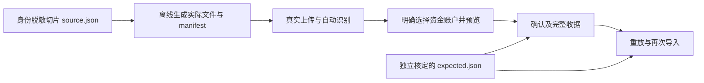

# 现金账单导入回归夹具

默认后端测试使用[实际格式切片](../../compose/backend/src/test/resources/cash-import-slice/)，从文件字节开始执行自动识别、解析、资金账户选择、预览、确认、收据分页、原键重放及新会话再次导入。浏览器用例连接真实 Kotlin 后端，一次选择 CSV、XLS、XLSX、PDF，经页面选择账户、批量补齐缺少的 USD 币种、核对、确认并返回账本查看流水；不拦截或伪造 API。



## 数据边界与覆盖

这些夹具是**身份脱敏的真实月度切片**，不是全合成数据。按用户明确选择，保留 2026 年 5 月的交易日期、金额、币种及余额等货币单元；姓名、账户、卡号、订单号、商户与自由描述已替换。保留付款方式组成、退款编号关系、原生状态及交易分类。原件、原文件名、密码和身份对应表不在仓库内；文件容器重新生成，不复制原容器的隐藏内容或元数据。

| 来源 | 格式 | 文件数 | 输入行数 |
|---|---|---:|---:|
| 支付宝 | GB18030 CSV | 3 | 150 |
| 微信支付 | XLSX | 3 | 220 |
| 建设银行借记卡 | XLS | 1 | 11 |
| 工商银行信用卡 | PDF | 2 | 342 |
| 工商银行借记卡 | PDF | 2 | 36 |

11 份文件共 759 行，包含重复导出和重叠区间，独立核定为 377 条正式现金交易事实、382 条重复、0 条草稿、0 条跳过。377 指事实数，关联合并后的账本展示数量可不同。建行存在同秒、同金额但内容不同的两笔，期望按多重集保留两次；银行序号也不被当成全局交易号。四份 PDF 保留 90 度页面旋转和分页，`wechat-01.xlsx` 的 worksheet XML 为 74,938 字节，超过 64 KiB，防止旧读取截断问题再次出现。

实际来源不含工银亚洲；其 reader 覆盖仍依赖既有合成样本。该自然月不能代表全部格式变体、跨月退款配对或所有关系决策，原有单元和契约测试继续承担这些边界。

## 独立期望与重新生成

`source.json` 是已脱敏单元及格式元数据；`manifest.json` 绑定实际提交文件的 SHA-256、来源和行数。`expected.json` 另绑定 source 的 SHA-256，保存独立核定的日期、带符号精确金额、币种、来源与状态多重集。期望由匿名单元、Decimal、上海时区和既有冻结合同独立推导并复核，没有调用被测解析、归一、规划或导入结果生成。实际结果在首次确认、原键重放及再次导入后分别与同一份期望比较，不能用再次导入纠正首批错误。

生成器的输入必须是已经脱敏的 JSON；工具不执行脱敏，也不读取原账单。使用 JDK 21 和后端已有 POI／SnakeYAML 依赖，无额外 Python 依赖。在仓库根目录执行：

```bash
./compose/gradlew -p compose :backend:installDist --no-configuration-cache
python3 scripts/generate_cash_import_fixtures.py \
  --source compose/backend/src/test/resources/cash-import-slice/source.json \
  --output /tmp/finance-cash-fixtures
```

重建工作簿的容器时间戳可能变化，应比较解码后的单元和格式边界；提交字节变化时同步 manifest。生成器不生成或更新 `expected.json`。调整切片必须重新独立核定期望，不能从被测服务实际输出回填；改变匿名化范围需先与用户对齐。

## 运行回归

后端的 `CashImportSliceFixtureTest` 和 `CashImportSliceFlowTest` 纳入默认 `:backend:test`。单独执行：

```bash
export FT_TEST_POSTGRES_URL='postgresql://localhost/finance_tracker_test'
./compose/gradlew -p compose :backend:test --tests '*CashImportSlice*' --no-configuration-cache
```

先由操作者准备专用 PostgreSQL；库名必须以 `_test` 结尾，连接用户需有创建／删除测试子库权限。测试不自动探测或启动数据库，未配置 PostgreSQL 时该分支跳过，不能当作双后端验收通过。SQLite 使用独立临时目录；PostgreSQL 每例创建独立 `_test` 子库并清理。追加合同在两个后端验证同修订并发、旧／未来修订、同／异摘要幂等、容量、真实 CAS 交错、有界重试、未知存储结果不重试以及其他操作严格修订。

浏览器安装见 [Compose 本地预览](../../compose/README.md#本地-compose-demo)，服务启动见 [后端与 Compose](../../README.md#启动后端与-compose)。后端使用专用临时 SQLite 文件、允许的内存暂存，并将 `FT_WEB_ORIGIN` 配为预览 origin。例如后端端口为默认 `18240` 时，运行：

```bash
FT_COMPOSE_PREVIEW_PORT=5186 FT_API_PROXY_ORIGIN=http://127.0.0.1:18240 \
  npm --prefix compose/qa/web run test:e2e -- compose-cash-import-live.e2e.ts --retries=0
```

浏览器自动注册临时测试用户和工作区、准备初始只支持 CNY 的测试资金账户；四份文件共 206 行。用例核对预览前无流水写入、明确账户选择、真实批量补齐 USD 的独立收据和新修订、一份导入确认请求、导入收据和实际账本行。预览后真实刷新恢复同一冻结计划，再确认原计划 ID 和修订；返回账本后核对实际列表请求，再刷新读取已保存流水。两次刷新用于绕过 Compose 已关闭弹层残留的语义镜像，不代表验证了无刷新连续流程。固定 1440×3000 视口将账户表单完整显示；Compose 既有弹窗语义镜像限制下，使用弹窗前稳定几何、当前菜单锚点、关闭后的实际画面稳定及最终请求中的账户 ID 共同验证，不代表修复通用无障碍问题。临时数据库在仓库外保存，运行后由操作者清理。PR 的 Backend (Kotlin) 在 SQLite／PostgreSQL 运行默认测试，Compose Web E2E 自动收集真实浏览器用例；两者均不需要个人账单或外部夹具目录。

批量币种合同另在两个后端通过真实 HTTP 验证：原币种与非零余额保留、各项独立事务与收据、修订冲突、同键重放、整体非法输入先于写入、整批授权、确定未提交与结果未知的区别，以及程序错误停止后续项目。请求与响应字段沿用[既有接口参考](cash-import-redesign-contracts.md#36-独立账户接口与退出补偿)。

预览和计划读取保留客户端的展示时区，后端完整链路验证上海时区、UTC 及缓存隔离，无效时区不发布新计划。另以[独立月度期望](../../compose/backend/src/test/resources/cash-import-monthly-oracle.json)覆盖跨月、待确认统计资格、退款净抵减、空月份、多币种和 80 位有效精度；汇总使用完整冻结输入，不从首页估算。缺少月度来源的旧计划不能读取或提交，原键核实返回未提交，重新预览可重建。时区不修改事实时间、金额或业务选择。
