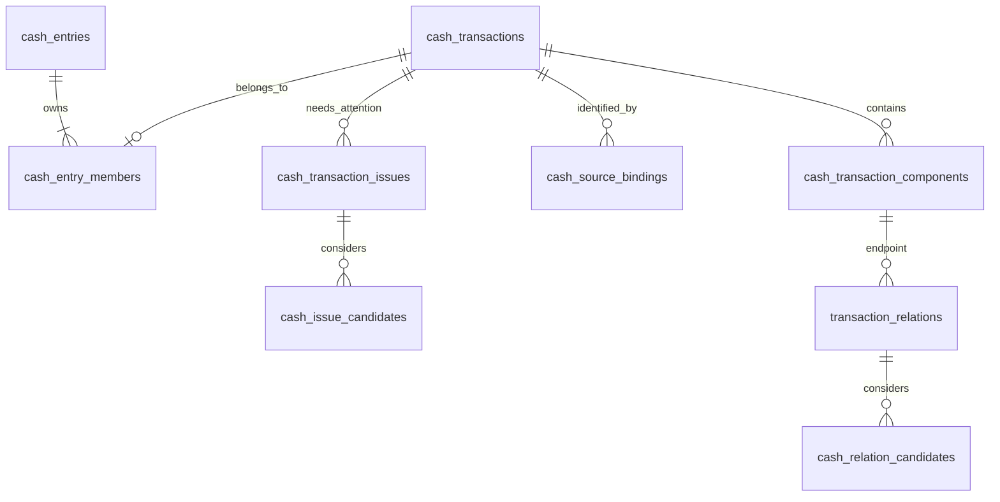

# 现金流水与导入：接口、数据与客户端交互参考

本文是现金流水维护与导入共用的详细参考。面向用户的界面用语统一见[领域词表](../../DOMAIN_GLOSSARY.md#用户界面用语)；本文件保留接口与实现所需的准确名称。连贯讲解分别从 [现金流水的存储、展示与操作](../cash-ledger/cash-ledger.md) 和 [现金账单导入流程](cash-import-flow.md) 开始；此处查阅精确 HTTP 协议、持久化约束和后续客户端交互。字段开放与来源对应等详细判定见 [业务规则](cash-import-redesign.md)。

## 1. 交付边界与现状

生产 Graph 已接本地文件准备、完整计算、写集提交和原批次恢复，Web、Android、iOS 共用入口；真实账本迁移、部署及整个变更验收尚未完成。账户步骤按微信昵称和支付宝来源账号分组，账号标题仅显示脱敏信息；缺少身份时按文件分组。默认开启跨渠道同名合并；微信每次重新选择目标账户，其他来源按确认映射建议。旧服务端导入会话／计划／确认 HTTP 方法已退役，内部旧实现及物化表尚待清理。当前覆盖及限制见[功能地图](../feature-map.md)。

| 内容 | 本文职责 | 权威入口 |
|---|---|---|
| 用户流程 | 保留统一核对、默认决定、后续补充及退出恢复合同 | 第 2 节；客户端完成状态见功能地图 |
| HTTP | 解释请求、修订、分页、结果及安全恢复语义 | 第 3 节；精确结构以运行服务 `/openapi.json` 及路由协议模型为准 |
| 数据 | 说明持久化对象、空值、引用及唯一性约束 | 第 4 节；实际结构以 Kotlin 双库基线 SQL 和 jOOQ 生成结果为准 |
| 验证 | 示例与后续 UI 验收范围 | 第 5–6 节；当前证据见[实施变更](../../openspec/changes/offline-first-ledger-import/tasks.md) |

本文不重复实施顺序、审查日志或迁移操作手册。纯文档整理不改变业务规则、接口、数据或主规格。

关系治理沿当前事实、角色、公共值及完整图合同；该领域的维护边界不因导入计算移到客户端而改变。真实环境升级状态以实际运行库为准，不能将代码或测试通过写成已经部署。

## 2. 用户业务流程

### 2.1 入口与信息顺序

用户业务主线和流程图统一见 [流程说明第 1–5 节](cash-import-flow.md#整体流程)。本节补充 Compose Web、Android、iOS 共同遵守的动作、状态、退出及跨端合同：准备后进入一个预计流水列表，流水与配对在其中核对并一次确认；最终确认前不写流水、映射或关系，独立账户命令除外。账号分组与密码提交改动的验证状态见[变更任务记录](../../openspec/changes/archive/2026-10-29-cash-import-source-account-grouping/tasks.md)。

### 2.2 同一任务内的内容与动作

| 区域／状态 | 用户看到的内容 | 系统默认处理 | 用户可做的事 | 操作条件 |
|---|---|---|---|---|
| 选择文件 | 文件名称、识别进度；有问题的文件显示具体原因 | 逐文件解析，成功文件不因其他文件失败而作废 | 添加／移除文件，为单个失败文件重试或输入密码；有失败或需密码文件时，下一步显示禁用样式，点击以 Snackbar 提示处理原因 | 失败文件已重试成功或删除、所需密码已提交解析；至少一条可辨认业务行或有可展示的终结处理结果，文件请求完成 |
| 选择对应账户 | 单渠道直接展示来源账户；至少两种来源渠道时按渠道分组并显示“合并不同渠道的同名账户”；微信组显示当次昵称或文件名 | 非微信渠道按已确认映射和账户别名预选；微信每次重新选择 | 选择或新建对应账户；多渠道时可调整同名账户合并；允许暂不选择 | 点“下一步”前补齐所选账户缺少的币种 |
| 预览并导入 | 预计收支列表显示主流水类型及具体待处理原因；有来源变化的项可展开差异 | 自动对应来源并形成预计展示；强证据合法关系纳入拟确认图，未确认关系不连接；保护人工分类和备注 | 直接确认导入；按需打开一项查看差异、组成流水和关联；无需逐项处理待确认项 | 当前计划已生成，没有未提交的本地修改；单项待确认不禁用导入 |
| 结果 | 实际保存结果、待确认数量和未导入原因 | 待确认项默认引导回主页处理；实际未合并时不沿用预览合并结果 | 返回主页；按需查看原因，收尾中断时继续原批次 | 结果已确定；网络未知状态走第 2.5 节 |

所有可应用更新的字段差异都可查看，“确认导入”同时确认这些更新，不额外逐条弹窗。用户选择“保留现有”只跳过本次更新，不建立永久禁止更新规则。人工分类和备注的保护规则不因预选更新而失效。强建议仍在最终确认前不生效；“暂不处理”保存草稿关系，“拒绝”形成忽略决定，两者不能共用一个动作。

只有用户主动展开某项维护时，才出现上述细分动作。主列表不要求先完成流水核对再进入关系核对，也不把来源行、关系建议和投影各展示成一份并列清单。文件无法解析、完全重复及冲突跳过通过摘要和按需展开的处理明细保留，不伪造为已保存的投影流水。

没有可靠编号不增加一步核对身份：正常对应自动完成。只有主设计第 6.2.1 节所述真实歧义才进入待补充；界面不把同批银行数据展示成两组要求逐笔选择。

### 2.3 列表如何合并及标记确认状态

预览列表由客户端按完整本地计划生成，使用与正式列表一致的共享投影规则。用户只看日期、金额、账户、说明和确认状态；组成流水及关系仅在维护该项时展开。消费镜像和退款镜像联合生效后对应一个结果时，只展示一个合并项，不展示“消费配对任务”和“退款配对任务”两张产品卡片。

| 情况 | 列表表现 | 导入后的统计 |
|---|---|---|
| 信息完整、没有待处理问题 | 已确认；有拟确认合法关系时展示合并结果 | 按最终成功提交的正式投影统计 |
| 两条正式流水仅存在未确认关系 | 两条各自的投影项，均标待确认；不能提前合并成一项 | 两条仍分别参与统计，确认关系后才合并 |
| 缺必填信息或身份尚不明确的草稿 | 单条待确认项，只展示已知信息 | 不参与统计 |
| 已有正式流水附有当前待处理来源信息 | 保留当前正式投影、标待确认，不新增另一笔 | 按现有正式值统计 |

这里“已确认”表示当前没有待用户处理的事项、可按当前决定导入，不表示预览已经写入账本，也不代表用户逐条作过人工审核。`confirmation_status` 与流水 `state` 是两个维度：正式流水也可以待确认关联且继续统计。没有关系候选的正常完整流水无需人为制造一个待确认关系。

联合建议尚未确认或用户暂不处理时，组内关联决定一起保存为待处理，不合并正式流水；不允许只确认一个违反最终关系约束的子集。独立关联各自可处理，预览已知待确认不阻止合法流水导入。非法关系不能伪装成草稿；提交新增异常使本次全部业务修改回滚，前端显示通用错误、安全原因和返回入口，不按关联提供逐项补救。

新增关系不得自动替换已有确认关系。需要解除或替换时，从相关流水详情维护，导入预览只说明当前不能合并。

### 2.4 导入后如何补充

主页流水列表与导入预览使用相同的收支展示和确认状态语义。列表显示主流水类型及具体待处理原因标签；普通已确认项不显示状态标签。主页默认可展示已保存的正式项及草稿项，待确认筛选提供快捷定位；不新增一级问题中心或关系页面。草稿显示已知信息但所有金额汇总仍排除草稿，正式流水的待确认关联不改变现有统计口径。不能把用户引导回主页后，又将待确认项隐藏在默认不可见的独立列表。

全额退款及全额平台退回在导入预览展示净额为 0；主页保留该投影和详情证据，列表默认由“隐藏0元流水”筛选隐藏，关闭后可以查看。关闭筛选后，无待处理事项时不显示状态标签，有待处理事项时显示具体原因；问题解决后标签随当前问题移除。其他业务隐藏项有活动待处理事项时优先展示，统计资格仍按原口径；此优先级不覆盖权限、工作区、逻辑删除或用户明确筛选。默认查询不能因为草稿时间为空而漏掉它，可在“时间待补充”分组展示；用户主动设置的具体筛选条件仍明确生效，结果页进入待确认筛选时清除妨碍定位的旧日期条件。

| 用户进入的对象 | 详情提供的动作 | 保存语义 |
|---|---|---|
| 缺账户、金额、时间或分摊的草稿 | 在同一流水详情补字段和关联；“保存待确认”；完整后“确认保存” | 前者保持草稿；后者在当前详情内预览变化并联合保存成为正式流水，保留原身份，不跳到独立配对步骤 |
| 正式流水的来源更新待处理项 | 查看已有值与当前待处理值；应用或保留现有 | 应用仍遵守统一字段约束并保护人工覆盖；保留现有只结束当前问题 |
| 无法自动确定身份的少数草稿 | 查看候选，在确有需要时确认独立记录或对应已有流水 | 只有用户主动进入该问题才提供选择；合并不相加金额，来源对应随之转移 |
| 尚未确认的关联 | 在流水详情展开相关记录并确认、拒绝或继续暂存 | 未确认保持当前展示；确认后按当前合法图合并 |
| 正式流水编辑 | 展示可编辑字段；固定字段只读 | 导入流水只改公共字段，合并后整笔编辑；手工流水按创建方式允许修改，手工转账双端共同保存 |

已经完整的草稿仍可“保存待确认”，不会因为一次普通保存意外进入统计。用户选择“确认保存”才转换状态。更新来源补足草稿时，导入最终确认可以同时承担这个确认，无须再打开详情操作一次。

保存后仍停留于当前详情并刷新结果。展示代表改变不改变收支对象标识；关系合并／拆分时，身份锚所在结果保留原对象，其他成员可能归入另一对象。客户端按稳定流水引用重新定位当前展示结果，不继续访问已失效的旧投影；草稿合并则使用响应中的保留流水引用。

### 2.5 失败、退出与重入

| 场景 | 交互与后续 |
|---|---|
| 文件需要密码或格式不可读 | 保留该文件的明确原因，重试时提供原文件与本次密码，不伪装成已保存草稿 |
| 全部重复、按规则跳过或只有草稿 | 按真实结果完成；不把无新增当作失败，不将草稿纳入统计 |
| 断网 | 继续查看已有事实和本地核对，不执行确认、账户修改等业务写入 |
| 正在提交或核实原操作 | 禁止重复确认和修改原材料；不换键、不启动账户撤销 |
| 提交响应丢失 | 保留原批次、请求和键，核实原操作，不根据网络错误认定回滚 |
| 账本已保存但结果收尾中断 | 保留已保存统计及原诊断，只恢复原批次，不再次提交已成功写集 |
| 提交前退出，没有独立账户改动 | 使用一次离开确认，保留或取消原批次，不逐条询问 |
| 提交前退出，有独立账户改动 | 合并为“撤销并退出／保留并退出／继续导入”；仅按实际修订链安全补偿 |
| 撤销账户失败或冲突 | 保留不能安全撤销的部分，说明实际状态，不强制覆盖 |
| 页面刷新、浏览器关闭或进程退出后重入 | 从原范围加密材料恢复文件和选择，重算核对；已冻结原请求优先核实，不复活旧可执行计划 |
| 已取消任务或材料已清理 | 不从旧计划和历史收据重造文件；已保存草稿从账本维护 |

本地加密库保存恢复必需的稳定文件、解析文档、核对输入和原请求，密码不持久化，明文财务内容不进入日志、Git 或报告。正常关闭可保留恢复材料，显式登出、已知失效及范围擦除沿同一缓存与密钥边界执行。断网重启恢复只能使用原已验证身份，不能取得新的服务端权限。

账户旧值和连续修订证明只用于本任务补偿，不能从账户收据重建一套账户历史。成功写入的独立账户改动立即生效，取消本地批次不会自动撤销；无法证明仍安全时保留账户并说明。导入结果未知时先恢复原操作，不能以取消或临时材料缺失推定没有保存。

### 2.6 跨端与界面设计约束

用户任务是“看一个流水列表，确认导入，待确认事项回主页处理”。FinanceTheme、Material 3、字体和金额颜色继续遵循项目约束，不新增产品导航。`COMPACT` 单列全屏，`REGULAR`／`WIDE` 使用主内容区的完整任务页面；区域顺序为标题、文件及账户准备、预览流水列表、固定确认操作。具体组件和旧步骤状态机可以重写，不要求为了复用保留四步导航。账户表单最大宽度 720 px，窄屏不横向滚动。

将删除的冗余信息：独立“核对流水／核对配对”步骤、并列的关系任务列表、无编号逐条身份问答、未完成账户映射导致的整页阻断、单独关系管理入口、重复的退出弹窗、内部关系图及投影术语、正常状态的大段流程教学。来源原文、组成流水和差异按需展开，错误原因紧邻对象。

设计方向自查：优先暴露需处理的问题，正常结果可批量确认；只有一个最终导入动作，账户操作明确独立保存；不靠颜色单独表达错误；键盘和系统返回统一走任务关闭逻辑。Web、Android、iOS 及共享 presentation 均受影响。此处交付信息架构与交互合同，不交付最终视觉 UI；实施时还需 Hallmark 方向及最终 audit、三种窗口真实 QA 和演示评审。

## 3. 前后端接口契约

### 3.1 通用规则与身份

路径均以 `/api/v1` 为前缀。新文件导入使用客户端本地计算和 `POST /cash-import/write-set`；服务端旧暂存会话、预览、分页及确认方法均已退役。维护仍使用自己的后端计划，两者不能混用提交或恢复凭证。

| 对象 | 当前合同 |
|---|---|
| 身份和工作区 | 原凭据及原工作区固定到该次操作；服务端在事务内重新鉴权，不信任正文身份 |
| 已有对象引用 | 存储 ID 及观察到的修订均按精确字符串传输，核真实归属、资格及冲突 |
| 本次新对象引用 | 仅在本写集中连接对象，实际存储身份由服务端分配；不能指定持久 ID |
| 本地来源行与操作引用 | 在原文件／批次内定位，重复来源不按行数重复写入 |
| 金额和数词 | 沿精确十进制及 JSON 数词合同，不经浮点归一；缺省、`null` 和显式清空分别处理 |
| 现金发生时间 | 转成 UTC 后须处于 `[1900-01-01, 2101-01-01)`，原账单文本保留 |

公开结构以运行服务 `/openapi.json` 和 `business-contracts` 的 `CashWriteSetRequest`、`CashWriteSet` 为准。维护 `mp_` 计划、收据 ID 及本地计算计划各自属于自己的生命周期，不以名字相似相互替代。

手工新建继续使用 `POST /cash-records`，仅接收账户名称、金额、币种、发生时间、交易对方、对方账号／属性、备注、分类 ID、类型／子类型及 `components`。组成项只接收账户 ID／名称、金额、币种和标签；顺序及其他内部字段由服务端生成。兼容旧 `category` 输入但不将名称猜测为分类 ID。正文最多 64 KiB、组成项最多 64 个，未知字段及格式错误返回安全 `422`；明确备注／分类含清空由服务端建立人工保护。此入口不接收来源身份、来源正文、关系解释或保护字典。

### 3.2 本地文件、核对与写集

CSV／XLSX 仅在端侧读取。PDF 和旧 XLS 分别使用 `POST /cash-import/pdf/parse`、`POST /cash-import/xls/parse`；单文件 multipart 沿当前元数据与文件部分合同，密码只用于本次请求。两者重新核验权限，不建立导入会话、不读账本、不写业务事实。PDF 返回归一化文档，旧 XLS 返回原始文档供客户端继续归一。

本地生命周期保存稳定文件和核对输入，从同一完整事实快照重新计算来源、账户、操作、关系和预计收支。分页、详情和月度汇总都读取本地冻结结果，文件或选择变化使旧核对失效。它不是公开的 `/cash-import/plans` HTTP 合同，也不以服务端 TTL 管理。

在线确认使用 `POST /cash-import/write-set?workspace_id=<原工作区>`，带 `Idempotency-Key`。请求字段为：

| 字段 | 含义 |
|---|---|
| `base_ledger_seq` | 本次完整计算所依据的原工作区账本版本 |
| `rules_version` | 本次计算的规则版本 |
| `changes` | 来源流水／组成项、绑定、问题、最终映射、关系及稳定收支对象的完整写集 |

服务端只校验明确输入的真实归属、来源身份、账户资格、修订、最终图和完整写入效果，不重新运行识别或配对。无文件的来源问题维护、草稿合并、删除和主动关系拆分继续由维护命令承接，不扩为该导入入口。

### 3.3 计划与逐项结果

核对计划的本地只读字段继续由共享规则裁剪，页面使用真实本地任务修订及编号；`expires_at` 可以为 `null`。它不授予提交资格，也不作为恢复后的可执行计划持久化。稳定选择、目标定位及结论摘要保存在原加密批次，恢复时重新计算。

永久收据记录真实提交与身份结果。新写集收据为 `operation_kind=cash_write_set`、`plan_id=null`，提供 `ledger_seq` 和 `write_set_result`；完整结果覆盖来源及组成项、绑定、问题、映射、关系、稳定条目、明确解决问题和真正退休的旧条目。身份顺序对应原写集位置，不从预览临时身份生成实际 ID。

`GET /cash-mutations/receipts/{receipt_id}/rows` 与 `/relations` 沿 `after`／`limit` 分页实际结果。确认前已知的跳过、批内重复、文件问题和没有保存操作的结果由原批次归档补齐，不能把这些行重新算作已写数量。结果定位使用当前可读的完整事实；旧定位字段不恢复已退役的物化读取入口。

历史 `import`／`legacy_import` 收据保留原字段、归属、原键、时间及已有逐项结果。没有新写集身份或原明细时不补造；来源后来删除或旧会话失效不删除永久收据，也不授权重新执行历史导入。

### 3.4 幂等、并发及结果恢复

| 状态或响应 | 合法后续 |
|---|---|
| 原键已有收据 | 返回同一收据，不再次保存事实 |
| 请求在途或结果未知 | 保留原正文和原键，继续查原键／ID；单次 `404` 不能证明未提交 |
| POST 明确拒绝基线且 `not_committed` | 刷新原范围完整快照，再查原键，没有成功收据才重算 |
| 重算结论相同 | 原批次持久化下一尝试后有界重派；一次调用最多自动三次 |
| 结论变化或选择失效 | 停止，保留文件和选择供重新核对 |
| 已成功但结果归档／刷新／清理失败 | 保留已保存统计，只恢复原批次，不再次 POST 成功命令 |
| 断网 | 可以本地准备和核对，不能提交业务写入；重连不自动发送未确认内容 |

同键不同请求产生幂等冲突。原请求身份、完整内容及键须在 HTTP 前保存；首 HTTP 前中断也继续恢复该原操作，不静默换键。基线或规则变化整批拒绝，任一实际写入异常整批回滚，独立账户命令不属于这笔事务。

`POST /cash-mutations/resolve` 只接受维护 `mp_` 计划的核实；`ip_` 导入计划返回 `404 plan_not_found`。导入通过永久收据按原键或 ID 核实。维护原有 `committed`、`retry_original`、`not_committed`、`pending` 合同保留，不借它推断新写集是否提交。

错误保留准确业务码、安全提示、诊断和提交状态。程序异常返回 `500`，已识别临时存储故障使用 `503`；未明确证明未提交时，不根据 HTTP 失败或回滚调用推断没有写入。完整流程、错误映射及生命周期见[流程说明](cash-import-flow.md#recovery)。

#### 提交新增异常与结果摘要

新导入收据的 `commit_outcome` 与业务结果同事务保存，结构如下：

```json
{
  "has_new_failures": false,
  "has_business_writes": true,
  "reason_codes": []
}
```

新成功收据的 `has_new_failures` 为 `false`，提交新增异常通过错误响应返回并回滚；历史收据的该字段继续表达其真实新增异常。预览已知的重复、业务跳过、文件失败和合法草稿缺项不算新增异常；内部配对发现异常直接拒绝预览。`has_business_writes` 记录实际成功的业务写入，重复不算新写入；不能从 `committed` 或 `partial` 推断这一值。`reason_codes` 为去重、有界的安全码，不包含异常正文。

原 `status`／`summary` 保留原有含义。结果未知仍用原命令核实；已知成功后的归档或清理失败保留成功统计，恢复原批次。永久读取、按键读取及原键重放保持原结果，维护 resolve 只核维护命令。旧收据缺少 `commit_outcome` 时分类未知，保留原摘要，不补算或改写历史结果。

#### 错误定位

HTTP 提交及解析的错误沿当前错误合同提供安全原因和适用的 `diagnostic`，保留原状态码、原错误及准确的 `commit_state`。本地文件问题按已知业务码保存；程序异常停止当前操作，不伪装成可继续的单文件失败。不存在服务端导入会话 TTL 下的诊断恢复路径。

| 字段 | 合同 |
|---|---|
| `error_id` | 32 位随机十六进制错误编号，与服务端诊断日志一致；重复包装不产生第二个编号 |
| `stage` | `request/file_read/row_conversion/row_planning/relation_discovery/submit_revalidation/source_evidence/row_write/batch_write/account_mapping/relation_save/balances/projection/entry_edit/database_commit` |
| `scope` | `row` 为已定位输入记录；`related` 只说明相关范围；`file` 为文件；`request` 无法确定到记录或文件 |
| `locations` | 最多 100 项，每项仅含已知的 `file_ref/display_name/row_ref/row_number/position_kind/document_position/transaction_id` |
| `total_locations` | 相关位置的真实总数，超过返回上限时不缩减 |

`position_kind` 为 `csv_record/worksheet_row/document_row`。CSV／TSV 的 `row_number` 是从文件起始计算的逻辑记录序号，包含表头和元数据记录；带换行的引号字段仍只算一条，不冒称文本物理行。Excel 使用工作表行号。PDF 有认证位置时，`document_position` 使用 `p<页>:t<表>:r<行>`，其中表编号从 0 起，行编号从首条数据记录的 1 起，客户端将表编号加一后按自然语言呈现；无证据时仅给已知记录位置。库中已有关系端点没有可证实的来源文件时，只返回内部 `transaction_id`，不把它归到本次上传的文件。

单条转换或保存失败返回该记录；批量 SQL、关系组、余额或账本更新失败只报告可确定的相关范围。最终数据库提交出错使用 `database_commit/request`，不指认最后处理的记录，也不据此宣称确定回滚。诊断不拆分重跑、不创建失败子集或逐项处理入口。前端在错误原因下直接显示单条摘要，多条相关记录默认折叠；错误编号始终可读。

服务端同编号记录异常类型、所有调用帧和去掉文件名后的安全位置引用；不记录异常正文、代码行字面量、SQL 参数、局部变量、路径、原键、密码或账单正文。诊断日志接收器失败不改变原异常及提交事实。恢复材料沿原范围加密批次保存，不新增永久错误表或公开诊断查询接口。

### 3.5 后续维护与读取

流水对象、投影及各操作的业务范围统一见 [现金流水说明](../cash-ledger/cash-ledger.md)，本节只列接口和执行约束。当前命令分为直接命令与维护计划，不能把所有写入都理解为同一种幂等／部分成功流程。

| 方法与路径 | 输入与输出 |
|---|---|
| `GET /ledger/version`、`GET /ledger/snapshot` | 返回规范事实及精确账本版本；Compose 在同一完整快照派生账本、筛选汇总、详情、证据与当前定位，旧物化读取面已退役 |
| `GET /cash-records/{transaction_id}` | 详情维护字段、组成项、`row_revision`、`editable_fields`、当前问题和关联；不能被正常列表用来拼接统计 |
| `PATCH /cash-records/{transaction_id}/draft` | `expected_revision` 与字段补丁；只保存草稿，即使完整也不转正式；返回已提交收据及读取时当前详情状态，详情暂不可读不抹去成功事实 |
| `POST /cash-mutations/plans` | 正式编辑、草稿转正式、当前问题处理或详情内关系维护；返回同类不可变计划 |
| `GET /cash-mutations/plans/{plan_id}` 及 `/items`、`/items/{preview_item_id}` | 读取维护计划的预计流水结果及详情，沿维护自己的权限、游标、修订和固定到期规则 |
| `GET /cash-mutations/edit-contexts/{edit_context_id}/plan` | 重预览响应丢失时读取该上下文的当前计划；已消费返回原收据引用，不重新授权提交 |
| `POST /cash-mutations/plans/{plan_id}/commit` | `Idempotency-Key`；统一字段约束及局部提交；返回 `MutationReceipt` 和最新定位 |
| `GET /cash-records` | 活动父流水的辅助搜索，非主页投影列表，不授权任意新关系写入；支持搜索、日期及游标，最多每页 20 条 |
| `POST /cash-records` | 手工新建正式流水的直接命令；公开字段见第 3.1 节，不创建维护计划，不承诺维护收据的重放语义 |
| `PUT /cash-projections/{projection_id}/category`、`PUT /cash-projections/categories` | `projection_id` 为稳定收支对象 ID（`cash-entry:<entry_id>`）；`projection_version/category_id`，批量另带明确 `projection_ids`，所选稳定收支对象的公共分类原子更新，来源成员不变，清空同样建立人工保护 |
| `DELETE /cash-records/{transaction_id}` | `mode=delete_current_dissolve`（默认）或 `delete_all`；前者只删当前，后者删已确认连通组；直接命令，当前不要求行修订或幂等键 |
| `POST /cash-projections/delete-impact` | `projection_ids/projection_version`；只读返回展示项、成员及关联影响计数 |
| `DELETE /cash-projections` | 同一投影选择和发布版本，`confirmed=true`；原子删除所选投影全部成员，失效选择拒绝，不删除未选的受影响重建组 |

草稿补丁请求也使用幂等键与并发修订，避免响应丢失后误报冲突。`state` 不属于补丁字段，用户不能直接改为 `posted`。正式编辑补丁只能包含主设计白名单；固定字段实际变化拒绝该操作，原记录不动。

当前详情使用 `transaction_id/state/row_revision/confirmation_status/fields/editable_fields/issues/relations/projection_ref`，替换旧单条详情结构。当前问题只返回安全原因、实例和修订、允许决定、待采用字段及适用的当前候选；不返回来源绑定证明。`pending_source_payload_present=true` 表示本次包含原文更新（正文为 null 时明确清空），false 表示不更新原文，null 或旧响应缺省表示不能判断；客户端不得从可空正文推断清空。只读成员可查看详情，但 `editable_fields` 和允许决定为空。

维护结构错误返回 `422`，当前流水修订变化返回 `409 record_changed`，不可见目标返回 `404`。统一字段规则拒绝固定字段变化时返回 `422 fixed_field_conflict`；可定位错误的 `field_errors` 项包含 `field/code/message`，只回传已知字段名，不附输入值。尚未补齐但不能定位到单一字段的原因仍通过安全消息和当前详情的问题表达，不伪造字段位置。允许来源的浏览器可读取认证错误；其他编辑者不能读取或提交本人的临时维护计划。

列表展示对象新增 `transaction_id`，直接引用当前根流水，供客户端打开详情及维护；`record_id` 保留账单来源编号。客户端只使用明确引用，不解析展示标识或猜测来源编号。该字段与列表其他值来自同一读取快照，工作区可见性不变。

账本列表、投影详情、证据及稳定流水当前定位都从同一可读完整事实本地派生，使用原工作区 `ledger_seq`，不混合不同版本的成员、问题或统计。旧服务端物化详情／定位方法不可用；历史结果不保留永久的展示组映射，对象已删除或当前事实不可读时不能补造可点击位置。

草稿保存响应区分 `receipt` 与 `current_record`，后者带 `current_record_status=available/deleted/unavailable`，明确是读取时的当前详情。幂等重放返回原收据，再读取当前详情，不保存或重放流水正文；提交后详情暂不可读仍返回已提交收据及 `unavailable`，不能误报保存失败并重跑写入。普通详情中的父 `row_revision` 不是整个维护视图的版本，问题实例／修订和关系修订分别参与相关决定及维护计划校验。

组成项 DTO 使用 `component_id`、`account_id`、`amount`、`currency`、`ordinal`；`ordinal` 是 `0..2**31-1` 的整数，不接受布尔值，不要求连续。草稿补丁省略 `components` 时保持原组成项，提供时表示完整替换；已有项须携带属于当前流水的 `component_id`，新增项省略该字段并由服务端分配，删除项通过从数组移除表达。组成项删除与相关草稿引用清理在同一原子事务内完成，不能留下失效端点；正式流水不开放组成项替换。

维护计划请求为判别联合：

```json
{
  "intent": "finalize_draft",
  "previous_plan_id": null,
  "expected_plan_revision": null,
  "transaction_id": "102",
  "expected_revision": 2,
  "patch": {},
  "issue_resolutions": [],
  "relation_choices": []
}
```

`intent` 可选 `save_draft/edit_entry/edit_record/finalize_draft/resolve_issue/maintain_relations`。`save_draft` 只接受当前草稿的字段补丁，不处理来源问题／关系决定、不转正式；复用维护计划及其可终结的原命令核实。`edit_entry/edit_record/finalize_draft/resolve_issue` 可提供 `issue_resolutions` 数组；每项包含 `issue_id`、`expected_issue_revision`、`resolution=apply_source/keep_existing/merge_into/create_independent` 及适用的目标引用。`resolve_issue` 至少提供一项，不接受同一问题的重复决定；允许值由当前问题返回。先应用所选来源决定，再应用本次显式 `patch`，最后验证最终状态及生成预计列表；`finalize_draft` 可在同次确认中解决来源阻断并转正式，单独 `resolve_issue` 不自动转正式。不能将固定字段冲突用 `apply_source` 或后续补丁掩盖。`merge_into` 是保留目标身份的终结动作，必须保护已有正式值及人工覆盖，冲突时保留问题，不能静默拼接金额。

原子草稿修改金额、币种或账户时，只需发送实际修改的标量字段；系统在采用来源后的有效值上联动唯一支付组成项。请求明确提供 `components` 时保留该决定；来源明确提供组成项时不使用父金额覆盖其未知值或金额。分摊草稿不做隐式联动，仍需明确补齐各组成项。

维护计划顶层 `additional_effects` 完整列出本次明确输入之外的实际影响，不随 `items` 分页截断。每项为 `kind/reference` 及适用的 `field`；`kind` 为 `field_value_changed`、`relation_changed`、`funding_relation_removed`、`choice_changed` 或 `new_attention`，只给授权对象引用和安全字段，不回传内部执行正文。明确公共清空、来源决定、完整关系决定及转账双端联动不重复确认；原有问题及保持的关系也不算新增影响。空数组表示可以在本次保存动作内继续提交；非空先向用户说明影响并确认同一计划修订。缺省时新页面提示重新核对，不提供旧版本执行路径。提交重新构建并比较完整影响，不能沿用旧确认。

请求仅接受当前意图的字段；`patch`、`issue_resolutions`、`relation_choices` 省略时为空，`maintain_relations` 不携带来源问题决定。`expected_revision`、每项 `expected_issue_revision` 和计划修订必须是受支持的正整数，不接受布尔或浮点数。每次最多处理 100 个当前问题；问题必须属于当前流水。`merge_into` 的目标字段是 `target_transaction_id/expected_target_revision`，其他问题决定不带目标字段；同次只能有一个合并目标，不能同时要求 `finalize_draft` 或 `create_independent`，也不隐式转正式目标草稿。关联决定使用 `suggestion_id/action/candidate_id/common_fields/inherit_common_fields`，实际允许动作和候选以该维护计划返回为准，不能由客户端构造执行清单。

`edit_entry` 使用 `transaction_id/expected_revision` 定位当前成员，同时必须携带 `entry_id/expected_entry_revision` 校验稳定对象。导入独立与合并收支的 `patch` 均只允许公共字段；保留的 `edit_record` 也执行相同权限。`GET /cash-records/{transaction_id}` 返回 `record_origin` 与 `entry`（标识、修订、公共字段、人工字段、可编辑字段及 `supports_transfer_edit`），来源 `fields` 与公共值分别返回。计划单项详情的 `entry.fields/editable_fields` 表达预计公共值，正式导入来源成员的字段只读；预计 `display` 包含公共分类和对方账户信息。

手工转账的财务修改使用 `edit_entry.member_patches`，恰含内部双端各一项 `transaction_id/patch`；公共属性仍放顶层 `patch`，不接受两端分别指定不同公共值。账户、币种、类型和完整最终图共同校验；两端、内部关系和余额同一事务保存，不能以单端补丁绕过。普通手工流水可修改全部合法业务字段，不能填写外部身份或参与配对。

身份问题详情可提供 `candidates`，每项包含 `transaction_id`、当前 `row_revision`、`state` 和与预览一致的 `display`。只返回同工作区、当前可访问的活动候选，不修改库中候选证明；这些候选只在使用者主动处理该问题时展示，不增加导入核对步骤。合并计划按实际选择的目标及其当前修订完整验证，不能把旧候选修订当作目标尚未变化的证明。

`merge_into` 以同一单元保存目标字段、目标原组的分类、全部来源绑定、未解决问题、双向候选及完整关联组，最后使源草稿退出活动态。双方原有固定财务冲突先于来源采用和显式补丁检查；未知不能覆盖已知，组成项不按序号或同额第一项任意对应。双方人工备注／分类冲突包含清空，须由本次补丁统一；未安全采用的源信息继续作为当前待采用内容保留。同 `issue_key` 的问题不按原因折叠，源未解决实例和正文保留，只有键冲突时重命名。不能保持合法完整关联组的合并整单元拒绝，保留原草稿和内容供之后处理。成功结果及 `retained_transaction_id` 均指向保留目标；已确认余额不重复计算，合并进草稿仍不入统计。

合并成功结果行为 `merged_draft`，`summary.merged_draft` 按源草稿计数，`summary.resolved_issues` 按实际结束的问题实例计数；输入 `item_ref` 仍指源，结果 `transaction_id` 指目标。单元失败时这些定位保留在源草稿，不宣称目标已更新。候选改指目标后旧证明失效；只有当前候选事实等价时去重，不能覆盖不同证据。来源问题的财务正文保留，源组成项的技术引用随明确对应一起迁移，不能证明对应时只省略引用，金额、账户、币种等内容仍可继续维护。

`apply_source` 使用库中当前待采用内容，来源备注／分类的自动取值不新增人工保护；已有人工选择及清空继续保留，本次显式 `patch` 可以覆盖并建立保护。多份采用内容对同一字段不一致时，须由本次补丁明确统一，否则保留原问题并拒绝该计划；每份来源的固定字段及结构仍须先合法。来源行的明确清空由服务端保存是否存在的标记区分；旧事项缺少正文时不推断清空，无足够可采用内容时只允许保留现有。`keep_existing` 只结束所选当前事项，保留字段、来源绑定及其他未选事项；单纯事项处理不制造父字段更新，但成功收据及当前待处理状态须反映该处理。流水、事项和局部投影仍共同提交，失败完整回滚。

首次维护预览创建一个临时编辑上下文并返回 `edit_context_id/plan_revision`。修改补丁或关联选择时再次 `POST /cash-mutations/plans`，携带该上下文、`previous_plan_id/expected_plan_revision` 和完整输入；服务端按比较写入生成新计划并使旧计划不可提交。无须重新读取原文件；记录并发仍由 `expected_revision` 单独约束。维护提交请求带 `expected_plan_revision`，成功后消费该编辑上下文；过期返回 `410 plan_expired`，用户从当前详情重新预览。

`create_independent` 只确认当前身份草稿保留原实体及全部来源绑定，不隐式转正式，可与明确的补充／转正式共用一次确认。输入自身已验证的来源范围和可靠键在最初保存草稿时即可进入来源绑定；这不消除与旧未知流水的对应问题。不同文件中的同一可靠编号应复用原草稿，时间变化也不另造草稿；旧问题和候选继续保留。来源原文修改不改变可信编号。微信交易号必有且使用工作区固定范围，昵称不进入来源绑定，不能由用户切换微信范围。旧无可信绑定的数据也可确认独立，但继续保守隔离，不能因此从后来文件为全部旧别名授信或抢占另一条活动流水的可靠身份。预览及提交核对当前完整绑定集合，即使父修订未变，绑定、实例或证据变化也使旧计划失效；不另复制身份证明，不向公开输入或永久收据暴露绑定证明正文。预览 `create_independent` 按流水计数，永久收据的 `resolved_issues` 按结束的问题计数。

维护上下文只承载无文件的当前操作，不能用于导入或失败重试。首次 `plan_revision=1`，成功重预览递增；稳定的 `transaction_id` 不能在同一上下文内更换。父修订过期时先刷新当前详情，再用新父修订重预览；构建、输入或预算失败不替换原计划。所有者和当前工作区权限、永久消费收据在读取临时正文前检查，已清理的已消费上下文不会重新授权提交。

维护计划的 `summary` 仅含非负、非布尔整数计数：`update_posted`、`finalize_draft`、`update_draft`、`resolve_issue`、`merge_draft`、`create_independent`、`duplicate`、`skip`、`relations_accepted`、`relations_deferred`、`relations_ignored`、`relations_removed`、`relations_failed`；不含错误文本或流水正文。未知键或错误类型在发布前拒绝，不能替换原计划。

`maintain_relations` 从相关 `transaction_id` 出发，保留服务端提供的完整建议与组决定。`accept/defer/ignore/remove` 是协议动作；界面不提供无实际影响的 `defer` 按钮，关闭弹窗不提交决定。主动新增使用 `relation_additions`，每次最多一项，显式提供 `target_transaction_id`、`expected_target_revision`、双方 `anchor_component_id/target_component_id`、`kind`；服务端读取真实导入流水、推导角色并校验共同硬约束及最终关系图，人工指定不要求来源证明，不接受客户端直接构造关系边。现有建议的公共人工值冲突以 `common_field_conflicts` 返回，选择放入 `common_fields`；新增关系的选择放在对应 `relation_additions[].common_fields`。客户端提供端点已有值及明确清空选项；主动新增的服务端输入限制为端点现值或字段对应的清空值：文本为空字符串、分类为 `null`、账号属性为空数组。解除只有 `split_field_diffs` 非空时才要求布尔 `inherit_common_fields`，差异列出字段、当前值和成员原值；同值人工标记不额外询问。

`GET /api/v1/cash-records/{transaction_id}/association-targets` 只读搜索同一工作区的导入流水，排除当前已确认关系连通组和手工记录。查询支持 `query`、`kind`（`payment_mirror`、`refund_offset` 或 `transfer_pair`，省略时不限类型）、`account_id`、精确绝对金额 `amount`、`date_from/date_to`、`timezone_name`、`cursor` 和 `limit`（默认 20、上限 100）；客户端显式发送本地时区，日期边界按该时区解释。服务端在分页前排除不可选记录，响应仅含当前可选流水 `items` 和可空 `next_cursor`，不以自动匹配候选窗口限制搜索。每项返回服务端认可的 `component_choices`（`anchor_component_id`/`target_component_id`）；`unavailable_reason` 保留为兼容字段，返回项中为 `null`。客户端只能提交这些明确组合，不能自行推导角色或金额。搜索后的资格变化、所有财务规则及当前修订仍在完整图预览和提交时重新校验。

关系建议及每套 `candidates` 各自返回 `relations` 摘要，包含 `kind` 和 `member_refs`；端点保留明确 `row_ref/transaction_id`，不公开内部证明。客户端按完整摘要显示混合方案，不能用首条关系的 `kind` 代替全部关系。仅普通备注等无关联影响的编辑，前端在点击“保存”后可以先请求计划再立即提交；若服务端返回实际额外影响，先展示确认。

当前关联同样先从计划取得完整 `suggestion_id` 和候选，再用完整输入重预览；不接受客户端构造的边或残缺成员集合。初次预览及未选择组保持各成员原状态，不算新确认或新延后，不刷新候选证明。当前组包含以前停用的成员供并发核对，维护不能自动复活它们；解除只停用仍活动的成员。已有候选按保存的当前修订、端点状态、共同硬约束及完整最终图校验，不重跑来源或时间发现证明；失效选择要求刷新，不改选其他对侧。多个关系必须共同生效时，每个 `candidate_id` 表示完整合法组合。没有组成项的草稿可继续延后、忽略或解除，仍不能确认合并。保存继续保留原关系 ID、锚点及决定组，成功后读取双方最新展示。

投影响应含 `state`、`confirmation_status`、可空展示金额／时间、`attention_count`、`statistics_eligible`、`projection_version`。每项的 `projection_version` 与所在读取快照的发布号一致，不把内部行最后构建版本当作调用方的确认版本。`confirmation_status=pending` 当且仅当是草稿或有未解决问题／未确认关联，否则为 `confirmed`；它是派生显示属性，不另建人工审批状态。统计端点始终排除草稿，前端不能自行按混合列表求和。投影与成员在同一读取快照返回；分页游标携带发布序号，翻页时版本变化返回可识别的 `409 read_snapshot_changed`，客户端重载，避免新旧成员混读。

主页基础可见条件为已授权的活动当前投影满足 `visible OR confirmation_status=pending`；之后仍应用用户筛选，列表与待确认计数使用相同的完整条件。全额退款组本身具有 `visible=true`，不依赖待处理事项保留投影；“隐藏0元流水”开启时该净额为 0 的项目从列表及相关计数中排除，关闭后可见。统计资格保持正式流水规则，不能回退原消费额或把退款另算收入。

### 3.6 独立账户接口与退出补偿

当前普通账户 API 按稳定 ID 和修订操作，独立立即生效；按名称写入的旧路径已关闭。前端退出补偿复用这些普通接口，没有导入回滚专用 API：

| 方法与路径 | 合同 |
|---|---|
| `POST /accounts` | `name/type/currencies`，幂等键；立即创建，返回 `account_id`、字段及 `account_revision` |
| `GET /accounts/by-id/{account_id}` | 返回当前字段、修订及可操作能力 |
| `PATCH /accounts/by-id/{account_id}` | `expected_revision`、允许修改的账户字段；原子更新并增加修订 |
| `DELETE /accounts/by-id/{account_id}` | JSON 正文 `expected_revision`、幂等键；只有普通删除规则允许且无使用引用时成功 |
| `POST /cash-import/accounts/currency-requirements` | `items[]`，每项含 `idempotency_key`、`account_id`、`expected_revision`、`currencies`；逐项执行普通账户修改并返回 `updated`／`failed` |

名称、启用状态和支持币种在本次需要的普通编辑范围内；账户类型沿用创建后固定的合同，不因为要撤销就开放任意类型修改。创建和补偿均用独立幂等键；前端记录每次已生效操作的键、前后修订和改动字段，重复补偿返回相同结果。`409 account_changed` 或 `409 account_in_use` 时不能强行覆盖／删除。

成功的普通更新（包括字段值未变化的请求）推进一次修订；稳定 ID 删除后不复用。币种配置不删除已有余额。收据仅对白名单账户字段保存本次命令结果，确保账户后来编辑或删除后，重放仍返回原结果与原修订；前端恢复旧值仍只依赖自身连续操作记录，不从收据构造账户历史。

三个单账户写接口均使用 `Idempotency-Key` 请求头。创建正文为 `name/type/currencies`，更新正文为 `{expected_revision,patch}`，删除正文为 `{expected_revision}`；多余字段、重复 JSON 键、浮点修订号及超过 64 KB 的账户正文拒绝。响应平铺 `account_id/name/type/active/currencies/account_revision/deleted`，写入响应再带 `receipt_id/committed`；读取附 `capabilities`。GET 返回当前状态，重放写请求返回本次原结果。账户名称定位的旧重命名、启停和删除路径关闭，缺少幂等键的旧创建请求不再执行。

批量币种补齐只作为传输聚合：每项携带自己的幂等键、`account_id`、`expected_revision` 与必需币种，服务端逐项执行普通账户修改、把必需币种并入现有集合、各自推进一次修订并写入各自收据。整批不共享事务或收据，允许逐项成功与失败；某项冲突返回该项 `account_changed`，不影响其他项。整请求级权限或协议错误使用既有错误信封；单批最多 100 项，重复账户或重复键、未知字段、非法币种和超过 64 KB 的正文拒绝。客户端选择账户后复用快照计算缺项；自动建议直接使用 `suggestion.account` 快照，只有旧响应缺少该快照时才补读一次。点击“下一步”一次提交全部缺项，成功后按响应中的最新修订更新映射；已有快照的账户不再重复读取，也不逐条修改。

账户写入遇到无法确定结果的存储故障时，返回 `503/account_result_unknown` 和 `commit_state=unknown`；当前任务内存仍保留请求时，客户端只用原幂等键、正文及目标重试，不据此撤销账户或生成替代命令。每个账户命令在发出前独立保存恢复键，和导入恢复标识分开，取消导入不能顺带清除未确定的账户键。刷新丢失正文及旧值后只按键查询：找到 `account_*` 的确定收据才确认该次操作成功；404、权限及网络错误都保持未确定，不重造正文或补偿链。确认成功后再读取当前账户资格供选择，不按名称猜测创建结果，不把收据旧快照当作当前账户。未确定的账户操作不阻塞其他流水导入，未知创建不算成功，缺账户的流水可保留草稿；受影响的补偿链等待核实。恢复键达到 64 条时拒绝新增命令，不静默淘汰；跨标签页并发超限仍按最多 64 条一批逐步核实，不能把合法键整体判为损坏。

沿用普通删除“已停用且无使用记录”的前置条件。撤销本次新建且仍启用的账户时，前端先以预期修订 `PATCH active=false`，再使用返回的新修订 `DELETE`，两个动作各自幂等。停用成功但删除失败，必须显示“账户保留，已停用”的实际状态；只有修订仍等于本次停用结果时，才可通过普通 `PATCH` 安全恢复原启用状态，不能覆盖其他操作。补偿中间失败不误报全部撤销。

账户表及其引用的检查与写入必须具备原子性：导入引用账户和账户删除／移除币种都取得同一账户锁或等价数据库约束，在同一事务内重验。不能“先查无引用，再无条件删除”。已有其他草稿引用也算使用。

前端账户操作记录不进入导入计划；选择携带账户引用和预期修订，计划只冻结该笔最终资金组成依赖的当前资格。同一账户由其他流程更新时，导入按稳定 ID 重验，预期修订不单独作为拒绝条件；名称、纯修订及无关币种变化无需跳过，来源映射账户失效或缺少所需币种使本次提交拒绝。人工资金补丁涉及的全部最终账户也重验当前资格；若其失效导致冻结的显式输入不再合法，整次提交在业务写入前以 `plan_changed` 拒绝，不能把人工决定静默改为其他结果。普通账户修改和退出补偿仍使用严格 CAS。

连续编辑同一账户时，只有修订链始终连续，才能以本次首次编辑前的值作为撤销目标。每次编辑前须比较当前读取修订与本次上次成功写入修订；链中出现其他入口修改后，不能仅凭当前值等于最后一次写入值就恢复最早旧值。例如 `0→本次写 1→外部写 2→本次写 3`，退出不能自动恢复为 `0`。新建账户也须保持可追踪修订链且没有外部引用，才可补偿删除。补偿只用于当前任务退出，不形成账户历史系统。

## 4. 后端逻辑表结构契约

### 4.1 通用类型、关系与权威数据

下文概括持久化的业务约束，不复制完整 DDL。准确结构以 Kotlin 的 [PostgreSQL](../../compose/backend/src/main/resources/schema/postgresql-baseline.sql)／[SQLite](../../compose/backend/src/main/resources/schema/sqlite-baseline.sql) 基线、jOOQ 生成结果和严格 schema 校验为准；真实库不自动升级。旧关系状态和原文件会话不作为当前导入合同，历史事实不能通过默认值伪造成已核验内容。

所有业务表带 `workspace_id`；内部主键继续使用现有代理键，新独立标识可用 UUID。被引用实体提供 `(workspace_id,id)` 唯一键，关联表用复合外键防跨工作区。前端字符串标识在适配层转换。金额沿用精确十进制适配器：PostgreSQL `NUMERIC(38,18)`、SQLite 无损十进制文本；两端写入前统一拒绝超过 20 位整数或 18 位小数的值，不允许数据库静默舍入。时间按 UTC 保存并保留明确解析时区语义。

权威数据只有当前流水、组成项、关系决定和来源对应；投影、候选证据和摘要可重算。导入计划是临时授权执行的内容，不是第二份正式账本。



图只表达主要联系；草稿关系的父流水锚点、候选端点和账户映射的精确约束以下表为准。

### 4.2 `cash_transactions`

| 字段 | 类型／空值 | 约束和写入责任 |
|---|---|---|
| `id/workspace_id/created_at` | 沿用，非空 | 系统维护 |
| `state` | `draft/posted`，非空 | 只能由对应命令转换 |
| `record_origin/manual_transfer_id` | 固定创建方式／可空内部转账标识 | 服务端设置 `import/manual/manual_transfer/legacy`；手工转账双端共用标识，缺证历史保守限制权限 |
| `row_revision` | 正整数，非空 | 来源字段、组成项或身份对应变化时推进；公共对象编辑不推进父修订；问题和关系分别使用各自实例／修订，维护计划联合校验 |
| `source_type/record_id` | 导入记录非空；手工记录沿用现状 | 活动记录业务身份唯一；无编号时一次生成合成标识，不能使用会变化的描述哈希 |
| `source_payload` | JSON，可空 | 导入记录保存当前原始来源列；手工记录可空；正式来源正文只通过来源更新写入 |
| `source_fingerprint` | 文本，可空 | 当前来源内容摘要，不是完整记录版本 |
| `relation_metadata` | JSON，可空 | 当前逐行来源解释，跨行选择放关系／候选中 |
| `manual_overrides` | JSON，非空，默认 `{}` | 保留草稿及迁移所需来源侧标记；正式公共人工值权威为 `cash_entries.manual_fields`，客户端不可直接写 |
| `occurred_at/amount/currency` | 草稿可空 | 正式必须完整；导入／缺证历史正式后固定，普通手工及完整手工转账按对应命令校验更新；未知金额不写 `0` |
| `cash_granularity` | `atomic/aggregate`，非空，默认 `atomic` | 正式 `atomic` 对应唯一组成项和一致账户；导入／缺证历史正式后固定 |
| `account_id` | 可空 | 草稿可尚未确定账户；正式 `atomic` 必填，`aggregate` 不填伪造的单一账户 |
| `record_type/record_subtype` | 草稿可空 | 正式非空且组合合法；已填草稿值同样必须合法，原始非法输入保留在来源行和问题中 |
| `counterparty/counterparty_account/note` | 文本，非空默认 `""` | 来源当前值，备注不截断或合成；微信交易对方取 `交易对方`，备注取 `商品`，不回退 `备注`；用户公共值另存稳定对象 |
| `counterparty_account_attrs` | JSON 数组，默认 `[]` | 仅基本结构检查，不做账号语义校验 |
| `category_id` | 可空，工作区内分类外键 | 来源默认分类；用户公共分类及保护另存稳定对象 |
| `deleted_at/deleted_by/delete_reason` | 沿用 | 逻辑删除后退出活动唯一性、关系与投影，不物理删除原记录 |

正式必填检查形如 `state <> 'posted' OR (amount IS NOT NULL AND occurred_at IS NOT NULL AND currency IS NOT NULL AND record_type IS NOT NULL AND record_subtype IS NOT NULL)`，不能只比较字段值而放过 SQL `NULL`。金额有限、日期可解析和类型组合由共享领域校验，双方后端一致。

活动记录按 `(workspace_id,source_type,record_id)` 唯一。来源候选查询使用不可变候选字段，**不能设为唯一键**，同秒同额真实交易允许存在多条；具体查询索引以双库基线和生成结果为准，不在本文维护列顺序副本。

### 4.2.1 `cash_entries/cash_entry_members`

`cash_entries` 保存 `id/workspace_id/root_transaction_id/identity_transaction_id/revision`，以及 `category_id/note/counterparty/counterparty_account/counterparty_account_attrs` 和 `manual_fields`。修订为正整数；分类为当前工作区外键；人工字段包含明确清空。`split_inherit` 仅传递同事务拆分决定，维护完成后清空。

`cash_entry_members` 以 `(workspace_id,transaction_id)` 唯一，引用同工作区的来源父记录及收支对象；`standalone_values/standalone_manual_fields` 保存该成员的一份当前独立恢复值。它不是历史版本；未保护字段随来源刷新，明确继承时将整笔人工值写入拆出的恢复值。来源成员不接受公共属性批量回写。

展示代表 `root_transaction_id` 与持久身份锚 `identity_transaction_id` 分开。合并优先保留经济根成员的既有对象，并以稳定对象 ID 决胜；拆分让包含身份锚的结果保留原 ID，其他结果创建对象。删除身份锚但保留成员时重新确定锚；代表改变只更新根引用，不换对象 ID。全量派生替换不删除稳定对象；实际流水删除时清理成员及空对象。迁移保留当前展示公共值和各成员已有不同人工值，缺证创建方式保持 `legacy`；有损降级拒绝，使用升级前备份恢复。

### 4.3 `cash_transaction_components`

沿用 `id/workspace_id/cash_transaction_id/account_id/amount/currency/ordinal/label/source_key/metadata_json/created_at`。草稿允许账户、金额、币种为空，但父引用、`ordinal` 非空；唯一 `(workspace_id,cash_transaction_id,ordinal)`。与父表和账户的复合外键有效，`account_id=null` 不代表虚拟账户。

组成项不另存 `state`，继承父记录状态。正式父记录至少一个完整组成项，与父流水同币种、同方向且精确合计正确；零父金额的组成项均为零。`atomic` 恰一个，`aggregate` 按已确认分摊保存。跨表约束由共享服务在锁内校验；余额查询必须连接活动正式父记录，不能只看组成项金额非空。

导入／缺证历史正式组成项字段固定；普通手工可改，完整手工转账在同一操作更新双端并校验最终图。草稿删除组成项前，清理对应候选，关联草稿退回父锚点；禁止通过级联删除留下错误关系。调整顺序不替换组成项主键。

### 4.4 `cash_source_bindings`

| 字段 | 类型／约束 |
|---|---|
| `id/workspace_id/transaction_id` | 主键及复合流水外键，非空 |
| `source_type/source_scope_kind/source_scope_key` | 渠道、`account/file_local` 作用域种类及非空作用域键；微信和支付宝分别使用工作区内的固定渠道范围，并以必有交易号跨账号识别；银行等其他来源仍按来源账户隔离，未提供全局交易号且本方账户未知时 `file_local` 用文件摘要及解析命名空间，只支持同文件幂等 |
| `identity_kind` | `provider_id/file_occurrence` |
| `identity_key` | 渠道稳定编号的规范编码（可用定长摘要，原编号保留在来源行），或文件摘要＋表格位置＋行位置＋解析规则命名空间的规范编码；不是可变内容摘要 |
| `identity_strength` | `provider/validated/manual/file_local`，说明当前对应依据；不能把文件位置标为跨文件交易身份 |
| `stable_evidence_key` | 可空，仅保存来源已认证的固定逐行证据规范键；包含来源账户作用域，不能由描述、类型或内容散列代替；用于同证据查找和不同证据排除 |
| `strategy_version` | 当前对应策略标识，不参与“哪个账单更新”的优先级 |
| `coverage` | JSON：来源声明的范围、边界、筛选及完整性；未知显式为未知 |
| `revision` | 正整数，更新绑定目标时增加 |
| `created_at/updated_at` | 系统时间 |

唯一 `(workspace_id,source_type,source_scope_kind,source_scope_key,identity_kind,identity_key)`，索引 `(workspace_id,transaction_id)`。它表达当前对应，不保存字段历史。一个流水可以有多个来源定位；真实重复出现必须使用不同 `file_occurrence`，不能同一个文件中的两次出现都被消耗为同一笔。

来源对应只在流水／草稿保存成功时提交；弱业务证据只能存为问题候选，不写确定的跨文件绑定。同文件出现位置是另一种确定性：允许 `file_local/file_occurrence` 指向草稿，只表示“这个文件的这一行已经保存”，不声称业务对应已确定。补齐来源账户后新增账户作用域绑定并保留原文件定位别名；合并到已有流水时两种绑定一起转移。同一未知来源账户文件再次上传必须命中原草稿。

身份草稿自身已验证的来源范围和可靠键仍应在首次保存时绑定，不能因为与旧未知流水的对应尚未确认而丢弃；重复来源可直接复用草稿，原问题继续保留。该强身份不为旧未知候选授信，也不把未知范围编号变成全局编号；多键指向不同活动目标时安全拒绝该单元，不能抢占。

微信交易单号和支付宝交易订单号必有且分别在各自渠道内全局匹配：同一工作区内不同微信昵称、微信账号或资金账户下的相同微信交易单号，以及不同支付宝账号下的相同支付宝交易订单号，都对应同一条来源身份。金额、时间、目标账户或类型变化按固定字段冲突处理，不能因变化生成另一笔正式记录。微信昵称和支付宝账号仅用于一次导入中的资金账户组，不改变交易身份；微信账户映射每次导入都由用户选择，支付宝账户选择仍按账号分组。

整个候选集合重复但不能确定逐行对应时，可以报告重复而不创建新绑定。绑定指向已删除流水不具有阻止重导的效力，新记录成功后更新该绑定；失败恢复原值。

稳定来源编号若只在账户内唯一，由来源适配器将作用域编码进不可变 `record_id`，与父表活动唯一键一致；支付宝订单号按用户合同在账号间全局唯一，不编码账号。来源原始编号仍在 `source_payload`，不能依赖父表唯一键误把不同事实折叠。

认证空页另用 `cash_source_empty_pages` 保存 `workspace_id/source_type/parser_version/document_key/page_number/coverage`，以前五项为复合主键，工作区外键级联；页码为 `1..2000`，`coverage` 只含该页摘要与认证范围。它不包含业务行、账号、原文件或历史状态。只有没有任何物理业务行（包括跳过行）的认证页可写入，且只在最终提交时保存；矛盾不覆盖，失败回滚不留证据。有业务行的证据仍来自当前活动来源绑定。计划和提交合并两类证据重新计算范围完整性，不信任单行旧完整标志，不回写全部旧流水。

### 4.5 当前问题与候选

`cash_transaction_issues`：

问题 ID 标识当前实例，删除后再次出现不得复用。SQLite 使用 `AUTOINCREMENT` 并在表重建时保留序列高水位，PostgreSQL 沿用序列；问题 ID、所属流水及修订共同参与当前上下文校验，不依赖创建时间的精度。

| 字段 | 合同 |
|---|---|
| `id/workspace_id/transaction_id` | 当前问题所属流水，复合外键 |
| `issue_key` | 同一流水内稳定问题键；唯一 `(workspace_id,transaction_id,issue_key)` |
| `code/field_path` | 稳定原因和可选字段定位 |
| `pending_source_payload` | 仅需后续处理的当前来源内容，可空；不是历史来源列表 |
| `pending_fields` | 当前待应用业务值，可空；不能绕过固定字段校验；保留键 `_source_explanation` 只承载同次来源解释白名单，应用来源值时由服务端一同处理，不作为用户可编辑字段 |
| `origin` | 必要文件摘要、行定位、来源作用域，不能含原文件或密码 |
| `revision/created_at/updated_at` | 并发与当前维护时间 |

问题不另设永久状态历史：解决后移除当前问题；收据只记录本次结果。未知技术异常只有安全原因，不把 SQL、堆栈写入可返回字段。固定字段冲突本次跳过，收据保存原因；不得因此创建可覆盖正式值的更新草稿。

`cash_issue_candidates`：`workspace_id/issue_id/candidate_transaction_id/expected_row_revision`；每对唯一，使用复合外键，提供按候选流水反向索引。后续变化只使引用需刷新，不把旧候选值当成仍然可选。

一条来源对应不明确时只保留一个草稿及其当前问题；已明确目标的未应用更新把问题挂在正式流水，不生成第二笔流水。合并草稿时在同一事务转移来源绑定、清理候选、保护保留方字段并移除被合并草稿的活动展示。

### 4.6 `transaction_relations` 与候选

当前现金关系不保留旧 `pending_review/accepted/rejected/superseded`、代理字段别名或 JSON 候选列表作为第二套事实源。现金—投资资金关系仍使用明确类型的端点，不能塞进无类型通用 ID。字段摘要如下：

| 字段 | 合同 |
|---|---|
| `id/workspace_id/kind` | `kind` 沿用 `payment_mirror/refund_offset/transfer_pair`，不新增财务关系种类 |
| `state` | 活动决定 `draft/confirmed/ignored`；使用当前决定状态 |
| `active` | 当前是否有效；系统解除设为非活动，不能伪装用户忽略 |
| `anchor_transaction_id/anchor_component_id` | 父锚点必填，组成项草稿可空 |
| `primary_transaction_id/secondary_transaction_id` | 主端父记录必填；对侧未确定时可空 |
| `primary_component_id/secondary_component_id` | 草稿可空；已确认时均必填且各自属于对应父记录 |
| `primary_role/secondary_role` | 已建立关系的端点角色，不使用后来变化的文本重新猜测 |
| `applied_amount` | 精确十进制；按关系种类解释，不额外改写流水金额 |
| `decision_group_id` | 可空；必须联合确认的草稿建议共享同一标识，使原导入上下文结束后仍能一起维护 |
| `decision_source/created_by/decided_by/decided_at/decision_reason` | 来源与当前决定；系统解除和用户拒绝区别记录 |
| `rule_id/evidence/row_revision` | 当前规则、必要证据和并发；不存原文件 |

`state=confirmed` 要求双端、双组成项、角色完整及活动正式端点；`draft/ignored` 不占正式端点或额度。父记录及组成项都用工作区复合外键，额外确保“组成项属于所声明父记录”，不能只分别验证两个 ID 都存在。

活动双边决定按工作区、关系种类及规范化端点唯一；无向镜像按组成项 ID 排序，有向关系保留方向。未确定对侧的草稿按锚点及关系种类去重。已确定的不同候选作为同一草稿的候选行，不复制多条已确认关系。索引覆盖主端、对侧、锚点、`decision_group_id` 和状态。

镜像端点排序仅用于业务唯一键，不改写持久主／对侧顺序；角色方向与展示代表独立。代表按角色、来源、时间和稳定来源身份选择，金额由完整关系图计算；主／对侧不代表用户可见的主次关系。

`cash_relation_candidates` 保存 `workspace_id/relation_id/candidate_transaction_id/candidate_component_id/expected_row_revision/evidence/validity`；候选可因端点缺失组成项而只引用父记录。每个候选引用唯一，按端点建反向索引。联合候选合法性按整组判断，不能把依赖其他边的候选标为可独立确认。

`decision_group_id` 仅保留必要的联合草稿决定，不建立全账本关系组主数据；正式配对提交组由当前已确认图和本次操作计算。组中成员删除或改动必须重验整体，不能留下可独立提交的残缺组。服务端通过组成员及修订摘要进行并发检查。

关系写入不再接收或保存 `subtype`，也不增加替代枚举。流水自身的 `record_type/record_subtype` 保留来源业务语义，自动发现仍按原有细分规则执行。下表是自动和人工确认共同遵守的角色约束，来源、时间顺序、窗口及订单证明不参与人工合法性判定。

| 关系 | 共同角色、类型和局部金额约束 | 自动发现保留的额外条件 |
|---|---|---|
| `payment_mirror` | 负向 `consumption/refund` 的 `expense/expense`，或正向 `refund/refund`；所选现金部分同账户、同币种、同方向、完整等额，不允许 `investment_out` | 平台与银行来源互补、窗口、账户线索；负向 `refund` 的原消费证明 |
| `refund_offset`，`expense/refund` | 负向 `consumption/refund/investment_out` → 正向 `refund`；同账户、同币种 | 订单、商户、时间窗口；现金投资出账退款的专用硬键 |
| `refund_offset`，`p2p_out/p2p_in` | 负向、正向 `transfer_reversal`；同账户、同币种，允许部分退回 | 明确原交易标识、精确全额及时间顺序 |
| `transfer_pair`，`outgoing/incoming` | 转出类型家族 `transfer_out/withdrawal_out/repayment/fx_out` 为负；转入家族 `transfer_in/withdrawal_in/repayment/fx_in` 为正，可跨家族搭配、可同账户；同币种精确等额，跨币种不比较面额 | 普通转账、提现、还款、换汇、跨境及内部调拨各自的来源分类、账户指向、窗口和证据 |

`cash_relation_migration_audit` 仅保存 `relation_id/workspace_id/legacy_subtype/migration_version`，用于保留删除字段前的分类依据；不参与当前关系确认和展示，不提供业务写入入口。该记录随工作区删除，单条关系解除或删除不清除迁移依据。只读预检、核验报告与受支持升级步骤见 [现金关系模型迁移](../cash-ledger/cash-relation-migration.md)。

角色通过不能替代完整图校验。确认关系要求同工作区、活动正式端点，手工记录不对外配对；手工转账只维护自身双端关系，聚合父记录不能作为转账端点。镜像须完整等额，现金部分等价映射在每个父记录内保持单射，并有一个父记录覆盖全部实际现金部分；未镜像部分仍计入。

退款必须完整计入同一逻辑支出，不能将 +100 元仅冲销 40 元后隐藏剩余金额；累计退款不得超过原支出。跨来源镜像退款只计算一次，独立现金部分分别累计。一笔退款不分摊给多个独立支出。两端父流水总额均为零的既有普通退款证据链保留；单边零退款、跨币种零退款和零金额转账不合法。

现金—投资关系继续使用 `cash_investment_funding_relations` 及明确的投资端点。导入正式现金类型固定；删除在本次闭包内清理失效关联并刷新资金关系影响的读取结果；不扫描或改写投资事件、不重建投资历史。

关系校验拆成三个职责：发现候选时判断创建方式和当前来源证据；手工转账整笔修改时应用相同出入角色约束；关系写入时共同检查端点、完整图和金额。类型校验输入必须带两端最终 `record_type`、`record_subtype`、方向、组成项及关系角色（流水子类型用于分类有效性校验，不恢复旧关系搭配限制），不能直接复用没有类型字段的投影事实对象。类型及角色兼容矩阵见本节上表，覆盖消费／退款镜像、退款抵扣、转账／换汇／还款，不通过账号、名称再验证恢复已取消的限制。

`relation_metadata` 只保存当前可重算的来源解释，不保存“已经选择了哪条对侧”的决定。导入来源更新和草稿的来源行补充使用同一派生过程：受影响键替换或清空，不与旧字典盲目合并；跨行计算出的候选分组、对侧和置信信息进入关系计划或当前候选，不当作流水身份。公共备注或分类编辑不重算来源证据；导入正式类型和来源原文不向用户开放编辑。

公共详情的 `entry.original_note` 是整笔展示来源的账单原始备注，`entry.original_note_token` 绑定该来源流水、修订及备注。清空已有备注时先让用户选择恢复原文或保留为空，并说明后者的长期保护。明确恢复原文的维护请求携带 `restore_note_token`，预览和提交均核验；来源已变返回 `entry_changed`，不能恢复过时原文。普通未修改保存不创建新的人工保护；既有保护保持有效。

来源更新不因名称或描述变化解除已确认关系。导入正式类型固定；普通手工不参与任何现金或现金—投资关联。手工转账只维护自身内部双端关系，其金额、币种、账户、类型及余额变化通过同一维护单元验证、保存；无完整内部现金双端时不开放单端财务编辑。

### 4.7 投影及发布状态

当前账本列表、详情、证据、业务标签和统计资格由客户端对同一完整规范事实派生，版本使用原工作区 ledger_seq 及规则版本。公共值来自稳定条目；代表变化不改变持久身份，合并／拆分沿身份锚决定保留对象。草稿、待处理、可见性和统计资格分别计算，不填伪造金额或时间。

排序缺少发生时间时可使用原创建时间作为稳定位置，不能把它冒充账单日期或把刷新时刻作为发生时间。月份和金额统计使用完整筛选范围，不从已加载页面估算。关系、来源候选或问题变化也要反映到同版本详情和待处理标识，不能只刷新金额。

旧 `cash_projection_*` 物化表及内部依赖已从基线和代码中删除；对应公开读取、状态和重建 HTTP 方法已经退役。保留的写命令沿规范条目与账本版本校验，不重新开放旧投影读取或用旧发布版本替换当前账本版本。

### 4.8 收据、账户及临时会话

| 对象 | 合同 |
|---|---|
| `cash_mutation_receipts` | `id/workspace_id/user_id/idempotency_key/request_digest/operation_kind/plan_id/session_digest/result_summary/created_at`；唯一工作区、用户、幂等键 |
| `cash_mutation_results` | 收据外键、`result_kind`、稳定项引用、状态、安全原因、可选流水／关系引用；按收据分页，唯一收据＋种类＋项引用；不存来源正文 |
| 历史导入会话消费约束 | 工作区、用户、非空 `session_digest` 联合唯一；摘要来自唯一会话标识，不是文件内容摘要，相同文件的新导入不被永久禁止 |
| 维护上下文消费约束 | 收据增加可空 `edit_context_digest`，工作区、用户、非空编辑上下文摘要联合唯一；不同键也不能重复消费同一维护上下文 |
| `accounts` | 增加单调 `revision`，所有普通写入口统一推进；稳定 ID、字段、名称唯一性及支持币种沿用现有实体 |
| `statement_account_mappings`（沿用） | 来源账户到已存在账户的当前映射及修订；新键为 `funding_group_v1` 下的不透明来源组引用，按本人／文件范围隔离。只随实际成功使用且资金资格有效的整组选择写入，失败项专属或单笔覆盖不改默认，同值及重放不推进修订 |
| 客户端导入材料 | 原范围加密批次保存文件、解析文档、核对输入及原请求，不建立服务端导入会话 |
| 服务端维护暂存 | 保留私有维护上下文、固定 TTL、CAS 和清扫；旧导入文件能力及内部实现尚待清理 |

当前 Kotlin 基线不包含旧 `cash_import_commits`，已有历史结果在共同收据中按真实身份与归属读取，不因新入口退役改键或删除。真实库升级、备份恢复和外部旧文件清理尚未执行，须沿显式配置及精确授权操作；不自动恢复旧表或降级真实数据。

收据与逐项结果和成功业务写入同一最终事务提交；没有“业务成功而没有收据”的可见状态。收据不因会话到期删除。结果中的旧对象已删除时仍可显示原处理状态，但不得假装它当前仍存在。

账户普通写命令使用同一命令收据基础设施，账户删除后仍按原键识别删除重试；稳定 ID、正文和 CAS 合同见第 3.6 节。

服务端维护临时上下文沿固定 TTL 和修订比较，不隐式续期；成功消费后的永久收据继续阻止重复写入。新导入使用原加密批次恢复，不套用该 TTL，也不在故障后退回服务器旧会话或不受控目录。

## 5. 端到端契约对照

以下均为合成场景，不使用真实账单。业务约束和跨层链路场景集中在本节；表格说明预期行为，不代表所有客户端已完成验收。

### 5.1 跨层链路场景

| 场景 | 用户流程 | 接口链路 | 持久化与展示 |
|---|---|---|---|
| 正常导入两条完整记录 | 一个预计流水列表，一次确认 | 本地准备与完整计算 → 在线写集 → 永久结果 | 两条正式流水、组成项及来源对应；关系及稳定对象同事务，展示从完整事实派生 |
| 1 条正式、1 条缺账户、1 条重复、1 条金额冲突 | 正常继续，结果查看待补充及未导入 | 同上，返回第 3.3 节部分完成示例 | 正式 1、草稿 1；重复不改写，冲突不改原记录；无另一条更新草稿 |
| 同编号来源名称变化，用户已有备注 | 按需展开差异后确认 | 计划差异：名称 `apply`、备注 `protected` → 提交 | 更新同一记录及当前来源，保留备注；已有关系不变，投影更新 |
| 草稿补齐账户 | 详情保存待补充，或确认保存 | 草稿 PATCH → 转正式计划 → 带旧计划标识重新预览关系选择 → 提交新计划 | 保存待补充仍不统计；正式确认保留主键并发布当前投影 |
| 两组消费退款新增双镜像 | 看一次联合合并结果 | 计划包含联合建议 → 一个配对提交组 | 最终图合法才整体保存；执行失败时本次全部业务修改回滚 |
| 非微信无编号账单重叠导出 | 不增加身份核对步骤 | 本地文件解析 → 同范围完整事实对应 → 核对及写集 | 重复不新增；唯一更新复用来源绑定，真实歧义仅当前待处理项 |
| 删除记录再次导入 | 无额外恢复询问 | 普通计划和提交 | 新活动记录和当前绑定；不恢复旧关系或人工覆盖 |
| 创建账户后退出导入 | 账户立即可选；退出选撤销 | 普通账户 POST → CAS 停用 → CAS 删除 → 取消本地批次 | 账户无引用且修订连续才删除；失败显示实际状态，取消批次本身不改账户 |
| 名称改动穿插其他客户端编辑 | 退出时说明无法完整撤销 | 前端检测修订链；普通 PATCH 的 CAS 再校验 | 不恢复过时的首次值，其他流水和账户修改不受影响 |
| 确认响应丢失后刷新 | 显示正在核实，恢复结果 | 按键查收据／原键提交重试 | 不重复写入；即使会话已清理也返回原收据 |
| 同一未知来源账户的文件重复上传 | 不要求用户重复补信息 | 文件局部位置命中同一草稿 | 草稿不增加；补齐账户后仍保留原位置别名 |
| 提交新增异常 | 显示安全错误与返回 | 本次全部写入回滚，重新核对 | 不发布部分成功收据或派生失败子集 |
| 导入请求结果未知且暂未找到收据 | 继续核实原操作 | 按原键／原请求恢复，不使用维护 resolve | 不能以查不到或旧会话不存在推断未提交 |
| 两条正式流水的关联仍待确认 | 预览和主页均显示两项待确认，可直接导入 | 共享计算返回两个预计项；未确认关系按原规则保留 | 不提前合并，两笔分别统计；以后从详情维护 |
| 有完整已确认项和缺金额待确认项 | 同一预览列表，直接确认，提示回主页处理 | 同一计划、同一提交 | 主页两项可见，草稿不进任何金额汇总，不强制进入另一个核对步骤 |
| 全额退款组已确认或存在来源待处理问题 | 预览显示净额为 0；主页保留投影和证据，默认由零元筛选隐藏，关闭后按当前问题显示状态 | 列表和待确认计数使用相同的完整筛选条件 | 净额为 0；问题解决后状态更新，不另算退款收入 |

### 5.2 业务约束场景

| 场景 | 必须得到的结果 |
|---|---|
| 100 元组合支付只知道两个账户 | 一条草稿、两个未完成组成项；补为 30 元和 70 元后同一记录转正式 |
| 分摊合计为 99 元 | 不允许转正式，也不把父金额改成 99 元 |
| 同一资金账户名称重复出现 | 规范账户身份，不人为增加无法解释的分摊 |
| 导入正式流水总额不变，但尝试重分摊 | 拒绝，导入正式组成项金额固定 |
| 正式流水修改分类或用户备注 | 保存成功，金额与关系集合不变，相关展示更新 |
| 正式流水修改时间、账户或币种 | 拒绝，不隐式解除关系或降为草稿 |
| 导入正式流水资金账户映射或分摊有误 | 不开放固定字段修改；由用户手动删除后新建，导入不自动代办 |
| 修改备注包含“退款”等词 | 不隐式改变流水类型，不触发配对或修改已有关系 |
| 平台和银行各有 100 元正式支出，配对为草稿 | 两个正式投影，按既有口径分别统计；确认后只显示一个合并结果 |
| 草稿关系的一端仍是草稿流水 | 允许保存待处理决定，禁止关系正式生效 |
| 多个草稿关系争用一个对侧 | 可以保留候选；确认其中一个后，其余候选立即重新校验或标记需刷新，不自动改配 |
| 已有 100 元消费累计退款 80 元，再确认 30 元退款 | 拒绝非法关系；合法退款流水仍可在导入计划中按未配对状态保存 |
| 解散旧关系组中的一条边 | 旧组所有成员重新获得正确投影，无残留旧组或遗漏单例 |
| 新关系连接两个已有组 | 完整校验并替换两组投影，闭包外不变 |
| 新来源存在更优候选，但旧关系已确认 | 保留旧决定，不自动抢占、连锁重配 |
| 重复导入同一草稿 | 命中同一身份，不创建第二条草稿 |
| 对方账号从一个非空值改为另一个非空值 | 导入和手动更新都直接覆盖，不要求同一账号证明，也不解除已有关系 |
| 对方账号属性与新账号表示不一致 | 不因账号语义校验阻止覆盖；不借关系检查恢复已取消的校验 |
| 原始来源没有注释、描述或备注 | 没有人工覆盖时 `note` 为空，不生成替代说明 |
| 原始来源描述含完整长文本 | 使用原文，不截成导入器生成的短描述 |
| 用户明确清空备注后重导入 | 保留人工清空，来源行可以更新 |
| 同编号仅来源状态由等待确认收货变为交易成功 | 作为 `source_payload` 更新，不增加独立状态字段或额外更新门槛 |
| 先导入后导出的账单，再导入早导出的账单 | 后一次仍视为最新来源，允许确认后覆盖可更新字段，不比较导出时间 |
| 用户在导入核对中尝试修改正式流水类型 | 拒绝预览输入，已有流水和关系保持原状 |
| 手工类型／子类型组合非法 | 拒绝整笔修改，原财务值保持不变 |
| 手工转账最终图不合法 | 本次流水、内部关系、余额及其他业务写入共同回滚 |
| 手工转账两端同时修改金额／币种／账户 | 同一维护单元验证完整双端与内部关系，不保存单端结果 |
| 来源名称变化同时伴随金额变化 | 整条冲突跳过，不更新名称或来源行，其余流水继续 |
| 全部来源行都是完全重复 | 显示处理完成、无新增流水和重复数量，不误报导入失败 |
| 1,000 行中有 1 行解析器异常 | 可识别的源字段错误按预览规则保留草稿或说明跳过；解析器内部错误终止当前处理并安全报错 |
| 文件无法解密或无法可靠提取行 | 结果说明文件无法处理，不伪造整文件草稿；其他文件继续 |
| 确认前候选被另一个请求占用 | 拒绝本次提交并回滚，提示刷新后重试，不静默改对侧 |
| 一条独立配对在发现、校验或保存时异常 | 终止本次处理；提交已经开始时全部回滚，不生成逐组失败结果 |
| 自动匹配阶段无法继续 | 停止生成可提交计划，安全报错并保留诊断；程序异常不提供普通重试 |
| 单条流水或关系写入失败 | 本次全部业务修改回滚，无新收据 |
| 写完流水后某配对组的最终图校验失败 | 本次全部业务修改回滚，不发布新收据 |
| 最终提交失败且确认已回滚 | 本次暂存写入均未导入，不能展示局部成功 |
| 重复同一已提交请求 | 返回原持久结果，不再次写入；历史部分完成收据仍可读取 |
| 内部异常含 SQL、堆栈或文件路径 | 用户仅看到安全业务说明，诊断信息不出现在结果中 |
| 不相关流水发生普通编辑 | 不扫描全账本关系，不重建无关投影 |
| 同组一条关系写入失败，另有独立配对组 | 本次全部业务修改回滚，安全报错并保留诊断，按原提交状态处理；可恢复冲突才刷新后重新核对 |
| 无编号银行账单首次导入 | 完整记录正常导入，不要求逐条证明独立身份 |
| 非微信无编号来源仅名称、备注或状态变化且对应唯一 | 命中同一流水，按统一字段规则展示更新，不以新内容哈希新增 |
| 完整重叠范围内同内容交易由 2 次增加到 3 次 | 在该来源已验证完整性及次数语义的前提下，仅新增 1 笔，不折叠真实重复交易，也不累加两份账单次数 |
| 同秒同额多笔且变化无法归属到具体旧记录 | 保持正式流水不变，仅保存一个当前待处理项；其他流水导入，不强制本次选择 |
| 同一待核对来源多次导入 | 复用当前问题或草稿及来源对应记录，不持续复制待核对项 |
| 草稿合并后再次导入同一文件 | 来源对应指向保留流水，不重新生成已合并草稿 |
| 新账户只被待补充流水使用 | 账户仍已存在，草稿保存其真实引用，不等待转正式才创建 |
| 撤销新账户时它已被其他流水引用 | 不级联删除，说明无法撤销；用户可以保留并退出 |
| 退出撤销时账户相关字段已被其他操作更新 | 不覆盖其他更新，明确部分未撤销 |
| 不同筛选各导出一笔同秒同额银行交易 | 不以“剩余互为唯一”判作同一笔更新；证据不足的碰撞项延后处理 |
| 同秒同额旧名称“甲、乙”变成“乙、丙”，两笔各有人工分类或关系 | 不先匹配两个“乙”再强配剩余行；没有稳定证据时仅该候选集合延后，原流水不被交叉覆盖 |
| 导入部分完成或只保存草稿 | 已是完成的提交，不触发中断退出账户撤销 |
| 最终导入事务回滚 | 流水、来源对应和配对均未提交，独立账户改动仍生效；退出时可选择撤销 |
| 来源解释变化但类型未变 | 更新当前派生证据，保留既有关系，不因旧退款提示消失自动解除 |
| 中途写入失败 | 后续操作不继续；数据库、余额、问题、关系、投影及收据共同回滚 |

### 5.3 HTTP 调用示例

一次文件导入先在本地完成文件读取、账户选择和统一核对；CSV／XLSX 没有服务端上传请求。PDF／旧 XLS 分别调用自己的 parse-only 方法，随后也进入同一本地计算。

确认时，客户端固定工作区与凭据，将完整 `CashWriteSetRequest` 保存在原批次，再发送 `POST /api/v1/cash-import/write-set?workspace_id=<原工作区>`，请求头携带原 `Idempotency-Key`。正文中的基线和规则版本来自这次完整计算，不在发送前改成另一个工作区或当前页面的后来状态。实际完整请求和断言示例见[双库 HTTP 合同测试](../../compose/backend/src/test/kotlin/com/finance/tracker/backend/CashImportWriteSetHttpTest.kt)，字段定义见运行 OpenAPI；不手写缺少依赖的部分写集当作可执行示例。

例如，第一次 POST 响应丢失后，仍以同一凭据、工作区和原键读取 `GET /api/v1/cash-mutations/receipts/by-key?key=<原键>&workspace_id=<原工作区>`。读到收据便恢复同一批次的结果；未找到时保留未知状态及原材料，不生成第二份请求。若 POST 明确返回基线拒绝且证明未提交，才进入原批次刷新及结论比对；结论变化时请用户重新核对。

维护命令继续先创建 `/api/v1/cash-mutations/plans`，持原 `mp_` 计划和幂等键提交或核实。它不使用导入写集原键恢复路径来猜测维护状态，旧 `/cash-import/sessions`／`plans` 方法不可用。

## 6. 验证与后续 UI 范围

第 5 节说明业务合同，不能代替完整请求或已通过测试的证据。精确响应见运行 OpenAPI，当前双库、共享端和 Web 验证以及未完成项统一见[实施变更](../../openspec/changes/offline-first-ledger-import/tasks.md)。旧 HTTP 兼容测试不再证明已退役入口可用；内部实现及遗留测试清理仍待完成。

后续独立 UI 任务仍须验证：

- 一个预览列表内核对流水、更新差异和完整关联决定，一次确认；待确认项不阻塞，之后能从主页继续维护。
- 缺字段及资金分摊的草稿保存、补全、明确转正式；净额为零的全额退款投影和详情证据保留，关闭零元筛选后可查看和维护。
- 文件问题、当次密码重试、本地账号分组、原批次恢复及成功后收尾；不把已成功项重新写入。
- 账户创建／修改立即生效，成功读取当前账户后才可选；中断退出询问、逆序安全补偿、刷新不猜测旧值。
- 提交未知时保留原请求并核实；结果展示真实收据，与预计列表分开。
- 共享页面的正常、空、错误、加载和禁用状态，代表视口、键盘及返回行为；按仓库门禁做真实 Web 冒烟、相称原生编译／单测、设计复核和演示。原生设备 QA 仅在用户要求时追加，不把默认未执行写成通过。

以上是后续 UI 验收范围，已具备的共享基础和后端验收不计作客户端完成。
