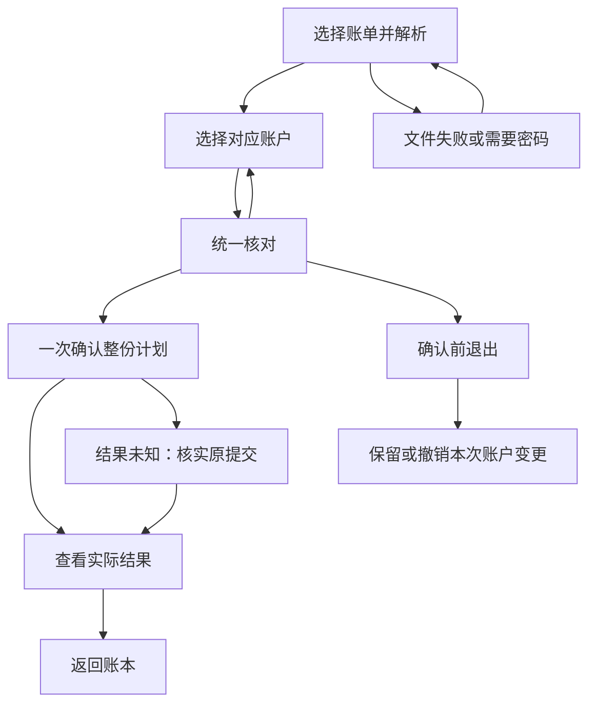

# 导入模块

[返回产品总览](../feature-map.md) · [跨端覆盖与待办](../feature-map.md#跨端覆盖与待办)

本模块包含 **1 项现有页面级功能**：F-05 现金账单导入。投资账单导入和连接器同步有后端能力规格，但没有独立 Compose 页面或路由。

本工作树的导入修复见 [规范对齐任务](../../openspec/changes/archive/2026-11-03-align-cash-import-product-rules/tasks.md)。页面数不变，Web／Android／iOS 共用共享呈现；共享测试与编译通过，Web 冒烟与独立设计复核已完成，设备交互 QA 不在默认范围。

离线演示 Graph 默认提供 24 条可见收支、待确认关联建议、多币种和缺项草稿；内置账单含 7 行、5 个来源账户组。Web 已完成代表视口入口与主要操作检查，Android／iOS 共用 Graph 并通过相称编译；设备 QA 未执行。本次不增加页面，具体 UI 审查与验证范围见变更任务。

## F-05 现金账单导入

**入口：** `/w/<workspaceId>/cash-import`，从收支账本打开的全屏任务。

**步骤与分支：**

| 步骤 | 操作与结果 |
|---|---|
| 进入时加载失败 | 账户、分类或账本选项读取失败时阻断任务；明确网络或服务故障提供重试，程序错误显示“系统错误”。关闭保留恢复信息，加载中不显示错误或重试 |
| 文件准备 | 选择一个或多个账单逐份解析，上传过程中仍可继续追加（最多 3 个并发），可移除或替换单份文件；单份失败可重试或删除，成功文件保留；失败或需密码时下一步显示禁用样式，点击提示处理原因 |
| 短暂操作反馈 | 文件选择器失败、处理中尝试退出及选择账户的临时读取失败使用带重试动作的 Snackbar；超限追加汇总未加入数量，文件原因与移除入口仍保留。实现与验证状态见 [规范对齐任务](../../openspec/changes/archive/2026-11-03-align-cash-import-product-rules/tasks.md)。 |
| 密码重传 | 重新选择需要密码的文件并提交密码；按钮显示向右箭头和“提交” |
| 来源分组 | 本次账单涉及至少两种来源渠道时按渠道与账号分组；仅一种渠道时直接列出来源账户；同账号资金方式共组，不同账号分开 |
| 对应账户 | 为各来源账户选择对应账户；仅在多渠道时显示“合并不同渠道的同名账户”，默认共用无歧义同名组的目标选择；冲突清空选择，关闭后独立选择 |
| 账户准备 | 目标账户下拉优先展示名称相似或已确认建议的账户；必要时新建账户或补齐币种，独立账户按 ID、修订和幂等键即时保存，账户类型创建后固定 |
| 统一核对 | 默认优先待确认，零待确认时默认全部；只读列表复用主页瀑布流组件、月度收支合计和右侧滚动条，按筛选准确计数、分页和序号定位；流水类型列显示主流水类型及适用细分，下方用有底色标签说明具体待处理原因，待处理行使用警告底色；整行可打开只读详情 |
| 返回修改 | 返回文件或账户步骤修改后重新生成核对结果 |
| 提交与结果 | 一次确认整份计划，查看实际导入结果；重复项和未导入项显示在结果中，最后返回账本 |

**取消与恢复：** 确认前可退出，按提示保留或撤销本次账户变更，包括新建账户和补齐币种。提交结果未知时按原提交核实；计划过期或内容失效时重新准备和核对。客户端不提供逐项失败处理入口。

**账户与来源边界：** 微信交易使用固定 `source_scope_key` 和非空交易单号，不再填写来源名称或保存跨导入账户映射。支付宝每条业务行必须有有效 `交易订单号`，同一工作区内跨支付宝账号按交易号匹配流水；账号分组和目标账户选择仍分别保留。微信昵称和支付宝脱敏账号只用于本次分组，跨渠道合并只共享本次目标选择。工银亚洲解析由本流程承载，不新增页面。支付宝流水号规则及验证见 [支付宝流水标识任务](../../openspec/changes/archive/2026-10-29-cash-import-alipay-transaction-identity/tasks.md)。

### 页面呈现与验证

统一核对复用 Paging3 连续加载、时间分组吸顶和右侧序号滚动条；月度收支合计按整份预计结果及当前筛选计算；compact 的月份独占首行，下方每币种的收入和支出横排右对齐；详情在宽屏侧滑、小屏切入；返回保留列表位置与筛选。用户已确认账户分组和密码操作方向，Material 3 排版及准确验证范围见 [账户分组变更任务](../../openspec/changes/archive/2026-10-29-cash-import-source-account-grouping/tasks.md)。

实际草稿摘要、原命令未知核实、新建账户后取消导入再撤销账户有 Web 实测证据；未知账户及账户编辑分支仍待最终验收。Android／iOS 共用入口，但账户分组与密码操作未执行原生设备 QA，尤其 iOS 文件选择器交回应用直到完成导入仍需实机验证。

### 实现与验证证据

- [真实格式回归夹具与执行入口](cash-import-fixtures.md)：11 份身份脱敏月度切片，默认双后端完整导入、收据、重放与重导去重；追加合并、独立批量币种及时区／完整月度汇总合同纳入自包含测试，真实浏览器覆盖四格式及补齐 USD。执行证据见[归档任务](../../openspec/changes/archive/2026-11-06-restore-concurrent-cash-file-append/tasks.md)。
- [`CashImportTaskScreen.kt`](../../compose/shared/src/commonMain/kotlin/com/finance/tracker/presentation/CashImportTaskScreen.kt)
- [`CashImportTaskViewModel.kt`](../../compose/shared/src/commonMain/kotlin/com/finance/tracker/presentation/CashImportTaskViewModel.kt)
- [`CashImportItemsPagingSource.kt`](../../compose/shared/src/commonMain/kotlin/com/finance/tracker/presentation/CashImportItemsPagingSource.kt)
- [`CashImportReviewList.kt`](../../compose/shared/src/commonMain/kotlin/com/finance/tracker/presentation/CashImportReviewList.kt)
- [`CashImportPreviewPanel.kt`](../../compose/shared/src/commonMain/kotlin/com/finance/tracker/presentation/CashImportPreviewPanel.kt)
- [`CashImportDiagnostic.kt`](../../compose/shared/src/commonMain/kotlin/com/finance/tracker/presentation/CashImportDiagnostic.kt)
- [变更任务](../../openspec/changes/archive/2026-10-29-cash-import-source-account-grouping/tasks.md)
- [`App.kt`](../../compose/shared/src/commonMain/kotlin/com/finance/tracker/app/App.kt)
- [`CashImportPreparation.kt`](../../compose/shared/src/commonMain/kotlin/com/finance/tracker/presentation/CashImportPreparation.kt)
- [`FinanceTheme.kt`](../../compose/shared/src/commonMain/kotlin/com/finance/tracker/core/FinanceTheme.kt)
- [导入客户端范围与验证](../../openspec/changes/archive/2026-10-28-compose-cash-import-workflow/proposal.md)

## 后端能力与客户端边界

现金导入由 Kotlin 会话服务承载，旧公开写入口已关闭。六渠道先快速探测，唯一匹配后完整读取；微信 XLSX 使用完整 XML 校验，工行 PDF 的文字与表格使用一致的页面坐标。读取、单批容量及原始文件导入的当前验收见 [读取修复任务](../../openspec/changes/archive/2026-11-05-fix-migrated-cash-statement-parsers/tasks.md)。流水模型、展示和维护见 [现金流水](../cash-ledger/cash-ledger.md)，入库过程见 [现金账单导入](cash-import-flow.md)，业务规则见 [规则与设计取舍](cash-import-redesign.md)，协议见 [接口与数据契约](cash-import-redesign-contracts.md)。

| 能力 | 后端及共享基础的实现证据 | 客户端状态 |
|---|---|---|
| 多文件解析与临时内容 | 会话服务、六渠道有界探测、完整读取及[清扫配置](cash-import-r2-staging.md)；唯一匹配后解析一次，不留原文件，零／多匹配保留具体文件错误 | 已接共享准备页、逐文件重选与密码重传；微信来源名称设置入口及 `source_scope_label` 会话字段已移除。密码提交和文件分组回归见 [账户分组任务](../../openspec/changes/archive/2026-10-29-cash-import-source-account-grouping/tasks.md)。 |
| 来源对应与资金账户 | 来源规划、资金桥接、账户映射；微信和支付宝使用固定交易范围与必有交易号，支付宝交易号跨账号匹配，银行等来源仍按来源账户隔离 | 微信昵称、支付宝脱敏账号仅作本次分组；同账号资金方式共组，不同账号分开。支付宝交易号跨账号匹配不合并资金账户组或目标账户选择。跨渠道同名组默认共享本次目标账户选择，选择冲突清空，关闭开关后独立选择。账户新建、币种补齐和预览行为沿用当前合同。 |
| 统一预览与一次确认 | 业务计划、联合提交、计划 HTTP；不可变计划提供按筛选的准确总数及序号分页 | 已接待确认优先、零待确认时默认全部的只读列表；复用主页流水行、Paging3 连续加载与右侧序号滚动条，详情在宽屏侧滑、小屏切入并在返回时保留列表位置和筛选；整份确认和实际收据摘要可演示。 |
| 结果及失败恢复 | 失败项原因、命令收据、旧收据迁移；实际结果分页、未知核实、限时失败补处理 | 已接结果摘要与统一错误；实际草稿摘要及原命令未知核实均有 Web 证据，不提供逐项失败处理入口 |
| 草稿及正式流水维护 | 当前详情／草稿保存、维护规划、维护提交；创建方式权限、稳定公共属性整笔编辑、来源问题及身份合并；原子草稿仅联动实际财务修改，保留来源明确组成项 | F-04 已接当前详情、普通草稿保存、分摊编辑、明确转正式和只读账单原文；公共属性整笔编辑已接入并通过真实 API 冒烟；来源采用和明确身份合并已通过真实 API 冒烟，演示验收待完成 |
| 关系及当前展示 | 最终图校验、稳定对象、当前查询；待确认不合并，人工冲突延后、解除明确继承，只差量更新受影响闭包；全额退款净额 `0` 的投影保留，收支账本默认由“隐藏0元流水”筛选隐藏；列表直接返回根流水 `transaction_id`，来源编号保持独立 | 正式／草稿状态列表、未知值展示、待确认筛选及默认开启的零元筛选已接共享入口；关系维护已展示完整候选成员，选择失效须重新核对；完整组、公共冲突及解除继承已通过真实 API 冒烟；旧任意关联写入已移除，不新增关系一级入口 |
| 统计与删除 | 余额、投影、身份迁移；草稿不入金额统计，删除清理当前引用并释放来源绑定 | 现有删除入口及新草稿操作须随当前合同统一验收 |
| 独立账户 | 账户命令、账户 HTTP；按 ID、修订及幂等键立即保存，账户类型创建后固定；导入下一步的币种补齐经一次批量请求提交，每项仍是独立命令与收据 | 已接独立账户表单与即时保存；实际新建后取消导入再撤销账户已通过 Web 实测，未知账户及编辑分支仍待最终验收 |
| 客户端基础 | [当前领域合同](../../compose/shared/src/commonMain/kotlin/com/finance/tracker/domain/CashImportLifecycle.kt)、[任务编排](../../compose/shared/src/commonMain/kotlin/com/finance/tracker/presentation/CashImportTaskViewModel.kt)、[账户编排](../../compose/shared/src/commonMain/kotlin/com/finance/tracker/presentation/ImportAccountViewModel.kt)、[最小恢复存储](../../compose/shared/src/commonMain/kotlin/com/finance/tracker/core/ImportRecoveryStore.kt) | 任务与账户 VM、恢复存储已接真实 App／Graph 入口；Web 已有主流程证据，Android／iOS 共用入口，按默认编译／单测验证；不据共享代码宣称设备 QA 通过 |
| Agent 入口 | [导入技能](../../.agents/skills/cash-statement-import/SKILL.md) 和 [API 参考](../../.agents/skills/cash-statement-import/references/api-contract.md) 已切换当前后端合同 | 同一后端的操作指引，不新增页面，不替代 Compose QA |

现金—投资资金关联是独立能力：后端只允许导入或缺证历史的正式现金流水参与，普通手工与手工转账禁止对外关联。投资事件、账户别名、手工新建、资金调拨和余额校准不因旧现金导入入口退役而移除。真实库迁移、旧外部原文件对象清理及部署尚未执行，条件见实施记录。

## 无独立页面的能力

投资账单导入和投资连接器同步目前没有独立 Compose 页面或路由，不计入现有页面，也不据后端代码或规格存在认定客户端可用。Agent 导入技能是同一后端的操作指引，不新增页面，不替代 Compose QA。

## 相关规格

- [现金导入任务](../../compose/shared/src/commonMain/kotlin/com/finance/tracker/presentation/CashImportTaskScreen.kt)
- [现金导入会话规格](../../openspec/specs/import/cash-import-session/spec.md)
- [账单导入规格](../../openspec/specs/import/statement-import/spec.md)
- [工银亚洲导入规格](../../openspec/specs/import/icbc-asia-current-account-import/spec.md)
- [投资账单导入规格](../../openspec/specs/import/investment-statement-import/spec.md)
- [连接器同步规格](../../openspec/specs/import/investment-connector-sync/spec.md)
