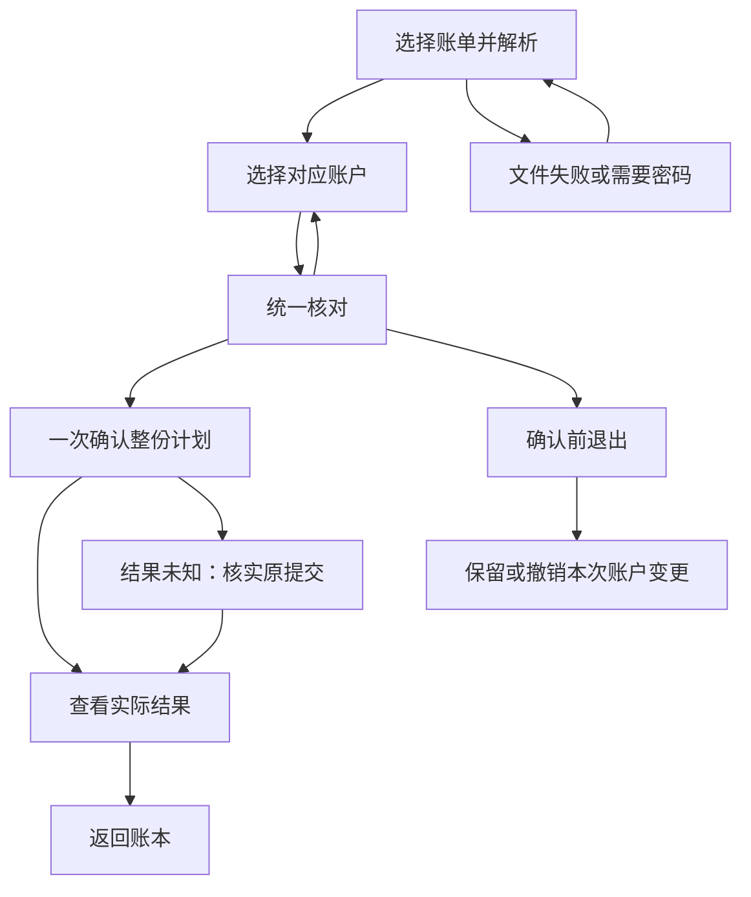

# 导入模块

[返回产品总览](../feature-map.md) · [跨端覆盖与待办](../feature-map.md#跨端覆盖与待办)

本模块包含 **1 项现有页面级功能**：F-05 现金账单导入。投资账单导入和连接器同步有后端能力规格，但没有独立 Compose 页面或路由。

## F-05 现金账单导入

**入口：** `/w/<workspaceId>/cash-import`，从收支账本打开的全屏任务。

**步骤与分支：**

| 步骤 | 操作与结果 |
|---|---|
| 文件准备 | 选择一个或多个账单逐份解析，可追加、移除或替换单份文件；单份失败可重试，其他已解析文件可继续 |
| 密码重传 | 重新选择需要密码的文件并提交密码；按钮显示向右箭头和“提交” |
| 来源分组 | 按渠道和账号分组；微信为“微信 - 昵称”，支付宝为“支付宝 - 脱敏账号”；同账号资金方式共组，不同账号分开 |
| 对应账户 | 为各来源组选择对应账户；默认开启跨渠道同名组共用目标选择，来源组仍分开显示；冲突清空选择，关闭开关后独立选择 |
| 账户准备 | 必要时新建账户或补齐币种，独立账户按 ID、修订和幂等键即时保存，账户类型创建后固定 |
| 统一核对 | 默认优先待确认，零待确认时默认全部；只读列表复用主页流水行，按筛选准确计数、分页和序号定位，可打开只读详情 |
| 返回修改 | 返回文件或账户步骤修改后重新生成核对结果 |
| 提交与结果 | 一次确认整份计划，查看实际导入结果；重复项和未导入项显示在结果中，最后返回账本 |

**取消与恢复：** 确认前可退出，按提示保留或撤销本次账户变更，包括新建账户和补齐币种。提交结果未知时按原提交核实；计划过期或内容失效时重新准备和核对。客户端不提供逐项失败处理入口。

**账户与来源边界：** 微信交易使用固定 `source_scope_key` 和非空交易单号，不再填写来源名称或保存跨导入账户映射。支付宝每条业务行必须有有效 `交易订单号`，同一工作区内跨支付宝账号按交易号匹配流水；账号分组和目标账户选择仍分别保留。微信昵称和支付宝脱敏账号只用于本次分组，跨渠道合并只共享本次目标选择。工银亚洲解析由本流程承载，不新增页面。支付宝流水号规则及验证见 [支付宝流水标识任务](../../openspec/changes/archive/2026-10-29-cash-import-alipay-transaction-identity/tasks.md)。

### 页面呈现与验证

统一核对复用 Paging3 连续加载和右侧序号滚动条，详情在宽屏侧滑、小屏切入；返回保留列表位置与筛选。用户已确认账户分组和密码操作方向，Material 3 排版及准确验证范围见 [账户分组变更任务](../../openspec/changes/archive/2026-10-29-cash-import-source-account-grouping/tasks.md)。

实际草稿摘要、原命令未知核实、新建账户后取消导入再撤销账户有 Web 实测证据；未知账户及账户编辑分支仍待最终验收。Android／iOS 共用入口，但账户分组与密码操作未执行原生设备 QA，尤其 iOS 文件选择器交回应用直到完成导入仍需实机验证。

### 实现与验证证据

- [`CashImportTaskScreen.kt`](../../compose/shared/src/commonMain/kotlin/com/finance/tracker/presentation/CashImportTaskScreen.kt)
- [`CashImportTaskViewModel.kt`](../../compose/shared/src/commonMain/kotlin/com/finance/tracker/presentation/CashImportTaskViewModel.kt)
- [`CashImportItemsPagingSource.kt`](../../compose/shared/src/commonMain/kotlin/com/finance/tracker/presentation/CashImportItemsPagingSource.kt)
- [`CashImportReviewList.kt`](../../compose/shared/src/commonMain/kotlin/com/finance/tracker/presentation/CashImportReviewList.kt)
- [`CashImportPreviewPanel.kt`](../../compose/shared/src/commonMain/kotlin/com/finance/tracker/presentation/CashImportPreviewPanel.kt)
- [`CashImportDiagnostic.kt`](../../compose/shared/src/commonMain/kotlin/com/finance/tracker/presentation/CashImportDiagnostic.kt)
- [变更任务](../../openspec/changes/archive/2026-10-29-cash-import-source-account-grouping/tasks.md)
- [`App.kt`](../../compose/shared/src/commonMain/kotlin/com/finance/tracker/app/App.kt)
- [`CashImportPreparation.kt`](../../compose/shared/src/commonMain/kotlin/com/finance/tracker/presentation/CashImportPreparation.kt)
- [`FinanceTheme.kt`](../../compose/shared/src/commonMain/kotlin/com/finance/tracker/core/FinanceTheme.kt)
- [导入客户端范围与验证](../../openspec/changes/archive/2026-10-28-compose-cash-import-workflow/proposal.md)

## 后端能力与客户端边界

现金导入后端已完成开发及验收，旧公开写入口已关闭。流水模型、展示和维护见 [现金流水](../cash-ledger/cash-ledger.md)，入库过程见 [现金账单导入](cash-import-flow.md)，业务规则见 [规则与设计取舍](cash-import-redesign.md)，协议见 [接口与数据契约](cash-import-redesign-contracts.md)。后端与历史账单验收见 [现金导入任务记录](../../openspec/changes/archive/2026-10-28-cash-import-lifecycle-redesign/tasks.md)。

| 能力 | 后端及共享基础的实现证据 | 客户端状态 |
|---|---|---|
| 多文件解析与临时内容 | [会话服务](../../src/ft/application/cash_import_context.py)、[会话 HTTP](../../src/ft/web/cash_import_routes.py)、[解析及清扫配置](cash-import-r2-staging.md)；一次解析，不留原文件，单文件错误可继续 | 已接共享准备页、逐文件重选与密码重传；微信来源名称设置入口及 `source_scope_label` 会话字段已移除。密码提交和文件分组回归见 [账户分组任务](../../openspec/changes/archive/2026-10-29-cash-import-source-account-grouping/tasks.md)。 |
| 来源对应与资金账户 | [来源规划](../../src/ft/application/cash_import_source_plan.py)、[资金桥接](../../src/ft/application/cash_import_funding.py)、[账户映射](../../src/ft/application/cash_import_account_mappings.py)；微信和支付宝使用固定交易范围与必有交易号，支付宝交易号跨账号匹配，银行等来源仍按来源账户隔离 | 微信昵称、支付宝脱敏账号仅作本次分组；同账号资金方式共组，不同账号分开。支付宝交易号跨账号匹配不合并资金账户组或目标账户选择。跨渠道同名组默认共享本次目标账户选择，选择冲突清空，关闭开关后独立选择。账户新建、币种补齐和预览行为沿用当前合同。 |
| 统一预览与一次确认 | [业务计划](../../src/ft/application/cash_import_business_plan.py)、[联合提交](../../src/ft/application/cash_import_commit.py)、[计划 HTTP](../../src/ft/web/cash_plan_routes.py)；不可变计划提供按筛选的准确总数及序号分页 | 已接待确认优先、零待确认时默认全部的只读列表；复用主页流水行、Paging3 连续加载与右侧序号滚动条，详情在宽屏侧滑、小屏切入并在返回时保留列表位置和筛选；整份确认和实际收据摘要可演示。 |
| 结果及失败恢复 | [失败项原因](../../src/ft/application/cash_import_issues.py)、[命令收据](../../src/ft/adapters/relational/cash_mutations.py)、[旧收据迁移](../../migrations/versions/20261023_49_unify_cash_import_receipts.py)；实际结果分页、未知核实、限时失败补处理 | 已接结果摘要与统一错误；实际草稿摘要及原命令未知核实均有 Web 证据，不提供逐项失败处理入口 |
| 草稿及正式流水维护 | [当前详情／草稿保存](../../src/ft/application/cash_record_maintenance.py)、[维护规划](../../src/ft/application/cash_mutation_business_plan.py)、[维护提交](../../src/ft/application/cash_mutation_commit.py)；创建方式权限、稳定公共属性整笔编辑、来源问题及身份合并；原子草稿仅联动实际财务修改，保留来源明确组成项 | F-04 已接当前详情、普通草稿保存、分摊编辑、明确转正式和只读账单原文；公共属性整笔编辑已接入并通过真实 API 冒烟；来源采用和明确身份合并已通过真实 API 冒烟，演示验收待完成 |
| 关系及当前展示 | [最终图校验](../../src/ft/domain/cash_relation_graph.py)、[稳定对象](../../src/ft/adapters/relational/cash_entries.py)、[当前查询](../../src/ft/adapters/relational/web_queries.py)；待确认不合并，人工冲突延后、解除明确继承，只差量更新受影响闭包；全额退款净额 `0` 的投影保留，收支账本默认由“隐藏0元流水”筛选隐藏；列表直接返回根流水 `transaction_id`，来源编号保持独立 | 正式／草稿状态列表、未知值展示、待确认筛选及默认开启的零元筛选已接共享入口；关系维护已展示完整候选成员，选择失效须重新核对；完整组、公共冲突及解除继承已通过真实 API 冒烟；旧任意关联写入已移除，不新增关系一级入口 |
| 统计与删除 | [余额](../../src/ft/application/cash_balances.py)、[投影](../../src/ft/application/cash_projections.py)、[身份迁移](../../migrations/versions/20261021_46_cash_instance_identity.py)；草稿不入金额统计，删除清理当前引用并释放来源绑定 | 现有删除入口及新草稿操作须随当前合同统一验收 |
| 独立账户 | [账户命令](../../src/ft/application/account_commands.py)、[账户 HTTP](../../src/ft/web/account_routes.py)；按 ID、修订及幂等键立即保存，账户类型创建后固定 | 已接独立账户表单与即时保存；实际新建后取消导入再撤销账户已通过 Web 实测，未知账户及编辑分支仍待最终验收 |
| 客户端基础 | [当前领域合同](../../compose/shared/src/commonMain/kotlin/com/finance/tracker/domain/CashImportLifecycle.kt)、[任务编排](../../compose/shared/src/commonMain/kotlin/com/finance/tracker/presentation/CashImportTaskViewModel.kt)、[账户编排](../../compose/shared/src/commonMain/kotlin/com/finance/tracker/presentation/ImportAccountViewModel.kt)、[最小恢复存储](../../compose/shared/src/commonMain/kotlin/com/finance/tracker/core/ImportRecoveryStore.kt) | 任务与账户 VM、恢复存储已接真实 App／Graph 入口；Web 已有主流程证据，Android／iOS 共用入口，按默认编译／单测验证；不据共享代码宣称设备 QA 通过 |
| Agent 入口 | [导入技能](../../.agents/skills/cash-statement-import/SKILL.md) 和 [API 参考](../../.agents/skills/cash-statement-import/references/api-contract.md) 已切换当前后端合同 | 同一后端的操作指引，不新增页面，不替代 Compose QA |

现金—投资资金关联是独立能力：后端只允许导入或缺证历史的正式现金流水参与，普通手工与手工转账禁止对外关联。投资事件、账户别名、手工新建、资金调拨和余额校准不因旧现金导入入口退役而移除。真实库迁移、旧外部原文件对象清理及部署尚未执行，条件见实施记录。

## 无独立页面的能力

投资账单导入和投资连接器同步目前没有独立 Compose 页面或路由，不计入现有页面，也不据后端代码或规格存在认定客户端可用。Agent 导入技能是同一后端的操作指引，不新增页面，不替代 Compose QA。

## 相关规格

- [现金导入任务](../../compose/shared/src/commonMain/kotlin/com/finance/tracker/presentation/CashImportTaskScreen.kt)
- [现金导入会话规格](../../openspec/specs/import/cash-import-session/spec.md)
- [账单导入规格](../../openspec/specs/import/statement-import/spec.md)
- [工银亚洲导入规格](../../openspec/specs/import/icbc-asia-current-account-import/spec.md)
- [投资账单导入规格](../../openspec/specs/import/investment-statement-import/spec.md)
- [连接器同步规格](../../openspec/specs/import/investment-connector-sync/spec.md)
