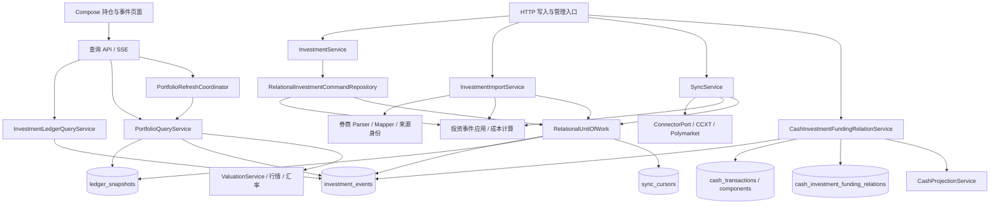
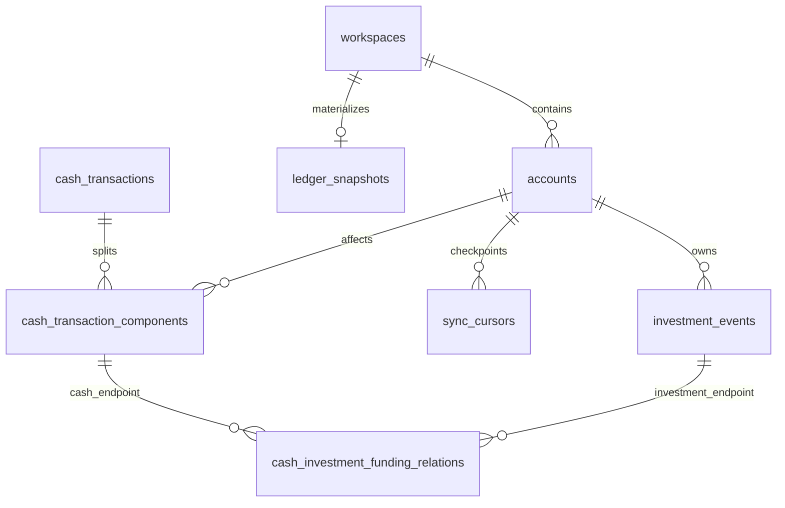
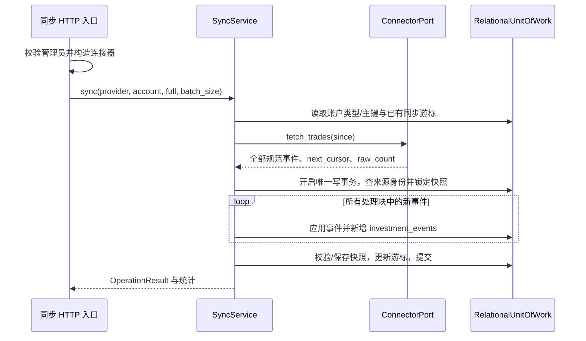

# 投资管理架构：当前模块、数据结构与 API 契约

记录日期：2026-10-22。代码基线：`bc8a6aa4ea417595d321148650b6065ac3ebe113`。

本文为重构前的现状记录，覆盖手工写入、账单导入、连接器同步、投资事件查询、组合估值和现金—投资资金调拨关系。组织方式参照 [现金账单导入后端架构](cash-import-flow.md)，但本次不设计重构方案，不修改业务代码、公共契约、数据库或产品功能。

范围已通过项目 `$grill-me` / `$grilling` 澄清并由用户确认：六条链路均记录入口、模块职责、数据结构、处理步骤、事务与幂等边界、API 和测试定位；另列规格与实现差异、耦合点和重构风险。验收以读者能从客户端或 HTTP 入口追踪到应用服务、领域计算、持久化及验证证据为准。术语沿用 [DOMAIN_GLOSSARY.md](../DOMAIN_GLOSSARY.md)，没有引入新的领域概念。

行为要求以当前主规格为准；下文的实现描述来自当前代码。两者不一致时明确并列，不把代码偏差升级为新合同，也不把归档设计、注释中的历史术语或 active change 的计划当成已实现行为。本文不包含真实账单、账户资料或凭据。

## 1. 能力归属与客户端边界

| 能力 ID | 当前主规格 | 本文关注点 |
|---|---|---|
| `investment/investment-event-model` | [投资事件模型](../openspec/specs/investment/investment-event-model/spec.md) | 规范事件、资产方向、费用、本位资产、成本与确定性重放 |
| `import/investment-statement-import` | [投资账单导入](../openspec/specs/import/investment-statement-import/spec.md) | 券商格式、来源证据、核对、行级幂等 |
| `import/investment-connector-sync` | [投资连接器同步](../openspec/specs/import/investment-connector-sync/spec.md) | 连接器端口、增量游标、凭据、事件提交 |
| `investment/portfolio-valuation` | [投资组合估值](../openspec/specs/investment/portfolio-valuation/spec.md) | 行情、汇率、状态、批量预算、局部失败 |
| `investment/cash-investment-funding-relations` | [现金—投资资金调拨关系](../openspec/specs/investment/cash-investment-funding-relations/spec.md) | 跨表资金移动、候选、人工决定与收支投影 |
| `shared/time-semantics`、`shared/runtime-database` | [时间语义](../openspec/specs/shared/time-semantics/spec.md)、[运行时数据库](../openspec/specs/shared/runtime-database/spec.md) | UTC、日期筛选、SQLite / PostgreSQL、迁移与故障边界 |

Compose Web 与 Native 使用共享的 [InvestmentApi.kt](../compose/shared/src/commonMain/kotlin/com/finance/tracker/data/InvestmentApi.kt)、[FinanceRepositoryImpl.kt](../compose/shared/src/commonMain/kotlin/com/finance/tracker/data/FinanceRepositoryImpl.kt) 和 [InvestmentScreens.kt](../compose/shared/src/commonMain/kotlin/com/finance/tracker/presentation/InvestmentScreens.kt)，提供持仓、事件、筛选、详情和估值刷新。当前投资 API 包装层没有手工投资写入、证券账单导入、连接器同步或资金关系审核的对应方法；不能从后端已有接口推断这些产品入口已经存在。

页面覆盖与跨端验证仍以 [功能地图](feature-map.md) 为盘点入口。Compose Web、Android 和 iOS 是当前客户端；已退役客户端的页面不作为迁移参考。本文只更新架构记录和文档索引，不改变页面覆盖状态。

## 2. 模块全景



图中的资金关系扫描是独立用例。当前手工写入、投资导入和同步服务均不会自动调用该扫描；新增投资事件不等于已经确认了现金对侧关系。

| 层与文件 | 核心符号 | 当前职责与依赖 |
|---|---|---|
| [web/app.py](../src/ft/web/app.py) | `WorkspaceServices`、`WorkspaceInvestmentServices`、`WorkspacePortfolioServices`、`WorkspacePortfolioRefresh` | 从认证上下文绑定工作区，构造写入、查询和刷新服务；HTTP 装配与 `runtime.build_services` 是两套组合入口 |
| [web/operation_routes.py](../src/ft/web/operation_routes.py) | `operation_router` | 手工写入、文件直传导入、管理员同步、资金关系命令；读取服务端凭据、管理临时文件 |
| [web/routes.py](../src/ft/web/routes.py) | `cash_router`、`portfolio_sse_frame` | 名称虽为 cash，实际也承载投资账户、事件、证据、持仓及 SSE |
| [application/investment.py](../src/ft/application/investment.py) | `InvestmentService`、`PortfolioQueryService` | 前者将操作参数转换为命令 DTO；后者同时编排当前估值、汇率、历史行情和周期表现 |
| [application/investment_import.py](../src/ft/application/investment_import.py)、[application/sync_service.py](../src/ft/application/sync_service.py) | `InvestmentImportService`、`SyncService` | 分别编排文件输入和连接器输入；各自执行去重、事件应用、事件写入和快照维护 |
| [domain/investment_projection.py](../src/ft/domain/investment_projection.py) | `apply_investment_command`、`apply_investment_event` | 不访问数据库，按精确数量、资产方向和成本语义修改内存快照 |
| [domain/investment_record_type.py](../src/ft/domain/investment_record_type.py)、[domain/investment_validation.py](../src/ft/domain/investment_validation.py) | 类型/子类型校验、`validate_investment_snapshot` | 经济事实枚举与快照数值校验；后者允许有限负值，不等同于完整的逐事件语义校验 |
| [adapters/relational/investments.py](../src/ft/adapters/relational/investments.py) | `RelationalInvestmentCommandRepository` | 手工写入的事务用例：查账户、锁快照、应用命令、保存事件与快照 |
| [adapters/relational/repositories.py](../src/ft/adapters/relational/repositories.py)、[imports.py](../src/ft/adapters/relational/imports.py) | `RelationalInvestmentRepository`、`RelationalSnapshotRepository`、`RelationalImportRepository` | ORM 字段转换、正式事件读取与新增、工作区快照和来源身份/游标访问 |
| [application/investment_web_queries.py](../src/ft/application/investment_web_queries.py)、[adapters/relational/investment_web_queries.py](../src/ft/adapters/relational/investment_web_queries.py) | `InvestmentLedgerQueryService`、`RelationalInvestmentLedgerQueryRepository` | 事件筛选、稳定分页、证据白名单、资金关系摘要 |
| [adapters/relational/queries.py](../src/ft/adapters/relational/queries.py) | `RelationalPortfolioRepository` | 组合查询输入：账户币种、快照、事件历史及标的展示名称 |
| [application/queries.py](../src/ft/application/queries.py) | `FinanceQueryService` | 通用账户余额与财务报表的兼容查询；投资账户余额另有行情失败回退成本的口径，不等同于组合 DTO |
| [application/valuation.py](../src/ft/application/valuation.py)、[adapters/market_data.py](../src/ft/adapters/market_data.py)、[adapters/fx_rates.py](../src/ft/adapters/fx_rates.py) | `ValuationService`、`CompositeQuoteProvider`、`FxRateProvider` | 标的识别、当前/历史行情、估值状态和汇率 |
| [application/portfolio_refresh.py](../src/ft/application/portfolio_refresh.py) | `PortfolioRefreshCoordinator` | 进程内后台刷新、展示口径缓存和 SSE，不拥有财务事实 |
| [application/cash_investment_funding_relations.py](../src/ft/application/cash_investment_funding_relations.py) | `CashInvestmentFundingRelationService` | 直接使用关系型 Session 扫描和决定关系，同事务维护现金投影 |

投资侧尚没有一个贯穿手工、文件、连接器和查询的统一事件实体类型。命令是 dataclass，导入和同步主要传递 `dict`，持久化是 ORM，事件列表和组合输出又各有 DTO。

## 3. 持久化结构

### 3.1 表与关系



模型定义见 [models.py](../src/ft/adapters/relational/models.py)。工作区参与事件、账户和关系端点的复合外键，不能仅凭全局自增 ID 跨工作区建立引用。

| 表 / 模型 | 数据与约束 |
|---|---|
| `accounts` / `AccountModel` | 投资账户类型为 `security` 或 `crypto`；保存名称、启用状态和 `currencies` 等账户配置。操作接口以账户名称定位，列表筛选以整数账户 ID 定位 |
| `investment_events` / `InvestmentEventModel` | 每个投资经济事实一行；工作区与账户复合外键；类型和子类型有 CHECK 约束；没有独立交易价格列，也没有现金流水那套软删除字段 |
| `ledger_snapshots` / `LedgerSnapshotModel` | 每工作区一行：`payload` JSON、`version`、`updated_at`。包含现金和投资状态；版本也是投资列表分页版本来源，不是投资事件专属版本 |
| `sync_cursors` / `SyncCursorModel` | `workspace_id + account_id + source_type` 唯一；保存 `cursor_value`（字符串，最多 256 字符）和 `updated_at` |
| `cash_investment_funding_relations` / `CashInvestmentFundingRelationModel` | 两端分别引用现金账户组成项、投资事件；保存方向、状态、规则、受限证据和决定信息；活动关系对唯一，已确认活动关系的两类端点各有唯一索引 |
| `cash_transactions`、`cash_transaction_components` | 资金关系读取父流水的时间/类型/对手方，使用组成项的账户、金额、币种和 ID；父流水 ID 与组成项 ID 不可互换 |

`investment_events` 的来源唯一约束不能只看 ORM：正式 Alembic 迁移创建了条件唯一索引 `uq_investment_events_source_record`，对非空 `source_type`、非空 `record_id` 约束 `workspace_id + source_type + record_id`。见 [来源清理迁移](../migrations/versions/20260724_08_inline_provenance_cleanup.py) 和 [整数主键迁移](../migrations/versions/20260724_09_bigint_surrogate_ids.py)。当前 ORM `__table_args__` 只声明对应普通索引；仅用 `Base.metadata.create_all` 创建的测试库与正式迁移库在这一点上不同。

当前 schema head 为 `20261018_37`。运行时通过 `FT_DATABASE_URL` 明确选择 SQLite 或 PostgreSQL，不自动回退、不双写、不隐式迁移；参见 [relational/runtime.py](../src/ft/adapters/relational/runtime.py)。

### 3.2 `investment_events` 字段合同

| 字段 | 类型 / 空值 | 语义 |
|---|---|---|
| `id` | PostgreSQL `BIGINT` / SQLite `INTEGER` | 数据库事件主键；资金关系引用它 |
| `workspace_id`、`account_id` | 工作区字符串、整数外键 | 工作区与投资账户归属 |
| `source_type` | 可空字符串，最长 64 | 导入渠道，如 `ibkr_csv`、`binance_api`；不是 `provider` 配置键 |
| `record_id` | 字符串，最长 512，默认空 | 来源业务行标识；与工作区、渠道共同构成导入幂等身份 |
| `source_payload` | 可空 JSON | 来源行快照；不应混入后续映射和派生字段 |
| `occurred_at` | UTC aware 时间 | 业务发生时间；与 `created_at` 分开 |
| `record_type`、`record_subtype` | 受约束字符串 | 来源无关经济事实，枚举见下一节 |
| `currency` | 长度 3 的字符串，默认空 | 事件金额/成本相关币种；不是所有资产代码都能放入此字段 |
| `note` | 文本，默认空 | 手工备注或来源说明，不承担来源身份或分类规则 |
| `from_ticker`、`to_ticker` | 字符串，默认空 | 付出资产与换入资产；现金也用资产代码表示 |
| `from_amount`、`to_amount` | 可空精确十进制 | 两侧资产数量；方向由字段所在侧表达 |
| `commission`、`commission_asset` | 可空精确十进制、资产字符串 | 费用数量和扣费资产，与交易现金部分分别表达 |
| `payload` | 非空 JSON | 未提升为正式列的扩展业务信息；不是来源行快照的副本 |
| `created_at` | UTC aware 时间 | 本地创建时间 |

`RelationalInvestmentRepository` 通过 `_INVESTMENT_CORE_KEYS` 排除正式字段后构造 `payload`。`price` 也在排除集合中：可在写入时辅助补齐现金数量，但不会作为独立列或扩展字段长期保存。重放不能依赖读取原始成交价格。

### 3.3 快照与成本

以下是结构示意，值均为虚构；它不是 HTTP 响应或独立持仓表。

```json
{
  "accounts": {
    "security": {
      "示例投资账户": {
        "currency": "USD",
        "positions": {
          "usd": {"shares": "900", "total_cost": "900", "cost_currency": "USD"},
          "aapl.us": {"shares": "1", "total_cost": "101", "cost_currency": "USD"}
        }
      }
    }
  }
}
```

当前事件应用函数统一写入 `accounts.security`，即使目标账户类型为 `crypto`；组合读取仍会合并已有 `security` 和 `crypto` 两个桶。上例是应用内表示，按账户名称访问；`RelationalSnapshotRepository._to_ids()` 保存时把账户键转成账户 ID，读取通过 `_to_names()` 转回名称，查询还容忍历史键。它不是独立的持仓关系表，不能把应用内名称键当作数据库 JSON 始终采用的键。

- 非本位资产保存数量、总成本和成本币种，增持累计成本，减持按原有平均成本释放；不同成本币种的非零持仓不能直接合并。
- 本位资产只表达余额，没有投资成本基础；当前快照仍以 `total_cost = shares` 保存面值占位，不能把这个存储值解释为投资成本，也不能写成物理存储一定为 `0`。
- 手工路径从账户 `currencies` 取本位资产；文件导入读取 `list_raw()` 的 `base_currencies`；同步当前直接使用 `DEFAULT_BASE_TICKERS`。默认集合包含常见法币以及 `usdt`、`usdc`，三条路径的配置来源并不完全相同。
- `validate_investment_snapshot` 校验持仓数量和成本是有限数值，允许负值；它不证明来源幂等、事件类型、现金数量、重放顺序和历史快照完全正确。

### 3.4 数值、时间与标识

`ExactDecimal` 在 PostgreSQL 使用 `NUMERIC(38,18)`，在 SQLite 使用无损文本；`exact_decimal` 拒绝非有限值、超过 18 位有效小数或 20 位整数的值。投资 Repository 的 `_amt` 另有把超过 18 位小数四舍五入的步骤，因此不能笼统声称所有层都拒绝超精度输入。除法成本计算按 18 位小数处理。HTTP 金额和数量均应使用十进制字符串，不能先转为二进制浮点数。

`UTCDateTime` 要求 aware 时间并规范到 UTC；但 Repository `_parse_timestamp` 会把无 offset 的输入补为 UTC。应区分持久化类型的要求与应用输入实际宽容程度，尤其不能将无 offset 日期解释成浏览器本地时间。

| 标识 | 真实用途 |
|---|---|
| `operation` 或命令 `record_type=buy` | 手工用例的操作名，尚不是正式事件类型 |
| `investment_events.record_type=trade` | 持久化的经济事实类型 |
| `source_type + record_id` | 工作区内的导入业务身份，不包含目标账户 |
| `InvestmentEventModel.id` | 数据库整数主键，供资金关系引用 |
| Web `event_id` | `source_type:record_id`；空渠道使用 `ledger:record_id`，供证据 URL 使用 |
| 列表 `cursor` | 绑定工作区、筛选、账本版本、时间和主键的翻页位置 |
| `sync_cursors.cursor_value` | 某账户和渠道的外部读取位置，不是列表游标，也不能代替业务去重 |
| SSE `id` / `version` | 进程内刷新条目的版本，不是账本版本或事件主键 |

## 4. 规范事件与领域计算

| `record_type` | 合法 `record_subtype` |
|---|---|
| `funding` | `external`、`subaccount` |
| `trade` | `security`、`fx`、`repo` |
| `income` | `dividend_cash`、`dividend_stock`、`interest`、`reward` |
| `expense` | `commission`、`tax`、`interest`、`handling_fee`、`penalty` |
| `reversal` | `expense_tax`、`expense_interest`、`expense_commission`、`expense_handling_fee`、`expense_penalty`、`funding_withdrawal` |
| `subscription` | `ipo_debit`、`ipo_refund` |
| `adjustment` | `fx_net`、`manual`、`unclassified` |
| `snapshot` | `cash`、`position` |

买入证券表现为付出现金、换入证券，卖出则相反；两侧数量分别表示资产单位，不能相加。交易费用单独扣除，成本计算必须与来源净现金保持一致：能够安全拆分费用时拆分，不能安全拆分时保留净额并使用零费用，不发明差额。

`apply_investment_command` 根据手工命令直接更新快照，并构造对应规范事件；它与 `apply_investment_event` 各自实现投影分支，不是先生成事件再统一调用后者。`apply_investment_event` 消费规范事件：资金、收入、支出、冲回、认购扣款与退款、调整改变对应资产数量；交易同时处理两侧资产及费用；快照显式重设对应资产的余额/持仓。快照不是买卖，也不是为抹平差异补造的交易。

两者都是对当前内存状态应用一次输入的函数。当前日常写入链路不是每次从数据库按历史顺序重建全部持仓；文件导入和同步只对新行按输入顺序继续应用。补录更早事件、跨文件重叠和期末快照的先后关系，会直接影响重构时需要保留或重新界定的语义。

## 5. 手工写入

### 5.1 调用与事务

`POST /api/v1/investment-events` → `WorkspaceServices.legacy_investments()` → `InvestmentService` → `RelationalInvestmentCommandRepository.execute()`。

Repository 在一个 `RelationalUnitOfWork` 内查找工作区账户，要求类型为 `security` 或 `crypto`，锁定快照，应用命令，校验快照，新增事件并保存快照后提交；任何失败回滚。文件型 SQLite 的 UoW 先执行 `BEGIN IMMEDIATE`；PostgreSQL 的快照读取使用相应行锁。领域计算和事务用例分别在 domain 与 adapter 中，`InvestmentService` 本身很薄。

### 5.2 请求合同

通用 JSON 字段：`account` 必填，`currency`、`note`、`date` 可选。`operation` 优先；省略时回退读取 `record_type`，但这里仍只接受下表操作名，不能直接提交任意规范事件。金额、数量和价格必须为有限十进制字符串。

| 操作 | 额外字段 | 正式事件 |
|---|---|---|
| `buy` | `ticker`、`shares`、`price`；`commission` 默认 `"0"` | `trade(security)`，现金 → 证券 |
| `sell` | 同上 | `trade(security)`，证券 → 现金 |
| `swap` | `from_ticker`、`from_shares`、`to_ticker`、`to_shares`；可选 `commission`、`commission_asset` | 当前为 `trade(security)`，两种资产兑换 |
| `deposit` | `amount` | `funding(external)`，现金在换入侧 |
| `withdraw` | `amount` | `funding(external)`，现金在付出侧 |
| `dividend` | `ticker`、`amount` | `income(dividend_cash)` |
| `checkin`，有 `ticker` | `ticker`、`shares`、`avg_cost` | `snapshot(position)` |
| `checkin`，无 `ticker` | `cash` | `snapshot(cash)` |

```json
{
  "operation": "buy",
  "account": "示例投资账户",
  "currency": "USD",
  "ticker": "AAPL.US",
  "shares": "1",
  "price": "100",
  "commission": "1",
  "date": "2026-10-22T02:00:00+00:00",
  "note": ""
}
```

成功返回 HTTP `201` 和 `OperationResult`，其中 `details.row` 是应用后的规范事件字典。响应不是投资列表 DTO，也不保证包含可直接用于详情查询的事件 ID。账户不存在、类型错误或业务参数错误通过失败结果返回 HTTP `400`。

请求层虽然允许省略 `currency`，当前命令路径没有从账户自动补齐，通常仍会因缺币种失败。买卖、兑换的数量、价格和费用要求非负，资金供给和股息金额非负；现金校准允许负值，持仓校准没有额外非负约束。当前不检查现金是否足够、是否超卖或账户是否停用，允许用负余额/负持仓承接不完整历史。非零兑换费用未指定资产时默认付出资产，也可指定换入资产或第三资产；第三种非本位资产的扣费成本处理不能视作通用跨资产估值算法。

当前路由没有 `Idempotency-Key` 处理，也不接受客户端指定的来源身份；生成行通常没有 `source_type`、`record_id`。重试会新增另一条手工事件。投资事件修改和删除没有对应的 `PATCH` / `DELETE` 路由；现金记录修改接口不能作为投资事件编辑能力使用。

## 6. 投资账单导入

### 6.1 单文件直写入口

`POST /api/v1/investment-import` 接受 JSON：必填 `source`、`account`、`content_base64`；可选 `filename`、`currency`。PDF 密码通过 `X-FT-Statement-Password` 请求头传入。Base64 解码后上限为 25 MiB；路由写入操作系统临时文件，调用 `InvestmentImportService.import_statement`，最后在 `finally` 尝试删除临时文件。

这是立即导入接口，没有现金导入的 `scan → preview → commit`、`import_token`、账户映射确认或确认请求幂等键；目标账户必须事先存在。当前 Compose 投资 API 未接入此入口。

### 6.2 来源适配器

| 请求 `source` | 持久化 `source_type` | 解析、币种与特殊语义 | 实现 |
|---|---|---|---|
| `dfzq` | `dfzq_pdf` | 东方证券 PDF/文本结构；默认 CNY；交易与非交易行、可安全拆分费用、期末现金等 | [dfzq.py](../src/ft/importers/dfzq.py) |
| `ibkr` | `ibkr_csv` | 已声明的 Activity CSV；调用者币种优先，否则读取 `总结.基础货币`，缺失则失败；不能静默默认 USD/CNY | [ibkr.py](../src/ft/importers/ibkr.py) |
| `schwab` | `schwab_csv` | 已声明的中文表头 Transaction History CSV；默认 USD；处理 `TRD`、`DOI`、`JRN`、`WIN`，不能泛化为所有 Schwab CSV | [schwab.py](../src/ft/importers/schwab.py) |
| `usmart-hk` / `usmart_hk` | `usmart_hk_pdf` | uSmart HK 受支持的保证金 / 日内融结单 PDF 或提取文本，含多市场、多币种业务；行自身币种优先，USD 为后备；核对现金、持仓，跳过已识别交易镜像 | [usmart_hk.py](../src/ft/importers/usmart_hk.py) |

每个来源分别提供解析、`construct_source_identity` 和 `map_*_to_investment_event`。来源动作保留在来源证据中，不能直接当成正式 `record_type`。来源说明与业务 ID 分开，未知格式或无法映射的业务应整批失败。

各来源的身份和期末处理也不同，不能只凭「同一笔金额」跨来源去重：

| 来源 | 业务身份组成 | 快照与核对 |
|---|---|---|
| DFZQ | 日期、标的或现金、解析器规范化动作 `action`、发生金额、余额；原生动作另存来源证据 | 交易、非交易资金及现金/持仓核对；费用安全拆分后保持净现金 |
| IBKR | 业务流水用日期、动作、代码或现金、数量、净额、佣金；现金快照另用 `ibkr:{date}:checkin:cash:{amount}:0` | 必须识别期末现金来源行并生成现金快照；外汇交易组成部分当前为 `adjustment(fx_net)`，不是完整双资产换汇 |
| Schwab | 业务流水优先参照号码和类型，无参照号码时使用日期、类型、金额、余额；现金快照另用 `schwab:{date}:checkin:cash:{amount}` | 从最新来源行余额生成现金快照；JRN 仅在受控税/冲回信号下映射，不把任意记账行猜成入金 |
| uSmart HK | 按交易、资金、换汇、现金快照、持仓快照分别生成；资金身份含来源快照摘要，重复内容行可加出现序号 | 处理现金、持仓及归零持仓快照，忽略已识别交易镜像并统计 |

这些规则由各来源的身份函数定义，不是通用文件行号。重叠导出能否稳定去重，依赖对应字段组合和来源快照的稳定性。

### 6.3 行转换与提交

1. 读取文件，计算 `sha256` 摘要；摘要不决定是否整文件跳过，也不创建持久化文件档案。
2. 进入 UoW，校验目标投资账户，再解析整份文件；当前解析发生在事务范围内。
3. 解析器输出来源行字典，含 `_source_payload`、来源身份所需字段、业务字段和可选核对信息。DFZQ、IBKR、uSmart 的快照要求为仅含 `原始文本单元` 的非空字符串数组；Schwab 保存其原始行字段。
4. 每行构造来源业务 ID，去除重复渠道前缀；一次查询 `existing_fact_targets`，以工作区、渠道和业务 ID 查已存在事实。
5. 已存在行直接跳过，不更新旧事件、不重映射账户。新增行经 mapper 形成规范事件，先应用到锁定快照，再补 `source_type`、`record_id`、`source_payload` 并新增 ORM 行；同次导入也更新去重集合。
6. 验证并保存最终快照，与全部事件一起提交。解析、映射、金额或快照任一步失败都回滚；当前不会自动扫描资金关系。

成功返回 HTTP `201` 和 `OperationResult`：`count` 为新事件数，`details` 含 `duplicate`、`new_rows`、`batch_id: null`，uSmart 可另含 `ignored_trade_mirrors`。全为重复行仍是成功，`duplicate=true`。这里没有持久化 `ImportBatch`、`RawRecord` 或来源文件实体；`batch_id` 兼容字段不代表存在数据库批次。

### 6.4 仍存在的 DFZQ 通用导入路径

[adapters/statement_import.py](../src/ft/adapters/statement_import.py) 的 `StatementParser` 仍接受 DFZQ，经 `_route_dfzq_account` 从仓库外 `~/.ft/mapping.yaml` 的 `source=dfzq, match=*` 规则取得账户，再交给 [StatementImportService](../src/ft/application/statement_import.py)。它与上述显式 `account` 的投资导入路径不同，来源身份生成和 `source_payload` 形状也不同；通用路径不能视为四家券商统一入口，更不能将它等同于 Compose 现金导入会话。

后续调整解析器或幂等规则时，两条 DFZQ 调用链都需要核对。本文记录其代码存在，不据此声明当前 Compose 有可用的 DFZQ 会话产品流程。

## 7. 连接器同步

### 7.1 端口、来源与配置

[ConnectorPort](../src/ft/domain/connector_port.py) 定义 `source_type` 属性和 `fetch_trades(*, since: str | None) -> ConnectorResult`。`ConnectorResult` 是冻结 dataclass，但 `events` 为事件字典列表，另含 `next_cursor` 和 `raw_count`。`ConnectorAuthError`、`ConnectorDataError` 均继承 `ConnectorError`。端口名称为 `fetch_trades`，实际包含交易、资金、收入、费用和快照。

| HTTP `source` / `provider` | 实现 | 允许目标账户 | 正式渠道 |
|---|---|---|---|
| `binance`、`kraken`、`okx` | [CcxtExchangeConnector](../src/ft/adapters/connectors/ccxt_exchange.py) | 仅 `crypto` | `binance_api`、`kraken_api`、`okx_api` |
| `polymarket` | [PolymarketConnector](../src/ft/adapters/connectors/polymarket.py) | `security` 或 `crypto` | `polymarket_api` |

凭据由 HTTP 边界 `_connector()` 经 [credentials.py](../src/ft/credentials.py) 读取，再把连接器注入 `SyncService`。应用服务不自行读凭据；未注入连接器会失败。配置位于仓库外 `~/.ft/credentials.yaml`，可用 `FT_CREDENTIALS_DIR` 指定目录：交易所要求 `api_key`、`api_secret`，可选 `password`；Polymarket 至少提供合法 `wallet` 或 `proxy_wallet`。读取器使用安全 YAML 解析，尝试设置 `0600` 和目录忽略规则。配置按数据源读取，没有工作区/账户专属凭据绑定。

客户端请求不提交密钥。连接器的来源快照仍主要保存远端行字典，写入层没有覆盖所有来源的通用 secret 清洗器；查询侧白名单脱敏不能替代来源写入安全约束。

### 7.2 同步请求与事务

`POST /api/v1/operations/sync` 仅管理员可用。JSON 必填 `account`，以及 `source` 或 `provider`（`source` 优先）；可选 `full=false`、`batch_size=500`。`batch_size` 必须为正整数且不能为布尔值；当前 `full` 经 Python `bool()` 转换，并没有严格的 JSON 布尔类型校验。



外部抓取发生在最终写事务外；全部响应先进入内存，之后按 `batch_size` 切块。`_import_all_batches` 对所有块只开启一个 UoW，因此 `batch_size` 不限制远端抓取规模，也不是每块提交一次。任一后续块失败，所有新增事件、快照和同步游标一起回滚。

- `full=true` 忽略已有游标，但仍按来源业务身份去重。
- 认证或数据错误直接失败；持有旧游标且遇到一般 `ConnectorError` 时，服务仅尝试一次 `since=None` 的全量重取。
- 空事件响应仍可提交 `next_cursor`；`next_cursor=None` 不覆盖旧游标。
- 成功 `200` 返回 `OperationResult`，`count=new_count`，`details={raw_count,new_count,skipped_count,batch_count}`。服务失败返回 `400 operation_failed`，意外连接器异常返回 `502 sync_failed`。以小写 `sync_` / `credential` 开头的配置异常才映射为 `400 sync_configuration_invalid`；其他凭据校验 `ValueError` 当前可能以异常原文作为 `error.code`，包括配置路径，错误合同并不统一。
- 去重身份不含账户，但游标含账户；相同来源业务 ID 被另一个账户导入后，当前服务会跳过，不自动迁移，也不明确报归属冲突。

### 7.3 CCXT 输入映射

先分页读取 `fetch_my_trades`，再分页读取 `fetch_ledger`，映射后排序。交易分页去重并检查进度；普通账本使用时间续读，Kraken 账本使用其分页方式。可重试外部请求最多 3 次，认证错误不重试。

| 外部活动 | 事件与身份 |
|---|---|
| trade BUY / SELL | `trade(security)`，可为现金/加密资产或币币交易；`record_id` 来自 trade ID，费用有明确数量和资产 |
| ledger `trade` | 跳过，避免与交易接口重复记账 |
| ledger deposit / withdrawal | `funding(external)`，业务 ID 来自 ledger ID |
| ledger staking / reward / credit / rollover | `income(reward)` |
| ledger transfer / derivatives cross-exchange transfer | `funding(subaccount)`；当前映射只表达已实现的流出方向，不能承诺完整还原所有交易所调拨方向 |
| ledger 非零费用 | 另生 `expense(commission)`，业务 ID 为原 ledger ID 加 `:fee` |

未知账本类型、缺失或不可解析/非有限数值，以及已显式校验的负费用/负账本金额使连接器失败，不返回部分有效事件；交易数量、价格和成本没有统一非负校验，不能扩大为所有异常输入均在连接器边界拒绝。当前事件 `currency` 使用 USD，资产代码另在 `from/to_ticker` 中表达。下一游标为两类原始活动最大时间戳加 1 毫秒；该时间游标只缩小读取范围，实际重复保护仍靠业务 ID。

### 7.4 Polymarket 输入映射与现金快照

生产实现分页读取 Activity，当前整数游标为秒级时间戳；`since` 在本地过滤，不直接限制 Activity API 抓取范围。支持 `TRADE`、`REDEEM`、`YIELD`，其他活动类型跳过。

- `TRADE` BUY / SELL 和 `REDEEM` 映射为 `trade(security)`；稳定预测市场资产为 `pm:<slug>:yes|no`，现金资产为 `usd`。TRADE 优先活动/成交 ID，缺少时使用交易哈希；REDEEM/YIELD 使用交易哈希。
- `YIELD` 映射为 `income(interest)`。来源时间和所需市场/结果标识缺失时失败。
- 生产抓取还通过 RPC 读取同一最新区块的 pUSD 余额和区块时间，追加 `snapshot(cash)`：数量按 6 位原始单位换算，资产为 `usd`，业务 ID 为 `checkin:<block>`，来源快照保存 token、wallet、原始余额与区块信息，来源说明为空。
- 当前没有链上转账扫描，也不会根据 pUSD 余额差推造 `funding`；未实现确认深度配置。某些测试名称或历史资料中的复合游标、链上扫描不能当作生产能力。
- Activity 游标取所有活动最大时间戳加 1 秒，pUSD 快照不推进它；`raw_count` 只统计 Activity 行。余额读取失败时整个抓取失败，不交回半份结果。

## 8. 投资事件查询与证据

### 8.1 列表输入与分页

`GET /api/v1/accounts?view=investment` 返回 `{items:[{id,name,type,active}]}`，限定当前工作区 `security/crypto` 账户，包含停用账户。

`GET /api/v1/investment-events` 的合同由 [investment_web_queries.py](../src/ft/application/investment_web_queries.py) 定义：

| 参数 | 实际规则 |
|---|---|
| `date_from`、`date_to` | ISO 日期；起始不得晚于结束 |
| `timezone` | IANA 时区，默认 UTC；日期转为本地起日零点至结束次日零点的半开 UTC 区间，覆盖夏令时日 |
| `account_id` | 正整数；不是写入 API 使用的账户名称 |
| `record_type` | 第 4 节的正式类型，不接受 `buy/sell` 等操作名 |
| `ticker` | 去首尾空白、转小写、最多 64 字符；在两侧资产做大小写无关的字面量子串查询，`%` / `_` 不作通配符 |
| `limit` | 默认 50，只接受 1–50 |
| `cursor` | URL-safe Base64 JSON，绑定工作区、完整规范化筛选、共享账本版本和上一行位置 |

按 `occurred_at DESC, id DESC` 使用 keyset 分页；多读一行判断是否存在下一页。筛选或游标错误返回 `400 invalid_filter/invalid_cursor`；共享快照版本改变返回 `409 investment.updated`，客户端应从第一页重新读取。现金等其他快照写入也可能使投资分页过期。

### 8.2 输出 DTO

| DTO | 字段 |
|---|---|
| `InvestmentPageDTO` | `data_version`、`items`、`next_cursor`、`page_size`、`filters` |
| `InvestmentEventDTO` | `event_id`、`occurred_at`、`account`、`record_type`、`record_subtype`、`currency`、`note`、`from_asset`、`to_asset`、`commission`、`source_type`、`record_id`、`relations` |
| `InvestmentAssetDTO` | `ticker`、`amount`，缺值可为 `null` |
| `InvestmentCommissionDTO` | `amount`、`asset`，缺值可为 `null` |
| `InvestmentEvidenceDTO` | `data_version`、`event`、`source_snapshot`、`relations` |
| `InvestmentRelationDTO` | 关系 `kind/status/direction/rule_id`，现金账户、金额、币种、时间、对手方、备注、来源身份及受限 `evidence` |

事件输出金额显式格式化为 18 位小数字符串；没有现金金额与证券数量混用的单一 `amount` 字段。`relations` 仅加载活动、已确认资金关系，且现金父流水未删除；不是所有待审核或已驳回关系的历史集合。

### 8.3 证据与隐私边界

`GET /api/v1/evidence/investment-events/{event_id:path}` 按来源组合身份查询，支持 ID 中包含 `:`；不存在或属于其他工作区返回 `404 not_found`。

数据库保存的 `source_payload` 与返回的 `source_snapshot` 不同。后者通过 `_safe_snapshot` 的字段白名单、类型和长度限制，仅暴露可展示摘要，拒绝 secret/token 等敏感字段和任意嵌套对象。关系 `evidence` 同样只允许窗口、候选数、现金类型、匹配键。不能把该接口写成「原始来源 JSON 下载」。

当前手工事件通常没有业务 ID，列表生成的 `event_id` 会成为 `ledger:`，而 `_find_event` 拒绝空业务 ID；这是代码可直接推导的浏览身份缺口，不能假定手工事件详情与导入事件已经具有相同可寻址性。

## 9. 组合估值与周期表现

### 9.1 两阶段读取

`GET /api/v1/investment-portfolio` 接受 `display_currency?`、`period=24h`、`timezone?` 和 `phase=valuation`。

- `phase=holdings` 调用 `get_holdings()`：只读本地账户、快照和必要标的名称，不加载完整历史，不联系行情和汇率，估值及表现字段为空。
- `phase=valuation` 调用 `get_portfolio()`：读取当前持仓和全部投资事件，获取行情/汇率与必要历史报价，计算当前估值和周期表现。

当前持仓来自已维护快照。全部事件历史是周期表现的输入；组合查询不是通过每次重放来检验快照正确性。来源名称只用于展示，不参与数量、成本或估值计算。

### 9.2 输出结构

| DTO / 字段组 | 字段与语义 |
|---|---|
| `PortfolioDTO` | `accounts`；可空的 `total_market_value`、`total_profit`、`total_profit_rate`、`period_profit`、`period_profit_rate`；`period_baselines` |
| `PortfolioAccountDTO` | `name`、`currency`、`positions` |
| 本地持仓 | `ticker`、`shares`、`total_cost`、`cost_currency`、`is_cash`、可空 `display_name` |
| 当前行情 | `current_price`、`market_value`、`profit`、`quote_status`、`quote_reason`、`quote_currency`、`quote_observed_at`、`quote_session` |
| 币种折算 | `display_currency`、`display_market_value`、`usd_market_value`、`fx_rate`、`fx_status`、`fx_reason` |
| 周期表现 | `period_profit`、`period_profit_rate`、`period_baselines`；基线元素含 `account`、`ticker`、`occurred_at` |

数值使用十进制字符串，时间使用 ISO 字符串；不可用金额为 `null`，不能用假 `0` 表示。上述 DTO 位于 [domain/investment.py](../src/ft/domain/investment.py)，Compose 解码见 [FinanceDtos.kt](../compose/shared/src/commonMain/kotlin/com/finance/tracker/data/FinanceDtos.kt)。

### 9.3 估值、汇率和总计

1. 跳过零数量持仓；按账户本位资产判断现金，现金单价为 `1`，市值等于余额。
2. 非现金标的规范化为 `AssetRef(identity, kind, quantity)`；`kind` 为 `security`、`crypto`、`prediction_market` 或 `cash`。同一类型和标的一次查询只请求一次行情，再用于各账户数量。
3. `market_value = current_price × shares`。行情状态为 `complete`、`stale`、`partial`、`unsupported`；只有可用状态计算市值。非现金 `profit` 仅在成本币种与报价币种一致时计算为市值减总成本。
4. 指定展示币种时保留原币金额，并用明确汇率计算 `display_market_value`；缺汇率则折算为空并标记 `partial`。另算 `usd_market_value` 供跨币种仓位比较，不回写账本。
5. `_current_totals` 有展示币种时汇总折算市值，否则只汇总同一原币。任一市值缺失、没有持仓或汇总币种不唯一时，三个当前总计均为空。

当前 `total_profit` 只累计能够计算 `profit` 的非现金持仓，缺失某项成本盈亏不一定使总盈亏为空。`total_profit_rate = total_profit / total_market_value`，其分母是当前市值；不能把它解释为按总成本计算的常规浮盈亏率。展示币种支持 USD、HKD、CNY、EUR、GBP、JPY、AUD、CAD、CHF、NZD、SGD，`RMB` 规范为 CNY。

带时间的加密资产报价以 24 小时、7 天区分完整、过期和不可用；其他非现金资产以 5 天、30 天区分。缺少报价时间目前仍可 `complete`，但原因为 `quote_time_unknown`。`quote_observed_at` 是报价观测时间，不能用 HTTP 刷新时间替代。状态枚举属于查询诊断合同，页面展示策略另由 presentation 决定。

### 9.4 数据源、预算与历史报价

| 资产 / 数据 | 当前适配器与边界 |
|---|---|
| 证券当前价 | yfinance 批量主源；缺失标的按 Yahoo Chart、Cboe、Nasdaq、可选 Finnhub 顺序回退；不覆盖已经获得的主源报价 |
| 加密资产当前价 | CoinGecko，以 USD 报价 |
| 预测市场当前价 | Polymarket，按 `pm:<slug>:yes|no` 路由，以 USD 报价 |
| 现金 | 固定面值 `1` |
| 汇率 | Frankfurter / ECB；按 UTC 日期查询，最多向前找 5 天；按日期与币种对进程内缓存，包括缺失结果 |
| 历史价格 | 当前生产 composite 仅证券提供历史读取；yfinance 小时 Close；加密资产和预测市场没有等价历史适配器 |

`PortfolioQueryService` 默认共享预算 2 秒，计时从本地仓储加载之前开始；当前报价分组处理，历史查询最多 8 个 worker，均受同一 deadline 约束。证券主源默认预算 0.25 秒，备用源受剩余预算限制。不可用、超时或部分返回只影响对应持仓；超预算项有明确原因，不无限提交新工作。预算主要限制等待与新任务提交，不能视为能强制取消所有不遵守超时的第三方调用。

行情、汇率和刷新展示状态是进程内读数据，不是投资事实或持久化估值历史。当前运行时不存在可供本文依赖的 `valuation_observations` 现行表。

历史边界有已识别限制：`SecurityQuoteProvider._yfinance_price_at` 优先取不晚于边界的样本，但没有候选时回退第一条样本，可能晚于边界；`raw_quote_at` 返回的观测时间使用请求边界，未保留真实样本时间。因此不能声称当前实现已严格避免所有历史未来数据。

### 9.5 周期表现与快照基线

支持 `24h`、`30d`、`90d`、`365d`、`week_to_date`、`month_to_date`、`year_to_date`。前四项为固定时长，后三项按指定时区的周一/月初/年初零点取边界，期间事件使用半开区间。

无期间快照时，以当前数量减期间净变动反推期初数量。有期间快照时，以最后快照数量和时间作为对应资产的不可逆基线；同时间事件使用原有顺序区分，只算基线之后的标的资金流，并通过 `period_baselines` 返回。存在期间快照时组合周期收益率为空。

[investment_performance.py](../src/ft/domain/investment_performance.py) 提供纯计算：

```text
组合周期盈亏 = 期末资产 - 期初资产 - 有符号外部资金流之和
标的周期盈亏 = 期末市值 - 期初市值 - 有符号交易资金流之和 + 投资收入 - 费用
周期收益率 = 周期盈亏 / (期初资产 + 按剩余时间加权的资金流)
```

收益率采用 Modified Dietz，资金基数非正时返回空。历史价格缺失、倒推负数量、当前价格不可用或预算不足时，组合周期结果为空，已完成的单标的结果可以保留。当前不提供通用的资产互换期间换算；现金不返回单标的周期盈亏。

需要明确的当前实现偏差：`_period_performance` 把各持仓原计价币种市值直接累加，没有按 `display_currency` 统一，也没有排除混币；它还将所有 `funding` 作为外部资金流，没有排除 `funding(subaccount)`。因此当前跨币种组合或含子账户调拨的周期总额不能视为已经满足正确的统一汇总口径。

### 9.6 通用账户余额和财务报表中的投资口径

另有 `GET /api/v1/queries/accounts` 和 `GET /api/v1/reports/finance?month=...`，经 `WorkspaceServices.legacy_queries()` 调用 `FinanceQueryService`。前者返回 `AccountListDTO`，每项含账户名称、类型、币种、启用状态和余额；后者返回包含账户列表、收支及资金流的 `FinanceReportDTO`。它们不是投资事件列表或 `PortfolioDTO` 的别名。

其 `_account_balances` 从快照计算投资账户余额，按账户币种识别现金；非现金标的仅在报价币种吻合时使用行情，否则回退 `total_cost`，不输出逐项估值状态，也没有组合查询同样的展示币种和周期合同。多个本位现金资产的数量会直接相加，未统一折算，不能保证结果都是账户币种下的完整市值。`GET /queries/transactions` 则查询现金流水，不能当作投资事件查询使用。这条兼容汇总路径也属于重构时需要保留定位的调用方。

## 10. 刷新与 SSE

每工作区一个 `PortfolioRefreshCoordinator`，每个规范化 `(display_currency, period, timezone)` 对应一个条目。它只保留最近展示状态，默认刷新间隔 5 秒、心跳 15 秒、最大失败退避 60 秒。单后台 worker 优先处理手动刷新，其次订阅和到期刷新；没有订阅者的口径只响应显式请求。

| API | 实际语义 |
|---|---|
| `POST /api/v1/investment-portfolio/refresh` | 同展示币种/周期/时区参数；返回 `202 {"accepted":true}` 表示排队，不代表行情已成功 |
| `GET /api/v1/investment-portfolio/stream` | `text/event-stream`；接收 `Last-Event-ID`，只可补发当前条目的最新版本，没有完整历史事件重放 |

```text
id: 12
event: portfolio
data: {"version":12,"portfolio":{"accounts":[]}}

id: 13
event: refresh_error
data: {"version":13}

: keepalive
```

后台可先发布当前估值，再补周期表现。`_merge_last_success` 在报价缺失时沿用旧报价，并可据旧汇率重算展示金额，数量变化时可用旧价乘新数量；仅汇率失败而本次报价可用时，不保证持仓折算值回填。USD 值、周期表现和组合总计另有独立回退逻辑。旧报价状态和原因会保留，不会自动变成 `stale`。因此 SSE 缓存和直接 GET 的失败状态可能不同，缓存不可当作新报价事实。它没有持久化、统一 TTL 或多进程共享保证，进程重启即丢失。

普通 portfolio GET 会同步校验参数；刷新和 SSE 的部分语义错误在后台计算时才形成 `refresh_error`。后台服务在创建 worker 前绑定工作区，不能依赖线程中读取请求 `ContextVar`。

## 11. 现金—投资资金调拨关系

### 11.1 候选资格与方向

只有同工作区 `security/crypto` 账户的 `funding(external)` 参与。投资事件恰有一侧非零现金数量；另一侧和资产方向不能靠备注猜测。

| 方向 | 投资侧 | 现金侧 | UTC 自然日窗口 |
|---|---|---|---|
| `cash_to_investment` | 换入现金，`to_amount>0`、`from_amount=0` | `cash` 账户负组成项；父类型 `investment_out` 或 `transfer_out` | 现金日期在投资入金此前 0–7 日 |
| `investment_to_cash` | 付出现金，`from_amount>0`、`to_amount=0` | 规格要求正金额；当前扫描接受非负组成项；父类型 `investment_in` 或 `transfer_in` | 现金日期在投资出金此后 0–7 日 |

普通候选要求同币种、绝对金额精确相等。受控来源可用机构名称附加信号放宽金额或币种：`dfzq_pdf` 对应银行转证券/证券转银行，`ibkr_csv` 对应 Interactive Brokers，`schwab_csv` 对应 Charles Schwab，`usmart_hk_pdf` 对应盈立证券的简繁体名称。它读取父流水对手方，不读取账号或自由备注。

有机构候选时优先机构候选；机构候选中存在精确金额/币种匹配时再取最近窗口。当前自动确认要求候选唯一，并且满足机构信号，或「同日且现金类型为 `investment_out/in`」。由代码可知唯一普通 `transfer_out/in` 仍待审核，比主规格唯一候选场景更窄；现有测试覆盖强候选自动确认、歧义普通候选待审核和人工端点互斥，没有单独证明唯一普通转账场景。

已被确认资金关系占用的任一端点不可再用；现金组成项也不能已被已确认现金关系占用。`funding(subaccount)`、其他工作区或已删除现金父流水不得进入候选。方向校验有实现缺口：出金侧扫描未显式排除零金额，命中机构信号时可能产生零金额候选；人工确认的 `_pair_is_valid` 没有单独复核现金金额符号，不能将它描述为已经完整落实主规格的方向要求。

### 11.2 状态、证据与投影

关系状态为 `pending_review`、`accepted`、`rejected`，规则 ID 为 `cash-investment-funding-v1`。重复扫描复用活动关系对，返回中可以包含已有已确认关系；不覆盖人工决定。失效且未经人工审核的系统候选可被驳回，记录 `no_longer_candidate`。

持久化字段为 `id`、`workspace_id`、`cash_transaction_component_id`、`investment_event_id`、`direction`、`status`、`rule_id`、`evidence`、`active_slot`、`created_by/at`、`decided_by/at`、`decision_reason`。API 关系对象不回传 `workspace_id` 和 `active_slot`。

`evidence` 限于 `business_day_window`、`candidate_count`、`cash_record_type`、`match_keys`。普通匹配键为金额/币种/方向/业务日，机构匹配键为机构名称/方向/业务日；不复制对方账号、原始备注或完整来源快照。

`scan`、`confirm`、`reject` 各自使用 `session_factory.begin()`，没有复用 `RelationalUnitOfWork` 抽象。扫描或确认形成已确认关系时，同事务通过 `CashProjectionService.maintain_if_ready_in_session` 维护受影响现金投影；投影未就绪时不等于已经完成重建。

已确认资金调拨对应可见的 `internal_transfer`、`bank_security_transfer` 投影，净额为 `0`；原始现金流水和投资事件均保留。跨币种或含手续费差额的机构匹配不补造手续费或换汇事实。

### 11.3 HTTP 合同

| 方法与路径（均在 `/api/v1` 下） | 请求 / 响应 |
|---|---|
| `GET /funding-relations/pending` | `{items:[关系对象]}` |
| `POST /funding-relations/scan` | 无业务 body；返回本次涉及关系的 `{items:[...]}`，不限于新建记录 |
| `POST /funding-relations/{relation_id}/confirm` | JSON 可含 `reason`；actor 取登录用户，返回关系对象 |
| `POST /funding-relations/{relation_id}/reject` | JSON 可含 `reason`，默认 `rejected`；返回关系对象 |

确认和驳回仅允许待审核关系；确认前重验工作区、投资侧方向、现金类型、时间窗口、匹配信号与端点占用，现金金额符号缺口见上一节。读取/扫描业务错误为 `400 invalid_relation`，确认/驳回冲突为 `409 invalid_relation`。这些接口不是现金 `transaction_relations` 的别名，不能混用关系 ID 或接受/确认接口。

## 12. API 公共约定与事务边界汇总

运行时启用认证时，全部投资接口使用 `Authorization: Bearer <token>`，工作区来自认证会话，不从请求体接受任意 `workspace_id`。成员 `admin/editor/viewer` 可读；viewer 的所有非只读请求被拒绝，包括只影响展示缓存的手动刷新；同步另要求 admin。应用服务和仓储不自行完成用户认证，脱离 HTTP 调用时需要调用者提供授权上下文。

成功响应没有统一 `{data:...}` 包装：命令返回 `OperationResult`，账户/关系列表返回 `{items:...}`，事件、证据和组合返回各自 DTO，刷新返回 `{accepted:true}`。`OperationResult` 字段为 `ok`、`message`、`count`、`findings`、`export`、`details`；失败 HTTP 响应通常转换为 `{error:{code,message}}`，不能按成功结构解码。传播到全局 handler 的存储异常映射为脱敏 `503 storage.*`；投资导入和同步的写入/快照阶段会广泛捕获异常并转成失败结果，因此部分存储故障实际返回 `400 operation_failed`，不是统一的 `503`。

| 用例 | 正式写入 | 幂等 / 重试 | 事务边界 |
|---|---|---|---|
| 手工投资命令 | 事件 + 共享快照 | 无请求幂等、通常无来源业务 ID | 单 UoW |
| 投资文件导入 | 新事件 + 共享快照 | 来源业务身份去重，非文件摘要去重 | 整份文件一个 UoW，解析目前也在范围内 |
| 连接器同步 | 新事件 + 共享快照 + 游标 | 来源业务身份去重，游标只是读取优化 | 抓取在事务外，所有处理块一个 UoW |
| 事件与证据查询 | 无 | 分页版本绑定，不是写幂等 | 只读 Session |
| 组合与行情读取 | 无账本写入 | 行情/汇率请求去重及进程缓存 | 本地读取后访问外部数据源 |
| 刷新 / SSE | 进程内展示状态 | 仅最新版本，没有完整重放日志 | 无业务数据库写事务 |
| 资金关系扫描 / 决定 | 关系，适用时现金投影 | 活动关系对唯一，确认端点互斥，人工决定保留 | 各自一个直接 Session 事务 |

## 13. 已识别差异、耦合与重构风险

以下排序反映财务正确性和重构影响，不代表本次完成了缺陷修复。静态推导项尚未运行专门复现；主规格仍是行为要求。

| 级别 | 当前事实 / 证据 | 重构时影响 |
|---|---|---|
| 高 | 手工 `checkin_ticker` 在内存用 `shares × avg_cost` 更新成本，但事件仅以辅助 `price` 携带均价，Repository 又不保存该字段；重放非本位快照时缺 `total_cost/price` 会落为零。由命令投影、事件模型、Repository 和事件应用分支静态推导 | 不能承诺持久化事件已覆盖全部快照成本重建；需区分当前快照与可重建事实 |
| 高 | 组合周期总额混合原计价币种，且外部资金流未排除 `funding(subaccount)`；见 `_period_performance` | 当前组合周期值存在语义限制，不能以保留现有数值代替确认正确口径 |
| 高 | 历史价格缺前置样本时可能取边界后首样本，返回时间又是请求时间；见 `_yfinance_price_at/raw_quote_at` | 周期基线可能包含未来数据，报价观测证据不完整 |
| 高 | 主规格要求未知结构整批失败，但 DFZQ 解析器对部分不完整日期块或 `--` 金额会直接跳过，未统一核对所有发现行的去向 | 数据库事务原子性不等于来源解析完整性；不能笼统宣称损坏块必然整批拒绝 |
| 高 | 手工事件没有来源业务 ID，对外身份可能全部为 `ledger:`，证据查找拒绝空 ID | 列表身份与详情可寻址性不足；重试也会重复记账 |
| 中 | 手工命令投影与规范事件应用分别实现；文件、同步又各自编排新增事件和快照，处理输入顺序而非每次历史重建 | 费用、校准、补录旧事件和成本规则可能漂移 |
| 中 | 文件导入与同步直接跳过已存在身份，不拒绝换目标账户；来源身份不含账户，游标含账户；通用导入分支的归属处理另有约束 | 同数据源多账户同步和跨入口导入需要明确身份作用域 |
| 中 | 手工/文件/同步的本位资产配置来源不同；稳定币可作为资产 ticker，但事件 `currency` 限三字母 | 纯领域支持不能等同于端到端币种支持 |
| 中 | 无 offset 时间在 Repository 被补 UTC，与时间主规格「无来源合同则拒绝」存在差距 | 补录、日历窗口和历史价格边界需要统一解释 |
| 中 | 资金关系主规格唯一候选自动确认的场景比实现宽；代码要求机构信号或同日专用现金类型，现有测试未单独固定唯一普通转账场景 | 需区分规格修订、规则改变和行为保持，不能无声选择一边 |
| 中 | 出金候选扫描允许零金额加机构信号，人工确认又不单独重验现金金额符号；由 `_candidate_cash/_pair_is_valid` 静态推导 | 不能假定扫描与确认具有完全一致且完整的方向校验 |
| 中 | 迁移维护投资来源条件唯一索引，ORM metadata 未声明同一唯一索引 | metadata-only 测试无法单独证明正式库的幂等和竞争行为 |
| 中 | 刷新沿用旧数值/旧状态，没有统一 TTL；组合主查询读取全部事件历史 | 展示新鲜度、多进程部署和大账本成本均有现有限制 |
| 中 | 同步凭据异常的错误代码不统一；文件导入/同步可能把存储故障转换为 `400 operation_failed` | 客户端无法只按 `503 storage.*` 判断可重试存储故障，也不能假设所有凭据错误都返回稳定代码 |
| 中 | 薄应用服务把手工事务放在 adapter，资金关系服务直接访问 ORM；HTTP 与独立 runtime 各有装配入口，DFZQ 又有通用路径 | 调整边界时容易漏掉调用链或误判事务所有者 |

[财富归因后端退役记录](../openspec/changes/archive/2026-10-28-remove-wealth-attribution-backend/proposal.md)说明当前运行时代码已移除财富归因专属服务和表，包括旧 `valuation_observations`；投资组合估值、周期盈亏与资金关系仍保留。归档任务中的 SQLite 迁移回归和 PostgreSQL 验证仍未完成，不据此声明删除迁移已全部验证。本文不将财富归因历史架构混入当前投资模块。

## 14. 测试定位与本次文档验证

### 14.1 现有测试的覆盖位置

下表记录代码库已有测试的用途，不表示本次已经执行这些运行时回归。

| 范围 | 现有证据 |
|---|---|
| 手工命令、费用、成本、软启动负余额与事务 | [test_application_investment.py](../tests/test_application_investment.py)、[test_investment_service_us2.py](../tests/unit/application/test_investment_service_us2.py) |
| 规范事件应用、本位资产与快照 | [test_investment_event_replay.py](../tests/unit/domain/test_investment_event_replay.py)、[test_investment_base_currency_cost.py](../tests/unit/domain/test_investment_base_currency_cost.py)、[test_investment_snapshot_validation.py](../tests/unit/domain/test_investment_snapshot_validation.py) |
| 券商解析、映射、核对和重复导入 | [unit/importers](../tests/unit/importers/)、[integration](../tests/integration/) 中 DFZQ、IBKR、Schwab、uSmart 的对应测试 |
| 四类券商双后端合同 | [DFZQ](../tests/contract/test_dual_backend_dfzq.py)、[IBKR](../tests/contract/test_dual_backend_ibkr.py)、[Schwab](../tests/contract/test_dual_backend_schwab.py)、[uSmart HK](../tests/contract/test_dual_backend_usmart_hk.py) |
| 连接器、游标回退、后续块失败全量回滚与凭据 | [test_sync_service.py](../tests/unit/test_sync_service.py)、[test_ccxt_connector.py](../tests/unit/test_ccxt_connector.py)、[test_polymarket_connector.py](../tests/unit/test_polymarket_connector.py)、[test_credentials.py](../tests/unit/test_credentials.py)；integration 中相应 SQLite / PostgreSQL 同步测试 |
| 事件筛选、分页、脱敏、跨工作区与 HTTP | [test_application_investment_web_queries.py](../tests/test_application_investment_web_queries.py)、[test_investment_web_api.py](../tests/contract/test_investment_web_api.py)、[test_cli_replacement_api.py](../tests/contract/test_cli_replacement_api.py)（文件名中的 CLI 是历史入口替代测试，不代表当前仍有该 CLI） |
| 估值、历史行情、汇率、预算、数据源隔离 | [test_portfolio_valuation.py](../tests/unit/application/test_portfolio_valuation.py)、[test_valuation_service.py](../tests/unit/application/test_valuation_service.py)、[test_historical_valuation.py](../tests/test_historical_valuation.py)、[test_market_data.py](../tests/test_market_data.py)、[test_fx_rates.py](../tests/test_fx_rates.py) |
| 周期盈亏与刷新流 | [test_investment_performance.py](../tests/test_investment_performance.py)、[test_portfolio_refresh.py](../tests/test_portfolio_refresh.py) |
| 资金关系和投影 | [test_cash_investment_funding_relations.py](../tests/test_cash_investment_funding_relations.py) |
| 投资查询性能 | [test_investment_web_performance.py](../tests/test_investment_web_performance.py) |

正式双后端补跑需要专用、名称以 `_test` 结尾的 PostgreSQL 库并设置 `FT_TEST_POSTGRES_URL`；测试跳过不能算验证通过。本文没有创建测试数据库、连接真实数据源或运行投资写入。

### 14.2 本次文档交付边界

本次仅新增本文件并更新 [文档索引](README.md)，不创建 OpenSpec scaffolding，不修改功能地图中的实现状态。后端回归、构建、双后端矩阵、Web/Native 浏览器或设备 QA 对这次纯文档变更不适用；以上代码风险保留待后续有授权范围的变更复现与处理。

审查与验证时间：2026-10-22 14:02，Asia/Shanghai。`HEAD` 与比较基线均为 `bc8a6aa4ea417595d321148650b6065ac3ebe113`，审查对象为该基线之上的本文件和索引改动。

| 独立复核上下文 | 覆盖范围与发现 | 处置与复核结果 |
|---|---|---|
| 核心模型与 API | 手工写入、事件模型、快照键、迁移索引、精度、查询、通用报表；2 项低优先级文档问题：命令投影顺序、遗漏认购分支 | 均采纳并回写第 4 节；另补第 9.6 节通用余额口径。复核无阻断性事实错误；代码自身风险保留第 13 节 |
| 导入与连接器 | 来源格式、身份、事务、凭据、API；2 项中优先级问题：错误代码与存储响应过度统一；4 项低优先级问题：uSmart 范围、CCXT 校验范围、DFZQ 动作身份、现金快照身份例外 | 均采纳并回写第 6、7、12、13 节；最后复核来源身份表，无剩余 finding |
| 估值、刷新与资金关系 | DTO、总计、周期、历史边界、预算、SSE、关系、财富归因移除；2 项中优先级问题：汇率回填与方向校验描述过强；1 项低优先级问题：唯一普通候选的测试覆盖表述过强 | 均采纳并回写第 10、11、13 节；复核无剩余 finding |

实际执行的文档检查：

- `python3` 标准库检查脚本（通过标准输入执行，使用 `pathlib/re/ast/json`）：95 个本地链接目标存在，2 个 JSON 示例可解析，8 组正式类型/子类型与代码一致，16 个不同 HTTP 路径与路由声明匹配；`:path` 路由转换器在核对时规范化。
- 同一脚本核对两个变更文件的代码围栏配对和行尾空白，通过；`git diff --check` 无错误。
- `$domain-glossary` / `$chinese-documentation` 复核完成：采用现有术语，规范字段和枚举保留原文，认购与资金方向用词统一；没有为未变更领域概念修改词表。
- `git status --short` 仅有 `docs/README.md` 和本文件。未提交、推送、创建 PR 或写入外部服务。

文档审查已完成。第 13 节登记的是现有实现风险，不是本次文档的未解决 finding；它们仍需在后续重构中通过专门复现和正式变更处理。本次没有以静态检查替代运行时财务正确性验证。
