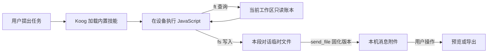

# 账本助手的内置技能、JavaScript 与文件附件

**技术方案草案，供评审。** 第一版面向 Web、Android 和 iOS。用户从现有对话提出任务，助手调用脚本查询当前账本，在本地加工数据，将成品作为消息附件发给用户。本文的 API、容量与超时参数均为拟议值，运行时适配尚未验证。

## 用户会看到什么

例如，用户说「把最近三个月的餐饮支出导出成 CSV，分币种列」。助手查明分类与时间范围，用账本的汇总口径生成文件。聊天中出现「运行脚本」工具行和一张 CSV 附件卡。点击工具行，在现有底部面板查看代码、读取了哪些账本数据、生成了哪些文件或哪里报错；点击附件可以预览或导出。第一版支持 UTF-8 CSV、Markdown 和纯文本。手机和桌面共用这套交互。

用户随后说「根据刚才那份 CSV，再做一份 Markdown」。助手可以继续使用本段对话的临时文件。临时文件已回收时，仍可读取本段对话先前发出的附件，生成新版本。第一版只包含系统内置技能，文件流向为助手发给用户。已有记账操作沿用逐笔授权卡。



## 技能和工具如何接入现有助手

第一个内置技能建议命名为 `ledger-analysis-export`（账本分析与导出）。`SKILL.md` 说明何时使用汇总、何时遍历明细、金额和多币种的处理规则；随包附上只读 SDK 参考、一个 CSV 示例、一个 Markdown 示例。系统提供名称、用途、版本，模型按需加载说明和示例。新增报表通常只需要调整本轮脚本。技能版本随客户端发布，固定的技能目录和资源路径由构建生成。[Agent Skills 目录与渐进加载规范](https://agentskills.io/specification)

| 新增模型工具 | 输入及结果 | 执行位置 |
|---|---|---|
| `read_skill` | 输入内置技能 ID，可选资源名。返回该版本的说明或登记过的示例 | 客户端的只读资源目录 |
| `run_script` | 输入 JavaScript 函数体和可选 JSON 参数。返回有界的 JSON 结果、已提交的输出文件引用或分类错误 | 设备上的隔离运行时 |
| `send_file` | 输入一次成功运行返回的文件引用，含文件版本。返回附件 ID、名称、类型、字节数，发出一张附件卡 | 当前对话的消息存储 |

脚本可以直接使用 `fs`，因此模型也能用短脚本列目录、读文件。上述三个工具加在现有五个查询工具和一个待授权写工具旁，共用现有 Koog 调度、流式调用组装和工具详情。同一回合仍按顺序解决工具调用。运行时只执行完整且通过宿主校验的代码参数。

当前推理后端固定生成系统指令、工具目录并校验工具名。建议请求增加可选能力标识，例如 `assistant-skills-v1`，服务端从已知目录中选择与客户端共同支持的版本；旧客户端获得原工具集。生产构建、流式和普通响应共用同一份工具名和参数契约。客户端保留独立的宿主校验。客户端不能上送自定义系统消息、工具定义或技能包。模型推理沿用现有已登录代理，执行脚本无需新增服务端接口。

## JavaScript 可以使用什么

每次 `run_script` 都有独立的 JS 上下文。宿主注入 `input`、`ft`、`fs`、`csv`；代码可使用标准 JavaScript、Promise 和异步迭代。跨轮保存的是文件，JS 全局变量只活到本次调用结束。

| SDK | 建议合同 |
|---|---|
| `ft.accounts.list()`、`ft.categories.list()` | 返回与当前账号、工作区和既有目录口径一致的账户及分类数据。 |
| `ft.transactions.summarize(filter)` | 返回账本版本及 `months[].currencies[]`，包含月份、币种、收入和支出。金额为精确十进制字符串。 |
| `ft.transactions.list(filter)` | 返回异步迭代器，宿主按游标逐页读取。首批取账本版本，后续页沿用预期版本；版本失配抛出错误，整次运行的临时写入作废。 |
| `ft.transactions.get(projectionId)` | 返回现有流水详情及组成记录，使用相同的敏感字段裁剪。 |
| `fs.list()`、`fs.readText(refOrPath)`、`fs.writeText(path,text)`、`fs.remove(path)` | 读写当前对话的临时文件；宿主也接受当前对话已发出的附件引用作只读输入。输出文件使用相对路径和宿主签发的版本引用。 |
| `csv.stringify(rows)`、`csv.parse(text)` | 确定性处理 UTF-8 文本、引号、逗号与换行。结构化导出按列处理金额和文本，用户录入的文本写入表格时防止被解释为公式。 |

`ft` 只开放上述读能力。共享宿主适配层调用现有 `LedgerLocalReader` 和 `client-operations`，复用日期边界、时区、退款、待确认流水、分页和精度规则。普通查询工具与脚本分别消费展示字段、业务字段。一次报告中涉及多次账本查询时，宿主固定首次读取的版本，并在读取及提交输出前核验；无法证明同一版本时返回 `ledger_changed`。无本地账本事实返回数据不可用，空结果才返回空集合。

示例中的 `input.filter` 由助手填入已解析的日期、时区和真实分类 ID。SDK 过滤字段与现有查询工具一致，例如 `date_from`、`date_to`、`time_zone_id`、`category_id`。CSV 采用明确列顺序，支出沿用原十进制字符串。

```js
const { months } = await ft.transactions.summarize(input.filter);
const rows = [["月份", "币种", "支出"]];
for (const { month, currencies } of months) {
  for (const { currency, expense } of currencies) {
    rows.push([month, currency, expense]);
  }
}
await fs.writeText("餐饮月报.csv", csv.stringify(rows));
return { dataRowCount: rows.length - 1 };
```

宿主在运行成功后把已提交文件的引用附到工具结果。模型据此调用 `send_file`。原始数据从设备上的账本进入运行时；显式返回的摘要或其他有界结果会随下一次推理发给模型。因此文件字节、查询明细和日志不自动拼入提示。详情面板可以展示脚本源代码、方法名称、页数、耗时和错误位置；生产诊断只记录错误类型和计数。技能示例默认返回统计值及文件引用。

## 三端运行时与权限

推荐先验证 QuickJS。Android、iOS 优先试用 `quickjs-kt` 的原生绑定；Web 在单独的 Web Worker 中加载随应用发布的 QuickJS Wasm，通过异步消息向 Kotlin 宿主调用 `ft` 和 `fs`。绑定和引擎修订固定在构建依赖中。共同 SDK 由一份定义和同一组样例约束。现成绑定是否能满足三个目标，应以锁定的发布产物实测。[quickjs-kt](https://github.com/dokar3/quickjs-kt) · [quickjs-emscripten](https://github.com/justjake/quickjs-emscripten) · [QuickJS 资源限制与中断](https://bellard.org/quickjs/quickjs.html)

首轮候选固定为原生 `quickjs-kt 1.0.19` 和 Web `quickjs-emscripten 0.32.0` 的标准 QuickJS 变体。前者的 Maven 制品覆盖 Android 和 iOS，未发布 wasmJs 目标。两者内含的 QuickJS 修订不同，先验收本项目使用的语法、Promise 调度、编码、内存限制和中断合同。若存在影响结果的语义差异，再评估将 Web Wasm 对齐同一 C 源码版本的维护成本。Web 桥通过宿主 Promise 回送结果，显式驱动 QuickJS 的待执行任务；与原生协程一样，运行超时后须丢弃旧任务的回复。[原生发布元数据](https://repo.maven.apache.org/maven2/io/github/dokar3/quickjs-kt/1.0.19/quickjs-kt-1.0.19.module) · [原生绑定 API](https://github.com/dokar3/quickjs-kt/blob/v1.0.19/quickjs/src/commonMain/kotlin/com/dokar/quickjs/QuickJs.kt) · [Web 发布包](https://www.npmjs.com/package/quickjs-emscripten/v/0.32.0)

每次执行绑定服务地址、账号、工作区、对话、调用 ID 及当前会话有效期。授权和路径解析在 Kotlin 宿主执行，切换账号、注销或删除对话后拒绝迟到回调。JS 只得到普通值和已登记的方法，无法取得会话令牌、数据库、网络、DOM、系统目录及任意模块加载器。宿主校验相对路径和附件归属。文件内容、账本备注始终作为数据处理。记账继续使用原来的 `create_transaction` 授权卡。

建议试验初值为每次运行 **32 MiB JS 堆、10 秒执行期限、4 KiB 显式返回值**，每文件 **2 MiB UTF-8 内容**，每对话 **16 MiB 临时空间**。宿主对代码、桥接请求、每页数据及写入字节做独立计量，脚本创建超限输出时报错。超时同时终止 JS 和待处理的宿主调用；Web 可终止 Worker，原生需验证能中断同步计算。超时或取消后重新开一轮应可正常运行。这些数值用于压测调优，与模型使用配额无关。

iOS 还需单独核对 App Store 发布边界。Apple 2.5.2 涉及执行会引入或改变应用功能的代码。本设计限定为应用内既有账本分析用途，但模型生成的脚本在设备执行能否获审属于发布风险。技术验证和商店判断分别记录；若有冲突，再和你确认 iOS 的产品选择。[Apple App Review Guidelines §2.5.2](https://developer.apple.com/app-store/review/guidelines/#software-requirements)

## 临时文件、消息附件与恢复

**第一版使用逻辑文件系统。** 现有对话已按服务地址、账号、工作区隔离保存在本地数据库。建议在同一数据库中按对话保存 UTF-8 文件内容，作为独立行，消息 JSON 只增加带默认值的可选附件元数据。历史列表只读消息和附件元数据，用户预览或导出时才读取内容。第一版处理文本即可验证整条链路，Native 与 Web 共用相同的文件系统语义。

| 对象 | 寿命和一致性 |
|---|---|
| 临时文件 | 以对话 ID、规范路径和版本定位。一次脚本的修改先暂存，脚本成功才原子提交；同名文件被其他运行改写时报版本冲突。建议整段对话的临时目录闲置满 24 小时后清理，启动、恢复前台和应用活跃时定期执行；活跃任务持有有期限的租约，崩溃后可回收。 |
| 消息附件 | `send_file` 校验归属及版本，将内容固化为独立附件。附件、对应工具消息与发送收据用同一数据库事务提交，采用现有对话版本校验。后续脚本可以读附件副本，修改或回收临时文件不影响已发版本。 |
| 执行与发送收据 | 以对话 ID 和原工具调用 ID 去重，核对参数。重复提交相同已完成调用时读取既有结果。遇到同一 ID 携带不同参数时拒绝。重试推理产生新调用 ID 时，若仍属同一原始用户消息且文件版本相同，以“用户消息 ID、文件版本”复用原附件；下一条用户消息中明确再发可产生新卡。手动重试沿用已有 delivery 的消息身份。 |
| 删除和导出 | 删除对话时同一事务删除临时文件、附件和收据；用户已导出的副本由用户管理。设备或浏览器存储被清除时，随本机对话一并清除。使用项目已有的 FileKit，原生端接系统保存，Web 接下载。 |

实现上需要调整当前 Koog 回合「用本轮消息覆盖快照」的更新方式，使已提交的附件事件按调用身份合并。进程在提交之后、模型收到收据之前退出时，再次打开对话必须能看到该附件；不会出现第二份附件，也不会自动重新推理。存储不足、文件已过期、版本改变时返回具体原因，不显示成功卡。若引用已过期但存在之前发出的附件，可由脚本显式读取该附件并重新生成。

附件卡使用本机登记的 A2UI 组件，放在对应回复的内容流中。预览 CSV 使用有行数上限的只读表格，Markdown/纯文本按安全文本展示，预览不自动取远程资源。用户点击导出后才打开系统保存界面；取消导出仍可在对话中重新打开。

## 实施顺序与验收

1. **运行时验证。** 同一段脚本在 Web、Android 和 iOS 调用一次异步宿主查询并输出字节相同的中文 CSV。验证精确金额、异常、同步死循环、等待宿主超时、取消后的迟到回调、界面响应和下一次运行恢复。记录实际依赖版本、安装包及 Web 首次加载增量、耗时与峰值内存，再决定采用哪个绑定。
2. **接通一次导出。** 登记技能与工具版本，通过现有 Koog 推理回合从用户请求走到真实账本读操作和文件卡。用三个币种、跨月时区边界、退款、超过一页及运行中版本变化的样例，对照已有账本结果。确认只读成员也能分析；脚本无法越权记账。
3. **验证附件交付。** 在临时文件提交前后、附件事务前后和推理响应丢失处模拟中断。核对重试、刷新、第二标签页、不同账号和工作区、回收、删除、导出取消和低空间失败。旧对话仍可阅读，旧客户端与新服务端的工具协商保持兼容。
4. **演示验收。** 做一份 CSV 月报，再基于原文件生成 Markdown。回收临时目录并刷新后，打开两份附件并生成第三份。检查实际 Web 交互、三端 SDK 一致性和各端导出的字节。试验和后续正式实施分别汇报。

**本轮请评审的选择**：首批实现一个分析与导出技能；脚本直接使用只读 `ft`；文本文件采用本机数据库暂存，发出后成为对话附件；先验证三端 QuickJS 运行及中断能力。现行产品行为以既有规格为准，待评审后再形成实施任务。
