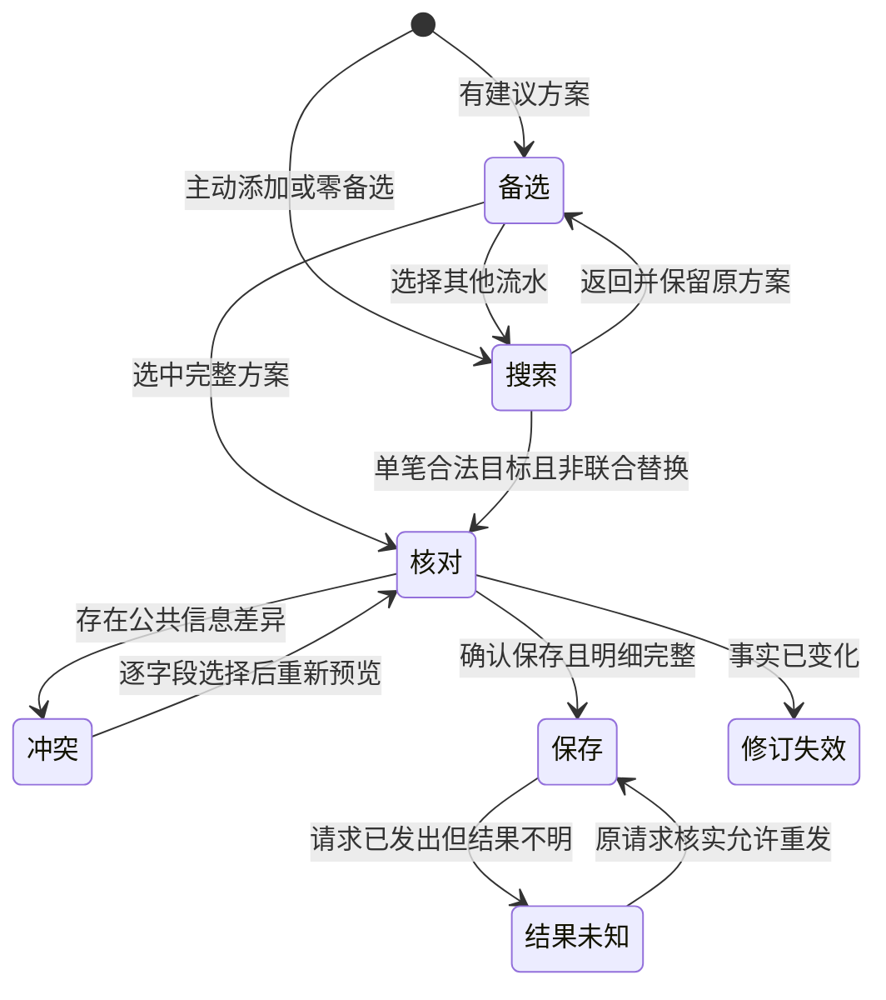

## Context

已确认的本机 HTML 原型为 v6。现有共享实现已具备正文关联／原文和搜索接口，但核对可能自动写入、选择与提交阶段混杂、失败后重复读取、部分子类型丢失及明细缺失仍可提交。本轮只改共享展示、状态及测试，复用既有维护协议、查询和完整关系模型。

## Goals / Non-Goals

以“核对这笔收支”为主任务，依次呈现基础信息、真实待处理事项、其他关联流水、账单原文。删除重复当前成员摘要、关系类型分组标题、悬空的管理关联入口及逐字段平铺的原文段落。新增搜索在一个弹窗中按“搜索 → 选流水和关系 → 核对效果 → 确认”切换，底层详情保持原位。功能边界和非目标以 proposal 为准。

## Decisions

### 原文归属与建议操作

当前成员以打开详情时的稳定 `transactionId` 判定。非当前成员的标签来自其实际已确认关系；同笔支付、退款、转账及还款等子类型统一为中性只读标签。一个成员可有多个标签，不以聚合类型摘要推断归属。直接消费 evidence 已有的关系端点，避免为标签逐成员请求。最终 DTO 增补所需字段，不把“只读角色标签”当作可点击筛选 chip。

| 后端情况 | 展示与操作 |
|---|---|
| 单个完整可接受方案 | 详情入口“接受建议”，进入统一弹窗，可改选或搜索其他流水 |
| 多套方案 | 详情仅给“核对建议”，完整备选移到弹窗单选，并可搜索其他流水 |
| 无可接受方案 | 系统已检测到很可能存在关系，但未找到另一边；提供“核对建议”进入同一弹窗自行搜索选择，未选中合法流水前不能保存 |
| 必须联合成立 | 一个方案列全实际成员和所有关系；整体预览和确认 |
| 公共人工值冲突 | 只询问实际冲突字段及明确清空；重新预览 |
| 旧选择失效 | 清除旧选择，提示刷新；不自动改选 |
| 已确认／已拒绝／已移除 | 已确认放实际关联区；其余不继续作为候选提醒 |

用户可见标题统一为“关联建议”。0 到多个备选走同一弹窗流程，始终支持搜索备选之外的导入流水；只有实际选择合法方案后才能继续保存。界面仅提供 `allowed_actions` 中有实际影响的操作，`ignore` 显示“拒绝建议”；不显示或提交“暂不处理”。返回或关闭不产生关系决定，建议保持待确认；`defer` 仅保留为兼容的内部待确认表示。无候选时不凭空解释为未导入。方案信息须新增明确关系列表，不能把首条边的类型赋给全方案。

### 主动搜索与事务

解除时只对实际生效、与拆出流水原有值不同的人工覆写询问是否保留，列出全部修改字段及当前值；清空以明确的空值文案表示。无人工覆写或覆写后同值时不询问，也不要求用户填写无影响的继承决定。由服务端返回实际差异，客户端不只凭 manual_fields 非空推断。保留／恢复原值均只影响可编辑公共信息，不改写账单原文。

新增工作区内实际导入流水查询合同，支持关键字、账户、日期和金额；按实际成员返回并分页，不使用当前账本投影列表冒充流水搜索。不合格目标可见时显示具体不可选原因；跨工作区和手动流水不返回。选中具有多现金部分的记录时，在确认关系前明确其涉及部分，不能静默选择第一部分。

新增关联进入共享维护的预览／提交管道，不能恢复旧直接写接口。客户端提供选中流水、关系及适用子类型；服务端根据当前事实建立完整计划，重验双方资格、来源证明、财务不变量、必要关系组、公共值冲突及权限。手动关联不要求自动匹配的时间窗口或候选置信度，但不能凭用户点击伪造退款来源证据、方向或类型。任一非法输入停止当前操作，给出明确错误，不保存部分关系。

最终写入在同一 Application Service 事务中校验预期修订、保存关系与人工决定并刷新收支结果；原始账单字段和金额不变。复用现有命令幂等键与结果核实，未知结果不重发新命令。只按真实修订失败提示刷新，不自动重放选择。使用现有关系持久化及证明结构，实施阶段先以失败契约验证其可表达性；若需要迁移，先回写设计，不先改 schema。SQLite 与真实 PostgreSQL 必须跑同一契约矩阵。

### 视觉与跨端

应用 `$compose-material3` 与 `$hallmark`：沿用 Git 深色 token、FinanceTheme、现有字体和 M3 Expressive 层级；不新造配色、组件包装或固定控件尺寸。关联成员独立容器，候选用标题和选择态区分，不只靠虚线；只读标签与操作按钮具有明显不同优先级。原文用对齐键值表，单号允许换行、金额采用等宽数字；保留正常业务文字，不显示模型术语。

已确认原型为 `compose/qa/local-evidence/prototypes/cash-record-detail.html`，Git 忽略；顶部摘要只作既有布局示意。原型场景切换器与合成数据提示不属于产品界面。添加、解除、候选确认及公共值冲突在详情上方打开一个模态弹窗，后续步骤在同一弹窗内切换；不替换底层详情。取消关闭弹窗，只有保存成功才刷新底层详情。此为用户明确要求，优先于原规格不叠加 Dialog 的约束。原型确认后，用 Compose Material 3 保留流程、结构与样式的业务含义，不要求像素复刻。

官方正文已用真实浏览器阅读：Chips — Overview / Specs（标签与可操作 chip 区分、选择反馈与柔和边界）；Search — Overview / Specs（搜索字段下方列表、明确选中态、适配窄窗）。其他直接涉及的官方主题及原型审查证据在 tasks 完成后更新；未阅读项不宣称通过。

Cross-platform Impact Check：Web、Android、iOS 与共享状态／DTO 均受影响；详情 COMPACT 使用全屏单列，REGULAR/WIDE 保持现有右侧面板；搜索弹窗在 COMPACT 全屏、REGULAR/WIDE 使用 Basic Dialog，移除确认使用相称的 Material 3 提示对话框。语义标签、字段、操作、错误和结果一致；默认 Web 真实冒烟，Native 相称编译和单测，不默认设备 QA。

## Risks / Trade-offs

- 自由搜索放大错误关联风险 → 完整预览、明确类型与服务端财务校验，不扩大可接受输入。
- 多边方案不能安全逐卡解除 → 入口贴近成员，确认展示实际完整作用范围。
- 与 `compose-cash-ledger-maintenance` 存在范围重叠 → 本变更拥有新增搜索及新的详情表现；旧维护 change 继续完成原合同，本变更 delta 在归档时保留其已同步合同并一并复核冲突，不先改写旧 change 的验收。
- 旧规格要求折叠、旧 UI 规范不要求原型，与本轮 AGENTS 及用户决定不一致 → delta 明确两个普通标题区域均无折叠状态及 HTML 已确认，遵守 AGENTS；收尾核对 UI 规范，不据旧条款跳过原型。

### 原型一致性修正

关联建议中单个备选方案的每笔对侧流水，复用已有关联流水的基础信息内容：对方与金额同行、类型与时间次级行，以及账户、适用子类型、分类、来源、对方账号及其属性、带“备注”标签的备注和多现金部分。不同对侧流水以分隔线区分，不嵌套卡片；操作置于完整信息下方，避免压缩字段宽度。多个备选仍只在正文显示数量，在“核对建议”弹窗中选择，零备选继续显示按关系类型说明的搜索提示，不把未知流水当作真实数据。已有关联流水的备注同样采用标签和值分列布局。只调整展示，不改关系选择、搜索或保存规则。

“添加关联”弹窗正文最上方、搜索框之前使用 Material 3 `SingleChoiceSegmentedButtonRow` 和 `SegmentedButton`，单选“同笔支付／退款冲销／个人转账”，复用原有默认关系和提交参数。删除原先仅在选中流水后出现的同组单选项；适用子类型与现金部分选择仍在需要时显示。选择状态与禁用语义使用 Material 组件，不添加依赖或固定控件尺寸，Web 与 Native 共用。

正文添加入口按已确认原型 v6 使用“关联流水”和加号图标；每笔对侧流水的“移除关联”使用断链图标；详情底部“编辑”使用编辑图标。建议操作中，“接受建议”和“核对建议”使用勾选图标，“拒绝建议”使用叉号图标。使用现有矢量资源及 Material 3 按钮默认图标尺寸、间距，图标只作辅助，始终保留文字，不重复朗读装饰图标。

保留现有后端及共享维护流程、紧凑筛选、具体建议摘要、原文卡头和弹窗标题。有备选时，“接受建议／核对建议”弹窗初始只展示完整建议备选，下方提供“选择其他流水”；此阶段不展示搜索、筛选或其他流水，也不发起搜索请求。单方案默认选中且不渲染 radio，多个方案以 Material 3 单选按钮整体选择；方案内复用只读账单表格／COMPACT 卡片，不显示逐笔复选框。点击“选择其他流水”后，在同一弹窗内切换为手动搜索，隐藏建议备选；关键词、账户、金额和单日日期变更后更新实际流水结果，只能单选一笔对侧流水，沿用建议的关系类型及适用子类型，不再展示类型选择。仅主动添加关联提供类型选择。搜索页提供“返回建议备选”，保留原方案选择，返回不发送决定；搜索所选流水仅在继续核对时提交。无备选时直接进入手动搜索，提示“这笔流水可能有关联流水，请搜索并选择对应流水”，不提供返回空备选的入口。添加关联仍直接进入带关系类型选择的搜索页。单备选正文展示对侧摘要，多备选正文展示数量，无备选按实际关系提示要核对的对象；服务端不允许接受时不展示可接受动作。

桌面选择承载现有账单表格，采用按可用窗口宽度布局的数据选择 Dialog（上限 1120 dp），不再把表格压入 560 dp 的 Basic Dialog；有限桌面宽度下只允许表格区域横向滚动，表头和行共用滚动位置，不压断金额。此项来自用户追加的表格复用和本轮修正要求。移除／拒绝及结果确认仍使用 Basic Dialog 的 560 dp 内容结构。COMPACT 全屏单列，标题及底部操作采用项目 56 dp 测量，正文滚动；流水仍使用既有卡片，无横向滚动。

原文多成员卡头以“对方／只读标签／金额”同一行组织，下一行时间和账户，随后分隔原始字段；窄窗或文字放大时仅标签组自然换行。标签形状和颜色统一，使用轻描边。单号类字段采用等宽字体；键值行沿用原型的紧凑层级和可换行值，不重复单成员摘要。关联卡把类型及时间放在次级行，账户等核对字段以键值行呈现。最终核对以同场景、同主题的真实页面截图和实际操作为准，控件存在断言不作为原型一致性结论。

### 搜索选择及接口实施合同

弹窗通过现有 CashLedgerRowContent／CashLedgerRow／CashLedgerTableHeader 渲染实际流水；桌面保留表格字段和选择行为，COMPACT 沿用流水卡片，不复用账本投影查询来冒充实际流水搜索。搜索按当前工作区返回导入记录及明确修订、现金部分，支持关键字、账户、日期、金额及分页。新增只读 `GET /api/v1/cash-records/{transaction_id}/association-targets`。

维护预览 `maintain_relations` 扩展 `relation_additions`（目标流水及修订、两端现金部分、kind/subtype、公共字段决定），与已有 candidate_id 选择分开编码；服务端生成关系和证明并重验完整图。不接受客户端提交角色、证明、金额或状态。新增组与 current 组在同一事务分别交给对应 writer，人工非法输入直接拒绝，不转成 skip。解除返回服务端计算的 `split_field_diffs`，比较实际拆分结果恢复值与当前人工公共值，只对实际不同的字段询问。现有数据库结构可表达，不预设迁移。

## Migration Plan

先确认原型，再测试驱动后端合同与共享 Compose 实现。现阶段不更改运行数据库。上线前完成双后端矩阵、权限和幂等专项检查；回滚可禁用新增入口并恢复兼容只读展示，保留已确认关系和原文。本轮前端修复已有本地提交授权；推送和部署仍须具体授权。

### 建议操作与关系提醒

关联建议的操作组靠右排列：左侧为 error 色、无边框的“拒绝建议”文字按钮，最右侧为有边框的“接受建议”或“核对建议”，保留叉号／勾选图标和文字。当前流水存在 active 且 draft 的已保存关系时，在关联流水标题前显示原型中的警示提示：“关系待确认”“这笔收支有已建立的关联等待确认”。提示仅保留标题和说明，不含按钮或定位操作；确认或拒绝从下方关联建议进入既有弹窗。无待确认关系不展示该提示，不将已确认／移除关系或单纯人工添加入口当作提醒条件。共享 Web／Native 行为一致，继续使用现有 warning token 和 Material 3 控件。

### 提交前复核修正

公共信息冲突是关联预览后的独立弹窗阶段，不能由 selectionPlan 的真假决定是否可编辑；只有实际接受或新增决定引发冲突时进入该阶段，仍须选择完所有冲突值后重新预览。每个可清空公共字段提供“清空”，保留空文本、null 或空数组的真实字段类型；保留决定及候选引用，不发送 defer，不修改原始账单。搜索日期按设备本地时区解释并显式传递时区。完整方案与每套备选传递全部关系的种类、子类型和端点，界面按真实摘要展示，不依赖首条边；选择和提交仍以完整方案为单位。

## 原型 v6 实施合同

信息顺序为既有摘要、关系待确认提示、关联流水（只列对侧）、关联建议、添加入口、账单原文。删除正文备选控件、折叠状态、重复当前摘要和 defer 操作。采用现有 token、Material 3 Surface/Card、文字／描边按钮及单选分段按钮，不重新设计配色或包装输入控件。Hallmark 预检采用原型的信息层级：身份标签中性、危险操作文字色、建议确认描边、最终保存主按钮；最终以真实页面 audit 对照。预检评分 P5/H4/E4/S5/R5/V4，执行质量须浏览器核对后判定。

单方案预选且无 radio，多方案方案级单选，成员仅复用只读账单表格／COMPACT 卡片。返回保留原方案及搜索条件，清除尚未核对的手动目标。建议内只读显示完整 kind/subtype；主动添加才显示关系分段及子类型选择。退款支持普通退款和转账退回；个人转账保留现有四类子类型。联合方案依据真实关系列表识别（多边或多种关系），搜索页保留入口和警示，禁止继续核对／保存，ViewModel 同样拒绝绕过；不以第一条边替代整组含义。

无参 `beginRelations()` 作为现有账本入口的只读建议发现，按当前流水修订最多尝试一次，结果独立存放于共享状态，不保留编辑计划；显式 `beginRelations(patch)` 才开始弹窗选择。这样不修改账本入口，也不会因取消或失败自动重试、隐藏编辑。取消只清未发送的弹窗计划，保留已发现建议；刷新详情或实际修订变化才重新读取。维护预览不自动提交任何关联决定；其他既有编辑行为保持不变。回到选择时显式清除未提交计划，不重放上一步决定。

移除逐字段列出 current/restored 的全部真实差异，再统一选择一个 `inheritCommonFields` 布尔值；无差异不传此决定。完整组影响和拒绝整条建议文案在各自独立确认视图展示，确认视图内先加载真实维护预览，最后一次明确确认才保存，不再新增核对步骤。公共冲突使用 selectableGroup 和逐字段 RadioButton，清空保留字段类型。预览汇总必须包含实际决定及所有关系／成员，即使 `additional_effects=[]` 也有明确关联结果；additional_effects 缺失、无法解析影响对象或决定成员未读全时禁用确认，ViewModel 同样校验。

结果未知使用既有 frozen command、recovery store 及核实接口，不生成新键；关闭关联弹窗只隐藏视图，保留底层核实入口和冻结命令。修订失效不自动重试，提供关闭并显式刷新详情。弹窗继续沿用现有外框、关闭手势、宽屏表格与 COMPACT 全屏合同；步骤标题、正文和底部操作在同一容器内切换。

官方依据：Android Developers《Segmented button》正文已读，采用 SingleChoiceSegmentedButtonRow、itemShape 和 selected 默认语义。M3 Dialog、Segmented buttons、Radio button 的 overview/specs 已通过真实 Chromium 加载并阅读正文；采用单任务弹窗、动态高度、默认触控区、单选语义及选中反馈。Segmented buttons 在 Expressive 中建议改用 connected group，但本轮按用户明确指定保留现有分段控件，不升级依赖。当前 Material3 1.12.0-alpha03，不引入或升级依赖。Web、Android、iOS 的状态、资源和语义 ID 共用；仅 Web 执行真实浏览器，Native 编译和单元测试，不默认设备 QA。

## 走查问题修复与本次提交边界

保留原型 v6 和全部既有澄清，不重新设计页面。冲突步骤不能覆盖选择页的返回目标；处理冲突后返回仍回到原方案或搜索，并保留原方案选择。两端多现金部分使用明确的当前／对侧标题，选项同时显示账户、适用名称与金额，行与单选按钮共享点击语义，不能只给等额金额。

任何实际关联决定的核对都显示计划内全部保存后收支，不以 additional_effects 是否非空裁剪结果。拒绝和移除的确认页在用户确认前自动读取只读预览；有实际拆分差异时，选择统一保留／恢复后重新预览，当前选择与预览不一致时不能确认。最后点击“确认拒绝／确认移除”提交已核对计划，取消不提交。不得把通用预览改为自动写入。修订变化仍显式刷新，未知请求仍核实原键。

用户已授权修复以上走查问题后直接本地提交到当前 average-snail 分支；不包含文件名修复与旧 React lockfile，不推送、不部署。对照失败回归、共享全量测试、Wasm／Android／iOS 构建、真实 Web 冒烟及截图、Hallmark audit 和独立复核后提交；仅有菜单截图不能冒充子类型提交流程通过。

独立复核复现多组冲突串入：核对仅消费本次接受建议的冲突；主动添加按 kind/subtype 及两端实际成员匹配其动态计划组，保留真实新增冲突，不消费其他待处理建议。增加双组隔离和动态新增组回归后重审。
