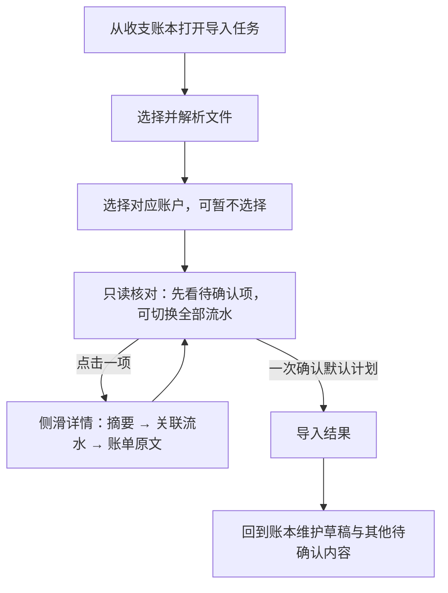

## Context

入口 `App.kt`／`AppShell.kt` 保留账本主体，并在导入任务打开时挂载全屏模态 `CashImportTaskScreen`。生命周期客户端、任务与账户 ViewModel、最小恢复存储和实际收据已接通；本轮重写展示层，并扩展导入计划只读分页接口以支持主页同款序号定位。现有核对列表已经复用 `CashLedgerTableHeader`／`CashLedgerRow`，真正可复用的详情宿主是 `CashLedgerDetails.kt` 的 `CashRecordModalPanel`：Regular/Wide 为右侧模态面板，Compact 为全屏页面。

行为输入为 [导入流程](../../../../docs/cash-import-flow.md) 与 [客户端合同](../../../../docs/cash-import-redesign-contracts.md#2-用户业务流程)。公共账本组件和侧板由维护变更所有，本轮不修改账本主页或导入后的维护能力。导入计划增加只读 `start_index` 页读取及筛选结果 `total_count`，继续支持原 `cursor` 客户端；页面用现有 Paging3 与 `CashLedgerScrollbar` 实现绝对序号跳转。

## Goals / Non-Goals

把文件选择、来源账户映射、待确认优先的只读核对、一次确认和实际结果组织成清晰、克制、可扫描的共享任务。完整候选成员、来源差异、处理原因和原文仍可检查；字段与关系决定采用服务端默认值，后续在账本维护。

不改导入财务算法、账户命令状态机、恢复存储、解析规则、数据库结构或性能预算；不增加双栏、独立详情页、导入内编辑器、问题中心或新依赖。只读计划 API 增加 `start_index` 与分页范围元数据；账户映射复用现有账户 CAS／收据命令，将选中目标所需币种合并补入其账户。

## Decisions

### 用户界面用语

用户界面不直接使用数据模型或处理过程的内部名称。列表中的项目称“一笔收支”或“收支记录”；详情中的实际来源成员称“关联流水”，来源字段称“账单原文”。账户步骤标题为“选择对应账户”，账户选择器称“对应账户”；提交后的页面称“导入结果”。预计列表和实际结果要用词区分。错误说明使用用户能理解的处理环节、账单文件和记录位置；完整异常细节只用于服务端诊断。

### 用户流程与信息架构

导入是从账本打开的 Material 3 Full-screen Dialog，不作为顶级页面。保留 `/cash-import` 兼容地址与恢复入口，外层标题和主体仍为账本；模态打开时后台不可交互。关闭、Escape、系统返回统一经过现有 `requestExit`，保留提交冻结、结果未知和独立账户改动保护。详情及账户表单继续在其上方按需打开，Escape 只作用于最上层。

按用户要求覆盖当前可用视口，采用无圆角表面、56 dp 标题栏、左侧关闭、24 dp 正文留白、56 dp 底部操作区；窗口安全区另行避让。宽屏保留账本表格，单项文件／账户表单维持 720 dp 上限。Material 3 规格表的 560 dp 宽度上限不用于此跨尺寸导入任务的外层容器：此处按用户明确要求保持全屏，内部信息密度沿用项目合同。删除应用顶栏中的重复导入标题、正文中的返回账本入口，结果页仍可结束并返回。

| 任务状态 | 主内容 | 主要动作 |
|---|---|---|
| 选择文件 | 添加多份文件；逐文件显示解析问题、密码重试和来源设置，行内操作收在右侧 | 解析后进入“选择对应账户” |
| 指定账户 | 对照解析出的来源账户、建议和本次选择；允许暂不选择；从各组下拉菜单立即创建新账户 | 下一步（生成核对列表） |
| 核对 | 有待确认项时默认仅显示待确认记录，提供“全部”切换；没有待确认项时自动显示全部。流水连续分页，右侧复用主页序号滚动条和相同表格；草稿与待确认关系以醒目的状态标签和底色区分，普通已确认记录不加状态标签；跳过／重复及文件问题在确认前可见 | 查看只读详情、确认导入 |
| 结果 | 实际保存摘要与待确认数量；新增异常显示统一错误和安全原因 | 返回账本 |
| 结果未知 | 已发送命令的核实状态，保留最小恢复标识 | 核实原请求 |

标题与离开入口保持唯一且可达，正文独立滚动，当前主动作固定可达。选择文件与选择对应账户分别占据当前任务，不同时堆在首屏；每步使用分隔行和就地操作。核对表格复用主页行组件；详情复用 `CashRecordModalPanel` 和共享模态头部，不重写侧板宽度、手势、键盘或 Compact 行为。详情按“摘要（含状态和字段差异）→关联流水→账单原文”排列。只有多笔实际关联流水或有候选时显示关联区，默认展开；真实成员按组展示，候选嵌在对应关系下并明确标记，导入页只读。证据不足关系使用“尚未合并，关系待确认”状态，不显示重复的通用导入错误；其他明确错误保留原有文案。单笔无候选时隐藏关联区。账单原文置于最后、默认折叠，展开显示各真实来源成员的原始字段。摘要排版和原文入口沿用维护变更提供的展示基础；已保存详情的维护操作不进入导入预览。

文件任务保留对话框标题、步骤提示和“账单文件”分区标题，删除重复的大标题“选择账单文件”。步骤导航统一使用“上一步”和“下一步”：上一步前置左箭头，下一步尾随右箭头；“添加文件”使用前置加号。三个步骤保留“选择文件／选择对应账户／核对”步骤提示；仅核对步骤在主体内容上方显示“核对本次将导入的收支和待确认内容。”，文件与选择对应账户步骤不显示副标题，以减少重复说明。三个步骤不显示额外的大标题“指定账户映射”或“核对预计结果”。文件和账户选择任务的说明与居中的 720 dp 正文列左边缘对齐；核对任务说明与铺满可用宽度的核对内容左边缘对齐。图标沿用现有资源与 Material 3 默认按钮尺寸，作为装饰图标不重复朗读，按钮文字承担完整无障碍名称。文件行的重试、来源设置和移除操作归入靠右的操作区；移除使用带明确无障碍名称及 Web 悬停提示的 `IconButton`，点击后立即从未提交会话移除，不弹二次确认。此行为只移除本次导入中的解析内容，不删除设备上的原文件或已入账记录，按用户明确要求作为通用删除确认规则的局部例外。

选择文件后，客户端立即读取并上传；服务端解析完成前，在文件列表中先显示本地名称和临时行。文件内容列最大宽度为 720 dp，进度轨道在该列两侧各延伸 24 dp，因此轨道最大宽度为 768 dp 并居中；窗口宽度不超过当前内容列宽加 48 dp 留白时，轨道铺满窗口。文件名与操作保持现有 24 dp 内容边距，轨道不能改变其布局宽度。轨道使用 `surfaceContainerHighest`，进度填充使用不透明 `primaryContainer`。假进度在固定 1.8 秒内推进到 90% 并停住，行尾在操作区前显示 Material 3 圆形 loading 指示器。服务端返回成功或部分解析结果后，进度补到 100%，短暂过渡后换成正式文件行；失败结果直接显示对应错误状态，不用进度完成来暗示成功。界面不显示虚构百分比。

本轮已通过真实浏览器读取 Material 3 `Buttons overview/specs` 与 `Progress indicators overview/specs`、`Icon buttons overview/specs` 正文。进度采用现有 `CircularProgressIndicator` 与基于主题色的行背景，不增加依赖；M3 进度规格区分确定和不确定状态，因此假进度只表示界面等待过程，不宣称服务端解析百分比。文件移除使用 M3 默认 `IconButton` 触控目标和图标语义，并在 Web 使用 `PlainTooltip`；项目实际 Material 3 依赖为 `1.12.0-alpha03`，`TooltipBox` 为 `ExperimentalMaterial3Api`，限定在本共享调用点并以 Android、iOS、Web 编译验证。

前轮已读取 Material 3 `Buttons overview/specs` 正文，采用简短操作标签、可选图标与 Material 默认状态。调用现有 `ButtonDefaults.IconSize`／`IconSpacing`，不固定按钮宽高；图标为装饰性，`contentDescription = null`，避免重复朗读操作名称。

本轮读取 Material 3 `Badges overview/specs` 正文。Badge 用于图标或导航项的短内容（最多 4 个字符），不适合“草稿”“关系待确认”这类记录状态标签；使用非交互 Material 3 `Surface` 承载文字。草稿标签使用语义警示色填充，所在行使用警示底色；关系待确认标签使用主题主色填充，所在行使用主色容器底色。标签跟随行内容排布并允许换行，不设置固定尺寸；其颜色沿用 FinanceTheme 与现有状态色，不新增 token。

详情单独实现导入专属内容，只复用主页的 `CashRecordModalPanel` 容器；阅读顺序和层级对齐主页“流水详情”：统一标题，先展示金额、对方、类型／时间次级摘要，账户、分类和备注作为无卡片字段行直接排在同一内容流中，不增加“流水信息”标题；随后以单个橙色提示卡显示必要状态和待处理原因，再显示来源差异、关联及真实成员，最后提供一个默认折叠的账单原文查看入口。预计状态为草稿时，提示卡标题为“草稿”，正文按计划项与详情中的字段路径及问题文案指出缺少内容，例如“金额信息尚未补齐”；不显示“当前不参与收支统计”，不另设“需要留意”分区。正式且参与统计的流水不重复显示状态说明。沿用主页详情的字号层级和 16 dp 区域节奏；字段行以标签和值建立清晰对齐，长备注自然换行。M3 `Grids & spacing: Spacing` 通过实际浏览器读取：相关字段用近邻和留白形成隐式分组，不再为它们增加边框、阴影或独立标题。原文入口只出现一次，保持默认折叠。长原文与长差异折叠；没有编辑 footer、保存按钮、来源采用、关系接受或候选改选。所有候选成员仍按服务端明确引用完整展示，缺失成员只报告不能自动确认，不提供导入内处理。

### 第一版 Compose 演示边界

导入核对采用待确认优先的完整计划列表。筛选选项只有“待确认 N”和“全部”；待确认数为零时自动显示全部。客户端使用 Paging3 占位分页和主页右侧序号滚动条，详情覆盖在主页相同宿主中，关闭详情后保留当前筛选及列表锚点。滚动条绝对序号跳转依赖不可变计划页读取的 `start_index` 和筛选后的准确 `total_count`；既有 cursor 读取继续兼容。未加载项由 PagingSource 按序号请求，错误提供分页重试。计划提交与当前已加载子集无关。

### 数据与状态接线

复用当前任务与账户状态机。`ImportTaskUiState.choices` 保持默认空 `ImportChoiceSet()`，账户准备的选择仍进入预览和提交；UI 不调用 `editRow`、`editEntry` 或 `editPair`，因此 `row_choices`、`entry_choices`、`relation_choices` 为空，由服务端生成默认计划。

文件集合变化回到文件或账户任务并使旧计划失效；账户映射变化会重新预览。成功响应更新计划与修订；未刷新不能确认。文件解析完成前不能进入映射，重新生成计划期间不能确认。提交时固定整份**导入计划**，冻结文件、映射、返回与重复确认操作；实际结果只由该计划对应的**处理收据**生成，不能读取提交期间的实时界面状态。

核对在待确认数大于零时默认仅展示待确认预计流水；待确认数为零时自动展示全部。把 `anticipated_state=draft` 的草稿排在前面，逐项显示缺少的字段或来源身份及已知值，不把空账户、金额或时间伪填为零或默认值。来源行可靠但金额未知时保存金额未知的草稿；只有无法安全形成草稿等真实原因才列为**导入跳过**。正式流水即使 `confirmation_status=pending` 仍单独表述，不能归为草稿，也不能仅凭待确认状态推断不参与统计；统计说明采用每项实际资格及当前关系结果。草稿、关系待确认与全部筛选只改变查看范围，不缩小最终确认范围。关闭详情回到同一列表位置并保留筛选。

草稿显示“草稿”状态，所有 `confirmation_status=pending` 的项目在“待确认 N”筛选中出现；待确认状态不一概称作关系待确认。待确认原因来自流水问题或延后关系时，行内次要说明保留对应事实；关系类型、双方来源及未合并情况只在服务端详情明确提供关系候选时呈现。已确认项及普通正式项不显示“已确认”“正式收支”等状态标签。桌面表格与 Compact 流水行采用相同语义，没有独立的顶部关系提示或直达入口。“拟确认关系”仅保留为计划内部术语，不进入界面。详情按关系类型、真实成员、识别依据、预计统计效果的顺序解释计划决定，明确最终确认前尚未生效。查看与筛选不改变默认计划或提交选择。

流水行的备注只显示 `display.note` 中从账单读取的业务字段；关系类型、双方来源和核对原因不拼入或替换备注。行内关系信息使用独立的“关联：”说明，待处理原因使用独立的“需核对：”说明；两者沿用 Material 3 `bodySmall` 与 `onSurfaceVariant`，Compact 与桌面列表保持相同字段语义。

来源记录数、预计条目数与正式流水操作数分别核对：同笔支付的多条来源可以形成一个预计条目，实际收据则分别报告新增、更新、草稿、重复、跳过和关系结果。结果页不根据预览条数或当前映射推算保存数量，也不因存在草稿、待确认关系或已知跳过而宣称全部成功。

计划页继续由不可变计划提供。账户映射自动建议按来源身份以及目标账户活动状态和类型判定，不因币种不足取消唯一建议；下一步先按目标账户汇总所有已选来源币种，使用现有账户修改命令补充缺失币种，再将最新账户修订写回全部对应来源选择并生成计划。失败留在账户步骤显示安全原因并允许重试；结果未知时使用既有账户核实入口。账户修改继续进入退出补偿链。核对默认筛选为 `pending`，若计划的待确认数为零则为 `all`；用户可切换至 `all`，筛选不缩小最终确认范围。

账户映射不再提供分区级“新建账户”按钮或“编辑账户”操作。每个来源账户的目标账户下拉菜单追加“＋新建账户”；选择后立即打开现有账户表单，预填来源账户名称、来源币种，并复用旧 Web 的类型推断：名称含“花呗”或“信用卡”时为 `loan`，其他名称为 `cash`。新建成功后返回原映射行并选中新账户；取消不改变映射。账户建议不受币种差异影响；点击下一步时按目标账户汇总所选来源组所需币种并自动补充缺项。

新建仍使用独立账户命令并立即生效；离开前一次询问撤销、保留或继续，补偿、未知命令核实、最小恢复标识和实际结果语义全部保持现状。结果与预计列表分开，不用新增数量推断提交是否成功。

账户类型选择沿用现有 M3 暴露下拉菜单及菜单项语义，不增加包装组件或依赖。本轮读取 Material 3 `Menus — Overview` 与 `Menus — Specs` 正文；标准菜单项保留默认焦点／悬停／按压状态和 48 dp 触控高度，“＋新建账户”作为普通菜单选项呈现。

### 响应式与组件合同

390、768、1440 px 保持文件、账户、核对的信息顺序与操作语义。Compact 为单列表格行和全屏详情，Regular/Wide 为完整表格和右侧详情；768 不另造双栏。窄屏无横向页面滚动，账户表单最大宽度保持 720 dp。

详情顺序为摘要（金额、无卡片核心字段行、状态和来源差异）、关联流水、账单原文。关联流水仅在多笔实际成员或存在候选时显示，默认展开；实际成员按组展示，候选嵌入对应关系并明确标注。单笔无候选时隐藏关联区域。账单原文最后出现、默认折叠，展开显示真实来源成员的原始字段。导入摘要和字段行保持与主页详情相同的层级与 16 dp 区域节奏。核心字段不放进卡片，也不增加重复分组标题；值与标签对齐，窄屏可自然换行。桌面侧板最大宽度 400 dp，分离留白 16 dp，正文左右留白 24 dp；Compact 全屏标题栏为 56 dp。表格由可聚焦的详情按钮提供键盘入口，数字使用表格数字；筛选用带 `aria-pressed` 的连接按钮组，不模拟不完整的 tab 键盘语义。支持 Escape、焦点恢复和减少动态效果。

`CashImportReviewList` 复用主页行组件和 Paging3 `CashImportItemsPagingSource`；后端按 `start_index` 返回指定筛选下的稳定计划切片和准确 `total_count`，保持 cursor 读取兼容。右侧复用 `CashLedgerScrollbar`，Regular/Wide 常显、Compact 沿用主页的交互后短暂显示行为；快拖按序号定位，实际项尚未载入时由 PagingSource 请求对应页。列表只提供“待确认／全部”筛选；有待确认项时默认 `pending`，待确认数为零时自动 `all`。`CashImportPreviewPanel` 改为纯只读内容并删除编辑回调；`CashImportRelationEditor` 在确认无其他引用后删除，`CashRelationTreatment` 等账本维护组件保留。导入账户表单只响应来源组下拉菜单中的新建选项，预填名称、推断类型及来源币种；下一步按账户聚合缺少币种并调用现有独立账户更新命令一次补齐，每组回填该目标最新修订。更新失败保留账户步骤；未知操作仍走账户收据核实。账户更新进入既有退出补偿链，映射内不开放已有账户编辑。

### Hallmark 方向与应删除内容

沿用 FinanceTheme、Noto Sans SC、IBM Plex Mono、4 dp 网格和少动效，按用户确认的页面方向保留外观并重做信息与操作布局。三个连续任务中，核对列表沿用主页行、Paging3 与序号滚动条；Regular/Wide 在右侧详情面板打开单项，Compact 切入全屏详情，返回保留滚动位置和筛选。关键字段保持可见并按业务分组，不用展示原型或合成数据替代真实 Compose 页面；只在开发／QA 演示模式使用仓库已有合成数据。

本轮用真实 Chromium 重新读取 Material 3 `Dialogs overview/specs` 正文，采用单一任务、无圆角、56 dp 标题／底栏及 24 dp 留白；Dialog 使用已有 commonMain `DialogProperties(usePlatformDefaultWidth = false)`，不新增依赖。已阅读 Material 3 官方 `Side sheets overview/specs`、`Dialogs overview/specs`、`Lists overview/specs`、`Segmented buttons overview`、`Button groups overview/specs`、`Progress indicators overview/specs` 与 `Typography — Applying type`。M3 Lists 将列表定义为连续纵向索引，要求按逻辑顺序排列并用一致格式支持快速扫读；Canonical layouts 的 List-detail 模式支持在列表旁查看单项详情。滚动条沿用主页既有组件，不另造滚动条视觉或交互。步骤说明使用 body 层级和 `onSurfaceVariant`，保持短句和较低视觉强调；M3 正文样式用于可读的短段落，小字号文本须保持充分对比。采用辅助内容侧板、最大 400 dp 宽度、24 dp 内容留白及 16 dp 分离留白；Compact 详情使用单任务全屏容器；列表单项一个主动作且目标至少 48 dp；筛选使用连接按钮组，选择不改变邻项宽度；解析和计划刷新使用可识别的线性进度状态。

删除导入内字段编辑、来源决定、关系决定、警示卡片内操作、双栏／独立详情页、重复统计说明与旧四步指示器。三个任务可以用紧凑进度提示表达顺序，不增加处理配对的必经步骤。强调色只用于当前主动作；状态色保留财务语义。最终必须执行可见文案必要性检查、范围化术语搜索、Hallmark audit、独立设计复核和真实浏览器冒烟，critical／major／阻断项清零。

实现沿用仓库的 `Button`、`TextButton`、`FilterChip` 和 `LinearProgressIndicator`，未新增实验 API 或依赖。已核对 JetBrains Material3 的 Button／FilterChip API 正文，保留默认尺寸、禁用与选择语义；官方页面显示 1.10.0，实际可用性以本仓库 1.12.0-alpha03 的多目标编译验证。

### Cross-platform Impact Check

Web、Android、iOS 共用 Screen、文案、只读状态、详情操作和响应式合同，三端均受展示层影响。Web 验证真实浏览器主流程；Android、iOS 默认仅编译和单元测试，不宣称设备 QA。共享分页 DTO、领域页范围和 API 调用受影响；不增加数据持久化规则。

### 规格和实施责任

本 change 继续拥有导入任务呈现。先更新 delta 与词表，再以失败回归证明旧编辑交互已移除且默认提交为空选择；实现后更新离线演示、功能地图和现状文档。旧 HTTP 编辑能力可以保留，但文档不得再宣称 Compose 提供这些入口。

既有分页只读快照与缓存决策不变：缓存只服务读取，不提供命令输入；所有预览／提交仍完整解码并校验归属、到期、修订和收据。账户币种变化复用现有账户更新事务，不新增持久化规则。新增页范围输出在同一不可变计划快照上验证；双后端业务存储矩阵不适用。

### 错误定位只读呈现

文件失败、预览错误及提交错误在后端提供 `diagnostic` 时，继续显示既有安全原因，并按阶段、来源位置和错误编号补充只读定位；单条位置直接显示，多条通过次要文字按钮展开并可收起。相关范围明确标注为相关记录，不推断具体坏行；没有位置时只显示已知阶段。使用共享 `CashImportDiagnostic` 与 Material 3 默认 `Text`／`TextButton`、项目主题 token，不增加逐项修复或重试入口，不从展示 ID 或错误文本猜位置，临时诊断不写入本机恢复存储。诊断字段、安全边界及 API 合同由 `import/cash-import-session` 唯一维护。

本次诊断组件已核对 Material 3 官方 Buttons overview/specs 正文与 JetBrains `TextButton` API；延续默认尺寸、焦点、键盘和触控语义，不新增依赖。

## Risks / Trade-offs

- 只读 UI 误调用旧编辑回调 → 组件 API 删除回调，并以请求体测试断言三类选择为空。
- 复用账本组件时改变主页 → 本轮只消费公共组件；回归导入并检查最终 diff 没有账本维护修改。
- 默认待确认筛选影响查看范围 → 显示准确待确认数及“全部”切换，待确认数为零自动显示全部；分页／跳转读取同一不可变计划的准确总数，确认仍提交完整计划。
- 平面分区降低操作可发现性 → 文件与账户各自一个清楚分区，就近操作、固定主动作，390／768／1440 实查。
- 删除专属编辑器影响账本维护 → 删除前全仓引用搜索，保留共享维护组件与协议能力。

## Migration Plan

原位替换展示组件，无数据迁移。先规格和失败测试，再准备／核对／详情／结果，随后演示与文档；小步验证。回退只恢复本组 UI 文件，不恢复已关闭接口，不更改原命令恢复证据。
