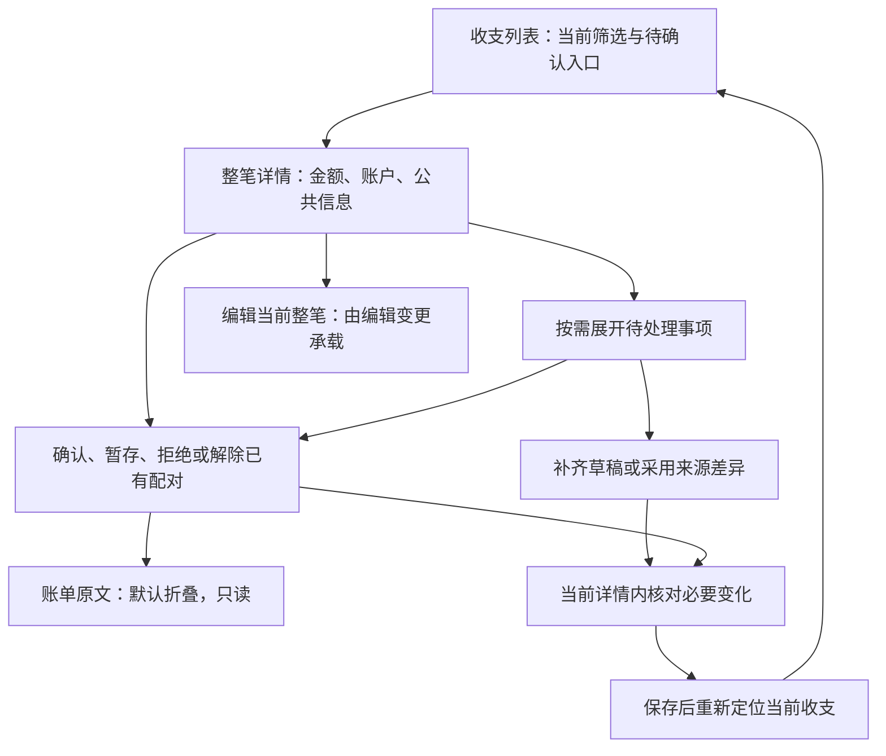

<!-- Hallmark · pre-emit critique: P4 H4 E4 S5 R5 V4 -->

## Context

当前共享入口已接入状态筛选、当前详情、草稿、来源问题及完整关系维护；旧全字段编辑、任意关联页面和 `CashRecordApi` 已移除，创建及正式编辑由编辑模块承载。导入使用生命周期、恢复基础及真实 App 入口；当前受影响验证已完成，完整用户演示确认仍待取得。

后端行为输入为 [现金流水](../../../../docs/cash-ledger/cash-ledger.md)、[维护接口](../../../../docs/import/cash-import-redesign-contracts.md#35-后续维护与读取) 和 [后端 delta](../2026-10-28-cash-import-lifecycle-redesign/proposal.md)。服务端匹配、来源身份、金额与事务规则不在本轮重定义。

## Goals / Non-Goals

完成列表到当前详情、草稿／来源／已有关系的补处理闭环。普通编辑及新建表单属于 [编辑变更](../2026-10-28-compose-cash-entry-editor/design.md)，文件导入属于 [导入变更](../2026-10-28-compose-cash-import-workflow/design.md)。不增加问题中心或一级关系页，不重排全局导航，不修改持久化。

## Decisions

### 用户任务与信息架构

| 区域 | 展示与动作 |
|---|---|
| 列表 | 保留当前筛选与月汇总；仅存在待确认项时增加快捷筛选；沿用大屏表格、手机列表 |
| 摘要 | 整笔金额、币种、日期、账户、分类、备注与对方；未知保持未知。待处理警示卡紧接摘要，显示具体问题并在当前详情展开处理 |
| 关联流水 | 摘要之后、账单原文之前；仅多笔实际关联流水或存在候选时显示，默认展开。实际成员按关系组展示；候选嵌入所属关系并标明候选。主页允许接受一个完整方案、整组拒绝或暂不处理；导入详情只读。`insufficient_evidence` 表示可继续处理的待确认状态，不显示通用导入错误；其他明确关系错误保留对应提示 |
| 账单原文 | 位于关联流水之后，默认折叠；展开按真实来源成员显示原始字段，只读 |
| 操作 | 整笔编辑、更多操作与明确删除影响；查看者不获得写入口 |

现有详情容器保持 Compact 全屏、Regular/Wide 末端全高面板。关系与来源处理采用当前容器内子状态，不增加独立关联任务。无待确认时隐藏快捷入口，但已生效状态筛选仍须可从现有筛选区清除，避免困在空列表。

### 共享基础与并行归属

本变更先完成任务 3.1–3.3，提交可编译的当前读取／维护合同和详情宿主，再由三个模块并行实施。两个消费方依赖该小步，不能把三个 change 宣称为完全无依赖。

| 所有者 | 文件／责任 | 其他模块如何使用 |
|---|---|---|
| 本变更 | 当前列表／详情 DTO 和映射；计划新增 `CashMaintenanceApi.kt`、`CashMaintenanceDtos.kt`、`CashMaintenanceModels.kt` 与 Repository；`CashLedgerScreen.kt`、`CashLedgerViewModel.kt`、`CashLedgerDetails.kt`、`CashRecordSummary.kt` 的详情宿主、共用摘要／账单原文入口及补处理 | 提供读取、草稿保存、维护预览／提交、结果核实、重新定位、共用详情摘要，以及编辑器挂载回调 |
| 导入变更 | `CashImport*`、`ImportTask*`、`ImportAccount*`、导入恢复接线；App／Graph 的最终集成 | 预览详情调用本变更提供的共用摘要与账单原文入口；差异、候选、导入状态和任务动作仍由导入模块负责 |
| 编辑变更 | 新编辑表单、输入／命令构造与独立状态、普通创建及明确转账适配 | 消费维护模型，在宿主给定插槽中渲染，不改列表和关联状态 |

`FinanceModels.kt`、`FinanceDtos.kt`、现有 FinanceRepository、共享语义 ID／文案目录及演示基础由本变更统筹；导入和编辑各自新增局部文件或提交所需接口清单，不并行改写集中声明。App／Graph 由导入模块最终接线，维护模块先行提供需要注入的合同；依赖合并后各模块必须验证真实入口。

后端 `entry`、`record_origin`、`editable_fields/allowed_actions`、`supports_transfer_edit`、`common_field_conflicts`、`common_fields`、`inherit_common_fields` 等公开字段必须保留 null 与明确清空。选择组件只回传服务端允许的完整候选，不能自行拼关系。导入 DTO 由导入模块补齐，避免强行共享两个不同生命周期的命令状态。

### 调用与恢复

读取切换到当前 `GET /cash-records/{id}`。普通草稿保存使用 `/cash-mutations/plans` 的 `save_draft` 意图，带当前修订并保留原计划命令；明确转正式、来源问题及关系维护使用同一维护计划合同和当前编辑上下文。直接 `PATCH /cash-records/{id}/draft` 仅保留兼容，不作为新页面恢复路径。新建与源文件不参与该编辑上下文。

保存前保留对应命令的最小恢复证据，未知结果先核实；计划过期或修订冲突统一提示重试，重读当前详情并按返回修订重置表单后重新操作，不做自动表单合并或重放。保存后的当前展示可能变化，使用收据保留目标及稳定流水定位刷新，不能复用旧展示 ID。维护提交使用对应计划收据，不混用导入恢复标识。

列表接收 `state/confirmation_status` 与可空展示值，计数使用服务端结果，保留筛选范围。后端计数也受传入筛选约束，不增加本地估算计数。切换至待确认后的加载期间保留已选筛选控件；无当前数量时只显示“待确认”，不伪造计数，也不通过移除控件丢失键盘焦点。版本变化重载后清理不能继续安全使用的批量选择，分类／删除仍走现有整笔命令和影响预览。

草稿的日期时间沿用本机时区和现有日期／时间选择器；只有更改该字段时才转换为带时区的时间，未更改时保留原值及秒精度。转换使用各平台已有时间 API，不新增依赖；不存在或重复的当地时间拒绝保存并提供字段校验，禁止静默校正夏令时或按 UTC 误存当地时间。

关系核对按每个候选的完整成员引用展示金额、币种、账户、对方和时间，单个候选也不可省略；预计合并摘要不能代替实际成员。候选按完整组用分隔线区分，成员以对方及金额为首行、账户与时间为次级信息；不重复展示本笔摘要或逐成员“当前信息”标签，核对任务中隐藏不可用的编辑页脚。预览读取完整引用，任何成员缺失或读取失败时不能接受未展示的候选。已知选择失效时清除未发送计划和旧决定，显示重新核对错误，由用户从当前详情重新开始；不迁移旧决定、不自动替换修订或重放。公共值冲突仅显示实际需要选择的值；后续预览只剩部分冲突时，已解决字段必须与当前计划返回的公共值完全一致才保留，不允许引入其他字段或值。解除有人工公共字段时保持显式继承决定。

### Hallmark 方向与自查

用户已确认保留整体外观，仅重做流程与操作布局。预检：共享框架为 Compose Material 3；[FinanceTheme](../../../../compose/shared/src/commonMain/kotlin/com/finance/tracker/core/FinanceTheme.kt) 提供浅／深色与形状，[token](../../../specs/shared/design-system/tokens/core.tokens.json) 提供蓝色强调与 4 px 间距；Web 使用 Noto Sans SC，Android/iOS 使用当前系统无衬线字体。保持既有字体映射和组件状态，不新增视觉系统、装饰动画、原型或 Pen 产物。

方向为任务型账本：列表优先扫读，详情按总览→待处理→来源→操作组织；使用现有 token 与标准 Material 3 控件。两个入口渲染同一收支摘要，账户、分类、备注等按标签值平铺在详情主体内，不设置“流水信息”标题或内层信息卡；共同原文入口显示“账单原文 查看”，默认折叠。待处理草稿在现有橙色提示区域显示“草稿”标题与缺项说明。导入差异／关联候选与已保存关系维护保留为各自任务内容。将删除旧新增关联搜索、逐条来源编辑、重复摘要、无问题时的空说明、实现术语和卡片套卡片。界面统一使用“一笔收支／收支记录”“关联流水”“账单原文”；内部模型名称只用于开发文档。正常状态帮助最多两处且各不超过 16 汉字，字段校验按项目规则。

自查覆盖密度、只读／编辑边界、空／错误／提交／未知状态、无障碍名称和三类窗口。当前实际页面及截图的 Hallmark audit、独立设计复核和未完成用户确认集中见 tasks；规划自查不能替代实际审查。

### 规格及旧任务归属

后端变更保留服务器读取／统计与领域合同；本变更只增加真实页面验收，不复制后端算法。其原 4.12.4 的草稿、来源及关联页面任务移交本变更，正式公共编辑由编辑变更负责。主分支已同步并归档旧账本／弹窗变更，其有效布局和 M3 测量继续适用；本 change 的完整 delta 定义当前详情及允许动作，不能恢复旧平铺约束、逐条来源编辑或直接关联写入。

### 修改前视觉基线与共享详情摘要

以实施前 `8aa0b40` 的 Compose 源码及 `d0b15a9` 的详情截图为基线；保留外层面板、金额语义色、等宽数字、交易对方标题、类型／时间次级摘要、主题、字段分组表单及主要操作。主页和导入预览共用 `CashRecordSummary`：账户、分类、备注等只读字段直接按标签和值排在详情主体内，不再使用“流水信息”标题、分隔线或内层信息卡。两端共同使用“账单原文 查看”默认折叠入口，原文内容仍由各自当前数据提供。草稿状态使用橙色提示区域，标题为“草稿”，正文说明缺少的信息；不另设“需要留意”区。待处理警示仍紧接摘要，来源成员只读，导入差异／关联候选与已保存关系维护维持各自动作。

### 官方 Material 3 页面复核

按用户要求实际打开官方页面并读取 JavaScript 渲染正文，不以技能摘要代替。参考 [Expressive](https://m3.material.io/foundations/usability/applying-m-3-expressive)、[间距](https://m3.material.io/foundations/layout/grids-spacing/spacing)、[文字层级](https://m3.material.io/styles/typography/applying-type)、[卡片](https://m3.material.io/components/cards/guidelines)、[卡片规格](https://m3.material.io/components/cards/specs)、[按钮](https://m3.material.io/components/buttons/guidelines)、[文本输入](https://m3.material.io/components/text-fields/guidelines) 及其 [无障碍](https://m3.material.io/components/text-fields/accessibility)、[侧面板](https://m3.material.io/components/side-sheets/guidelines)、[列表与详情](https://m3.material.io/foundations/layout/canonical-examples/list-detail)、[状态](https://m3.material.io/foundations/interaction/states/overview) 和 [对比度](https://m3.material.io/foundations/designing/color-contrast)。卡片指南建议：当间距、标题或分隔线能形成更简单的层级时，不要强行把内容装入卡片；间距页面强调用邻近关系和留白区分相关信息与独立区域。因此详情总览采用无卡片标签值行。卡片 Overview 路径在真实浏览器中未加载正文；本次判断依据已成功读取的 Guidelines、Specs 和 Spacing 正文，不依赖 Overview 未读内容。

组件另读文本输入、卡片、按钮及侧面板的 `overview`／`specs` 正文：输入使用默认 outlined 状态、标签与 supporting error；卡片只归拢同一主题，尺寸随内容；按钮沿用当前依赖的默认尺寸及主题角色；侧面板保留独立滚动和既有容器合同，不照搬官网新 API 或改变用户认可的面板宽度。本轮另读 Material 3 `Lists — Overview/Specs` 与 `Buttons — Overview/Specs` 正文：列表保持连续纵向扫读，支持清楚标识的展开／收起；披露入口使用默认 Material 3 按钮语义和触控目标，不固定控件尺寸。

落实为业务字段标签和值同行、相关字段靠近、区域间留白、现有 type scale、独立滚动正文和固定主要操作；不把每个字段装进卡片，不增加按钮或装饰。额外影响确认时，正文切到本次变化，使用独立滚动位置；底部原保存栏由“取消／确认保存”替换，不能同时出现可用与禁用两组保存，或将确认内容埋在表单下。取消确认回到原表单并保留本次输入，不发送写命令。每个明确目标只展示一次当前摘要，字段变化紧邻该目标展示旧／新值；已由具体差异完整表达的字段影响不再重复整笔预计金额与对方，其他影响及必要的预计组结构完整保留，不按种类合并或丢弃不同目标／字段。分配控件归记账组，位于对方组之前；金额格式错误提供明确文字反馈。

官方网页说明设计，当前 JetBrains Material3 API 与实际编译负责平台支持，不升级依赖。原始 Expressive 链接路径失效，使用站内当前链接。用户已确认加深交互蓝并达到对比度要求。浅色交互蓝采用既有品牌蓝 `#0A63B8`，焦点与其一致；深色保留原蓝 `#0485F7`，按钮前景使用既有深色背景色 `#060607`，避免深色操作文字随浅色一起变暗。两主题分别验收按钮标签与页面操作文字至少 4.5:1、焦点边界至少 3:1；颜色仍只从 Git token 生成，无新视觉系统。

## Risks / Trade-offs

- Web 弹层关闭后无障碍树残留：Compose `1.12.1` 已复现上游 [CMP-10623](https://youtrack.jetbrains.com/issue/CMP-10623)。用户明确保持当前版本，不升级 `1.13.0-beta01`；将该问题作为待解决缺陷，保留关闭后恢复语义树的失败回归，不将对应无障碍 QA 标为通过。业务交互继续按当前默认 Web 冒烟范围验证，Android、iOS 仅编译和单元测试。
- 旧 DTO 能编译但运行时读取失败 → 以真实响应形状做解码及端到端合同测试，不用旧演示数据掩盖。
- 关联保存／发现失败没有合法候选 → 只展示安全原因，登记后端边界，不提供重新发现按钮。
- 共享文件并行覆盖 → 基础小步先合入，按所有者实施，集成后重跑受影响验证。
- 直接按“待确认”排除统计 → 汇总采用服务器结果，分别断言草稿和正式待确认。

## Migration Plan

先冻结并提交公共基础，再切列表／详情和补处理，接入编辑器与导入后的定位。新合同接通前不回退旧写入口。无数据库迁移；回退只读降级。Cross-platform Impact Check：Web、Android、iOS 页面和共享层均受影响，实现保持三类窗口合同，默认 Web 代表视口冒烟，Android、iOS 仅编译和单元测试；不得沿用旧截图当作当前流程通过。没有未决业务或 UI 方向。

实施前细化：用户确认总览摘要下方以警示卡片简述待处理问题，点击业务动作后在同一详情展开；公共编辑通常一次保存，仅实际新增影响需要确认。导入与主页共用表格及详情宿主，Regular/Wide 末端面板、Compact 全屏。

维护任务的原命令定位按 API 来源、用户和工作区隔离，使用独立于导入会话的本机命名空间；计划命令只保存目标流水、计划修订及原幂等键，普通草稿保存采用后端 `save_draft` 计划并只保存原计划定位，不持久化财务表单或来源原文。未知结果先核实，未确定前禁止打开其他流水覆盖命令；已知收据与保存后的当前详情读取分别处理，读取失败不能抹去已提交事实。

草稿仅发送用户实际修改的标量；单笔金额／币种／账户的现金部分联动由后端在同次来源处理后的有效值上完成，禁止客户端发送包含旧金额或币种的派生完整组成项。

普通一次保存使用后端完整 `additional_effects`；为空时在同一次动作内预览、提交，有额外影响才确认。缺少该字段的计划作为无效响应提示重试，不维护旧版计划确认分支；不能根据 `can_commit` 或首屏详情推断。后端单一归属及验证见 `cash-import-lifecycle-redesign` 4.17。

并发处理按个人使用场景保持简单：后端发现修订变化、过期或安全可重试失败时返回明确错误，页面提示重试；不自动合并表单、不自动替换修订重放、不增加跨版本执行路径。只有结果无法确定的已发送命令保留最小原键核实，避免重复记账。实际配对及公共值冲突仍由用户作业务选择。

真实行点击使用列表 `transaction_id`；`record_id` 只作为来源编号读取，不解析展示标识或猜测目标。该字段由后端当前读取合同直接提供。

草稿的 `economic_type` 与时间、金额、币种一样保留真实 null，不用虚构枚举替换，不开启全局 JSON 强制转换；实际客户端夹具覆盖该合同。

草稿补齐按当前 `next_action=edit` 合同接线；所有草稿编辑问题集中为一张警示卡，列出具体问题，有具体原因时不再重复“信息未补齐”。没有具体问题时才显示通用待补齐提示。卡片点击展开同一个表单，不保留无操作的重复警示卡。

合并收支的待处理事项必须覆盖当前全部成员。详情读取现有 `/cash-projections/{id}` 的明确成员引用，再读取待确认成员的当前详情；不从来源编号或组成项编号猜目标。公共摘要保持当前收支；其他成员的问题在摘要下同一详情内展开，提交使用问题所属流水的当前修订。读取失败直接提示重新读取，不静默丢失成员问题，不引入跨版本分支或自动合并。保存后重新读取当前成员，来源区折叠，避免旧展开状态停留在永久加载。

来源展开复用现有证据成员的明确流水引用，读取当前详情的 `fields.source_payload` 并按原账单字段只读展示；不把归一化备注当作原文，不持久化原文，不增加后端接口。成员修订或展示版本不一致时只提示重读，不混合显示；来源错误由用户重试重新读取当前详情。草稿分摊表单保留组成项身份与顺序，只有用户明确调整分摊时才发送完整 `components`；普通标量改动不携带旧分摊。

单笔／分摊切换只提交当前模式。切回单笔不携带隐藏的分摊改动，明确“采用上方账户与金额”的选择不跨模式沿用；分摊行的身份与原顺序保持不变，新行使用未占用顺序。

### 主分支集成边界

合入 `origin/main` 的索引滚动、吸顶／刷新、管理页和 M3 容器测量；保留当前正式／草稿、稳定公共对象、一次保存和统一导入合同，不恢复已关闭写入口或旧客户端。索引按既有 `sort_at` 与流水标识排序，涵盖所有符合筛选的可见／待处理流水；月份位置用实际连续区间，缺少时间沿用页面 `unknown` 桶，不能伪造发生月份。待处理数与总数不受当前页长度影响，月金额仍只汇总具统计资格的正式流水。索引页携原读取版本，版本变化清空批量选择并要求重读；不新增自动重放或跨协议兼容。容器复用主分支已验收的 Basic Dialog／Side Sheet 测量：侧板保留原批准宽度，16 dp 分离留白及 16／72／24 dp 固定操作区，主要操作在左；紧凑全屏保留右侧主要操作与 56 dp 底栏。保留本分支的字段分组、信息卡、配色和业务流程，不继承旧详情渲染、来源编辑或独立关系任务。另实际读取官方 Dialog overview／specs，采用其独立 Basic／Full-screen 测量。真实 SQLite／专用 PostgreSQL 合同与前端编译、单测及 Web 受影响流程须在合并结果重验。

索引元数据复用同一次首次全筛选扫描得到的总数、待处理数、月份区间与金额汇总，缓存最多 16 个筛选结果。缓存键包含工作区内精确的已删除来源 ID 集合，并在同一读取事务中读取；来源删除即使尚未发布新版本，也必须立即使元数据失效。每页继续执行当前来源有效性约束，不缓存流水或放松已删除成员不可见规则。

下拉刷新手势监听保持稳定，使用当前可刷新状态和当前回调；多选期间及非列表顶部均不发起刷新，恢复普通浏览后下一次手势立即可用。避免在模式切换中提前结束整个指针监听，回归以触控完成选择、禁止刷新、取消选择与下一次实际刷新，不增加重试。鼠标后切换 CDP 模拟触控的序列存在测试局限，不能据此证明上游缺陷；不增加产品兼容路径。

索引页在同一读取事务中验证活动版本后，使用该事务内的数据集常量执行排序索引查询，再补页面详情；避免将状态 CTE 外连接放在深页偏移之前。游标读取合同保持不变。

HTTP 可按请求创建查询服务。携版本的冷请求不加载全量月份行，只用一次 SQL 聚合总数及待处理数；同服务热请求复用已有聚合。缓存不承担正确性，也不要求跨请求保存服务实例。

M3 操作区测量覆盖整个独立任务，包括导入中的独立账户表单；其 Regular／Wide 主要操作在左，Compact 保留取消／保存顺序，正文使用宿主 24 dp 水平留白且表单不超过 720 dp。导入详情内展开的字段／关系事项仍在所属事项内应用，不能将多个局部操作伪装成全局任务操作区。

## 草稿已填资金校验

用户确认本轮收紧仅补足现有草稿表单的合法性：金额、方向、币种、账户和分摊存在明确矛盾时，在当前编辑区域提示并保留输入，不发起保存。合法缺项仍可保存。后端基于当前草稿联动原子现金部分；前端仅为校验计算相同有效值，不把旧完整组成项补进请求。

本轮已用真实浏览器打开并阅读 Material 3 `Text fields: Overview` 与 `Text fields: Specs` 正文。采用简短可行动错误说明、现有 Material error 色和输入区域下方提示；沿用组件默认状态、间距与现有 token，不新增组件 API。Hallmark 预检范围为草稿表单错误分支，信息架构、全部字段按业务分组及响应式容器保持；删除后端自动清空账户及生成错误事项的冗余补救。最终 audit 对实际 Web 代表视口与截图执行。

Cross-platform Impact Check：Web、Android、iOS 共用草稿校验、错误语义和 API 能力退役；Web 冒烟，原生端仅相称编译和单元测试，无设备 QA 或依赖升级。原请求核实与历史结果显示继续保留。
