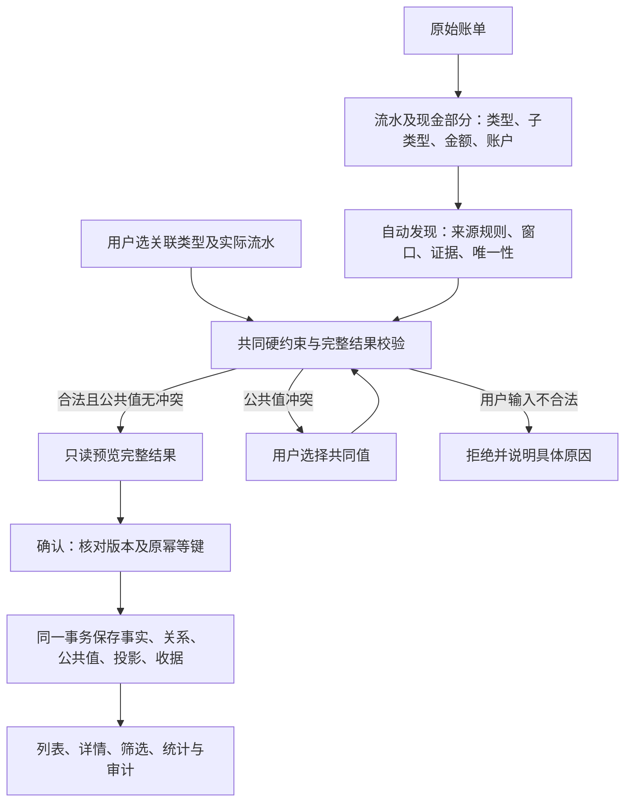

## Context

动机与交付范围见 [proposal](proposal.md)。本设计是待实施目标，当前行为仍以主规格和实际入口为依据。

当前人工新增经 `cash_manual_associations.manual_groups → _current_proof → discover_relation_roles` 重新要求发现证明；`cash_relation_context` 与旧 `RelationService` 的确认检查也不同。`transaction_relations.subtype` 将普通转账、还款、换汇、跨境汇款及转账退回混在一起。`cash_projections.transfer_subtype` 又混入银证转账和余额调整。`cash_projection._validate_group` 同时用图根决定金额、描述和 `cash:{root_id}`，不能只改根排序而继续取根金额。

用户已通过三轮 `grill-me → grilling` 确认九项决定：治理三类现金关系，投资资金关系独立；保留业务标签和筛选；保留数据、客户端同步切换；转账采用出入角色家族和币种金额约束；退款无需人工发现证明且允许部分退回；代表优先级与金额分开；保留联合改选及原子替换的现有边界；完整计入退款、异常存量阻断迁移；初始设计交付；用户后续授权先实施后端和数据库，前端最后实施。用户另问及草稿“待确认”重复标签，本设计记录模型解释，不将状态字段迁移或标签改版自动并入本次实现。

当前活跃 `pr104-alipay-test-fixture-contract` 仅修测试夹具，不改变产品规则；本 change 不吸收其工作。实际客户端为 Compose Web／Android／iOS 与 HTTP／Agent；用户 CLI 和旧现金关系路由已退役。

## Goals / Non-Goals

设计以消费者和操作合同约束实现。收支合并、统计、公共字段、维护范围及审计都读取关系；余额不直接读取关系，继续使用既有 `counts_toward_balance` 策略，特别是非手动 `transfer_in/transfer_out` 的现有排除行为。

关系治理不扩大来源分类、记录可编辑范围或手动记录对外配对资格。组合支付只覆盖当前可表达的现金部分，不实现交错聚合的新拆分能力。银证转账保持自己的端点、方向、证据和确认服务。所有产品非目标见 proposal。

## Decisions

### 1. 输入分类、发现、合法性与展示分层



自动发现器仍可拒绝生成不符合发现规则的建议；其内部候选经共同校验失败后丢弃并聚合脱敏告警，不把非法候选包装成待确认。明确用户请求失败或提交时发现新错误则整个操作失败，不拆组继续。不捕获任意异常来忽略程序错误。草稿决定可保存不完整端点，但没有确认财务效果，不能用它承接非法确认输入。

自动与人工使用同一纯领域合法性服务；角色由正式类型和金额方向规范化推导后校验，不能接受客户端伪造角色。发现证明只存在于发现器，审计元数据不能改变校验结论。修订和授权由应用服务负责；图、金额和角色在纯领域层负责。

### 2. 最小关系模型

| 数据 | 唯一职责与目标位置 | 治理动作 |
|---|---|---|
| 来源记录分类 | `cash_transactions.record_type/record_subtype` | 保留，不因关系合并改写；分类合法性仍校验 |
| 现金部分 | `cash_transaction_components` 的账户、币种、精确金额 | 关系端点与金额覆盖基础 |
| 现金关系 | `transaction_relations.kind`、两端父／组成项、角色、状态、决定组 | 删除 `subtype`；保留三种 `kind` 与当前状态模型 |
| 金额覆盖 | 关系 `applied_amount` | 保留但按关系类型严格派生，用户不能任意填写 |
| 发现与决定元数据 | `rule_id`、受限 `evidence`、当前 `decision_source` 及操作者字段 | 自动记录规则；人工记录用户决定，不伪造来源证明；已有协议字面量不为命名重整而另改 |
| 投资资金关系 | `cash_investment_funding_relations.direction` 及独立端点 | 保留独立模型，不塞进现金关系枚举 |
| 收支业务标签 | 派生 `cash_projections.business_label` 与读 DTO | 替换 `transfer_subtype`，仅展示／筛选，不能驱动确认校验 |
| 稳定公共对象 | `cash_entries` 与 `cash_entry_members` | 保留公共值、人工清空、独立恢复值和身份 |
| 展示代表与金额基准 | 派生构建结果中分别持有代表引用及完整金额基础 | 不再让代表金额替代合并金额 |

转账的 `currency_mode = same_currency | cross_currency` 是从当前端点得出的只读结果，仅在调用方需要时返回；不存 `variant`，不接受客户端指定币种形态。四种旧转账子类型全部归 `transfer_pair`；旧 `p2p_return` 归 `refund_offset`，仍有 `p2p_out/p2p_in` 角色。普通退款使用 `expense/refund`，同笔支付使用 `expense/expense` 或 `refund/refund`，转账使用 `outgoing/incoming`。

没有“自动关系表”和“人工关系表”。候选仍与生效关系有状态区别；本次不重做候选／决定持久化体系，也不增加通用关系框架。

### 3. 共同硬约束及其消费者

| 编号 | 拒绝确认的条件 | 保护的消费者 |
|---|---|---|
| H1 | 越权、跨工作区、删除／非正式端点、不属于所选父的现金部分、账户不可用于该写入、修订或计划过期 | 所有读取与写入安全 |
| H2 | 手动记录参与外部配对，独立投资事件进入现金关系，任一现金部分已有生效资金关系的父流水同时参与现金配对 | 公共对象归属与投影；当前资金投影要求父流水独立，不支持部分银证资金混合投影；手动转账自身双端创建／编辑是明确例外 |
| H3 | 同笔支付不是负向 consumption/refund 的 expense/expense 或正向 refund 的 refund/refund、现金部分不同账户／币种／方向／金额，或未完整覆盖所选组成项 | 同笔来源仅计一次；按组成项账户判断，不比聚合父的空账户 |
| H4 | 普通退款不是负向 `consumption/refund/investment_out` → 正向 `refund`；转账退回不是负向 → 正向 `transfer_reversal`；不同账户或币种 | 收支抵扣、原始类型保持；现金 `investment_out` 不等于投资事件 |
| H5 | 退款未全部计入、消费累计被抵扣过量、一个逻辑退款指向多个独立消费事件 | 收支净额和统计 |
| H6 | 转账负端不属 `transfer_out/withdrawal_out/repayment/fx_out`，正端不属 `transfer_in/withdrawal_in/repayment/fx_in`；同币种不等额；任一端为零 | 内部转账不计外部收支；允许家族间搭配及同／不同账户 |
| H7 | 转账端为多现金部分的聚合父，导致只有一部分关联却把整笔排除统计 | 防止其他现金部分被隐含转为内部转账；当前仅支持原子转账端 |
| H8 | 自关联、同业务键活动关系重复、转账经济端点重复占用、退款与转账混组、镜像折叠后无法形成合法单一经济根／无环关系 | 唯一归属、维护闭包与可计算性 |
| H9 | 金额不能按精确十进制表示、币种非法、完整覆盖无法证明、必要关系只提交部分 | 金额保真及原子结果 |

“占用”不等于一条流水只能有一条边：镜像消费可以继续承接退款，一个消费可有多次退款，钻石中的多条证据可指同一退款。按经济事件和角色定义占用；转账出入事件只能参与一次资金移动，镜像证据不得重复消耗。

零金额只保留既有普通退款两端父及选中部分均为零、同账户同币种的证据场景；不放开零金额同笔支付、零金额转账或单边零退款。该例外不改变零金额显示筛选。

每个入口都按 H1–H9 得到相同结果；不同入口的可见操作范围、候选选择凭据和授权要求可以不同。例如 API 接受建议仍须引用当前计划中的候选，主动搜索新增则绑定实际流水和当前修订；两者都不能绕过硬约束。

### 4. 发现规则保留独立

| 发现器 | 继续使用的规则输入 | 不能进入共同写入校验的条件 |
|---|---|---|
| 同笔支付 | 来源平台／银行、账户、金额、10 秒／60 秒／业务日、卡尾号和原文 | 平台×银行、时间、别名／来源证据；同账户和等额仍由 H3 共同校验 |
| 普通退款 | 类型、订单／商户、剩余额度、通常 15 天与订单 30 天窗口 | 时间先后、窗口和订单证明；额度仍由 H5 校验 |
| 平台原生退回 | 原交易链接、来源作用域、精确退回、有效顺序、现有 60 天窗口 | 硬键、全额和时间；人工允许部分退回 |
| 转账各规则 | 记录子类型、出入类别组合、对方账户指向、普通 5 分钟、换汇 60 秒、唯一目标 7 天 | 原来的类型配对、账户指向及窗口；方向和同币种等额仍由 H6 校验 |

本次不扩大自动发现覆盖率；新增的人工合法组合不会自动成为建议。发现器的 `rule_id` 可以继续含业务名称，规则名不等于持久关系类型。保持当前阶段和来源稳定键，不以随机 ID、排序或“数量一样”制造唯一证据；用户编辑备注不参与发现。别名命中过程和账号原文不进入证据日志。修改发现规则版本不解除或复活既有决定。

### 5. 金额基准、镜像与退款

以同账户、同币种、完整等额的组成项镜像构造等价类。每个等价类是一份实际现金部分，多条来源只是证据。父流水可以只有部分现金部分获得镜像，但所选组成项必须完整匹配。同一镜像等价类最多包含同一父流水的一份现金部分；禁止把父流水中两份等额真实部分折叠成一份。镜像是无向等价关系，有向单根和无环校验只作用于折叠后的退款／转账关系。

每个父级镜像事件构建去重后的现金部分集合，至少一条成员父流水必须完整覆盖该集合；若多条完整覆盖父存在，其总金额与币种必须一致。该集合提供经济金额基准，不能按最大金额猜测，也不能以展示代表的金额代替。无完整覆盖父的交错聚合拒绝为不支持，不引入并集拆分模型。所有未镜像组成项保留。

退款覆盖按 `(消费现金部分等价类, 退款现金部分等价类)` 去重。同一逻辑退款的全部现金部分必须完整分配到同一消费事件；允许在这个消费事件的多个现金部分之间沿已有账户约束分配，但不得跨独立消费根。每个消费部分累计不超过绝对金额；每个退款部分分配合计等于其全部金额。`applied_amount` 由完整合法方案生成；同笔支付等于所选完整部分金额，退款为该已验证分配，转账为 0。客户端不可传任意抵扣金额。现有完整多边方案保留其已证明分配；人工单边新增仅在该边完整覆盖退款时允许。聚合退款无法由单边完整覆盖时拒绝，不按容量、顺序或 ID 贪心编造分摊，也不新增分摊 UI。

| 例子 | 合并结果／拒绝原因 |
|---|---|
| 平台 -100 与银行 -100 完整镜像 | 支出 -100 |
| 平台 -100 = 账户 A -30 + 账户 B -70，银行 A -30 与前一部分镜像 | 支出仍为 -100；代表即使来自银行也不能算成 -30 |
| 消费 -100，退款 +30 与 +20 | 支出 -50 |
| 消费 -100，退款 +100，但仅分配 40 | 拒绝 `relation_refund_incomplete`，不能隐藏 60 |
| 两条来源镜像记录同一笔 +20 退款 | 抵扣一次 20 |
| 同一聚合退款中两份真实 +20 现金部分 | 抵扣 40，不能因金额一样去重 |
| 支出 -100，退回 +30 的 `transfer_reversal` 组合 | 支出 -70；没有订单号也可人工确认 |
| 同币种转账 -100/+100，或跨币种 -100 CNY/+14 USD | 内部转账，不计收支；跨币种展示双端原金额，不相加也不推算汇率 |

### 6. 代表、身份与公共字段

先折叠镜像确定经济事件，再根据经济角色确定消费或转出侧，最后在候选成员中按平台优于银行优于其他、较早规范发生时间、稳定来源身份排序选代表。稳定来源键复用已有来源绑定的来源类型、作用域种类／值、身份种类／值；多绑定先取提供方编号，再取账户作用域，最后按完整元组字典序决胜。无编号来源使用已有文件出现身份。手动转账采用既有组身份及出入方向；旧来源编号只对明确 legacy 记录沿用，不允许 import 缺少绑定时回退任意记录字符串。来源键随正式和草稿事实传递，合并草稿在预览中取迁移后绑定并集的最小键；上下文令牌、建议凭据和重建摘要包含相关来源键。运行时数据库自增 ID 和导入批次顺序不参与经济选择。无法提供必要身份的存量在预检报告；重复身份由来源身份合同解决，不能随机选代表。

`representative_transaction_id` 只决定默认描述、默认发生时间和成员排序，不决定净额、币种集合或账户集合。组合收支仍展示完整相关账户，跨币种转账仍展示两侧金额。默认日期变化会改变月份归属和筛选结果，这是已确认的行为变化；重建校验要区分总额不变与月度重新归属。

稳定 `cash_entries.id` 不由代表推导；新增持久 `identity_transaction_id` 作为身份锚。迁移从旧对象的有效 `root_transaction_id` 初始化，缺失或不属该对象则阻断，不虚构创建时间。当前组成员不变时复用原 ID。合并多个旧对象时，优先从身份锚属于消费／转出经济根的对象中选取，其内按既有 UUID entry ID 字典序选唯一保留对象；没有此类对象才从全部相交对象按同样规则选择。镜像平权时直接使用此持久 ID 规则。拆分后包含原身份锚的组保留原 ID，其他组创建新 ID 与组内确定身份锚；新对象按稳定来源身份选择锚，不随展示代表变化。被合并对象的成员恢复值仍保留。这里的持久 ID 仅决定已有对象延续，不决定金额、日期或自动发现。

旧 `cash:{transaction_id}` 的只读定位利用当前工作区、数据集和流水的唯一成员约束，以非关联标量子查询先定位唯一投影，再按主键读取；保留来源未删除及全部成员有效性检查。不以 `IN` 半连接遍历工作区全部投影，也不使用任意 `LIMIT` 掩盖重复归属。新公开引用继续按唯一键读取，写命令不接受旧别名。

当前读模型以 `cash-entry:{entry_id}` 定位，代表另有字段；旧 `cash:{transaction_id}` 只读引用可由原流水解析当前对象，不能把已删除对象悄悄替换成无关记录。成员变化按既有合并／拆分身份规则处理，不承诺一个 ID 同时代表拆分后的多笔。旧分页和选择上下文全部由发布版本失效。纯领域构建中的 `cash:{root}` 仅作为同次构建内部索引；仓储协调稳定对象后保存 `cash-entry:{entry_id}`，不得把构建临时引用输出为已保存对象的公开引用。

公共字段逐项保留人工值和人工清空；多个不同人工值进入同一预览内的共同值选择。无人工值才随展示代表取默认值。迁移仅代表变化时不改变人工字段及各成员独立恢复值。解除只有实际有效值差异才询问保留／恢复，不能因存在人工标记而反复询问。

### 7. 业务标签与对外合同

`business_label` 是单一派生标签，读模型存储方便一致筛选；当前值沿用 `ordinary_transfer`、`credit_repayment`、`currency_exchange`、`cross_currency_remittance`、`bank_security_transfer`、`balance_adjustment`，并允许退款退回显示 `p2p_return` 业务标签。这些值不得再进入当前关系行、关系写入请求或硬校验分支。

确定标签按完整事件事实：独立资金关系为银证转账；单条余额调整保持原隐藏标签；转账事件按还款记录、明确换汇记录、明确跨境来源记录、普通转账的优先级选择，冲突时依此固定顺序，不依代表或发现来源。只有币种不同、没有换汇来源语义时不得伪称个人换汇；普通转账的双端币种已能表达事实。退款 `p2p_out/p2p_in` 显示转账退回。无关联的其他类型沿现有记录标签。所有成员原始类型仍在详情可查。

`p2p_return` 本期仅作退款展示标签，筛选选项树仅为内部转账列出业务标签，不新增退款筛选子节点，也不把退款归为内部转账。列表筛选及选项树将 `transfer_subtype` 改为 `business_label`；关系类型筛选继续用 `kind`／组成方式，二者不能互相替代。旧标签类别保留可筛选能力；因新确定规则与旧关系子类型不一致的存量，在预检的标签差异表列明，不为保持旧标签而制造长期覆盖字段。

| 接口范围 | 目标合同 |
|---|---|
| `/cash-records/{id}/association-targets` | 继续只读搜索；增加所选 `kind` 上下文，返回实际流水及当前可选现金部分／不适用原因；不按发现来源、时间或旧子类型筛选 |
| `/cash-mutations/plans` 中 `relation_additions` | 保留目标、组成项、当前修订、`kind`、共同值；删除 `subtype`；服务端推导角色和币种形态 |
| 建议决定／导入计划决定 | `suggestion_id/candidate_id` 仍绑定当前计划；继承关系 `kind`，不继承旧业务子类型门槛 |
| 导入及维护计划、详情、结果 DTO | 关系返回 `kind/roles` 与实际端点；展示返回 `business_label`；必要时转账返回只读 `currency_mode` |
| 列表、筛选、报表 | 使用独立业务标签和统一结果；代表引用与稳定对象标识分开 |
| 原幂等键核实、永久收据 | 先查已执行结果再判断计划版本；旧结果按其版本只读解析，不重新执行旧命令 |

本期 Web 协议与 Compose 不暴露关系 `roles` 或只读 `currency_mode`：关系种类、端点及成员已足以展示，二者按需保留，不作为本期已实现字段。

主动新增请求示意（现有外层上下文及鉴权字段保持）：

```json
{"relation_additions":[{"target_transaction_id":"205","expected_target_revision":3,"anchor_component_id":"1011","target_component_id":"2051","kind":"transfer_pair","common_fields":{}}]}
```

确认错误按稳定业务码返回：`relation_account_mismatch`、`relation_currency_mismatch`、`relation_amount_invalid`、`relation_role_incompatible`、`relation_refund_exceeds_remaining`、`relation_refund_incomplete`、`relation_endpoint_occupied`、`relation_aggregate_unsupported`。请求结构／未知字段继续使用现有输入错误；当前修订和计划失效继续现有 `record_changed`／计划错误合同。页面说明不符合的约束类别（账户、币种、金额、角色）或需要刷新，不显示图结构、证据证明和数据库术语；本期不回显账单正文或具体值，需要逐值定位时另行扩展协议。

搜索提供的是当前可选范围而非永久合法性保证。列表先排除草稿、自身、删除、手动及不兼容角色；有多现金部分时逐项选择；最终合法性必须以完整图预览和提交为准。发现规则缺失不显示警告，也不要求额外“强制关联”开关。

搜索账户筛选按实际现金部分账户命中，金额筛选沿用来源流水总金额的绝对值；均在分页前执行。任一部分已有生效投资资金关系时，按 H2 对整条父流水返回空选择及 `relation_endpoint_occupied`。共同校验允许的双零普通退款在两个搜索方向保持一致；不能因 SQL 正负号预筛选丢失。未知或重复查询参数按 `record_input_invalid` 拒绝，不静默忽略筛选。

### 8. 全部用户可达操作路径

下表的 P 编号同时用于测试矩阵。C 表示共享 Compose，覆盖 Web／Android／iOS；A 表示 HTTP／Agent；O 表示有权限的运维 API。所有路径保持当前工作区授权。导入及现金维护计划路径共享预览不写入、完整计划确认、失败整体回滚、未知结果原键核实、成功重读当前对象；创建、删除、别名、资金确认和余额校准保留各自直接命令合同，不新增计划／收据协议。直接创建结果未知时沿用锁住重复创建的现状，不虚构可核实键。取消只取消未提交操作；导入准备账户保留，或按既有退出补偿由用户明确撤销。

| 路径 | 入口与步骤 | 分支、取消与失败出口 | 结果与治理影响 |
|---|---|---|---|
| P01 C/A 导入准备 | 账本新增→导入→多文件解析／密码重传／移除替换→选择账户→预览 | 解析失败定位文件；账户变更重预览；取消会话遵守临时清理，已建账户保留或按既有退出补偿明确撤销 | 来源分类不变；所有新事实走同一发现与校验 |
| P02 C/A 导入核对 | 预计列表→详情→查看拟合并成员、原文、候选和冲突→返回 | 详情读取失败可重试；缺完整成员不能确认对应方案；C 只读，无关系第四步 | 强关系展示拟合并结果，弱建议保留未合并状态 |
| P03 A 导入决定 | 当前计划→`accept/defer/ignore`／选候选／共同值→重预览 | 只接受当前计划合法引用；旧选择失效后明确重选；不能把搜索任意端点注入候选请求 | A 能力保留，C 不增加导入时编辑按钮 |
| P04 C/A 确认导入 | 确认整份计划→保存→导入结果→返回账本 | 写入任何一步失败全回滚；不拆出关系失败子集继续提交 | 一次事务保存流水、关系、公共值、投影、收据 |
| P05 C/A 导入恢复 | 错误后重试／按原键核实／重新核对 | 确定未提交可重试；未知必须核实；过期或版本变化重建；成功旧命令返回原结果 | 不重复流水、关系或计数 |
| P06 C/A 看收支 | 列表→当前详情→摘要→关联流水→账单原文 | 删除或权限改变返回可识别错误；无关联不展示空区 | 稳定对象、展示代表、来源成员分开 |
| P07 C/A 看建议 | 打开详情→读取本条维护计划→查看已保存建议 | 读取失败重试；不因打开详情全库扫描 | 已确认、忽略与草稿状态不互相冒充 |
| P08 C/A 接受方案 | 单方案默认选中／多方案单选→核对完整结果→保存 | 多边只按完整方案选择；无方案不允许确认；成员缺失阻断 | 同一套 H1–H9，保存清理其他备选 |
| P09 C/A 拒绝建议 | 建议“拒绝”→预览整组范围→一次最终确认 | 取消保留；失败不清除当前建议 | 保留拒绝决定，清理整组候选，扫描不复活 |
| P10 C 暂不处理 | 关闭／返回当前弹窗 | 不发送决定；不设 defer 按钮 | 待确认保持，已确认组不变化；A defer 见 P03 |
| P11 C/A 主动新增 | “添加关联”→选三类关系→搜索／筛选／分页→选实际流水和双方现金部分→预览→保存 | 无结果调整筛选；草稿／非法角色不可选；硬约束错误返回具体原因；取消不保存 | 移除四类转账及 p2p 关系子类型下拉；自动窗口外也可选 |
| P12 C/A 建议改选 | “选择其他流水”→沿用 kind→搜索→选目标→核对→保存 | 返回备选保留原方案并清除搜索选择；不继承旧 subtype | 单关系改选保持原建议拒绝／取代审计语义，完整最终图确认 |
| P13 C 联合改选边界 | 联合方案→选择其他流水→搜索 | 继续核对与提交不可用，说明尚不支持；返回可选原完整方案或关闭 | 不偷偷忽略整组再只建一条边；本次不补齐 |
| P14 C/A 解除 | 关联成员“移除”→完整受影响范围→必要时保留／恢复人工值→核对→确认 | 无实际差异不询问；有差异未决定不提交；取消保留 | 解除完整必要组、保留所有来源和拒绝状态，重算旧／新闭包 |
| P15 C 更换已确认对侧 | P14 成功→刷新→P11 新增 | 两次独立事务；第二次失败保持已解除后的真实状态，不假装原子恢复 | 本次不增加一键替换，UI 不暗示一次保存完成两步 |
| P16 C/A 公共值冲突 | 接受／新增→逐字段选现有值或清空→重预览→核对 | 未解决不能确认；返回原选择步骤；只能提交允许字段和值 | 冲突属于合并前置决定，不属于发现失败 |
| P17 C/A 维护恢复 | 搜索／计划失败重试；保存失败／超时处理 | 失效清除旧选择并刷新；未知保留原键核实；确定失败显示重试；关闭未发送计划不影响详情 | 不自动改选或重放决定，成功重新定位当前对象 |
| P18 C/A 公共编辑 | 详情整笔编辑分类、备注和交易对方信息→保存 | 正式导入财务类型字段不可编辑；合并成员只读；冲突刷新 | 公共值和人工清空保留，不改变来源和发现证据 |
| P19 C/A 草稿与来源 | 补草稿及现金部分／转正式；采用来源或保留；明确来源身份合并→预览→保存 | 非法财务输入拒绝；关系／问题修订改变需刷新；身份合并不是 payment_mirror | 所有涉及关系的最终图重验，不扩大普通事项自动扫描 |
| P20 C/A 手动记账／转账 | 新增普通或转账→同币种单金额／跨币种双金额→创建；转账整体编辑双端 | 非法币种、金额、账户资格阻断；普通手动记录不能外部配对 | 自身转账也用无 subtype 模型；不得遗漏创建／编辑写入者 |
| P21 C/A 删除 | 单笔／批量选择→读取完整影响→确认→删除 | 取消不变；旧选择失效重新选择；不能只清理一端留下悬空引用 | 清理现金关系、候选、公共对象及资金引用；删除区别于解除 |
| P22 C/A 筛选统计 | 搜索、状态、组成、业务标签、零元开关→列表／月份汇总／批量分类 | 切换类型清除不适用标签；版本变更重新加载及选择 | 标签能力保留；代表日期可调整月份，总额和统计资格受财务合同约束 |
| P23 A/O 定位重建 | 当前投影读取／原流水定位；有权限者查询状态或重建 | 非法存量重建失败关闭；旧游标失效；权限或目标不存在明确失败 | 稳定 entry 与代表解耦；重建不触发新发现 |
| P24 A 别名 | 登记本人账户别名→后续发现使用 | 属性及工作区检查；冲突不强配 | 仅发现证据，无独立 C 页面，不改变既有关系合法性 |
| P25 A/C 投资资金边界 | A 待处理／扫描／确认／拒绝；C 投资详情只读；现金删除联动引用 | 仍按独立资金关系约束和授权；C 不新增维护页 | 标签独立；互斥、删除和展示回归，不合并模型 |
| P26 A/C 余额与报告 | 查看账户余额／报告／收支汇总；A 通过 `POST /cashflow/checkin` 直接校准余额 | 数据不可用明确报错；快照一致 | 校准保留直接命令、零金额标签和隐藏语义；余额策略原样；报告消费统一投影，跨币种不伪加总 |

入口证据集中如下，行号以任务证据中的 HEAD 为准，不把未接线 ViewModel 方法算为用户入口：

| 路径组 | 当前实现证据 |
|---|---|
| P01–P05 | `CashImportTaskScreen.kt:290`、`CashImportPreviewPanel.kt:83`、`CashImportTaskViewModel.kt:206`；`src/ft/web/cash_plan_routes.py:153/239/246/287` |
| P06–P17 | `CashDetailRelations.kt:189/200/223/330/478/499/517/568`、`CashRecordTaskViewModel.kt:94/117/237`；`cash_manual_associations.py`、`cash_current_relation_plan.py` |
| P18–P21 | `CashCurrentRecordPanel.kt`、`CashEntryEditor.kt`、`CashCreationPanel.kt`、`CashLedgerScreen.kt:550/613/706`；`cash_record_maintenance.py`、`cash_manual_transfer_edit.py`、`cash_record_deletion.py` |
| P22–P26 | `src/ft/web/routes.py`、`operation_routes.py:185/195/210/370/380`、`adapters/relational/web_queries.py`、`application/cash_balances.py` |

Compose 文件位于 `compose/shared/src/commonMain/kotlin/com/finance/tracker/presentation/`；应用文件位于 `src/ft/application/`。入口覆盖以 [现金功能地图](../../../../docs/cash-ledger/feature-map.md)、[导入功能地图](../../../../docs/import/feature-map.md) 和 [投资功能地图](../../../../docs/investment/feature-map.md) 为盘点基线；实施后同组更新覆盖和 TODO，不凭此设计移除现状缺口。

### 9. UI 设计与跨端合同

这是现有关联流程的局部简化：入口与“选择→核对→确认”结构保持，移除关系子类型下拉。主动新增只选择同笔支付、退款冲销、个人转账；选择实际流水后服务端确定角色和币种规则。由建议进入时沿用 kind。P02 导入详情保持只读；P13 继续有明确限制。删除“不会自动发现”等无助于决定的提示，不显示财务 variant、图根、证明等级或内部错误名。

Hallmark 预检采用既有 FinanceTheme、Material 3 Expressive、任务模态流程；信息优先级为当前选择、实际成员、保存结果，来源原文次级。保留原有 COMPACT 卡片与 REGULAR／WIDE 表格，不改导航、弹窗尺寸或 token。设计自评：Philosophy 5、Hierarchy 4、Execution 4、Specificity 5、Restraint 5、Variety 3；这是方案自查，不是最终截图 audit。

已读 Git `core.tokens.json`、Material3 `1.12.0-alpha03` 和 Compose Multiplatform `1.12.1`，不新增依赖／实验 API。2026-10-29 用实际浏览器阅读官方 [Designing: Flow](https://m3.material.io/foundations/designing/flow) 与 [Applying M3 Expressive](https://m3.material.io/foundations/usability/applying-m-3-expressive) 正文：按主要任务排序，减少同时强调的操作，沿用默认键盘顺序，关联对话框沿用组件默认焦点行为，详情面板不新增显式焦点恢复。本次不改变组件外框／组件实现；实施如改变组件，先补对应 overview/specs 核验。

Web、Android、iOS 共享关系模型、文案、错误、确认和结果语义；A 专用能力保持已登记边界。Android／iOS 默认仅编译和单测，Web 走受影响真实浏览器流程。第一版编译与代表视口核心流程可用后立即启动最新 Compose 演示交用户确认，再做最终 audit 与回归。本任务已通过 Paseo 的 Kimi K3.1 Pro 产出本机 HTML 原型，用户审阅后明确授权保留现有 Compose UI、仅按本 change 微调，并按需采纳原型。原型及截图保存在仓库外，不作为整页替换或 1:1 复刻的实现输入。既有 Compose 仍为结构和样式事实源；原型中的金额写死、联合成员丢失、解除结果不完整、来源值覆盖和未接通表单不得进入实现。

| 路径 | 本次实施差异 | 保留合同 |
|---|---|---|
| P06–P17 | 删除关系 subtype 控件与 DTO／比较条件，关系只按 kind 表达；核对完整成员和后端最终结果，硬约束错误沿既有错误区显示 | 三类选择、搜索分页、双方现金部分、完整方案、公共值冲突、整组拒绝／解除、关闭返回与原键核实；联合改选不可提交，更换分两次操作 |
| P01–P05 | 适配无 subtype 的关系摘要／效果及派生结果 | 导入准备、账户选择、只读核对、整份确认和恢复；不增加关系第四步 |
| P18–P21 | 接通新的关系读写合同并回归成员归属 | 公共编辑、草稿与来源、手动记账／双端转账、删除影响的现有表单和容器 |
| P22、P25–P26 | transfer_subtype 及筛选树切换为 business_label；保留标签、稳定引用和后端金额结果 | 账本布局、业务筛选、月份统计、余额报告与独立投资详情；不增加 API-only 页面 |

采纳原型仅限三类关系选择、实际流水及现金部分核对、具体影响确认的信息顺序；现有 Compose 已实现的同等结构直接复用。移除的冗余信息是关系业务细分选择及依赖它的重复判断，不新增“不会自动发现”等常驻说明。Material 3 控件、FinanceTheme、Git token、COMPACT／REGULAR／WIDE 区域次序及测量保持，不新增依赖。实施范围先以 API 编解码和共享逻辑回归证明新合同，再编译受影响目标、运行真实 Web 冒烟并立即提供首版演示；最终独立审查与完整验证在用户确认方向后完成。

草稿重复标签现状：流水 `state`、关系 `state`、待处理事项分别保存，`confirmation_status` 汇总草稿或待处理为 pending；UI 因双重判断显示“草稿＋待确认”。该汇总不是关系状态，不得用其推断有关联或已确认关系。此问题本次仅作消费者边界说明，标签去重和汇总字段迁移需另行明确范围。

### 9.1 UI 审查结论与范围边界

2026-10-30 首版演示获用户确认后，执行 `$codebase-degradation-review` 的 Compose UI 复用审查和 Hallmark 截图审查。UI 复用审查未发现重复业务组件、万能组件或绕过 token；其发现中与本次合同直接相关的不可用原因、永久约束重试、自动选中现金部分、孤儿文案、错误码文案、空 kind 和术语不一致已修复，`record_subtype` 用户术语统一为“业务细分”，业务标签统一使用“个人购汇”。

关系核对中，主动新增在预览中展示双方所选现金部分；建议方案的组成项由服务端确定，界面按完整记录成员核对，逐项现金部分展示需要扩展协议，已登记到 `fix-cash-ui-audit-findings`。硬约束错误说明违反的约束类别，不回显账单正文或具体值。

Hallmark 审查结果 0 critical、5 major、7 minor，均为既有页面问题，覆盖导入步骤重复标题与对齐、账本表头与整行打开、选择列、月份汇总列、详情关系主操作与摘要、关系待确认颜色。用户决定本轮保持已完成 UI，将 12 项登记到 `fix-cash-ui-audit-findings`，不在本 change 修复；因此本 change 不宣称整体设计 QA 通过。审查基于 macOS OCR、像素测量和源码核对，未直接渲染 PNG，阴影、悬停态、动效和对比度未评分。Compose 独立契约增量审查与独立设计复核在启动后被用户取消，未形成结论，不补记通过。


演示数据按 P01–P26 建立本机合成场景索引。导入文件覆盖正常、重复、来源更新、密码输入和解析失败；库中记录覆盖单／多候选、联合方案、公共值冲突、主动搜索及双方现金部分、解除字段继承、部分／全额／多笔退款、同／跨币种转账、草稿和来源身份处理、手动创建／编辑、批量分类／删除、分页、月份、币种、零元筛选与银证资金边界。API 专属操作沿用实际接口，不新增 Compose 页面。读取失败、保存前失败、旧计划和已保存响应丢失通过仓库外本机演示中间层触发，不修改财务数据以伪造错误。演示分类响应暂将既有 `path` 合同差异适配成 Compose 所需祖先对象；此适配仅服务演示，不构成生产分类合同验收。场景、文件、数据库、凭据、截图及工具均保存在仓库外。

### 10. 实施划分与现有替代方案

来源绑定新增或从已删除流水转移也可能改变稳定来源排序。当前计划导入和旧账单导入都必须把实际绑定变更的父流水加入受影响投影集合；同文件同绑定重复不发布。该维护不改变重复行计数、来源金额或余额，仅保证当前绑定与公开投影同事务一致。

仍挂载的 `StatementImportService` 在保存来源后、关系扫描之前补齐文件出现绑定，复用 `CashSourceRepository` 的目标、活动归属和原子保存校验。旧解析接口不能可靠区分原生业务编号与合成 `record_id`，因此该路径仅记录真实文件摘要、版本化解析输出表和输出行位置，使用 `file_occurrence`，不把合成编号当作 `provider_id`，不以内部账户补来源账号。它不改变旧服务自身的行去重合同，也不代替当前导入计划的来源识别。当前 `SourceOccurrence` 的平台交易号要求保持；新旧保存入口共用文件键算法和底层绑定写入。未知来源范围、页码及覆盖保持未知；文件行位置只表示解析输出位置，不声称物理页行。重复同文件同位置幂等，键已属于另一活动流水则整笔回滚。旧关系字典和缓存决定须在文件读取、跳过、匹配或写入之前拒绝已删除字段。

先固化失败用例，再完成纯硬约束、金额图和代表分离，接通所有写入口，最后存储／协议／Compose 同批切换。预览与重建使用同一构建函数；确认不得依赖已缓存结果绕过重验。复用现有事务、收据、局部闭包和公共对象服务，不重写导入管线。

| 备选 | 取舍 |
|---|---|
| 只把 subtype 改叫 variant | 仍重复两端币种、仍可能被客户端误填；不采用 |
| 保留四种关系 subtype，只改文档说明 | 发现／硬约束仍可分叉，不能完成治理；不采用 |
| 所有一负一正都可关联为转账 | 丢失记录角色边界，消费可被随意排除统计；不采用 |
| 为普通退款和转账退回拆两个 kind | 财务计算相同且角色已有区别，增加模型和入口分支；不采用 |
| 为银证转账复用现金关系表 | 端点类型、账户及投资方向不同，超出确认范围；不采用 |
| 代表继续兼任金额根及 ID | 组合支付可能少计、人工对象漂移；不采用 |
| 自动修复不完整退款或迁移重复键 | 猜测用户决定或改金额；预检失败关闭 |

## Migration Plan

历史迁移测试在其所属 revision 的真实表结构上以反射数据准备，只运行对应迁移或相邻往返；不从新版 head 降级制造旧账本。revision 36 是明确不回填现金部分、会丢弃旧关系的开发期迁移，不能把 pre-36 合成流水直升 head 当作受支持的保真链。缺现金部分的新版预检在 revision 52 快照后单独验证 `52 → 53` 拒绝及事务不变；不补造金额或放宽新版图校验。旧收据及字段迁移的当前仓储读取在升至当前 schema 后执行。

1. 在实施分支准备新版本及双后端迁移测试；真实操作另需授权。停写并等待在途事务结束，备份整个选定数据库和匹配应用版本；使用显式 `FT_DATABASE_URL`，不自动探测环境。
2. 只读预检按状态分层：仅 active confirmed 边进入生效图；draft／ignored／inactive 保留缺失端点、旧角色意图与决定原因，只验证可表示性，不套用生效金额约束。每个完整候选替代方案分别叠加当前生效图校验，不把互斥候选同时加入。按当前候选有效性、修订及端点归属生成方案；已失效的暂定对侧不作为独立方案。每个有效候选须至少被一套合法完整方案覆盖，交叉拼接出的非法组合不作为历史方案；不能表示的有效候选仍阻断。预检项目包括：旧 subtype／kind／角色组合、账户、金额完整性、聚合转账、覆盖父、退款目标、资金占用、稳定来源身份、新业务键碰撞及公共对象成员完整性。逐工作区返回受控关系 ID 与错误码，敏感账单不输出。任何无法保持决定的记录使预检失败；不删除证据或把确认降为草稿继续迁移。
3. 预检同时生成差异分类：来源／金额／账户／关系决定必须不变，默认代表／日期／业务标签允许按新规则调整，公共人工值及清空必须不变。展示调整不掩盖总额差异。旧的空 subtype 由 kind、角色、端点校验解释，非三类合法值不能猜测。
4. 在显式数据库中事务迁移：为旧 subtype 留必要的不可写迁移审计值，审计归属工作区且随工作区删除，不随单条关系删除，移除当前列和相关唯一索引语义，建立按工作区、kind、规范端点的业务唯一性；保留 relation ID、状态、操作者、时间、证据、决定组与候选关联。镜像端点按对称业务键规范化，退款／转账按角色定向；收敛后冲突直接失败，禁止合并决定。
5. 草稿和 ignored 也移除 subtype，保留状态、空端点及角色意图；旧候选按独立完整替代方案检查，不能静默变为新确认。不能映射的候选报告并停止，由单独授权修复处理。旧拒绝的抑制按 kind、稳定业务端点和原候选身份映射，不能因去 subtype 而复活。
6. 重建当前读模型，保留既有 entry ID、人工值、恢复值；写 `business_label`、代表引用和新发布版本。核对所有活动流水恰一归属、分币种总额、退款全额、余额不变、标签差异及公共字段。所有校验成功才恢复新服务与新客户端写入。
7. 发布新模型／合法性／展示版本；导入、维护计划及文件变化后保留的选择凭据共用 `contract_version=2`，读取、继续预览及提交都检查该版本，缺失或旧值返回 `plan_changed`。重新打开任务生成新计划，不沿用旧决定；未消费旧计划失效并要求重预览，客户端持久筛选将旧 transfer_subtype 映射到新 business_label；未知字段请求失败，不能静默忽略旧写字段。已成功命令先读取永久收据，以原幂等键返回历史结果，历史 payload 的版本解码仅用于读取，不重执行。

运维预检通过 `PYTHONPATH=src:. uv run python scripts/cash_relation_migration_check.py preflight --report <仓库外文件>` 读取显式 `FT_DATABASE_URL` 的 revision 52 数据库，输出 JSON 校验报告；命令不升级数据库、不重建投影。报告包含来源／金额／账户／决定的完整性摘要、人工公共值和成员保护值摘要、预期组成员／稳定对象／金额及代表变化字段；不输出来源正文、账户名称或备注。现有对象身份锚及成员引用不完整、人工公共值冲突、活动投影金额或成员范围无法核对时失败，禁止以丢弃现有对象绕过。尚未初始化的投影明确记为无旧展示基线。迁移到 53 并按既有重建入口发布后，使用同一报告运行 `verify`，检查所有保真摘要、全部状态的关系金额、正式及草稿的完整成员／对象归属、公共值及实际展示副本、统计资格、代表／日期／标签／金额和发布版本。核验范围与数据库工作区集合一致，报告不能省略工作区；报告不作为数据写入载体。两种模式均使用数据库只读事务；结构或版本不符返回受控错误码，预检发现异常时另返回白名单对象引用供定位。不存在的 SQLite 文件不会创建，已有报告不会覆盖。

SQLite 使用显式事务和必要 batch 表重建并检查外键／索引；PostgreSQL 使用同等约束和真实数据库事务验证，不以 SQLite 测试代替。迁移冻结转换逻辑，不能在未来 upgrade 中调用会持续变化的运行时代码。迁移再次运行无重复影响；事务中断保持旧版或完整新版，不允许半新结构。

回滚在新写入开放前可直接恢复数据库备份与旧应用／客户端。开放后，新跨类别关系、部分平台退回可能不符合旧校验，不承诺 downgrade 可逆；必须停写、核对新增事实并制定单独恢复方案，禁止为了旧版本启动而删除新关系。观察项为预检阻断数、确认拒绝码、未确认建议数量、分币种总额、旧键核实成功率和标签／月份变化；指标不写账单正文或账号。

## Risks / Trade-offs

| 风险 | 处置 |
|---|---|
| 同账户约束新增后历史人工镜像非法 | 预检定位，保留数据并阻断；不把改账户作为自动修复 |
| 现存 +100 仅 applied=40 或部分组成项镜像 | 作为必须失败的迁移样本；确认完整金额规则后由用户单独修复 |
| 代表排序改变日期、标签及默认公共字段 | 迁移明确报告允许差异；人工字段及总额单独不变断言 |
| 遗漏手动转账、旧服务或草稿转换写入口 | P01–P26 路径追踪与所有仓储调用清单；未接通旧路由删除残余调用，不复活 CLI |
| 新搜索过滤误用发现规则 | 合同用同源、超窗口、无证据、跨类别正反例验证 |
| UI 保留 subtype 隐藏限制或旧 DTO 容忍字段 | 新旧请求字段测试、Compose 序列化测试及真实冒烟 |
| 金额图复杂度或全量回读退化 | 复用受影响闭包，固定钻石／聚合／多退款工作负载及现有性能预算 |
| 全量停写迁移时间增长 | 测试环境测耗时、迁移前预检；不引入双写和长期双模型 |

## 设计审查

独立产品／路径与领域审查已返回 findings，金额等价单射、完整退款生成、持久身份锚、分状态迁移、直接命令边界和冲突规格已回写；实施按更新后的七阶段工作流执行。数据库、后端接口和数据模型由独立上下文按 `contract-design-review` 跨层评审，审查范围、证据、发现、建议与未覆盖项记录在 tasks 第 5 阶段；本次实施中补审不能替代最终实现完成后、第 6 阶段前的复核。实现方不改写评审结论。实现后仍须独立工程／DX／安全及 UI 范围复核；当前审查结论、处置位置与验证证据在 [tasks](tasks.md) 集中维护。实现前不得把本设计、静态阅读或官方页面核验当成最终 Web／Native／数据库 QA。
