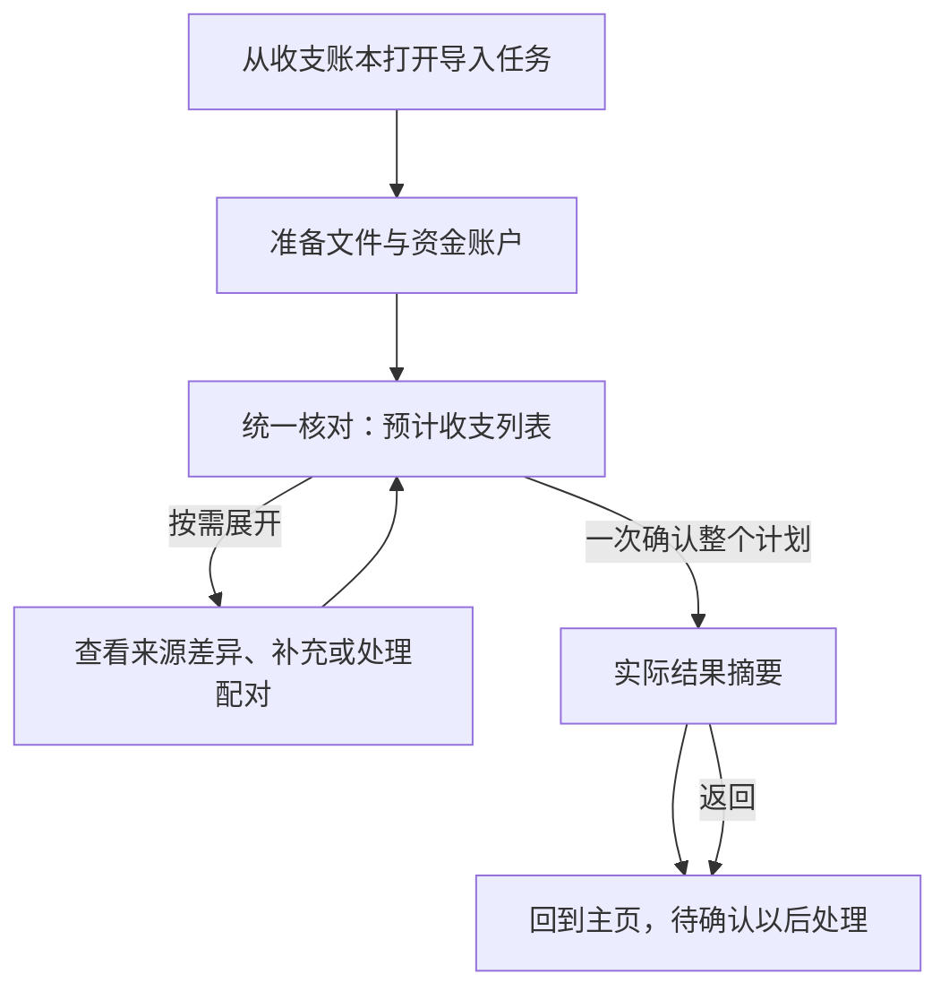

## Context

生产入口 `App.kt`／`AppShell.kt` 已在主内容区挂载 `CashImportTaskScreen`，通过 `FinanceTrackerGraph` 接入当前生命周期仓库、任务与账户 VM、按后端／使用者／工作区隔离的最小恢复存储。旧四步导入页面、scan／preview／commit 客户端及其专属模型已移除。预计整笔公共编辑使用明确 `entry.edit_ref`，不以来源行补丁替代；复杂分支与最终演示仍按 tasks 验收。

行为输入为 [导入流程](../../../docs/cash-import-flow.md)、[客户端合同](../../../docs/cash-import-redesign-contracts.md#2-用户业务流程)；公共合同及并行文件所有权见 [维护变更](../compose-cash-ledger-maintenance/design.md#共享基础与并行归属)。

## Goals / Non-Goals

把准备、统一核对、实际结果接成一个真实共享任务。保持后端支持边界，不新增独立关系管理、问题中心或长期原文件存储，不改来源算法、配对规则和万行性能预算。结果接入消费后端 commit_outcome，按是否新增异常选择摘要或统一错误，不用 partial／failed 或行码白名单猜测。后端事实由 cash-import-lifecycle-redesign 4.16 唯一维护；旧收据缺字段时仅展示原摘要。

## Decisions

### 用户流程与信息架构

| 任务状态 | 主内容 | 主要动作 |
|---|---|---|
| 准备 | 同一准备页上方文件列表、单文件状态／重传入口和来源设置，下方集中账户选择；账户表单按需打开 | 生成预览；不要求补齐全部失败或缺项 |
| 核对 | 复用主页流水表格及状态筛选，默认待确认、无待确认时全部；已知跳过／重复和文件问题在确认前呈现，不受待确认筛选隐藏 | 修改后刷新预览、确认导入 |
| 结果 | 实际保存摘要、待确认数量；提交新增异常统一错误标题和安全原因 | 返回主页 |
| 结果未知 | 已发送命令的核实状态，保留恢复标识 | 核实或按权威结果重试原请求，不换键 |

导入是账本内进入的二级任务，不新增侧栏目的地；保留直接 URL。Regular/Wide 占主内容区，不再遮罩账本的窄侧滑容器；Compact 全屏单列。标题唯一，离开入口始终可达，正文独立滚动，当前主操作保持可达。核对可使用主内容宽度，单项账户表单仍不超过 720 dp。列表与详情复用主页实现：Regular/Wide 点击后末端侧滑展示，Compact 切入详情；关闭详情回到同一列表位置并保留筛选。摘要下方用警示卡片简述待处理事项，点击业务动作后在当前详情展开处理。

### 数据与状态接线

复用新任务、账户 VM 和限时会话客户端，不重写已有恢复状态机。复用已交付的 `entry`、当前权限、公共字段冲突与决定字段；按完整替换语义提交账户、行、关系与整笔公共属性选择。保存中的冻结命令不可被新选择覆盖，迟到响应按任务归属丢弃。

输入改变后重新预览，成功更新当前计划与修订；不按页提交。核对默认读取待确认专属分页；不能过滤全部首屏后继续使用全部游标。用户主动切换的筛选在重新预览时保留；待确认数为零时自动显示全部，不覆盖其主动选择。恢复当前计划使用相同规则。

预计列表和实际结果分开保存，结果项按收据及当前定位读取。公共字段表单可复用纯显示／输入组件，但导入中的编辑仍写预览选择，不能调用已保存收支的维护命令。

新建／修改账户使用独立命令，成功后刷新可选项。离开前一次询问撤销、保留或继续；补偿前先关闭可取消会话或取得确定结果，并核对连续修订及是否允许撤销；不能撤销被引用账户或猜测丢失旧值。成功、部分完成、仅草稿及正常无新增结果退出不撤销账户；确定未保存，或收据为 `committed=true/status=failed` 且没有成功业务写入时，仍按账户改动询问。未知导入命令和未知账户命令分别核实，不能共用幂等键或先撤销再核实。

恢复存储仅保存绑定后端／使用者／工作区的最小标识。密码和文件在需要重传时重新取得；不持久化原字节或财务正文。全部重复、仅草稿、部分成功都可以有已提交收据，不能按新增数量决定是否重新发送。

### 预计整笔公共属性入口

后端在当前详情 `entry.edit_ref` 返回明确的预计整笔编辑目标，预览输入增加 `entry_choices[{edit_ref, patch}]`，只接受公共五字段与明确清空。目标由服务器完整成员、来源身份、既有对象修订及相关关系依赖限定；上一计划必须实际授权该引用。成员或依赖变化即拒绝，不按列表序号、首来源行或相似金额迁移补丁。纯重复且没有预计项目时不制造可编辑目标。

选择与来源行的 `apply`／`keep_existing`／`defer` 独立，不改变原文或来源差异决定。规划器在最终关系图上校验完整目标并呈现公共修改；提交先重建比较冻结目标，再保存流水与关系。对被编辑目标，依赖保存失败或实际完整成员不符时整次命令确定未提交并回滚；没有整笔编辑的导入保留既有单项失败隔离。实际目标一致后只修改最终公共对象一次，刷新相关列表公共值，不重复调整余额。该事务内取得的对象修订不能用作跨请求自动重放。无 schema 迁移，不新增依赖。

### 候选成员读取

单项预览详情同时返回只读 `relation_members`，按当前组与全部候选的明确成员引用给出真实字段，不用候选预计合并摘要替代成员。字段从当前冻结计划的操作／既有成员值恢复，正文只存一份；不请求全量列表来猜候选所在项，不按金额匹配。候选缺少完整成员时不可接受，来源成员保持只读，用户编辑权限仍仅取当前项 `members` 与 `entry`。

### Hallmark 方向与应删除内容

预检及共同设计体系见 [维护变更](../compose-cash-ledger-maintenance/design.md#hallmark-方向与自查)。用户明确选择现有外观和完整任务页；采用准备→统一列表→实际结果的任务结构，不选择窄侧滑导入容器、四步向导或单列关系列表。

保留现有颜色、字体、间距和 Material 3 控件；强调色只突出当前主要动作，待处理按项标记。删除四步指示器、配对教学区、重复统计说明、未保存账户草稿，以及要求处理完所有问题才能继续的提示。错误展示原因及可用动作，不暴露技术字段。

自查：同一列表完成流水／配对核对，正常合并无额外人工值选择，零金额退款可见，正式待确认未擅自排除统计；未知与已提交可区分。这里只完成方向自查，最终 audit、受影响流程 Web 冒烟及演示确认仍为开发门禁。

### 规格和实施责任

从后端主变更接管四条纯导入 UI requirement 及导入 presentation delta；改用准确名称，完整保留文件与账户边界。导入任务呈现仅由本变更定义；通用键盘／返回要求一并纳入，其他布局变更不得覆盖完整任务页。

本变更拥有导入文件族、旧导入协议退役及最终 App／Graph 接线。共享集中声明由维护模块统筹，各模块通过接口清单集成；具体归属不另复制一份。实际用户入口、演示、Web 冒烟与原生编译／单元测试均在最终依赖合入后运行。

## Risks / Trade-offs

- 底层测试通过但旧页面仍在线 → 验证生产入口、真实 HTTP 及已关闭接口零调用。
- 一项失败阻断整批 → 按文件／行／必要关系组及命令级错误分别验证，不将网络未知误当坏文件。
- 结果页残留预计合并 → 以实际收据和当前定位重读，覆盖关系保存失败。
- 无合法候选的配对异常 → 仅报告现状，不提供当前后端不存在的重新发现操作。

## Migration Plan

维护模块公共基础先合入，随后替换导入页面与注入、补齐账户及恢复、删除本模块无调用的旧协议，最后与其他两个模块完成联调。回退不恢复旧导入接口；保留最小核实入口及恢复证据。Cross-platform Impact Check：三端共用状态、文案和业务结果；文件选择控件允许平台差异，页面与系统返回均需实测。无数据库迁移和未决 UI 方向。

### 实施前细化决定

经 `grill-me → grilling` 逐轮确认：复用主页表格与详情交互；核对默认只显示待确认，有待确认时可切换全部，无待确认时自动显示全部；文件在上、账户集中在下。正常结果页仅保留摘要及返回。预览可知的重复、业务跳过、文件失败、草稿缺项与配对问题必须在确认前显示，不用结果页补救。提交新增异常统一显示“导入出错”、安全业务原因和“返回”，不提供逐项处理、失败明细或重试入口。部分成功时错误原因须准确说明已保存部分，不能暗示全批回滚。结果未知先核实原请求，返回仍保留最小恢复证据，不换键重导。后端收据与失败派生能力保留，前端不为其增加入口。

并发处理按个人使用场景保持简单：后端发现修订变化、过期或安全可重试失败时返回明确错误，页面提示重试；不自动合并表单、不自动替换修订重放、不增加跨版本执行路径。只有结果无法确定的已发送命令保留最小原键核实，避免重复记账。实际配对及公共值冲突仍由用户作业务选择。

默认验证遵循当前 AGENTS.md：Web 仅冒烟受影响流程，Android、iOS 只做相称编译和单元测试；三类窗口仍是响应式实现合同，不强制设备或逐窗口截图 QA，不将未执行范围记为通过。

核对分页只读优化：现有千行 HTTP 验证中，预览与提交达标，50 项页的 p95 约 356–399 ms，超过 100 ms。当前读取每页重建全部解析文件及验证完整会话；新增暂存只读计划快照入口，仍每次读取原对象并检查大小、JSON、摘要、所有者、TTL、当前计划与已提交收据，只跳过不使用的文件恢复和重序列化。profiler 进一步确认每页展开 4.13 MB JSON 会触发约 70–81 ms 的整堆垃圾回收；仅跳过文件恢复仍未达标。暂存仓库增加最多 16 项／4 MB 的公开读取响应缓存，仅保存响应 JSON 字节、不可变归属／到期元数据；每次仍读取真实原对象，缓存键同时包含对象 ETag、内容摘要、会话及完整分页参数，读取权限、过期及已消费收据检查仍逐请求执行。替换、取消或对象损坏均不能命中旧响应；重试会话不缓存，因其合法性还依赖根收据。没有新增数据库表、依赖或跨修订执行路径；所有预览／提交继续完整解码，缓存不能提供命令输入。以两种暂存实现的隔离、归属、过期、替换、取消、坏元数据及现有 HTTP 双后端合同／千行预算验收，不扩展万行独立待办。

来源差异显示复用维护模块的只读字段显示：`source_payload` 展开实际键值，`components` 显示账户／金额／币种，不把结构化值当未知标量。只隐藏服务端返回的完全相同 JSON 值，不在前端重算金额或推断是否可写。来源原文与候选成员仍只读。
