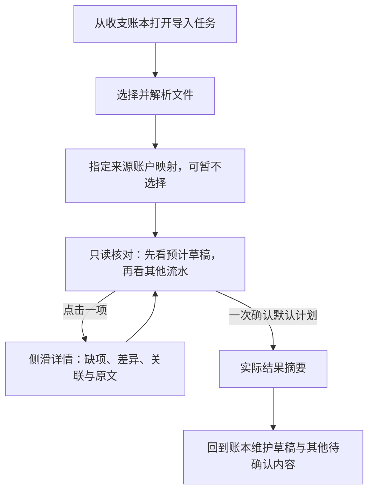

## Context

入口 `App.kt`／`AppShell.kt` 保留账本主体，并在导入任务打开时挂载全屏模态 `CashImportTaskScreen`。生命周期客户端、任务与账户 ViewModel、最小恢复存储和实际收据已接通；本轮只重写展示层。现有核对列表已经复用 `CashLedgerTableHeader`／`CashLedgerRow`，真正可复用的详情宿主是 `CashLedgerDetails.kt` 的 `CashRecordModalPanel`：Regular/Wide 为右侧模态面板，Compact 为全屏页面。

行为输入为 [导入流程](../../../docs/cash-import-flow.md) 与 [客户端合同](../../../docs/cash-import-redesign-contracts.md#2-用户业务流程)。公共账本组件和侧板由维护变更所有，本轮不修改账本主页或导入后的维护能力。

## Goals / Non-Goals

把文件选择、来源账户映射、草稿优先的只读核对、一次确认和实际结果组织成清晰、克制、可扫描的共享任务。完整候选成员、来源差异、处理原因和原文仍可检查；字段与关系决定采用服务端默认值，后续在账本维护。

不改后端、DTO、Repository、账户 ViewModel、命令状态机、恢复存储、路由地址及解析、数据库、解析／关系算法或性能预算；不增加双栏、独立详情页、导入内编辑器、问题中心或新依赖。

## Decisions

### 用户流程与信息架构

导入是从账本打开的 Material 3 Full-screen Dialog，不作为顶级页面。保留 `/cash-import` 兼容地址与恢复入口，外层标题和主体仍为账本；模态打开时后台不可交互。关闭、Escape、系统返回统一经过现有 `requestExit`，保留提交冻结、结果未知和独立账户改动保护。详情及账户表单继续在其上方按需打开，Escape 只作用于最上层。

按用户要求覆盖当前可用视口，采用无圆角表面、56 dp 标题栏、左侧关闭、24 dp 正文留白、56 dp 底部操作区；窗口安全区另行避让。宽屏保留账本表格，单项文件／账户表单维持 720 dp 上限。Material 3 规格表的 560 dp 宽度上限不用于此跨尺寸导入任务的外层容器：此处按用户明确要求保持全屏，内部信息密度沿用项目合同。删除应用顶栏中的重复导入标题、正文中的返回账本入口，结果页仍可结束并返回。

| 任务状态 | 主内容 | 主要动作 |
|---|---|---|
| 选择文件 | 添加多份文件；逐文件显示解析问题、密码重试和来源设置，行内操作收在右侧 | 解析后进入账户映射 |
| 指定账户 | 对照解析出的来源账户、建议和本次选择；允许暂不选择；从各组下拉菜单立即创建新账户 | 下一步（生成核对列表） |
| 核对 | 默认全部流水中先排预计草稿，再排带自动／手动配对信息的流水及其他项；保留账本表格与分页，跳过／重复及文件问题在确认前可见 | 查看只读详情、确认导入 |
| 结果 | 实际保存摘要与待确认数量；新增异常显示统一错误和安全原因 | 返回账本 |
| 结果未知 | 已发送命令的核实状态，保留最小恢复标识 | 核实原请求 |

标题与离开入口保持唯一且可达，正文独立滚动，当前主动作固定可达。选择文件与账户映射分别占据当前任务，不同时堆在首屏；每步使用分隔行和就地操作。核对表格复用主页行组件；详情复用 `CashRecordModalPanel` 和共享模态头部，不重写侧板宽度、手势、键盘或 Compact 行为。

文件任务保留对话框标题、步骤提示和“账单文件”分区标题，删除重复的大标题“选择账单文件”。步骤导航统一使用“上一步”和“下一步”：上一步前置左箭头，下一步尾随右箭头；“添加文件”使用前置加号。三个步骤保留“选择文件／账户映射／核对”步骤提示，并在其下、主体内容上方各显示一句简短业务说明：“添加本次要导入的账单文件。”“为账单中的账户选择对应的账本账户。”“核对本次将导入的收支和待确认内容。”不再显示额外的大标题“指定账户映射”或“核对预计结果”。文件和映射任务的说明与居中的 720 dp 正文列左边缘对齐；核对任务说明与铺满可用宽度的核对内容左边缘对齐。图标沿用现有资源与 Material 3 默认按钮尺寸，作为装饰图标不重复朗读，按钮文字承担完整无障碍名称。文件行的重试、来源设置和移除操作归入靠右的操作区；移除使用带明确无障碍名称及 Web 悬停提示的 `IconButton`，点击后立即从未提交会话移除，不弹二次确认。此行为只移除本次导入中的解析内容，不删除设备上的原文件或已入账记录，按用户明确要求作为通用删除确认规则的局部例外。

选择文件后，客户端立即读取并上传；服务端解析完成前，在文件列表中先显示本地名称和临时行。文件内容列最大宽度为 720 dp，进度轨道在该列两侧各延伸 24 dp，因此轨道最大宽度为 768 dp 并居中；窗口宽度不超过当前内容列宽加 48 dp 留白时，轨道铺满窗口。文件名与操作保持现有 24 dp 内容边距，轨道不能改变其布局宽度。轨道使用 `surfaceContainerHighest`，进度填充使用不透明 `primaryContainer`。假进度在固定 1.8 秒内推进到 90% 并停住，行尾在操作区前显示 Material 3 圆形 loading 指示器。服务端返回成功或部分解析结果后，进度补到 100%，短暂过渡后换成正式文件行；失败结果直接显示对应错误状态，不用进度完成来暗示成功。界面不显示虚构百分比。

本轮已通过真实浏览器读取 Material 3 `Buttons overview/specs` 与 `Progress indicators overview/specs`、`Icon buttons overview/specs` 正文。进度采用现有 `CircularProgressIndicator` 与基于主题色的行背景，不增加依赖；M3 进度规格区分确定和不确定状态，因此假进度只表示界面等待过程，不宣称服务端解析百分比。文件移除使用 M3 默认 `IconButton` 触控目标和图标语义，并在 Web 使用 `PlainTooltip`；项目实际 Material 3 依赖为 `1.12.0-alpha03`，`TooltipBox` 为 `ExperimentalMaterial3Api`，限定在本共享调用点并以 Android、iOS、Web 编译验证。

前轮已读取 Material 3 `Buttons overview/specs` 正文，采用简短操作标签、可选图标与 Material 默认状态。调用现有 `ButtonDefaults.IconSize`／`IconSpacing`，不固定按钮宽高；图标为装饰性，`contentDescription = null`，避免重复朗读操作名称。

详情顺序为摘要 → 问题 → 来源差异 → 关联及真实成员 → 原文。长原文与长差异折叠；没有编辑 footer、保存按钮、来源采用、关系接受或候选改选。所有候选成员仍按服务端明确引用完整展示，缺失成员只报告不能自动确认，不提供导入内处理。

### 第一版 Compose 演示边界

用户要求按第三版原型完成第一版后先演示确认，细节修整留待确认后。第一版拆分文件／映射任务、采用默认全部的只读核对及实际收据摘要；只修改共享展示层、默认筛选和当前页详情读取编排。当前页详情按明确条目引用顺序读取，复用原缓存和修订校验，不新增接口或修改保存、恢复、账户及财务规则。

现有公开读取合同不含全量草稿／配对计数、全局草稿排序或关系识别依据。第一版只有完整列表且详情读取完成时才提供精确草稿／手动配对筛选；分页尚未完成时按已加载范围展示、保留加载更多，不宣称全量核对完成。行内配对依据 `relationChoices` 的 `accept`／`defer`，现存关系 `keep`／`remove` 不冒充自动配对。无法取得的规则依据不推算。完整合同扩展、异常分支全回归及细节设计 QA 保留后续任务，本次不标记整个 change 完成。

### 数据与状态接线

复用当前任务与账户状态机。`ImportTaskUiState.choices` 保持默认空 `ImportChoiceSet()`，账户准备的选择仍进入预览和提交；UI 不调用 `editRow`、`editEntry` 或 `editPair`，因此 `row_choices`、`entry_choices`、`relation_choices` 为空，由服务端生成默认计划。

文件集合变化回到文件或账户任务并使旧计划失效；账户映射变化会重新预览。成功响应更新计划与修订；未刷新不能确认。文件解析完成前不能进入映射，重新生成计划期间不能确认。提交时固定整份**导入计划**，冻结文件、映射、返回与重复确认操作；实际结果只由该计划对应的**处理收据**生成，不能读取提交期间的实时界面状态。

核对默认展示全部预计流水，把 `anticipated_state=draft` 的草稿排在前面，逐项显示缺少的字段或来源身份及已知值，不把空账户、金额或时间伪填为零或默认值。来源行可靠但金额未知时保存金额未知的草稿；只有无法安全形成草稿等真实原因才列为**导入跳过**。正式流水即使 `confirmation_status=pending` 仍单独表述，不能归为草稿，也不能仅凭待确认状态推断不参与统计；统计说明采用每项实际资格及当前关系结果。草稿、手动配对与全部筛选只改变查看范围，不缩小最终确认范围。关闭详情回到同一列表位置并保留筛选。

配对信息直接放在对应流水行内，桌面表格和 Compact 流水行均显示“自动配对”或“手动配对”、关系类型及双方来源；草稿之后先排带配对信息的流水。没有独立的顶部关系提示或直达入口。“拟确认关系”仅保留为计划内部术语，不进入界面。详情按关系类型、真实成员、识别依据、预计统计效果的顺序解释自动决定，明确最终确认前尚未生效。证据不足的候选标示尚未合并，其成员和仍独立统计的结果可查看。查看与筛选不改变默认计划或提交选择。

来源记录数、预计条目数与正式流水操作数分别核对：同笔支付的多条来源可以形成一个预计条目，实际收据则分别报告新增、更新、草稿、重复、跳过和关系结果。结果页不根据预览条数或当前映射推算保存数量，也不因存在草稿、待确认关系或已知跳过而宣称全部成功。

当前预览分页只支持 `all/confirmed/pending`，`item_counts` 也不含草稿数量。实现前须验证能否以现有首屏和摘要真实覆盖草稿；不能仅把已加载一页的草稿置顶后声称完成全量草稿优先核对。若需增加草稿筛选或计数，应先 Flow-Back 更新读取合同、范围和验证策略，再实施。

账户映射不再提供分区级“新建账户”按钮或“编辑账户”操作。每个来源账户的目标账户下拉菜单追加“＋新建账户”；选择后立即打开现有账户表单，预填来源账户名称、来源币种，并复用旧 Web 的类型推断：名称含“花呗”或“信用卡”时为 `loan`，其他名称为 `cash`。新建成功后返回原映射行并选中新账户；取消不改变映射。选择的既有账户未支持某些来源币种时，在对应下拉框下方以小字列出待补充币种，不静默修改账户币种。

新建仍使用独立账户命令并立即生效；离开前一次询问撤销、保留或继续，补偿、未知命令核实、最小恢复标识和实际结果语义全部保持现状。结果与预计列表分开，不用新增数量推断提交是否成功。

账户类型选择沿用现有 M3 暴露下拉菜单及菜单项语义，不增加包装组件或依赖。本轮读取 Material 3 `Menus — Overview` 与 `Menus — Specs` 正文；标准菜单项保留默认焦点／悬停／按压状态和 48 dp 触控高度，“＋新建账户”作为普通菜单选项呈现。

### 响应式与组件合同

390、768、1440 px 保持文件、账户、核对的信息顺序与操作语义。Compact 为单列表格行和全屏详情，Regular/Wide 为完整表格和右侧详情；768 不另造双栏。窄屏无横向页面滚动，账户表单最大宽度保持 720 dp。

详情顺序为摘要、问题、已知字段、来源差异、关联及完整真实成员、可折叠原文。桌面侧板最大宽度 400 dp，分离留白 16 dp，正文左右留白 24 dp；Compact 全屏标题栏为 56 dp。表格由可聚焦的详情按钮提供键盘入口，数字使用表格数字；筛选用带 `aria-pressed` 的连接按钮组，不模拟不完整的 tab 键盘语义。支持 Escape、焦点恢复和减少动态效果。

`CashImportReviewList` 只重写摘要、筛选、分页和外层留白，继续调用主页表格组件。`CashImportPreviewPanel` 改为纯只读内容并删除编辑回调；`CashImportRelationEditor` 在确认无其他引用后删除，`CashRelationTreatment` 等账本维护组件保留。导入账户表单只响应来源组下拉菜单中的新建选项，预填名称、推断类型及来源币种；普通账户创建命令和退出补偿保持不变，映射内不开放已有账户编辑。

### Hallmark 方向与应删除内容

沿用既有 preflight：FinanceTheme、Noto Sans SC、IBM Plex Mono、4 dp 网格和少动效。选择 Workbench 工具方向，以三个连续任务、草稿优先的账本表格及侧滑详情组织信息；不引入装饰性 enrichment。用户要求先看独立 HTML 原型，因此仅在仓库外生成评审文件和截图，Compose 仍是最终结构与样式事实源。原型只演示正常必经流程，不读取本地账单、不虚构真实解析，也不额外演示密码、未知提交或失败重试；账户创建入口和既有名称推断在 Compose 实现中验证，普通账户命令及退出补偿保持现状。

第三版评审文件为仓库外 `/tmp/finance-import-prototype-v3.html`，保留第二版。使用明确标注的合成示例：20 条来源记录中，12 条形成 9 项预计条目，6 条重复、2 条跳过；默认全部且草稿优先，自动／手动配对的双方来源直接显示在流水行。初始 2 项草稿，补上映射后剩 1 项金额未知草稿；合成处理收据分别列出新增 8 条、更新 3 条正式流水和保存 1 条草稿，不用 9 项预计条目冒充实际保存数量。关系详情列出双方、识别依据及原文。该演示不证明真实解析、关系算法或服务端收据已经实现。

本轮用真实 Chromium 重新读取 Material 3 `Dialogs overview/specs` 正文，采用单一任务、无圆角、56 dp 标题／底栏及 24 dp 留白；Dialog 使用已有 commonMain `DialogProperties(usePlatformDefaultWidth = false)`，不新增依赖。已阅读 Material 3 官方 `Side sheets overview/specs`、`Dialogs overview/specs`、`Lists overview/specs`、`Segmented buttons overview`、`Button groups overview/specs`、`Progress indicators overview/specs` 与 `Typography — Applying type`。步骤说明使用 body 层级和 `onSurfaceVariant`，保持短句和较低视觉强调；M3 正文样式用于可读的短段落，小字号文本须保持充分对比。采用辅助内容侧板、最大 400 dp 宽度、24 dp 内容留白及 16 dp 分离留白；Compact 详情使用单任务全屏容器；列表单项一个主动作且目标至少 48 dp；筛选使用连接按钮组，选择不改变邻项宽度；解析和计划刷新使用可识别的线性进度状态。

删除导入内字段编辑、来源决定、关系决定、警示卡片内操作、双栏／独立详情页、重复统计说明与旧四步指示器。三个任务可以用紧凑进度提示表达顺序，不增加处理配对的必经步骤。强调色只用于当前主动作；状态色保留财务语义。最终必须执行可见文案必要性检查、范围化术语搜索、Hallmark audit、独立设计复核和真实浏览器冒烟，critical／major／阻断项清零。

实现沿用仓库的 `Button`、`TextButton`、`FilterChip` 和 `LinearProgressIndicator`，未新增实验 API 或依赖。已核对 JetBrains Material3 的 Button／FilterChip API 正文，保留默认尺寸、禁用与选择语义；官方页面显示 1.10.0，实际可用性以本仓库 1.12.0-alpha03 的多目标编译验证。

### Cross-platform Impact Check

Web、Android、iOS 共用 Screen、文案、只读状态、详情操作和响应式合同，三端均受展示层影响。Web 验证真实浏览器主流程；Android、iOS 默认仅编译和单元测试，不宣称设备 QA。共享 DTO、领域语义、路由与持久化不受影响。

### 规格和实施责任

本 change 继续拥有导入任务呈现。先更新 delta 与词表，再以失败回归证明旧编辑交互已移除且默认提交为空选择；实现后更新离线演示、功能地图和现状文档。旧 HTTP 编辑能力可以保留，但文档不得再宣称 Compose 提供这些入口。

既有分页只读快照与缓存决策不变：缓存只服务读取，不提供命令输入；所有预览／提交仍完整解码并校验归属、到期、修订和收据。本轮无存储行为变化，双后端矩阵不适用。

## Risks / Trade-offs

- 只读 UI 误调用旧编辑回调 → 组件 API 删除回调，并以请求体测试断言三类选择为空。
- 复用账本组件时改变主页 → 本轮只消费公共组件；回归导入并检查最终 diff 没有账本维护修改。
- 隐藏草稿导致误确认 → 首屏突出草稿与缺项原因，保留其他待确认、完整候选、处理原因和文件问题；全量分页覆盖在实现前核实，不用结果页补救。
- 平面分区降低操作可发现性 → 文件与账户各自一个清楚分区，就近操作、固定主动作，390／768／1440 实查。
- 删除专属编辑器影响账本维护 → 删除前全仓引用搜索，保留共享维护组件与协议能力。

## Migration Plan

原位替换展示组件，无数据迁移。先规格和失败测试，再准备／核对／详情／结果，随后演示与文档；小步验证。回退只恢复本组 UI 文件，不恢复已关闭接口，不更改原命令恢复证据。
