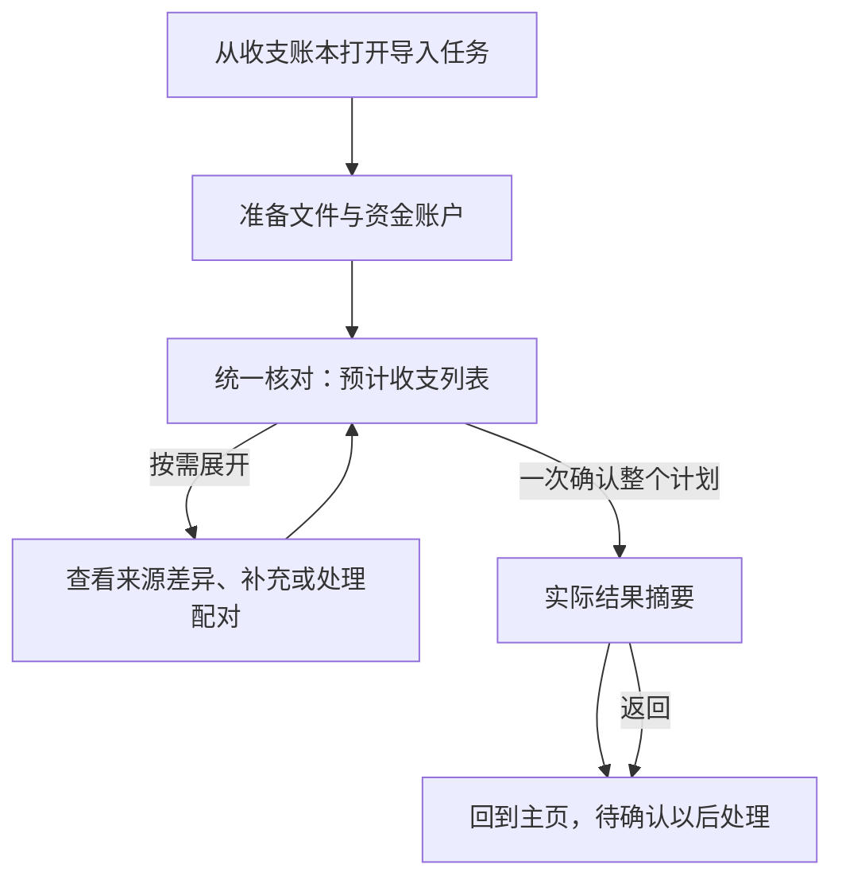

## Context

生产入口 `App.kt` 仍挂载旧 `CashImportScreen/CashImportViewModel`；新 `CashImportLifecycleRepositoryImpl`、`CashImportTaskViewModel`、`ImportAccountViewModel` 及最小恢复存储已有基础，尚未接到页面。当前计划 DTO 缺整笔公共对象及公共冲突决定，必须补齐，不能仅换按钮文案。

行为输入为 [导入流程](../../../docs/cash-import-flow.md)、[客户端合同](../../../docs/cash-import-redesign-contracts.md#2-用户业务流程)；公共合同及并行文件所有权见 [维护变更](../compose-cash-ledger-maintenance/design.md#共享基础与并行归属)。

## Goals / Non-Goals

把准备、统一核对、实际结果接成一个真实共享任务。保持后端支持边界，不新增独立关系管理、问题中心或长期原文件存储，不改来源算法、配对规则和万行性能预算。

## Decisions

### 用户流程与信息架构

| 任务状态 | 主内容 | 主要动作 |
|---|---|---|
| 准备 | 同一准备页上方文件列表、单文件状态／重传入口和来源设置，下方集中账户选择；账户表单按需打开 | 生成预览；不要求补齐全部失败或缺项 |
| 核对 | 复用主页流水表格及状态筛选，默认待确认、无待确认时全部；已知跳过／重复和文件问题在确认前呈现，不受待确认筛选隐藏 | 修改后刷新预览、确认导入 |
| 结果 | 实际保存摘要、待确认数量；提交新增异常统一错误标题和安全原因 | 返回主页 |
| 结果未知 | 已发送命令的核实状态，保留恢复标识 | 核实或按权威结果重试原请求，不换键 |

导入是账本内进入的二级任务，不新增侧栏目的地；保留直接 URL。Regular/Wide 占主内容区，不再遮罩账本的窄侧滑容器；Compact 全屏单列。标题唯一，离开入口始终可达，正文独立滚动，当前主操作保持可达。核对可使用主内容宽度，单项账户表单仍不超过 720 dp。列表与详情复用主页实现：Regular/Wide 点击后末端侧滑展示，Compact 切入详情；关闭详情回到同一列表位置并保留筛选。摘要下方用警示卡片简述待处理事项，点击业务动作后在当前详情展开处理。

### 数据与状态接线

复用新任务、账户 VM 和限时会话客户端，不重写已有恢复状态机。补齐导入 DTO／domain／mapper 的 `entry`、当前权限、公共字段冲突和决定字段；按完整替换语义提交账户、行与关系选择。保存中的冻结命令不可被新选择覆盖，迟到响应按任务归属丢弃。

输入改变后重新预览，成功更新当前计划与修订；不按页提交。预计列表和实际结果分开保存，结果项按收据及当前定位读取。公共字段表单可复用纯显示／输入组件，但导入中的编辑仍写预览选择，不能调用已保存收支的维护命令。

新建／修改账户使用独立命令，成功后刷新可选项。离开前一次询问撤销、保留或继续；补偿前先关闭可取消会话或取得确定结果，并核对连续修订及是否允许撤销；不能撤销被引用账户或猜测丢失旧值。成功、部分完成、仅草稿及正常无新增结果退出不撤销账户；确定未保存，或收据为 `committed=true/status=failed` 且没有成功业务写入时，仍按账户改动询问。未知导入命令和未知账户命令分别核实，不能共用幂等键或先撤销再核实。

恢复存储仅保存绑定后端／使用者／工作区的最小标识。密码和文件在需要重传时重新取得；不持久化原字节或财务正文。全部重复、仅草稿、部分成功都可以有已提交收据，不能按新增数量决定是否重新发送。

### Hallmark 方向与应删除内容

预检及共同设计体系见 [维护变更](../compose-cash-ledger-maintenance/design.md#hallmark-方向与自查)。用户明确选择现有外观和完整任务页；采用准备→统一列表→实际结果的任务结构，不选择窄侧滑导入容器、四步向导或单列关系列表。

保留现有颜色、字体、间距和 Material 3 控件；强调色只突出当前主要动作，待处理按项标记。删除四步指示器、配对教学区、重复统计说明、未保存账户草稿，以及要求处理完所有问题才能继续的提示。错误展示原因及可用动作，不暴露技术字段。

自查：同一列表完成流水／配对核对，正常合并无额外人工值选择，零金额退款可见，正式待确认未擅自排除统计；未知与已提交可区分。这里只完成方向自查，最终 audit、三尺寸真实 QA 及演示确认仍为开发门禁。

### 规格和实施责任

从后端主变更接管四条纯导入 UI requirement 及导入 presentation delta；改用准确名称，完整保留文件与账户边界。导入任务呈现仅由本变更定义；通用键盘／返回要求一并纳入，其他布局变更不得覆盖完整任务页。

本变更拥有导入文件族、旧导入协议退役及最终 App／Graph 接线。共享集中声明由维护模块统筹，各模块通过接口清单集成；具体归属不另复制一份。实际用户入口、演示及三端 QA 均在最终依赖合入后运行。

## Risks / Trade-offs

- 底层测试通过但旧页面仍在线 → 验证生产入口、真实 HTTP 及已关闭接口零调用。
- 一项失败阻断整批 → 按文件／行／必要关系组及命令级错误分别验证，不将网络未知误当坏文件。
- 结果页残留预计合并 → 以实际收据和当前定位重读，覆盖关系保存失败。
- 无合法候选的配对异常 → 仅报告现状，不提供当前后端不存在的重新发现操作。

## Migration Plan

维护模块公共基础先合入，随后替换导入页面与注入、补齐账户及恢复、删除本模块无调用的旧协议，最后与其他两个模块完成联调。回退不恢复旧导入接口；保留最小核实入口及恢复证据。Cross-platform Impact Check：三端共用状态、文案和业务结果；文件选择控件允许平台差异，页面与系统返回均需实测。无数据库迁移和未决 UI 方向。

### 实施前细化决定

经 `grill-me → grilling` 逐轮确认：复用主页表格与详情交互；核对默认只显示待确认，有待确认时可切换全部，无待确认时自动显示全部；文件在上、账户集中在下。正常结果页仅保留摘要及返回。预览可知的重复、业务跳过、文件失败、草稿缺项与配对问题必须在确认前显示，不用结果页补救。提交新增异常统一显示“导入出错”、安全业务原因和“返回”，不提供逐项处理、失败明细或重试入口。部分成功时错误原因须准确说明已保存部分，不能暗示全批回滚。结果未知先核实原请求，返回仍保留最小恢复证据，不换键重导。后端收据与失败派生能力保留，前端不为其增加入口。
