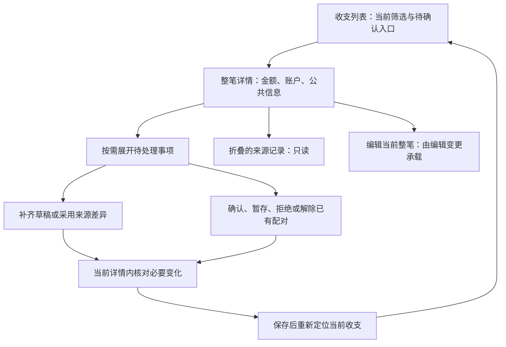

## Context

当前缺口以实际共享入口为准：`CashProjectionApi.kt` 未发送状态筛选，`FinanceModels.kt/FinanceDtos.kt` 缺当前状态和可空值，`CashRecordApi.kt` 仍按旧详情形状读取并提供直接关系写入。新的导入生命周期客户端与恢复基础已存在；本变更不重复开发它们。

后端行为输入为 [现金流水](../../../docs/cash-ledger.md)、[维护接口](../../../docs/cash-import-redesign-contracts.md#35-后续维护与读取) 和 [后端 delta](../cash-import-lifecycle-redesign/proposal.md)。服务端匹配、来源身份、金额与事务规则不在本轮重定义。

## Goals / Non-Goals

完成列表到当前详情、草稿／来源／已有关系的补处理闭环。普通编辑及新建表单属于 [编辑变更](../compose-cash-entry-editor/design.md)，文件导入属于 [导入变更](../compose-cash-import-workflow/design.md)。不增加问题中心或一级关系页，不重排全局导航，不修改持久化。

## Decisions

### 用户任务与信息架构

| 区域 | 展示与动作 |
|---|---|
| 列表 | 保留当前筛选与月汇总；仅存在待确认项时增加快捷筛选；沿用大屏表格、手机列表 |
| 详情总览 | 整笔金额、币种、日期、账户、分类、备注与对方；未知保持未知 |
| 待处理 | 总览摘要下方警示卡片显示具体问题，点击后在当前详情展开对应操作；没有问题不留空教学区 |
| 来源 | 默认折叠，展开看各自原文和字段，只读 |
| 操作 | 整笔编辑、更多操作与明确删除影响；查看者不获得写入口 |

现有详情容器保持 Compact 全屏、Regular/Wide 末端全高面板。关系与来源处理采用当前容器内子状态，不增加独立关联任务。无待确认时隐藏快捷入口，但已生效状态筛选仍须可从现有筛选区清除，避免困在空列表。

### 共享基础与并行归属

本变更先完成任务 3.1–3.3，提交可编译的当前读取／维护合同和详情宿主，再由三个模块并行实施。两个消费方依赖该小步，不能把三个 change 宣称为完全无依赖。

| 所有者 | 文件／责任 | 其他模块如何使用 |
|---|---|---|
| 本变更 | 当前列表／详情 DTO 和映射；计划新增 `CashMaintenanceApi.kt`、`CashMaintenanceDtos.kt`、`CashMaintenanceModels.kt` 与 Repository；`CashLedgerScreen.kt`、`CashLedgerViewModel.kt`、`CashLedgerDetails.kt` 宿主及补处理 | 提供读取、草稿保存、维护预览／提交、结果核实、重新定位，以及编辑器挂载回调 |
| 导入变更 | `CashImport*`、`ImportTask*`、`ImportAccount*`、导入恢复接线；App／Graph 的最终集成 | 使用冻结的公共字段／关系选择语义，不写账本 ViewModel |
| 编辑变更 | 新编辑表单、输入／命令构造与独立状态、普通创建及明确转账适配 | 消费维护模型，在宿主给定插槽中渲染，不改列表和关联状态 |

`FinanceModels.kt`、`FinanceDtos.kt`、现有 FinanceRepository、共享语义 ID／文案目录及演示基础由本变更统筹；导入和编辑各自新增局部文件或提交所需接口清单，不并行改写集中声明。App／Graph 由导入模块最终接线，维护模块先行提供需要注入的合同；依赖合并后各模块必须验证真实入口。

后端 `entry`、`record_origin`、`editable_fields/allowed_actions`、`supports_transfer_edit`、`common_field_conflicts`、`common_fields`、`inherit_common_fields` 等公开字段必须保留 null 与明确清空。选择组件只回传服务端允许的完整候选，不能自行拼关系。导入 DTO 由导入模块补齐，避免强行共享两个不同生命周期的命令状态。

### 调用与恢复

读取切换到当前 `GET /cash-records/{id}`。普通草稿保存使用 `/cash-mutations/plans` 的 `save_draft` 意图，带当前修订并保留原计划命令；明确转正式、来源问题及关系维护使用同一维护计划合同和当前编辑上下文。直接 `PATCH /cash-records/{id}/draft` 仅保留兼容，不作为新页面恢复路径。新建与源文件不参与该编辑上下文。

保存前保留对应命令的最小恢复证据，未知结果先核实；计划过期或修订冲突统一提示重试，重读当前详情并按返回修订重置表单后重新操作，不做自动表单合并或重放。保存后的当前展示可能变化，使用收据保留目标及稳定流水定位刷新，不能复用旧展示 ID。维护提交使用对应计划收据，不混用导入恢复标识。

列表接收 `state/confirmation_status` 与可空展示值，计数使用服务端结果，保留筛选范围。后端计数也受传入筛选约束，不增加本地估算计数。切换至待确认后的加载期间保留已选筛选控件；无当前数量时只显示“待确认”，不伪造计数，也不通过移除控件丢失键盘焦点。版本变化重载后清理不能继续安全使用的批量选择，分类／删除仍走现有整笔命令和影响预览。

草稿的日期时间沿用本机时区和现有日期／时间选择器；只有更改该字段时才转换为带时区的时间，未更改时保留原值及秒精度。转换使用各平台已有时间 API，不新增依赖；不存在或重复的当地时间拒绝保存并提供字段校验，禁止静默校正夏令时或按 UTC 误存当地时间。

### Hallmark 方向与自查

用户已确认保留整体外观，仅重做流程与操作布局。预检：共享框架为 Compose Material 3；[FinanceTheme](../../../compose/shared/src/commonMain/kotlin/com/finance/tracker/core/FinanceTheme.kt) 提供浅／深色与形状，[token](../../specs/shared/design-system/tokens/core.tokens.json) 提供蓝色强调与 4 px 间距；Web 使用 Noto Sans SC，Android/iOS 使用当前系统无衬线字体。保持既有字体映射和组件状态，不新增视觉系统、装饰动画、原型或 Pen 产物。

方向为任务型账本：列表优先扫读，详情按总览→待处理→来源→操作组织；使用现有 token 与标准 Material 3 控件。将删除旧新增关联搜索、逐条来源编辑、重复摘要、无问题时的空说明、实现术语和卡片套卡片。正常状态帮助最多两处且各不超过 16 汉字，字段校验按项目规则。

规划自查覆盖密度、只读／编辑边界、空／错误／提交／未知状态、无障碍名称和三类窗口；当前没有新页面可供 audit，不把规划自查算作最终 Hallmark audit。开发完成须审查实际页面和截图，并演示给用户确认。

### 规格及旧任务归属

后端变更保留服务器读取／统计与领域合同；本变更只增加真实页面验收，不复制后端算法。其原 4.12.4 的草稿、来源及关联页面任务移交本变更，正式公共编辑由编辑变更负责。旧 `compose-cash-ledger-redesign` 保留布局和未验收演示，不能再恢复逐条来源编辑或直接关联写入；通用 M3 合同继续适用。

## Risks / Trade-offs

- Web 弹层关闭后无障碍树残留：Compose `1.12.1` 已复现上游 [CMP-10623](https://youtrack.jetbrains.com/issue/CMP-10623)。用户明确保持当前版本，不升级 `1.13.0-beta01`；将该问题作为待解决缺陷，保留关闭后恢复语义树的失败回归，不将对应无障碍 QA 标为通过。业务交互继续按当前默认 Web 冒烟范围验证，Android、iOS 仅编译和单元测试。
- 旧 DTO 能编译但运行时读取失败 → 以真实响应形状做解码及端到端合同测试，不用旧演示数据掩盖。
- 关联保存／发现失败没有合法候选 → 只展示安全原因，登记后端边界，不提供重新发现按钮。
- 共享文件并行覆盖 → 基础小步先合入，按所有者实施，集成后重跑受影响验证。
- 直接按“待确认”排除统计 → 汇总采用服务器结果，分别断言草稿和正式待确认。

## Migration Plan

先冻结并提交公共基础，再切列表／详情和补处理，接入编辑器与导入后的定位。新合同接通前不回退旧写入口。无数据库迁移；回退只读降级。Cross-platform Impact Check：Web、Android、iOS 页面和共享层均受影响，实现保持三类窗口合同，默认 Web 代表视口冒烟，Android、iOS 仅编译和单元测试；不得沿用旧截图当作当前流程通过。没有未决业务或 UI 方向。

实施前细化：用户确认总览摘要下方以警示卡片简述待处理问题，点击业务动作后在同一详情展开；公共编辑通常一次保存，仅实际新增影响需要确认。导入与主页共用表格及详情宿主，Regular/Wide 末端面板、Compact 全屏。

维护任务的原命令定位按 API 来源、用户和工作区隔离，使用独立于导入会话的本机命名空间；计划命令只保存目标流水、计划修订及原幂等键，普通草稿保存采用后端 `save_draft` 计划并只保存原计划定位，不持久化财务表单或来源原文。未知结果先核实，未确定前禁止打开其他流水覆盖命令；已知收据与保存后的当前详情读取分别处理，读取失败不能抹去已提交事实。

草稿仅发送用户实际修改的标量；单笔金额／币种／账户的现金部分联动由后端在同次来源处理后的有效值上完成，禁止客户端发送包含旧金额或币种的派生完整组成项。

普通一次保存使用后端完整 `additional_effects`；为空时在同一次动作内预览、提交，有额外影响才确认。缺少该字段的计划作为无效响应提示重试，不维护旧版计划确认分支；不能根据 `can_commit` 或首屏详情推断。后端单一归属及验证见 `cash-import-lifecycle-redesign` 4.17。

并发处理按个人使用场景保持简单：后端发现修订变化、过期或安全可重试失败时返回明确错误，页面提示重试；不自动合并表单、不自动替换修订重放、不增加跨版本执行路径。只有结果无法确定的已发送命令保留最小原键核实，避免重复记账。实际配对及公共值冲突仍由用户作业务选择。

真实行点击使用列表 `transaction_id`；`record_id` 只作为来源编号读取，不解析展示标识或猜测目标。该字段由后端当前读取合同直接提供。

草稿的 `economic_type` 与时间、金额、币种一样保留真实 null，不用虚构枚举替换，不开启全局 JSON 强制转换；实际客户端夹具覆盖该合同。

草稿补齐按当前 `next_action=edit` 合同接线；所有草稿编辑问题集中为一张警示卡，列出具体问题，有具体原因时不再重复“信息未补齐”。没有具体问题时才显示通用待补齐提示。卡片点击展开同一个表单，不保留无操作的重复警示卡。

合并收支的待处理事项必须覆盖当前全部成员。详情读取现有 `/cash-projections/{id}` 的明确成员引用，再读取待确认成员的当前详情；不从来源编号或组成项编号猜目标。公共摘要保持当前收支；其他成员的问题在摘要下同一详情内展开，提交使用问题所属流水的当前修订。读取失败直接提示重新读取，不静默丢失成员问题，不引入跨版本分支或自动合并。保存后重新读取当前成员，来源区折叠，避免旧展开状态停留在永久加载。

来源展开复用现有证据成员的明确流水引用，读取当前详情的 `fields.source_payload` 并按原账单字段只读展示；不把归一化备注当作原文，不持久化原文，不增加后端接口。成员修订或展示版本不一致时只提示重读，不混合显示；来源错误由用户重试重新读取当前详情。草稿分摊表单保留组成项身份与顺序，只有用户明确调整分摊时才发送完整 `components`；普通标量改动不携带旧分摊。

单笔／分摊切换只提交当前模式。切回单笔不携带隐藏的分摊改动，明确“采用上方账户与金额”的选择不跨模式沿用；分摊行的身份与原顺序保持不变，新行使用未占用顺序。
