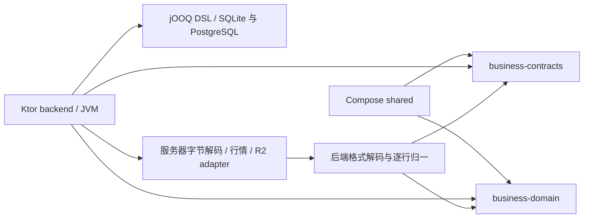

## Context

起点为远端 `main` 的 `0c038a75e34264bd6d4aa5cce2070727df9d9ff7`。当前工作区为 `/workspaces/finance-tracker`，分支 `codex/kotlin-backend-shared-core`，jOOQ 与证据读取已保存至 `394b23e5553b18a980e37f92d59d6146289cc37b` 并推送至 origin 同名分支；继续迁移当前流水详情。历史 macOS 验证仅说明当时的代码快照；当前容器使用仓库外匿名夹具重新执行受影响验证。

已读根 `AGENTS.md`、项目技能、项目上下文、主规格导航、active changes、词表、Python 与 Compose 相关实现和 CI。`grill-me → grilling` 及 `openspec-explore` 已显式执行，用户确认完整迁移、保留全部合同，并明确授权先提交并推送当前进度、后续每完成一个实施阶段在本仓库当前分支提交并推送至 origin 同名分支；部署未获授权。用户明确确认旧实验停止后才允许构建测试。旧实验 REPORT/README 仅作受限背景，不复用规划器、IPC 或 Gson 实现。未找到本机 `memory_summary.md`；本机 Codex memories 目录为空，memory 数据库只读查询未找到相关项目条目，不能假称读取了不存在的记录。

当前 86 个 HTTP 操作及模块、格式、后台任务见 [迁移盘点](inventory.md)。当前产品 CLI 已退役，必须保持不存在。现有 active changes 的未完成事项保留原状态；其历史证据不是本任务当前验证。

## Goals / Non-Goals

完成全量运行时迁移和实际前端共用，范围与验收见 proposal。公共层只接受显式输入，服务端负责事实和副作用；不做产品重设计，不修改已通过性能门槛，不引入自动冲突合并，不碰真实账本和用户服务。用户明确要求本轮完成标准为功能迁移及功能测试：本轮执行双库功能、安全与事务合同，明确排除性能用例，保留原性能预算及未通过证据，性能验证不阻断本轮功能交付。

## Decisions

### 多文件来源批次规划

批次规划复用单文件的字段校验、索引、身份及旧流水对应规则，先按可靠证据合并，再按可比较范围和相同内容的最大出现次数生成共同操作。可靠身份的不同快照按完整且互异的文件修改时间选择；时间缺失或相同时按选择文件顺序。固定财务字段仍由当前旧流水校验，不因选中了较新文件而覆盖。空页的文档证据参与同命名空间冲突检查；不确定结果用共享组引用，不建立猜测的逐行绑定。该纯规则先完成原生功能测试和完整结果对照，再接暂存及导入事务；不会改变现有上传或确认流程。

### 解析会话存储

解析会话沿原 Python 私有 JSON 格式保存已解析文件与计划，不保存上传字节或密码。文件模型在既有来源组合模型上补齐客户端引用、名称、大小、状态、诊断等元数据；解析与执行仍使用同一行模型。编码前校验文件和会话，区分解析文件预算与完整会话预算，往返解码隔离调用方可变容器。普通读取完整核对，计划投影读取保留原已发布内容的校验边界。存储以原始对象字节及条件版本为依据；内存和 R2 共享会话生命周期，CAS 不替代应用服务的工作区锁。创建重试只用于确认的键冲突，提交结果未知不做无条件覆盖。取消清空文件、计划和私有上下文，更新保持原到期时间；清扫只处理明确属于本命名空间的对象。

私有计划快照保存不可变已验证字节并绑定原存储/条件版本，返回 DTO 和字节均隔离调用方修改。公开缓存仅存过滤后的 JSON，最多 16 项且总计 4 MiB；每次仍读取当前对象，使用 ETag 与内容摘要隔离，错误与 TTL 不能被缓存遮蔽。R2 条件对象端口已有 AWS SDK HTTP 客户端，清扫器接本机运行入口；维护计划已使用此存储，上传应用服务仍待接入。计划专用解析对无法由正常编码器产出的极深损坏对象及非有限指数更严格；既有 coverage filters 仍为字符串映射，此类型边界在完整上传验收前继续核对。

后台清扫与用户访问独立，启动先同步扫描一页，失败则拒绝启动。还有分页时立即继续，完整一轮或失败后等待配置间隔；失败不丢游标，不记录 provider 正文。生命周期锁与扫描锁分离，停止先通知当前扫描再等待启动/工作线程结束；重复启动、并发停止不产生第二线程。配置必须明确选择内存或 R2，内存要求原允许开关，TTL、间隔和页大小保持原界限。Ktor 生命周期启动时首扫，停止时等待在途扫描结束后幂等关闭客户端；JVM 外部中断不提前释放等待，完成后恢复调用线程的中断标记。

R2 HTTP 使用 AWS SDK for Java v2 `2.57.7` 的 S3 客户端及 URLConnection transport，依赖只在 backend。SDK 负责签名和 S3 协议，配置使用显式静态凭据、HTTPS endpoint、region（默认 `auto`）及 path-style 访问，禁用 AWS 分块编码以保持完整 JSON 请求正文；连接 3 秒、读取 5 秒。应用层不得把不确定写入当键冲突；SDK 禁止自动重试，避免条件写已成功但回包丢失时的再次发送掩盖原结果。请求/响应正文、签名和凭据不进入应用日志。用本机 HTTP 假服务验证实际 SDK 发出的请求、条件头、元数据、对象流与未知结果；生产配置仍只允许 HTTPS，不连接真实 R2 或写第三方资源。

维护计划通过既有 `MutationPlanStore` 协议适配共享解析存储，删除独立可变 Map。上下文必须为 `mutation`、无文件，正文恰含交易标识和版本；每次读取经当前存储权限/有效期/完整格式验证，返回独立 JSON。所有已接入的预览和查询先在当前财务事务核对永久消费；取消入口仍待迁移，并须遵循同一检查。重新预览使用已校验快照的修订执行 CAS，不能在构建后重读并采用新修订覆盖并发变化。提交将收据与业务事实先原子保存，再尽力取消临时上下文；清空失败保留原成功收据且由固定 TTL 清理，不能在财务事务提交前删除计划。后续公开请求仍由永久收据阻止重写。运行入口向维护服务传同一已配置存储；直接测试构造器使用可注入内存或合成 R2 端口。

### 来源账户对应持久化

导入资金组扫描使用已解析文件和行，按来源、身份种类、来源范围及身份键生成稳定组引用；银行优先完整账户，无法识别时保留文件局部身份及可信显示名，微信默认与命名范围隔离。支付宝金额提示只用于分配，不成为账户身份，补贴和优惠不产生现金部分；已知部分不猜剩余金额。选择按严格字段和当前账户资格验证，多组指向同一账户时合并为一个现金部分，保留 80 位十进制加总及行原文。已知解析错误只作用于原行，内部程序错误停止整次准备。该切片不读取数据库或写入对应，不提供上传入口；原账户修订变化重新核对当前资格，不构建自动并发合并。

来源账户建议按 `funding_group_v1` 的完整来源组身份查询，最多 200 个去重键一批。已确认对应优先；存在但已失效时不回退旧对应或别名。旧对应仅覆盖默认微信零钱、工行完整文件账户及工银亚洲完整账户标识；银行别名只接受至少 5 位 ASCII 数字的完整文件账户，多个有效账户不猜测。建议只核对工作区、活动状态及现金/借入/借出类型，币种资格由导入行准备阶段核对，不写默认。

发布接收调用方已验证的成功使用证明，与流水、投影和收据处于同一事务；相同来源组选择不同账户在查询前拒绝。同值保持原确认人、时间和修订；换账户才更新确认人、微秒时间及修订。内部仓库不提交、不增加自动合并、upsert 或重试。本片先迁仓库及建议，导入提交的成功筛选和来源组扫描仍须分别验收，不因内部实现计为上传或完整导入可用。

维护提交完整验收还须迁移 Python `_validate_current`：冻结方案在写事务内依据当前账户、关系、事项和证明重建并核对，不以父流水或收支修订替代。当前已接入提交只完成部分动作，4.8 保持未完成，须补不推进父修订的关系/事项变更拒绝回归后实施。

单流水提交先在同一写事务按冻结输入重建，操作按 Python 白名单摘要比较；事项身份、修订、code 与 key 纳入冻结操作，账户依赖仅包含实际财务校验所需的存在、类型、活动及币种支持，不因展示名称或无关币种变化拒绝。关系上下文复用既有稳定 token，并保存原 seed/decision group 依赖；当前关系/事项变化分别按原 `record_changed` 或 `relation_context_changed` 拒绝。重验发生在财务写入和永久收据创建前，拒绝保留临时方案；多成员、关系保存和完整来源仍待后续验收。

冻结内部请求按已归一结构解码，非关系意图仅允许暂存中的空 `relation_additions`，公共请求仍拒绝该字段。操作保存完整收支对象及独立恢复值快照；草稿重新计算账户与可纠正的解析事项，外部来源事项和 `relation:` 事项按原身份保留。明确选择失效账户仍拒绝整次输入，不转成草稿成功。Python 预览对照增加内部账户、事项及收支依赖，提交回归分别核对所有财务表无写入、方案未消费和原键可重试。

单流水提交保持原写入顺序：未处理的来源待采用或身份事项阻止转正式；任何动作携带的 `entry_edit` 都在同一事务应用，正式公共编辑也保存事项决定。三个独立审查发现均以失败回归证明并修复，不把已接入动作中的遗漏推迟到完整关系迁移。

维护提交在永久收据查询前取得目标工作区锁，锁后重新核对会话、成员及活动工作区，并与进入请求时的工作区一致；返回前再次核对权限。SQLite 使用已有 `BEGIN IMMEDIATE`，PostgreSQL 显式锁工作区。实锁等待回归覆盖降权、退出与换区，原键并发提交只创建一份收据；不引入金融操作自动重试。

### 已授权凭据类型调整

用户明确选择注册/登录的 `email`、`password` 仅接受字符串，停止 Python `str()` 对任意 JSON 值的隐式转换。使用按字段存在性检查的 JSON object 解码：缺省沿用空字符串，显式非字符串（含 null）返回 400/invalid_credentials；未知字段继续忽略。字符串正常/错误路径继续与 Python 黄金比较；非字符串路径依据新 delta 单独验证无用户/会话写入。此决定仅涉及这两个端点的凭据，不扩大到工作区名称、分类或其他协议字段。

密码适配使用 JVM 独立实现读取原 Argon2 PHC 字符串，并与 Python 固定盐/参数黄金及双向验证比较；新 hash 沿用当前 Argon2id 参数和随机盐。注册、登录与登出的用户/会话写入采用显式事务，失败回滚，DB 仅保存 token 摘要。新增密码依赖只留 backend，不进入公共层。

### 模块与依赖

在现有 `compose` Gradle 构建内新增独立 `business-contracts`、`business-domain` 与 JVM `backend`。模块目录虽共用构建，依赖图不允许后端依赖 Compose `shared`、UI 或平台适配器。账单保持客户端上传、服务端解析和预览，先共享行模型和协议，不新增客户端解析入口或 `statement-core`；存在真实客户端调用场景时再规划归一算法下沉。

公共模块提供 JVM、Android、iOS arm64/simulator arm64、JS、Wasm。沿用当前 Kotlin 2.4.20、Ktor 3.6.0、serialization 1.10.0，不为实验沿用旧版。公共 source set 禁止 Compose、SQL、java-only 与网络依赖。先物理移动已有纯规则并保留原调用签名，DTO 用明确别名替换重复定义；业务扩展由 Python 黄金驱动。

参考已核对的 [Ktor serialization](https://ktor.io/docs/server-serialization.html) 和 [KMP DSL](https://kotlinlang.org/docs/multiplatform/multiplatform-dsl-reference.html)。不用 Gson。JSON 需逐能力明确 `encodeDefaults`、`explicitNulls`、未知字段、严格标量、重复键和预算；禁止对全部接口简单套一个宽松 Json 配置。

### 实际双端复用与完成标准

用户确认按实际双端需求复用，完整后端迁移范围不变。优先级为协议与输入校验、金额/分摊、分类、账单行与预览/提交协议；投资计算随真实客户端需求接入。投影重建、完整关系规划、投资重放、文件归一等没有现有客户端消费者的算法先保留在后端纯业务层。

每片核对正式客户端调用、正式后端调用、旧重复实现、协议消费和测试证据。只有两端实际调用同一规则、旧重复实现已移除或登记兼容适配、同一输入跨平台结果一致时才计为双端复用完成。现状中认证和分类目录 DTO、分类祖先与移动约束已双端使用；精确分摊主要由客户端调用，分类排序由后端调用，金额合法性和现金部分规则目前仅测试使用，不能把公共模块存在当作全部复用完成。

服务端读取当前权限、账户、修订和完整组后再次执行公共规则；客户端展示模型、任务状态、文件选择、本地时间与格式化、缓存保留。表单语法与旧协议解析使用不同命名入口，不扩大或收紧既有行为；注册规则不套用到旧密码登录，持久化金额范围不盲目限制中间计算。

### Python 测试迁移与漏项门禁

测试对应表以基线 Python 测试定义及参数化场景为盘点来源，逐项记录规则/断言、Kotlin 目标和结果。检查器从基线和当前源码重新枚举，新增、删除、源变化、目标不存在及未处理项必须可见；不能靠手工选择几个文件形成虚假的全量分母。静态函数计数与 pytest 展开后的用例计数分别报告，不以测试数量相等证明断言等价。

已授权修复带来的新增 Python 回归通过对应表的 `source_additions` 登记准确源码指纹和复核理由；原基线保持固定。未登记、指纹变化、无理由、已删除或与基线重名的新增项均使检查失败。新增项默认 pending，只有完整断言、参数和实际 Kotlin 测试均登记后才允许标迁移；新增文件的 fixture／输入指纹仍独立检查。

共享规则的测试迁入公共 `commonTest`，服务端 Application Service/HTTP/存储测试迁入 backend；正常、边界、错误顺序、缺省/null、失败无写入、并发和回滚断言一起迁。原 Python 回归与黄金仅作为对照补充；Kotlin 测试不能运行 Python 业务实现才能通过。仍保留的历史 schema 或基础设施用例逐项登记理由和执行路径，由独立审查确认，不静默删项。每片先出现目标行为缺失导致的失败，再实现转绿；未对应参数或断言的片段不标完成。

### 当前收支详情与稳定流水定位

`GET /cash-records/{transaction_id}/projection` 先检查原 ASCII 正整数标识，再在当前活动数据集中定位；不按业务可见性过滤，隐藏的零金额结果仍可定位。`GET /cash-projections/{projection_id}` 保留 1–128 码点标识与可维护条件（可见或存在待处理事项），并核实实际成员数及展示基准流水。不存在、已删除、跨工作区、状态未就绪和成员缺失分别保持原 404/503 错误及 `field_errors/retryable` 字段，不用空结果掩盖内部不完整。

财务读取使用 SQLite 的同一读事务和 PostgreSQL 的 `REPEATABLE READ`，从活动状态到成员、关联摘要、分类、转账双端及待处理事项均在同一快照完成。权限不沿用该历史快照：读取前和返回前使用独立当前连接重验令牌、当前工作区及成员资格，并对照请求已授权工作区。读服务不抢占整个工作区写锁，不触发重建、余额更新或状态初始化。以真实交错重建和撤权/换区/登出测试区分财务快照一致性与当前授权。

详情仅返回原公开问题原因，不加载待采用字段、账单原文或候选正文；待确认关联只影响相关成员的确认状态。现金转账优先采用首条完整已发布关联，银证转账保留接受状态、资金方向与原币种金额。现有 Compose 只消费详情中的版本与成员，抽取这一既有 DTO 到公共协议并由后端实际使用；完整投影展示与按流水定位没有新增客户端入口，不能把读取迁移计为整页可用。列表、证据及维护命令分别继续迁移。

### 当前单条流水详情

`GET /cash-records/{transaction_id}` 返回当前流水及来源事项，复用已有精确字段规则、稳定收支仓库和 jOOQ 生成类型。来源事项的缺省正文与明确清空分别判断；固定字段冲突先于用户补丁，受保护字段保持当前值，现金部分仅可引用本流水拥有的标识。多个所选来源不一致时沿原冲突规则处理，不猜测或自动采纳。只读规则先独立验证，再用于详情计算可选动作和后续维护服务。

事项选择保留 `issue_id` 的原字符串，与当前事项的十进制标识精确匹配；不提前收窄成 Long，前导零或超出 Long 的合法协议文本沿原 `issue_changed` 拒绝。正文摘要保留 Python 的 Unicode 码点键序、UTF-8 与浮点表示，来源金额仍以精确十进制处理。差分逐层核对 JSON 类型和值，浮点按完整二进制值与符号比较，金额文本、错误、摘要及字段集合严格相等。

可选来源动作继续调用完整只读准备。其依赖的来源正文效果先单独迁移：原文只派生备注与当前单行解释，账户身份仅来自已保存的可信解释；不采用正文伪造的身份、金额、类型或跨行决定。保留微信空商品、银行列名去空白及同名冲突、显式备注和人工保护优先、金额方向相关退款信号。微信、支付宝、建行、工行和工银亚洲沿原来源规则运行；纯规则以完整值差分和原生断言核对，供详情及后续维护共用，不用默认放行或仅校验补丁代替真实准备。

详情按当前角色、创建方式和完整成员数给出可编辑字段，查看者不返回可执行的来源选择。当前候选展示使用当前流水和账户值，不刷新其保存的修订证明；来源身份判断读取绑定与页证据，不从可编辑原文重建身份。公共人工值与来源字段分别返回，账单原文只出现在原合同允许的位置，不带出内部关系线索、来源绑定或候选证明。

单条详情不同于收支展示详情：没有活动投影时 `projection_ref` 可空，活动指针存在时沿原定位规则返回；不套用展示接口的 ready、可见性或成员完整性前置。读取使用一致的财务快照，返回前独立复核当前会话/成员；若角色变为查看者，返回内容不得保留旧编辑能力。存储或内部故障中止读取并按既有维护路由输出安全错误及诊断，不保存待处理问题，不返回部分详情。

实施分为来源选择规则、详情读取与 HTTP/客户端三个可验证阶段；每阶段完成相称验证后按用户授权提交并推送当前分支。成功读取通过现有 Compose `sources` 的版本、成员修订及当前位置检查，不更改产品 UI；失败仍由现有刷新重试流程处理。

### 首个垂直切片

先实现旧令牌可用的 `GET /auth/session` 与鉴权工作区内的 `GET /cash-categories`，前端真实消费公共认证 DTO、Role、分类上级纯约束及精确分摊算法；不称认证或分类模块全部完成。会话读取只需有效 token SHA256、有效期和用户，保留原 active_workspace_id（含空或已无 membership 的值），按当前 membership 列出工作区；分类另行要求当前活动成员资格。分类目录保持现有排序、名称数组路径、空 description 和修订；缺目录 state 返回 0，GET 不持久化初始化。首片不写金融事实，后续写入必须覆盖完整事务/幂等/投影。

首片 HTTP oracle 比较完整错误：session 401「请求未获授权或无效。」与业务 401「请先登录。」分别保留；覆盖 malformed Bearer、过期、无工作区、移除 membership、CORS 允许/拒绝来源和 OPTIONS。运行时保持本机任意 HTTP 端口及配置 HTTPS origin 的 CORS，不允许 cookie credentials。接口矩阵必须与真实 create_app 装配导出的 OpenAPI 方法/路径集合一致，不只按文件提取 decorator。

首片本机预览的数据库 URL 暂限绝对文件 `sqlite+pysqlite:////...` 和有 host、无 query 的 `postgresql+psycopg://...`，其他格式明确拒绝。默认 SQLite driver/相对路径、PG socket、SSL 等连接参数仍属后续装配迁移项；不得静默丢弃连接参数，不能宣称启动配置全量兼容。

分类目录和命令回包的 `path` 均为含自身的名称数组，摘要/详情等其他 API 使用对象数组。公共目录 DTO 单独建模；Compose 按同一完整目录的 `id/parent_id` 链重建真实祖先对象，检测缺失与循环，并核对名称路径，不按名称猜 ID。领域 `path` 仅含祖先，由展示层附加自身。创建、编辑、排序只消费命令确认 `id/revision`，再沿用现有目录刷新；不能以缺少祖先对象为由把已成功写入报告为解码失败。实际 Ktor 读写字节经正式客户端解码器验证。

### 分类删除的财务引用维护

删除检查按当前工作区返回目录修订、分类行修订、直接子项和当前 entry 使用量。删除在工作区写锁后重验权限与目录修订，依次拒绝不存在、有子项、过期分类或使用量、未确认的已使用分类；保留原错误码与顺序。检查读取不持久化目录初始化。

同一事务集合更新当前 entry、全部独立恢复值和全部引用事实（含已删除事实），清空分类并保护人工决定，保留其他人工字段和分类来源元数据。事实行修订递增；按实际改变事实使候选及端点依赖失效，每个关系修订只递增一次。全部数据集的对应投影清空分类，ready 活动数据集标记下一版本；仅存在当前使用或事实改变时推进状态版本及来源修订。任何失败回滚全部效果，不修复真实数据库。

DELETE 输入以原始字节解码，保留 Python 的 BOM/UTF-8/UTF-16/UTF-32 检测、代理字符来源、JSON 语法错误位置和三项整数转换；非法输入不执行删除。整数错误 repr 采用原 200 字符上限，十进制转换沿用 4,300 位限制。输入来源元数据仅用于该命令解析和错误诊断，不进入持久化或公共协议。

原生测试独立迁移原删除断言，补 stale impact、权限、跨工作区、事务回滚、超过 500 条候选依赖及集合 SQL 性能；Python 完整 HTTP/持久状态对照只作为补充。客户端继续使用既有删除检查与确认流程，不新增界面。没有独立删除消费者的算法保留服务端。

### 当前收支的单项和批量分类

分类命令先去重并保留原 ID 转换，在工作区写锁后重验当前权限并锁定 ready 数据集，依次验证当前版本、目标分类、可维护的当前投影和完整 entry/成员。可见或有待确认提示的投影可维护；根流水或任一成员已删除时拒绝旧选择。选择未覆盖完整稳定收支对象时整批拒绝，不拆分重跑。

显式选择相同分类也建立人工保护；变更只写稳定收支公共值，来源事实及其人工覆盖不回写。单成员对象同时更新独立恢复值，多成员对象保留各自恢复值。任一公共值/保护或投影路径不同才推进投影和来源修订，并对整批投影写入同一新版本；全同值且已保护则保持版本。所有更新共用一事务，批量 JDBC 写入保留原集合读和写预算；未知内部错误停止并回滚。沿用现有 Compose 分类请求与结果，不新增界面。

分类 API 的 SQL 验证包含真实 middleware 鉴权、工作区锁、服务端重新授权和批量写入，保留原 12 条 API SQL / 500 毫秒门槛。middleware 当前工作区仅作为锁目标提示；取得工作区锁后以单条会话/用户/成员联查重新验证令牌、有效期、当前工作区和可写角色，并锁定会话。提示不作为授权依据，工作区已变化时拒绝，不自动重放。服务直接调用时自行读取初始会话。JDBC 连接装饰入口默认恒等，仅为测试观测真实执行和 batch 边界，不探测或启动数据库。

成员删除检查只沿选中投影读取成员，再按流水主键判断当前删除状态；根流水也按主键读取后核对工作区。不能先连接整个数据集与工作区全部流水再排除已删除成员：PostgreSQL 在新工作区统计低估时可能选择反复扫描整个工作区的嵌套循环。PostgreSQL 固定选中 CTE 边界，以标量 `LIMIT 1` 保留删除检查的相关读取，并以 `LATERAL` / `OFFSET 0` / 唯一键 `LIMIT 1` 逐级限定成员、稳定收支对象的读取；只固定 CTE 不能阻止后续三表全局连接。SQLite 使用同一业务过滤和原索引连接。性能验收包含完整回归数据及新工作区，不能依赖手动 ANALYZE 后的较好计划。测试为实测语句设置 5 秒取消上限以保证失败后完成夹具清理，验收仍为 500 毫秒，不提高预算。

当前 Python 的 `update(parent_id=...)` 与内部 `move(...)` 具有不同的投影维护调用链，迁移保持各自入口的现有行为；不以本片分类命令顺带更改该差异。内部 move 的完整投影维护仍另行验收。

### 稳定收支对象和投影发布

投影 SQL 适配器先以同一连接上的稳定收支对象仓库处理公共人工值与成员归属，再发布派生行。仓库保存分类、备注、交易对方及账号的当前公共值，成员保留独立恢复值；两者不回写来源事实。重组先保留旧根所在结果，拆分继承按原明确选择处理；不同人工值合并时拒绝，不选最后一个值覆盖。公共值、根或成员改变按原分支推进修订，无当前成员的对象仅在成员调整后删除。所有操作由调用者事务提交，失败回滚；修订溢出停止写入。

先迁移仓库规则及双库原生反例，再接入全量/增量投影；未接入的内部仓库不计新增 HTTP 完成。SQL 行值只在服务端转换，不将持久化、图校验或人工继承规则放进公共 UI 模块。原 ORM 的身份、未 flush 与 expire 断言须以实际事务上下文适配并复核，不能因采用 JDBC 而默认为通过。投影、关系和来源维护在同一事务内共用一个稳定收支仓库上下文；不能照搬 Python 的逐调用新建仓库而丢失 Session 级身份与待写状态。提交前完成 flush，expire 丢弃未保存修改并保留对象身份，快速 JOIN 逐行核对缓存归属。已有 schema 和历史迁移仍是兼容边界，不在本片自动升级或修复真实库。

全量重建在工作区/状态锁后读取并验证事实、现金部分及完整关系图，使用与 Python 一致的 canonical 摘要；暂存数据集和稳定收支对象在同事务生成，发布前重读摘要并核对完整成员。验证证明仅对同一仓库实例和事务有效；发布清理原数据集。非存储构建失败由独立事务写安全诊断，带原活动集/来源修订围栏，不能覆盖后来成功。增量维护保留当前成员和确认关系的完整闭包，仅替换受影响组；无关投影身份和原性能预算保持。

管理员重建 HTTP 先取得当前工作区定位，在工作区锁后及返回前核对真实会话、操作者、工作区和管理员角色；拒绝时整事务回滚，不另写失败诊断。领域构建拒绝保留 Python `CashProjectionError(ValueError)` 的 409 与检查数据提示，仓库运行错误/存储错误保留 503 与稍后重试提示；`projection.incomplete` 可来自领域图或仓库完整性检查，不能只按 code 猜 HTTP 分类。时间、匿名 ID 和故障钩子仅用于内部测试，不加入公开请求。管理员能力当前没有 Compose 调用方，不新建页面或重复共享 DTO。

增量维护先锁定当前 ready 状态，引用只在同一事务上下文有效；跨工作区、上下文或提交后拒绝复用。确认图闭包与旧投影成员反复扩展到完整受影响组，保留来源与人工值。相同独立项或完全相同的成员/关系结构直接更新派生字段，保留父行、成员、关系身份；重组只删除实际受影响的旧行并插入替换项。所有成功维护按原分支推进投影/来源版本、清除构建错误并维护计数，不改活动数据集身份或全量构建诊断时间。新流水可明确排除旧根查找；单笔移除按根索引定位，批量通过成员反查。新建、独立刷新、展示字段刷新、移除和未初始化时的稳定收支维护共用 caller-owned 事务及一个 entry 仓库，失败回滚全部。无关派生行必须逐列保持，原性能预算继续适用，不以全量替换充当增量。

同事务状态只有一个对象身份，重读、增量推进和全量发布都更新该对象。创建 savepoint 前无条件 flush 既有收支及成员修改，保持原 Session.begin_nested 的边界。savepoint 回滚保留外层来源证明身份，但必须重载可变缓存：恢复已加载或在保存点内移除的收支/成员对象，丢弃保存点内新增且已回滚对象的托管关系，并重新取得工作区/状态锁后恢复活动集与版本/计数。SQL `ROLLBACK TO` 与 JDBC `rollback(savepoint)` 都触发该恢复；恢复失败停止整个操作，不能继续使用过期缓存。监听器只属于注册时的外层事务，提交、回滚及连接关闭时清除，复用连接的新事务不得回调旧上下文。

分类独立 move 命令与 Python 保持同一事务：收集子树下未删除来源流水以及稳定收支根，更新树路径/深度后按完整闭包维护投影；无使用不推进投影版本，未 ready 只维护稳定收支。原 update 虽调用树移动 helper，但没有投影维护调用；本次保留该既有边界，不将用户批准的后代 depth 修复扩大为额外行为修复。移动后的实际深度及五层限制仍按正确树结构验收，失败回滚分类与派生状态。

现金写入先接余额快照仓库：数据库保存稳定账户 ID，领域增量按当前账户名/类型处理，保留未知历史键、同名合并及 security/crypto 兼容；无快照只读返回默认，不创建记录。写入在原 caller-owned 事务取得工作区/快照锁，精确加减采用原精度 80/half-even，再验证既有金额范围；草稿与删除记录不计余额，普通导入 transfer_in/out 排除，manual 来源保留。批量变更时间取最后一个计入余额的新/旧记录，不受随后草稿影响。快照与 entry、投影、来源必须整事务回滚；内部仓库未接实际现金入口前不计新增接口，也不把单入口测试当作完整多入口源参数迁移。

内部余额组成项的 account_type 来自 AccountModel.type 的非空字符串列，公共手工新建/组成项输入也不允许声明该内部字段。Kotlin 在余额边界拒绝非字符串值，停止整个变更，避免将非法类型转换为新的余额桶；不实现 Python 字典对 True/1/1.0 的键合并来接纳无有效账户对应的内部值。该语言类型适配不改变有效账户或公开请求合同；公共现金入口接线时仍须验证账户资格，不允许客户端伪造此字段。原 source 测试中的三个余额入口都是有效字符串类型；statement 入口仅为共享函数别名，其纯参数可独立迁移，实际导入仍保持 pending。

手工新建先保留严格请求合同：65,536 字节、JSON 编码识别、重复键和非有限数字拒绝，字段白名单与严格字符串/整数/null 联合，64 个现金部分。服务器内部字段在 HTTP 与直接应用调用均拒绝；保留未提供与显式空 note/category 的区别。直接应用边界递归复制对象和数组，隔离调用方后续修改，并保留容器共享引用；不可变 primitive 保留身份，以继续查询原始 Unicode 表示。余额快照保存复用同一复制函数。现有 JSON 读取器增加可选错误适配与手工请求专用限制，账户读取保持默认原行为。实际创建在工作区锁后重验操作者/工作区及当前账户，保存 manual 来源和只读来源字段，现金部分、余额快照、稳定收支和投影在同事务完成；完整响应继续供既有 Compose 创建 API 消费。未接入接口和当前消费者前不增加 HTTP 完成数，不制造新的页面或客户端流程。

手工创建时间沿用原仓库 datetime.fromisoformat 合同：支持纯日期与无时区时间，缺省 UTC，保留微秒截断及特殊日期/分隔符；既有 posting policy 仍要求显式时区。共用 ISO 解析过程但显式选择入口规则；UTC 换算超出 Python 年份范围仍停止操作，不改为可继续的业务结果。原账户资格与现金部分校验按原创建调用链保留，不额外加入停用账户或组成项币种配置的新产品规则。 金额仍由共享 LedgerDecimal 解析，新增可选失败原因回调供后端映射原精度/范围/非有限数错误，Compose 原 parseOrNull 调用保持不变；不是在后端复制一套金额校验。币种 isalpha 使用 Python Unicode 14 字母表，避免 JVM 字符版本差异。 新建保留原 flush 造成的行修订推进：先保存原子事实，现金部分改变账户/聚合形态时推进修订，显式人工保护再推进修订。PG 失败后的事实/现金部分序列也由后续合法新建对照；全部组件 label 在执行任何组件 INSERT 前完成 UTF-8 校验。持久化文本编码错误返回原 UnicodeEncodeError 的安全 ASCII 消息；错误回包本身无法编码时保留 500，整事务不写入。多字段校验按原绑定列顺序；合法 emoji 与只用于 ISO 分隔符的单代理仍按原入口处理。极大指数零在 SQLite 固定为 0/-0，PG 保留原 NUMERIC 绑定拒绝；NUL 在 SQLite 保存、PG 拒绝，不擅自修复这些旧后端差异。

SQL UTC 时间按 Python datetime 的微秒精度绑定，两库都先截断微秒，不能让 PostgreSQL 对 JVM 纳秒尾数再次四舍五入。金额读取保留 SQLite 原系数/指数与负零，仅去掉 PostgreSQL NUMERIC 的表示补零；canonical 摘要仍按原固定小数、UTC ISO 时间、Unicode 键序和浮点拒绝规则，不能直接散列 JDBC 文本或默认 Java JSON。

### 手工转账和旧现金写入

转账保留双边精确金额和现有公开请求：同币种忽略显式到账金额并返回原警告，跨币种必须提供到账金额。现金、贷款、借款两侧保存 `manual_transfer` 来源和同一转账标识，建立已确认的现金部分关系；投资或加密账户一侧保存 `funding/subaccount` 事件，不伪造现金关系。两边均为投资账户时仍写两个投资事件。同名投资账户按原规则拒绝，账户停用及空币种配置不额外收紧。普通新建的账户资格不能用于替代旧转账合同。

转账事件构造与余额更新先以纯规则和独立测试迁移，再接入真实 caller-owned 事务。现金余额保留负数、精度 80 和原金额范围；投资及加密现金头寸仍共同使用 security 快照桶，增量同时作用于 shares 和 total_cost，保留其他头寸字段。来源事件、现金部分、关系、快照、稳定收支和增量投影共用事务；后侧持久化、余额溢出、投影或返回阶段失败必须全部回滚。HTTP 完成数仅在完整双后端、原断言和 Compose 实际消费者验证后增加，内部算法验收不增加接口数。

旧现金新增和余额校准沿用原账户查找、币种及响应语义，与严格手工新建分别保留应用边界，底层 SQL 绑定和金额规则复用。原始时间响应、快照 updated_at、金额表示、来源字段和行修订按各入口核对，不能因共享持久化而统一改写。原接口没有新增手续费参数，本片不设计新费用模型。

投资事件 ticker 和现金头寸键使用 Python Unicode 14 小写表及 final-sigma 上下文；合法币种 `ΟΣʰ` 对应已有 `οςʰ` 头寸，不能采用 JVM 默认小写另建键。大小写忽略属性由同版本 Python 的 Sigma 上下文探针生成并检查，保持 Unicode 版本一致。纯事件 helper 保留符号翻转和巨指数零的科学表示，公开服务仍先拒绝非正金额。投资仓库保留原 `_amt` 的 18 位 HALF_UP 和 28 位上下文限制，先于日期与备注编码；原内部量化失败仍停止并回滚，不擅自扩宽金额合同。组合时间保留 date/time 原始代理位置，编码失败的错误响应保持 500，合法转义代理对仍按一个码点处理。

旧现金新增保留公开 source 的来源文字、对应来源摘要和原未保护 note/category；严格手工新建仍不允许这些服务器字段。余额校准保存零金额 legacy 事实，来源文字为手动，备注按原币种符号和两位 HALF_EVEN 金额生成，再按原精度设置指定币种余额；其他币种不变。原始响应时间、快照时间和日期摘要分别保留，不用 SQL UTC 时间覆盖。账户定位、存储金额、日期、文本绑定、余额范围及晚期投影失败按原顺序差分，并验证失败后下一次成功的持久身份。两个入口均在工作区锁后与返回前核对当前授权，共用原子现金部分写入、快照仓库和投影上下文，不复用普通新建的额外资格或人工保护规则。

用户已确认修复旧现金新增的响应编码事务缺陷。Python 和 Kotlin 均在事务内构建成功结果，并按实际 JSON 响应规则完成 UTF-8 预检后才提交。日期原文中的孤立代理字符即使可作 ISO 时间分隔符，也必须在预检失败时回滚事实、现金部分、快照、收支及投影。保留可编码的 Unicode 时间分隔符和原响应字段，不自动清理历史库；源 Python 与 Kotlin 的双库回归同时断言错误响应及全部财务行未改变。

读取余额快照时，损坏的顶层、账户类型桶和投资头寸结构属于内部错误，保持原 500 及整事务回滚。现金新增／校准的账户余额不是币种字典，以及原金额解析拒绝，仍按原 ValueError 返回 400；不按同一 Kotlin JSON 转换异常统一分类。校准先检查账户余额是币种字典，再解析目标金额；坏余额结构与范围外金额同时存在时仍优先返回结构错误。投资头寸先计算 shares，再读取 total_cost，保留金额错误与缺字段错误的原次序。组成项币种校验同时核对原始 JSON 的代理字符来源与规范化值，不能把原始 CESU 字节拼成合法 Unicode 币种；合法转义代理对继续按原规则处理。响应编码回归以实际 editor 和已有财务记录保留原测试前置，每个代理字符参数分别核对失败全回滚及后续正常写入。

旧 HTTP 的 decimal-string 语法与财务范围分两步核对：将已有共享十进制解析过程提取出有限值表示入口，继续由原 LedgerDecimal 校验 NUMERIC 范围，客户端原入口不变。该提取用于保留 HTTP 字段校验与应用范围校验的先后，不复制一套语法解析器。校准的范围外数值仍在写入零事实和现金部分后由快照金额校验拒绝，整事务回滚并保留原 PG 序列行为；拒绝分支不展开无用途的巨大指数备注，避免在必然回滚的准备步骤分配巨型文本。有效金额的备注和最终响应保持原格式。

### 收支证据读取

收支证据 GET 复用当前读取的独立授权与同一财务快照，使用生成字段查询活动数据集、根记录、成员和现金部分、已发布关系及当前端点。按照原成员、现金部分和关系序号组织响应；非活动关系按原状态及 ID 排序。根记录、成员、现金部分及端点的字符串标识、金额文本、空值和字段省略保持实际 Python 协议，不依据客户端类型推测服务端输出。

证据接口允许读取隐藏投影，不复用当前详情的可见／关注筛选。它不校验当前详情专用的 128 码点长度，也不将原存储错误统一改成当前详情的可重试错误；缺记录、数据未就绪和存储异常分别保持原状态与安全正文。根记录不在当前成员中时保留原 Python LookupError 的 404，不修改数据；其他内部错误继续停止读取。读取前后核对真实会话、工作区和当前成员，普通只读角色仍有权限；活动集发布和旧集清理不能让一个响应混入不同版本。

输出只包含可核对的业务记录和关系端点，不输出来源原文、待采用正文、人工覆盖及匹配元数据。资金调拨仅输出已确认且活动的关系和既有证据白名单，布尔值不得作为整数窗口／候选数通过；内部保存的流水类型若为数组／对象，沿原错误边界停止读取，不忽略损坏字段后发布部分信息。来源原文由其既有专用详情流程提供，本片不新增客户端任务或页面。先执行完整匿名 Python 响应对照和 Kotlin 原生断言，再由现有两个 Compose 证据消费者读取真实 Ktor 回包；包含未迁移列表、扫描或维护操作的原测试定义保持 pending。

### 数值、时间与解码

现有 `ExactDecimal.kt` 仅有分摊加减，`DisplayDecimal.kt` 属展示计算；不能作为已完成的完整金额层。按 Python `exact_decimal` 的有限值、有效尾零、18 位小数/20 位整数及零指数边界生成黄金，再补无浮点金额运算及指定舍入。保留界面当前输入语法，与服务端可接受的指数输入分别定义。时间使用明确 offset/UTC，来源无 offset 只按渠道时区解释；本地显示和表单 patch 保留 presentation。

金额合法性与已知现金部分一致性先以 `scripts/export_shared_rule_goldens.py` 从当前 Python domain 生成固定/随机匿名黄金，在公共 JVM/JS/Wasm 执行同数据。Python 3.11 的 Unicode 14 十进制数字与空白集合由同一可检查生成器固定，避免各平台 Unicode 版本不同造成接受范围漂移；`--check` 验证实际生成内容。该边界不把现有表单的严格输入正则扩宽，也不以规范化后的值覆盖来源原文。

账单结构输入保留原字段、出现位置、文件声明、parser version 和来源证据。CSV/TSV 平台解码与结构归一分层；XLSX ZIP/XML 预算、XLS 和 PDF 密码/超时由可运行 adapter 承担。若阶段保留 Python 格式解码，只能是隔离的具体格式 adapter，退出条件为对应黄金与安全预算全部通过，不能转发业务 API 或把 Python 规划当 Kotlin 实现。

来源对应解析先迁当前索引、绑定证明、同文件位置、内容差异与守恒；只产生 match/duplicate/new/pending/conflict 结果和新 ID，不写账本，批间重复计数只在批次层合并。

来源账户扫描只使用已归一行的支付方式/文件账户证据：支付宝组件分摊只校验金额语法与守恒，账户存在性和映射持久化留给应用服务；group_id 只由来源/身份种类/内部键摘要生成，不向客户端泄露内部键。

已解析文件组合只复用归一结果：跳过行、显式 resolved 字段覆盖、subset 覆盖降级、微信 scope label、认证页完整性合并和文件元数据进入同一批次输入，不重新解析或访问账本。

来源身份先迁文件/出现/文档/页绑定键、provider 摘要、微信来源范围与多页完整性派生；键输入只来自已解码文档与稳定定位，不从正文猜造，也不接暂存或写入。

统一入口只做读取格式分派和行归一，不执行上传、去重、关系或持久化；空输入、未知来源、密码失败与文档错误保持原分类。

工行 PDF 行归一保留信用卡/借记卡方向、金额、币种、时间、卡号归属与显示名、摘要噪声子序列、基金清算户、退款/冲正/offset 与渠道；不可用行清理 coverage 文档键、页数与页指纹。

银行行归一并保留建行交易地点/对方户名对手方、支付源、退款信号、卡号尾号显示名、account_opening 跳过和工银亚洲金额方向/备注去重；覆盖可用性使用同一开始/结束边界判定。

平台行归一保留原方向/金额/类别、跳过原因、时间、对手方、原文备注、订单号、来源解释与覆盖可用性；只复用已迁的分类、账号、来源正文和平台对手方规则，不重写另一套品牌表。

来源行归一的公共规则先迁记录类型/子类型分类和对方账号规范表示：按来源原生字段判定冲正、P2P 退回、退款、还款、投资、利息、费用、转账/提现方向及默认子类型，对方账号保留完整号、尾号、掩码和工银亚洲可证明重建；分类只读取来源行字段，不接受客户端推断，也不跨行配对。分类结果和账号属性以 Python 匿名行组合黄金逐项对照。

工行信用卡/借记卡 PDF 由后端专用 Apache PDFBox 3.0.8 解码，仅进入后端依赖，不进入共享模块。读取器按页上限预检后提取文字坐标与表格线，按原 pdfplumber 默认格子表语义构造单元格：坐标吸附/拼接容差、字符中心归属、行内间隙空格、跨行换行，并保留原始表头与空单元格。页面文字用于核对品牌、起止日期、本页笔数、总页数/页码、筛选条件和导出时间；表格用于逐行原文、物理位置和页指纹。保留 100 MiB 输入、25 MiB 解析文本、2000 页、10 万业务行、20 万物理行、128 列、每页 16 表、500 万字符预算及 `startxref … %%EOF` 完整性检查；解析前要求末尾存在 `startxref` 指针，避免 PDFBox 自动修复 Python 会拒绝的损坏文件。加密 PDF 使用独立密码失败类型，由后续导入上下文映射为密码必填/错误；其他解析异常统一脱敏为 `statement_unreadable`。PDFBox 只在本机验证匿名合成样本，不提交真实账单，也不把 PDF 能力扩张到 Wasm/iOS。匿名夹具由 Python 开发依赖 reportlab 生成、pypdf 生成确定性加密样本并固定在金标准中，运行时不使用这些工具。

### 持久化和安全

jOOQ adapter 适配当前 Alembic schema，不自动建表或迁移。首次装配只接受显式连接且检查 schema revision；SQLite 文件须已存在，外键、有界锁等待、私有权限及辅助文件保护保持原合同。SQLite 精确数值文本，PG `NUMERIC(38,18)`，禁止 `Double`/REAL。

用户确认采用 jOOQ OSS 3.21.9、JDK 21、PostgreSQL 18 与当前 SQLite JDBC。PostgreSQL 18 先作为本机独立端口的匿名测试实例，保留原实例与夹具，不执行真实数据升级。官方代码生成器从显式指定、已运行现有 Alembic 迁移的匿名 PostgreSQL schema 生成后端表、字段及记录类型；生成结果可重现并校验，不手写伪生成类型，也不引入第二套迁移事实源。普通编译消费已校验的生成类型，不探测或启动数据库；重新生成要求明确的 `_test` 数据库。连接串格式拒绝使用固定错误，不保留可能包含凭据的 URI 异常及 cause；独立代码生成测试不连接数据库。生成类型不进入共享协议或规则。

业务查询和写入使用生成字段与 jOOQ DSL，包括关联、子查询、批次、RETURNING 和行锁；不以将 SQL 字符串传给 jOOQ 代替迁移。事务控制、驱动配置和 schema 校验保留 JDBC 边界。jOOQ 使用现有受管 Connection，不再拥有提交、回滚、重试或连接关闭权；原 SQLite `BEGIN IMMEDIATE`、PG 锁顺序、savepoint 缓存恢复和来源证明寿命均保留。

查询保留原列范围。为缺少稳定收支对象的流水建立公共值时，只读取构建所需财务字段；账单原文及关系元数据不属于这一操作的输入，不能因全表记录自动解码而引入额外拒绝。SQLite 中无关原文损坏仍允许原公共编辑，原文逐字保留；双库回归分别验证两个公共编辑入口。

分类删除继续在数据库内批量清空分类并保护人工值。JSON 函数通过 jOOQ 的函数表达式组合；SQLite `json_each` 使用固定 `{0}` QueryPart 模板把函数表达式作为表引用，不插入 SQL 文本或用户值。PostgreSQL 保留 JSONB 对象更新与数组追加语义；两库均保留其他人工字段和原修订推进。SQL 测试观察器只规范化引用符、大小写和空白，继续验证实际参数、批次、索引和晚期故障，不能让文本不匹配使断言失效。

金额使用后端专用绑定，SQLite 按精确文本读写，PostgreSQL 按 NUMERIC 读写，不经浮点，也不丢失 SQLite 有效尾零或负零；原 PostgreSQL 数值表示归一保留。UTC 时间截断到微秒，JSON 使用 `kotlinx.serialization`，空值保留原语义。jOOQ 执行日志关闭，SQL、绑定值和连接串不进入响应或日志；只将包含真实 SQL 异常的 DataAccessException 转为现有安全 StorageFailure，程序错误继续中止操作。

PostgreSQL 金额绑定保留十进制原文并由 NUMERIC 转换，避免驱动提前把 `0E2147483648` 归一化为零，绕过原数据库拒绝边界。SQLite 同一输入继续使用原固定小数表示；失败时整笔回滚，后续合法请求的事实和组成项序列与 Python 对照。

生成器把 PostgreSQL INTEGER 字段的 JVM 读取类型提升为 Long，使同一生成模型能无损读取 SQLite 的 64 位 ordinal、成员数和关注数；不改变 PostgreSQL 物理字段或范围，原业务确需 Int 的深度/排序在应用边界按既有行为转换。双库当前读取极值合同验证该适配，不能因从 PostgreSQL 生成而截断 SQLite 合法整数。

先以失败测试验证生成类型、极值金额、UTC/JSON、回滚、savepoint 和异常边界，再迁移当前收支详情/定位及完整转账调用链，最后替换其余现有手写业务 SQL。每步运行同一服务在 SQLite 和 PostgreSQL 18 的功能合同及原完整回归；性能用例按本轮明确要求排除，已有预算和失败证据保留。框架接入不增加已完成接口数，剩余后端迁移继续按全量盘点验收。

写命令在同一事务内重验认证/成员/账户/修订/来源和完整组，再调用共享规则。SQLite `BEGIN IMMEDIATE`，PG workspace `FOR UPDATE`，只在适配层区分方言。收据与业务结果同事务；永久 `(workspace,user,key)` 唯一，不随暂存 TTL 删除。计划保留 CAS、owner、TTL、输入/当前事实证明，未知结果按原键核实。SQL、连接串、凭据和原始文件不进入公共层，不写日志正文。

## Risks / Trade-offs

- 大范围 API/数据库差异 → 全量 inventory 逐项状态与 Python oracle，HTTP 成功/错误/省略/null/DB effects 比较，未覆盖不标完成。
- 字符串金额算法与 Unicode/时间行为差异 → 边界及固定随机黄金，JVM/前端目标同数据验证，不用浮点缩短实现。
- 旧 PDF/XLS 依赖跨端不可用 → 明确格式 adapter 和真实样本，平台能力不越界。
- Mac mini 内存及用户服务 → 串行重构验证，任务独立缓存/数据库/端口；不终止或复用旧实验进程及用户服务。
- 部分运行时被误部署 → 本轮仅本机显式预览入口；原生产入口与 Python 保留，任务状态明确未完成。

## Migration Plan

1. 公共合同/规则与首个鉴权读取切片，建立 Python 黄金、Ktor HTTP 和双库测试路径。
2. 完整认证/工作区及账户、分类/公共属性写入，验证原子性、权限和修订。
3. 现金事实/完整组/投影读写与维护计划，永久收据/未知结果核实。
4. 服务端格式 adapter 与逐行归一、来源证据/去重/暂存，完整导入计划/提交；前端共享行模型和协议，保持上传流程。
5. 关系纯计算与权威候选/决定/投影，现金—投资资金调拨。
6. 投资事件/持仓/成本/PnL/估值，投资格式、同步连接器、行情/FX、SSE 与清扫。
7. 完整 Python 与 Kotlin 合同矩阵、原性能和安全/资源专项，前端目标验证、文档收尾、独立最终复核、同步规格后归档。

每步先失败测试再实现。PG 使用人工启动的任务私有实例与 `_test` 库，显式 `FT_TEST_POSTGRES_URL`；测试不启动或探测数据库，skip 不计通过。真实数据和凭据不复制。回滚保留原 Python 入口与 schema，不切流不双写；任何生产切换、迁移、提交或外部写另获授权。

当前后续顺序先建立测试对应表并补查认证/金额已迁移规则，再打通分类目录真实解码和完整分类写入、账户与现金配对切片、账单行与预览协议、投资。分类目录名称数组和客户端详情对象路径使用分别命名的类型及显式映射，不能改服务端字段掩盖客户端差异。修订值使用可承载当前后端范围的类型；测试以实际后端响应经过 Compose 解码/领域映射证明消费成立。

分类目录 wire 路径含自身名称，Compose 领域路径仅含祖先对象；适配从同一目录的真实 `id`/`parent_id` 链重建祖先，不能按名称猜身份。写入回包使用独立类型，不以缺失祖先或伪造 ID 冒充完整目录对象。

用户已明确授权同步修复 Python 与 Kotlin 分类移动的深度缺陷：循环前固定原根深度，各后代使用该不可变基准计算，结果不依赖数据库遍历顺序。新增原回归同时校验下移/上移后的后代深度及后续五层边界。此项是已确认的 oracle 修复，测试对应表记录基线与当前测试指纹和原因；不自动扫描、重写或修复真实数据库中既有错误深度，历史数据修复需另行授权。

### 认证写入切片

注册、登录、登出先独立验证，再接工作区与成员。JVM 密码适配使用 Bouncy Castle `bcprov-jdk18on:1.86` 的 Argon2 实现（仅 backend 依赖），读取原 PHC 参数与 UTF-8 密码；新密码保持 Argon2id v19、64 MiB、3 次迭代、4 lanes、16 字节随机盐与 32 字节摘要。以 Python 固定匿名密码和固定盐生成黄金，并用 Python 验证 Kotlin 新摘要；生产运行不调用 Python。

写事务在同一连接验证与保存，SQLite 使用 `BEGIN IMMEDIATE`，PostgreSQL 使用显式事务；任何异常回滚。注册唯一邮箱冲突只转换已识别的唯一约束错误，其他数据库错误不伪装凭据错误。令牌为 32 字节安全随机值的无填充 URL Base64，数据库只保存 SHA-256。会话默认工作区按会员创建时间选择，过期为 30 天。注册默认管理员和已存在 `default` 工作区的关联保留。非字符串凭据单独按已确认 delta 测试，其他正常及错误路径由 Python HTTP 黄金驱动；读写快照对比用户、会员和会话的实际数据库结果。

官方实现依据：[Bouncy Castle 下载](https://www.bouncycastle.org/download/bouncy-castle-java/)、[Argon2BytesGenerator](https://github.com/bcgit/bc-java/blob/main/core/src/main/java/org/bouncycastle/crypto/generators/Argon2BytesGenerator.java)。新增依赖不进入公共模块或客户端。

已知金额一致性提供两层入口：保留 JSON 原始类型的入口负责标量、引用、组成项 ID 和 ordinal 结构，类型化快照负责已知值的币种、方向、账户及精确合计。不得在 HTTP 适配中先把任意 JSON 值转成金额字符串再宣称通过规则。黄金覆盖 JSON 数字与字符串、显式空、缺省、错误次序、Unicode 十进制字符及极值指数；取负和整数转换前先限制指数，避免平台整数溢出。

密码读取与 Argon2 校验在 SQLite 写锁外完成；短写事务重读当前用户及密码摘要，改变时拒绝，不自动重放。UTF-8 编码采用严格报告模式，与 Python 一样不把孤立代理字符替换成另一密码。仅字段类型已授权改为 400；顶层非对象及破损 JSON 保留原内部错误边界，不在本片扩大产品行为。

工作区写入保持当前权限和最后管理员规则；每个写事务在同一连接重新读取有效会话、当前工作区及成员。PostgreSQL 先读取目标，再按工作区、会话、邀请顺序加锁并重读，避免删除清除其他会话时发生锁顺序反转；创建新工作区只锁当前会话。SQLite 的短事务由 `BEGIN IMMEDIATE` 串行化。邀请保留 7 天、摘要存储、一次消费及已有成员角色不覆盖。删除须精确确认当前名称，清除所有会话的活动指针，并按当前 Python 的依赖顺序清理投影、收支对象、关系、事实、分类和账户；仅当前会话选择剩余工作区。

新工作区在创建事务内发布零来源的首个活动数据集及 ready 状态，源摘要按现有规范 JSON 计算，版本和计数与 Python 对照。新工作区初始化复用完整重建的来源校验、暂存替换和原子发布管线，由创建事务提交或回滚；当前查询仍独立迁移。工作区名称和角色继续现有字段转换边界，不能将注册/登录的字符串限制扩大到这些端点。数据库结果黄金覆盖成员、活动指针、邀请消费和初始投影状态；并发角色变更和初始化/删除失败回滚已有双库专项，完整财务数据删除与等待锁时撤权仍待验证。

删除后的备选工作区须在事务内确认仍然存在。PostgreSQL 对备选使用 `FOR KEY SHARE NOWAIT`，正在修改或删除时以既有 `storage.busy` 拒绝并回滚本次删除；不猜测其他工作区或重放决定。SQLite 写事务已串行化。原 Python 的并发删除缺口不能使 Kotlin 发布已删除的活动指针。名称的旧 JSON 转换由匿名差分覆盖；浮点文本使用最短可回读十进制及 Python 格式规则，Unicode 可打印与空白集合固定为 Python 3.11 的 Unicode 14，不采用 JVM 版本相关分类。这些浮点值只用于旧名称转换，不能进入金额计算。

## 账户命令切片

账户按稳定 ID 查询和修改，创建后类型固定；服务端在同一事务重读当前会话、活动工作区和成员资格，锁定工作区、成员与账户，校验修订后保存账户、余额快照和永久收据。相同用户/工作区/原键先比较规范化命令摘要并重放原结果，再检查当前账户；删除后仍能按原键核实，其他命令不得复用该键。空补丁也推进修订，失效修订返回可识别错误供刷新重试。

输入保持当前账户专用合同：名称按 Python 空白裁剪并以 Unicode 码点限制 255，类型为既有五项，币种严格 ASCII 三字母、去重排序；补丁仅允许名称、启用和币种。HTTP 拒绝未知字段、重复 JSON 键、非有限数、非整数修订及超过 65,536 字节的正文，错误不回显内容。公共账户响应 DTO 由 Compose 与后端实际消费；纯规则按实际客户端需求提取，不为复用而改变既有表单语义。

余额快照保留账户 ID 存储与名称视图的既有适配；更名不改稳定身份、既有分币种余额或引用。删除要求停用、没有任何真实外键引用且没有非零或不可读余额；结果收据的文字 ID 不构成占用。SQLite 与真实 PostgreSQL 使用同一服务和原测试场景，覆盖并发原键、晚期失败整体回滚、跨区/撤权、旧收据及坏快照；未覆盖项保持任务未完成。

账户列表按 ID 排序，现金视图包括 `cash/loan/lend`，投资视图包括 `security/crypto`，两者均保留停用账户；重复 `view` 使用末值，明确空值继续拒绝。共享 `AccountReferenceDto` 保持列表整数 ID，导入选择器继续沿用无损字符串 ID 适配。共享账户命令 DTO 省略空的只读能力和 null 收据元数据，读取时保留能力；后端正式编码与 Compose 正式解码都直接消费公共类型。名称/币种的旧转换采用固定 Python Unicode 14 数据，不用于财务金额。

## 现金字段与转正式规则切片

先将 `cash_record_policy.py` 的字段保护、明确 null、来源原文、组成项归一、精确金额、类型组合和转正式完整性迁入后端纯规则，再接正式写入服务。规则仅接收当前快照和请求，不读取权限、SQL 或来源文件；完整服务仍在事务内核实事实后调用。现金部分一致性直接使用已有公共规则，避免复制金额合计、方向和账号约束；完整补丁规划因尚无客户端调用场景留在后端。

金额使用公共不可变十进制值并保留原系数、符号及指数；比较使用数值等价，不依赖环境精度，不把金额转为浮点。Kotlin 入口接受 JSON 对应结构和明确的十进制/时区值，递归隔离可变容器并保留同一输入中的共享引用。Python 特有的动态字符串子类属性不能由 Kotlin 字符串表示，对应用例保留 pending，待独立复核其类型边界适配；不得借已有金额/组成项黄金关闭这些原单测。

字段校验先于保护值筛选，来源身份与正式导入流水财务字段只允许重传等价值；合法缺项草稿不自动转正式，矛盾、未知字段和非法类型整次拒绝。时区适配不猜本地时间，完整时间格式兼容矩阵仍由 4.6 验收。当前切片不增加 UI 或本地解析入口，不修改原 Python 行为。

投影纯构建作为现金写入的前置依赖保留在后端，直接迁移 `cash_projection.py` 的完整图算法及原测试。输入为当前事务已核实的事实和关系快照；算法保留镜像根、退款份额去重、关系种类互斥、草稿与统计资格、关注状态及确定排序。返回值使用不可变事实、关系和集合，金额沿用精确十进制。此步骤不发布 SQL 数据集，不把纯算法通过计为现金 HTTP 或投影发布完成；服务端完整来源校验、版本栅栏及原子发布在后续存储层接入。

当前关系规则先迁入后端纯层，保留来源角色证据与既有确认角色的区别。完整图先校验事实与组成项守恒、角色/端点、额度、资金占用、镜像等价和退款剩余额度，再调用投影纯构建；未确认边不合并、不占用，旧/新闭包与联合决定保持完整原子组。原始内部输入与验证后的端点分开，非法动态形状在边界拒绝；不引入客户端本地关系搜索。服务端仍须在同一授权事务加载完整当前成员及修订。

纯图关系 ID 保留任意精度正整数，数据库适配器另按实际列范围处理，不能在输入图校验提前加 Long 上界。内部联合成员遍历接受集合、序列及迭代器，完整核对后才比较当前组。资金角色兼容函数保留原有限浮点转 Python 文本再精确解析的输入合同，不以此放宽 Decimal-only 关系端点，也不使用浮点执行财务计算。

投影源与关系上下文使用事务内同一个 `CashSqlContext.entries`。只沿已确认关系扩张父流水；候选、草稿和隐式决定组不扩大选择，显式决定组则完整读取全部成员。上下文只读取规则所需的父字段、组成项、资金关联、问题及人工值围栏，不加载来源正文。父流水和组成项按 500 个父 ID 分批；SQLite 现有存储中的 `ordinal` 按 64 位读取，输入层既有 32 位限制不变。已删除或草稿父流水的资金关联仍进入版本围栏，但只有正式且未删除父流水的组成项进入最终图资金占用集合。

关系确认服务在同一工作区事务重新读取上下文，使用兼容 Python ASCII JSON 的版本摘要核对父修订、组成项、关系、决定组、资金、问题、人工值及完整联合成员。新增或更新的边先校验形状，再核对全部端点、完整组及来源角色证据；仅保留已确认且结构未变的角色。整个准备过程不写关系和投影；最终图中的解析份额返回给调用方，由后续原子写入和投影发布统一提交。来源证明、事务生命周期与暂存发布已有内部验证，真实关系写回仍待接入；连接未关闭不能代替发布围栏。

来源证明绑定创建它的仓库实例及 JDBC 事务代次。数据库连接在驱动与业务之间记录提交、完整回滚、autoCommit 切换和关闭；SQLite 显式事务 SQL 也记录边界，savepoint 回滚保留外层身份。同一个未关闭连接在提交后开始新事务，仍必须拒绝旧证明和旧上下文。来源证明保存只读事实/关系副本；发布前重新计算当前来源摘要，再核对同事务证明、未删除事实数量及新数据集成员数量。只有完整暂存集才能更新活动指针，旧活动集清理和人工值调整与发布共用外层事务；失败后回滚整个财务变更，另一个事务仅在活动指针和来源修订仍一致时记录安全诊断。

受管 JDBC 连接仅在仍有效的事务中签发证明：SQLite 依据受管物理事务状态，PG 保留 JDBC autoCommit=false 的隐式开启语义；自动提交查询之间不能形成一次来源快照。事务控制 SQL 不允许进入 JDBC batch，普通 DML 批量写入保留；原生驱动 unwrap 拒绝，标准 Connection/Statement/ResultSet/DatabaseMetaData 的归属链均返回受管对象，避免通过另一条标准入口跳过事务代次。SQL 控制识别保留注释、savepoint、PG ABORT 及多语句边界，事务开始也建立新代次。

SQLite 的物理事务状态单独记录：SQL COMMIT/ROLLBACK 后不能根据 JDBC autoCommit=false 推断事务仍存在；成功的 JDBC commit/rollback 则保留驱动自动续开的新事务。SQLite 块注释在首个结束标记终止，PG 保留嵌套规则。驱动 SQL 异常统一使当前证明失效；SQLite 在显式结束并重新开始前视为不可用，以覆盖约束或触发器主动回滚。内部 SQL 错误仍停止当前业务操作，不以继续读取或拆分重试掩盖。JDBC 元数据按方法声明的接口封装，避免 SQLite 对象兼有 ResultSet/ResultSetMetaData 或 PreparedStatement/ParameterMetaData 时返回错误接口。

暂存替换先按最终成员保留/协调稳定收支对象，再替换指定暂存集的父行、成员与关系。批量插入和父 ID 回查保留原 900 条边界；回查仅选 id/projection_id，按 workspace/dataset/projection_id 限定并合并全部批次，缺失或重复映射整次拒绝。单父行直接使用返回 ID，全部成员角色、序号及关系种类/子类型原样持久化。时间与不透明 ID 可在内部测试注入，正式默认仍使用 UTC 时钟和随机 UUID；不向公开请求新增测试参数。发布前原子核对当前来源摘要、同仓库/同事务证明和事实/成员数量，再更新活动指针并清理前活动集，所有人工值及投影写入共用外层事务。

永久收据先以独立读取切片接入现有五个 GET，仍以当前活动工作区和操作者共同授权，不因持有收据 ID 或旧键扩大访问。查询旧键保留原文、严格 UTF-8 及长度限制；查询串拒绝重复字段、坏百分号和未知字段。结果按 ID 有界分页，当前投影位置与版本在同一数据库快照读取；摘要不暴露请求/会话/编辑上下文摘要。共享 Compose 现有收据与分页 DTO，保留缺省/明确 null 和旧账户结果；该切片不修改 UI、上传流程、resolve 或提交语义。

收据读取与原应用服务使用同一工作区锁边界，锁后及返回前重读当前会话和成员，避免等待期间撤权后仍返回结果。现金路径的 401/403 保留 `field_errors`、`retryable`；其他领域错误格式不变。Netty 请求行上限为 16 KiB，应用在路由解析查询字段前严格校验旧键查询，超出 4096 的原始串及破损转义仍按原合同返回 422。

公开收据中的非负计数按原 Python 整数保留；输出经过字段白名单和类型校验后直接写 JSON 字节，避免通用 JSON 内容协商将超 `Long` 数字转成浮点。现有 Compose 计数字段仍为 `Long`，超范围有效回包无法解码属于已登记的客户端兼容缺口；实际响应测试明确验证该限制，不据此宣称全计数范围双端可用。当前切片共享原 DTO，未改变界面或计数展示。

永久收据写入在调用方已有工作区锁和外层事务内执行，仓库不自行提交。先完整验证键、摘要、操作/计划/单一上下文和所有结果，再检查原键及已消费上下文；创建发现已存在时必须拒绝，不用写后重放掩盖重复业务写入。重放只在摘要、操作及计划相同时返回原收据；会话与编辑上下文各永久唯一，冲突带原收据 ID。摘要保留原白名单、计数、账户结果一致性、确认结果原因约束与 Python ASCII JSON 的 1 MiB 预算（DEL 及非 ASCII 均按转义字节计算），结果保留字段/类型/引用和种类内 item_ref 唯一。复用到现有账户命令后，与账户/余额快照共用原事务，保留固定时间/ID 测试注入；schema 仍由原迁移准备，当前不新增或修改真实数据库迁移。

投影活动指针与构建状态先提供只读仓库和管理员 GET，缺少状态行时只返回原 `uninitialized/never` 缺省，不创建状态或触发重建。已有行保留版本、来源修订、规则版本、活动数据集、数量及最后构建/错误字段；接口仅当前工作区管理员可读，服务重读当前权限，存储/读取失败保持 `projection.unavailable` 503。状态仓库的 ready 读取由既有收据结果使用，在已有事务和工作区锁内按原 ready/非空数据集规则取得并锁定当前版本；不变更收据协议或锁顺序。当前 Compose 没有该管理员状态接口的调用，不提取没有真实客户端消费者的新公共 DTO。内部全量重建、发布及数据集校验已接入；管理员重建 HTTP 已通过独立双库验收，增量维护继续实施。

账本选项沿用现有 GET `/api/v1/cash-ledger/options`，在当前工作区普通读权限下返回全部一级类型、合法子类型和三种关系类型，标签、空标签及枚举顺序保持原合同，不修改界面。服务端使用已迁移的类型组合规则生成子类型选项；Compose 已有 `fetchLedgerOptions` 正式消费者，因此将三个现有选项 DTO 原样移入公共 contracts，原包保留 typealias。实际 Ktor 字节通过该客户端及领域映射验证；数据不依赖工作区业务记录，不读取或初始化现金数据集。手工新建、维护和关系确认仍单独验收。

资金组准备复制复用现金规则的按引用记忆深复制，保留原十进制和整数类型、嵌套容器别名，并隔离调用方与扫描/解析结果。账户币种保持原成员判断（列表元素、映射键、字符串子串）；明确 null 或不可遍历的内部账户值停止当前操作，不改为行问题或成功子集。

银行卡资金身份只在无账户标识的工行信用卡读取正文中的遮掩卡号；其他银行和已有完整标识的信用卡不访问该分支。该分支的非映射正文、非字符串卡号或列名属于内部形状错误，停止扫描；不以静默缺省制造局部来源组。

上传准备实现为内部纯层：严格 1–20 个文件、唯一客户端引用、单次上限 100 MiB；文件名去路径、去本次密码、去空括号，并把长账号遮掩为尾号后按 255 码点截断。正文与密码只在解析调用内存在，不写入会话；解析器只接收本次正文与密码，不重读旧原文件。密码失败、已知文档格式错误和会话预算溢出成为文件结果，类型化错误保留 `file_read` 安全诊断；内部未知异常停止整次操作，不复制 Python 的任意异常吸收。替换继承原微信命名范围，非微信来源不得借用，显式无效范围也不清除已确认范围。文件变化使旧计划不可执行：移除整笔选择、过滤过时行选择、更新会话修订提示，并从计划提取只保留引用的关系选择证明；缺失、重复或代数不一致的证明整体拒绝。文件名与失效结果由 `scripts/export_cash_import_context_goldens.py` 的 20 个文件名、5 个失效和 36 个证明用例对照 Python。本层无财务写入、数据库访问或上传 HTTP；授权复核、永久消费收据、工作区事务与 multipart 接线仍在后续切片，接入前不宣称上传接口可用。

来源规划读取层按工作区批量读取当前来源绑定、关联流水及无账户组件，复用 125 键身份分片、旧微信交易号的原始与裁剪比较、同时间候选和文档/页证据；认证空页与已绑定文档证据合并计算完整性，缺少命名空间的旧认证标志不授予完整证明。无法证明的冲突停止读取，不以内容散列或内部账户补造身份。规划器在读取后提升覆盖并调用已迁移的批次解析，不写绑定、问题或财务数据。导入会话视图只公开文件状态与问题、来源账户建议与选择、允许的预览输入键、计划标识和是否可预览，不公开解析正文或内部证明。该层由 SQLite/PostgreSQL 同一匿名种子对照；上传 HTTP、授权复核、永久收据和提交仍待后续切片。

上传 HTTP 使用同一次 multipart 读取元数据与文件：只接受 `file:<client_file_ref>` 部件、单一 `metadata` 文本、1–20 个唯一引用，单部件头 16 KiB、元数据 64 KiB、单文件保留 100 MiB+1 字节、请求总量 20×100 MiB+1 MiB；密码只从元数据进入本次解析。解析在数据库事务外完成，创建/追加/替换/范围/删除/取消在取得工作区锁后重读当前会话和永久收据，发布与收据核实处于同一锁定窗口；解析期间提交会让晚到发布返回 `session_committed` 和原收据。已提交会话只返回空文件与收据摘要，拒绝修改。读取路径与 Python 一样通过工作区 UoW 取得同一把锁。错误映射保留 `session_not_found`/`session_expired`/`session_changed`/`session_closed`/`file_not_found`/`source_scope_invalid`/`upload_too_large`/`import_unavailable`；导入规划、预览、提交、OpenAPI multipart 合同和真实账单样本仍待后续切片。

导入计划公开视图实现为纯层：选择输入按来源账户、行、关系和条目分别校验类型、动作、引用唯一性、公共字段与账户修订；公开条目/详情只保留合同字段，冻结详情按 `operation_ref` 或 `transaction_id` 从本计划恢复，独立详情不要求操作引用；分页只接受 1–200 条、互斥的游标与起始序号、确认状态筛选，游标绑定计划、类型和筛选并以序号续页；文件结果校验安全诊断，视图汇总条目、文件结果、失效选择和下一页指针。校验路径不得改写调用方计划。该层不访问实时库、不构建预览、不发布计划，也不接 HTTP 或客户端。

已保存计划的读取入口复用上述公开视图与解析存储的计划快照。读取前在当前工作区检查永久收据；原会话已提交时返回原收据冲突，未提交时只接受当前计划标识，替换、取消或缺失计划返回变化／过期错误。公开分页投影可以按计划标识、类型和筛选缓存，但每次必须重新核对收据、当前权限、对象版本与有效期。详情仅从冻结操作和明细恢复，不读取当前财务字段，也不触发导入写入。此阶段只接只读 HTTP，预览构建与联合提交仍由后续任务完成。

预览关系候选读取在逐流水操作之后、关系图加载之前执行。只让新建正式记录或草稿转正式触发候选查询；时间窗沿原规则扩展前后 61 天，合并重叠区间并每 100 段批量读取，按业务类型收窄当前正式导入/旧记录。纯消费支出不从未知其他来源补候选。可靠交易号按已保存来源绑定和完整账户范围召回，支付宝前缀变体也保留；旧商家订单与交易号只在来源、完整账户及非冲突范围下召回，键每 100 个一批。来源正文中的候选键仅用于有界召回，最终关系仍由后续完整图和身份规则决定；查询不修改当前记录或来源证明。

导入逐流水操作规划实现为纯层：按来源决定、资金账户选择和行选择合并字段，读取当前账户、分类、收支对象、事项与操作目标；正式记录只允许公共人工值，草稿可补财务字段并核对当前账户资格与币种；固定字段冲突、组成项身份、事项依赖和来源范围按原规则处理。保留、新建、草稿完成、更新、延迟与跳过分别生成冻结操作；事项去重后保留 `after_import_action`，共享收支对象的条目编辑在同组内合并并拒绝冲突。已使用账户证明直接比较资金组件列表，不把列表误当映射。该层不写库、不构建预览、不发布计划，也不接 HTTP 或客户端。

条目目标索引按当前关系边、事务/收支对象/关系修订和关系选择建立；目标只包含父事务、成员引用、受影响行/条目/关系、关系依赖和最终边，并以 `ie_` 摘要绑定。公共条目编辑要求当前目标摘要与上一计划一致，只允许公共字段并核对分类存在；计划摘要变化和非公共字段整体拒绝。保存收支对象与投影维护在提交切片内完成，本层不写库。

关系核心纯层提供正式记录类型门、来源范围兼容、稳定时间/来源引用/排序键、有序事实对、关系与 open-leg 业务键、候选 top-K 和平台/银行来源分组。来源分组优先正式来源字段，仅正式为空时回退备注文本；未知正式来源不因文本改判。数字事实对按 Python int 语义归一，字符串按码点排序；无效时间保留裁剪后的原文。该层不执行候选匹配、不写关系或投影。

关系几何纯层提供 UTC 时间差/同日、来源业务日（优先原始日期，naive 按 UTC）、日期-only 判定、银行日期-only 哨兵、卡尾提取、主分支交叉核对、种类互斥、平台评分、镜像代表选择和镜像连通组。日期-only 接受 `YYYY-MM-DD`、`YYYYMMDD` 和午夜时间；银行原始日期优先于正式时间；镜像并列不指定代表。该层不执行候选匹配或写入。

关系投影余额/损益纯层以全部活动事实计算账户币种余额；镜像组先排除转账成员，再按代表事实计入支出或收入，退款冲销以原支出组内退款事实金额递减且不为负。open-leg、已拒绝关系和退款接收侧不影响净额。该层只计算结果，不发布数据集、不写投影或关系。

退款纯层以正式退款入账类型作为一级门，文本只用于排除 P2P/转账种子和退款标题比较；退款标题去除「退款」前缀后与消费标题精确相等，通用平台标题不参与。菱形匹配沿银行退款—平台退款镜像—平台原支付—银行原支付的唯一链，要求原支付为负且金额不高于退款；无唯一原支付时不提议。该层不写关系。

平台退款纯层以支付宝订单号前缀/状态、微信在途退款金额与退款收支腿、支付方式/商户单号/对方名称兼容为先验，按商户/交易号、全额状态、部分在途金额、residual 四层寻找唯一原支出；金额按精确十进制比较，时间窗口与并列距离不唯一时不配对。双行退款与转账退还分别配对，residual 可复用同一支出，转账退还要求账户/支付和源交易号互相印证。该层不写关系。

Phase A 硬键退款按来源身份分组，支付宝使用订单前缀/商户单、免押下单与同日唯一解冻链，微信复用双行退款与转账退还配对；提议要求同账户同币种、退款入账与支出资格，扣除已用剩余额度，跳过已链接对，并允许固定投资转出作为支出侧。规则 ID 统一归一为 `scan.` 前缀。该层不写关系。

退款候选匹配只允许正式退款入账作为种子，候选须同账户、同币种、同平台范围且为负向支出；商户/标题/对方账号/订单锁/弱精确金额按优先级排序，窗口与剩余额度先过滤，事件镜像先折叠再选唯一强证据，唯一最近或唯一弱链接才自动接受，多候选生成 open-leg pending。商户键使用 Unicode 词字符语义。该层不写关系。

关系候选索引按来源组、币种、规范十进制金额和 UTC 日期分桶，镜像只查平台/银行对侧，转账入账按日邻居，转账配对按子类型/币种/金额与时间窗口，FX 使用显式入账类型；无效时间事实保留在配对兜底列表。退款候选按账户/币种/日窗口，退款门默认不启用，由调用方显式传入。索引只剪枝，不决定最终配对。

转账/购汇纯层只读标准化字段：普通转账/提现/还款要求同币种、金额相等、时间窗内且非同一账户，对方账号唯一归属时收窄候选；个人购汇使用显式 fx 类型和不同币种；长窗口按唯一对方账号目标全局分配并排除已用事实，内部账户/跨境汇款按币种与目标选择规则。阶段 C 保留种子过滤和已用集合。该层不写关系。

支付镜像纯层只配平台×银行且同账户、币种一致、同向支出/退款；按金额相等、日历/业务日、退款双源、短窗文字/卡尾/别名和日期-only 规则分层，金额差与晚窗只生成待确认；唯一强候选才接受，ICBC 同分并列降级待确认。确定性字段分组先折叠同组，互唯一和贪心分配保证每事实只配一次；FactView 文本交叉沿用原鸭子类型语义。该层不写关系。

关系识别管线按镜像→退款配对准入→转账→菱形→商家弱退款运行：先对齐平台/银行退款对，镜像与退款占用扩展到镜像等价事实；转账和菱形消耗事实，商家退款按镜像事件共享剩余额度；Phase A 退款在镜像揭示同一事件后按事件上限降级。发现短路只排除四阶段均不可能的消费种子。该层不持久化关系。

关系计划辅助纯层把行转换为事实视图，判定人工决定，生成不依赖数据库 ID 的稳定引用与提案键，计算初始退款剩余额度，并在内部序列化时仅暴露引用、状态、证据和缓存安全的 extras；缺少内外部上下文摘要时拒绝序列化，要求重新确认。该层不规划提案或持久化关系。
应用层关系规划把已迁移的 Phase A 与 B–D 管线串成完整计划：规范化并排序事实，补平台退款行元数据，按已接受关系计算初始退款剩余额度与阻断集合，再合并 Phase A 与后续阶段提议，按提案键排序后以父级投影快照过滤非法自动结果并计算上下文摘要。平台退款行增强返回副本，不修改调用方行；open-leg 提案的锚点在模型层归一为主流水，保证提案键、序列化与持久化语义一致。该层不写库。
系统银行退款调和在后续证据到达时重评估自动退款，先暂存旧边失效再写入替代结果，失败时恢复旧状态；新到银行退款按同一索引补建，已占用退款与人工决定不重算。退款合同的各组从相同未删除基线独立播种。两个同等级候选保持待审核；删除其中一个后唯一候选可接受，唯一最高证据候选可接受。旧多候选差异来自 Python 前序逻辑删除与 Kotlin 重新播种的候选集合不同，匹配规则不变。
系统支付镜像调和以完整规范匹配为准：人工接受端点不再参与自动匹配，人工拒绝的对在正反方向都被阻断；不再出现在规范结果中的系统镜像被标记失效，人工端点冲突时记录人工原因。整批替换先做投影校验，失败时不退休任何旧边。
关系提案持久化先按业务键或开放锚点查找现有关系：系统待审核开放关系只刷新候选，出现唯一已接受结果时绑定或升级；人工决定永不被自动结果覆盖。新结果在退款与内部转账同类冲突、或退款超出剩余额度时降级为待审核，自动结果写入前必须通过完整投影校验。
关系审核决定在读事务内校验端点候选、转账占用及完整投影图，确认后维护收支投影；开放关系绑定对侧，退款按支出在前归一。驳回、取代和逻辑删除复用同一关系仓库并保留人工决定，自动提案被拒绝时人工结果不被覆盖。修订号按原实现的实际状态变化决定额外步进：状态确实改变且需要清理候选时才多一次，避免重复失效时伪造修订。
关系应用服务把工作区流水按 Python 明细行形状暴露给规划：父/组件账户、payload 别名补全和删除标记；计划在读取事务内合并预览行并调用纯规划器，随后补齐外部上下文摘要；缓存计划校验只比较版本与摘要，避免重复匹配。SQLite 保留存储的小数精度、PostgreSQL 返回规范化数值，摘要差异由各自的 Python 黄金记录验证。
关系仓库把关系表的读写、状态映射、端点解析和业务键查询收敛到 `CashRelationRepository`：行转换同时携带组成项与父流水标识，候选按组件 ID 批量读取；写入在事务内校验分摊金额、退款累计占用、开放关系候选和关系来源（手工/手工转账限制），失败返回稳定消息。状态更新调整修订号与候选清理，候选删除引发的自动刷新步进按原实现保留。
缓存关系计划解码把稳定引用还原为提案，版本、引用、字段类型或提案键不符一律返回 `import_relation_reconfirmation_required`；写入前复用父级投影合法性校验（含相关闭包局部化）拒绝失效自动图。人工决定按稳定引用、记录号或 `preview:` 前缀解析端点，镜像决定可覆盖对侧；种子扩展、组件行展开、别名索引和退款剩余额度保持原行/映射语义。

关系迁移本轮范围已通过 `grill-me → grilling` 确认：先隔离 Python 服务合同夹具并补同输入回归，再迁移冗余银行退款清理和事务内 `check`，之后继续全量未完成迁移。用户授权在本仓库 `continue-kotlin-backend-refactor` 分支逐切片提交并推送。冗余清理仅取代一对一确定的系统银行退款；人工决定、歧义、缓存外平台对及待审核平台结果保持。旧边暂时失效以释放额度，新平台结果未接受则恢复；未知故障由外层事务回滚并停止操作。内部 `check` 在调用方写事务的同一 SQL 上下文完成规划、调和、清理、保存及投影维护，成功结果保持原阶段计数与已有结果计数；不在事务内部吸收任意异常。当前路由矩阵没有独立的关系 `check` HTTP 入口；导入流程的关系计划应用在 4.11 接线时须持有工作区锁，并验证当前权限、错误映射和结果。匹配规则不变。

下一切片迁移导入计划应用：即时计划按当前事实及种子生成，摘要不符停止写入；人工拒绝先持久化并阻断相应系统退款，接受的镜像选择保护端点，跳过与忽略仍允许正常待审核候选。自动镜像、银行退款和冗余退款清理与提案持久化共用调用方事务，返回新关系及受影响现金部分；缓存计划只解码并验证已冻结提案与完整图，不重新匹配未缓存事实，人工接受决定留给导入服务在自动提案之后处理。导入 HTTP/会话、永久收据和投影发布仍在 4.11 接线时验收。

导入人工关系决定在同一调用方写事务中解析已导入行的稳定来源引用、`preview:` 引用或现有流水 ID；仅当至少一端是本次新建流水时才可修改关系。暂不处理与拒绝不创建关系，接受决定按业务键复用或升级现有关系，并先让人工支付镜像占用端点；端点存在性、转账占用和完整投影图按原服务校验，错误由事务边界回滚。此内部服务先以 Python 导入决定方法的匿名结果及错误合同迁移，随后与现金合并、缓存计划应用、一次投影发布和收据接入同一 4.11 提交事务。

人工支付镜像冲突查询必须使用现金部分 ID：关系行端点保存在现金部分命名空间，父流水 ID 只用于导入引用解析。旧 Python 导入决定辅助方法以父流水查询关系后再用现金部分比较占用，在两种 ID 不相等时漏检；Kotlin 按当前关系规范和端点占用要求纠正，并以系统旧镜像失效、人工新镜像占用拒绝的独立回归验证。即时计划拒绝退款时在提前进入下一提案前记录退款现金部分，以显式阻断自动调和；原 Python 不可达的后置赋值不作为规范，拒绝关系本身仍保留。
