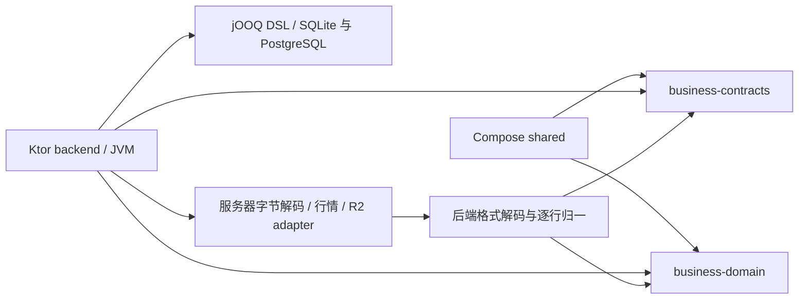

## Context

当前记录复用原 7 定义／24 双库参数及发现失败结果原 2 定义／2 参数逐项迁移。Kotlin 按当前事务和流水 ID 查询，不接收 SQLAlchemy 实体；源参数的当前／过期／回滚／其他记录分别以当前读取、已结束事务快照、真实回滚和不同记录快照验证同一最新值不变量，跨连接旧值、删除和工作区隔离均使用真实数据库。类型签名同时证明外部快照不参与目标选择；不为复刻 ORM 状态增加运行入口。完整闭包比较当前值、事实及现金部分，根范围为空也必须加载额外成员来源；金额／关系规则不变。来源类型修改拒绝及无父修订变化的现金部分变更拒绝核对完整持久结果。纯失败结果调用实际写入器的只读汇总方法，以禁止 SQL 的连接验证稳定去重、已有组排除和虚拟编号不泄露。原参数适配与直接断言须经独立复核，不能仅靠匿名种子或现有黄金计原迁移数。

删除原定义包含未刷写的 `Session.deleted` 状态，属于 SQLAlchemy 对象输入合同；JDBC 没有该输入入口，物理删除既有财务记录会触发现有外键保护。该原定义按语言边界 retained，继续运行 Python 两个参数的双库参考；Native 直接证明软删除拒绝、完整回滚、快照不可变及读取只接受 ID，不为复刻 ORM 状态加入删除注册表或绕过外键。其余 8 定义／22 参数计迁移，保留项不混入迁移数。

完整 PostgreSQL 回归为控制磁盘峰值按数据库依赖分两组顺序执行：原基础类及新增纯结果类先运行，保存全部 JUnit、源码／资源指纹后清理其精确登记库；再准备并运行维护类。类清单由同版 SQLite 完整结果导出，分组必须互斥且并集、逐类测试数覆盖全量，无新增 skip，源码和资源指纹保持相同。两组都使用真实 PostgreSQL、相同 Application Service 和合同；测试进程不探测或启动数据库，现有 Host 消费在两组结束后执行。

维护 HTTP 剩余 9 定义／36 双库参数直接迁移实际回滚、提交后丢失响应、已有原键读取故障、当前权限／有效期、非法结构、固定金额保护、私有方案归属、提交后详情不可读及状态／修订错误。故障在收据实际写入后、JDBC 实际提交后和首次原键查询处注入，核对到达次数、31 表和原键恢复；只读结果故障不得改变已知成功。匿名准备保留既有八场景路径，扩展为 26 个原组合；原定义迁移计数与维护逐项验收分开核对，不以单个文件通过代替完整合同。

原 HTTP 的 `SaveDraftPlanInput`／`MaintainRelationsInput` 不定义 `issue_resolutions`，显式空数组也必须拒绝；Kotlin 首轮真实请求在 `invalid_4` 发布了方案，须在公开解析入口按字段是否出现拒绝。内部存储的统一表示仍带空问题列表，`fromStored` 只对这两种意图移除已验证为空的字段，再复用公开解析；非空或损坏值仍拒绝，不能放宽公开输入。查询故障注入覆盖 JDBC 实际执行方法，不局限于 `executeQuery`。

既有当前关系规划／写入黄金由 Python `_input` 导出内部规范化数据，业务构建测试使用 `fromStored` 读取；服务测试提交真实公开输入前，明确断言该关系意图的规范化问题列表为空，再省略这个不属于公开协议的字段。不得通过放宽公开解析兼容内部夹具，也不得删除实际选择或其他业务输入。完整回归从未消费的初始状态重新准备。

维护 HTTP 原合同分步直接迁移：首片覆盖草稿保存、转正式、完整输入替换、来源问题与公共编辑、联合关系零额结果、身份合并引用、普通草稿计划及账户停用拒绝的 8 定义／16 双库参数。真实 Ktor 请求验证当前详情、私有计划分页／明细、永久收据／原键及核实，输入仅来自原匿名种子和原补丁；不生成 Python 预期响应，不新增公共字段、路由、产品语义或 UI。其余 9 定义／36 参数由故障与权限合同片完成，维护接口按业务图、提交、发布／恢复、协议及来源输入的完整矩阵验收。

### 完整维护与关系决定

维护提交恢复按原 `test_cash_mutation_commit_recovery.py` 的 9 定义／34 双库参数迁移。预览后分别真实改变父流水、事项正文、关系决定与整笔成员，确认拒绝旧方案且不消费上下文；无关导入与账户改名不使已确认备注编辑失效，停用账户只阻止草稿转正式。原键及永久上下文消费先于正文读取，清理失败不能隐藏已提交结果；取消／过期／替换的旧计划以原可识别业务错误拒绝，核实返回确定未提交。

核实必须使用独立且不等待写锁的工作区写事务；仅真实锁忙返回 `pending`，其他存储错误原样传播。取得写锁后重新核对当前写权限／工作区及私有拥有者；提交与重放均不能越权。回归使用真实锁持有连接及独立核实连接，不以预设状态代替竞争；无关导入使用真实导入服务，成员变化使用真实全量投影重建。存储故障只注入原 UOW 对应的连接阶段，不增加公开配置或改变正常错误合同。保持同一原键核实，不增加自动重放、部分成功、schema 或 UI 变化。 原失败回归要求过期／缺失暂存经确认装载转换为 `plan_expired`，私有拥有者拒绝保留原未找到语义；确认入口不得把这些预期拒绝统一包装成内部提交故障。核实复用既有导入核实的非阻塞事务及工作区行锁，在锁后重验当前身份。

维护计划发布按原 `test_cash_mutation_plan_publication.py` 的 12 定义／40 双库参数迁移。原测试的 121 项合成构建结果用于隔离发布边界，新增仅包级可注入的构建函数，默认仍调用同一真实 `MutationPlanBuilder`，不增加配置、HTTP 字段或替代业务图。授权、工作区、当前流水／修订及上一方案校验先于构建；发布前校验全部公共视图和摘要，未知字段、布尔／负数／字符串计数不发布。构建异常或编码／预算失败保留原上下文和冻结计划，不延长 TTL，不产生财务写入。

无文件维护上下文与导入会话隔离，永久消费围栏先于暂存正文读取；读取与取消按当前成员资格及私有拥有者判断。分页绑定原计划、种类及筛选，详情只读冻结值，不随当前流水变化；更改外部返回 JSON 不改变已存计划。原 Python 的可变预算用同一存储对象底层及较小内部 codec 构造参数适配，不改生产预算；意外 flush 在真实读事务内执行后回滚。补齐原内部取消入口，并把确认上下文装载／严格修订校验抽出供实际确认路径复用；永久消费检查仍先于正文读取，`not_committed` 边界位置保持。确认装载的内部参数按原严格整数规则拒绝布尔值，同时核对 HTTP 数字边界，不增加公开路由。原 native 验证与完整双库、现有实际客户端消费及独立复核分别执行，无 UI／schema／生产 DTO 变化。

身份草稿合并按原 `test_cash_draft_merge_plan.py` 的 16 定义／44 参数及 `test_cash_draft_merge_commit.py` 的 13 定义／44 参数迁移，保留原 `merge_into` 用户合同。源必须是同来源的草稿，目标为当前导入／旧流水；核对双方当前修订、完整来源身份与认证页、活动归属及所选问题，不从补丁掩盖既有财务冲突。金额、币种、时间和已知账户先校验原值，再逐个校验采用来源及最终有效值；未知值不清除目标已知值。公共人工清空与人工分类受保护，双方人工值冲突必须由明确补丁解决；合并到目标草稿不隐式转正式。

预览仅保留目标的预计收支，移除源的预计事实／现金部分，以完整关系上下文覆盖双向端点、候选与同决定组成员；源上的活动确认关系、映射后的自关联或业务键碰撞均拒绝。现金部分只有唯一完整资金事实才能证明对应，等额重复或未知部分不按序号猜测，无法证明的来源组成项保留待处理。冻结双方绑定快照及全部相关问题、候选、关系和覆盖证据的完整事实／摘要；候选展示读取当前值，不给旧证明重新授信。当前事实变化即使父修订未变，也使旧计划失效。

确认在原工作区写锁和单事务内先删已证明等价的重复候选，再保存目标字段／公共值及现金部分；转移已有绑定、所选问题的结束与其余问题实例／正文／候选、双向关系与完整人工组，最后软删除源草稿。问题键碰撞使用确定且有界的新键，保留实例与来源正文；无法映射的组成项退回父锚点，反向候选失效，不能把旧证明刷新成有效证明。目标、源退出、余额、稳定收支、投影和永久收据同成败，返回保留目标并以源作为结果引用。各实际写后阶段、外层投影／收据故障均恢复全表和原方案；删除暂存后仍按原键永久重放，重复导入复用目标。 泛型更新复用生成字段本身及既有 JSON／UTC／金额绑定；不得用按 Java 类型重新查找／强转的字段丢失自定义绑定。移动后的原始时间、问题正文及证明必须能由同一真实仓库再次读取。

本片沿用已接受的整体 grilling／A 类范围，以 `0b53b0b0` 为独立基线，保留已交付的手工转账与公共编辑修复。先用原准备状态和完整只读图失败驱动，再完成 Kotlin 原断言、真实 HTTP／现有 Compose 消费、完整 SQLite／真实 PostgreSQL、独立复核和文档／映射。无 schema、依赖、生产 UI 或公开 DTO 变化；完整维护按当前合同矩阵验收；全量迁移及其他模块继续单独保留。 预览中草稿合并的关系自关联／碰撞拒绝沿原安全 `422 import_payload_invalid`，仅在维护预览 HTTP 入口适配关系拒绝；确认阶段仍保留原未提交与错误语义，不全局改写其他关系调用方。

确认独立记录沿原 `test_cash_independent_identity.py` 的 9 定义／46 双库参数迁移：只结束用户选择的身份问题，保留当前同一流水、来源绑定及正文，不新增或搬迁来源身份；可与来源采用、明确补丁和转正式共用一次计划。仅处理问题时父修订、字段与余额不变，同一记录的多个身份问题在预览只计一笔独立确认。后续重复导入仍命中原记录。

预览只读核对当前绑定的身份、范围、认证页及活动归属，并冻结包含实例编号、创建时间、修订和完整覆盖证据的稳定摘要。提交按同一规则重建；新增／删除／替换绑定、解析器或覆盖变化在父修订未变时仍拒绝旧方案，活动他项占有证据或认证页冲突禁止确认。微信范围只取当前可靠绑定、文件隔离或未绑定隔离，不能从可改正文或旧编号升级为默认范围。写后故障恢复事项／候选、绑定、余额、投影和原方案；永久原键收据独立于暂存，viewer 没有动作且不能预览／提交。

本片以提交 `be6107be` 为独立基线，不带手工转账待决行为；先由原准备状态及完整预览复现缺口，再补原生断言、公开 HTTP／现有 Compose 消费、完整 SQLite／真实 PostgreSQL、独立复核、映射与文档。无新 schema、依赖、生产 UI 或公开 DTO，不扩大原用户合同。

来源绑定冲突在预览 HTTP 边界沿原 `plan_failure` 返回 422／`import_payload_invalid` 和原固定安全正文；内部准备仍保留精确来源冲突，确认时的此类失败仍按事务边界返回确定未提交。仅在预览路由适配该异常，不改变其他调用方或把内部错误降级为业务跳过。

来源事项的完整服务迁移沿原 `test_cash_source_issue_resolution.py` 的 22 定义／78 参数，使用原测试分别准备预览入口前的真实状态、当前事项与原请求；旧格式只读详情在最后目标读取前停止。初始导入属于准备过程，只有原测试的目标导入预览才截取。只读完整计划与真实提交使用隔离场景库，原生断言不把金标准数量计作原测试数。

准备阶段保留累计的非空来源派生说明：采用正文后的说明继续交给显式补丁阶段，后续阶段只有产生新说明时才替换，不得因空补丁返回空结果而丢弃。是否需要更新及最终写入都使用同一最终说明。原来源中的交易号／状态及当前可信归属应保留，旧退款信号应去除。

来源内容的固定字段校验先于显式补丁准入校验，保持原错误次序。来源类型本身冲突时，即使用户补丁把类型设回当前值，仍应报告 `fixed_field_conflict`；不得先以完整组不允许修改类型的 `field_not_editable` 掩盖来源冲突。

旧人工保护数据补充场景不计作新增原定义：先准备保护 `source_payload` 的既有记录，再读取实际 ORM 修订作为请求修订。来源正文受到保护时，即使最终值未变化，预览仍显示该来源的 incoming、保留的 effective 和 `protected`，真实提交不得覆盖正文／备注。差异先按所采用来源及其保护结果生成，再合并实际字段变化和显式公共补丁，不可只比较最终值与当前值。

所选事项编号按原字符串顺序冻结，不能转成整数后排序。编号 `10`／`2` 的双事项补充场景须冻结为 `["10", "2"]`；确认清除两个实例、保留父修订及余额。此补充和旧正文保护共两个场景，不增加原定义或原参数迁移数。

采用前逐份校验来源内容和固定字段，显式补丁不得掩盖非法组成项、类型或金额冲突；多来源值冲突须由用户给出该字段的明确最终值。公共人工备注／清空值保存在收支条目，来源字段仍更新到流水，不给来源分类或备注制造人工保护。来源正文缺失、明确清空、旧格式内联正文及矛盾存在标记分别按原合同呈现和处理。来源派生说明保留可信当前归属，去除旧退款信号，不允许正文伪造归属；完整预览的差异保留原 incoming／effective／protected 含义。

确认只清除所选事项，保留其余实例的正文、修订、来源位置和候选；单纯保留现有值不伪造父流水更新或余额变化。事项修订或正文在父修订不变时变化仍拒绝旧方案。来源选择和草稿补全／转正式共用一次计划及一个事务，字段、事项、来源说明、余额、收支、投影和永久收据一起成功或回滚。viewer 没有来源选择动作且不能发布方案。此片只恢复原服务合同，接口数不变，不涉及手工转账待决行为、独立身份或草稿合并；不改 schema、依赖或生产 UI／DTO。

普通维护剩余异常原测试独立迁移，生产行为保持原合同。生成器执行原四个测试到目标维护／导入预览入口前，仅保存真实预置状态和原请求／解析文件；测试自行验证原断言。发现故障在 `CashImportRelationDiscovery` 已确认具备发现种子并读取账户别名时注入，覆盖单现金部分、显式多现金部分与导入预览，禁止以早期权限／读取错误替代。核对原异常到达一次、31 张业务表完全不变，以及维护上下文未创建或导入会话正文／修订和未发布方案保持。来源原文修改须拒绝，当前详情完整不变，完整退款仍仅呈现一笔、金额为零。生产代码、DTO、路由与数据库模型不变，测试阶段不扩大原已接受迁移范围。

手工转账双端编辑沿原 `prepare_transfer_members`：当前收支必须恰含同一手工转账的两个成员，且只有一条活动、已确认的 `manual.transfer.v1` 关系。两端补丁不得包含公共字段；按最终账户和币种推导转出／转入、还款或换汇类型，显式矛盾类型拒绝。当前目标的公共编辑保留，两个财务操作共用一个维护单元；预计图只覆盖原关系子类型，不删除重建原关系。提交先保存两端，再按原修订替换关系子类型并验证完整图，之后统一更新余额、收支、投影及收据。第二端或关系写后失败整笔回滚；另一端、关系修订或账户资格变化拒绝旧方案。原成功、失败与并发场景先生成匿名预置状态及完整计划，再由 Kotlin 直接验证原断言；接口数量不变，共享生产 UI／DTO 不变，保留两端 UI TODO。

公共编辑与双端财务准备合并时，以字段名合并差异并按原字符串顺序输出；公共编辑的差异保留整笔当前值，财务差异保留各自成员的当前值。公共编辑或财务操作任一发生修改时保留修改动作，只有二者均为 `duplicate` 才维持无变化。此授权修复同步应用 Python 与 Kotlin，不修改请求、响应字段或其他财务规则。 双端账户编号无法解析为数据库整数时，沿原 HTTP 返回安全的 `503 import_unavailable`，不暴露内部异常；不存在的数字编号沿原 `422 account_unavailable`。该适配只包裹成员账户查询的数值转换错误，不捕获任意异常或继续执行。

全部维护意图按原 `CashMutationBusinessPlanBuilder` 使用同一已准备操作后段与确认执行器。普通保存、公共编辑、转正式及来源决定不得继续自行拼装单流水视图或绕过共享关系发现／完整依赖；先统一其操作准备、来源范围、上一方案和确认，再接手工转账双端及身份草稿合并。转正式仅把该操作的现金部分加入发现种子；正式备注编辑不发起新发现，也不因已用账户停用而拒绝。无效输入与内部发现故障均停止预览，不发布部分方案或问题；字段、关系、余额、稳定收支、投影及收据保持同一事务。

完整转正式回归发现既有退款匹配的空列表偏差：银行退款种子经过已确认镜像扩展后可能为空，原 Python diamond 匹配器对此按假值回退到符合条件的银行退款；Kotlin 不得把空列表解释为禁用匹配。四个事实与两条既有边完全一致时，该回退必须保留由平台链证明的银行退款边，与新的退款镜像组成完整提交组。补纯层空列表金标准及实际维护的第二边写后故障回归，不改变金额、角色或额度规则。

维护按原 `build_operations` 合同消费已经准备的流水操作，共用导入的只读上下文、预计快照、关系决定、最终图和展示，不伪造导入文件或重新准备来源行。通用入口接收当前流水种子、完整决定组、快照变换及当前关系构建回调；导入入口继续保留来源行归一和选择，使用相同后段。操作、选择及上一计划保持隔离，不写财务数据。

当前关系规划从已确认闭包及整个决定组加载原关系、候选身份和修订；依据当前端点、来源与硬键重验候选，保持忽略／失效状态、父端点及拆分公共值，不自动发现新的配对。手工关联使用明确选择的当前流水与现金部分。维护预览保留未变化成员及完整关系明细，重新预览与提交重建都携带上一冻结计划，使原选择来源、失效代次和完整组得到同一校验。

当前关系的内部引用保留候选行编号，关系与候选按 500 个编号批次读取。数据库 JSON、存储金额和图中的金额包装在进入业务复制及选择前转为已有业务值，保持原摘要与公开编码；不扩展领域复制器接受任意持久化对象。原测试的首次预览、再次选择、失效选择及人工关联分别保存独立匿名预置状态和上一冻结计划，完整比较内部图与公开明细。内部构建器验证期间不接通会忽略关系决定的旧提交路径；公开预览与确认接线须同时守住关系写入、完整重验及事务门禁。

写入当前关系时，在同一写事务内加载一次新鲜图，再直接执行完整端点、角色、决定组及投影验证；不把已加载上下文当作旧快照再次读取。业务图的关系编号在传给底层证据映射时转换为整数键，公开 JSON 的字符串键保留；其他关系入口仍沿原快照令牌重验合同。原断言夹具在原提交入口前停止，由 Kotlin 重放真实预览与选择并执行提交；不得把检查点对照数当成已迁原定义数。

剩余失败组合继续沿同一合同验证：原测试的无效预览步骤保留原输入与错误，失败不得替换上一冻结方案；候选证明或人工目标在预览后变化时，夹具保存变更前状态，由 Kotlin 在真实预览后重做相同数据库变更，再验证旧方案拒绝且不消费。故障在实际字段、当前关系、投影或收据写入后注入，完整 31 表必须回滚；第二关系成员的失败也不得留下第一个成员。投影／收据失败后保留原方案并允许原键重试，候选清理不能为了允许移除现金部分而丢弃不同证明。

确认继续在工作区锁内核对权限、原键收据、当前上下文、完整操作和关系证明；当前关系的耦合清理在必要的现金部分替换前执行，流水、关系、余额、稳定收支、投影及永久收据同事务。实际提交未知、临时清理失败及原键核实沿原合同。阶段门禁分别覆盖共用管线、当前关系预览／人工关联、关系写入／完整重验、多成员和身份合并；中间内部能力完成不关闭完整维护或增加接口接入数。共享生产 UI／DTO 不变，回滚保留原 Python 与 schema，撤销本片 Kotlin 适配。

### 普通草稿直接保存

共享准备器对照未应用补丁的当前现金部分验证编号归属，直接保存及计划准备分别验证这一规则。来源说明先把数据库 JSON 转为业务映射，再交给来源派生规则；直接保存验证可信来源身份保持，沿用原用户合同。

迁移当前 Compose 使用的 `PATCH /cash-records/{transaction_id}/draft`，保持原普通保存合同：输入先验证严格编号／修订、JSON 深度和字节预算，再在工作区锁内授权、查询原键收据、核对当前草稿及修订。复用原草稿操作准备、来源正文派生和公共条目编辑，交由现有 `CashRecordWriter` 保存；保留来源对应及外部事项／证明，重算缺失信息，现金部分替换时解除草稿端点并推进关系修订。保存不转正式、不写余额，不创建或依赖临时导入／维护计划。

投影维护和永久 `save_draft` 收据与流水写入共用一个事务。未见原收据前结果保持未知；核实原键不存在后才标记确定未提交，实际 COMMIT 前改回未知，不能因后续 rollback 推断提交失败。错误复用原安全诊断和 commit_state，原键重试返回相同收据；成功后单独读取当前详情，读取失败不掩盖已保存收据，已删除与暂不可读分别返回明确状态。完整 HTTP、真实提交故障／响应丢失、权限重验、原草稿保存文件全部适用断言及现有 Compose 消费完成后才计接口和原测试。共享生产页面／DTO 不变，回滚撤销本片直接保存入口及准备适配，无 schema、部署或真实数据迁移。

### 流水与已选收支删除

沿完整迁移已确认的 A 类范围迁移旧单流水 DELETE、已选收支影响预览 POST 和批量 DELETE。保留原单流水的仅删当前／删除确认闭包两种方式；批量选择以同一活动数据集和版本核对业务可维护条件、完整成员与当前未删除事实，预览只读，确认必须为布尔 `true`。当前 Compose 的影响预览与批量删除消费者直接消费实际回包，不新增 UI。

共用清理按父流水端点和候选引用计算：删除目标直接涉及的当前关系，补齐同决定组的未确认关系，保留其余确认边；仅作为候选时删除该候选并推进保留关系／事项修订，保留其余证明。先删除投影关系引用，再清理关系、事项／候选、来源对应和投资资金关联；保留原始流水、现金部分及来源原文，逻辑删除后同事务维护稳定收支／投影和余额。受影响范围在清理前取确认闭包，不能用旧闭包整组删除替代目标清理。批次读取和写入保持 500 个编号边界，不物化全账本。

写入持有工作区锁，锁后及返回前复核权限；任一引用清理、投影或余额失败整笔回滚，不捕获后逐行继续。HTTP 保留原公开输入、错误码、消息、确认及内部编号省略合同；来源删除后重新导入、完整关系维护组合等原测试逐断言迁移，未覆盖者继续 pending。双库验证真实事务、来源证据保留、独立审查及现有 Compose 消费后再增加接口和原测试计数。回滚撤销本片代码与映射，不改 schema、生产入口或真实数据。

### 旧交易查询读取

本片在已确认全量范围内接入 `GET /api/v1/queries/transactions`，保留旧平面 DTO，不以当前收支或关联搜索代替。仅读取当前工作区未删除的正式流水，按 UTC 月份半开区间、父账户或现金部分账户名称、原分类编号筛选，按时间及编号倒序；页长默认 30，只接受 1–200，重复参数取最后值。原月份接受形式、FastAPI 整数转换、400／422 错误及未知参数忽略均以真实 Python HTTP 对照。账户查询依赖行情估值，留待相应能力，不提供不完整的替代结果。

应用层通过类型化读取接口传递全部筛选并生成原十字段 DTO；关系仓库使用生成表类型，页和现金部分账户在同一快照内读取，PG 使用重复读。父账户缺失时仅在恰有一条有效现金部分账户记录时回退，重复账户的两条现金部分仍不回退。保留原始备注、类型和分类，不读取公共编辑或要求投影就绪。金额全程精确，保留数据库原有小数表示及空金额转零、空币种转 CNY 的合同；不返回内部编号或来源载荷。读取前和返回前复核当前身份及工作区，任一读取异常停止整个响应，不生成部分结果。

先建立缺路由失败回归，再以匿名原始状态作完整 HTTP 对照和 Kotlin 直接断言；覆盖筛选、稳定排序、200 条边界、空值、金额、权限、快照交错、31 表无写入及真实 JDBC 读取故障。直接迁移两个原应用查询测试定义，其余混合原测试不提前计数。Cross-platform Impact Check：当前 Compose 没有本 GET 的实际消费者，共享层、Web、Native 页面与交互均未变，不新增无调用方 DTO；功能地图保留两端既有 TODO。回滚撤销本片读取服务、路由和测试映射，不改 schema、部署或真实数据。

原关系仓库传出的金额已经是 Decimal；零值在应用层 `value or 0` 后统一为 `"0"`，非零保留数据库的小数表示。类型化读取边界保留这个差别，不沿用旧列表的负零文本。超长整数的语法检查使用无递归回溯的匹配，仍返回原 422 错误及输入，不能触发 JVM 栈溢出。

### 旧流水列表读取

沿已确认的完整迁移范围接通 `GET /cash-records`。它包含人工、导入及旧流水，也包含草稿；只排除已删除记录和明确的 `exclude_id`，不套用关联候选的准入或关系闭包。文字按原 SQL 方言在对方、备注、币种、父账户名和金额文本做转义后的大小写不敏感包含匹配，无 256 字符限制。日期使用指定时区的完整日范围，按时间、编号倒序，以原时间及编号两字段游标翻页；页长由 FastAPI 整数转换后压到 1–20，重复参数取最后值。原日期／时区／游标错误、超大编号与日期溢出的方言错误分别对照原运行时，不增加筛选绑定或草稿游标兜底。

页查询保持 SQL `limit + 1`，同一读取快照内加载现金部分及分类路径；PostgreSQL 使用 repeatable read，返回前复核当前操作者／工作区。保留数字编号、金额全部小数位、草稿空值、单现金部分账户回退和分类路径 SQL 的原合同，不泄露父项内部字段。生成器执行原测试到首次读取前，只提供真实预置状态；四个原定义／七个参数用例由 Kotlin 直接重写断言，另做完整 HTTP 差分、31 表只读、权限变化及故障停止验证。

当前 Compose 没有这个 GET 的实际调用者，旧 DTO 和离线演示辅助方法不能算作接线。本片不新增页面或消费者；共享层、Web、Native 生产行为不变。验收完成前不增加接口／原测试计数。回滚撤销本片读取路由、服务及测试映射，不改 schema、部署或真实数据。

起点为远端 `main` 的 `0c038a75e34264bd6d4aa5cce2070727df9d9ff7`。当前工作区为 `/workspaces/finance-tracker`，分支 `codex/kotlin-backend-shared-core`，jOOQ 与证据读取已保存至 `394b23e5553b18a980e37f92d59d6146289cc37b` 并推送至 origin 同名分支；继续迁移当前流水详情。历史 macOS 验证仅说明当时的代码快照；当前容器使用仓库外匿名夹具重新执行受影响验证。

已读根 `AGENTS.md`、项目技能、项目上下文、主规格导航、active changes、词表、Python 与 Compose 相关实现和 CI。`grill-me → grilling` 及 `openspec-explore` 已显式执行，用户确认完整迁移、保留全部合同，并明确授权先提交并推送当前进度、后续每完成一个实施阶段在本仓库当前分支提交并推送至 origin 同名分支；部署未获授权。用户明确确认旧实验停止后才允许构建测试。旧实验 REPORT/README 仅作受限背景，不复用规划器、IPC 或 Gson 实现。未找到本机 `memory_summary.md`；本机 Codex memories 目录为空，memory 数据库只读查询未找到相关项目条目，不能假称读取了不存在的记录。

当前 86 个 HTTP 操作及模块、格式、后台任务见 [迁移盘点](inventory.md)。当前产品 CLI 已退役，必须保持不存在。现有 active changes 的未完成事项保留原状态；其历史证据不是本任务当前验证。

## Goals / Non-Goals

完成全量运行时迁移和实际前端共用，范围与验收见 proposal。公共层只接受显式输入，服务端负责事实和副作用；不做产品重设计，不修改已通过性能门槛，不引入自动冲突合并，不碰真实账本和用户服务。用户明确要求本轮完成标准为功能迁移及功能测试：本轮执行双库功能、安全与事务合同，明确排除性能用例，保留原性能预算及未通过证据，性能验证不阻断本轮功能交付。

## Decisions

### 多文件来源批次规划

批次规划复用单文件的字段校验、索引、身份及旧流水对应规则，先按可靠证据合并，再按可比较范围和相同内容的最大出现次数生成共同操作。可靠身份的不同快照按完整且互异的文件修改时间选择；时间缺失或相同时按选择文件顺序。固定财务字段仍由当前旧流水校验，不因选中了较新文件而覆盖。空页的文档证据参与同命名空间冲突检查；不确定结果用共享组引用，不建立猜测的逐行绑定。该纯规则先完成原生功能测试和完整结果对照，再接暂存及导入事务；不会改变现有上传或确认流程。

### 解析会话存储

解析会话沿原 Python 私有 JSON 格式保存已解析文件与计划，不保存上传字节或密码。文件模型在既有来源组合模型上补齐客户端引用、名称、大小、状态、诊断等元数据；解析与执行仍使用同一行模型。编码前校验文件和会话，区分解析文件预算与完整会话预算，往返解码隔离调用方可变容器。普通读取完整核对，计划投影读取保留原已发布内容的校验边界。存储以原始对象字节及条件版本为依据；内存和 R2 共享会话生命周期，CAS 不替代应用服务的工作区锁。创建重试只用于确认的键冲突，提交结果未知不做无条件覆盖。取消清空文件、计划和私有上下文，更新保持原到期时间；清扫只处理明确属于本命名空间的对象。

私有计划快照保存不可变已验证字节并绑定原存储/条件版本，返回 DTO 和字节均隔离调用方修改。公开缓存仅存过滤后的 JSON，最多 16 项且总计 4 MiB；每次仍读取当前对象，使用 ETag 与内容摘要隔离，错误与 TTL 不能被缓存遮蔽。R2 条件对象端口已有 AWS SDK HTTP 客户端，清扫器接本机运行入口；维护计划已使用此存储，上传应用服务仍待接入。计划专用解析对无法由正常编码器产出的极深损坏对象及非有限指数更严格；既有 coverage filters 仍为字符串映射，此类型边界在完整上传验收前继续核对。

后台清扫与用户访问独立，启动先同步扫描一页，失败则拒绝启动。还有分页时立即继续，完整一轮或失败后等待配置间隔；失败不丢游标，不记录 provider 正文。生命周期锁与扫描锁分离，停止先通知当前扫描再等待启动/工作线程结束；重复启动、并发停止不产生第二线程。配置必须明确选择内存或 R2，内存要求原允许开关，TTL、间隔和页大小保持原界限。Ktor 生命周期启动时首扫，停止时等待在途扫描结束后幂等关闭客户端；JVM 外部中断不提前释放等待，完成后恢复调用线程的中断标记。

R2 HTTP 使用 AWS SDK for Java v2 `2.57.7` 的 S3 客户端及 URLConnection transport，依赖只在 backend。SDK 负责签名和 S3 协议，配置使用显式静态凭据、HTTPS endpoint、region（默认 `auto`）及 path-style 访问，禁用 AWS 分块编码以保持完整 JSON 请求正文；连接 3 秒、读取 5 秒。应用层不得把不确定写入当键冲突；SDK 禁止自动重试，避免条件写已成功但回包丢失时的再次发送掩盖原结果。请求/响应正文、签名和凭据不进入应用日志。用本机 HTTP 假服务验证实际 SDK 发出的请求、条件头、元数据、对象流与未知结果；生产配置仍只允许 HTTPS，不连接真实 R2 或写第三方资源。

维护计划通过既有 `MutationPlanStore` 协议适配共享解析存储，删除独立可变 Map。上下文必须为 `mutation`、无文件，正文恰含交易标识和版本；每次读取经当前存储权限/有效期/完整格式验证，返回独立 JSON。所有已接入的预览和查询先在当前财务事务核对永久消费；内部取消入口执行同一检查，不新增公开取消路由。重新预览使用已校验快照的修订执行 CAS，不能在构建后重读并采用新修订覆盖并发变化。提交将收据与业务事实先原子保存，再尽力取消临时上下文；清空失败保留原成功收据且由固定 TTL 清理，不能在财务事务提交前删除计划。后续公开请求仍由永久收据阻止重写。运行入口向维护服务传同一已配置存储；直接测试构造器使用可注入内存或合成 R2 端口。

### 来源账户对应持久化

导入资金组扫描使用已解析文件和行，按来源、身份种类、来源范围及身份键生成稳定组引用；银行优先完整账户，无法识别时保留文件局部身份及可信显示名，微信默认与命名范围隔离。支付宝金额提示只用于分配，不成为账户身份，补贴和优惠不产生现金部分；已知部分不猜剩余金额。选择按严格字段和当前账户资格验证，多组指向同一账户时合并为一个现金部分，保留 80 位十进制加总及行原文。已知解析错误只作用于原行，内部程序错误停止整次准备。该切片不读取数据库或写入对应，不提供上传入口；原账户修订变化重新核对当前资格，不构建自动并发合并。

来源账户建议按 `funding_group_v1` 的完整来源组身份查询，最多 200 个去重键一批。已确认对应优先；存在但已失效时不回退旧对应或别名。旧对应仅覆盖默认微信零钱、工行完整文件账户及工银亚洲完整账户标识；银行别名只接受至少 5 位 ASCII 数字的完整文件账户，多个有效账户不猜测。建议只核对工作区、活动状态及现金/借入/借出类型，币种资格由导入行准备阶段核对，不写默认。

发布接收调用方已验证的成功使用证明，与流水、投影和收据处于同一事务；相同来源组选择不同账户在查询前拒绝。同值保持原确认人、时间和修订；换账户才更新确认人、微秒时间及修订。内部仓库不提交、不增加自动合并、upsert 或重试。本片先迁仓库及建议，导入提交的成功筛选和来源组扫描仍须分别验收，不因内部实现计为上传或完整导入可用。

维护提交已迁移 Python `_validate_current`：冻结方案在写事务内依据当前账户、关系、事项和证明重建并核对，不以父流水或收支修订替代。全部已接入意图均在锁内重建，不推进父修订的关系／事项变更拒绝由原恢复组合直接验证。

单流水提交先在同一写事务按冻结输入重建，操作按 Python 白名单摘要比较；事项身份、修订、code 与 key 纳入冻结操作，账户依赖仅包含实际财务校验所需的存在、类型、活动及币种支持，不因展示名称或无关币种变化拒绝。关系上下文复用既有稳定 token，并保存原 seed/decision group 依赖；当前关系/事项变化分别按原 `record_changed` 或 `relation_context_changed` 拒绝。重验发生在财务写入和永久收据创建前，拒绝保留临时方案；多成员、关系保存及完整来源复用同一重验与事务管线，并由对应原组合直接验证。

冻结内部请求按已归一结构解码，非关系意图仅允许暂存中的空 `relation_additions`，公共请求仍拒绝该字段。操作保存完整收支对象及独立恢复值快照；草稿重新计算账户与可纠正的解析事项，外部来源事项和 `relation:` 事项按原身份保留。明确选择失效账户仍拒绝整次输入，不转成草稿成功。Python 预览对照增加内部账户、事项及收支依赖，提交回归分别核对所有财务表无写入、方案未消费和原键可重试。

单流水提交保持原写入顺序：未处理的来源待采用或身份事项阻止转正式；任何动作携带的 `entry_edit` 都在同一事务应用，正式公共编辑也保存事项决定。三个独立审查发现均以失败回归证明并修复，不把已接入动作中的遗漏推迟到完整关系迁移。

维护提交在永久收据查询前取得目标工作区锁，锁后重新核对会话、成员及活动工作区，并与进入请求时的工作区一致；返回前再次核对权限。SQLite 使用已有 `BEGIN IMMEDIATE`，PostgreSQL 显式锁工作区。实锁等待回归覆盖降权、退出与换区，原键并发提交只创建一份收据；不引入金融操作自动重试。

### 已授权凭据类型调整

用户明确选择注册/登录的 `email`、`password` 仅接受字符串，停止 Python `str()` 对任意 JSON 值的隐式转换。使用按字段存在性检查的 JSON object 解码：缺省沿用空字符串，显式非字符串（含 null）返回 400/invalid_credentials；未知字段继续忽略。字符串正常/错误路径继续与 Python 黄金比较；非字符串路径依据新 delta 单独验证无用户/会话写入。此决定仅涉及这两个端点的凭据，不扩大到工作区名称、分类或其他协议字段。

密码适配使用 JVM 独立实现读取原 Argon2 PHC 字符串，并与 Python 固定盐/参数黄金及双向验证比较；新 hash 沿用当前 Argon2id 参数和随机盐。注册、登录与登出的用户/会话写入采用显式事务，失败回滚，DB 仅保存 token 摘要。新增密码依赖只留 backend，不进入公共层。

### 模块与依赖

在现有 `compose` Gradle 构建内新增独立 `business-contracts`、`business-domain` 与 JVM `backend`。模块目录虽共用构建，依赖图不允许后端依赖 Compose `shared`、UI 或平台适配器。账单保持客户端上传、服务端解析和预览，先共享行模型和协议，不新增客户端解析入口或 `statement-core`；存在真实客户端调用场景时再规划归一算法下沉。

公共模块提供 JVM、Android、iOS arm64/simulator arm64、JS、Wasm。沿用当前 Kotlin 2.4.20、Ktor 3.6.0、serialization 1.10.0，不为实验沿用旧版。公共 source set 禁止 Compose、SQL、java-only 与网络依赖。先物理移动已有纯规则并保留原调用签名，DTO 用明确别名替换重复定义；业务扩展由 Python 黄金驱动。

参考已核对的 [Ktor serialization](https://ktor.io/docs/server-serialization.html) 和 [KMP DSL](https://kotlinlang.org/docs/multiplatform/multiplatform-dsl-reference.html)。不用 Gson。JSON 需逐能力明确 `encodeDefaults`、`explicitNulls`、未知字段、严格标量、重复键和预算；禁止对全部接口简单套一个宽松 Json 配置。

### 实际双端复用与完成标准

用户确认按实际双端需求复用，完整后端迁移范围不变。优先级为协议与输入校验、金额/分摊、分类、账单行与预览/提交协议；投资计算随真实客户端需求接入。投影重建、完整关系规划、投资重放、文件归一等没有现有客户端消费者的算法先保留在后端纯业务层。

每片核对正式客户端调用、正式后端调用、旧重复实现、协议消费和测试证据。只有两端实际调用同一规则、旧重复实现已移除或登记兼容适配、同一输入跨平台结果一致时才计为双端复用完成。现状中认证和分类目录 DTO、分类祖先与移动约束已双端使用；精确分摊主要由客户端调用，分类排序由后端调用，金额合法性和现金部分规则目前仅测试使用，不能把公共模块存在当作全部复用完成。

服务端读取当前权限、账户、修订和完整组后再次执行公共规则；客户端展示模型、任务状态、文件选择、本地时间与格式化、缓存保留。表单语法与旧协议解析使用不同命名入口，不扩大或收紧既有行为；注册规则不套用到旧密码登录，持久化金额范围不盲目限制中间计算。

### Python 测试迁移与漏项门禁

测试对应表以基线 Python 测试定义及参数化场景为盘点来源，逐项记录规则/断言、Kotlin 目标和结果。检查器从基线和当前源码重新枚举，新增、删除、源变化、目标不存在及未处理项必须可见；不能靠手工选择几个文件形成虚假的全量分母。静态函数计数与 pytest 展开后的用例计数分别报告，不以测试数量相等证明断言等价。

已授权修复带来的新增 Python 回归通过对应表的 `source_additions` 登记准确源码指纹和复核理由；原基线保持固定。未登记、指纹变化、无理由、已删除或与基线重名的新增项均使检查失败。新增项默认 pending，只有完整断言、参数和实际 Kotlin 测试均登记后才允许标迁移；新增文件的 fixture／输入指纹仍独立检查。

共享规则的测试迁入公共 `commonTest`，服务端 Application Service/HTTP/存储测试迁入 backend；正常、边界、错误顺序、缺省/null、失败无写入、并发和回滚断言一起迁。原 Python 回归与黄金仅作为对照补充；Kotlin 测试不能运行 Python 业务实现才能通过。仍保留的历史 schema 或基础设施用例逐项登记理由和执行路径，由独立审查确认，不静默删项。每片先出现目标行为缺失导致的失败，再实现转绿；未对应参数或断言的片段不标完成。

### 当前收支详情与稳定流水定位

`GET /cash-records/{transaction_id}/projection` 先检查原 ASCII 正整数标识，再在当前活动数据集中定位；不按业务可见性过滤，隐藏的零金额结果仍可定位。`GET /cash-projections/{projection_id}` 保留 1–128 码点标识与可维护条件（可见或存在待处理事项），并核实实际成员数及展示基准流水。不存在、已删除、跨工作区、状态未就绪和成员缺失分别保持原 404/503 错误及 `field_errors/retryable` 字段，不用空结果掩盖内部不完整。

财务读取使用 SQLite 的同一读事务和 PostgreSQL 的 `REPEATABLE READ`，从活动状态到成员、关联摘要、分类、转账双端及待处理事项均在同一快照完成。权限不沿用该历史快照：读取前和返回前使用独立当前连接重验令牌、当前工作区及成员资格，并对照请求已授权工作区。读服务不抢占整个工作区写锁，不触发重建、余额更新或状态初始化。以真实交错重建和撤权/换区/登出测试区分财务快照一致性与当前授权。

详情仅返回原公开问题原因，不加载待采用字段、账单原文或候选正文；待确认关联只影响相关成员的确认状态。现金转账优先采用首条完整已发布关联，银证转账保留接受状态、资金方向与原币种金额。现有 Compose 只消费详情中的版本与成员，抽取这一既有 DTO 到公共协议并由后端实际使用；完整投影展示与按流水定位没有新增客户端入口，不能把读取迁移计为整页可用。列表、证据及维护命令分别继续迁移。

### 当前单条流水详情

`GET /cash-records/{transaction_id}` 返回当前流水及来源事项，复用已有精确字段规则、稳定收支仓库和 jOOQ 生成类型。来源事项的缺省正文与明确清空分别判断；固定字段冲突先于用户补丁，受保护字段保持当前值，现金部分仅可引用本流水拥有的标识。多个所选来源不一致时沿原冲突规则处理，不猜测或自动采纳。只读规则先独立验证，再用于详情计算可选动作和后续维护服务。

事项选择保留 `issue_id` 的原字符串，与当前事项的十进制标识精确匹配；不提前收窄成 Long，前导零或超出 Long 的合法协议文本沿原 `issue_changed` 拒绝。正文摘要保留 Python 的 Unicode 码点键序、UTF-8 与浮点表示，来源金额仍以精确十进制处理。差分逐层核对 JSON 类型和值，浮点按完整二进制值与符号比较，金额文本、错误、摘要及字段集合严格相等。

可选来源动作继续调用完整只读准备。其依赖的来源正文效果先单独迁移：原文只派生备注与当前单行解释，账户身份仅来自已保存的可信解释；不采用正文伪造的身份、金额、类型或跨行决定。保留微信空商品、银行列名去空白及同名冲突、显式备注和人工保护优先、金额方向相关退款信号。微信、支付宝、建行、工行和工银亚洲沿原来源规则运行；纯规则以完整值差分和原生断言核对，供详情及后续维护共用，不用默认放行或仅校验补丁代替真实准备。

详情按当前角色、创建方式和完整成员数给出可编辑字段，查看者不返回可执行的来源选择。当前候选展示使用当前流水和账户值，不刷新其保存的修订证明；来源身份判断读取绑定与页证据，不从可编辑原文重建身份。公共人工值与来源字段分别返回，账单原文只出现在原合同允许的位置，不带出内部关系线索、来源绑定或候选证明。

单条详情不同于收支展示详情：没有活动投影时 `projection_ref` 可空，活动指针存在时沿原定位规则返回；不套用展示接口的 ready、可见性或成员完整性前置。读取使用一致的财务快照，返回前独立复核当前会话/成员；若角色变为查看者，返回内容不得保留旧编辑能力。存储或内部故障中止读取并按既有维护路由输出安全错误及诊断，不保存待处理问题，不返回部分详情。

实施分为来源选择规则、详情读取与 HTTP/客户端三个可验证阶段；每阶段完成相称验证后按用户授权提交并推送当前分支。成功读取通过现有 Compose `sources` 的版本、成员修订及当前位置检查，不更改产品 UI；失败仍由现有刷新重试流程处理。

### 首个垂直切片

先实现旧令牌可用的 `GET /auth/session` 与鉴权工作区内的 `GET /cash-categories`，前端真实消费公共认证 DTO、Role、分类上级纯约束及精确分摊算法；不称认证或分类模块全部完成。会话读取只需有效 token SHA256、有效期和用户，保留原 active_workspace_id（含空或已无 membership 的值），按当前 membership 列出工作区；分类另行要求当前活动成员资格。分类目录保持现有排序、名称数组路径、空 description 和修订；缺目录 state 返回 0，GET 不持久化初始化。首片不写金融事实，后续写入必须覆盖完整事务/幂等/投影。

首片 HTTP oracle 比较完整错误：session 401「请求未获授权或无效。」与业务 401「请先登录。」分别保留；覆盖 malformed Bearer、过期、无工作区、移除 membership、CORS 允许/拒绝来源和 OPTIONS。运行时保持本机任意 HTTP 端口及配置 HTTPS origin 的 CORS，不允许 cookie credentials。接口矩阵必须与真实 create_app 装配导出的 OpenAPI 方法/路径集合一致，不只按文件提取 decorator。

首片本机预览的数据库 URL 暂限绝对文件 `sqlite+pysqlite:////...` 和有 host、无 query 的 `postgresql+psycopg://...`，其他格式明确拒绝。默认 SQLite driver/相对路径、PG socket、SSL 等连接参数仍属后续装配迁移项；不得静默丢弃连接参数，不能宣称启动配置全量兼容。

分类目录和命令回包的 `path` 均为含自身的名称数组，摘要/详情等其他 API 使用对象数组。公共目录 DTO 单独建模；Compose 按同一完整目录的 `id/parent_id` 链重建真实祖先对象，检测缺失与循环，并核对名称路径，不按名称猜 ID。领域 `path` 仅含祖先，由展示层附加自身。创建、编辑、排序只消费命令确认 `id/revision`，再沿用现有目录刷新；不能以缺少祖先对象为由把已成功写入报告为解码失败。实际 Ktor 读写字节经正式客户端解码器验证。

### 分类删除的财务引用维护

删除检查按当前工作区返回目录修订、分类行修订、直接子项和当前 entry 使用量。删除在工作区写锁后重验权限与目录修订，依次拒绝不存在、有子项、过期分类或使用量、未确认的已使用分类；保留原错误码与顺序。检查读取不持久化目录初始化。

同一事务集合更新当前 entry、全部独立恢复值和全部引用事实（含已删除事实），清空分类并保护人工决定，保留其他人工字段和分类来源元数据。事实行修订递增；按实际改变事实使候选及端点依赖失效，每个关系修订只递增一次。全部数据集的对应投影清空分类，ready 活动数据集标记下一版本；仅存在当前使用或事实改变时推进状态版本及来源修订。任何失败回滚全部效果，不修复真实数据库。

DELETE 输入以原始字节解码，保留 Python 的 BOM/UTF-8/UTF-16/UTF-32 检测、代理字符来源、JSON 语法错误位置和三项整数转换；非法输入不执行删除。整数错误 repr 采用原 200 字符上限，十进制转换沿用 4,300 位限制。输入来源元数据仅用于该命令解析和错误诊断，不进入持久化或公共协议。

原生测试独立迁移原删除断言，补 stale impact、权限、跨工作区、事务回滚、超过 500 条候选依赖及集合 SQL 性能；Python 完整 HTTP/持久状态对照只作为补充。客户端继续使用既有删除检查与确认流程，不新增界面。没有独立删除消费者的算法保留服务端。

### 当前收支的单项和批量分类

分类命令先去重并保留原 ID 转换，在工作区写锁后重验当前权限并锁定 ready 数据集，依次验证当前版本、目标分类、可维护的当前投影和完整 entry/成员。可见或有待确认提示的投影可维护；根流水或任一成员已删除时拒绝旧选择。选择未覆盖完整稳定收支对象时整批拒绝，不拆分重跑。

显式选择相同分类也建立人工保护；变更只写稳定收支公共值，来源事实及其人工覆盖不回写。单成员对象同时更新独立恢复值，多成员对象保留各自恢复值。任一公共值/保护或投影路径不同才推进投影和来源修订，并对整批投影写入同一新版本；全同值且已保护则保持版本。所有更新共用一事务，批量 JDBC 写入保留原集合读和写预算；未知内部错误停止并回滚。沿用现有 Compose 分类请求与结果，不新增界面。

分类 API 的 SQL 验证包含真实 middleware 鉴权、工作区锁、服务端重新授权和批量写入，保留原 12 条 API SQL / 500 毫秒门槛。middleware 当前工作区仅作为锁目标提示；取得工作区锁后以单条会话/用户/成员联查重新验证令牌、有效期、当前工作区和可写角色，并锁定会话。提示不作为授权依据，工作区已变化时拒绝，不自动重放。服务直接调用时自行读取初始会话。JDBC 连接装饰入口默认恒等，仅为测试观测真实执行和 batch 边界，不探测或启动数据库。

成员删除检查只沿选中投影读取成员，再按流水主键判断当前删除状态；根流水也按主键读取后核对工作区。不能先连接整个数据集与工作区全部流水再排除已删除成员：PostgreSQL 在新工作区统计低估时可能选择反复扫描整个工作区的嵌套循环。PostgreSQL 固定选中 CTE 边界，以标量 `LIMIT 1` 保留删除检查的相关读取，并以 `LATERAL` / `OFFSET 0` / 唯一键 `LIMIT 1` 逐级限定成员、稳定收支对象的读取；只固定 CTE 不能阻止后续三表全局连接。SQLite 使用同一业务过滤和原索引连接。性能验收包含完整回归数据及新工作区，不能依赖手动 ANALYZE 后的较好计划。测试为实测语句设置 5 秒取消上限以保证失败后完成夹具清理，验收仍为 500 毫秒，不提高预算。

当前 Python 的 `update(parent_id=...)` 与内部 `move(...)` 具有不同的投影维护调用链，迁移保持各自入口的现有行为；不以本片分类命令顺带更改该差异。内部 move 的完整投影维护仍另行验收。

### 稳定收支对象和投影发布

投影 SQL 适配器先以同一连接上的稳定收支对象仓库处理公共人工值与成员归属，再发布派生行。仓库保存分类、备注、交易对方及账号的当前公共值，成员保留独立恢复值；两者不回写来源事实。重组先保留旧根所在结果，拆分继承按原明确选择处理；不同人工值合并时拒绝，不选最后一个值覆盖。公共值、根或成员改变按原分支推进修订，无当前成员的对象仅在成员调整后删除。所有操作由调用者事务提交，失败回滚；修订溢出停止写入。

先迁移仓库规则及双库原生反例，再接入全量/增量投影；未接入的内部仓库不计新增 HTTP 完成。SQL 行值只在服务端转换，不将持久化、图校验或人工继承规则放进公共 UI 模块。原 ORM 的身份、未 flush 与 expire 断言须以实际事务上下文适配并复核，不能因采用 JDBC 而默认为通过。投影、关系和来源维护在同一事务内共用一个稳定收支仓库上下文；不能照搬 Python 的逐调用新建仓库而丢失 Session 级身份与待写状态。提交前完成 flush，expire 丢弃未保存修改并保留对象身份，快速 JOIN 逐行核对缓存归属。已有 schema 和历史迁移仍是兼容边界，不在本片自动升级或修复真实库。

全量重建在工作区/状态锁后读取并验证事实、现金部分及完整关系图，使用与 Python 一致的 canonical 摘要；暂存数据集和稳定收支对象在同事务生成，发布前重读摘要并核对完整成员。验证证明仅对同一仓库实例和事务有效；发布清理原数据集。非存储构建失败由独立事务写安全诊断，带原活动集/来源修订围栏，不能覆盖后来成功。增量维护保留当前成员和确认关系的完整闭包，仅替换受影响组；无关投影身份和原性能预算保持。

管理员重建 HTTP 先取得当前工作区定位，在工作区锁后及返回前核对真实会话、操作者、工作区和管理员角色；拒绝时整事务回滚，不另写失败诊断。领域构建拒绝保留 Python `CashProjectionError(ValueError)` 的 409 与检查数据提示，仓库运行错误/存储错误保留 503 与稍后重试提示；`projection.incomplete` 可来自领域图或仓库完整性检查，不能只按 code 猜 HTTP 分类。时间、匿名 ID 和故障钩子仅用于内部测试，不加入公开请求。管理员能力当前没有 Compose 调用方，不新建页面或重复共享 DTO。

增量维护先锁定当前 ready 状态，引用只在同一事务上下文有效；跨工作区、上下文或提交后拒绝复用。确认图闭包与旧投影成员反复扩展到完整受影响组，保留来源与人工值。相同独立项或完全相同的成员/关系结构直接更新派生字段，保留父行、成员、关系身份；重组只删除实际受影响的旧行并插入替换项。所有成功维护按原分支推进投影/来源版本、清除构建错误并维护计数，不改活动数据集身份或全量构建诊断时间。新流水可明确排除旧根查找；单笔移除按根索引定位，批量通过成员反查。新建、独立刷新、展示字段刷新、移除和未初始化时的稳定收支维护共用 caller-owned 事务及一个 entry 仓库，失败回滚全部。无关派生行必须逐列保持，原性能预算继续适用，不以全量替换充当增量。

同事务状态只有一个对象身份，重读、增量推进和全量发布都更新该对象。创建 savepoint 前无条件 flush 既有收支及成员修改，保持原 Session.begin_nested 的边界。savepoint 回滚保留外层来源证明身份，但必须重载可变缓存：恢复已加载或在保存点内移除的收支/成员对象，丢弃保存点内新增且已回滚对象的托管关系，并重新取得工作区/状态锁后恢复活动集与版本/计数。SQL `ROLLBACK TO` 与 JDBC `rollback(savepoint)` 都触发该恢复；恢复失败停止整个操作，不能继续使用过期缓存。监听器只属于注册时的外层事务，提交、回滚及连接关闭时清除，复用连接的新事务不得回调旧上下文。

分类独立 move 命令与 Python 保持同一事务：收集子树下未删除来源流水以及稳定收支根，更新树路径/深度后按完整闭包维护投影；无使用不推进投影版本，未 ready 只维护稳定收支。原 update 虽调用树移动 helper，但没有投影维护调用；本次保留该既有边界，不将用户批准的后代 depth 修复扩大为额外行为修复。移动后的实际深度及五层限制仍按正确树结构验收，失败回滚分类与派生状态。

现金写入先接余额快照仓库：数据库保存稳定账户 ID，领域增量按当前账户名/类型处理，保留未知历史键、同名合并及 security/crypto 兼容；无快照只读返回默认，不创建记录。写入在原 caller-owned 事务取得工作区/快照锁，精确加减采用原精度 80/half-even，再验证既有金额范围；草稿与删除记录不计余额，普通导入 transfer_in/out 排除，manual 来源保留。批量变更时间取最后一个计入余额的新/旧记录，不受随后草稿影响。快照与 entry、投影、来源必须整事务回滚；内部仓库未接实际现金入口前不计新增接口，也不把单入口测试当作完整多入口源参数迁移。

内部余额组成项的 account_type 来自 AccountModel.type 的非空字符串列，公共手工新建/组成项输入也不允许声明该内部字段。Kotlin 在余额边界拒绝非字符串值，停止整个变更，避免将非法类型转换为新的余额桶；不实现 Python 字典对 True/1/1.0 的键合并来接纳无有效账户对应的内部值。该语言类型适配不改变有效账户或公开请求合同；公共现金入口接线时仍须验证账户资格，不允许客户端伪造此字段。原 source 测试中的三个余额入口都是有效字符串类型；statement 入口仅为共享函数别名，其纯参数可独立迁移，实际导入仍保持 pending。

手工新建先保留严格请求合同：65,536 字节、JSON 编码识别、重复键和非有限数字拒绝，字段白名单与严格字符串/整数/null 联合，64 个现金部分。服务器内部字段在 HTTP 与直接应用调用均拒绝；保留未提供与显式空 note/category 的区别。直接应用边界递归复制对象和数组，隔离调用方后续修改，并保留容器共享引用；不可变 primitive 保留身份，以继续查询原始 Unicode 表示。余额快照保存复用同一复制函数。现有 JSON 读取器增加可选错误适配与手工请求专用限制，账户读取保持默认原行为。实际创建在工作区锁后重验操作者/工作区及当前账户，保存 manual 来源和只读来源字段，现金部分、余额快照、稳定收支和投影在同事务完成；完整响应继续供既有 Compose 创建 API 消费。未接入接口和当前消费者前不增加 HTTP 完成数，不制造新的页面或客户端流程。

手工创建时间沿用原仓库 datetime.fromisoformat 合同：支持纯日期与无时区时间，缺省 UTC，保留微秒截断及特殊日期/分隔符；既有 posting policy 仍要求显式时区。共用 ISO 解析过程但显式选择入口规则；UTC 换算超出 Python 年份范围仍停止操作，不改为可继续的业务结果。原账户资格与现金部分校验按原创建调用链保留，不额外加入停用账户或组成项币种配置的新产品规则。 金额仍由共享 LedgerDecimal 解析，新增可选失败原因回调供后端映射原精度/范围/非有限数错误，Compose 原 parseOrNull 调用保持不变；不是在后端复制一套金额校验。币种 isalpha 使用 Python Unicode 14 字母表，避免 JVM 字符版本差异。 新建保留原 flush 造成的行修订推进：先保存原子事实，现金部分改变账户/聚合形态时推进修订，显式人工保护再推进修订。PG 失败后的事实/现金部分序列也由后续合法新建对照；全部组件 label 在执行任何组件 INSERT 前完成 UTF-8 校验。持久化文本编码错误返回原 UnicodeEncodeError 的安全 ASCII 消息；错误回包本身无法编码时保留 500，整事务不写入。多字段校验按原绑定列顺序；合法 emoji 与只用于 ISO 分隔符的单代理仍按原入口处理。极大指数零在 SQLite 固定为 0/-0，PG 保留原 NUMERIC 绑定拒绝；NUL 在 SQLite 保存、PG 拒绝，不擅自修复这些旧后端差异。

SQL UTC 时间按 Python datetime 的微秒精度绑定，两库都先截断微秒，不能让 PostgreSQL 对 JVM 纳秒尾数再次四舍五入。金额读取保留 SQLite 原系数/指数与负零，仅去掉 PostgreSQL NUMERIC 的表示补零；canonical 摘要仍按原固定小数、UTC ISO 时间、Unicode 键序和浮点拒绝规则，不能直接散列 JDBC 文本或默认 Java JSON。

### 手工转账和旧现金写入

用户已通过本轮 `grill-me → grilling` 范围决策确认同步修复 Python 与 Kotlin 的公共编辑覆盖缺陷。合并双端财务操作时，保留当前目标的 `entry_edit`，按字段合并公共编辑与财务差异，公共编辑差异优先；任一准备操作具有修改动作时不得降为 `duplicate`。最终财务值、账户依赖、类型变化及关系更新仍来自双端准备。回归覆盖从任一端编辑、只改备注、同时改金额及完全无变化；预览动作、差异、保存计数、实际备注、精确余额和同键重放必须一致。范围不含 UI、schema、历史数据修复或新增业务规则。

转账保留双边精确金额和现有公开请求：同币种忽略显式到账金额并返回原警告，跨币种必须提供到账金额。现金、贷款、借款两侧保存 `manual_transfer` 来源和同一转账标识，建立已确认的现金部分关系；投资或加密账户一侧保存 `funding/subaccount` 事件，不伪造现金关系。两边均为投资账户时仍写两个投资事件。同名投资账户按原规则拒绝，账户停用及空币种配置不额外收紧。普通新建的账户资格不能用于替代旧转账合同。

转账事件构造与余额更新先以纯规则和独立测试迁移，再接入真实 caller-owned 事务。现金余额保留负数、精度 80 和原金额范围；投资及加密现金头寸仍共同使用 security 快照桶，增量同时作用于 shares 和 total_cost，保留其他头寸字段。来源事件、现金部分、关系、快照、稳定收支和增量投影共用事务；后侧持久化、余额溢出、投影或返回阶段失败必须全部回滚。HTTP 完成数仅在完整双后端、原断言和 Compose 实际消费者验证后增加，内部算法验收不增加接口数。

旧现金新增和余额校准沿用原账户查找、币种及响应语义，与严格手工新建分别保留应用边界，底层 SQL 绑定和金额规则复用。原始时间响应、快照 updated_at、金额表示、来源字段和行修订按各入口核对，不能因共享持久化而统一改写。原接口没有新增手续费参数，本片不设计新费用模型。

投资事件 ticker 和现金头寸键使用 Python Unicode 14 小写表及 final-sigma 上下文；合法币种 `ΟΣʰ` 对应已有 `οςʰ` 头寸，不能采用 JVM 默认小写另建键。大小写忽略属性由同版本 Python 的 Sigma 上下文探针生成并检查，保持 Unicode 版本一致。纯事件 helper 保留符号翻转和巨指数零的科学表示，公开服务仍先拒绝非正金额。投资仓库保留原 `_amt` 的 18 位 HALF_UP 和 28 位上下文限制，先于日期与备注编码；原内部量化失败仍停止并回滚，不擅自扩宽金额合同。组合时间保留 date/time 原始代理位置，编码失败的错误响应保持 500，合法转义代理对仍按一个码点处理。

旧现金新增保留公开 source 的来源文字、对应来源摘要和原未保护 note/category；严格手工新建仍不允许这些服务器字段。余额校准保存零金额 legacy 事实，来源文字为手动，备注按原币种符号和两位 HALF_EVEN 金额生成，再按原精度设置指定币种余额；其他币种不变。原始响应时间、快照时间和日期摘要分别保留，不用 SQL UTC 时间覆盖。账户定位、存储金额、日期、文本绑定、余额范围及晚期投影失败按原顺序差分，并验证失败后下一次成功的持久身份。两个入口均在工作区锁后与返回前核对当前授权，共用原子现金部分写入、快照仓库和投影上下文，不复用普通新建的额外资格或人工保护规则。

用户已确认修复旧现金新增的响应编码事务缺陷。Python 和 Kotlin 均在事务内构建成功结果，并按实际 JSON 响应规则完成 UTF-8 预检后才提交。日期原文中的孤立代理字符即使可作 ISO 时间分隔符，也必须在预检失败时回滚事实、现金部分、快照、收支及投影。保留可编码的 Unicode 时间分隔符和原响应字段，不自动清理历史库；源 Python 与 Kotlin 的双库回归同时断言错误响应及全部财务行未改变。

读取余额快照时，损坏的顶层、账户类型桶和投资头寸结构属于内部错误，保持原 500 及整事务回滚。现金新增／校准的账户余额不是币种字典，以及原金额解析拒绝，仍按原 ValueError 返回 400；不按同一 Kotlin JSON 转换异常统一分类。校准先检查账户余额是币种字典，再解析目标金额；坏余额结构与范围外金额同时存在时仍优先返回结构错误。投资头寸先计算 shares，再读取 total_cost，保留金额错误与缺字段错误的原次序。组成项币种校验同时核对原始 JSON 的代理字符来源与规范化值，不能把原始 CESU 字节拼成合法 Unicode 币种；合法转义代理对继续按原规则处理。响应编码回归以实际 editor 和已有财务记录保留原测试前置，每个代理字符参数分别核对失败全回滚及后续正常写入。

旧 HTTP 的 decimal-string 语法与财务范围分两步核对：将已有共享十进制解析过程提取出有限值表示入口，继续由原 LedgerDecimal 校验 NUMERIC 范围，客户端原入口不变。该提取用于保留 HTTP 字段校验与应用范围校验的先后，不复制一套语法解析器。校准的范围外数值仍在写入零事实和现金部分后由快照金额校验拒绝，整事务回滚并保留原 PG 序列行为；拒绝分支不展开无用途的巨大指数备注，避免在必然回滚的准备步骤分配巨型文本。有效金额的备注和最终响应保持原格式。

### 收支证据读取

收支证据 GET 复用当前读取的独立授权与同一财务快照，使用生成字段查询活动数据集、根记录、成员和现金部分、已发布关系及当前端点。按照原成员、现金部分和关系序号组织响应；非活动关系按原状态及 ID 排序。根记录、成员、现金部分及端点的字符串标识、金额文本、空值和字段省略保持实际 Python 协议，不依据客户端类型推测服务端输出。

证据接口允许读取隐藏投影，不复用当前详情的可见／关注筛选。它不校验当前详情专用的 128 码点长度，也不将原存储错误统一改成当前详情的可重试错误；缺记录、数据未就绪和存储异常分别保持原状态与安全正文。根记录不在当前成员中时保留原 Python LookupError 的 404，不修改数据；其他内部错误继续停止读取。读取前后核对真实会话、工作区和当前成员，普通只读角色仍有权限；活动集发布和旧集清理不能让一个响应混入不同版本。

输出只包含可核对的业务记录和关系端点，不输出来源原文、待采用正文、人工覆盖及匹配元数据。资金调拨仅输出已确认且活动的关系和既有证据白名单，布尔值不得作为整数窗口／候选数通过；内部保存的流水类型若为数组／对象，沿原错误边界停止读取，不忽略损坏字段后发布部分信息。来源原文由其既有专用详情流程提供，本片不新增客户端任务或页面。先执行完整匿名 Python 响应对照和 Kotlin 原生断言，再由现有两个 Compose 证据消费者读取真实 Ktor 回包；包含未迁移列表、扫描或维护操作的原测试定义保持 pending。

### 数值、时间与解码

现有 `ExactDecimal.kt` 仅有分摊加减，`DisplayDecimal.kt` 属展示计算；不能作为已完成的完整金额层。按 Python `exact_decimal` 的有限值、有效尾零、18 位小数/20 位整数及零指数边界生成黄金，再补无浮点金额运算及指定舍入。保留界面当前输入语法，与服务端可接受的指数输入分别定义。时间使用明确 offset/UTC，来源无 offset 只按渠道时区解释；本地显示和表单 patch 保留 presentation。

金额合法性与已知现金部分一致性先以 `scripts/export_shared_rule_goldens.py` 从当前 Python domain 生成固定/随机匿名黄金，在公共 JVM/JS/Wasm 执行同数据。Python 3.11 的 Unicode 14 十进制数字与空白集合由同一可检查生成器固定，避免各平台 Unicode 版本不同造成接受范围漂移；`--check` 验证实际生成内容。该边界不把现有表单的严格输入正则扩宽，也不以规范化后的值覆盖来源原文。

账单结构输入保留原字段、出现位置、文件声明、parser version 和来源证据。CSV/TSV 平台解码与结构归一分层；XLSX ZIP/XML 预算、XLS 和 PDF 密码/超时由可运行 adapter 承担。若阶段保留 Python 格式解码，只能是隔离的具体格式 adapter，退出条件为对应黄金与安全预算全部通过，不能转发业务 API 或把 Python 规划当 Kotlin 实现。

来源对应解析先迁当前索引、绑定证明、同文件位置、内容差异与守恒；只产生 match/duplicate/new/pending/conflict 结果和新 ID，不写账本，批间重复计数只在批次层合并。

来源账户扫描只使用已归一行的支付方式/文件账户证据：支付宝组件分摊只校验金额语法与守恒，账户存在性和映射持久化留给应用服务；group_id 只由来源/身份种类/内部键摘要生成，不向客户端泄露内部键。

已解析文件组合只复用归一结果：跳过行、显式 resolved 字段覆盖、subset 覆盖降级、微信 scope label、认证页完整性合并和文件元数据进入同一批次输入，不重新解析或访问账本。

来源身份先迁文件/出现/文档/页绑定键、provider 摘要、微信来源范围与多页完整性派生；键输入只来自已解码文档与稳定定位，不从正文猜造，也不接暂存或写入。

统一入口只做读取格式分派和行归一，不执行上传、去重、关系或持久化；空输入、未知来源、密码失败与文档错误保持原分类。

工行 PDF 行归一保留信用卡/借记卡方向、金额、币种、时间、卡号归属与显示名、摘要噪声子序列、基金清算户、退款/冲正/offset 与渠道；不可用行清理 coverage 文档键、页数与页指纹。

银行行归一并保留建行交易地点/对方户名对手方、支付源、退款信号、卡号尾号显示名、account_opening 跳过和工银亚洲金额方向/备注去重；覆盖可用性使用同一开始/结束边界判定。

平台行归一保留原方向/金额/类别、跳过原因、时间、对手方、原文备注、订单号、来源解释与覆盖可用性；只复用已迁的分类、账号、来源正文和平台对手方规则，不重写另一套品牌表。

来源行归一的公共规则先迁记录类型/子类型分类和对方账号规范表示：按来源原生字段判定冲正、P2P 退回、退款、还款、投资、利息、费用、转账/提现方向及默认子类型，对方账号保留完整号、尾号、掩码和工银亚洲可证明重建；分类只读取来源行字段，不接受客户端推断，也不跨行配对。分类结果和账号属性以 Python 匿名行组合黄金逐项对照。

工行信用卡/借记卡 PDF 由后端专用 Apache PDFBox 3.0.8 解码，仅进入后端依赖，不进入共享模块。读取器按页上限预检后提取文字坐标与表格线，按原 pdfplumber 默认格子表语义构造单元格：坐标吸附/拼接容差、字符中心归属、行内间隙空格、跨行换行，并保留原始表头与空单元格。页面文字用于核对品牌、起止日期、本页笔数、总页数/页码、筛选条件和导出时间；表格用于逐行原文、物理位置和页指纹。保留 100 MiB 输入、25 MiB 解析文本、2000 页、10 万业务行、20 万物理行、128 列、每页 16 表、500 万字符预算及 `startxref … %%EOF` 完整性检查；解析前要求末尾存在 `startxref` 指针，避免 PDFBox 自动修复 Python 会拒绝的损坏文件。加密 PDF 使用独立密码失败类型，由后续导入上下文映射为密码必填/错误；其他解析异常统一脱敏为 `statement_unreadable`。PDFBox 只在本机验证匿名合成样本，不提交真实账单，也不把 PDF 能力扩张到 Wasm/iOS。匿名夹具由 Python 开发依赖 reportlab 生成、pypdf 生成确定性加密样本并固定在金标准中，运行时不使用这些工具。

### 持久化和安全

jOOQ adapter 适配当前 Alembic schema，不自动建表或迁移。首次装配只接受显式连接且检查 schema revision；SQLite 文件须已存在，外键、有界锁等待、私有权限及辅助文件保护保持原合同。SQLite 精确数值文本，PG `NUMERIC(38,18)`，禁止 `Double`/REAL。

用户确认采用 jOOQ OSS 3.21.9、JDK 21、PostgreSQL 18 与当前 SQLite JDBC。PostgreSQL 18 先作为本机独立端口的匿名测试实例，保留原实例与夹具，不执行真实数据升级。官方代码生成器从显式指定、已运行现有 Alembic 迁移的匿名 PostgreSQL schema 生成后端表、字段及记录类型；生成结果可重现并校验，不手写伪生成类型，也不引入第二套迁移事实源。普通编译消费已校验的生成类型，不探测或启动数据库；重新生成要求明确的 `_test` 数据库。连接串格式拒绝使用固定错误，不保留可能包含凭据的 URI 异常及 cause；独立代码生成测试不连接数据库。生成类型不进入共享协议或规则。

业务查询和写入使用生成字段与 jOOQ DSL，包括关联、子查询、批次、RETURNING 和行锁；不以将 SQL 字符串传给 jOOQ 代替迁移。事务控制、驱动配置和 schema 校验保留 JDBC 边界。jOOQ 使用现有受管 Connection，不再拥有提交、回滚、重试或连接关闭权；原 SQLite `BEGIN IMMEDIATE`、PG 锁顺序、savepoint 缓存恢复和来源证明寿命均保留。

查询保留原列范围。为缺少稳定收支对象的流水建立公共值时，只读取构建所需财务字段；账单原文及关系元数据不属于这一操作的输入，不能因全表记录自动解码而引入额外拒绝。SQLite 中无关原文损坏仍允许原公共编辑，原文逐字保留；双库回归分别验证两个公共编辑入口。

分类删除继续在数据库内批量清空分类并保护人工值。JSON 函数通过 jOOQ 的函数表达式组合；SQLite `json_each` 使用固定 `{0}` QueryPart 模板把函数表达式作为表引用，不插入 SQL 文本或用户值。PostgreSQL 保留 JSONB 对象更新与数组追加语义；两库均保留其他人工字段和原修订推进。SQL 测试观察器只规范化引用符、大小写和空白，继续验证实际参数、批次、索引和晚期故障，不能让文本不匹配使断言失效。

金额使用后端专用绑定，SQLite 按精确文本读写，PostgreSQL 按 NUMERIC 读写，不经浮点，也不丢失 SQLite 有效尾零或负零；原 PostgreSQL 数值表示归一保留。UTC 时间截断到微秒，JSON 使用 `kotlinx.serialization`，空值保留原语义。jOOQ 执行日志关闭，SQL、绑定值和连接串不进入响应或日志；只将包含真实 SQL 异常的 DataAccessException 转为现有安全 StorageFailure，程序错误继续中止操作。

PostgreSQL 金额绑定保留十进制原文并由 NUMERIC 转换，避免驱动提前把 `0E2147483648` 归一化为零，绕过原数据库拒绝边界。SQLite 同一输入继续使用原固定小数表示；失败时整笔回滚，后续合法请求的事实和组成项序列与 Python 对照。

生成器把 PostgreSQL INTEGER 字段的 JVM 读取类型提升为 Long，使同一生成模型能无损读取 SQLite 的 64 位 ordinal、成员数和关注数；不改变 PostgreSQL 物理字段或范围，原业务确需 Int 的深度/排序在应用边界按既有行为转换。双库当前读取极值合同验证该适配，不能因从 PostgreSQL 生成而截断 SQLite 合法整数。

先以失败测试验证生成类型、极值金额、UTC/JSON、回滚、savepoint 和异常边界，再迁移当前收支详情/定位及完整转账调用链，最后替换其余现有手写业务 SQL。每步运行同一服务在 SQLite 和 PostgreSQL 18 的功能合同及原完整回归；性能用例按本轮明确要求排除，已有预算和失败证据保留。框架接入不增加已完成接口数，剩余后端迁移继续按全量盘点验收。

写命令在同一事务内重验认证/成员/账户/修订/来源和完整组，再调用共享规则。SQLite `BEGIN IMMEDIATE`，PG workspace `FOR UPDATE`，只在适配层区分方言。收据与业务结果同事务；永久 `(workspace,user,key)` 唯一，不随暂存 TTL 删除。计划保留 CAS、owner、TTL、输入/当前事实证明，未知结果按原键核实。SQL、连接串、凭据和原始文件不进入公共层，不写日志正文。

### 导入准备对象寿命

原 `test_cash_import_plan_lifetime.py` 要求操作准备、来源计划和资金扫描包装在最终快照前退出构建器持有范围，预览快照在条目选择前退出持有范围。构建器按准备、图呈现和条目选择划分方法栈，只把必要的操作／行列表、候选集合和准备值传给下一阶段，不置空或重复深复制整张图。内部可覆盖的三个业务步骤用于观测准备输出、快照输入／输出和条目选择边界，生产默认仍调用原步骤。Python 引用计数断言在 JVM 以弱引用及有限次显式 GC 验证可回收性，不按耗时验收或当作性能测试。最终私有计划的操作和条目目标字段仍必须是普通列表；同一服务、暂存发布和数据库合同保持不变。

### 当前账本列表读取

原查询文件的 13 个补充定义按原工厂和全部断言迁移：月汇总的流式累加器作为内部纯计算入口，由实际仓库消费；JVM 没有环境 Decimal 精度，低精度调用者场景以独立 `MathContext(6)` 对照与完整精确结果验证。月份计算次数以真实轻量统计 SQL 观测；原 SQLAlchemy 单条 CTE 文本断言适配为 jOOQ 同一读取事务／快照内的一次状态读取和后续关系读取，并保留退款插入及真实重建交错后的全部旧页／版本／游标断言。

匿名状态由原测试函数执行到首次查询前准备，拦截仅用于停止生成，不产生预期响应。重建交错的退款输入使用原 `cash_relation_fixture`，保留原类型补全、版本和角色；不以简单金额编辑替代原退款关系。原状态修改与被测只读查询分别执行，所有只读用例核对完整业务表快照，含真实状态修改的用例使用独立库。

迁移现有 `GET /cash-projections` 及 Compose `fetchCashPage` 的真实调用，保持游标／绝对序号两种分页、修订围栏、原字段与空值、生命周期／账户组成项／分类子树／文字／币种／精确金额／经济类型／组成关系筛选。页长、序号、版本沿原 Python `int()` 解析；`uncategorized` 沿 FastAPI 布尔解析，最后一个同名参数生效。游标保留原 v2 有序 ASCII JSON／URL-safe Base64、完整工作区与筛选绑定和日期位置，不新增游标格式或客户端兼容分支。

在同一 SQLite／PG 重复读快照中读取活动数据集、页 ID、字段、全局筛选选项和筛选后统计；返回前重验当前身份与工作区。页 ID 使用 SQL 排序和有界 limit／offset，不物化全部条目；原月汇总／月份位置所需的轻量统计列可流式读取。带 `projection_version` 的绝对序号页只在 SQL 计算总数／待确认数，不重复生成月份数据；未带版本的首屏按原时区计算全量筛选结果的月份区间，未知日期仍占位置但不参加统计。金额比较及汇总不经浮点数，保留极小金额和超 2^53 精度。

列表项复用现有当前详情的原字段呈现与账户／分类／关系／转账读取，按原列表的单成员来源快捷规则和多成员来源顺序输出；不借用完整详情的成员／问题额外校验改变列表合同。所有来源已删除的排除规则与活动数据集一致，隐藏但有待确认事项的记录仍可见；全局筛选选项不随当前筛选收缩。版本变化返回原 `read_snapshot_changed`，坏游标／筛选返回原安全错误，内部错误停止整次读取。原测试按完整断言逐项登记；关系维护／删除／投资等未迁移内容不随列表 GET 关闭。

分类树在单次仓库实例／读取快照内缓存一次，列表成员及全局选项共用，不建立跨请求缓存。独立复核发现的重复全树读取以真实 JDBC 查询次数先复现再修复。超大账户编号沿原后端错误边界处理：SQLite 返回通用 500，PostgreSQL 返回既有 `storage.connect`；不把原存储失败推测成空结果。

`date_to=9999-12-31` 在原实现计算次日时溢出，保留通用 500；不能因 Java 日期范围更大而返回成功。此输入边界由纯解析失败回归及两库原 HTTP 对照验证，不新增日期产品限制或补救流程。

### 当前流水关联候选读取

HTTP 页长遵守原 FastAPI 整数解析：接受整数部分数字间的单下划线和全零小数部分，保留最后一个同名参数；HTTP 参数的无效格式返回原 `detail` 错误，数值越界再走既有字段错误。HTTP 参数解析与 Python 业务字符串分别去除空白，前者不接受 U+001C–U+001F。

迁移现有 `GET /cash-records/{transaction_id}/association-targets`，优先接通当前 Compose `KtorCashMaintenanceRepository.associationTargets` 实际调用。保留原权限、正 63 位标识、最多 256 个码点的文字、1–100 条页长、按 ID 升序／最后 ID 游标、账户／精确金额绝对值／本地日期筛选；不引入自动匹配时间窗。锚点必须为当前工作区未删除的正式导入／旧流水；排除其全部已确认关系闭包、已删除记录和人工创建记录，候选可包含未完成草稿，返回原当前字段与现金部分 ID、修订及只读空能力。

候选 ID 以同一数据库快照中的 SQL 条件和 `limit + 1` 有界查询，当前字段复用单条详情的原始字段呈现，不物化全账本、不读取投影可用性、不把返回候选视为已验证关联。金额比较留在方言适配：PostgreSQL 用 NUMERIC，SQLite 在打开原生连接时注册精确十进制比较函数，查询比较两个符号，禁止 REAL／DOUBLE 舍入；输入沿原 NUMERIC(38,18) 限制。注册发生在托管事务包装前，业务仓库没有原生连接解包通道，已有事务身份边界保持。读取前后核对当前身份与工作区，丢失权限不返回旧数据。异常停止整次读取并保留既有安全错误合同。原三个只读定义单独迁移；同时涵盖搜索与关联预览的原 HTTP 定义及实际关联预览／提交仍 pending，不因 GET 接线而关闭。主账本与旧搜索列表分别按各自合同迁移，不据候选读取判完成。

### OpenAPI 与收据边界

本片恢复原 `/openapi.json` 合同，不恢复原已关闭的 `/docs`／`/redoc` 页面。以原实际路由和公开协议产生完整静态合同资源，提供可执行生成器及 `--check`；运行时只由 Kotlin 读取，不调用 Python 或数据库。根据 Ktor 实际注册的 HTTP 方法和结构化路径筛选操作，保留原路径参数名、完整操作字段及所有可解析 schema；未注册的导入服务或未迁移 API 不出现在文档中。内部参数名差异按路径结构匹配，不手工重复维护已接线清单；新增实际路由缺少合同须显式失败，不能静默漏文档。完整 86 项资源不是可用接口计数，实际接线仍 71/86。

直接迁移维护六意图、账户版本／幂等键、完整计划与分页、上传 multipart、诊断错误和普通新增字段的原 schema 断言，以及两种角色的浏览器错误读取。文档无认证时也可读取，不读取凭据、账户或财务数据；所有引用在返回文档内解析，维护请求保留自包含 discriminator 与严格字段边界。公开 CORS 验证真实认证错误／viewer 拒绝及允许／恶意来源，不以模拟访问服务代替实际入口。

工作区写边界按原互斥合同迁移：第一事务持有真实工作区锁，第二个实际账户写入已尝试但不能开始业务读取；PG 用真实阻塞队列证明等待，SQLite 验证写事务串行，释放后第二操作完成。保留 Native 的显式 JDBC 事务加工作区锁组合，不添加只供测试使用的工作单元。历史收据升降级仍由 Alembic 管理，其原定义整体 retained 并在两库运行；新增 Native 兼容测试读取原升级／拒绝有损降级后实际留下的旧／新收据，核对完整结果及当前 schema，不把历史编排改写成假 Kotlin 迁移。

沿用已明确 A 类全量范围与同分支交付授权，先失败回归，再实现／直接断言、双库完整功能与独立范围／工程／DX／安全复核。无 schema、依赖、生产客户端或 UI 变化；Web／Native／共享合同及页面数 10 不变，两端 TODO 保留。当前关系计划、稳定收支编辑、来源输入及公开协议原定义均已直接对应，六个维护接口按完整矩阵验收；回滚撤销文档接线、资源及测试映射，不改生产数据或部署。

历史兼容状态导出器在执行任何迁移前拒绝已存在的 SQLite 文件和非空 PostgreSQL schema；PG 还必须为显式 `_test` 目标。不得对已有账本或已消费的测试库执行历史降级，重跑使用新的专用目标。

### 维护预计图与额外确认原断言

沿用全量 A 类迁移范围，直接迁移维护业务计划原 12 定义／30 双库参数和额外确认效果原 9 定义／9 参数。既有 15 个维护图检查点继续保留完整对照，但不代替原断言。直接通过实际预览、暂存和详情读取验证停用账户备注编辑不发现、固定财务字段拒绝、无变化的真实条目、全额退款及既有决定、未绑定内部编号不作证明、公共编辑保护来源、保留问题正文、同身份转正式及自身现金部分种子、未解决问题拒绝、缺字段不发布和来源范围／远期订单匹配。

原 monkeypatch 在实例内部适配为维护图构造器的业务图工厂，生产默认仍构造原真实业务图。测试在真实准备和快照后观测 `discover` 未调用或完整种子；异常分支继续执行真实发现，候选准入后在账户别名读取处注入同一内部异常，不能在外层 override 一进入就抛出；不以早期 SQL 故障、伪计数或公开测试配置替代。成功和拒绝均观测无写入 SQL、核对完整 31 表及未发布暂存；失败不得变为草稿或部分计划。纯效果直接核对字段偏离但不泄露值、新关注、关系／资金移除、失效选择、明确决定不重复确认、连带成员已有发现问题去重及整组失败的单一效果，保持顺序和去重。

匿名状态沿用原测试准备并在首次预览前停止，不生成直接断言的预期。SQLite 与真实 PG 以同一服务验证；完整功能回归、实际现有消费者、独立范围／工程／安全与最终 diff 复核分别执行。无路由、schema、依赖、用户文案或生产 DTO 修改，Web／Native 页面及共享交互均不变；页面数 10，两端 UI TODO 保留，六个维护接口按完整矩阵验收。回滚撤销实例工厂和原测试映射，不改生产数据或部署。

### 完整业务计划原断言

业务计划原文件的 30 定义／84 参数按原匿名工厂、当前来源／关系状态和完整断言迁移。只读构建同时观测无写入 SQL 和 31 表快照；两次预览之间的原事实变化由测试单独提交并推进修订，不能把测试状态变化误计为规划写入。所有当前候选、退款来源范围／旧订单硬键、镜像歧义／截断、合并统计、公共值、冻结明细和选择代际均以原生构建结果断言；原会话服务的发布／读取／再预览走实际服务。

构建器沿现有 protected 阶段边界补准备／发现扩展，默认使用真实实现；快照的图构建依赖默认保持 `buildCashRelationGraph`，仅供原闭包断言观测真实输入规模。原 monkeypatch 的候选与提议转换为实例内依赖，不使用全局可变开关、不增加 HTTP／配置字段。普通来源更新无新建／转正式种子时不进入关系发现；有种子时保持当前准入与默认管线。候选全量对照通过既有 `additionalSeedIds` 强制纳入指定事实后比较完整业务输出，不用同一剪枝结果冒充完整发现。异常必须停止，不递归重试。

### 导入操作规划原断言

操作规划原生迁移覆盖该文件的全部 36 定义／94 参数。匿名生成器使用原 `_bind_existing`、版本 ORM 和问题仓库准备来源绑定、人工保护、停用／币种、来源状态、歧义草稿等独立状态；规划仍只读。原猴子补丁的逐行内部错误适配为在真实来源计划的首行字段读取、且调用栈进入原生 `operation` 时注入内部异常，确认已到达首行而未处理下一行，不新增生产测试入口。来源更新、固定值冲突、人工公共值、草稿财务补全及现金部分身份逐项直接断言，不以黄金或 Python 参考通过替代。

新建字段／无虚假差异、支付宝缺支付方式的余额分组、正式／草稿只读结果、跨文件去重、坏行隔离、同一操作多决定、分类形状／归属、类型不兼容、未知字段脱敏、无身份重复、账户改名及六组显式分摊矛盾使用原匿名 `_file` 和原账本。独立生成器只提供输入，不提供 Python 预期结果；JVM 直接调用同一 `CashImportOperationPlanner`，观测没有写入 SQL 并保存 31 表前后快照。typed／wire 使用稳定来源记录 ID 比较完整操作结果，原 Python `Decimal` 适配为原生精确金额 `CashAmount`。现有金额、账户、来源与分摊合同不变。

### 导入会话 HTTP 原断言

解析上下文按既有迁移记录补 7 个待迁定义，另把“银行默认解析已由黄金覆盖”的保留项改为真实原生场景，不能用黄金替代来源断言。使用同一带当前身份和工作区锁的应用服务，直接验证私有编辑上下文排除、解析在锁外、解析后撤权、解析时消费／晚到发布、永久收据优先、来源范围的修订／权限／消费边界。匿名银行原字节来自原测试工厂，不按扩展名伪造内容；原生默认解析器须保留坏金额行、声明数量空值及暂存恢复。已有 PDF 源映射补真实加密内容的无密码／错误／正确密码三次尝试及原有效期、文件名和私有数据边界。原保留的三项动态类型／未知异常差异继续按已记录的类型和内部错误停止合同处理，绑定现有原生兼容测试，不称为基础设施覆盖。

原断言发现的两处差异按既有合同修复：私有编辑上下文不允许导入，原键核实在无永久收据且工作流不属于导入时返回 `not_committed`；认证、工作区和操作者校验仍在其前执行。工银亚洲 TSV 必须按制表符 CSV 的逻辑记录读取，保留引号内换行、制表符和双引号，逻辑位置和计数与 Python `csv.reader(strict=True)` 一致，错误引号整体报文件不可读。复用既有分隔文本扫描器，原逗号 CSV 默认行为保持；银行路径启用严格模式并沿用行／列／解析预算。来源技能的分类桶、账户路由和关系扫描策略本片不适用：只修字节到原字段的保真，不改变摘要、符号、币种或匹配规则。

元数据即使重复键的两个值都合法，也必须整体拒绝，不能只靠空文件数组等其他错误间接拒绝。Kotlin 元数据入口复用现有严格 JSON 读取器，拒绝重复键、非有限数及异常结构后才进入字段校验；文件部件仍在协议失败前释放。

原会话文件的 14 个定义按真实 Ktor 请求验证多文件、格式失败、密码替换、修改时间、来源范围、CAS／有效期、建议与选择、跨用户、消费后的永久恢复、读取失败和 CORS。原 Starlette 临时文件断言在 Ktor 接收管线观察实际文件部件的交付及 `dispose`，拒绝只读用户时不进入接收管线；不创建模拟临时文件充当资源验证。原 8 字节超限参数由内部服务构造参数传给已有上下文预算，正式默认保持 100 MiB，不增加请求或运行配置字段。已知格式错误对应文件失败；任意内部程序错误继续遵守停止整次操作的工程边界。匿名生成器只提供原账本、认证和 `_document` 文档，预期结果及全部断言在 Kotlin 中定义。发现的严格元数据或范围差异先回写设计，再由失败回归修复。

## Risks / Trade-offs

- 大范围 API/数据库差异 → 全量 inventory 逐项状态与 Python oracle，HTTP 成功/错误/省略/null/DB effects 比较，未覆盖不标完成。
- 字符串金额算法与 Unicode/时间行为差异 → 边界及固定随机黄金，JVM/前端目标同数据验证，不用浮点缩短实现。
- 旧 PDF/XLS 依赖跨端不可用 → 明确格式 adapter 和真实样本，平台能力不越界。
- Mac mini 内存及用户服务 → 串行重构验证，任务独立缓存/数据库/端口；不终止或复用旧实验进程及用户服务。
- 部分运行时被误部署 → 本轮仅本机显式预览入口；原生产入口与 Python 保留，任务状态明确未完成。

## Migration Plan

1. 公共合同/规则与首个鉴权读取切片，建立 Python 黄金、Ktor HTTP 和双库测试路径。
2. 完整认证/工作区及账户、分类/公共属性写入，验证原子性、权限和修订。
3. 现金事实/完整组/投影读写与维护计划，永久收据/未知结果核实。
4. 服务端格式 adapter 与逐行归一、来源证据/去重/暂存，完整导入计划/提交；前端共享行模型和协议，保持上传流程。
5. 关系纯计算与权威候选/决定/投影，现金—投资资金调拨。
6. 投资事件/持仓/成本/PnL/估值，投资格式、同步连接器、行情/FX、SSE 与清扫。
7. 完整 Python 与 Kotlin 合同矩阵、原性能和安全/资源专项，前端目标验证、文档收尾、独立最终复核、同步规格后归档。

每步先失败测试再实现。PG 使用人工启动的任务私有实例与 `_test` 库，显式 `FT_TEST_POSTGRES_URL`；测试不启动或探测数据库，skip 不计通过。真实数据和凭据不复制。回滚保留原 Python 入口与 schema，不切流不双写；任何生产切换、迁移、提交或外部写另获授权。

当前后续顺序先建立测试对应表并补查认证/金额已迁移规则，再打通分类目录真实解码和完整分类写入、账户与现金配对切片、账单行与预览协议、投资。分类目录名称数组和客户端详情对象路径使用分别命名的类型及显式映射，不能改服务端字段掩盖客户端差异。修订值使用可承载当前后端范围的类型；测试以实际后端响应经过 Compose 解码/领域映射证明消费成立。

分类目录 wire 路径含自身名称，Compose 领域路径仅含祖先对象；适配从同一目录的真实 `id`/`parent_id` 链重建祖先，不能按名称猜身份。写入回包使用独立类型，不以缺失祖先或伪造 ID 冒充完整目录对象。

用户已明确授权同步修复 Python 与 Kotlin 分类移动的深度缺陷：循环前固定原根深度，各后代使用该不可变基准计算，结果不依赖数据库遍历顺序。新增原回归同时校验下移/上移后的后代深度及后续五层边界。此项是已确认的 oracle 修复，测试对应表记录基线与当前测试指纹和原因；不自动扫描、重写或修复真实数据库中既有错误深度，历史数据修复需另行授权。

### 认证写入切片

注册、登录、登出先独立验证，再接工作区与成员。JVM 密码适配使用 Bouncy Castle `bcprov-jdk18on:1.86` 的 Argon2 实现（仅 backend 依赖），读取原 PHC 参数与 UTF-8 密码；新密码保持 Argon2id v19、64 MiB、3 次迭代、4 lanes、16 字节随机盐与 32 字节摘要。以 Python 固定匿名密码和固定盐生成黄金，并用 Python 验证 Kotlin 新摘要；生产运行不调用 Python。

写事务在同一连接验证与保存，SQLite 使用 `BEGIN IMMEDIATE`，PostgreSQL 使用显式事务；任何异常回滚。注册唯一邮箱冲突只转换已识别的唯一约束错误，其他数据库错误不伪装凭据错误。令牌为 32 字节安全随机值的无填充 URL Base64，数据库只保存 SHA-256。会话默认工作区按会员创建时间选择，过期为 30 天。注册默认管理员和已存在 `default` 工作区的关联保留。非字符串凭据单独按已确认 delta 测试，其他正常及错误路径由 Python HTTP 黄金驱动；读写快照对比用户、会员和会话的实际数据库结果。

官方实现依据：[Bouncy Castle 下载](https://www.bouncycastle.org/download/bouncy-castle-java/)、[Argon2BytesGenerator](https://github.com/bcgit/bc-java/blob/main/core/src/main/java/org/bouncycastle/crypto/generators/Argon2BytesGenerator.java)。新增依赖不进入公共模块或客户端。

已知金额一致性提供两层入口：保留 JSON 原始类型的入口负责标量、引用、组成项 ID 和 ordinal 结构，类型化快照负责已知值的币种、方向、账户及精确合计。不得在 HTTP 适配中先把任意 JSON 值转成金额字符串再宣称通过规则。黄金覆盖 JSON 数字与字符串、显式空、缺省、错误次序、Unicode 十进制字符及极值指数；取负和整数转换前先限制指数，避免平台整数溢出。

密码读取与 Argon2 校验在 SQLite 写锁外完成；短写事务重读当前用户及密码摘要，改变时拒绝，不自动重放。UTF-8 编码采用严格报告模式，与 Python 一样不把孤立代理字符替换成另一密码。仅字段类型已授权改为 400；顶层非对象及破损 JSON 保留原内部错误边界，不在本片扩大产品行为。

工作区写入保持当前权限和最后管理员规则；每个写事务在同一连接重新读取有效会话、当前工作区及成员。PostgreSQL 先读取目标，再按工作区、会话、邀请顺序加锁并重读，避免删除清除其他会话时发生锁顺序反转；创建新工作区只锁当前会话。SQLite 的短事务由 `BEGIN IMMEDIATE` 串行化。邀请保留 7 天、摘要存储、一次消费及已有成员角色不覆盖。删除须精确确认当前名称，清除所有会话的活动指针，并按当前 Python 的依赖顺序清理投影、收支对象、关系、事实、分类和账户；仅当前会话选择剩余工作区。

新工作区在创建事务内发布零来源的首个活动数据集及 ready 状态，源摘要按现有规范 JSON 计算，版本和计数与 Python 对照。新工作区初始化复用完整重建的来源校验、暂存替换和原子发布管线，由创建事务提交或回滚；当前查询仍独立迁移。工作区名称和角色继续现有字段转换边界，不能将注册/登录的字符串限制扩大到这些端点。数据库结果黄金覆盖成员、活动指针、邀请消费和初始投影状态；并发角色变更和初始化/删除失败回滚已有双库专项，完整财务数据删除与等待锁时撤权仍待验证。

删除后的备选工作区须在事务内确认仍然存在。PostgreSQL 对备选使用 `FOR KEY SHARE NOWAIT`，正在修改或删除时以既有 `storage.busy` 拒绝并回滚本次删除；不猜测其他工作区或重放决定。SQLite 写事务已串行化。原 Python 的并发删除缺口不能使 Kotlin 发布已删除的活动指针。名称的旧 JSON 转换由匿名差分覆盖；浮点文本使用最短可回读十进制及 Python 格式规则，Unicode 可打印与空白集合固定为 Python 3.11 的 Unicode 14，不采用 JVM 版本相关分类。这些浮点值只用于旧名称转换，不能进入金额计算。

## 账户命令切片

账户按稳定 ID 查询和修改，创建后类型固定；服务端在同一事务重读当前会话、活动工作区和成员资格，锁定工作区、成员与账户，校验修订后保存账户、余额快照和永久收据。相同用户/工作区/原键先比较规范化命令摘要并重放原结果，再检查当前账户；删除后仍能按原键核实，其他命令不得复用该键。空补丁也推进修订，失效修订返回可识别错误供刷新重试。

输入保持当前账户专用合同：名称按 Python 空白裁剪并以 Unicode 码点限制 255，类型为既有五项，币种严格 ASCII 三字母、去重排序；补丁仅允许名称、启用和币种。HTTP 拒绝未知字段、重复 JSON 键、非有限数、非整数修订及超过 65,536 字节的正文，错误不回显内容。公共账户响应 DTO 由 Compose 与后端实际消费；纯规则按实际客户端需求提取，不为复用而改变既有表单语义。

余额快照保留账户 ID 存储与名称视图的既有适配；更名不改稳定身份、既有分币种余额或引用。删除要求停用、没有任何真实外键引用且没有非零或不可读余额；结果收据的文字 ID 不构成占用。SQLite 与真实 PostgreSQL 使用同一服务和原测试场景，覆盖并发原键、晚期失败整体回滚、跨区/撤权、旧收据及坏快照；未覆盖项保持任务未完成。

账户列表按 ID 排序，现金视图包括 `cash/loan/lend`，投资视图包括 `security/crypto`，两者均保留停用账户；重复 `view` 使用末值，明确空值继续拒绝。共享 `AccountReferenceDto` 保持列表整数 ID，导入选择器继续沿用无损字符串 ID 适配。共享账户命令 DTO 省略空的只读能力和 null 收据元数据，读取时保留能力；后端正式编码与 Compose 正式解码都直接消费公共类型。名称/币种的旧转换采用固定 Python Unicode 14 数据，不用于财务金额。

## 现金字段与转正式规则切片

完整提交黄金对照在两种实现中显式固定收支对象 ID 生成器，并核对分配次序；不从冻结操作或依赖指纹中删除对象身份。运行时仍使用随机 UUID，测试生成器只通过内部事务上下文传入，不进入 HTTP 或配置。确认与核实请求沿计划协议的 64 MiB 字节上限，不套用上传元数据的 64 KiB 限制；以超过 64 KiB 的合法空白填充请求验证。

原确认测试迁移另建隔离场景夹具：复用原现金账本工厂生成匿名事实、账户和分类，把实际行复制到明确指定的新测试库，保持 editor 身份和原现金/贷款类型；仅添加 HTTP 认证令牌。各场景独立建库，Kotlin 从原已解析文件重新预览并提交，再直接核对来源、现金部分、公共人工值、余额和收据。批量测试观测真实 JDBC 的父项/现金部分/来源写入次序，在第一批来源写入后注入异常，验证所有财务行回滚、诊断定位第一批且不发生逐行回退；不能只用提交后钩子证明批量路径。源断言完整复核后才登记迁移，完整命令黄金继续作为补充。

其余原确认场景沿同一夹具扩展原镜像/退款工厂、已绑定来源和文件变体。并发确认使用独立命令实例与共享条件存储，并以屏障同时发起；同键返回同收据，异键只允许一次消费。重验拒绝在当前事实、关系分配或新来源绑定已经变化后验证全部表不再变化。收据结果页沿当前投影定位，拆分或删除不改永久摘要；全额退款的共同提交组、零净额可见性及中途故障用真实关系写入验证。草稿组成项交换保留身份，替换保留序号但换身份；来源正文和公共人工值仍按原层次分开验证。编程错误必须传播，诊断转换不得覆盖更精确的内部上下文，缺少原断言的定义继续待验。

最后两个故障回归通过 JDBC 读取端口在实际关系发现或完整计划构建调用栈内触发异常；构建后的财务和暂存状态分别核对。重验把输入错误转换为计划变化时携带原诊断，命令边界对已有诊断补齐当前文件显示名和位置，保留原阶段、范围、行引用及错误标识；缺少内部诊断时沿现有外层上下文生成。真实 409 回包继续由现有 Compose 消费者解码，既有提交状态和不自动重试合同保持。该修复不改变冻结操作、重验、授权、幂等或事务写入次序。

联合确认使用专用应用服务并由现有导入 HTTP 服务委托；现有维护核实入口按计划前缀路由到导入或维护服务。数据库事务增加仅内部使用的提交前回调与独立不等待写锁入口，普通读写配置不变；回调恰在实际 COMMIT 调用前标记未知状态，不能仅凭业务闭包返回推断提交成功。权限在工作区锁后与收据写入前重读，原键重放也校验当前用户/工作区。已知计划/消费冲突在原状态码上附确定未提交证明，内部或存储异常只返回安全诊断和提交状态；错误不携带驱动消息、来源正文或 SQL。验证包含真实双库 HTTP、Python 完整提交流程对照、临时清理失败、COMMIT 前后异常、独立锁核实、权限变化与整笔回滚，客户端实际解码后再关闭相应路由。

联合确认先在写锁内核对原键及会话永久消费，再读取当前未取消的同用户/工作区暂存，核对会话修订和计划标识；重建完整业务计划并比较操作指纹、条目编辑、关系组/失败及逐行决定，失效即拒绝。文档证据排除全部已跳过的冲突命名空间，但所需既有记录/候选的证据仍必须校验。冻结候选集合按内容签名恢复并核对当前存活成员。无问题且无文档定位的全新正式操作达到 20 项时按最多 100 项有界写入，先核对已有身份占用，再建立全部父流水与现金部分映射、来源别名和公共编辑；异常由外层整体回滚，不逐行重跑。性能按既有用户决定不作本轮验收。

所有来源、流水、关系、账户对应、余额、公共值、投影和永久收据共用一个数据库事务。事务提交调用前切换结果状态为未知，提交返回后才尝试清空暂存正文；清理失败沿永久收据围栏和原 TTL 收尾。原键重放不依赖暂存存在；核实使用独立不等待写锁的事务，返回已提交、未提交、按原请求重试或等待，其他存储故障不伪装为等待。HTTP 严格输入、当前权限/工作区复核与现有客户端协议一并验证后才关闭确认父任务。核实输入的缺键及未知字段按原 Python 返回 `import_payload_invalid`；原 Kotlin 旧断言不作为合同。诊断保留原阶段、范围、文件/行位置及最多 100 个位置，收据故障使用 `request`，409 计划变化附诊断但不标可自动重试。账户修订变化不自动使计划过期，必须重建后按当前资格和完整操作指纹判断；停用账户拒绝并整笔回滚。

确认收尾层从已成功流水操作的前后值计算实际余额变化；普通流水按完整现金部分撤销旧值再加新值，手工转账使用既有专用账户口径。未计入或冻结现金部分值完全相同不写快照，更新时间取最后实际应用值。整笔公共编辑先核对依赖关系的实际结果、虚拟端点已落地及唯一条目的完整当前成员，随后用当前条目修订保存并增量更新投影。待处理计数按受影响父流水去重，逐行结果保留批内重复和正常跳过语义。该层不授权、不创建收据，所有余额/条目/投影写入共用最终确认事务，晚期失败整笔回滚。

关系组保存按冻结的共同提交组依次处理，任一成员已标为不可应用则整组记录失败，不写其中可应用的边。重复判断同时核对实际端点/现金部分、角色、金额、锚点、证明、规范候选和原共同组全部成员；不能只凭业务键忽略部分失效。非重复组须与重验计划动作及边一致，映射实际 ID 后先校验完整图和角色证明，再应用共同公共值并保存关系/候选。关系发现失败按稳定引用生成当前事项和去重结果。该层共用调用方事务，不单独提交或发布投影；晚期失败由最终确认边界整体回滚。

当前角色关系写入使用独立内部仓库，保留旧适配器的兼容接口。所有字段、端点归属、手工创建方式和已确认角色先校验，再插入或按当前修订替换；候选完整验证后才推进关系修订并整体替换。候选当前修订、删除状态和完整性决定其有效性，失败不改变旧候选。调用方负责完整关系图联合校验、工作区锁、投影和外层事务。

先将 `cash_record_policy.py` 的字段保护、明确 null、来源原文、组成项归一、精确金额、类型组合和转正式完整性迁入后端纯规则，再接正式写入服务。规则仅接收当前快照和请求，不读取权限、SQL 或来源文件；完整服务仍在事务内核实事实后调用。现金部分一致性直接使用已有公共规则，避免复制金额合计、方向和账号约束；完整补丁规划因尚无客户端调用场景留在后端。

金额使用公共不可变十进制值并保留原系数、符号及指数；比较使用数值等价，不依赖环境精度，不把金额转为浮点。Kotlin 入口接受 JSON 对应结构和明确的十进制/时区值，递归隔离可变容器并保留同一输入中的共享引用。Python 特有的动态字符串子类属性不能由 Kotlin 字符串表示，对应用例保留 pending，待独立复核其类型边界适配；不得借已有金额/组成项黄金关闭这些原单测。

字段校验先于保护值筛选，来源身份与正式导入流水财务字段只允许重传等价值；合法缺项草稿不自动转正式，矛盾、未知字段和非法类型整次拒绝。时区适配不猜本地时间，完整时间格式兼容矩阵仍由 4.6 验收。当前切片不增加 UI 或本地解析入口，不修改原 Python 行为。

投影纯构建作为现金写入的前置依赖保留在后端，直接迁移 `cash_projection.py` 的完整图算法及原测试。输入为当前事务已核实的事实和关系快照；算法保留镜像根、退款份额去重、关系种类互斥、草稿与统计资格、关注状态及确定排序。返回值使用不可变事实、关系和集合，金额沿用精确十进制。此步骤不发布 SQL 数据集，不把纯算法通过计为现金 HTTP 或投影发布完成；服务端完整来源校验、版本栅栏及原子发布在后续存储层接入。

当前关系规则先迁入后端纯层，保留来源角色证据与既有确认角色的区别。完整图先校验事实与组成项守恒、角色/端点、额度、资金占用、镜像等价和退款剩余额度，再调用投影纯构建；未确认边不合并、不占用，旧/新闭包与联合决定保持完整原子组。原始内部输入与验证后的端点分开，非法动态形状在边界拒绝；不引入客户端本地关系搜索。服务端仍须在同一授权事务加载完整当前成员及修订。

纯图关系 ID 保留任意精度正整数，数据库适配器另按实际列范围处理，不能在输入图校验提前加 Long 上界。内部联合成员遍历接受集合、序列及迭代器，完整核对后才比较当前组。资金角色兼容函数保留原有限浮点转 Python 文本再精确解析的输入合同，不以此放宽 Decimal-only 关系端点，也不使用浮点执行财务计算。

投影源与关系上下文使用事务内同一个 `CashSqlContext.entries`。只沿已确认关系扩张父流水；候选、草稿和隐式决定组不扩大选择，显式决定组则完整读取全部成员。上下文只读取规则所需的父字段、组成项、资金关联、问题及人工值围栏，不加载来源正文。父流水和组成项按 500 个父 ID 分批；SQLite 现有存储中的 `ordinal` 按 64 位读取，输入层既有 32 位限制不变。已删除或草稿父流水的资金关联仍进入版本围栏，但只有正式且未删除父流水的组成项进入最终图资金占用集合。

关系确认服务在同一工作区事务重新读取上下文，使用兼容 Python ASCII JSON 的版本摘要核对父修订、组成项、关系、决定组、资金、问题、人工值及完整联合成员。新增或更新的边先校验形状，再核对全部端点、完整组及来源角色证据；仅保留已确认且结构未变的角色。整个准备过程不写关系和投影；最终图中的解析份额返回给调用方，由后续原子写入和投影发布统一提交。来源证明、事务生命周期与暂存发布已有内部验证，真实关系写回仍待接入；连接未关闭不能代替发布围栏。

来源证明绑定创建它的仓库实例及 JDBC 事务代次。数据库连接在驱动与业务之间记录提交、完整回滚、autoCommit 切换和关闭；SQLite 显式事务 SQL 也记录边界，savepoint 回滚保留外层身份。同一个未关闭连接在提交后开始新事务，仍必须拒绝旧证明和旧上下文。来源证明保存只读事实/关系副本；发布前重新计算当前来源摘要，再核对同事务证明、未删除事实数量及新数据集成员数量。只有完整暂存集才能更新活动指针，旧活动集清理和人工值调整与发布共用外层事务；失败后回滚整个财务变更，另一个事务仅在活动指针和来源修订仍一致时记录安全诊断。

受管 JDBC 连接仅在仍有效的事务中签发证明：SQLite 依据受管物理事务状态，PG 保留 JDBC autoCommit=false 的隐式开启语义；自动提交查询之间不能形成一次来源快照。事务控制 SQL 不允许进入 JDBC batch，普通 DML 批量写入保留；原生驱动 unwrap 拒绝，标准 Connection/Statement/ResultSet/DatabaseMetaData 的归属链均返回受管对象，避免通过另一条标准入口跳过事务代次。SQL 控制识别保留注释、savepoint、PG ABORT 及多语句边界，事务开始也建立新代次。

SQLite 的物理事务状态单独记录：SQL COMMIT/ROLLBACK 后不能根据 JDBC autoCommit=false 推断事务仍存在；成功的 JDBC commit/rollback 则保留驱动自动续开的新事务。SQLite 块注释在首个结束标记终止，PG 保留嵌套规则。驱动 SQL 异常统一使当前证明失效；SQLite 在显式结束并重新开始前视为不可用，以覆盖约束或触发器主动回滚。内部 SQL 错误仍停止当前业务操作，不以继续读取或拆分重试掩盖。JDBC 元数据按方法声明的接口封装，避免 SQLite 对象兼有 ResultSet/ResultSetMetaData 或 PreparedStatement/ParameterMetaData 时返回错误接口。

暂存替换先按最终成员保留/协调稳定收支对象，再替换指定暂存集的父行、成员与关系。批量插入和父 ID 回查保留原 900 条边界；回查仅选 id/projection_id，按 workspace/dataset/projection_id 限定并合并全部批次，缺失或重复映射整次拒绝。单父行直接使用返回 ID，全部成员角色、序号及关系种类/子类型原样持久化。时间与不透明 ID 可在内部测试注入，正式默认仍使用 UTC 时钟和随机 UUID；不向公开请求新增测试参数。发布前原子核对当前来源摘要、同仓库/同事务证明和事实/成员数量，再更新活动指针并清理前活动集，所有人工值及投影写入共用外层事务。

永久收据先以独立读取切片接入现有五个 GET，仍以当前活动工作区和操作者共同授权，不因持有收据 ID 或旧键扩大访问。查询旧键保留原文、严格 UTF-8 及长度限制；查询串拒绝重复字段、坏百分号和未知字段。结果按 ID 有界分页，当前投影位置与版本在同一数据库快照读取；摘要不暴露请求/会话/编辑上下文摘要。共享 Compose 现有收据与分页 DTO，保留缺省/明确 null 和旧账户结果；该切片不修改 UI、上传流程、resolve 或提交语义。

收据读取与原应用服务使用同一工作区锁边界，锁后及返回前重读当前会话和成员，避免等待期间撤权后仍返回结果。现金路径的 401/403 保留 `field_errors`、`retryable`；其他领域错误格式不变。Netty 请求行上限为 16 KiB，应用在路由解析查询字段前严格校验旧键查询，超出 4096 的原始串及破损转义仍按原合同返回 422。

公开收据中的非负计数按原 Python 整数保留；输出经过字段白名单和类型校验后直接写 JSON 字节，避免通用 JSON 内容协商将超 `Long` 数字转成浮点。现有 Compose 计数字段仍为 `Long`，超范围有效回包无法解码属于已登记的客户端兼容缺口；实际响应测试明确验证该限制，不据此宣称全计数范围双端可用。当前切片共享原 DTO，未改变界面或计数展示。

永久收据写入在调用方已有工作区锁和外层事务内执行，仓库不自行提交。先完整验证键、摘要、操作/计划/单一上下文和所有结果，再检查原键及已消费上下文；创建发现已存在时必须拒绝，不用写后重放掩盖重复业务写入。重放只在摘要、操作及计划相同时返回原收据；会话与编辑上下文各永久唯一，冲突带原收据 ID。摘要保留原白名单、计数、账户结果一致性、确认结果原因约束与 Python ASCII JSON 的 1 MiB 预算（DEL 及非 ASCII 均按转义字节计算），结果保留字段/类型/引用和种类内 item_ref 唯一。复用到现有账户命令后，与账户/余额快照共用原事务，保留固定时间/ID 测试注入；schema 仍由原迁移准备，当前不新增或修改真实数据库迁移。

投影活动指针与构建状态先提供只读仓库和管理员 GET，缺少状态行时只返回原 `uninitialized/never` 缺省，不创建状态或触发重建。已有行保留版本、来源修订、规则版本、活动数据集、数量及最后构建/错误字段；接口仅当前工作区管理员可读，服务重读当前权限，存储/读取失败保持 `projection.unavailable` 503。状态仓库的 ready 读取由既有收据结果使用，在已有事务和工作区锁内按原 ready/非空数据集规则取得并锁定当前版本；不变更收据协议或锁顺序。当前 Compose 没有该管理员状态接口的调用，不提取没有真实客户端消费者的新公共 DTO。内部全量重建、发布及数据集校验已接入；管理员重建 HTTP 已通过独立双库验收，增量维护继续实施。

账本选项沿用现有 GET `/api/v1/cash-ledger/options`，在当前工作区普通读权限下返回全部一级类型、合法子类型和三种关系类型，标签、空标签及枚举顺序保持原合同，不修改界面。服务端使用已迁移的类型组合规则生成子类型选项；Compose 已有 `fetchLedgerOptions` 正式消费者，因此将三个现有选项 DTO 原样移入公共 contracts，原包保留 typealias。实际 Ktor 字节通过该客户端及领域映射验证；数据不依赖工作区业务记录，不读取或初始化现金数据集。手工新建、维护和关系确认仍单独验收。

资金组准备复制复用现金规则的按引用记忆深复制，保留原十进制和整数类型、嵌套容器别名，并隔离调用方与扫描/解析结果。账户币种保持原成员判断（列表元素、映射键、字符串子串）；明确 null 或不可遍历的内部账户值停止当前操作，不改为行问题或成功子集。

银行卡资金身份只在无账户标识的工行信用卡读取正文中的遮掩卡号；其他银行和已有完整标识的信用卡不访问该分支。该分支的非映射正文、非字符串卡号或列名属于内部形状错误，停止扫描；不以静默缺省制造局部来源组。

上传准备实现为内部纯层：严格 1–20 个文件、唯一客户端引用、单次上限 100 MiB；文件名去路径、去本次密码、去空括号，并把长账号遮掩为尾号后按 255 码点截断。正文与密码只在解析调用内存在，不写入会话；解析器只接收本次正文与密码，不重读旧原文件。密码失败、已知文档格式错误和会话预算溢出成为文件结果，类型化错误保留 `file_read` 安全诊断；内部未知异常停止整次操作，不复制 Python 的任意异常吸收。替换继承原微信命名范围，非微信来源不得借用，显式无效范围也不清除已确认范围。文件变化使旧计划不可执行：移除整笔选择、过滤过时行选择、更新会话修订提示，并从计划提取只保留引用的关系选择证明；缺失、重复或代数不一致的证明整体拒绝。文件名与失效结果由 `scripts/export_cash_import_context_goldens.py` 的 20 个文件名、5 个失效和 36 个证明用例对照 Python。本层无财务写入、数据库访问或上传 HTTP；授权复核、永久消费收据、工作区事务与 multipart 接线仍在后续切片，接入前不宣称上传接口可用。

来源规划读取层按工作区批量读取当前来源绑定、关联流水及无账户组件，复用 125 键身份分片、旧微信交易号的原始与裁剪比较、同时间候选和文档/页证据；认证空页与已绑定文档证据合并计算完整性，缺少命名空间的旧认证标志不授予完整证明。无法证明的冲突停止读取，不以内容散列或内部账户补造身份。规划器在读取后提升覆盖并调用已迁移的批次解析，不写绑定、问题或财务数据。导入会话视图只公开文件状态与问题、来源账户建议与选择、允许的预览输入键、计划标识和是否可预览，不公开解析正文或内部证明。该层由 SQLite/PostgreSQL 同一匿名种子对照；上传 HTTP、授权复核、永久收据和提交仍待后续切片。

上传 HTTP 使用同一次 multipart 读取元数据与文件：只接受 `file:<client_file_ref>` 部件、单一 `metadata` 文本、1–20 个唯一引用，单部件头 16 KiB、元数据 64 KiB、单文件保留 100 MiB+1 字节、请求总量 20×100 MiB+1 MiB；密码只从元数据进入本次解析。解析在数据库事务外完成，创建/追加/替换/范围/删除/取消在取得工作区锁后重读当前会话和永久收据，发布与收据核实处于同一锁定窗口；解析期间提交会让晚到发布返回 `session_committed` 和原收据。已提交会话只返回空文件与收据摘要，拒绝修改。读取路径与 Python 一样通过工作区 UoW 取得同一把锁。错误映射保留 `session_not_found`/`session_expired`/`session_changed`/`session_closed`/`file_not_found`/`source_scope_invalid`/`upload_too_large`/`import_unavailable`；导入规划、预览、提交、OpenAPI multipart 合同和真实账单样本仍待后续切片。

导入计划公开视图实现为纯层：选择输入按来源账户、行、关系和条目分别校验类型、动作、引用唯一性、公共字段与账户修订；公开条目/详情只保留合同字段，冻结详情按 `operation_ref` 或 `transaction_id` 从本计划恢复，独立详情不要求操作引用；分页只接受 1–200 条、互斥的游标与起始序号、确认状态筛选，游标绑定计划、类型和筛选并以序号续页；文件结果校验安全诊断，视图汇总条目、文件结果、失效选择和下一页指针。校验路径不得改写调用方计划。该层不访问实时库、不构建预览、不发布计划，也不接 HTTP 或客户端。

已保存计划的读取入口复用上述公开视图与解析存储的计划快照。读取前在当前工作区检查永久收据；原会话已提交时返回原收据冲突，未提交时只接受当前计划标识，替换、取消或缺失计划返回变化／过期错误。公开分页投影可以按计划标识、类型和筛选缓存，但每次必须重新核对收据、当前权限、对象版本与有效期。详情仅从冻结操作和明细恢复，不读取当前财务字段，也不触发导入写入。此阶段只接只读 HTTP，预览构建与联合提交仍由后续任务完成。

预览关系候选读取在逐流水操作之后、关系图加载之前执行。只让新建正式记录或草稿转正式触发候选查询；时间窗沿原规则扩展前后 61 天，合并重叠区间并每 100 段批量读取，按业务类型收窄当前正式导入/旧记录。纯消费支出不从未知其他来源补候选。可靠交易号按已保存来源绑定和完整账户范围召回，支付宝前缀变体也保留；旧商家订单与交易号只在来源、完整账户及非冲突范围下召回，键每 100 个一批。来源正文中的候选键仅用于有界召回，最终关系仍由后续完整图和身份规则决定；查询不修改当前记录或来源证明。

操作规划后的预览准备按原构建器补齐每个操作的来源范围与匹配标识：优先来源账户范围，否则使用文件范围；来源行有可靠编号时使用记录编号，否则使用出现键。上一计划中的公共条目选择只能引用冻结的目标索引，缺目标返回 `plan_changed`，保留目标的父流水供后续展示与依赖计算。完整工作区账户的名称、类型、修订供关系匹配使用；只对新建正式或草稿转正式操作召回候选，已有操作目标、候选与可选额外种子共同加载当前关系上下文。此准备阶段只读，不构造关系建议或公开预览，不改变已保存计划和财务事实。

预览生成的虚拟父流水和现金部分 ID 沿用 Python 的 `2**64 + 128-bit digest`，其值可能超过数据库 `BIGINT` 范围。内存投影和关系图必须保留完整正整数身份及排序，不能截断、取模或映射成可见的临时 `Long`；既有数据库流水仍按 `BIGINT` 读取。持久化适配在写入或查询真实表时执行精确范围转换，拒绝虚拟 ID 穿过财务写入边界。先以超 64 位父流水、现金部分和关系组合的 Python 结果驱动投影模型，再构造导入快照及预览。

完整预览快照在同一只读数据库会话中，以关系上下文的父流水集合为边界读取当前流水字段、来源账户范围、现金部分和收支对象。来源范围优先使用唯一账户绑定，否则使用唯一文件范围；冲突范围保留可识别的歧义标记，缺省范围由来源与父流水 ID 构成。现有财务值和新操作都恢复为精确金额与 UTC 时间；新流水及现金部分使用稳定虚拟 ID。操作先替换其父流水的预计值和现金部分，再更新关系图可用端点；正式记录类型变化须暂存原值、端点、关系和资金关联，完整旧组校验失败时整体恢复该操作并将对应行标为不可导入。公共收支字段按当前对象的人工保护、同组操作补丁及原流水值计算；预览只修改内存快照，不写当前流水、关系或收支对象。类型变化恢复与关系发现之后，才生成预计收支和公开预览。

类型变化的旧组取操作前已确认关系的连通闭包；逐条检查当前仍有效的关系角色，只有端点类型不兼容时移除该关系。原资金关联只按更新后的现金部分金额、类型和既定方向判断，失配时从预计图中移除。随后用旧组全部正式流水、现金部分和有效关系校验预计投影；失败时恢复该操作前的值、事实、端点、关系、资金关联及移除集合，并将关联账单行标为不可导入。完整预计列表另包括草稿；虚拟 ID 保留在内存中，类型变化恢复过程不写库。

导入关系发现以预计现金部分为身份，保留父流水与聚合序号；账户名称/类型来自同次准备的账户集合，备注和匹配提示来自账单原文及来源说明。微信负数退款的原消费提示按方向和平台状态补入匹配元数据。只有创建方式为导入或旧流水的现金部分参与发现，新增正式及转正式操作提供种子；空种子或无需发现时直接返回。调用现有关系提议管线时，传入当前有效且两端均可参与的已确认关系、当前工作区的卡尾/账户标识别名，并开启唯一镜像要求；提议按种类、子类和现金部分两端去重。发现只生成内存提议，后续仍须转换关系组并校验完整图。

关系提议先核对两端现金部分、父流水和已保存角色，生成稳定虚拟关系；已存在的活动业务键不再建议，只有涉及新增正式或转正式流水的转换失败进入预览问题。关系组按旧组与本次边组成完整提交组，建议摘要绑定依赖父流水、原操作值、来源说明、当前流水/现金部分/关系/资金关联/问题修订及匹配证明。摘要保留 Python 默认字符串编码中的精确金额和带空格的 UTC 时间表示，不以公开 JSON 编码替换。弱提议按原锚点和候选生成边变体，最多遍历 2,000 种组合，去重后取前 20 个通过完整旧组图校验且有预计收支的候选；所有候选只存在于内存，未通过角色或图校验的组合不进入可选列表。完整图构建必须保留所有当前边，引用缺失事实或现金部分的已确认边直接拒绝，不能因两端都不在事实集合而漏过校验。

关系选择必须来自上一冻结计划，或与已保存失效选择完全相同；未知引用、候选、动作和公共字段用法整体拒绝。当前建议或候选已变化时保存失效引用及成员，递增来源建议的世代并改变当前建议标识；共享受影响成员且未显式选择的新建议恢复待确认，不重放旧决定。当前关系直接确认须有冻结确认内容；移除时选择不继承公共值，则按当前已确认旧组恢复各成员保存的独立值。

最终图应用按旧关系闭包与本次决定共同分组，先在内存登记边并校验完整旧组。接受合并时按稳定收支对象去重其人工公共值，显式决定优先；不同人工值或组间决定冲突使接受动作恢复待确认，并保留可核对的冲突值。合法图回填实际抵扣金额及共同提交组标识；自动组的业务图失败恢复原边并记录不可应用，人工组失败则整体报错。以上过程只修改本次预览快照和内部关系组，不写当前关系、收支或余额。

共用流水写入器消费已重验的冻结操作，不自行授权或提交。正式财务字段未变时保留现有现金部分；草稿替换先拆除非确认关系端点/候选，已确认关系阻止删除，交换序号先使用不占用的临时值。更新原始字段、人工覆盖、公共编辑、来源绑定和当前问题处于同一外层事务。类型变化以前后关系上下文证明仅允许本次类型/修订变化，固定财务事实或其他依赖改变即拒绝；沿用已记录角色移除不兼容确认边和资金关联，先校验完整剩余图再写关系，并标记端点及候选依赖失效。调用方最终联动余额、投影、关系组和永久收据。

导入确认的来源写入仓库使用调用方工作区事务，不授权或提交外层事务。保存出现先校验目标状态/来源、原账户/编号/独立证明和文档位置，再核对所有别名的活动归属；任一冲突不得先移动部分别名。文档页只保存当前页指纹，认证空页按完整文件事实生成，重试子集和定位/数量不足不提供空页证明；冲突声明或页指纹停止操作。当前问题先校验安全 JSON、来源位置和全部候选修订，再更新父项与候选；同值重试不推进修订，父字段或候选变化只推进一次。所有写入依赖外层事务回滚，真实提交仍须接流水、关系、余额、投影与永久收据。

导入计划 API 的原 25 个定义直接通过真实 Ktor 请求迁移，匿名生成器只准备原账本、认证和解析文档，不提供预期响应。原分页、完整输入、原子确认／重试、收据恢复、旧键重放、权限、空值／类型／重复字段和缓存身份断言由 Kotlin 自行核对。来源／关系／收据错误在实际 JDBC 写入后触发；提交响应丢失在实际事务提交后触发；已提交键的读取错误和重放事务退出错误必须保持 `unknown`，不能误报未提交。公开计划读取用无法完整还原的解析正文证明其不调用完整文档解码，仍保留有效 JSON 与元数据；缓存读取继续核对当前身份、权限、有效期和永久收据。文件失败计数通过已知文档读取错误复现，内部编程错误仍遵守停止整次操作的工程边界。原 Python 对 `__exit__` 的故障在 JVM 以重放事务完成后异常等价验证，所有适配在源对应表注明。该片不新增 HTTP 或公共 DTO，不把测试黄金计入原迁移数；准备图寿命和其他原组合继续待迁移。 全局只读角色拦截须为 `cash-import` 写请求返回与认证拒绝相同的完整公开错误对象（含空 `field_errors` 和 `retryable: false`），并在读取非法正文前结束；不能落入只含代码／消息的旧通用对象。

计划发布的原断言迁移保持构建与发布边界独立：内部构建依赖接收当前事务上下文、解析文件、完整选择和上一计划，生产默认仍调用完整业务构建器。发布服务先校验全部公开字段可读，再以原对象版本保存；`detail_values` 缺省为空映射；显式 `null` 的处理明细或文件结果不是缺省数组，必须拒绝并保留原修订。构建器接收选择的深副本，避免构建期修改污染保存的用户选择。构建器及返回对象的可变容器不得污染保存的解析正文、选择或计划。原发布文件的 18 个定义按原 121 条合成条目、6 组输入反例、4 组畸形结果及 2 组无问题码明细直接断言；数据库、认证、工作区锁和暂存 CAS 使用真实应用边界。构建失败、过期、取消、文件变化、消费优先级、跨用户读取、游标筛选和绝对位置均在隔离 SQLite／PostgreSQL 合同中验证。该片不修改公开协议，不增加接口计数；计划 API 和准备图寿命另行迁移。

完整导入计划在同一数据库事务和工作区锁内串联逐流水操作、候选读取、内存快照、关系发现/决定、完整图及预计列表；保留原计算值直到条目选择校验后统一编码。重复预览沿用上一计划或保留选择证明中的新记录编号，关系失败按业务键去重并标记待确认。发布前核对当前永久收据、会话修订和上一计划标识，保留原有效期，使用共享暂存快照的对象版本条件替换；业务失败或发布冲突不得覆盖当前计划。公开视图先完整校验，再发布并返回；HTTP 保持现有客户端输入与错误语义。该步骤不写财务事实，导入确认和永久收据创建另行实施。

预计预览呈现从最终图选择受本次操作、旧关系闭包、关系决定及保留条目编辑影响的投影，按业务时间和主流水编号倒序生成列表。详情同时保留实际成员、全部候选成员、旧关系移除效果及公共字段编辑凭据；既有成员字段只从冻结快照恢复。摘要沿用 Python 计算类型的表示，最终公开边界才转换金额与时间，虚拟现金部分编号不进入成员公开字段。问题决定待确认状态，重复与跳过进入处理明细，文件结果复用会话视图。该层只读快照，不发布计划、不写财务表；完整构建、暂存发布与 HTTP 仍待后续任务。

导入逐流水操作规划实现为纯层：按来源决定、资金账户选择和行选择合并字段，读取当前账户、分类、收支对象、事项与操作目标；正式记录只允许公共人工值，草稿可补财务字段并核对当前账户资格与币种；固定字段冲突、组成项身份、事项依赖和来源范围按原规则处理。保留、新建、草稿完成、更新、延迟与跳过分别生成冻结操作；事项去重后保留 `after_import_action`，共享收支对象的条目编辑在同组内合并并拒绝冲突。已使用账户证明直接比较资金组件列表，不把列表误当映射。该层不写库、不构建预览、不发布计划，也不接 HTTP 或客户端。

条目目标索引按当前关系边、事务/收支对象/关系修订和关系选择建立；目标只包含父事务、成员引用、受影响行/条目/关系、关系依赖和最终边，并以 `ie_` 摘要绑定。公共条目编辑要求当前目标摘要与上一计划一致，只允许公共字段并核对分类存在；计划摘要变化和非公共字段整体拒绝。保存收支对象与投影维护在提交切片内完成，本层不写库。

关系核心纯层提供正式记录类型门、来源范围兼容、稳定时间/来源引用/排序键、有序事实对、关系与 open-leg 业务键、候选 top-K 和平台/银行来源分组。来源分组优先正式来源字段，仅正式为空时回退备注文本；未知正式来源不因文本改判。数字事实对按 Python int 语义归一，字符串按码点排序；无效时间保留裁剪后的原文。该层不执行候选匹配、不写关系或投影。

关系几何纯层提供 UTC 时间差/同日、来源业务日（优先原始日期，naive 按 UTC）、日期-only 判定、银行日期-only 哨兵、卡尾提取、主分支交叉核对、种类互斥、平台评分、镜像代表选择和镜像连通组。日期-only 接受 `YYYY-MM-DD`、`YYYYMMDD` 和午夜时间；银行原始日期优先于正式时间；镜像并列不指定代表。该层不执行候选匹配或写入。

关系投影余额/损益纯层以全部活动事实计算账户币种余额；镜像组先排除转账成员，再按代表事实计入支出或收入，退款冲销以原支出组内退款事实金额递减且不为负。open-leg、已拒绝关系和退款接收侧不影响净额。该层只计算结果，不发布数据集、不写投影或关系。

退款纯层以正式退款入账类型作为一级门，文本只用于排除 P2P/转账种子和退款标题比较；退款标题去除「退款」前缀后与消费标题精确相等，通用平台标题不参与。菱形匹配沿银行退款—平台退款镜像—平台原支付—银行原支付的唯一链，要求原支付为负且金额不高于退款；无唯一原支付时不提议。该层不写关系。

平台退款纯层以支付宝订单号前缀/状态、微信在途退款金额与退款收支腿、支付方式/商户单号/对方名称兼容为先验，按商户/交易号、全额状态、部分在途金额、residual 四层寻找唯一原支出；金额按精确十进制比较，时间窗口与并列距离不唯一时不配对。双行退款与转账退还分别配对，residual 可复用同一支出，转账退还要求账户/支付和源交易号互相印证。该层不写关系。

Phase A 硬键退款按来源身份分组，支付宝使用订单前缀/商户单、免押下单与同日唯一解冻链，微信复用双行退款与转账退还配对；提议要求同账户同币种、退款入账与支出资格，扣除已用剩余额度，跳过已链接对，并允许固定投资转出作为支出侧。规则 ID 统一归一为 `scan.` 前缀。该层不写关系。

退款候选匹配只允许正式退款入账作为种子，候选须同账户、同币种、同平台范围且为负向支出；商户/标题/对方账号/订单锁/弱精确金额按优先级排序，窗口与剩余额度先过滤，事件镜像先折叠再选唯一强证据，唯一最近或唯一弱链接才自动接受，多候选生成 open-leg pending。商户键使用 Unicode 词字符语义。该层不写关系。

关系候选索引按来源组、币种、规范十进制金额和 UTC 日期分桶，镜像只查平台/银行对侧，转账入账按日邻居，转账配对按子类型/币种/金额与时间窗口，FX 使用显式入账类型；无效时间事实保留在配对兜底列表。退款候选按账户/币种/日窗口，退款门默认不启用，由调用方显式传入。索引只剪枝，不决定最终配对。

转账/购汇纯层只读标准化字段：普通转账/提现/还款要求同币种、金额相等、时间窗内且非同一账户，对方账号唯一归属时收窄候选；个人购汇使用显式 fx 类型和不同币种；长窗口按唯一对方账号目标全局分配并排除已用事实，内部账户/跨境汇款按币种与目标选择规则。阶段 C 保留种子过滤和已用集合。该层不写关系。

支付镜像纯层只配平台×银行且同账户、币种一致、同向支出/退款；按金额相等、日历/业务日、退款双源、短窗文字/卡尾/别名和日期-only 规则分层，金额差与晚窗只生成待确认；唯一强候选才接受，ICBC 同分并列降级待确认。确定性字段分组先折叠同组，互唯一和贪心分配保证每事实只配一次；FactView 文本交叉沿用原鸭子类型语义。该层不写关系。

关系识别管线按镜像→退款配对准入→转账→菱形→商家弱退款运行：先对齐平台/银行退款对，镜像与退款占用扩展到镜像等价事实；转账和菱形消耗事实，商家退款按镜像事件共享剩余额度；Phase A 退款在镜像揭示同一事件后按事件上限降级。发现短路只排除四阶段均不可能的消费种子。该层不持久化关系。

关系计划辅助纯层把行转换为事实视图，判定人工决定，生成不依赖数据库 ID 的稳定引用与提案键，计算初始退款剩余额度，并在内部序列化时仅暴露引用、状态、证据和缓存安全的 extras；缺少内外部上下文摘要时拒绝序列化，要求重新确认。该层不规划提案或持久化关系。
应用层关系规划把已迁移的 Phase A 与 B–D 管线串成完整计划：规范化并排序事实，补平台退款行元数据，按已接受关系计算初始退款剩余额度与阻断集合，再合并 Phase A 与后续阶段提议，按提案键排序后以父级投影快照过滤非法自动结果并计算上下文摘要。平台退款行增强返回副本，不修改调用方行；open-leg 提案的锚点在模型层归一为主流水，保证提案键、序列化与持久化语义一致。该层不写库。
系统银行退款调和在后续证据到达时重评估自动退款，先暂存旧边失效再写入替代结果，失败时恢复旧状态；新到银行退款按同一索引补建，已占用退款与人工决定不重算。退款合同的各组从相同未删除基线独立播种。两个同等级候选保持待审核；删除其中一个后唯一候选可接受，唯一最高证据候选可接受。旧多候选差异来自 Python 前序逻辑删除与 Kotlin 重新播种的候选集合不同，匹配规则不变。
系统支付镜像调和以完整规范匹配为准：人工接受端点不再参与自动匹配，人工拒绝的对在正反方向都被阻断；不再出现在规范结果中的系统镜像被标记失效，人工端点冲突时记录人工原因。整批替换先做投影校验，失败时不退休任何旧边。
关系提案持久化先按业务键或开放锚点查找现有关系：系统待审核开放关系只刷新候选，出现唯一已接受结果时绑定或升级；人工决定永不被自动结果覆盖。新结果在退款与内部转账同类冲突、或退款超出剩余额度时降级为待审核，自动结果写入前必须通过完整投影校验。
关系审核决定在读事务内校验端点候选、转账占用及完整投影图，确认后维护收支投影；开放关系绑定对侧，退款按支出在前归一。驳回、取代和逻辑删除复用同一关系仓库并保留人工决定，自动提案被拒绝时人工结果不被覆盖。修订号按原实现的实际状态变化决定额外步进：状态确实改变且需要清理候选时才多一次，避免重复失效时伪造修订。
关系应用服务把工作区流水按 Python 明细行形状暴露给规划：父/组件账户、payload 别名补全和删除标记；计划在读取事务内合并预览行并调用纯规划器，随后补齐外部上下文摘要；缓存计划校验只比较版本与摘要，避免重复匹配。SQLite 保留存储的小数精度、PostgreSQL 返回规范化数值，摘要差异由各自的 Python 黄金记录验证。
关系仓库把关系表的读写、状态映射、端点解析和业务键查询收敛到 `CashRelationRepository`：行转换同时携带组成项与父流水标识，候选按组件 ID 批量读取；写入在事务内校验分摊金额、退款累计占用、开放关系候选和关系来源（手工/手工转账限制），失败返回稳定消息。状态更新调整修订号与候选清理，候选删除引发的自动刷新步进按原实现保留。
缓存关系计划解码把稳定引用还原为提案，版本、引用、字段类型或提案键不符一律返回 `import_relation_reconfirmation_required`；写入前复用父级投影合法性校验（含相关闭包局部化）拒绝失效自动图。人工决定按稳定引用、记录号或 `preview:` 前缀解析端点，镜像决定可覆盖对侧；种子扩展、组件行展开、别名索引和退款剩余额度保持原行/映射语义。

关系迁移本轮范围已通过 `grill-me → grilling` 确认：先隔离 Python 服务合同夹具并补同输入回归，再迁移冗余银行退款清理和事务内 `check`，之后继续全量未完成迁移。用户授权在本仓库 `continue-kotlin-backend-refactor` 分支逐切片提交并推送。冗余清理仅取代一对一确定的系统银行退款；人工决定、歧义、缓存外平台对及待审核平台结果保持。旧边暂时失效以释放额度，新平台结果未接受则恢复；未知故障由外层事务回滚并停止操作。内部 `check` 在调用方写事务的同一 SQL 上下文完成规划、调和、清理、保存及投影维护，成功结果保持原阶段计数与已有结果计数；不在事务内部吸收任意异常。当前路由矩阵没有独立的关系 `check` HTTP 入口；导入流程的关系计划应用在 4.11 接线时须持有工作区锁，并验证当前权限、错误映射和结果。匹配规则不变。

下一切片迁移导入计划应用：即时计划按当前事实及种子生成，摘要不符停止写入；人工拒绝先持久化并阻断相应系统退款，接受的镜像选择保护端点，跳过与忽略仍允许正常待审核候选。自动镜像、银行退款和冗余退款清理与提案持久化共用调用方事务，返回新关系及受影响现金部分；缓存计划只解码并验证已冻结提案与完整图，不重新匹配未缓存事实，人工接受决定留给导入服务在自动提案之后处理。导入 HTTP/会话、永久收据和投影发布仍在 4.11 接线时验收。

导入人工关系决定在同一调用方写事务中解析已导入行的稳定来源引用、`preview:` 引用或现有流水 ID；仅当至少一端是本次新建流水时才可修改关系。暂不处理与拒绝不创建关系，接受决定按业务键复用或升级现有关系，并先让人工支付镜像占用端点；端点存在性、转账占用和完整投影图按原服务校验，错误由事务边界回滚。此内部服务先以 Python 导入决定方法的匿名结果及错误合同迁移，随后与现金合并、缓存计划应用、一次投影发布和收据接入同一 4.11 提交事务。

人工支付镜像冲突查询必须使用现金部分 ID：关系行端点保存在现金部分命名空间，父流水 ID 只用于导入引用解析。旧 Python 导入决定辅助方法以父流水查询关系后再用现金部分比较占用，在两种 ID 不相等时漏检；Kotlin 按当前关系规范和端点占用要求纠正，并以系统旧镜像失效、人工新镜像占用拒绝的独立回归验证。即时计划拒绝退款时在提前进入下一提案前记录退款现金部分，以显式阻断自动调和；原 Python 不可达的后置赋值不作为规范，拒绝关系本身仍保留。

### 当前关系预览的原断言迁移

使用原测试生成的完整检查点逐项验证 Native 实际服务：上一计划以真实暂存存储装载并重绑定本机上下文身份，候选与组的原稳定证明保留，服务自行读取最新数据库并发布计划；不把 Python 预期作为返回值注入。公共明细继续通过实际展示边界读取。所有只读预览比较完整 31 表，并观测禁止关系再发现和无用顶层公共值读取。驳回后刷新使用单独准备的可写库，由 Native 自行预览、选择、确认并重新读取；其余初始输入只读。类型修改拒绝需验证先前计划不变，候选正文变更需验证父修订不变且原选择被撤销。沿用完整关系、来源范围和父级草稿合同，不扩展并发或自动重试规则。

### 稳定收支公共编辑与关联变化的服务验证

直接迁移剩余稳定收支编辑服务断言，保留原来源字段、创建方式、entry 修订、人工保护和独立恢复值。解除仅在拆分后实际不同的人工字段上要求明确继承；两端不同人工值先保留待决定，再按明确公共决定合并。原候选被删除后，旧关系计划须在任何确认写入前拒绝。导入公共编辑与重新导入必须核对预览、实际来源、当前公共值和全量重建结果，不把初始 Python 状态当作 Native 写入证明。原操作及错误合同不变，成功／拒绝／回滚和完整财务快照均由实际应用服务或 HTTP 执行；采用独立双库初始输入，保留初始 SHA 和精确所有权清单，不依赖设备或 UI 变化。

### 公开计划 JSON 读取和校验调度

导入预览／确认、维护预览／确认、草稿保存和结果核实使用同一实际流读取边界，按收到的字节核对原 64 MiB 限制，不信任声明的 Content-Length；越界不解析、不调用应用服务。字节解码、严格 JSON 和输入校验在 IO 调度器执行，调用方可挂起继续服务其他请求；只切线程不绕过权限或财务事务。保留 Python JSON 的 BOM／UTF-8／UTF-16／UTF-32、重复键和非有限数合同，原错误类型由协议层返回。确认在读取正文前先校验原幂等键，保持原错误优先级；确认模型仅接受原唯一修订字段及严格正整数。以小预算分块读取和真实维护路由超预算输入分别验证机制及实际接线；单请求调度器上的并行调用证明校验不会阻塞。原 Uvicorn 日志过滤定义整体 retained；Native 未安装 URI 访问日志，对实际 Netty 宿主记录验证原键和查询正文不泄露，不为测试添加生产访问日志。

### 来源决定输入直接断言

维护源范围验收包含严格输入纯层：保留三个允许的记录意图、原十六种非法结构、规范化事项标识去重和合并的终结性；直接调用 `MutationPlanRequest.parse`，不连接数据库或复用黄金预期。原 Python 输入与全部参数保留。测试迁移及现状说明沿用已接受全量范围，不改变用户合同；只有完整源门禁和逐项实现／回归矩阵都通过后，才更新维护父任务及六个接口的验收状态，其他迁移范围继续单独保留。

### 解析暂存原断言适配

剩余原定义直接验证同一 `ParsedImportStore` 公共行为和实际内存／R2 条件端口；测试专用观察器只委托底层 `readRaw`／`writeRaw`／`deleteRaw` 或注入原故障，禁止替代授权、预算、CAS、TTL、快照及公开缓存逻辑。原 Python 静态类型不可表达的混合参数按整定义 retained，保留原参考与 Native 类型／损坏数据兼容验证，不增加宽类型模型。只读快照需负控制证明恢复无关文件会失败，而快照仍保持原计划、隔离和归属；预算变小只在测试构造器配置，缓存必须每次读取当前对象、保持所有者／TTL，关闭流和条件写仍使用实际端口。

### 当前关系父项复用原查询断言

`CurrentCashRelationWriteRepository.add` 的来源校验复用同次已读取的完整父项，不额外查询来源列。原一次父流水查询断言通过实际 JDBC 执行阶段观察，查询准备不算执行；测试工作区和主键单独对应原匿名五父项／五现金部分。清扫配置仍是 `Int` 构造器，Python `True` 页长无法构造，相关混合参数原定义整项 retained，Native 继续验证实际整数界限及错误码，不扩大配置 API。

### 账户别名登记

原 POST /api/v1/relations/aliases 接入 AccountAliasService 和调用方事务内的 AccountAliasRepository，复用既有认证、工作区写锁和当前权限重验。先按原顺序读取 type／value／account，再按当前工作区精确账户名定位，随后执行卡尾／完整账号校验与规范化，保留通用历史别名命名空间以及原停用／投资账户范围。成功只增加 account_aliases 并返回数值 id，唯一约束和两后端原存储错误保留，不新增收据、自动重试、扫描或关系确认。沿用现有 Python JSON 字节／语法入口保留重复键和未使用字段语义；使用的文本在原阶段拒绝不可编码 Unicode，避免 JDBC 静默替换。原响应和行状态由真实 Python 路由／仓库导出，直接断言与故障输入相互隔离；此生产变化重新准备完整双库功能矩阵。Web／Native 无新页面或已有消费者变化，源码／功能地图记录实际接口状态和其他原文件缺口。

### 投资事件列表与账单原文读取

迁移原 GET /api/v1/investment-events 和 GET /api/v1/evidence/investment-events/{event_id:path}，使用当前工作区的关系型只读适配，与已有当前权限和安全存储错误处理对齐。页按时间／内部 ID 倒序，游标绑定工作区、版本及规范筛选；18 位投资金额保持原 SQLAlchemy／后端表示，来源原文与关系证据仅公开原白名单。列表限制 security／crypto，证据保留原身份查询边界，不增加账户活动限制或另造估值。两个读取接口使用真实匿名输入与原应用 Oracle，原四个应用定义和前四个 HTTP 定义直接对应；生产路由新增后重跑完整真实双库，并通过现有共享仓库消费实际回包。投资写入、持仓／收益／行情、资金关系决定和完整投资验收继续保留，页面数与共享生产 UI 不变。

投资读取的整数入参继续采用已有服务端 Python int 兼容入口。其数字／下划线正则改用等价的无回溯重复，保留正负号、Unicode 十进制数字、原空白与 4,300 位上限，避免合法长输入触发 JVM 栈溢出；不新增数值或财务限制。公开游标先按原 Python 字符串 Base64 入口限定 ASCII，继续允许原非字母 ASCII 噪声。

### 现金—投资资金调拨迁移

以原 CashInvestmentFundingRelationService 为兼容合同，关系锚定现金部分和投资事件。扫描在工作区锁后读取当前端点；按投资时间／编号、现金父记录时间／编号处理，使用 UTC 自然日窗口。机构名称优先于普通候选，精确机构候选只取最近窗口；唯一机构候选允许币种／金额不同，同日唯一强类型可自动确认，其余留待审核。受控机构信号不读取账号、账户名称或备注。

保留原扫描与确认资格差异：扫描筛选 cash／security／crypto 账户和现金方向；确认重查 posted、import／legacy、未删除端点及匹配规则，不额外增加原实现没有的账户 active 检查。扫描仅处理 active_slot=active，待审核列表按原合同不增加活动槽过滤。系统失效候选标 rejected 并保留 active_slot，人工决定不被重扫覆盖。

所有决定在真实 Database.write 中先锁工作区并核对当前身份，确认和自动确认复用 CashProjectionService.maintainIfReadyInSession；驳回不维护投影。关系和投影须一起提交或回滚。原协议没有幂等键，不新增自动重放；测试用真实提交前／提交后连接故障核对持久状态和只执行一次。原公共字段、actor=user_id、可选 reason、非对象 JSON 按空对象、FastAPI 整数路径校验及错误码／正文使用真实 Python HTTP Oracle 验证。原始关系 evidence 按原接口返回，不复用投资读取的另一套证据白名单。

### 账户与报表依赖的统一估值迁移

先迁移 valuation 纯领域和应用服务，再实现行情提供器、账户余额／当前投影报表读取与路由。当前客户端只消费已计算结果，没有领域函数调用者，因此估值纯层暂留 backend；不增加公共 KMP 依赖或虚构客户端复用。

保留原 AssetRef、ProviderTick、QuoteResult／Batch、稳定原因、精确十进制、时效阈值与历史边界。数量使用既有 NUMERIC(38,18) 校验，乘法按原 Decimal 上下文（普通 28，报表调用期间 80）处理；行情单价本身不可被数量的持久化范围提前截断。现金单价为 1，缺失和不支持保留 null，不伪造零；历史报价不得回退当前行情。批量先整体校验、保留输入顺序和重复身份、传递剩余预算；不兼容身份不调用提供器。批量提供器的结果和失败按原服务处理，应用核心只依赖显式提供器和时钟／单调时钟，不进行网络或数据库访问。

原提供器错误隔离限于读取行情适配边界，不用于掩盖财务写入或任意程序错误。新增 typed 时间表示必须保留源代码对 naive／aware 时间的区别，拒绝无时区的观察／历史边界，按原规则处理无时区当前时钟。股票代码映射、受支持币种／加密币和预测市场身份均以原列表为合同，不新增市场或隐式汇率。

### 行情提供器与 JVM 传输

在 `ValuationService` 的既有接口后接入原全部提供器。证券主源使用 JVM HTTP 读取与原 `yfinance` 相同的 Yahoo chart 收盘序列；保留 `range=1d`、`interval=5m`、`includePrePost=false`、未调整收盘价和顺序下载。历史请求先按输入边界生成前 3／后 1 个日历日期，再使用证券交易所时区的日界读取 1h 数据，按原规则选择边界前最后一笔、没有该笔时取首笔；不改原历史取值规则。旧 `provider` 标识 `yfinance`／`yfinance-history` 保留为协议兼容标识，不能宣称 Native 调用了 Python SDK。下载请求和帧是平台适配边界，原 pandas 测试的全部业务结果、来源时间、naive 时间未知及参数断言通过 Native 下载／HTTP 证据验证。

本地参考依赖为 `yfinance` 1.7.0，核对其 `history.py` 的 `range`／`period1`／`period2`、`interval`、`includePrePost` 和原始 `Close` 路径；上游参考 [yfinance history](https://github.com/ranaroussi/yfinance/blob/main/yfinance/scrapers/history.py)。不增加运行依赖；JDK 传输保持原固定来源 URL、User-Agent／Accept、显式可选 timeout、`HTTPS_PROXY` 优先于 `HTTP_PROXY` 和适用代理绕过，测试用本机服务器实际检查请求／失败。凭据只在服务端读取，异常和日志不得暴露密钥或完整 URL。

证券批量按原规范代码去重主源、仅对空值／错误项执行 Yahoo chart → Cboe → Nasdaq → 可选 Finnhub。主源忽略自身 timeout 时外层仍按预算返回；备用源最多 8 项并行，逐项顺序并传递剩余预算。预测市场最多 4 项并行，直查 slug 后按原规则搜索父事件，缺失／超时不污染其他项；加密币合并已知 CoinGecko ID 单次请求。工作线程为可退出的守护线程，过期后不无限提交任务；缺价不填零，内部数据／程序错误不伪装成财务写入的部分成功。

保留现有来源时间差异：证券使用来源时间，naive 下载时间保留未知；原 CoinGecko／Polymarket 将观察时钟写入 `tick`、现金以当前时钟报价，这些旧语义不在本片静默修改。真实行情／FX、持仓及当前财务 API 的总体接线和验收仍须后续完成。

SDK 兼容解析在真实原 SDK 的离线响应中验证：保留 float64 转换后的数值表示，按来源时刻排序、交易所本地日期的正常交易时段过滤、末尾同周期行情合并、重复时刻保留首项，并按原 `keepna=False` 清除全零／空的 OHLC、调整收盘价和成交量条目。只按 `Close` 的有效性清理会误报零价；NaN 应视为缺失，历史选中缺失收盘价仍不可擅自向前回退。SDK 文件 SHA、版本和原输出随匿名合同绑定，测试经真实 JVM HTTP 输入，不自行构造预期数值。

### 账户余额查询与当前财务报表

迁移原 `FinanceQueryService`，按原账户创建时间／ID 和币种顺序返回余额。现金／借贷读取名字化 snapshot 的分币种金额；证券与加密账户仍按原 `security` 存储桶及配置币种处理，现金资产按持有数量累计，其他资产实际调用估值服务，只接受原 complete／stale 和同计价币种结果，缺失／不支持／异币种按原成本回退。不得据此引入 FX 或持仓刷新合同。普通计算精度 28，报表在 80 位上下文下执行账户估值与报表合计，保留十进制表示和零值语义。

保留纯应用无 reporter 时的旧行级报表用于原合同；生产 HTTP 与默认服务装配始终提供当前正式投影 reporter。先按原顺序计算账户，再读取报表；月份无效和投影未初始化不能换成空成功，当前正式／统计资格、根来源及成员删除边界必须在 SQL 内执行。金额与资金流同一数据库读取快照，资金流按原全期 transfer_out 成员归并、金额降序及原字串顺序取前十，不随月份过滤，也不擅自 distinct。所有业务 SQL 使用现有 jOOQ 生成类型，不执行写入、重建或任意异常拆分。

现有默认模块接入真实 `ValuationService(CompositeQuoteProvider())`，实例注入仅用于原确定性行情 Oracle 和当前身份／JDBC 故障观测。读取前后核实当前身份与工作区，SQLite／PG16 以相同输入／服务合同验证；PG18 仍保留待验收项。未知内部读取错误停止整次查询并保留原安全错误，不能用现金零值或成本覆盖 SQL 读取失败。原 HTTP 字段／嵌套／小数文本／错误、重复参数最后值和忽略额外参数保持；不改客户端流程或授权边界。

纯应用的旧报表行字段按原类型操作：账户名与币种必须能执行字符串 `strip`；原非字符串内部错误不能被 `str()` 转换吞掉并返回成功报表。仅原 `_decimal` 的数字归一保留其宽松零值规则；不得扩大到其他字段。

### FX 历史中间价依赖

按原 `fx_rates.py` 迁移只读中间价及相对偏差计算，作为持仓折算和旧匹配证据的依赖，不改写正式流水或引入新接口。沿用全量 A 类澄清和等价范围；金额不经二进制浮点计算，偏差的两次除法、减一和绝对值逐步使用原 Decimal 精度 28／HALF_EVEN。日期保留原 UTC datetime 与字符串前十字符的不同规则，缺省日期从显式可注入 UTC 时钟读取；币种只按原 upper／长度验证，不增加新的币种白名单或 trim。

默认 Frankfurter 下载使用原路径、参数、8 秒超时、`ft-fx/1.0` 与 JSON 请求头，复用 JVM 传输并保留原代理行为。只有请求异常或空响应才按原回查前五天，错误结构／无效价格不继续回查。只接受有限正的原 Decimal 价格。默认进程缓存按日期／基础币种／计价币种保存成功和缺失；同币种直接为一，自定义 fetcher 绕过缓存且其异常不得被默认网络容错吞掉。内部独立实例可供确定性测试，生产 provider 默认共享进程实例，不新增配置字段、落盘缓存或依赖。

原五个测试定义须逐条保留断言和调用记录，补真实 Python 输出／请求 Oracle、默认缓存与缺失缓存、失败／回查上界、非有限与非法价格、日期与 Unicode 归一、精度和实际 JVM HTTP。当前仅恢复后端依赖，未接入的持仓路由、刷新、SSE、同步、客户端入口及其原测试仍待后续完成。没有存储／UI 合同变化；完整双库回归、独立复核、文档／地图／技能收尾后才验收。

### 投资事件重放、命令与周期计算

沿用已接受全量 A 类澄清和行为等价范围，迁移投资事件类型／子类型、命令 DTO 构造、纯命令应用及账单事件重放、快照有限性校验与周期损益／Modified Dietz 回报。它们同时支撑后续投资写入和持仓周期基线；本片不提前登记数据库命令、导入器、持仓路由或新客户端消费者。

事件与命令保持原 `security` 存储桶、账户与位置建立顺序、类型先验、币种大小写、默认基础币种与稳定币、数量／成本／手续费／日期文本和 `updated_at`。基础币种按面值记数量与成本；非基础资产成本币种冲突拒绝，历史不完整允许负持仓和负成本，CHECKIN 替换而非追加。换出资产、换入资产及第三资产手续费分别按原分支处理，释放成本使用 40 位除法后 HALF_UP 量化 18 位，其他重放／命令运算保持 80 位。全部金额输入与写出经原 NUMERIC(38,18) 校验，负零和原文本表示保持。纯函数的中途错误可留下原局部内存变更，不能虚称原子；后续仓库必须在原事务内校验并整体回滚，不以改变纯函数行为代替事务。

快照校验仅拒绝非法／非有限值，不擅自套用新增正数或范围限制；同时覆盖 `security`／`crypto`，保留字段、账户与标的错误信息。周期计算逐步使用原默认 28 位或调用方显式 80 位；资金流与期间边界须有时区，期间非正拒绝，资本基数非正返回空而非假零。时间权重保留原微秒时刻与 `total_seconds()` 的十进制转换，收益与费用不重复计入。

原重放、基础币种、快照和周期文件的完整直接断言，加原应用前四定义及类型组合两定义，共 50 定义／68 参数本片迁移；同文件存储／导入器／持仓定义继续 pending。只导出原函数调用前的匿名输入，Native 自行重放整个调用序列并执行原预期断言；完整 Python 输出及失败后的内存状态差分另作补充，不代替这些原生断言。先红后绿、独立复核、完整双库、文档／地图／技能和精确清理后验收，不改 Python、schema 或生产入口。

### 投资命令持久化与公开写入

投资写入复用既有工作区锁、当前身份复验、`CashSqlContext` 和快照仓库；将已验收纯命令输出写入生成的 `INVESTMENT_EVENTS` 字段，在同一 JDBC 事务保存完整快照。按原账户名称查询，允许停用账户及空币种集合，不添加原接口没有的资格规则；只允许 `security`／`crypto`，两类都沿原 `security` 快照桶。账户币种作为本位资产输入，缺省采用原默认集合。原财务错误返回失败结果，程序或存储异常停止并回滚；不捕获任意异常继续写入。

原仓库先装载／锁定快照，执行纯命令并验证全部持仓有限性，再插入事件、保存快照。事件使用当前账户 ID、UTC 微秒时间、来源字段及精确金额绑定；`price` 属于核心输入而不是数据库列，不能残留到 `payload`。金额量化沿原仓库 HALF_UP 18 位和精确范围，响应保留纯命令原文本。原仓库还会校验并量化未持久化的 `price`；超过默认 28 位量化精度时返回安全 500 且不写事件／快照，Native 必须保留该失败边界。公开入口保持原严格小数字符串、操作选择、字段校验顺序与 `operation_failed` 安全文案，不新增幂等协议或公开测试字段。

测试先直接迁移原数据库命令序列、释放成本两个参数、US2 三个存储定义，分别核对真实事件与快照；另补实际写后故障、提交故障、完整财务状态不变及当前权限。公开回包与错误以原真实 HTTP 输出比较，现有 Compose 若无调用者保留两端 TODO。每项按实际证据验收，不把纯规则通过当作持久化完成；投资导入、持仓、同步和运行时最终门禁仍按原全量目标推进。

### 投资命令持久化与成功响应编码

投资命令继续由应用服务构造原命令，关系适配在同一工作区写事务中读取账户、锁定快照、执行既有持仓运算、校验快照、写投资事件并保存快照。Kotlin 使用当前 jOOQ 类型化持久化和 CashSnapshotRepository，不引入新 schema、幂等协议、账户活动限制或客户端调用者。存储保留原三字母币种校验、18 位量化与 UTC 时间语义；纯函数失败后的内存变化不得泄漏到数据库。

用户已明确授权 Python、Kotlin 同步修复响应编码失败仍提交的问题。原 Python 实际复现为日期分隔符含孤立 surrogate 时 HTTP 返回 400，但事件增加且 USD 持仓增加 10。应在提交前构造最终 OperationResult，并按实际 HTTP JSON 参数验证整个对象可编码为 UTF-8；验证失败沿用原失败合同并回滚。不得仅校验日期或备注，也不得以 ASCII 转义规避响应编码失败。提交后连接丢失仍遵守原结果未知边界，不自动重放。

验收包括原投资应用断言、真实 HTTP 与持久状态、编码失败后的完整财务状态不变、已有记录不受影响及正常四字节 Unicode 分隔符成功；SQLite 与显式专用 PostgreSQL `_test` 库执行相同合同。无 UI、共享协议或当前生产部署切换，回滚保留 Python 和原 schema。

### 本地持仓读取依赖

投资组合装配先迁移本地 holdings 阶段，不新增或宣称完整 GET 已接通。Repository 在当前读取事务中加载 security／crypto 账户、名字化快照及当前非现金标的所需来源名称；元数据 SQL 仅选择原五列，按 ID 排序，保留原 source_payload／IBKR／DFZQ 条件与全工作区标的名称归并。合并 security 和 crypto 快照时保留 crypto 覆盖同名 book 的原行为，旧未知键仍用配置币种并集。名称只用于呈现，不进入数量、成本或估值。

纯查询服务优先调用 loadHoldings，原仅有 loadPortfolio 的适配仍支持回退；本阶段不调用行情、FX 或历史读取。数量及成本沿用 exact_decimal 与 NUMERIC(38,18)，零数量跳过，原币种判断和 display_name 保留。全部 DTO 缺省字段显式输出 null 或空数组，不以零值伪装行情结果。后续估值装配复用该读取器与 DTO。

原五个定义（本地读取应用、阻塞 provider 跳过和 SQLite／PG 名称和事件读取）直接迁移全部功能断言；同时保留后续估值需要的完整 loadPortfolio 事件投影：原发生时间／ID 顺序、账户名称和经济字段；用 SQLite 原事件读取定义直接断言。不迁移尚无实现的原 HTTP 或组合估值定义。耗时阈值按已确认性能排除处理，但实际无 provider／history 调用必须断言。新增 SQL 观察、当前工作区隔离、空／零／负／精确数量、配置币种／旧键、元数据优先顺序和原错误验证。存储由同服务在 SQLite／真实专用 PostgreSQL 执行，最终重跑完整双库及独立复核；不改 UI、共享生产协议、schema、依赖或财务写入。

持仓读取的查询层币种字段保持原字符串方法边界：truthy 的非字符串账户／成本币种、配置及账户币种集合中的非字符串元素须停止查询，不能字符串化后伪装有效结果；数据库读取器原本明确使用 str 的账户配置转换仍保持原行为。

### 完整组合估值应用装配

在本地持仓依赖上实现原 `get_portfolio` 应用合同；本片只装配内部查询，不提前接通 GET、刷新或 SSE。复用 ValuationService、FxRateProvider 与 InvestmentPerformance，数据库读取返回原始快照后结束事务，上游网络不得持有读取事务。展示币种、时区、周期和 aware 时钟先校验；默认两秒共享截止时间在本地读取前启动。

请求按资产类型与规范化标的保序去重，独立类型有限并发；默认完整查询并行预取历史，进度回调先发送当前估值再开始历史。历史最多八个 daemon worker，超过截止时间停止未启动工作；当前报价、历史和汇率共享剩余预算，不让忽略取消的提供器阻止进程退出。保留原提供器错误／缺失／超时分类及局部成功，不把计算错误当作业务跳过。

金额按原 Decimal 默认 28 位逐步运算，输入仍校验 NUMERIC(38,18)，中间结果不能误用 80 位或重复约束为数据库金额。周期采用原时区边界、左闭右开事件范围和稳定时间／序号次序；最近投资快照是不可倒推的记录基准。保留现金、手续费、收入、外部资金、已卖清标的、负开仓和历史币种不匹配的原处理及全部空字段。无新公开配置、依赖、schema、UI 或词表概念。

验收以原应用和估值定义完整功能断言、Python 实际完整响应与调用行为为依据；功能截止时间、并发顺序、停止新请求与 daemon 生命周期不能因排除耗时指标而省略。先失败回归，后实现／差分，再双库全功能覆盖、独立复核和文档收尾。回滚撤销内部装配，不影响已交付 holdings 或现有 HTTP；整体迁移保持未完成。

完整组合时间输入保留原 Python 小于 24 小时偏移及微秒偏移；QuoteTime 增加可选原偏移微秒，仅适配超出 Java ZoneOffset／非整秒范围的原输入，默认构造与既有报价行为不变。事件按实际 instant 排序，记录基准与历史请求保留原本地时间／规范化偏移。负零当前收益率保留除数符号，金额比较不替代 JSON 表示核对。

时区使用生成时原 Python ZoneInfo 的完整名称与 TZif 规则，按相同文件摘要去重后保存编译资源，包含历史转折与未来重复规则；生成器验证每个转折边界及未来规则，运行时不依赖宿主 JDK 的时区版本、Python 或用户主目录。EST／MST／HST 保留原历史偏移，Asunción 保留取消夏令时后的规则。月初／年初沿原 replace 保留当前重叠时刻的 fold（同一当地时间的前后两次），周初因原 timedelta 运算重置为 0；不存在的当地时间按 fold 选择转折前／后偏移，不自动移动午夜。

### 持仓刷新协调与公开读取

沿完整迁移范围复用已验收组合查询，实现进程内刷新协调器后接通持仓 GET、SSE 和刷新 POST。协调器按工作区固定应用服务，再按展示币种／周期／时区维护独立状态；不让后台线程依赖请求上下文，不新增持久化、网络提供器、配置或财务写入。默认 5 秒更新、15 秒心跳、最长 60 秒退避，参数归一／最小界限保持原实现。

单 daemon worker 串行调度展示口径，手动请求优先于新订阅和周期更新；请求代数确保执行中新增请求不会被完成标记清除。订阅保存已发送版本，只发送更新的最新快照并保留断线重放，关闭订阅减少计数；无数据时心跳不等待行情返回。停止通知全部等待者并等待正在运行的 worker 结束，再关闭其数据库依赖。错误按原规则发布 refresh_error、增加版本和退避，保留上次成功快照；原进度快照先发布，最终相同结果不重复发布；判等使用原 DTO 的十进制数值和带偏移时间的瞬间语义，不能以 JSON 小数文本差异额外发布。

缺报价合并只保留 incoming 中仍存在的持仓，按账户名称／账户币种／标的／成本币种关联原成功值。数量改变时以保留单价乘当前数量重新计算，保持原显示汇率、周期指标、基准及汇总回退顺序；所有计算用原 Decimal 28 位和负零表示，不能简单复用旧市值。使用原完整合并输出对照和原四个协调器测试，补失败退避、代数、取消／关闭、当前工作区隔离及真实 SSE 消费。

GET 保留 holdings 跳过估值参数、默认 valuation 和原错误码；刷新返回 202／accepted，参数错误仍按原后台刷新错误呈现。SSE 保留 Last-Event-ID 的 Python 整数语义、keepalive、事件 ID／类型／紧凑 Unicode JSON 和响应头。实际注册路由更新 OpenAPI，双库真实 HTTP、原功能断言和现有 Compose GET／SSE 消费通过后计入 84/86；不能因内部协调器存在提前关闭公开操作。先完成独立内部协调小步，接口装配另记证据。回滚撤销本机接线及内部协调器，Python 生产入口与账本数据不变。

### 持仓公开接口装配

`4.14.5` 复用当前 `PortfolioQueryService`，通过显式工作区的仓库在单次只读快照中完成本地装载，PostgreSQL 使用重复读；事务结束后才请求行情和历史数据。请求先核实当前身份及工作区，GET 返回和每次 SSE 发送前再次核实。后台协调器只持有已绑定的工作区服务，不保存请求令牌或依赖线程局部请求状态。手动刷新沿原 POST 权限，排队前再次检查当前写权限。

三个原路径保留查询参数及重复参数取最后值，`phase=holdings` 完全跳过估值参数；无效阶段、周期、时区及展示币种保持原状态码和中文正文。刷新 POST 返回 `202 {"accepted":true}`，不提前校验原本由后台报告的口径错误。`Last-Event-ID` 使用原整数兼容规则，失败按未提供处理；心跳、事件编号和紧凑 Unicode JSON 保留原 SSE 格式。

应用拥有按工作区复用的协调器。流在阻塞读取时可取消，断连、权限变化、异常和应用停止均关闭订阅；应用停止先拒绝新工作、关闭订阅，再等待已开始的刷新完成。请求间不会借用其他工作区的快照。OpenAPI 从实际路由注册生成；真实双库 HTTP 回包和事件由现有 Compose 读取／刷新／流消费者验证，无生产页面改动。刷新消费者必须按原服务端 `accepted` 字段解码，不能套用其他命令的必填 `ok` 字段；以专属接受响应 DTO 修正当前接线缺陷，公共 HTTP 和 Repository 返回 Unit 的合同不变。

原四个 GET 定义、一个双库刷新／帧定义和一个认证工作区定义分别映射，全部原断言保留。补当前权限交错、读快照、网络期间无数据库事务、跨工作区隔离、断连和停止测试；本轮仍排除性能测试，功能预算／生命周期不排除。未完成完整回归和独立复核前保持接口接线及映射待验收。

### IBKR CSV 与事件映射内部依赖

保持原 IBKR Activity CSV 的 UTF-8 解码、CSV 逻辑记录、总结／日期回退、来源原始文本单元和行顺序。先迁移纯解析、业务行标识、事件映射及离线重放；使用仓库现有匿名账单，不触碰真实财务数据。股票交易按总额和独立佣金记录，FX 只记基础币种净额并按 18 位 HALF_UP，期末现金校准保留独立来源行，不引入双计费用或名义 HKD 持仓。

原两个解析、四个映射、一个重放定义逐断言对应，补完整解析结果／每行身份／完整事件／逐步重放对照、错误和 CSV 边界。金额解析与原 Decimal 默认精度保持；共享现金 CSV 读取器有不同兼容行为，不为复用而修改现金路径。此片不接 HTTP、数据库导入或其他券商，不新增依赖。完成后再接投资导入同事务与原行级幂等；原导入／同步两个接口继续 pending。

IBKR 解析行须保留数值类型边界：原 Decimal 零值在 `or` 回退中为假，外部直接调用映射时的字符串 `"0"` 为真。内部 `IbkrRow` 标记来自解析器的金额字段，JSON 对照仍输出原十进制文本；来源原文不增加标记字段，来源身份不能因负零改变。空基础币种时仅 FX 资产回退 `usd`，响应币种字段仍保留原空值。

### Schwab CSV 与事件映射内部依赖

金额括号按 Python Decimal 一元负号处理：保留 NaN 符号、原零转正零，非零下溢后仍保留运算结果符号；手续费先逐项绝对值，再相加并检查默认指数上限。正则空白和十进制数字使用已验证 Python 字符集合，说明标签只排除 LF，不能套用 JVM 对 CR／Unicode 行分隔符的额外排除；原文保持原样。独立复核发现的配对税务和指数溢出差异，以及扩展负零／空白差分，均先失败后修复。

按原 Transaction History CSV 保留 UTF-8-SIG、原始列名和值、精确金额、日期补零、最新行余额及按日期／参照号码升序重放。TRD 使用金额和独立杂费／佣金，DOI 按金额及原说明区分股息／利息，负 JRN 仅在同日期／标准化说明匹配正 DOI 时标记预扣税；正退款须有原 REFUND 信号，否则拒绝。现金校准采用第一条有效业务行的完整来源字段，来源身份不随派生说明改变。

迁移原两解析、五映射和一重放定义，逐断言及完整结果对照；补重复／缺列、坏行、日期、币种、负零／指数和来源说明边界。IBKR 已验证的 CSV 和 Decimal 工具提取为后端内部券商工具，保持解析行数值类型标记；移植后同时重跑 IBKR 全部原断言和完整对照。其他已验证源码不变，数据库／HTTP 接线继续 pending，不新增依赖、UI 或客户端协议。

### DFZQ 文本解析与事件映射内部依赖

本片接收已提取的原始文本行，保留资金流水段、分页恢复、汇总终止、列布局、原始文本单元、日期稳定排序和现金／证券快照的来源。现金余额优先头部汇总，其次最近影响现金的流水；证券快照以汇总数量及成本价生成，无流水时沿打印日期回退。交易总发生金额是含费用的净额；所有非负已识别费用一起拆分，买入费用不可拆或任一费用为负时保留原净额及零佣金。回购、场外划转、利息、税务、现金和股票分红按原动作映射。解析保留 Decimal 原表示；映射先按原顺序验证 NUMERIC(38,18)，默认运算精度 28，不能先规范化而丢失来源身份的小数位数。

范围为十个纯文本解析定义、十三个映射定义和完整 Python 输出对照；`check_external_tools` 单独待迁移，qpdf／mutool、PDF 解密／提取、数据库事务和 HTTP 不在本片接线。无新依赖、schema、生产 DTO 或 UI。纯内部增量复用此前完整回归的未变源文件证据，新增测试及共用工具受影响合同单独执行；独立复核后才计来源迁移。回滚删除内部依赖及对应回归，不影响已启用接口。

DFZQ 的原测试按函数保留完整输入、结果及参数，解析后映射使用 Kotlin 产生的实际对象，不再次注入 Python 解析结果；费用净额关系另行断言。来源标识保留 Decimal 小数位，非 Decimal 数字按 Python 二进制浮点六位格式及负零处理；证券快照最终价格保留直接类型校验和格式，必填字段缺失先于金额校验报告内部错误。

### uSmart HK 文本解析与事件映射内部依赖

本片迁移原保证金／日内融文本解析、产品前缀、来源身份及事件映射。保留兼容偏旁归一前的来源文本、成交组和成交数量汇总、费用差额容差、现金交易镜像排除、换汇按三日范围和汇率分值配对，以及空列币种、月末持仓和已清仓证券零数量快照。现金行标识绑定排序后的原文快照摘要，显示备注不能改变身份；重复行按原序号去重身份。映射保留现金动作／退款优先级、原币种和 Decimal 28 位运算，长除法尾数按原规则量化 18 位。

原测试 13 定义／18 参数按全部断言和完整真实调用输出对照，解析后操作绑定 Kotlin 实际对象，修改备注的副本保留变化；失败分支核对原异常。补完整样本逐步重放、版式／日期／业务标志、换汇配对、费用容差与数值边界。外部工具、PDF、投资导入事务／HTTP 留后续，无新依赖、schema 或客户端页面。独立复核及适用验证前不验收来源，回滚删除内部依赖和对应测试，不改存储。

uSmart 的 Unicode 单词边界按 Python 字母和数字字符集合匹配，不能直接使用 JVM 默认 `\b`。直接整数除法先以精确有理数舍入到二进制浮点；整数绝对值不经过 Decimal 上下文，Decimal 运算仍保留 28 位精度及指数溢出／下溢。数值字符集合由 Python Unicode 14 的 `str.isnumeric` 逐码点生成并校验，原字符表不变。

### PDFBox 独立进程解析

PDF 字节解码统一使用后端现有 PDFBox 3.0.8。投资文字读取和现有工行表格读取在独立 JVM 执行，业务归一／映射仍在宿主执行。工行读取保留原表格、来源及完整声明合同；投资文字提取逐样本与原 mutool／pdfplumber 对照，再接入文件分派。原工具版本探测和密码临时文件属于被替换的实现细节，其测试保留在原 Python 端，原测试对应暂不验收；Kotlin 改验无外部解析工具、密码管道传递与实际资源释放。不得伪造 qpdf／mutool 版本以满足旧测试。

单服务承载多个租户。宿主通过服务级共享准入器最多同时启动两个 PDF 工作进程，超额立即返回可识别繁忙错误，不建立无界队列。每次请求创建全新 JVM，结束即退出；单进程堆上限 256 MiB、元空间上限 128 MiB、直接内存上限 32 MiB，默认总期限 60 秒覆盖输入传输、解析和结果读取。堆参数不是总 RSS 上限，线程数量与原生分配仍消耗额外内存；本轮不承诺操作系统级内存或 CPU 隔离，也不宣称租户公平调度。宿主超时／取消／协议失败先终止进程，再释放管道和准入名额；不得因清理或工作进程异常占住其他请求。

固定 Java 可执行文件和入口类，使用独立参数数组；不执行 shell，不调用 qpdf／mutool，不编译 C 监督程序。每次只接收有界控制头和 PDF 字节，密码仅在控制头中经 stdin 传递，不放 argv、环境、日志、临时密码文件或解密 PDF。清除继承环境，工作目录为仓库外私有临时目录；关闭 JVM 堆转储与原生崩溃转储并丢弃原始 stderr，错误只通过受控类型报告。一次只允许完整成功结果或受控失败，不接受半截输出。控制头先按字符串长度预检、准入后编码并检查 64 KiB 上限；结果 JSON 在解码前限制嵌套深度并校验操作对应字段／类型。控制头、输入 100 MiB、页数 2,000、字符数 500 万、提取文本 25 MiB 和返回帧均有边界。宿主不把工作进程返回路径当成文件读写指令。

用户明确暂缓文件／网络沙箱：子进程仍有宿主操作系统用户的权限，清除环境和独立工作目录不构成权限边界。当前目标为故障与解析状态隔离；不引入容器依赖，也不将该实现描述为恶意代码安全沙箱。后续如采用沙箱，必须重新落实实际文件／网络／系统调用限制并补真实拒绝测试。

先失败回归证明独立 PID、缺／错／正确密码、无密码泄露、异常退出、堆耗尽、永久阻塞、超限、并发准入及名额恢复，再实现。工行 38 组文档和相关行归一／分派回归须走宿主到工作进程的真实路径。投资匿名 PDF 覆盖多页／换行／字流及密码，不以普通 PDFBox getText 自动宣称原版式兼容。记录单次启动的耗时和内存观测，避免先引入常驻池增加跨租户状态复杂度。数据库和 HTTP 接线仍属于后续小步；独立安全／工程复核、构建和文档收尾前不提交。

解析端口内部区分繁忙和超时，现有现金上传文件合同将其映射为已有 `statement_unreadable`，不新增公共错误码或 UI 文案；没有自动重跑、部分成功或后台恢复。

### 投资文件分派与原子导入

延续原 `InvestmentImportService` 合同，四家券商先通过内部文件分派入口读取：DFZQ／uSmart 的 `.txt`／`.text` 按 Python UTF-8 replace 和换行语义读取，其余文件交给已验收的 PDFBox 独立进程；IBKR／Schwab 保持严格 UTF-8 CSV。IBKR 每行带基础币种和期末现金元数据，Schwab 每行带期末现金；补元数据须保留解析行的 Decimal 类型标记，原始来源正文不得混入编排字段。币种解析保持调用方优先，IBKR 缺调用方币种及基础币种时拒绝，其余保留 CNY／USD 默认。

先验证文件读取与完整行／身份／映射，再连接投资导入应用和 HTTP。解析在财务写锁外进行；读取前验证当前访问权限和账户类型，写锁内重新验证工作区、成员及目标账户。投资事件、来源原文和持仓快照在同一事务保存，失败整批回滚；已有记录按工作区、来源类型和记录编号去重，批内重复同样跳过，文件摘要不作为入账门槛。保留原 `security`／`crypto` 账户合同、基础标的和金额量化，费用及期末校准不重新解释。原应用从账户原始行读取 `base_currencies`（通常未提供，因此使用原默认集合），不得在本迁移中改为 `currencies` 修正这一历史行为；有历史元数据时仍按原键消费；列表按元素、字典按键、字符串按码点迭代，整数／布尔等不可迭代的真值按原错误拒绝。不得写现金流水或关系。

采用原集成／双库／行去重定义的全部断言和匿名实际输出验证，另补锁内权限变化、并发重复、写入／快照／提交故障及完整无写入断言。依次关闭内部文件分派、事务和 HTTP 子任务，不以读取器完成计导入接口完成。既有页面和共享 DTO 无变化，两端入口 TODO 保留。无 schema、新依赖、生产切换或真实数据迁移。

投资导入 HTTP 保留 `/api/v1/investment-import` 的 JSON 对象、来源枚举、字符串字段、严格 base64 与 25 MiB 解码后上限，密码仍取 `x-ft-statement-password`。文件名先按原 POSIX Path 规则忽略重复分隔符和 `.` 部分、保留 `..`，再参与原 suffix 前 12 字符分派，不用作宿主文件路径；直接传字节可省去原 HTTP 临时文件而保留格式选择。截断 DFZQ 文本导致的原索引越界在文件解析边界转换为明确解析拒绝，保留原 HTTP `operation_failed`／400；其他内部异常仍停止整次操作。接口安全失败保留 `operation_failed` 和原固定文案，成功 201／完整 OperationResult；当前请求鉴权及写入前重验均保留。

### 同步事务与增量游标

先迁移内部连接器端口、同步服务和游标仓库，沿原支持集合 `binance`／`kraken`／`okx`／`polymarket` 及账户类型合同。网络抓取前读取当前账户与游标，连接器返回后在工作区写锁内重验访问权限、账户身份与类型。处理分块只影响循环，不形成提交边界；事件、来源正文、快照和游标在一个事务中保存。去重沿工作区／来源／记录编号，包含现金活动且忽略现金软删除；合法空扫描仍可更新游标。缺省同步使用已保存游标，完整同步忽略游标；旧游标的连接错误只回退一次完整读取，认证或数据错误立即拒绝。

提取投资文件导入已验证的内部事件仓库供同步复用，并补原仓库 price 推导缺失一侧金额及来源正文合同：非映射假值为无正文，键值对序列先按 Python 数值／布尔键判等，保留首键表示并覆盖值，再按 JSON 键编码（含无穷值），转换错误顺序在币种／类型之后、金额之前；文件导入的来源校验仍在文件边界。同步保持原计数、错误和结果字段，内部程序错误停止事务，HTTP 装配后统一安全错误。游标仓库只操作调用方当前事务，不启动数据库、不自行提交。直接迁移原同步 13 定义、游标两库 6 定义及增量两库 2 定义，另以原 Python 完整结果／持久状态对照，覆盖后块失败、晚期故障、权限变化及工作区隔离。当前片不引入网络 SDK、凭据读取或 HTTP，不能增加已接入操作数。

### 服务端连接器凭据读取

保留原 `FT_CREDENTIALS_DIR` 或 `~/.ft/credentials.yaml` 的服务端配置入口，只在连接器构建时读取，不进入共享模块或账户数据库。使用后端专属 SnakeYAML 2.7 `SafeConstructor` 解析 YAML 1.1，与原 PyYAML 的布尔、数值、映射及合并键合同对照；禁止任意对象构造。保留原必填字段、Python 字符串／复合值表示、额外字段忽略及 Polymarket 地址校验／小写。显式适配 YAML 浮点解析、日期微秒与偏移、binary／pairs／omap、数字键判等和重复键首位置；未知标签仅进入安全构造后的拒绝分支，不加载任何声明类。读取前按原尽力设置 `0600` 并维护该目录 `.gitignore`。不访问用户真实凭据，所有回归使用仓库外合成目录。

错误仅保留配置路径、缺失字段和解析异常类别，不保留 YAML 正文、密钥或原解析异常 cause；重复键警告关闭，避免库日志输出敏感内容。先直接迁移 17 个原定义，再用真实 PyYAML 输出补配置类型／错误／权限／gitignore 对照，安全构造和错误脱敏专项与独立复核完成后验收。依赖只属于 backend；同片不接网络／HTTP，不增加公开操作数。

### 真实交易所连接器迁移调查

原 Python 锁定 CCXT 4.5.90，官方原生 Java 同版 `io.github.ccxt:ccxt:4.5.90` 已通过仓库外 Java 21 探针；三家固定时钟签名及代表性完整归一 Map 与 Python 一致。下一片优先使用该 SDK，四参 fetch 方法返回 Future，后端适配器须解包错误、关闭客户端，并保留原浮点字符串和完整来源正文。SDK 的 Netty／BouncyCastle 依赖须与现有宿主统一版本并实际验证 HTTP。

独立原 SDK 探针确认原实现存在范围／完整性缺口：Binance 默认现货成交必须给交易对，现货 ledger 不受支持；Kraken 原成交分页以 500 判断短页但 API 返回 50 条，会提前结束；OKX 原请求页大小／资金账单历史窗口不一致，数字 `info.type` 还会被原映射拒绝。完整证据为仓库外 `connector-investigation-1103ck/recommendation.txt`。用户已确认先保持原行为、明确记录限制，完成迁移后另修。本次按原请求、结果及错误验收，补真实 SDK 离线限制回归；不改变交易对枚举、分页、历史窗口或资金类型映射，不将等价通过写成完整同步可用。当前凭据是全服务 provider 文件，不等于每租户密钥模型；本变更不隐式增加租户凭据存储。

### Polymarket 活动与余额读取

沿用原 Activity API 的 offset／limit 分页、TRADE／REDEEM／YIELD 映射、原始正文和交易编号。全部活动映射后才应用秒级游标；下一游标取全部原活动最大时间加一，包含不入账的活动。直接 proxy_wallet 优先，否则由 profile 页解析代理地址。生产请求使用原 User-Agent、30 秒超时和最多三次读取；HTTP／RPC 仅捕获明确传输／协议错误，内部程序错误直接终止，不转换为可重试连接故障。

生产同步每次追加当前 pUSD 现金快照：依次读取区块号、同区块时间、同区块 balanceOf，金额为原始整数除以 10^6，并按原 Decimal 28 位舍入／格式化。不得扫描 Transfer 日志，也不将旧测试名称中的 compound cursor 解释为当前连接器协议。余额失败不得返回活动子集；原同步事务负责事件／持仓／游标原子保存。测试注入仅 Activity 时保留原不读取余额的边界，生产默认始终读取余额。

先补原 16 单元定义／17 参数、SQLite 7 定义与 PostgreSQL 5 定义的直接断言，再以原 Python 全结果／请求对照扩展边界；实际本机 HTTP 服务验证 GET、profile、RPC JSON／固定区块及故障，不访问真实钱包或发送交易。内部 URL／传输注入只用于验证，不增加公开配置。当前片不接同步 HTTP、不改变交易所历史缺陷或服务端凭据归属。

Polymarket 传输使用 backend 专属 Apache HttpClient 5.6.4，以请求上下文绑定代理认证；HTTPS CONNECT 认证不得写入源站请求头，也不改 JVM 全局认证或安全属性。禁用客户端隐式重试和自动内容解压，重试仍由连接器原三次策略负责；每次请求释放连接、客户端和响应。严格 UTF-8 后按文本 JSON 读取，拒绝 BOM／坏 JSON，协议失败可重试而内部程序错误直接停止。代理及其凭据不进入日志或业务异常。

### 冻结详情原断言与来源证据映射收尾

直接迁移 `test_cash_import_plan_values.py` 的六个定义和十个参数，冻结详情仅可引用本成员，沿原公开字段白名单返回脱离计划的副本，内部虚拟组成项 ID 不公开。缺省 components 在默认复制模式保持字段缺失，在只校验的浅复制模式补空列表；显式 null 必须返回 `plan_build_failed`，不得静默修补为合法形状。独立详情的可读性快速校验同样拒绝明确空值，不得绕过完整解析校验。原失败回归先行，局部修复仅恢复既定合同，不改 DTO、HTTP、财务金额或存储。

同片关闭已完成且独立逐断言核对的来源派生九定义／24 参数、当前来源证据六定义／七参数。证据复用按源码 SHA 和实际双库 XML，之前错误端口的 PG 失败记录不得作为通过，采用修正后完整证据。原断言逐字登记，不因函数存在或黄金覆盖猜测验收；其余来源匹配定义仍待补直接断言，位置／页声明在下一节验收。

### 来源位置、页声明与行情边界原断言

直接迁移来源重试位置四定义、页声明四定义、关系选择豁免一项（三参数）、行情标的两定义及投资快照 NaN 一定义，使用原输入和完整断言。位置证明仅在同来源原文件及解析命名空间生效，稳定 provider 身份仍优先；页声明合并须同命名空间且边界／精度／筛选／策略一致，不改调用方资料。明确关系决定只豁免所选组，不扩散到相邻未选择组。行情标的和快照非法数值沿现有拒绝合同。此片不改产品流程、存储或公共接口；若失败揭示行为差异，先回写根因与边界再最小修复。

### 单文件来源匹配原功能断言

直接迁移 `tests/test_cash_source_matching.py` 的 44 个功能定义，按原数据保留覆盖范围四参数、统一更新两参数和稳定证据冲突两参数。验证首次重复出现、完整多重集合、含糊归属、固定字段冲突、人工保护、已删目标、批内身份传播及来源 ID 分配。每个原功能定义对应独立原生方法，完整保留其断言，既有黄金仅作附加验证；若揭示差异，先记录根因再最小修复。最后一个性能定义按用户决定不在本轮验收，保留单独未完成说明，不以功能断言通过冒充性能通过。无新产品语义、存储或公共接口。

### 资金账户解析剩余原断言

按独立差距报告直接迁移 `test_cash_import_funding.py` 中的原输入与断言。先补 35 个值与结构定义，包括完整钱包回退参数、显式分摊、同账户合并、账户当前资格、完整身份／脱敏、逐行失败和输入不变；原异常注入两定义／三参数由下节实际支付宝适配、parts 和 total 边界完成验证，不以银行资料读取失败替代。金额精度以精确生产结果及独立低精度对照证明 JVM 不依赖环境 Decimal 上下文。无新接口、产品语义或存储变化。

### 资金账户解析内部故障边界

保留 `CashImportFunding` 单例调用面，内部实现机械移入 `CashImportFundingEngine`，以实例级 protected open 依赖验证原支付宝 parser、parts 与 total 故障。单例使用默认实现，各测试独立子类；不引入全局可变开关、公开配置或跨请求共享替换。原异常捕获类型、金额计算、组顺序及扫描／解析公开签名不变。

原两定义／三参数分别在真实调用点抛出同一个内部异常，验证异常原样传播、第二行不再处理和默认实例不受影响。原总额故障在成功扫描之后注入，不能用输入非法或银行读取异常替代。独立设计审查 `funding-fault-design-1103ep.txt` 无阻断。先执行缺少依赖点的失败测试，再机械提取和受影响双库完整业务链验证；源码变化必须重新覆盖账户解析调用方，不以此前纯测试片的全源不变证据替代。

### 微信来源范围原断言

直接迁移来源范围原七个功能定义，保留昵称、原账户、内部对应账户与用户命名范围的区别；同编号更新、固定字段冲突、跨文件桥接和输入不变按原数据核对。非法 label 的整定义含五个 String 和两个不能进入 Kotlin String? 签名的 Python 类型参数，按既有语言边界规则整体 retained；运行原七参数，并以原生直接验证五个字符串，现有协议对数字／列表的拒绝另作兼容补充，不冒充原领域错误。不为测试扩大生产类型或新增 HTTP 行为。

### 名称归一与工行类型原断言

直接迁移 `test_convert_normalize.py` 的十九定义／二十二参数。八个 O2O 前缀清理测试直接调用现有 `stripPlatformPrefix`，仅把可见性由 private 改为 internal，不替换算法；不能用完整名称归一替代，因为完整入口还处理支付前缀。十个交易对方／描述定义调用现有 `normalizeSourceCounterparty`，原 source 参数在 Python helper 内不参与判断，Kotlin 入口不新增无效参数。四个工行跨境汇款／购汇类型参数调用现有分类器。原数据、全部断言和错误边界不变，不改 UI 文案或归一规则。

### 冻结详情可读性快速校验等价

原 `test_cash_import_readable_equivalence.py` 的三个可构造定义要求快速独立详情校验不分配公开详情、91个结构替换与完整路径结果一致，以及六个组成项编号转换参数保持相同结果。两条路径统一使用原 Python Unicode 数字规则和 4300 位转换预算，5000 位数字编号均按原 ValueError 拒绝；不能仅以两条原生路径结果相同证明兼容。编号识别、转换、预算和输入不变分别由原结果及边界回归验证，实际计划 HTTP 和发布调用链完成受影响双库验证。

保留 `CashImportPlanViews` 单例调用面，内部机械提取实例实现，仅开放实际 resolveDetail 和 independentDetail 依赖点用于原故障／强制慢路径验证。无全局可变开关或公开配置，生产默认仍调用相同实现。所有91变体用原完整输入，对比实际Python结果与原生快速／完整校验并验证输入不变；测试不能重复实现被测校验。原字符串子类自定义比较协议的整定义按Kotlin String不可继承的语言边界保留原Python参考，原生普通字符串查找和重复引用拒绝单独验证。

原矩阵与独立复核进一步确认：空详情的缺失 members 必须使用空列表，明确 null 不得视作缺省；完整校验使用 copyValues=false，仅复制会修改的容器。超长 BigInteger 在编号数字判断前保留 Python 整数转字符串的预算及错误，与字符串转整数的含位数错误分别验证。以上恢复既定 Python 合同，不增加产品规则；先保存对应失败回归，再修复缺省／明确 null、复制模式和整数边界。

### 导入结果与旧结构退役原断言

原 outcome 两定义直接调用 CashPlanFinalizer.rowResults 和 CashPlanRelationWriter.saveGroups，保留原三个行引用、op2／12 身份和空 parents 的已知 skip 完整结果。空组没有 SQL 操作，用拒绝任何 SQL 的连接代理验证真实分支，不新增生产 hook 或虚构数据库结果。

原 retirement 两定义分别依赖 Python 一体命令类的 hasattr、模块 find_spec 和共享错误结构，按整定义保留 Python 参考；Kotlin 现金命令已拆分，补当前真实命令 surface 的八个旧入口缺席及现行独立导入入口存在，四个 ParsedImportFailure 派生错误核对基类、code 和 message。以上兼容检查不冒充 Python 结构定义迁移；不删除旧关系 helper 或现行解析会话，不改生产接口。

### CCXT 事件映射与原分页

先迁移既有统一成交／资金流水到投资事件的内部适配器，使用明确的客户端端口，后续同版 Java SDK 实现该端口并接入同步 HTTP。原19定义／26参数逐项保留，直接验证原输入、错误、次数和全部断言；另用 Python 实际完整结果和请求序列覆盖费用子事件、缺 cost 乘法、28位 Decimal normalize、毫秒时间经 binary64 舍入微秒、稳定时间排序及来源正文。

按用户决定保留原交易所缺陷：成交仍以 pageLimit 判断短页并按最后 timestamp+1前进；Kraken资金流水使用50条及ofs偏移，其余保持原游标。重复页、缺编号和无进展保持拒绝，不引入交易对枚举或修复OKX数字type。原信息中的type优先，trade资金流水忽略；成交金额允许原负值，资金金额及费用拒绝负值，已有cost也验证price。

客户端边界用明确 CcxtCallFailure 保留外部异常类名／消息，适配SDK BaseError及实际I/O；重试器只捕获该边界错误，按原认证／400／invalid分类及1、2秒／最多3次执行。原Fake的Exception(401 Unauthorized)由相同端口标记为外部调用失败，保留认证拒绝和一次调用原断言；未知程序异常原样停止，不能通过捕获任意异常继续执行。该边界不改变三家SDK已确认的失败行为，ArgumentsRequired／NotSupported仍沿原重试合同。暂不新增SDK依赖、凭据工厂或HTTP，不增加已接入数。

CCXT 缺省 cost 的乘法须在原 Python Context 的精度与 Etiny（-1000026）共同约束下一次舍入，再按 normalize 输出；不能先按28位乘法舍入、后按最小指数再舍入。独立边界 price=5.0000000000000000000000000001e-1000027、amount=1、cost=null 的原结果为1e-1000026，双舍入会错误变零。以真实原探针及失败回归约束此兼容修复，不提前按持久化精度量化。

### Java CCXT SDK 与请求资源边界

后端引入原Python同版官方 `io.github.ccxt:ccxt:4.5.90`，Netty统一现有4.2.17.Final、BouncyCastle保留1.86；SDK的Jackson仅作内部依赖，应用JSON仍由kotlinx.serialization编码。CcxtSdkClient实现已验证的客户端端口，使用实际Exchange四参Future方法，完整TypedMap及其嵌套值转Json，原Double使用Python浮点文本。BigInteger游标进入SDK Long签名前精确检查，不截断或回绕。

每次同步独立构造SDK对象，合成测试不读取真实凭据。原SDK close仅关闭WebSocket，适配器必须同时拥有并关闭REST HttpClient；完成、失败和中断均释放实例资源和凭据引用，不关闭SDK静态共享执行器。等待Future用可中断get；解包仅CompletionException／ExecutionException，BaseError及实际I/O转换为CcxtCallFailure，取消／中断和未知程序错误直接传播。中断时取消上层Future并shutdownNow底层独立HttpClient，恢复线程中断状态；真实挂起loopback请求验证释放。不得把仅调用SDK close当作HTTP已取消。

先失败测试再接依赖和适配器，用真实loopback服务执行SDK签名、请求、JSON、市场加载和归一；三家固定时钟签名和完整Map与Python同版对照。Kraken短成交页、OKX数字type拒绝、Binance默认现货限制作为已知行为保留；不真实连接账户或发送交易。SDK验证与随后同步HTTP／双库集成分别验收，本片仍不增加公开操作数。

SDK 传输所有者包装构造时的独立 HttpClient，跟踪并取消实际 sendAsync Future，再 shutdownNow 和有界等待；不复制 SDK 的签名或响应解析。运行期间不更改代理配置，避免 SDK 重建客户端绕过所有者。中断清理先暂存并清除当前中断标志，完成有界资源释放后恢复；清理错误不得覆盖原异常。完整 JSON 转换只接受 SDK 实际 JSON 类型，保留数字、显式 null、未知字段和嵌套容器，拒绝未知对象及非字符串键。合法 1–9999 年毫秒游标全部落在 Long 范围内，超界 BigInteger 直接停止，不能截断或作为可重试网络失败。请求取消的 Ktor 桥接在 HTTP 接线阶段验证；SDK 的全局执行器及响应体内存不由此实例关闭或新增预算，不能声称已经隔离所有上游资源。

真实双 SDK 请求对照按完整结果和请求语义验收：Java HashMap 可改变 OKX 查询参数顺序及对应签名，必须验证参数集合相同且实际路径的签名正确，不强行改写 SDK 内部集合。JDK HTTP 不提供 reason phrase，Java SDK 的 HTTP 503 诊断含 `null`，Python 为 `Service Unavailable`；保留原失败类别、重试与安全 HTTP 映射，传输诊断不作为跨语言逐字合同。错误响应正文在两个测试服务按相同字节发送。此差异不改变 Kraken 分页、OKX 类型拒绝或 Binance 缺省行为。

### 同步 HTTP 与原交易所双库集成

用户确认本次修复凭据错误回显路径。凭据工厂在读取配置的窄边界把配置错误标记为同步配置错误，路由返回 `400 sync_configuration_invalid` 和固定提示；Python 原路由同时补完整错误正文的失败回归，不以消息大小写猜测来源。未知程序异常停止请求，存储、访问拒绝及取消保持各自传播边界。

每次 connector.fetch 独立创建并关闭 SDK，完整抓取、归一和关闭均在财务写事务之前；旧游标回退重新创建实例，关闭失败不写事件、持仓或游标。路由先检查管理员再读请求，网络之后及提交前在同一事务复核管理员与原工作区。同步服务的非 HTTP 原合同默认仍使用现有写权限，HTTP 显式请求管理员约束。用可中断协程工作桥接实际请求取消，取消不转普通失败或推进游标。

保留 source 优先、空值回退 provider、Python truthiness、正整数 batch_size 且排除布尔／浮点；超过 Int 的批量大小等效限制到事件列表最大长度，不能回绕或拒绝合法 Python 整数。原十个集成定义使用原四笔成交、四个资金事件、原始成交／资金记录和真实费用后置失败；SQLite 与显式准备的 PostgreSQL 均验证幂等、完整持仓和事务回滚。

抓取与关闭同时失败时，Kotlin use 会把关闭错误挂在原连接错误下，原旧游标回退可能继续抓取并提交。同步工厂必须将清理失败标记为独立终止错误，不允许被 ConnectorFailure 回退分支捕获；保留原失败与清理失败作内部异常证据。中断、取消及 Error 仍为主错误，清理失败仅附加，不恢复执行。以非空原游标、首次抓取失败加关闭失败、第二实例原本可成功的真实工厂回归验证只创建一次且事件／快照／游标不变。

取消验收区分服务端请求协程取消与客户端断连：testApplication 客户端 cancel 不自动取消服务端任务，不能据此宣称 runInterruptible 未生效或已覆盖断连。通过实际路由请求 Job 的取消验证 Future／底层 HTTP 释放及零写入；客户端断连对服务端任务的取消取决于 Ktor 引擎，不承诺服务器未收到或未处理请求。清理阶段自身抛出的中断、取消或 Error 同样保留类型，不能包装为普通 502；两种失败组合分别回归。
